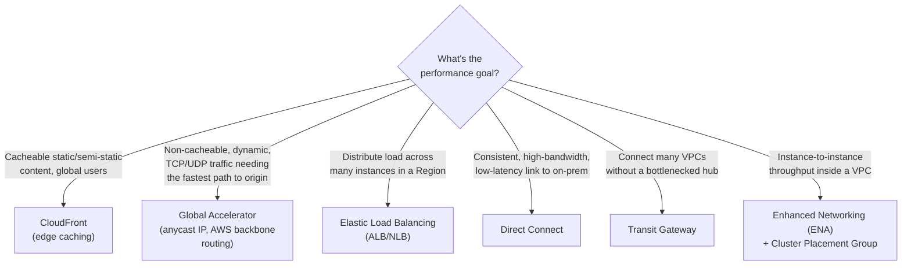

# Network Performance Architecture Patterns

## Definition

A decision layer on top of `vpc.md`, `elastic-load-balancing.md`, `cloudfront.md`,
`global-accelerator.md`, `direct-connect.md`, and `transit-gateway-and-peering.md` — it answers
"what actually makes network *performance* better," as opposed to network security or cost.

## Purpose

Network performance questions on the exam separate into a few repeating levers: get content
physically closer to users, reduce hops/overhead inside the AWS network, and avoid bottlenecking
a single path. Knowing which lever applies to which scenario is the actual tested skill.

## How It Works

Step by step: for **content that can be cached** (images, video, static site assets, even
dynamic content with proper cache headers), **CloudFront** terminates connections at edge
locations near the user and serves cached copies, cutting round-trip latency dramatically — the
default answer whenever "global users, fast content delivery" appears. For traffic that **can't
be cached** (dynamic API calls, gaming/UDP traffic, non-HTTP TCP) but still needs the fastest
possible path to an origin, **Global Accelerator** gives you static anycast IPs and routes
traffic onto the AWS global backbone network as early as possible (at the nearest edge location)
instead of the public internet the whole way — different mechanism, same "get onto AWS's fast
network sooner" goal as CloudFront, but for non-cacheable traffic. Inside a Region, **Elastic
Load Balancing** spreads traffic across instances/targets (and across AZs) so no single target
becomes a bottleneck — ALB for HTTP-layer routing, NLB for extreme-throughput/ultra-low-latency
TCP/UDP. For a steady, high-volume, performance-sensitive connection to an on-premises data
center, **Direct Connect** provides a dedicated private link with predictable latency and
bandwidth, versus a VPN's internet-dependent, variable performance. When many VPCs must talk to
each other, a full mesh of VPC peering connections becomes its own bottleneck/complexity problem
at scale — **Transit Gateway** acts as a central hub so traffic takes one hop through a
purpose-built router instead of many point-to-point peering paths. Within a single VPC, raw
instance-to-instance throughput is improved with **Enhanced Networking (ENA)** drivers and, for
workloads sensitive to inter-instance latency specifically, a **cluster placement group** that
physically co-locates instances.

## Key Decision Points

- **CloudFront = cacheable content; Global Accelerator = non-cacheable/non-HTTP traffic that
  still needs the fastest path.** A common exam trap offers both as answer choices for a
  scenario that's clearly one or the other.
- **ALB vs. NLB for performance** — NLB handles millions of requests per second with
  microsecond latency (Layer 4); ALB adds Layer 7 features (path routing, host routing) at a
  modest latency cost. Choose based on whether Layer 7 routing is actually needed.
- **Direct Connect vs. VPN for performance** — Direct Connect is the answer whenever the
  scenario states a consistent bandwidth/latency requirement; VPN's performance rides on the
  public internet and is inherently variable.
- **Transit Gateway vs. full-mesh VPC peering** — peering is fine for a handful of VPCs;
  Transit Gateway is the performance/scale answer once the mesh would otherwise require many
  direct connections (and avoids peering's non-transitive routing limitation).

## Why It's Important

**Exam mapping:** SAA-C03 Domain 3, Task 3.4 ("determine high-performing and/or scalable network
architectures") is exactly this set of "which network service gets me the fastest/most scalable
path" decisions.

## Related Terms

- [`../../../services/networking-content-delivery/cloudfront.md`](../../../services/networking-content-delivery/cloudfront.md)
- [`../../../services/networking-content-delivery/global-accelerator.md`](../../../services/networking-content-delivery/global-accelerator.md)
- [`../../../services/networking-content-delivery/elastic-load-balancing.md`](../../../services/networking-content-delivery/elastic-load-balancing.md)
- [`../../../services/networking-content-delivery/direct-connect.md`](../../../services/networking-content-delivery/direct-connect.md)
- [`../../../services/networking-content-delivery/transit-gateway-and-peering.md`](../../../services/networking-content-delivery/transit-gateway-and-peering.md)
- [`../../../services/networking-content-delivery/vpc.md`](../../../services/networking-content-delivery/vpc.md)
