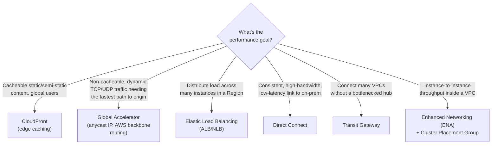
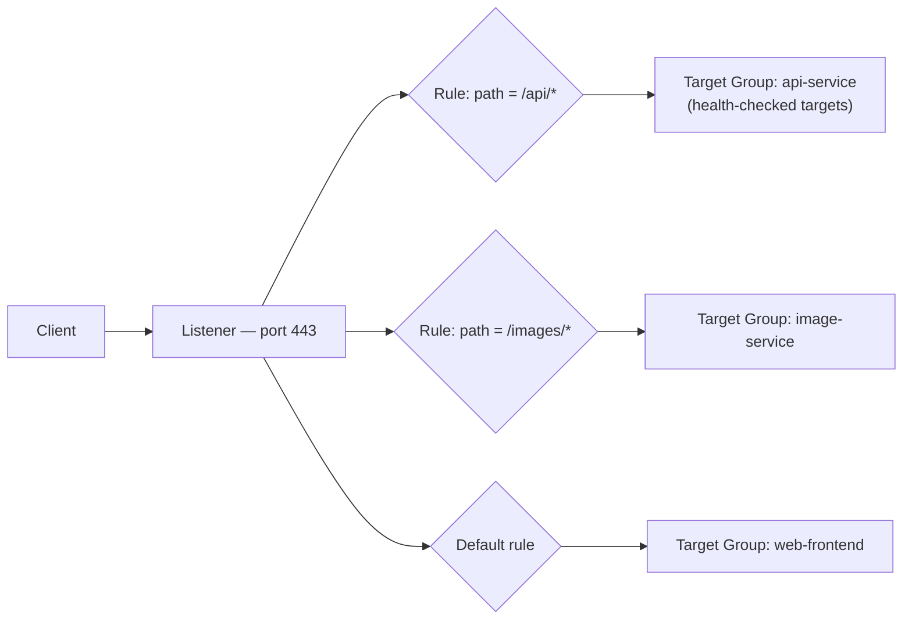
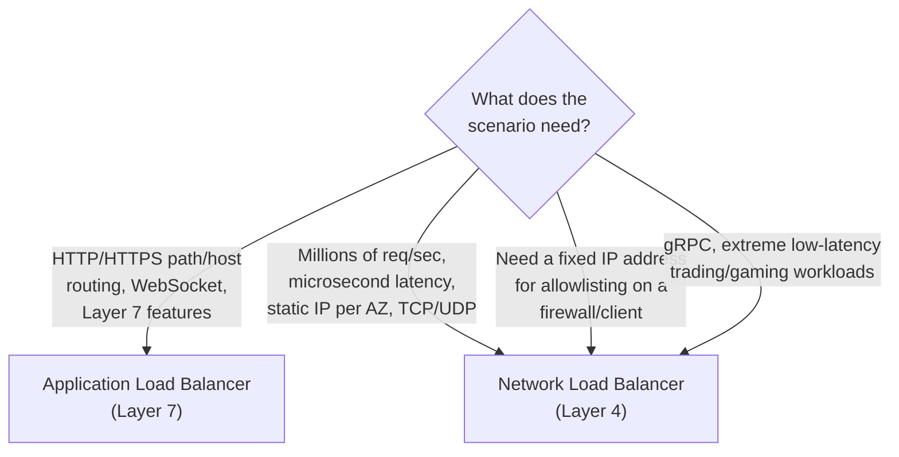

# Network Performance Architecture Patterns

*Source: [Elastic Load Balancing — What is an Application Load Balancer?](https://docs.aws.amazon.com/elasticloadbalancing/latest/application/introduction.html)*

## Definition

A decision layer on top of `vpc.md`, `elastic-load-balancing.md`, `cloudfront.md`,
`global-accelerator.md`, `direct-connect.md`, and `transit-gateway-and-peering.md` — it answers
"what actually makes network *performance* better," as opposed to network security or cost.

## Purpose

Network performance questions on the exam separate into a few repeating levers: get content
physically closer to users, reduce hops/overhead inside the AWS network, and avoid bottlenecking
a single path. Knowing which lever applies to which scenario is the actual tested skill.

## How It Works

Step by step: for **content that can be cached** (images, video, static site assets, even
dynamic content with proper cache headers), **CloudFront** terminates connections at edge
locations near the user and serves cached copies, cutting round-trip latency dramatically — the
default answer whenever "global users, fast content delivery" appears. For traffic that **can't
be cached** (dynamic API calls, gaming/UDP traffic, non-HTTP TCP) but still needs the fastest
possible path to an origin, **Global Accelerator** gives you static anycast IPs and routes
traffic onto the AWS global backbone network as early as possible (at the nearest edge location)
instead of the public internet the whole way — different mechanism, same "get onto AWS's fast
network sooner" goal as CloudFront, but for non-cacheable traffic, and documented to improve
performance for TCP/UDP applications by up to 60% versus the public internet path. Inside a
Region, **Elastic Load Balancing** spreads traffic across instances/targets (and across AZs) so
no single target becomes a bottleneck — ALB for HTTP-layer routing, NLB for extreme-throughput/
ultra-low-latency TCP/UDP. For a steady, high-volume, performance-sensitive connection to an
on-premises data center, **Direct Connect** provides a dedicated private link with predictable
latency and bandwidth, versus a VPN's internet-dependent, variable performance. When many VPCs
must talk to each other, a full mesh of VPC peering connections becomes its own bottleneck/
complexity problem at scale — **Transit Gateway** acts as a central hub so traffic takes one hop
through a purpose-built router instead of many point-to-point peering paths. Within a single VPC,
raw instance-to-instance throughput is improved with **Enhanced Networking (ENA)** drivers and,
for workloads sensitive to inter-instance latency specifically, a **cluster placement group**
that physically co-locates instances.

## Architecture: ALB Request Routing in Detail

*Source: [Elastic Load Balancing — What is an Application Load Balancer?](https://docs.aws.amazon.com/elasticloadbalancing/latest/application/introduction.html)*

Content-based routing at the ALB (path-based, host-based, or header-based rules) is itself a
performance pattern: it lets you split traffic across independently-scaled target groups so a
spike in one path (e.g., `/api/*`) triggers Auto Scaling only for the target group actually under
load, rather than over-provisioning a single monolithic target group sized for the sum of every
path's peak.

## Architecture: ALB vs. NLB — Choosing the Right Load Balancer Layer

The exam-tested distinguishing clue is almost always one of: **"path-based routing"** (ALB),
**"millions of requests per second"** or **"static IP"** (NLB). A scenario combining both needs
(e.g., path routing *and* a fixed IP) typically points toward an ALB behind a Global Accelerator,
since Global Accelerator — not the ALB itself — is what provides the static anycast IP in that
combination.

## Key Decision Points

- **CloudFront = cacheable content; Global Accelerator = non-cacheable/non-HTTP traffic that
  still needs the fastest path.** A common exam trap offers both as answer choices for a
  scenario that's clearly one or the other.
- **ALB vs. NLB for performance** — NLB handles millions of requests per second with
  microsecond latency (Layer 4); ALB adds Layer 7 features (path routing, host routing) at a
  modest latency cost. Choose based on whether Layer 7 routing is actually needed.
- **Direct Connect vs. VPN for performance** — Direct Connect is the answer whenever the
  scenario states a consistent bandwidth/latency requirement; VPN's performance rides on the
  public internet and is inherently variable.
- **Transit Gateway vs. full-mesh VPC peering** — peering is fine for a handful of VPCs;
  Transit Gateway is the performance/scale answer once the mesh would otherwise require many
  direct connections (and avoids peering's non-transitive routing limitation).
- **Content-based ALB routing is a scalability lever, not just an organizational one** — splitting
  traffic into independently-scaled target groups prevents one hot path from forcing the whole
  fleet to scale.
- **Global Accelerator also improves failover speed**, not just latency — because it doesn't rely
  on DNS TTL expiration to redirect traffic (unlike Route 53-only failover), it can shift traffic
  to a healthy endpoint faster than waiting for a DNS record to expire and be re-resolved.
- **VPC endpoints remove a network hop for AWS-service traffic**, which is also a latency win, not
  just a cost one — traffic to S3/DynamoDB/KMS never leaves the AWS network via an Interface or
  Gateway endpoint, shaving the round-trip a NAT Gateway + Internet Gateway path would otherwise
  add.

## Common Mistakes

- Choosing Global Accelerator for content that's actually cacheable — CloudFront is both cheaper
  and better suited for that traffic shape.
- Choosing ALB when the scenario explicitly needs a static IP address for a downstream firewall
  allowlist — ALB IP addresses are not static; NLB (or Global Accelerator in front of an ALB)
  provides that.
- Defaulting to VPC peering for a large and growing number of interconnected VPCs instead of
  recognizing the point where Transit Gateway's central-hub model becomes the more scalable and
  performant choice.
- Assuming Direct Connect alone provides redundancy — a single Direct Connect circuit is a single
  point of failure; a resilient design pairs it with either a second Direct Connect circuit (via
  a different location/provider) or a VPN as backup.

## Full Worked Mini-Case: A Global Trading Platform's Network Design

**Scenario:** a trading platform needs (a) the lowest possible latency between its matching-engine
EC2 instances within one Region, (b) a fast, reliable, low-latency path for institutional clients
connecting from fixed on-premises data centers, and (c) the fastest possible path for retail
mobile app users connecting over the public internet globally, for traffic that is per-user and
cannot be cached.

**Design mapped to this framework:** (a) matching-engine instances sit in a **cluster placement
group** within one AZ, using **Enhanced Networking (ENA)**, minimizing inter-instance latency for
the tightly-coupled matching logic. (b) institutional clients connect via **Direct Connect**,
giving them a dedicated, predictable-latency, high-bandwidth private link rather than riding the
public internet or even a VPN. (c) retail mobile traffic — dynamic, per-user, non-cacheable — is
routed through **Global Accelerator**, which gets it onto the AWS backbone at the nearest edge
location rather than crossing the uncontrolled public internet the whole way to the Region.
CloudFront is deliberately *not* used for (c) because the data is non-cacheable; using it anyway
would add an edge hop with no caching benefit.

## Why It's Important

**Exam mapping:** SAA-C03 Domain 3, Task 3.4 ("determine high-performing and/or scalable network
architectures") is exactly this set of "which network service gets me the fastest/most scalable
path" decisions.

## Exam Tips

- "Cacheable" is the single word that should flip your answer between CloudFront and Global
  Accelerator — read the scenario for it explicitly.
- "Millions of requests per second" or "static IP" flips ALB to NLB.
- A scenario naming a specific percentage/bandwidth/latency SLA for hybrid connectivity is
  pointing at Direct Connect, not VPN.
- "Many VPCs, growing, hard to manage peering connections" is the Transit Gateway tell.

## Related Terms

- [`../../../services/networking-content-delivery/cloudfront.md`](../../../services/networking-content-delivery/cloudfront.md)
- [`../../../services/networking-content-delivery/global-accelerator.md`](../../../services/networking-content-delivery/global-accelerator.md)
- [`../../../services/networking-content-delivery/elastic-load-balancing.md`](../../../services/networking-content-delivery/elastic-load-balancing.md)
- [`../../../services/networking-content-delivery/direct-connect.md`](../../../services/networking-content-delivery/direct-connect.md)
- [`../../../services/networking-content-delivery/transit-gateway-and-peering.md`](../../../services/networking-content-delivery/transit-gateway-and-peering.md)
- [`../../../services/networking-content-delivery/vpc.md`](../../../services/networking-content-delivery/vpc.md)
- [`compute-performance-decision-framework.md`](compute-performance-decision-framework.md) —
  the cluster placement group / ENA reasoning referenced above in full
- [`../domain-1-secure-architectures/vpc-security-architecture-patterns.md`](../domain-1-secure-architectures/vpc-security-architecture-patterns.md) —
  the same subnet/VPC-endpoint layout, viewed from a security angle
- [`../domain-4-cost-optimized-architectures/network-cost-optimization-decision-framework.md`](../domain-4-cost-optimized-architectures/network-cost-optimization-decision-framework.md) —
  the same Direct Connect/Transit Gateway/VPC endpoint choices, revisited for cost
