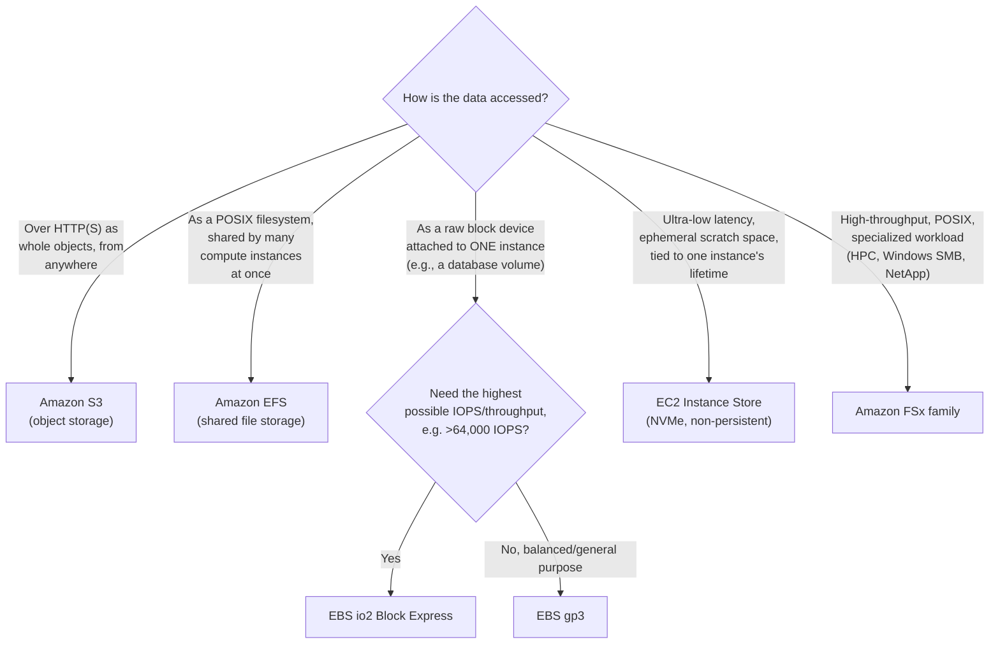
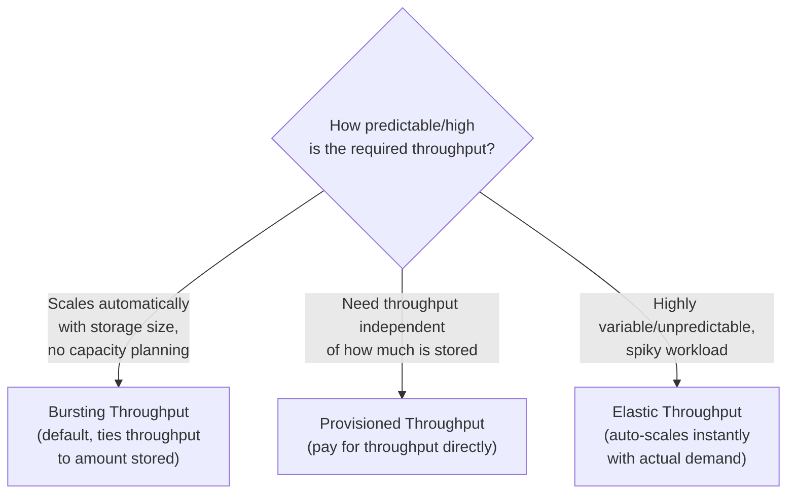
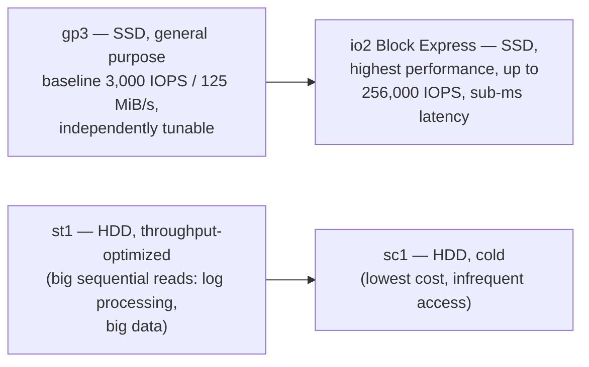

# Storage Performance Decision Framework

*Source: [Amazon EC2 User Guide — Storage options for your Amazon EC2 instances](https://docs.aws.amazon.com/AWSEC2/latest/UserGuide/Storage.html)*

## Definition

A decision framework for picking between S3 (object), EFS (file), and EBS/Instance Store (block)
when the driving question is **performance**, not cost — on top of the individual docs
`s3.md`, `efs.md`, `ebs.md`, `fsx.md`.

## Purpose

The three storage shapes solve genuinely different access patterns, and performance
characteristics follow directly from the shape — the exam tests whether you can map a workload's
description ("many servers need the same files," "a database needs low-latency block storage,"
"serve files globally over HTTP") to the right storage type, not whether you've memorized every
spec sheet number.

## How It Works — The Decision Tree

Step by step: if many clients need to fetch and store **whole files over the network from
anywhere** (images, backups, static website assets, data lake files), that's **S3** — essentially
unlimited scale, but it's not a filesystem; you can't `mount` it and run arbitrary file I/O
against it. If the requirement is specifically **"many EC2 instances need to read/write the same
files concurrently, like a shared drive"** (e.g., a content management system's upload directory
shared across a fleet, or a Lambda function needing shared scratch space), that's **EFS** — a
real POSIX-compliant network filesystem, elastic, with no pre-provisioned size. If a single
instance needs a **persistent block device** (the disk a database or boot volume lives on), that
is **EBS** — and within EBS, **gp3** is the default/general-purpose sweet spot with separately
tunable IOPS and throughput, while **io2 Block Express** targets the extreme top end (sub-
millisecond latency, very high IOPS) for the most demanding databases. If the requirement is
**throwaway, ultra-low-latency scratch space** that doesn't need to survive an instance stop
(cache files, temp processing), **EC2 Instance Store** is the fastest option because it's
physically attached NVMe with no network hop at all — but it is **not persistent**. Specialized
cases (Windows file shares needing native SMB, high-performance computing needing a Lustre
filesystem, NetApp ONTAP features) point to the **FSx family** instead of generic EFS.

## Architecture: EFS Throughput Modes, Matched to Workload

A commonly tested EFS gotcha: **Bursting Throughput mode ties available throughput to how much
data is stored** — a small file system with a small amount of data can be throughput-starved even
under light load, which is why a workload needing high throughput on a *small* data set should use
Provisioned or Elastic throughput mode instead of assuming "EFS is elastic" covers every
dimension automatically.

## Architecture: EBS Volume Types at a Glance

The exam-relevant split: **SSD-backed volumes (gp3, io1/io2)** are priced and designed around
**IOPS** for latency-sensitive transactional workloads (databases, boot volumes); **HDD-backed
volumes (st1, sc1)** are priced and designed around **throughput (MB/s)** for large sequential
workloads (big data processing, log analysis) and are *not* a fit for small, random-access I/O —
a scenario describing a database on st1/sc1 storage is describing a mismatch.

## Key Decision Points

- **S3 is not a mountable filesystem** — if a question says "mount," "POSIX," or "multiple
  EC2 instances need the same file," S3 is the wrong answer even though it's "storage."
- **EFS scales elastically with no pre-provisioning**; **EBS must be sized and provisioned**
  up front (though it can be resized later) and is attached to exactly one instance at a time
  (Multi-Attach io1/io2 is the narrow exception, for specific clustered applications).
- **Instance Store is the fastest but least durable** — data is lost on stop/terminate (not
  reboot), which the exam uses as a trap for "I need maximum performance" questions that also
  imply durability is required.
- **EBS volume type tuning** (gp3 vs io2) is itself a performance decision — gp3 lets you
  provision IOPS and throughput independently of volume size, which is cheaper than scaling size
  just to get more performance.
- **S3 performance at scale** — S3 now auto-scales request rate with no required key-naming
  tricks for most workloads, but Transfer Acceleration and multipart upload are still the
  performance levers for large objects/high-latency clients.
- **EFS throughput mode selection matters independently of storage size** — Bursting mode ties
  throughput to stored data volume; Provisioned and Elastic modes decouple throughput from size,
  which matters for small-dataset, high-throughput workloads.
- **HDD-backed EBS (st1/sc1) is wrong for random I/O or small files** — it is purpose-built for
  large sequential throughput; a scenario describing small random reads/writes on st1/sc1 is
  describing a mismatch to fix by switching to SSD-backed gp3/io2.
- **S3 Transfer Acceleration** uses CloudFront's edge network to speed up uploads over long
  distances — the specific exam-tested answer for "users far from the bucket's Region are
  uploading large files slowly."

## Common Mistakes

- Trying to "mount" S3 as a shared drive for multiple EC2 instances — the correct service for
  that access pattern is EFS.
- Using Instance Store for data that must survive an instance stop or replacement — Instance
  Store data does not persist across stop/terminate.
- Provisioning a larger EBS volume purely to get more IOPS/throughput when gp3's independently
  tunable IOPS/throughput settings would achieve the same result without over-provisioning
  capacity.
- Placing a transactional database's data files on st1/sc1 (HDD-backed, throughput-optimized)
  volumes — the random, latency-sensitive access pattern needs SSD-backed storage.
- Assuming EFS throughput scales purely with the compute fleet size — it's governed by the
  file system's throughput mode and (in Bursting mode) stored data volume, not by how many
  instances are mounting it.

## Full Worked Mini-Case: Choosing Storage for a Media Transcoding Pipeline

**Scenario:** a video transcoding pipeline has three distinct storage needs: (1) the original
uploaded video files, which need to be durably stored and later served globally over HTTPS; (2)
a shared working directory where a fleet of 20 transcoding worker instances simultaneously read
and write intermediate frame files during processing; (3) each worker's own local scratch space
for temporary decode buffers that never need to survive the worker's lifetime.

**Mapped to this framework:** (1) is a clear **S3** fit — durable, served over HTTP, globally
accessible, no POSIX requirement. (2) is a clear **EFS** fit — many compute instances need
concurrent read/write access to the *same* files, which is exactly the shared-filesystem access
pattern EBS cannot provide (EBS attaches to one instance at a time in the general case). (3) is a
clear **EC2 Instance Store** fit — ultra-low latency, genuinely disposable data, no durability
requirement, and avoiding Instance Store here (e.g., using EBS instead) would add unnecessary
network-attached latency to a workload that explicitly doesn't need persistence.

## Why It's Important

**Exam mapping:** SAA-C03 Domain 3, Task 3.1 ("determine high-performing and/or scalable storage
solutions") is precisely this object/file/block tradeoff — a very frequently tested pattern-
matching skill, often phrased as "which storage service fits this access pattern."

## Exam Tips

- Scan for the words "mount," "shared," "POSIX," and "multiple instances" — these point to EFS,
  not S3 or EBS.
- "Highest IOPS," "sub-millisecond latency," and "demanding transactional database" point to
  io2 Block Express; "balanced, general-purpose, independently tunable" points to gp3.
- "Temporary," "scratch," "cache," and "doesn't need to survive a restart" point to Instance
  Store; any durability requirement rules it out immediately.
- "Large sequential reads," "log processing," "big data throughput" point to st1 (or sc1 for the
  coldest, least-accessed end of that same pattern).

## Related Terms

- [`../../../services/storage/s3.md`](../../../services/storage/s3.md),
  [`../../../services/storage/s3-storage-classes.md`](../../../services/storage/s3-storage-classes.md)
- [`../../../services/storage/efs.md`](../../../services/storage/efs.md)
- [`../../../services/storage/ebs.md`](../../../services/storage/ebs.md)
- [`../../../services/storage/fsx.md`](../../../services/storage/fsx.md)
- [`../../../services/compute/ec2.md`](../../../services/compute/ec2.md) — instance store detail
- [`compute-performance-decision-framework.md`](compute-performance-decision-framework.md) —
  pairing the right EBS volume type with the right instance family
- [`../domain-4-cost-optimized-architectures/storage-cost-optimization-decision-framework.md`](../domain-4-cost-optimized-architectures/storage-cost-optimization-decision-framework.md) —
  the same storage-shape choice, revisited once cost (not just performance) is the driver
