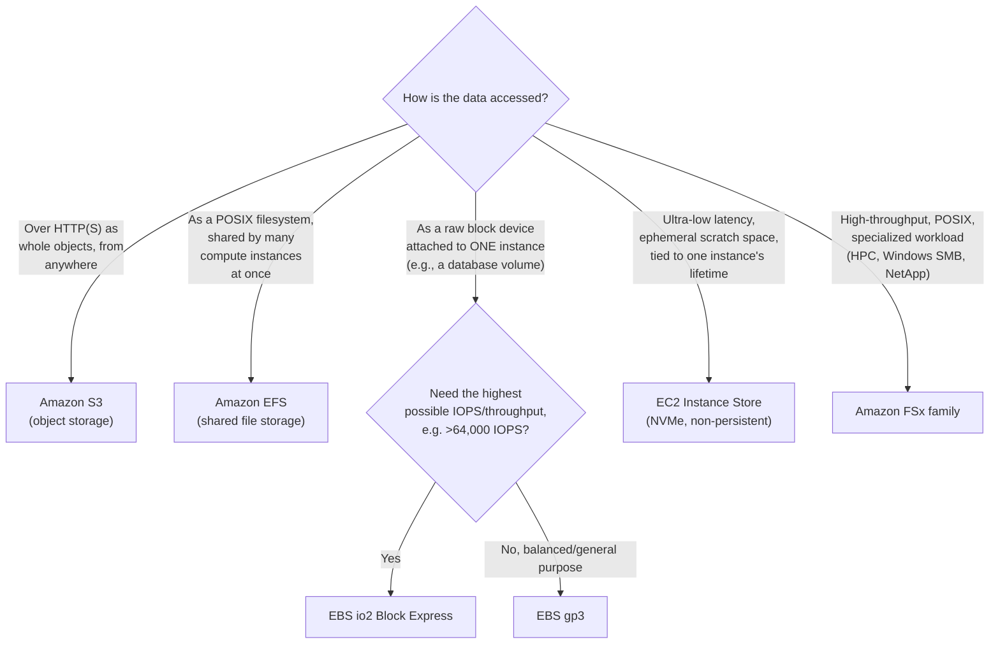

# Storage Performance Decision Framework

## Definition

A decision framework for picking between S3 (object), EFS (file), and EBS/Instance Store (block)
when the driving question is **performance**, not cost — on top of the individual docs
`s3.md`, `efs.md`, `ebs.md`, `fsx.md`.

## Purpose

The three storage shapes solve genuinely different access patterns, and performance
characteristics follow directly from the shape — the exam tests whether you can map a workload's
description ("many servers need the same files," "a database needs low-latency block storage,"
"serve files globally over HTTP") to the right storage type, not whether you've memorized every
spec sheet number.

## How It Works — The Decision Tree

Step by step: if many clients need to fetch and store **whole files over the network from
anywhere** (images, backups, static website assets, data lake files), that's **S3** — essentially
unlimited scale, but it's not a filesystem; you can't `mount` it and run arbitrary file I/O
against it. If the requirement is specifically **"many EC2 instances need to read/write the same
files concurrently, like a shared drive"** (e.g., a content management system's upload directory
shared across a fleet, or a Lambda function needing shared scratch space), that's **EFS** — a
real POSIX-compliant network filesystem, elastic, with no pre-provisioned size. If a single
instance needs a **persistent block device** (the disk a database or boot volume lives on), that
is **EBS** — and within EBS, **gp3** is the default/general-purpose sweet spot with separately
tunable IOPS and throughput, while **io2 Block Express** targets the extreme top end (sub-
millisecond latency, very high IOPS) for the most demanding databases. If the requirement is
**throwaway, ultra-low-latency scratch space** that doesn't need to survive an instance stop
(cache files, temp processing), **EC2 Instance Store** is the fastest option because it's
physically attached NVMe with no network hop at all — but it is **not persistent**. Specialized
cases (Windows file shares needing native SMB, high-performance computing needing a Lustre
filesystem, NetApp ONTAP features) point to the **FSx family** instead of generic EFS.

## Key Decision Points

- **S3 is not a mountable filesystem** — if a question says "mount," "POSIX," or "multiple
  EC2 instances need the same file," S3 is the wrong answer even though it's "storage."
- **EFS scales elastically with no pre-provisioning**; **EBS must be sized and provisioned**
  up front (though it can be resized later) and is attached to exactly one instance at a time
  (Multi-Attach io1/io2 is the narrow exception, for specific clustered applications).
- **Instance Store is the fastest but least durable** — data is lost on stop/terminate (not
  reboot), which the exam uses as a trap for "I need maximum performance" questions that also
  imply durability is required.
- **EBS volume type tuning** (gp3 vs io2) is itself a performance decision — gp3 lets you
  provision IOPS and throughput independently of volume size, which is cheaper than scaling size
  just to get more performance.
- **S3 performance at scale** — S3 now auto-scales request rate with no required key-naming
  tricks for most workloads, but Transfer Acceleration and multipart upload are still the
  performance levers for large objects/high-latency clients.

## Why It's Important

**Exam mapping:** SAA-C03 Domain 3, Task 3.1 ("determine high-performing and/or scalable storage
solutions") is precisely this object/file/block tradeoff — a very frequently tested pattern-
matching skill, often phrased as "which storage service fits this access pattern."

## Related Terms

- [`../../../services/storage/s3.md`](../../../services/storage/s3.md),
  [`../../../services/storage/s3-storage-classes.md`](../../../services/storage/s3-storage-classes.md)
- [`../../../services/storage/efs.md`](../../../services/storage/efs.md)
- [`../../../services/storage/ebs.md`](../../../services/storage/ebs.md)
- [`../../../services/storage/fsx.md`](../../../services/storage/fsx.md)
- [`../../../services/compute/ec2.md`](../../../services/compute/ec2.md) — instance store detail
