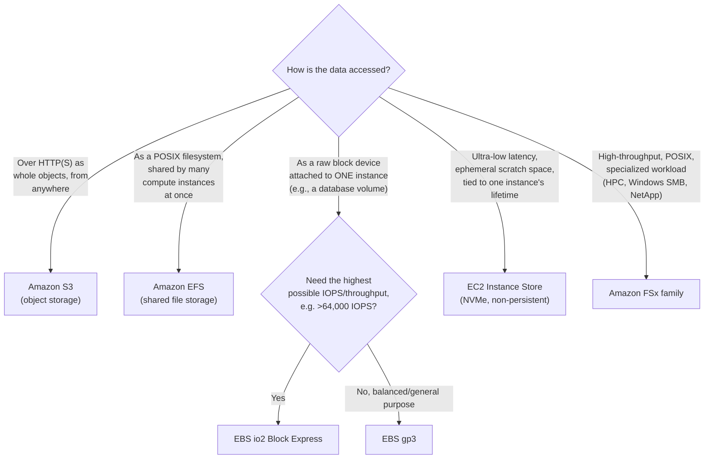
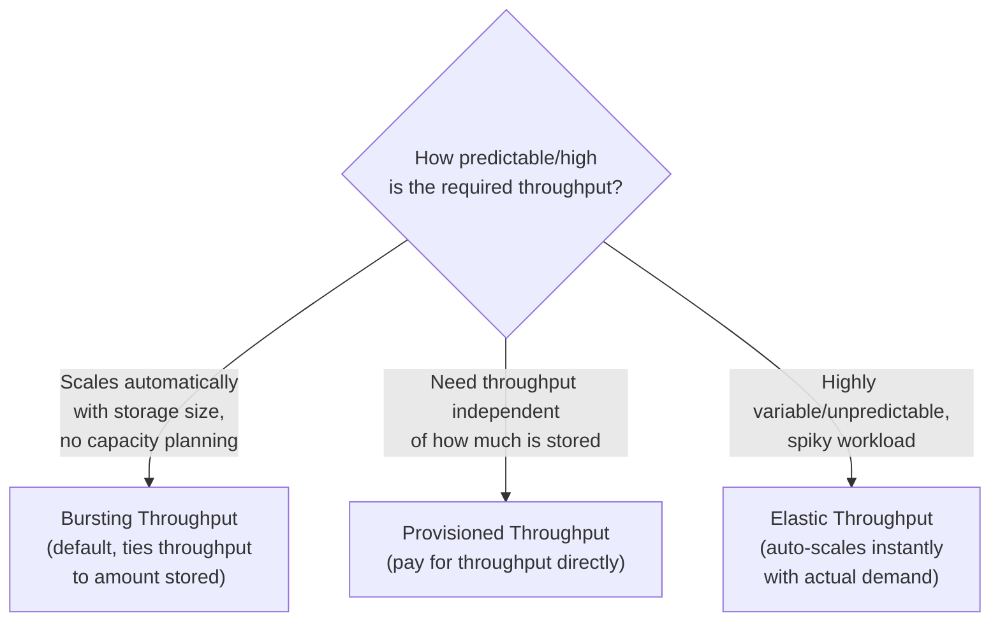
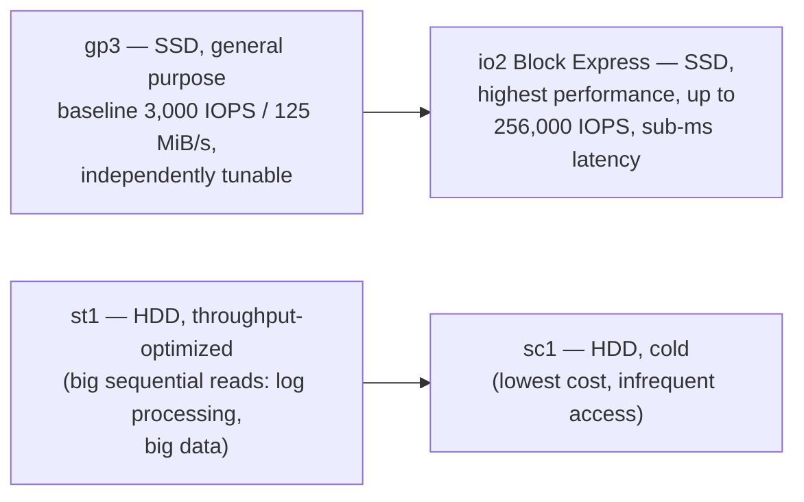
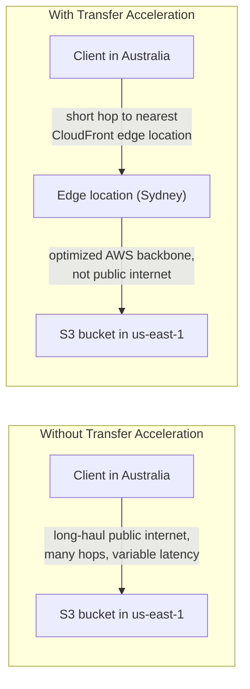
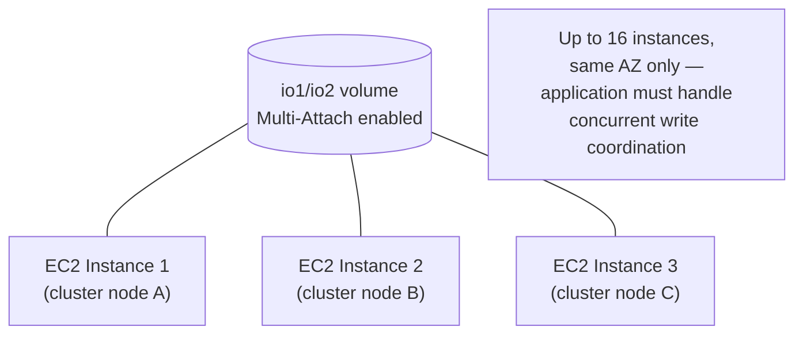

# Storage Performance Decision Framework

*Source: [Amazon EC2 User Guide — Storage options for your Amazon EC2 instances](https://docs.aws.amazon.com/AWSEC2/latest/UserGuide/Storage.html)*

## Definition

A decision framework for picking between S3 (object), EFS (file), and EBS/Instance Store (block)
when the driving question is **performance**, not cost — on top of the individual docs
`s3.md`, `efs.md`, `ebs.md`, `fsx.md`.

## Purpose

The three storage shapes solve genuinely different access patterns, and performance
characteristics follow directly from the shape — the exam tests whether you can map a workload's
description ("many servers need the same files," "a database needs low-latency block storage,"
"serve files globally over HTTP") to the right storage type, not whether you've memorized every
spec sheet number.

## How It Works — The Decision Tree

Step by step: if many clients need to fetch and store **whole files over the network from
anywhere** (images, backups, static website assets, data lake files), that's **S3** — essentially
unlimited scale, but it's not a filesystem; you can't `mount` it and run arbitrary file I/O
against it. If the requirement is specifically **"many EC2 instances need to read/write the same
files concurrently, like a shared drive"** (e.g., a content management system's upload directory
shared across a fleet, or a Lambda function needing shared scratch space), that's **EFS** — a
real POSIX-compliant network filesystem, elastic, with no pre-provisioned size. If a single
instance needs a **persistent block device** (the disk a database or boot volume lives on), that
is **EBS** — and within EBS, **gp3** is the default/general-purpose sweet spot with separately
tunable IOPS and throughput, while **io2 Block Express** targets the extreme top end (sub-
millisecond latency, very high IOPS) for the most demanding databases. If the requirement is
**throwaway, ultra-low-latency scratch space** that doesn't need to survive an instance stop
(cache files, temp processing), **EC2 Instance Store** is the fastest option because it's
physically attached NVMe with no network hop at all — but it is **not persistent**. Specialized
cases (Windows file shares needing native SMB, high-performance computing needing a Lustre
filesystem, NetApp ONTAP features) point to the **FSx family** instead of generic EFS.

## Architecture: EFS Throughput Modes, Matched to Workload

A commonly tested EFS gotcha: **Bursting Throughput mode ties available throughput to how much
data is stored** — a small file system with a small amount of data can be throughput-starved even
under light load, which is why a workload needing high throughput on a *small* data set should use
Provisioned or Elastic throughput mode instead of assuming "EFS is elastic" covers every
dimension automatically.

## Architecture: EBS Volume Types at a Glance

The exam-relevant split: **SSD-backed volumes (gp3, io1/io2)** are priced and designed around
**IOPS** for latency-sensitive transactional workloads (databases, boot volumes); **HDD-backed
volumes (st1, sc1)** are priced and designed around **throughput (MB/s)** for large sequential
workloads (big data processing, log analysis) and are *not* a fit for small, random-access I/O —
a scenario describing a database on st1/sc1 storage is describing a mismatch.

## Key Decision Points

- **S3 is not a mountable filesystem** — if a question says "mount," "POSIX," or "multiple
  EC2 instances need the same file," S3 is the wrong answer even though it's "storage."
- **EFS scales elastically with no pre-provisioning**; **EBS must be sized and provisioned**
  up front (though it can be resized later) and is attached to exactly one instance at a time
  (Multi-Attach io1/io2 is the narrow exception, for specific clustered applications).
- **Instance Store is the fastest but least durable** — data is lost on stop/terminate (not
  reboot), which the exam uses as a trap for "I need maximum performance" questions that also
  imply durability is required.
- **EBS volume type tuning** (gp3 vs io2) is itself a performance decision — gp3 lets you
  provision IOPS and throughput independently of volume size, which is cheaper than scaling size
  just to get more performance.
- **S3 performance at scale** — S3 now auto-scales request rate with no required key-naming
  tricks for most workloads, but Transfer Acceleration and multipart upload are still the
  performance levers for large objects/high-latency clients.
- **EFS throughput mode selection matters independently of storage size** — Bursting mode ties
  throughput to stored data volume; Provisioned and Elastic modes decouple throughput from size,
  which matters for small-dataset, high-throughput workloads.
- **HDD-backed EBS (st1/sc1) is wrong for random I/O or small files** — it is purpose-built for
  large sequential throughput; a scenario describing small random reads/writes on st1/sc1 is
  describing a mismatch to fix by switching to SSD-backed gp3/io2.
- **S3 Transfer Acceleration** uses CloudFront's edge network to speed up uploads over long
  distances — the specific exam-tested answer for "users far from the bucket's Region are
  uploading large files slowly."

## Use Cases — Real Scenarios

- **Architecture firm's CAD file collaboration platform.** Dozens of engineers across multiple
  offices need concurrent read/write access to the same large CAD project files — EFS is the only
  fit among S3/EFS/EBS for this genuinely shared-filesystem access pattern.
- **Trading platform's order-book database demanding the highest available IOPS.** The database
  backing live order matching runs on EBS io2 Block Express specifically because the exchange's
  stated latency requirement (sub-millisecond) and IOPS requirement exceed what gp3 is designed
  for.
- **Video-transcoding farm using local NVMe for in-flight decode buffers.** Each transcoding worker
  uses EC2 Instance Store for its temporary frame buffers, since that data is fully disposable and
  the ultra-low local latency measurably speeds up each transcode job.
- **Global retailer serving millions of product images over HTTPS.** Product images live in S3,
  not EFS or EBS, precisely because the access pattern is "fetch whole objects over HTTP from
  anywhere," not "mount as a filesystem" — S3's near-unlimited scale handles the catalog size
  without any capacity planning.
- **Windows-based enterprise application needing native SMB file shares.** Rather than forcing a
  Linux-native EFS filesystem to serve Windows clients awkwardly, the team uses FSx for Windows File
  Server, which speaks native SMB and integrates with Active Directory permissions directly.
- **HPC genomics pipeline needing a high-throughput, POSIX-compliant shared filesystem.** The
  pipeline's I/O pattern (thousands of parallel compute nodes reading/writing the same dataset at
  very high aggregate throughput) points to FSx for Lustre rather than standard EFS, which isn't
  built for that throughput profile.
- **Startup's small but suddenly very active EFS-backed build-artifact cache.** Default Bursting
  Throughput mode throttled builds because the stored data volume was small even though demand was
  high — switching to Elastic Throughput mode decoupled throughput from stored size and fixed the
  bottleneck immediately.
- **Big-data company's log-processing pipeline reading large sequential files.** The pipeline's EBS
  volumes use st1 (throughput-optimized HDD) rather than gp3/io2, because the access pattern is
  large sequential reads, not small random I/O — exactly what st1 is priced and designed for.
- **Design agency accelerating large file uploads from clients around the world.** Clients
  uploading multi-gigabyte video files to an S3 bucket in us-east-1 from Australia see dramatically
  faster uploads once S3 Transfer Acceleration (routing through CloudFront's edge network) is
  enabled for that bucket.

## Common Mistakes

- Trying to "mount" S3 as a shared drive for multiple EC2 instances — the correct service for
  that access pattern is EFS.
- Using Instance Store for data that must survive an instance stop or replacement — Instance
  Store data does not persist across stop/terminate.
- Provisioning a larger EBS volume purely to get more IOPS/throughput when gp3's independently
  tunable IOPS/throughput settings would achieve the same result without over-provisioning
  capacity.
- Placing a transactional database's data files on st1/sc1 (HDD-backed, throughput-optimized)
  volumes — the random, latency-sensitive access pattern needs SSD-backed storage.
- Assuming EFS throughput scales purely with the compute fleet size — it's governed by the
  file system's throughput mode and (in Bursting mode) stored data volume, not by how many
  instances are mounting it.

## Full Worked Mini-Case: Choosing Storage for a Media Transcoding Pipeline

**Scenario:** a video transcoding pipeline has three distinct storage needs: (1) the original
uploaded video files, which need to be durably stored and later served globally over HTTPS; (2)
a shared working directory where a fleet of 20 transcoding worker instances simultaneously read
and write intermediate frame files during processing; (3) each worker's own local scratch space
for temporary decode buffers that never need to survive the worker's lifetime.

**Mapped to this framework:** (1) is a clear **S3** fit — durable, served over HTTP, globally
accessible, no POSIX requirement. (2) is a clear **EFS** fit — many compute instances need
concurrent read/write access to the *same* files, which is exactly the shared-filesystem access
pattern EBS cannot provide (EBS attaches to one instance at a time in the general case). (3) is a
clear **EC2 Instance Store** fit — ultra-low latency, genuinely disposable data, no durability
requirement, and avoiding Instance Store here (e.g., using EBS instead) would add unnecessary
network-attached latency to a workload that explicitly doesn't need persistence.

## Deeper Dive: More Analogies for the Three Storage Shapes

Three different everyday analogies for the same object/file/block split, because different
framings click for different people:

- **The library analogy.** S3 is a library's public catalog system — you hand the librarian a
  call number (key) and she returns the whole book (object); you cannot check out "just chapter
  3, page 10" the way you can seek into the middle of an open file on a real filesystem. EFS is a
  shared office binder that multiple coworkers can open, flip to any page, and write on
  simultaneously. EBS is a notebook that belongs to exactly one desk — only the person sitting at
  that desk can write in it, though they can hand the whole notebook to someone else's desk later
  (detach/reattach).
- **The apartment-building analogy.** EBS is your own private apartment unit — one tenant, full
  control over the interior, but it's physically tied to one building (Availability Zone) and
  moving it to another building means literally packing it into a truck (a snapshot/restore).
  EFS is a shared community laundry room in the building complex — every tenant (EC2 instance)
  in the complex (Region, via mount targets per AZ) can walk in and use it concurrently. S3 is a
  citywide package locker network (like an Amazon Locker) — you don't "live" in it, you just drop
  off and pick up whole packages (objects) from any locker location (AWS Region) that has one.
- **The restaurant kitchen analogy.** EC2 Instance Store is the chef's own cutting board at their
  station — blisteringly fast to reach for mid-service, but it's wiped clean (and effectively
  disappears) the moment that chef's shift/station is broken down. FSx for Lustre is a specialized
  walk-in freezer built for one specific high-throughput purpose (bulk ingredient prep for a huge
  catering order) — overkill for a small neighborhood diner, essential for a stadium's concession
  operation.

## Architecture: S3 Transfer Acceleration — Why Distance Hurts and How It's Fixed

*Walkthrough:* a direct upload from Australia to a bucket in `us-east-1` rides the public internet
for the entire geographic distance — every router hop along that path adds latency and jitter S3
itself has no control over. Transfer Acceleration instead routes the upload to the *nearest*
CloudFront edge location (a short, fast hop), and from there onto AWS's own optimized global
backbone network for the long-haul portion — the same "get onto AWS's network as early as
possible" principle Global Accelerator uses for non-S3 traffic, applied specifically to S3
uploads/downloads over long distances.

## Architecture: EBS Multi-Attach for Clustered Applications

*Walkthrough:* Multi-Attach is the narrow, explicitly-named exception to "EBS attaches to one
instance at a time" — it exists specifically for clustered applications (certain configurations of
clustered Linux databases, cluster-aware file systems) that already implement their own
write-coordination/locking logic at the application layer. EBS itself does **not** provide any
file-locking or write-ordering guarantee across the attached instances — a scenario describing an
application *without* its own cluster-aware concurrency control is describing a bad fit for
Multi-Attach regardless of how attractive "shared block storage" sounds; that scenario should
point to EFS (a real POSIX filesystem with proper concurrent-access semantics) instead.

## Real AWS Documentation Image: FSx for Lustre at HPC/Genomics Scale

*This architecture shows the specific pattern FSx for Lustre is built for: a large genomics compute
cluster needs to read/write a shared dataset at very high aggregate throughput (far beyond what
standard EFS throughput modes are designed to sustain), with S3 serving as the durable long-term
store that Lustre can lazily load from and write back to. Source: [AWS Storage Blog — Using Amazon
FSx for Lustre for genomics workflows](https://aws.amazon.com/blogs/storage/).* This is the exact
diagram pattern the exam is testing when a scenario says "thousands of parallel compute nodes need
the highest possible shared-filesystem throughput" — the answer is never "a bigger EFS filesystem,"
because EFS's throughput ceiling (even on Elastic mode) is a different performance tier than
Lustre's purpose-built parallel filesystem design.

## Real AWS Documentation Image: EFS Mount Targets Across Availability Zones

*Each Availability Zone gets its own EFS **mount target** (an ENI with its own IP in that AZ's
subnet) — this is why an EFS file system functions as one logical shared filesystem across an
entire Region, not just within a single AZ: every EC2 instance mounts the mount target that's
local to its own AZ, and all mount targets present the identical underlying file system data.
Source: [Amazon EFS User Guide — How Amazon EFS
works](https://docs.aws.amazon.com/efs/latest/ug/how-it-works.html).* A scenario describing an EFS
file system that needs to be reachable from instances in three different AZs is really asking "did
you create a mount target in each of those AZs" — a frequently tested operational detail, since a
missing mount target in one AZ means instances there simply cannot reach the file system at all,
not that they experience degraded performance.

## Additional Worked Exam Scenarios

**Scenario A — "The database that silently got slower after a 'successful' migration."** A team
migrates their self-managed PostgreSQL database's data volume from a larger gp2 volume to a
smaller gp3 volume of the exact same provisioned IOPS, expecting identical performance since IOPS
"are the same." Performance instead degrades under peak load. **Diagnosis:** gp2's IOPS scale with
volume *size* (3 IOPS per GB, with a burst credit bucket), while gp3's IOPS are provisioned
independently of size — but gp2's *burst* behavior could have been masking an actual baseline IOPS
need higher than what was explicitly provisioned on the new gp3 volume. **Fix:** calculate what the
old gp2 volume's actual *sustained* (non-burst) IOPS were, and provision at least that much
explicitly on gp3, rather than assuming "it reported fine before" meant burst credits weren't doing
quiet, invisible work.

**Scenario B — "The ML training job that kept getting slower the longer it ran."** A SageMaker-
adjacent training job reads its dataset repeatedly from an EFS file system in Bursting Throughput
mode; early epochs are fast, but each subsequent epoch gets progressively slower. **Diagnosis:**
Bursting Throughput mode draws down a burst credit balance that replenishes based on stored data
size — a training job hammering the file system continuously, faster than credits replenish, will
eventually exhaust the burst balance and fall back to the (much lower) baseline throughput rate.
**Fix:** switch the file system to Provisioned or Elastic Throughput mode, decoupling available
throughput from the credit-balance mechanic entirely.

**Scenario C — "Database restore took 6 hours and the team wants to know why."** A team restoring
an EBS volume from a snapshot notices the restored volume's performance is poor for the first
several hours of use, even though the snapshot and target volume type/size are identical to the
original. **Diagnosis:** a newly-restored EBS volume from a snapshot uses **lazy loading** — data
blocks are fetched from S3 (where snapshots are stored) on first access, not pre-loaded onto the
new volume, so the first pass over the whole volume is slower until every block has been
touched/initialized at least once. **Fix:** either accept this is expected one-time startup
behavior, or run `fio`/`dd`-style pre-warming reads over the whole volume (or use EBS's
Fast Snapshot Restore feature for snapshots that will be restored repeatedly and need to be fully
performant immediately) before putting it into production traffic.

## Real AWS Documentation Image: EBS Snapshots Are Incremental, Not Full Copies

*Only the blocks that changed since the previous snapshot are actually saved — this is the
mechanism behind both why snapshots are fast/cheap at scale and why a restored volume's first-read
"lazy loading" behavior (Scenario C above) exists: a snapshot is a chain of incremental deltas
referencing the original full copy, not a flat, fully materialized duplicate sitting ready to go.
Source: [Amazon EBS User Guide — Amazon EBS
snapshots](https://docs.aws.amazon.com/ebs/latest/userguide/EBSSnapshots.html).*

## Why It's Important

**Exam mapping:** SAA-C03 Domain 3, Task 3.1 ("determine high-performing and/or scalable storage
solutions") is precisely this object/file/block tradeoff — a very frequently tested pattern-
matching skill, often phrased as "which storage service fits this access pattern."

## Exam Tips

- Scan for the words "mount," "shared," "POSIX," and "multiple instances" — these point to EFS,
  not S3 or EBS.
- "Highest IOPS," "sub-millisecond latency," and "demanding transactional database" point to
  io2 Block Express; "balanced, general-purpose, independently tunable" points to gp3.
- "Temporary," "scratch," "cache," and "doesn't need to survive a restart" point to Instance
  Store; any durability requirement rules it out immediately.
- "Large sequential reads," "log processing," "big data throughput" point to st1 (or sc1 for the
  coldest, least-accessed end of that same pattern).

## Related Terms

- [`../../../services/storage/s3.md`](../../../services/storage/s3.md),
  [`../../../services/storage/s3-storage-classes.md`](../../../services/storage/s3-storage-classes.md)
- [`../../../services/storage/efs.md`](../../../services/storage/efs.md)
- [`../../../services/storage/ebs.md`](../../../services/storage/ebs.md)
- [`../../../services/storage/fsx.md`](../../../services/storage/fsx.md)
- [`../../../services/compute/ec2.md`](../../../services/compute/ec2.md) — instance store detail
- [`compute-performance-decision-framework.md`](compute-performance-decision-framework.md) —
  pairing the right EBS volume type with the right instance family
- [`../domain-4-cost-optimized-architectures/storage-cost-optimization-decision-framework.md`](../domain-4-cost-optimized-architectures/storage-cost-optimization-decision-framework.md) —
  the same storage-shape choice, revisited once cost (not just performance) is the driver
