# Domain 4 Master Chunk — Design Cost-Optimized Architectures (SAA-C03, 20% weight)

> **Appears in:** [SAA-C03](../../README.md) | [Domain 4 README](README.md)
>
> This is a **single, standalone, self-contained reference** covering every service and topic in
> scope for Domain 4. It duplicates material from the individual `services/` docs and the four
> decision-framework docs in this folder *on purpose* — the goal is a file you can open once,
> during a final review pass, and never have to leave. If you want the deeper per-service
> treatment (more console screenshots, more edge cases, more CLI examples), follow the links in
> each section to the full `services/<category>/<name>.md` doc this section was distilled from.

## How to use this file

Each of the 29 sections below follows the same fixed structure, so you can scan for exactly the
piece you need instead of reading linearly:

1. **Definition** — what the service/topic actually is, in one tight paragraph.
2. **Plain-English Analogy** — a non-AWS comparison that makes the mental model stick.
3. **Purpose** — the specific problem AWS built this to solve.
4. **When to Use** — the pattern-match signal that should make this service come to mind.
5. **When NOT to Use** — the pattern-match signal for the wrong tool.
6. **Use Cases** — 4-6 concrete, cost-focused scenarios.
7. **Why Important** — how this maps to the exam and to real bills.
8. **Diagram** — at least one Mermaid diagram with a walkthrough.
9. **Real AWS Image** — a curl-verified screenshot/diagram straight from AWS's own documentation,
   with a discussion of what it shows.
10. **Exam Tips** — 2-3 tips, including worked pricing math wherever the topic has a real pricing
    dimension (which, in this domain, is almost always).

## Table of Contents

1. [AWS Backup](#1-aws-backup)
2. [Cost Management Tools](#2-cost-management-tools)
3. [AWS DataSync](#3-aws-datasync)
4. [AWS Database Migration Service (DMS)](#4-aws-database-migration-service-dms)
5. [AWS Direct Connect](#5-aws-direct-connect)
6. [AWS Fargate](#6-aws-fargate)
7. [AWS Lambda](#7-aws-lambda)
8. [Site-to-Site VPN & Client VPN](#8-site-to-site-vpn--client-vpn)
9. [AWS Snow Family](#9-aws-snow-family)
10. [AWS Transfer Family](#10-aws-transfer-family)
11. [AWS Trusted Advisor](#11-aws-trusted-advisor)
12. [Additional Governance Services](#12-additional-governance-services)
13. [Amazon Aurora](#13-amazon-aurora)
14. [Amazon CloudFront](#14-amazon-cloudfront)
15. [Amazon DynamoDB](#15-amazon-dynamodb)
16. [Amazon EBS](#16-amazon-ebs)
17. [Amazon EC2](#17-amazon-ec2)
18. [EC2 Auto Scaling](#18-ec2-auto-scaling)
19. [Amazon RDS](#19-amazon-rds)
20. [Amazon S3 Glacier](#20-amazon-s3-glacier)
21. [Containers vs. VMs vs. Serverless](#21-containers-vs-vms-vs-serverless)
22. [Data Transfer Pricing](#22-data-transfer-pricing)
23. [Database Selection Guide](#23-database-selection-guide)
24. [Migration Services Overview](#24-migration-services-overview)
25. [Niche Compute Services](#25-niche-compute-services)
26. [Niche Database Services](#26-niche-database-services)
27. [Amazon S3 Storage Classes](#27-amazon-s3-storage-classes)
28. [Transit Gateway & VPC Peering](#28-transit-gateway--vpc-peering)
29. [VPC Endpoints & PrivateLink](#29-vpc-endpoints--privatelink)

---

## 1. AWS Backup

### Definition
AWS Backup is a fully managed, policy-based backup service that centralizes and automates data
protection across many AWS services (EBS, RDS, Aurora, DynamoDB, EFS, FSx, Storage Gateway, EC2,
S3, and more) through one console, one API, and one set of backup plans — instead of configuring
native, service-specific backup/snapshot mechanisms separately for each resource type.

### Plain-English Analogy
Native per-service snapshots are like every department in a company keeping its own filing cabinet
with its own retention rules — HR shreds documents after 3 years, Legal keeps them for 10, nobody
can tell you company-wide what's backed up or for how long. AWS Backup is the single corporate
records-management policy applied to every department's cabinet at once: one retention schedule,
one audit trail, one person who can answer "is everything backed up?" truthfully.

### Purpose
Before AWS Backup, protecting a multi-service application meant configuring EBS snapshot
lifecycles, RDS automated backups, DynamoDB point-in-time recovery, and EFS backup policies
*separately*, each with its own retention rules and its own blind spots. AWS Backup exists to
collapse that into one declarative backup plan — schedule, retention (including lifecycle
transition to cold storage), and resource selection by tag — applied uniformly, with Backup Audit
Manager able to prove compliance against that plan automatically.

### When to Use
- An organization needs one consistent retention/compliance policy across 3+ AWS data services.
- Backup Audit Manager-style compliance reporting ("is everything backed up per policy?") is a
  stated requirement.
- Cross-account or cross-Region backup copies are needed for disaster recovery or ransomware
  protection, without hand-building the copy pipeline.
- Immutable backups (ransomware/compliance protection) are required — AWS Backup Vault Lock.

### When NOT to Use
- A single resource type with a trivial retention need (e.g., just daily RDS automated backups
  for one database) doesn't need the centralization overhead of a backup plan — native automated
  backups suffice.
- Extremely fine-grained, application-aware backup logic (e.g., application-consistent snapshots
  requiring custom pre/post scripts beyond what AWS Backup's hooks support) may still need a
  native or third-party tool alongside it.

### Use Cases (cost-focused)
1. **Consolidating retention tiers into one lifecycle rule.** A company with daily EBS snapshots
   kept forever (because nobody had written an expiration rule) applies an AWS Backup plan: daily
   backups retained 35 days, weekly retained 90 days, monthly transitioned to cold storage and
   retained 7 years — cutting standing backup storage cost without losing any required retention.
2. **Cross-account copy replacing a hand-rolled Lambda/EventBridge pipeline.** Instead of engineer
   time building and maintaining a custom snapshot-copy script, a backup plan rule copies backups
   to a separate backup account automatically — removing both the engineering cost and the risk
   of a broken custom script silently failing.
3. **Backup Audit Manager avoiding a compliance fire-drill.** Rather than paying for a manual,
   quarterly spreadsheet audit proving every production resource is backed up per policy, Audit
   Manager's automated reports generate that evidence continuously at no extra engineering cost.
4. **Vault Lock satisfying an immutability mandate without a pricier storage tier.** A compliance
   requirement for tamper-proof backups is met by a policy setting (Vault Lock in compliance
   mode) layered on the same lifecycle-tiered backup storage — no separate, costlier storage
   product required.
5. **Right-sizing retention after an audit finds 3-year-old daily snapshots nobody restores from.**
   Shortening the hot-tier retention window and adding a cold-storage transition for the handful
   of snapshots kept for compliance cuts backup storage spend materially with zero application risk.
6. **One dashboard replacing five separate per-service backup reviews.** A FinOps review that used
   to require logging into EBS, RDS, DynamoDB, and EFS consoles separately to check backup
   coverage and cost now runs against one AWS Backup view, cutting the recurring review's time
   cost (and the chance something gets missed).

### Why Important
Backup storage is a slow, compounding cost leak if nobody ever tiers or expires it — AWS Backup is
the domain's answer to "apply one lifecycle-aware retention policy across every data service at
once" rather than hand-rolling per-service tiering. On the exam, AWS Backup is the canonical
answer whenever a scenario says "manage backups consistently/centrally across multiple AWS
services" or "prove compliance with a retention policy."

### Diagram

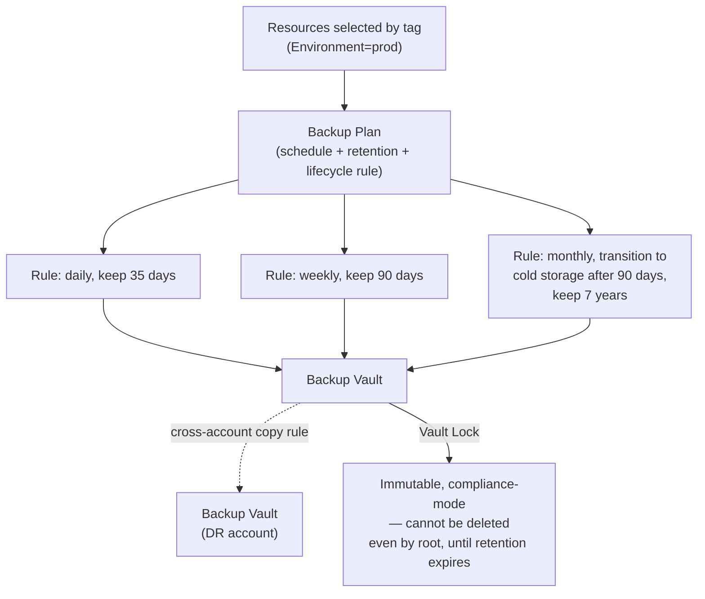

Walkthrough: one **Backup Plan** fans out into multiple **rules**, each with its own schedule and
retention, applied to every resource matching a **tag selector** — so tagging `Environment=prod`
is enough to bring a brand-new RDS instance or EFS file system under the exact same policy with no
extra configuration. The **cross-account copy rule** is how a single plan satisfies a disaster-
recovery or ransomware-protection requirement without a custom pipeline. **Vault Lock** is a
one-way switch (in compliance mode, not even the AWS account root user can shorten retention or
delete a locked recovery point before its retention expires) — follow that dashed arrow and you've
traced the exact mechanism an exam question means by "immutable backups."

### Real AWS Image


*Source: [AWS Storage Blog — Protect your Amazon S3 data-lake with AWS Backup](https://aws.amazon.com/blogs/storage/protect-your-amazon-s3-data-lake-using-aws-backup/)*

This diagram shows the governance pattern AWS Backup enables and the exam likes to test: a
**backup administrator** role (which can create vaults, plans, and restore data) is deliberately
separated from a **storage administrator** role (which manages the underlying S3 bucket day to
day) — so no single compromised credential can both corrupt production data *and* delete the
backups that would otherwise undo that corruption. That separation-of-duties pattern, layered on
top of Vault Lock's immutability, is specifically AWS's answer to ransomware scenarios where an
attacker with application-level access must not also have backup-deletion rights.

### Exam Tips

- "Centralized backup policy across multiple AWS services, one place to prove compliance" → AWS
  Backup, every time — the exam rarely tests the native per-service backup mechanisms once AWS
  Backup is in scope for Domain 4.
- **Worked cost math — tiering backup retention.** A company keeps 2 TB of daily EBS snapshots in
  hot (warm) backup storage at roughly $0.05/GB-month, retained for 3 years with no tiering: that's
  2,000 GB × $0.05 × 36 months = **$3,600/month-equivalent averaged**, or **$129,600** over the
  full 3-year retention window if the volume stayed constant. Adding a lifecycle rule that keeps
  only 35 days hot and transitions the rest to cold storage at roughly $0.01/GB-month changes the
  blended rate to approximately (35/1095 × $0.05 + 1060/1095 × $0.01) ≈ $0.0113/GB-month — a drop
  of about 77%, from $3,600/month down to roughly **$824/month** for the same 2 TB and the same
  3-year retention requirement, simply by tiering instead of leaving everything hot.
- "Immutable backups required for compliance/ransomware protection" → Vault Lock in compliance
  mode, not a different (and not necessarily pricier) storage product — don't let the word
  "immutable" push you toward assuming a cost increase that isn't actually required.

---

## 2. Cost Management Tools

### Definition
"Cost Management Tools" covers the native AWS suite for seeing, forecasting, and controlling
spend: **Cost Explorer** (visualize/analyze historical and forecasted cost and usage), **AWS
Budgets** (set thresholds and get alerted/act when exceeded), **Cost and Usage Report (CUR)**
(the most granular, line-item-level billing export), and **Compute Optimizer** (actual-utilization-
based right-sizing recommendations).

### Plain-English Analogy
If your AWS bill is a bank statement, Cost Explorer is the banking app's spending-by-category
graph, Budgets is the "alert me if I go over $500 this month" notification, CUR is the full raw
transaction export an accountant would actually reconcile against, and Compute Optimizer is a
financial advisor who looked at your actual spending habits and said "you're paying for a premium
card you only use 10% of its features."

### Purpose
You cannot optimize spend you cannot see. These tools exist to turn "the bill was $40,000 this
month, we don't know why" into a specific, actionable answer: which service, which linked
account, which tag, which hour of the day, and — via Compute Optimizer — which specific
over-provisioned resource is responsible, with a concrete right-sized recommendation attached.

### When to Use
- Any cost-optimization initiative's *first* step is always one of these tools — you diagnose
  before you fix.
- A recurring, proactive alert is needed before a budget threshold is breached (Budgets).
- Finance needs the most granular, auditable breakdown of exactly what was billed (CUR).
- Engineers are over-provisioning "to be safe" and need data-backed right-sizing (Compute
  Optimizer).

### When NOT to Use
- Real-time, sub-hourly cost visibility isn't these tools' job — Cost Explorer's finest
  granularity is hourly, and CUR data lands with some delay; neither is a real-time billing meter.
- Compute Optimizer needs a meaningful history of CloudWatch metrics (typically at least 14 days)
  before its recommendations are trustworthy — a brand-new resource won't yet have a useful
  recommendation.

### Use Cases (cost-focused)
1. **Tracing a surprise bill spike to one linked account via Cost Explorer.** A 40% month-over-
   month jump is isolated, within minutes, to a single linked account's NAT Gateway data
   processing charges — turning a vague "the bill went up" into a specific, fixable line item.
2. **A Budget alert catching a runaway dev account before month-end.** A forgotten, oversized
   EC2 test fleet left running over a long weekend triggers an 80%-of-budget alert on day 20
   instead of being discovered on the invoice on day 31.
3. **CUR feeding a custom Athena/QuickSight cost dashboard for finance.** A finance team that
   needs resource-tag-level cost allocation (for internal chargeback across business units) builds
   it directly from CUR data, since Cost Explorer's UI doesn't expose that level of granularity.
4. **Compute Optimizer right-sizing before a Savings Plan purchase.** A fleet running at 12%
   average CPU utilization gets right-sized to a smaller instance family *first*, so the
   subsequent 1-year Savings Plan commitment is sized to actual need, not a bloated baseline.
5. **Anomaly Detection (a Cost Explorer feature) flagging an unexpected new cost pattern.** A
   misconfigured Lambda function retrying indefinitely racks up invocation costs; Cost Anomaly
   Detection flags the unusual pattern well before the next billing cycle's invoice would have.
6. **Reserved Instance/Savings Plan coverage and utilization reports guiding renewal decisions.**
   Before a 1-year Savings Plan term expires, Cost Explorer's utilization report shows it was
   97% utilized — informing a confident renewal decision instead of guessing.

### Why Important
Every decision-framework doc in this folder assumes you've already *found* the cost problem —
that discovery step is this toolset's job. On the exam, "how do we know where the money is going"
or "how do we get alerted before we overspend" questions map directly here, distinct from the
purchasing-model questions (Reserved/Spot/Serverless) that come *after* this diagnostic step.

### Diagram

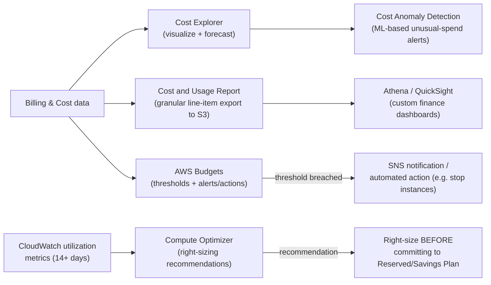

Walkthrough: raw **billing data** feeds four different tools depending on the question being
asked — Cost Explorer for visual trend analysis, CUR for the most granular export (the only one
finance typically reconciles against), Budgets for threshold-based alerting, and (fed by
CloudWatch rather than billing data directly) Compute Optimizer for utilization-based right-
sizing. The critical ordering in the diagram is the final arrow: Compute Optimizer's
recommendation should land **before** any purchasing-model commitment, not after — this is the
single most common sequencing mistake the exam tests in this area.

### Real AWS Image


*Source: [Amazon CloudWatch Monitoring Guide — Cost Explorer example](https://docs.aws.amazon.com/AmazonCloudWatch/latest/monitoring/ce.png)*

This is the default Cost Explorer view most engineers see first: daily cost bars broken down and
colored by service. The exam-relevant habit this screen builds is **filtering/grouping before
concluding** — grouping by linked account, by tag, or by usage type (e.g., isolating "DataTransfer-
Out-Bytes" specifically) turns a vague "AWS costs more than last month" into the exact line item
a fix should target, which is the pattern every use case above actually depends on.

### Exam Tips

- "We need to know *before* we exceed $X this month" → AWS Budgets (proactive/alerting), not Cost
  Explorer (which is retrospective/analytical) — the tense of the requirement is the tell.
- **Worked cost math — right-sizing before committing.** A fleet of 50 × m5.2xlarge On-Demand
  instances ($0.384/hr each) running 24/7 costs 50 × $0.384 × 730 hours ≈ **$14,016/month**.
  Compute Optimizer finds they're consistently under 15% CPU and recommends m5.xlarge
  ($0.192/hr) instead: 50 × $0.192 × 730 ≈ **$7,008/month** — a 50% cut from right-sizing *alone*,
  before any purchasing-model discount is even applied. Only after that right-sizing should a
  Savings Plan be purchased against the new, smaller $7,008/month baseline — committing to a
  Savings Plan against the original $14,016/month baseline would have locked in the waste for the
  full term.
- Finance asking for "the most granular, line-item cost data, exportable for our own analysis
  tooling" is asking for CUR specifically — Cost Explorer's UI/API does not expose that level of
  detail.

---

## 3. AWS DataSync

### Definition
AWS DataSync is a managed data-transfer service that moves large amounts of data between
on-premises storage (NFS, SMB, HDFS, object storage) and AWS storage services (S3, EFS, FSx), or
between AWS storage services themselves, at up to 10x the speed of typical open-source copy tools
— handling scripting, scheduling, encryption, retry logic, and data-integrity validation
automatically.

### Plain-English Analogy
Writing your own `rsync`/`rclone` cron job to move files into S3 is like personally driving a
moving truck cross-country, taking phone calls from the office to find out if a box fell off
along the way, and re-checking every item at the destination yourself. DataSync is hiring a
professional moving company with GPS-tracked trucks, automated damage-checking, and someone who
calls you if a box goes missing — the job gets done faster, more reliably, and without you
babysitting the process.

### Purpose
Moving large datasets (the "last mile" of a lift-and-shift migration, or an ongoing data-pipeline
feed) over a hand-rolled copy script is slow, fragile (one dropped connection means restarting or
building your own resume logic), and consumes real engineering time to build and maintain.
DataSync exists to remove that engineering cost and the retry/validation risk, while optimizing
the network path (it can use the full available bandwidth, with optional throttling controls) in
a way a naive script typically doesn't.

### When to Use
- A one-time or recurring, large-scale transfer from on-premises storage into S3/EFS/FSx.
- Ongoing replication between two AWS storage services (e.g., S3-to-S3 cross-Region, or S3-to-EFS)
  that needs to run on a recurring schedule.
- A migration needs built-in data-integrity verification and the ability to preserve file
  metadata/permissions, which a basic copy command doesn't guarantee.

### When NOT to Use
- A one-time, small transfer (a few GB) doesn't justify standing up a DataSync agent — a direct
  `aws s3 cp`/console upload is simpler and cheaper for a trivial amount of data.
- A live, continuously-changing relational or NoSQL *database* (not a file/object store) is DMS's
  job, not DataSync's — DataSync moves files/objects, not database records with schema and
  transaction semantics.
- Petabyte-scale data with limited or no network bandwidth available is the Snow Family's job —
  DataSync still needs a usable network path; past a certain size/bandwidth ratio, physically
  shipping a device is faster and cheaper (see Section 9).

### Use Cases (cost-focused)
1. **Avoiding the engineering cost of a custom transfer script entirely.** A team that would have
   spent 2-3 engineer-weeks building and testing retry/validation logic for a one-time 50 TB
   migration instead configures a DataSync task in an afternoon — the "cost optimization" here is
   avoided engineering time, not a per-GB discount.
2. **Scheduled, incremental sync instead of full re-copies.** A nightly DataSync task transfers
   only changed files from an on-premises NAS to S3, instead of a naive script re-copying the
   entire dataset every run and wasting both time and data-transfer cost on unchanged files.
3. **Replacing a brittle on-prem backup-to-cloud pipeline.** A company's previous nightly backup-
   to-S3 process occasionally silently failed mid-transfer with no alert; DataSync's built-in
   task-execution status and CloudWatch integration surfaces failures immediately, avoiding the
   hidden cost of an undetected backup gap.
4. **Cross-Region S3 replication for data no longer needed at the source immediately after
   transfer.** Rather than paying for S3 Cross-Region Replication's continuous sync for data that
   actually just needs a one-time move, a single DataSync task handles the transfer at a known
   one-time cost.
5. **Consolidating many regional file shares into one S3 data lake ahead of an analytics
   project.** Multiple DataSync agents, one per regional office, feed into a single destination
   bucket on a schedule — cheaper and faster to stand up than a bespoke multi-site replication
   tool, and billed simply per GB transferred.
6. **Decommissioning an on-premises file server after a verified, validated migration.** DataSync's
   built-in data-integrity verification gives the confidence needed to actually power off (and
   stop paying for) the legacy hardware, rather than keeping it running "just in case" the migration
   wasn't complete.

### Why Important
DataSync is this domain's answer to "the cost-optimized way to move large datasets isn't writing
your own transfer tooling" — a managed-service-over-DIY argument, parallel to the same argument
Transfer Family and DMS make for their respective transfer types. The exam flags DataSync whenever
a scenario describes a *large, one-time or recurring* bulk data movement into AWS storage with a
usable network path.

### Diagram

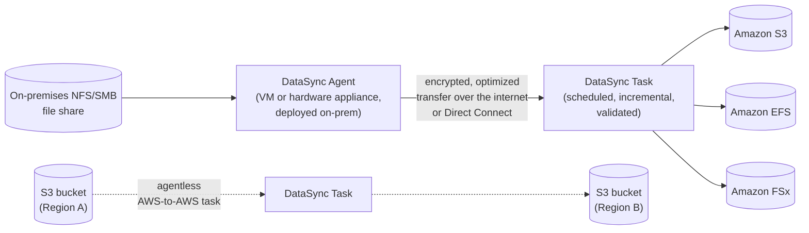

Walkthrough: for on-premises sources, a **DataSync Agent** (a small VM you deploy locally) handles
the actual read from the file share and the optimized, encrypted upload — this is the piece that
gives DataSync its throughput advantage over a naive script, since it manages parallelism and
retries itself. The dashed, lower path shows the **agentless** case: AWS-to-AWS transfers (S3 to
S3, S3 to EFS) don't need an agent at all, since both ends are already inside AWS's network.

### Real AWS Image


*Source: [AWS DataSync User Guide — How DataSync works](https://docs.aws.amazon.com/datasync/latest/userguide/how-datasync-works.html)*

This diagram shows the canonical on-premises-to-AWS DataSync flow the exam most often describes:
a local file share, an agent, and a destination AWS storage service, connected either over the
public internet or (for larger, steadier volumes) a Direct Connect link — the same Direct Connect
vs. internet cost tradeoff from Section 5 applies directly to which path a large DataSync
migration should use.

### Exam Tips

- "Large dataset, has a usable network connection, needs to move into S3/EFS/FSx reliably and
  fast" → DataSync. If the scenario instead says "no usable network bandwidth" or "petabyte scale,
  tight deadline" → Snow Family, not DataSync.
- **Worked cost math — DataSync vs. engineering time.** Building a custom, retry-safe transfer
  script for a 50 TB on-prem-to-S3 migration realistically costs 2-3 engineer-weeks; at a loaded
  cost of roughly $120/hour, 2.5 weeks (100 hours) of engineering time is **$12,000** in labor
  alone, before accounting for the risk of a bug causing a failed, re-started transfer that
  doubles the data-transfer cost. DataSync itself charges per GB transferred (roughly
  $0.0125/GB at time of writing) — 50 TB (≈51,200 GB) × $0.0125 ≈ **$640** in DataSync fees, a
  fraction of the avoided engineering cost, on top of removing the re-transfer risk.
- A DataSync task re-run after a partial failure transfers only the delta (changed/new files), not
  the whole dataset again — a detail that matters when a scenario is testing whether you understand
  DataSync avoids the "start over from scratch" cost risk of a naive script.

---

## 4. AWS Database Migration Service (DMS)

### Definition
AWS DMS migrates databases to AWS with minimal downtime, supporting both **homogeneous**
migrations (same engine, e.g. Oracle to Oracle) and **heterogeneous** migrations (different
engine, e.g. Oracle to Aurora PostgreSQL, using the companion **Schema Conversion Tool**), and can
run in one-time (full load) or continuous (full load + change data capture / CDC) mode to keep a
source and target in sync during a cutover window.

### Plain-English Analogy
Migrating a database by manually exporting and re-importing a dump file is like moving house by
packing everything into boxes, driving them over, and hoping nothing changed at the old house
while you were en route — if anyone adds a new item at the old place after you left, it's lost.
DMS's CDC mode is like having a second truck constantly running back and forth carrying every new
item the moment it appears at the old house, right up until the exact second you flip the sign on
the door — so the move finishes with nothing missing and almost no time the old house and new
house are both "live" at once.

### Purpose
A large production database can't simply be dumped, copied, and restored without an unacceptable
downtime window — the database keeps changing while the (possibly many-hour) copy is in flight.
DMS exists to solve this specific problem: an initial full load of existing data, followed by
ongoing change data capture that keeps replicating new writes from source to target continuously,
so the actual cutover (pointing the application at the new database) can happen in minutes rather
than hours, at the exact moment source and target are fully in sync.

### When to Use
- Migrating a production database to AWS (RDS, Aurora, Redshift, or even another EC2-hosted
  database) with a downtime window that must be minimized.
- Migrating to a *different* database engine (heterogeneous migration) where schema translation
  is also needed — pair DMS with the Schema Conversion Tool.
- Ongoing database replication for purposes beyond migration — e.g., continuously replicating
  production data into a separate analytics/reporting database without touching production load.
- Database consolidation (combining several smaller databases into one) or database splitting.

### When NOT to Use
- Migrating a file/object dataset (not structured database records) is DataSync's job, not DMS's.
- A trivially small database with an acceptable maintenance-window downtime may not need CDC's
  added complexity — a straightforward export/import during a scheduled window can be simpler and
  cheaper to set up for a one-off, non-critical migration.
- DMS's replication instance itself is a billed, running resource for the duration of the
  migration — leaving it running indefinitely after cutover (rather than decommissioning it) is a
  pure cost leak with no further function.

### Use Cases (cost-focused)
1. **Minimizing the cost of a maintenance-window downtime commitment.** A company that would
   otherwise need an expensive overnight maintenance window (with on-call engineering staff paid
   for standby) instead uses DMS's CDC to keep source and target in sync continuously, cutting the
   actual cutover window — and the associated staffing cost — to minutes.
2. **Heterogeneous migration avoiding ongoing commercial database licensing.** Migrating from a
   licensed, commercial engine (e.g., Oracle or SQL Server) to Aurora PostgreSQL via DMS + Schema
   Conversion Tool removes a recurring licensing cost line item entirely, not just a one-time
   migration cost.
3. **Decommissioning the DMS replication instance immediately after cutover.** A team that leaves
   a DMS replication instance running for months "just in case" after a successful cutover is
   paying for compute with no remaining function — stopping/deleting it the moment CDC confirms
   sync is the direct cost-optimization action.
4. **Validating a migration with a parallel-run period before fully committing.** Rather than an
   all-or-nothing cutover risking a costly rollback, a brief parallel-run period (both source and
   target live, traffic gradually shifted) de-risks the migration at the cost of a short period of
   running both databases — cheaper than an emergency rollback after a bad cutover.
5. **Using DMS for ongoing analytics replication instead of a custom ETL pipeline.** Continuously
   replicating production OLTP data into a separate reporting database via DMS avoids both the
   engineering cost of a hand-built replication pipeline and the production performance risk of
   running analytics queries directly against the primary database.
6. **Right-sizing the replication instance to the migration's actual data volume.** Over-
   provisioning the DMS replication instance "to be safe" for a migration that doesn't need that
   much throughput is pure waste for a resource that only exists for the migration's duration —
   right-sizing it the same way you'd right-size any other temporary compute resource is a direct,
   if modest, savings.

### Why Important
DMS is this domain's answer to "the cost-optimized way to migrate a live database isn't a risky,
expensive downtime window" — minimizing the downtime window has a direct dollar cost (on-call
staff, lost revenue during an outage, rollback risk) that DMS's CDC approach specifically targets.
On the exam, any scenario describing "migrate a database to AWS with minimal downtime" is a DMS
signal; add "different engine" and Schema Conversion Tool joins it.

### Diagram

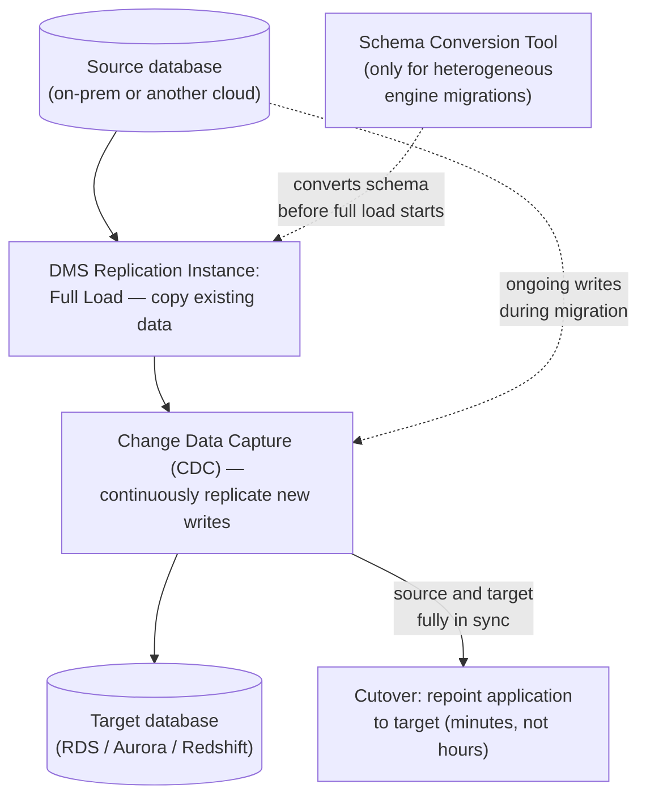

Walkthrough: the **Full Load** phase does the heavy one-time copy of existing data, while **CDC**
starts capturing every write made to the source *during* that load and keeps replaying them to the
target — so by the time Full Load finishes, CDC has already caught the target up to nearly
real-time. The **Schema Conversion Tool** only enters the picture for heterogeneous migrations
(different source and target engines), converting schema and, where possible, application code
before DMS ever starts moving data. The final **Cutover** step is the payoff of the whole
diagram: because CDC kept the two databases converging the entire time, flipping the application's
connection string is a minutes-long operation, not an hours-long one.

### Real AWS Image


*Source: [AWS DMS — SQL Server to Aurora PostgreSQL Migration Playbook](https://docs.aws.amazon.com/dms/latest/sql-server-to-aurora-postgresql-migration-playbook/how-aws-dms-works.html)*

This diagram, from a real heterogeneous migration playbook, shows exactly the full-load-then-CDC
flow walked through above, applied to the specific SQL-Server-to-Aurora-PostgreSQL case — a
migration that also removes SQL Server's per-core licensing cost once cutover completes, which is
frequently the single largest cost justification for the entire migration project.

### Exam Tips

- "Migrate a production database with minimal/near-zero downtime" → DMS with CDC, not a manual
  dump-and-restore — "minimal downtime" is the specific phrase that rules out a simple export/
  import.
- "Different source and target database engines" → DMS *plus* the Schema Conversion Tool — DMS
  alone handles the data; SCT handles the schema/code translation.
- **Worked cost math — downtime cost avoided.** A company estimates lost revenue during a
  maintenance-window outage at $2,000/minute. A naive dump-and-restore migration needing a
  6-hour (360-minute) downtime window would cost 360 × $2,000 = **$720,000** in lost revenue
  alone (ignoring on-call staffing). Using DMS's CDC approach to cut the actual cutover window to
  10 minutes instead costs 10 × $2,000 = **$20,000** in equivalent downtime exposure — a
  **$700,000** difference that dwarfs the DMS replication instance's own running cost (typically a
  few hundred dollars for the migration's duration on a modestly-sized instance).

---

## 5. AWS Direct Connect

### Definition
AWS Direct Connect is a dedicated, private network connection from an on-premises data center (or
colocation facility) directly into AWS, bypassing the public internet entirely — available as a
dedicated connection (1/10/100 Gbps, provisioned by AWS) or a hosted connection (sub-1 Gbps to
10 Gbps, provisioned through an AWS Direct Connect Partner).

### Plain-English Analogy
Internet-based VPN traffic to AWS is like driving to the airport on public roads that anyone can
use and that get congested at rush hour — usually fine, occasionally unpredictable. Direct Connect
is a private, dedicated highway lane built just for your traffic between your building and AWS's
front door — consistent, predictable, and not subject to the public internet's congestion, but it
costs real money to build and maintain that dedicated lane whether you use it heavily or not.

### Purpose
Direct Connect exists for two things internet-based connectivity structurally can't guarantee:
**consistent, predictable network performance** (no variable public-internet congestion/latency)
and, at **sustained high volume, a lower per-GB data transfer rate** than standard internet
egress. Both matter for workloads where bandwidth cost and/or performance consistency at scale
justify a dedicated circuit's fixed cost.

### When to Use
- Sustained, high-volume data transfer between on-premises and AWS (bulk migration, hybrid
  workloads, continuous replication) where the data-transfer savings at that volume exceed the
  circuit's fixed monthly cost.
- Workloads needing consistent, low-jitter network performance that a shared internet path can't
  guarantee (e.g., real-time hybrid application tiers).
- Compliance or security requirements for traffic to never traverse the public internet.

### When NOT to Use
- Lower-volume, intermittent, or backup/failover-only connectivity — the fixed monthly port-hour
  cost isn't justified by light, bursty use; Site-to-Site VPN is the cheaper default here (see
  Section 8).
- A brand-new, uncertain workload without established traffic volume — committing to a Direct
  Connect circuit (and often a multi-month lead time to provision one) before you have real usage
  data to justify it risks paying for capacity that goes underused.

### Use Cases (cost-focused)
1. **Bulk, continuous data replication crossing the VPN-vs-DX breakeven point.** A company
   replicating 50 TB/month from on-prem to S3 finds Direct Connect's per-GB rate, even after
   adding the fixed port-hour cost, comes in below what the same volume would cost over standard
   internet egress — the migration from VPN to DX pays for itself within a few months.
2. **A Direct Connect gateway consolidating multiple VPCs/Regions onto one physical connection.**
   Instead of provisioning (and paying the port-hour cost for) a separate physical connection per
   Region, a single Direct Connect connection paired with a Direct Connect Gateway reaches VPCs in
   multiple Regions, spreading the fixed circuit cost across more of the business's total traffic.
3. **Avoiding Direct Connect until traffic volume actually justifies it.** An early-stage
   company initially provisions Site-to-Site VPN, deliberately deferring Direct Connect's
   provisioning lead time and fixed cost until usage data proves the sustained volume that would
   make the dedicated circuit cost-effective.
4. **A hosted connection sized to actual need instead of a full dedicated connection.** A mid-
   size company needing 500 Mbps doesn't provision a full 1 Gbps or 10 Gbps dedicated connection —
   a sub-1-Gbps hosted connection through a Direct Connect Partner is both available and
   appropriately priced for that smaller, specific bandwidth need.
5. **Link Aggregation Group (LAG) consolidating multiple physical connections' billing.** Rather
   than running several unrelated lower-bandwidth connections for redundancy, a LAG combines
   multiple physical connections into one logical, higher-bandwidth, often more cost-efficient
   connection with a single aggregated billing line.
6. **Using a VPN connection as a Direct Connect failover path instead of a second physical
   circuit.** Rather than paying for two full Direct Connect circuits purely for redundancy, a
   Site-to-Site VPN running over standard internet serves as the (less performant, but far
   cheaper) failover path if the primary Direct Connect connection goes down.

### Why Important
Direct Connect is the domain's clearest example of a service with a **real fixed cost floor** —
unlike almost everything else in this domain, provisioning one has a cost even before a single
byte moves, which makes the "is the volume high and steady enough to justify this" judgment call
a direct, frequently-tested cost-optimization decision rather than a pure technical one.

### Diagram

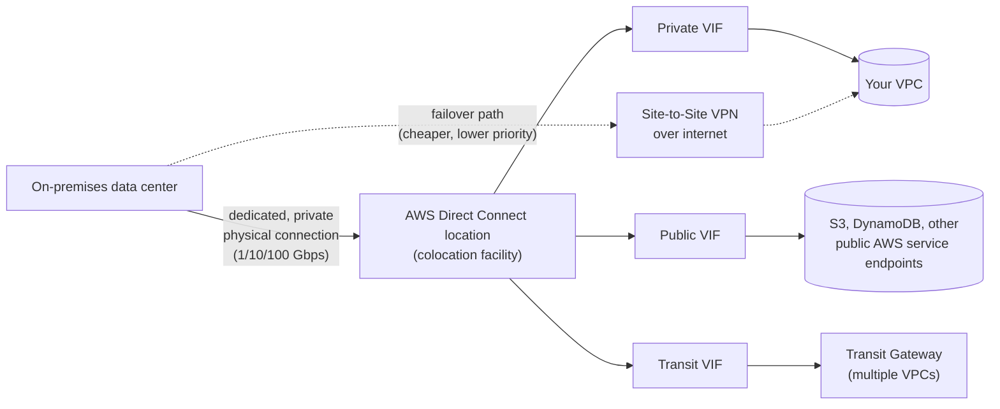

Walkthrough: all three virtual interface (VIF) types share the **same physical connection** and
therefore the **same fixed port-hour cost** — a **Private VIF** reaches a VPC directly, a
**Public VIF** reaches AWS's public service endpoints (S3, DynamoDB) over the dedicated link
instead of the internet, and a **Transit VIF** reaches a Transit Gateway for multi-VPC
connectivity. The dashed path is the cost-conscious failover pattern from Use Case 6: a cheap
VPN connection as backup, rather than doubling the fixed Direct Connect cost for redundancy alone.

### Real AWS Image


*Source: [AWS Direct Connect User Guide — Virtual interfaces](https://docs.aws.amazon.com/directconnect/latest/UserGuide/WorkingWithVirtualInterfaces.html)*

This is the official VIF reference diagram — the exam-relevant detail it makes visible is that
**one physical Direct Connect connection carries multiple logical VIFs simultaneously**, which is
exactly how a company consolidates several traffic types (private VPC traffic, public AWS service
traffic, and Transit Gateway traffic) onto a single fixed-cost circuit instead of paying for
separate physical connections for each.

### Exam Tips

- "Steady, high-volume, sustained on-prem-to-AWS traffic, cost-sensitive at that volume" → Direct
  Connect. "Lower volume, intermittent, backup, or need it provisioned quickly" → Site-to-Site VPN.
- **Worked cost math — the VPN/DX breakeven.** Say internet-based data transfer out costs roughly
  $0.09/GB, and a 1 Gbps dedicated Direct Connect port costs roughly $0.30/hour ($219/month) with
  a Direct Connect data transfer rate of roughly $0.02/GB. At 10 TB/month (10,240 GB): over
  standard internet egress that's 10,240 × $0.09 ≈ **$922/month**. Over Direct Connect:
  $219 (port) + 10,240 × $0.02 ≈ $219 + $205 = **$424/month** — already cheaper despite the fixed
  port cost. At only 1 TB/month (1,024 GB), internet egress is 1,024 × $0.09 ≈ **$92/month**,
  while Direct Connect would still cost $219 + 1,024 × $0.02 ≈ **$240/month** — more expensive at
  that lower volume. The breakeven is squarely a function of monthly volume, which is exactly why
  the exam phrases this as a volume/pattern question, not a "which is technically better" one.
- A Direct Connect Gateway is the mechanism for reaching VPCs in *multiple Regions* over one
  connection — a scenario needing that multi-Region reach without a second physical circuit is
  pointing at the Gateway, not a second connection.

---

## 6. AWS Fargate

### Definition
AWS Fargate is a serverless compute engine for containers, usable with both ECS and EKS, that
removes the need to provision, patch, or scale the underlying EC2 instances a container runs on —
you specify vCPU and memory per task/pod, and AWS runs it, billing per-second for exactly that
vCPU/memory combination for the duration the task actually runs.

### Plain-English Analogy
Running containers on self-managed EC2 instances is like owning a delivery van fleet — you pay for
every van around the clock whether it's full of packages or empty, and you're responsible for its
maintenance. Fargate is like a courier service you call only when you have packages to move — you
pay per delivery, for exactly the size of van that one delivery needs, and you never think about
van maintenance, idle vans, or right-sizing the fleet.

### Purpose
Self-managed EC2 instances backing an ECS/EKS cluster must be sized, patched, and scaled by you —
and they bill whether or not every container on them is fully utilizing that capacity, creating
the same bin-packing/right-sizing cost problem as any EC2 fleet. Fargate exists to remove that
entire layer: you pay for the exact vCPU/memory each task/pod requests, per second, with no
underlying instance to size, patch, or leave idle.

### When to Use
- Containerized workloads with variable or unpredictable load, where right-sizing and managing an
  underlying EC2 fleet would otherwise mean either over-provisioning (waste) or under-provisioning
  (risk).
- Teams wanting to eliminate the operational burden (and associated engineering time cost) of
  patching and scaling container-hosting EC2 instances.
- Batch or scheduled containerized jobs that don't run continuously, where per-second billing for
  only the run duration beats paying for an always-on instance.

### When NOT to Use
- Extremely high, sustained, predictable container density where a well-tuned, Reserved-covered
  EC2 fleet's bin-packing efficiency can beat Fargate's per-task pricing at scale — Fargate carries
  a per-vCPU/memory premium over equivalent raw EC2 capacity.
- Workloads needing specialized hardware (GPUs, specific instance families) or deep OS-level
  control that Fargate's abstraction doesn't expose.

### Use Cases (cost-focused)
1. **Spiky batch image-processing jobs billed only for actual run time.** A nightly job
   processing uploaded images runs as Fargate tasks that scale from zero, billing per-second only
   while images are actually being processed — no idle EC2 fleet during the other 22 hours a day.
2. **Replacing a chronically under-utilized EC2-backed ECS cluster.** A cluster's EC2 instances
   averaging 20% utilization (sized for a rare peak) moves to Fargate, trading the per-vCPU
   premium for eliminating the much larger waste of 80% idle reserved capacity.
3. **A CI/CD pipeline running build containers on Fargate instead of dedicated build servers.**
   Build agents that only run for the duration of each build (minutes) bill per-second on
   Fargate, versus a fleet of permanently-running EC2 build servers billed 24/7 regardless of
   build frequency.
4. **Removing patching labor cost from a compliance-sensitive container fleet.** A security team
   that previously spent recurring engineer-hours patching the OS on container-hosting EC2
   instances eliminates that labor cost entirely by moving to Fargate, where AWS manages the
   underlying infrastructure.
5. **Mixed Fargate + EC2 capacity providers in one ECS cluster for cost-efficient bursting.** A
   steady baseline runs on Reserved/Savings-Plan-covered EC2 capacity (cheaper per-vCPU at
   steady scale) while burst capacity above that baseline runs on Fargate, avoiding both EC2
   over-provisioning and Fargate's premium on the steady-state portion.
6. **Fargate Spot for interruption-tolerant containerized batch work.** A long-running but
   checkpoint-friendly data-processing task runs on Fargate Spot, capturing a meaningful discount
   (up to roughly 70% off standard Fargate pricing) for workloads that can tolerate the occasional
   interruption.

### Why Important
Fargate is this domain's clearest illustration of "serverless removes the instance-sizing decision
from the cost equation entirely" applied to containers specifically — directly relevant to Task
4.2's "serverless, containers" phrasing. The exam contrasts Fargate against self-managed EC2-backed
ECS/EKS precisely on this operational-cost-vs-per-unit-premium tradeoff.

### Diagram

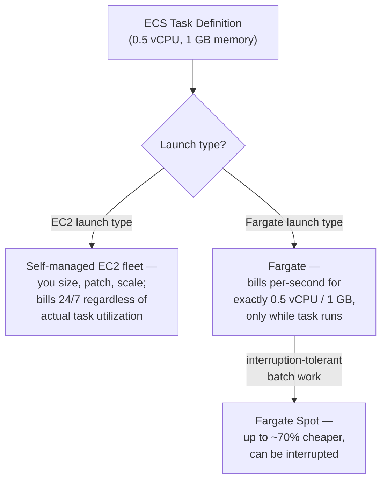

Walkthrough: the same **task definition** can run under either launch type with zero change to
the container image itself — the EC2 path bills for the underlying instance's full capacity
whether or not the task uses all of it, while the Fargate path bills exactly for the task's
declared vCPU/memory, per second. **Fargate Spot** is a further branch off the Fargate path
specifically for workloads that tolerate interruption, the same interruption-tolerance test from
the EC2 Spot discussion in Section 17/18.

### Real AWS Image


*Source: [AWS Reference Architecture Diagrams — Autoscaling async job queues](https://docs.aws.amazon.com/reference-architecture-diagrams/latest/autoscaling-async-job-queues/autoscaling-async-job-queues.html)*

This reference architecture is the textbook cost-optimized async-job pattern: an SQS queue decouples
job submission from processing, and ECS-on-Fargate tasks scale based on queue depth — so compute
cost tracks the actual *backlog of work* rather than a fixed, always-on worker fleet sized for an
assumed peak that may rarely occur.

### Exam Tips

- "Containerized, variable/bursty load, wants to avoid managing EC2 instances" → Fargate.
  "Containerized, steady, high-density, cost-sensitive at scale" → EC2 launch type with Reserved/
  Savings Plan coverage, often beats Fargate's per-vCPU premium at that volume.
- **Worked cost math — Fargate premium vs. idle EC2 waste.** A Fargate task using 1 vCPU + 2 GB
  running 24/7 for a month costs roughly (1 × $0.04048/hr + 2 × $0.004445/hr) × 730 hours ≈
  ($0.04048 + $0.00889) × 730 ≈ $0.04937 × 730 ≈ **$36/month** (us-east-1 On-Demand Fargate
  rates). An equivalent always-on t3.medium EC2 instance (2 vCPU, 4 GB) costs roughly
  $0.0416/hr × 730 ≈ **$30/month** On-Demand — slightly *cheaper* raw, but that EC2 instance
  still needs patching labor and, if running multiple tasks' worth of spare capacity sitting idle
  most of the day, the comparison flips the other way quickly once utilization drops below roughly
  50-60%. This is why the exam frames the Fargate-vs-EC2 choice around utilization/variability,
  never a flat "Fargate is always more expensive" rule.
- Fargate Spot is the answer whenever a scenario pairs "containerized" with "fault-tolerant/
  interruptible batch work" — don't default to standard Fargate pricing if the workload shape
  matches Spot's eligibility criteria.

---

## 7. AWS Lambda

### Definition
AWS Lambda is a fully serverless compute service that runs your code in response to events
(API calls, file uploads, schedule triggers, queue messages) without provisioning or managing any
server, billing per-millisecond of actual execution time (rounded to the nearest 1ms) multiplied
by the memory allocated, with zero charge while no function is executing.

### Plain-English Analogy
Lambda is like paying an on-call electrician only for the exact minutes they're in your house
fixing something, with zero retainer fee the rest of the month — versus a full-time electrician
on staff (an EC2 instance) who you pay a salary whether or not anything in the house needs fixing
today.

### Purpose
Many workloads are genuinely event-driven and idle the vast majority of the time — a webhook
handler, a nightly cleanup job, an image-resize trigger. Provisioning and paying for a server to
sit idle waiting for these infrequent triggers is pure waste. Lambda exists to make "idle" cost
exactly zero, removing both the server-sizing decision and the idle-time cost simultaneously.

### When to Use
- Event-driven, bursty, or infrequent workloads (API backends with uneven traffic, file-processing
  triggers, scheduled jobs) where most of the time nothing is happening.
- Short-duration tasks (Lambda has a 15-minute max execution time) that don't need a persistent
  process.
- Workloads where eliminating server management (patching, scaling, right-sizing) entirely is a
  stated goal, not just a cost one.

### When NOT to Use
- Long-running processes exceeding 15 minutes need Fargate, EC2, or Batch instead.
- Very high, sustained, predictable invocation volume can make Lambda's per-invocation pricing
  more expensive than an equivalently-sized, Reserved-covered EC2/Fargate fleet — the
  "always busy" case flips the serverless cost advantage.
- Workloads sensitive to cold-start latency that can't tolerate Lambda's cold-start behavior
  (and don't want to pay for Provisioned Concurrency to eliminate it) may fit a persistently-
  running compute option better.

### Use Cases (cost-focused)
1. **A webhook handler invoked a few hundred times a day.** Running this on even the smallest
   always-on EC2 instance would cost roughly $5-10/month in pure idle waste; on Lambda, a few
   hundred sub-second invocations a day cost a small fraction of a cent total, inside the Lambda
   free tier for many workloads of this size.
2. **Nightly cleanup/reporting jobs running on an EventBridge schedule.** A 90-second nightly job
   bills for exactly 90 seconds of compute, 365 times a year — versus a dedicated EC2 instance
   that would bill 24/7 for a job that only needs 0.17% of that time.
3. **Avoiding Provisioned Concurrency's added cost for functions that don't need it.** A function
   invoked only a few times an hour tolerates occasional cold starts fine; the team correctly
   skips paying for Provisioned Concurrency (which bills for pre-warmed capacity even when idle),
   reserving that cost for only the latency-critical, high-frequency functions that actually
   justify it.
4. **A seasonal registration system active two weeks a year.** The entire backend runs on Lambda,
   billing essentially nothing for the other fifty weeks and scaling automatically during the
   two-week registration window, with no standing reservation ever purchased for a workload this
   genuinely intermittent.
5. **Right-sizing memory allocation to reduce per-invocation cost.** Since Lambda bills
   memory × duration, a function over-allocated at 1024 MB that only needs 256 MB (and, often,
   also runs *faster* at higher memory due to proportionally more CPU) is tuned down — directly
   cutting the per-invocation cost for a high-volume function.
6. **Switching a Lambda function to ARM/Graviton2 (Lambda's arm64 architecture) for a price cut.**
   A compute-bound function recompiled for arm64 gets up to roughly 20% better price-performance
   at the same memory setting, with no functional change — a pure cost win for eligible workloads.

### Why Important
Lambda is the domain's purest example of "serverless removes the sizing/purchasing decision
entirely" — there's no instance type, no Reserved/Spot choice, just a memory setting and a
duration. The exam uses Lambda as the default correct answer whenever a scenario describes
"infrequent," "event-driven," or "unpredictable, mostly idle" compute needs.

### Diagram

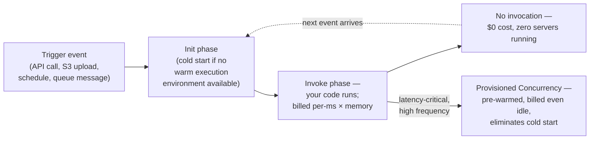

Walkthrough: the loop between **Invoke** and **Idle** is the entire cost story — the moment a
function finishes executing, billing stops completely, and it stays at exactly $0 until the next
event. **Provisioned Concurrency** is the one branch that reintroduces an idle-time cost
deliberately, trading it for eliminated cold-start latency — appropriate only when that latency
guarantee is worth paying for, which is why Use Case 3 explicitly calls out *not* reaching for it
by default.

### Real AWS Image


*Source: [AWS Lambda Developer Guide — Lambda execution environment](https://docs.aws.amazon.com/lambda/latest/dg/lambda-runtime-environment.html)*

This is AWS's own lifecycle diagram for a Lambda execution environment. The cost-relevant detail:
after the **Init** phase completes once, a "warm" execution environment can serve *multiple*
subsequent invocations without repeating Init — which is why a function invoked frequently enough
rarely pays the cold-start cost repeatedly, while one invoked rarely (once an hour or less) pays
it on nearly every invocation, a detail that matters when a scenario is weighing Lambda against
Provisioned Concurrency.

### Exam Tips

- "Infrequent, event-driven, unpredictable, idle most of the time" → Lambda, almost by default in
  this domain — look for language like "triggered by," "on a schedule," or "only runs when."
- **Worked cost math — Lambda vs. always-on EC2 for a light workload.** A function runs 200,000
  times/month, each invocation taking 300ms at 512 MB memory. Lambda cost ≈ 200,000 invocations ×
  $0.0000166667 per GB-second × 0.5 GB × 0.3s ≈ 200,000 × $0.0000025 ≈ **$0.50/month** in compute
  (plus a negligible per-request charge of 200,000 × $0.0000002 = $0.04) — call it roughly
  **$0.54/month** total, likely covered entirely by the free tier's 1M free requests and 400,000
  GB-seconds/month. The cheapest comparable always-on EC2 instance (t3.micro, ~$0.0104/hr) would
  cost 730 × $0.0104 ≈ **$7.59/month** just to exist, regardless of whether it ever handled a
  single request — over 14x more expensive for this specific, low-volume access pattern.
- A scenario describing "millions of steady, constant invocations per second, 24/7" is testing
  whether you recognize Lambda's per-invocation economics can *lose* to a well-utilized, Reserved
  EC2/Fargate fleet at sufficiently high, sustained volume — don't treat "serverless" as
  unconditionally cheaper.

---

## 8. Site-to-Site VPN & Client VPN

### Definition
**Site-to-Site VPN** creates an encrypted IPsec connection between an on-premises network (or
another cloud) and a VPC over the public internet, using redundant tunnels for high availability,
provisioned in minutes with no dedicated hardware circuit. **Client VPN** is a managed, OpenVPN-
based remote-access VPN service letting individual users (not whole networks) securely connect
from their laptops into a VPC.

### Plain-English Analogy
Site-to-Site VPN is like renting an armored car service that still drives on public roads —
encrypted and secure, but subject to the same public road conditions as any other traffic, and
you can book it same-day with no construction project. Direct Connect, by contrast, is building
your own private road. Client VPN is the individual-employee version: a secure, personal tunnel
each remote worker dials into from home, rather than a connection for an entire office network.

### Purpose
Site-to-Site VPN exists to connect an on-premises network to AWS **quickly and without the
provisioning lead time or fixed cost of a dedicated Direct Connect circuit** — ideal when volume
is lower, intermittent, or when a connection is needed as a backup path. Client VPN exists for
the parallel individual-user problem: secure remote access into private VPC resources for people,
not sites, without building a traditional corporate VPN concentrator.

### When to Use
- **Site-to-Site VPN:** lower/intermittent-volume hybrid connectivity, a fast-to-provision
  connection needed now (no months-long circuit lead time), or a backup/failover path for an
  existing Direct Connect connection.
- **Client VPN:** remote employees/contractors need secure access to private VPC resources
  (internal tools, databases) from unmanaged networks, without exposing those resources publicly.

### When NOT to Use
- Site-to-Site VPN for sustained, very high-volume hybrid traffic where Direct Connect's lower
  per-GB rate would pay back its fixed cost quickly (see Section 5's worked breakeven math).
- Client VPN for *site-to-site* connectivity (an entire branch office's network, not a single
  user) — that's Site-to-Site VPN's or Direct Connect's job, not Client VPN's.

### Use Cases (cost-focused)
1. **Standing up hybrid connectivity same-day while a Direct Connect circuit is being
   provisioned.** A company that knows it will eventually need Direct Connect's volume discount
   starts with Site-to-Site VPN immediately, avoiding weeks or months of zero connectivity while
   the dedicated circuit is physically installed.
2. **A Site-to-Site VPN as the cost-effective backup for a primary Direct Connect connection.**
   Rather than paying for a second full Direct Connect circuit purely for redundancy, a VPN
   connection (riding on standard internet pricing, no fixed circuit cost) serves as the failover
   path, activated only if the primary connection fails.
3. **Client VPN replacing a traditional, licensed corporate VPN appliance.** A company retiring an
   aging, per-seat-licensed VPN concentrator moves remote access to Client VPN, paying per
   connection-hour instead of a large upfront hardware and licensing cost.
4. **Scaling Client VPN down outside business hours for a smaller remote team.** Usage-based,
   per-connection-hour billing means a small team's Client VPN endpoint costs roughly proportional
   to actual connected hours, rather than a flat licensed-seat cost that's the same whether anyone
   connects or not.
5. **A branch office with modest, intermittent traffic choosing VPN over Direct Connect
   permanently.** After a cost review (the same breakeven math from Section 5) shows the branch's
   actual monthly volume would never pay back a dedicated circuit's fixed cost, the company
   deliberately keeps that branch on Site-to-Site VPN rather than "upgrading" out of habit.
6. **Transit Gateway VPN attachments consolidating many sites' Site-to-Site VPN connections.**
   Multiple regional offices' individual VPN connections attach to one Transit Gateway instead of
   each one separately attaching to a VPC, simplifying management and avoiding the connection
   sprawl cost discussed in Section 28.

### Why Important
VPN services are the domain's "lower commitment, lower fixed cost" counterpart to Direct Connect —
every exam scenario pitting VPN against Direct Connect is testing the volume/pattern judgment from
Section 5's framework, while Client VPN specifically tests recognizing *individual remote-user*
access as a distinct problem from *site-to-site* connectivity.

### Diagram

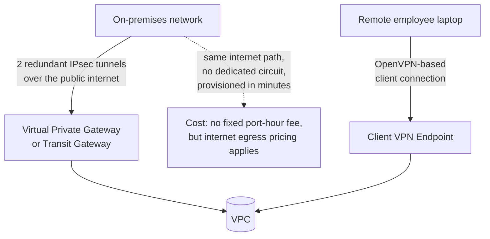

Walkthrough: Site-to-Site VPN's two tunnels (shown terminating at a Virtual Private Gateway or
Transit Gateway) exist for availability, not throughput scaling — AWS recommends configuring both
for redundancy even though a single tunnel alone could carry the traffic. **Client VPN** is a
structurally separate path for individual users, terminating at its own endpoint rather than a
gateway meant for whole-network traffic — the diagram deliberately keeps these two flows visually
distinct because conflating them is a common point of confusion on the exam.

### Real AWS Image


*Source: [AWS Site-to-Site VPN User Guide — How AWS Site-to-Site VPN works](https://docs.aws.amazon.com/vpn/latest/s2svpn/how_it_works.html)*

This is AWS's canonical Site-to-Site VPN diagram, showing the Virtual Private Gateway attached to
one side of the VPC and the customer gateway device on the on-premises side. The detail worth
internalizing for cost purposes: nothing in this diagram has a dedicated-circuit fixed cost the
way Direct Connect does — the VPN connection itself has a modest hourly charge, and the traffic
itself still bills at standard data-transfer rates, which is exactly why Section 5's breakeven
math is the deciding factor between this diagram and Direct Connect's.

### Exam Tips

- "Need hybrid connectivity fast, don't want to wait for a circuit to be provisioned" or "lower,
  intermittent volume" → Site-to-Site VPN. "Individual remote workers need secure access to VPC
  resources" → Client VPN — don't confuse the two when a scenario mentions "VPN" without
  specifying site vs. individual-user.
- **Worked cost math — VPN as backup vs. a second Direct Connect circuit.** A second dedicated
  1 Gbps Direct Connect circuit purely for redundancy costs roughly $219/month in port-hours alone
  (per Section 5's rate), before any data transfer. A Site-to-Site VPN connection used only as a
  failover path costs roughly $0.05/hour × 730 ≈ **$36.50/month** to simply exist on standby, plus
  data transfer only during the rare periods it's actually carrying traffic — a difference of
  roughly $182/month, or **over $2,100/year**, for redundancy that in most designs is only ever
  active during a primary-connection outage.
- Client VPN bills per connection-hour per active client connection — a scenario asking you to
  estimate its cost needs the number of concurrent remote users and typical session length, not
  just a flat per-endpoint rate.

---

## 9. AWS Snow Family

### Definition
The AWS Snow Family (Snowcone, Snowball Edge, Snowmobile) is a set of physical, ruggedized edge
devices AWS ships to you for offline, large-scale data transfer and/or edge compute — you load
data onto the device locally, ship it back to AWS, and the data is ingested into S3 (or another
service) without ever traversing a network connection for the bulk transfer.

### Plain-English Analogy
Transferring a petabyte of data over even a fast internet connection is like trying to empty a
swimming pool through a drinking straw — technically possible, but it'll take an absurdly long
time. Snow Family devices are the "just drain the pool into a tanker truck and drive it over"
solution — physically moving the bytes is, past a certain volume, dramatically faster than
pushing them through any network pipe you're likely to have.

### Purpose
Past a certain dataset size relative to available bandwidth, no network transfer — not even
Direct Connect — finishes in a reasonable time or at a reasonable cost. Snow Family devices exist
specifically for that crossover point: shipping physical storage is faster and/or cheaper than
transferring the same bytes over any network connection realistically available.

### When to Use
- Petabyte-scale (or very large terabyte-scale), one-time data migrations where calculating
  network transfer time at available bandwidth yields an unacceptably long duration.
- Environments with limited, unreliable, or no network connectivity at all (remote field
  locations, ships, disaster response) — Snowcone/Snowball Edge can also run edge compute/ML
  workloads locally in these environments.
- Data center decommissioning or migration where bulk data must move out quickly ahead of a
  hardware retirement deadline.

### When NOT to Use
- Smaller datasets, or any dataset where available bandwidth can realistically complete the
  transfer within the actual deadline — DataSync over a normal network connection (or Direct
  Connect for recurring bulk transfer) is simpler and avoids physical shipping logistics/time.
- Ongoing, continuous data flows — Snow Family is fundamentally a one-time or occasional physical
  transfer mechanism, not a standing replication pipeline (that's DataSync's or DMS's job).

### Use Cases (cost-focused)
1. **A media company migrating 2 PB of archival video off legacy on-prem storage.** Calculating
   that even a dedicated 10 Gbps connection would take over 18 days of saturated, nonstop
   transfer (and realistically far longer with contention), the company instead orders multiple
   Snowball Edge devices, loads them in parallel, and completes the physical shipping-based
   transfer in about a week.
2. **A research vessel with no reliable internet connectivity collecting terabytes of sensor
   data.** Rather than attempting any network-based transfer at sea, data is stored locally on a
   Snowball Edge device (which also runs some on-board preprocessing via its compute capability)
   and shipped to AWS only once the vessel returns to port.
3. **Data center exit under a hard deadline.** A company closing a leased data center within 60
   days uses Snowmobile (a shipping-container-scale, exabyte-capable transfer vehicle) for its
   multi-petabyte dataset, since no feasible network transfer could complete in that window at
   any cost.
4. **Avoiding Snow Family for a dataset that fits comfortably within the available network
   window.** A company evaluating Snowball for a 20 TB migration runs the math, finds its 1 Gbps
   connection would complete the transfer in under 2 days, and uses DataSync instead — correctly
   recognizing that Snow Family's shipping lead time would actually be *slower* at this smaller
   scale.
5. **Edge compute/inference at a disconnected or intermittently-connected remote site.** A mining
   or oil-and-gas remote site uses Snowball Edge's onboard compute to run local processing and
   ML inference where no cloud connectivity exists, syncing results back only when a device is
   periodically shipped or reconnected.
6. **Right-sizing the number of devices ordered to the actual dataset size.** A company avoids
   over-ordering Snowball Edge devices "to be safe," instead calculating actual capacity needed
   per device and ordering precisely that number, since each device has its own handling and
   shipping cost regardless of how full it ends up being.

### Why Important
Snow Family is the domain's clearest "physics beats network economics past a certain scale"
lesson — a petabyte-scale, deadline-driven, one-time transfer is a recurring exam scenario
specifically testing whether you'll reach for a Snow device instead of defaulting to "just use
the internet" or even Direct Connect.

### Diagram

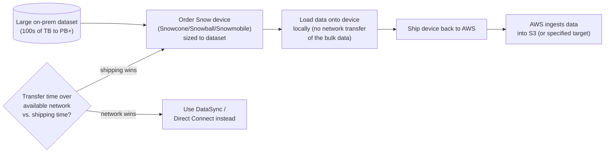

Walkthrough: the entire decision hinges on the **BandwidthCheck** diamond — this is a math
problem (dataset size ÷ available bandwidth = network transfer time) compared against the
device's shipping and handling lead time, not a subjective preference. The main flow below it
is deliberately simple: load locally, ship, ingest — the whole point of Snow Family is removing
the network from the bulk-transfer critical path entirely.

### Real AWS Image


*Source: [AWS Snowball Edge Developer Guide — Snowball Edge device overview](https://docs.aws.amazon.com/snowball/latest/developer-guide/device-overview.html)*

This is the actual physical Snowball Edge appliance — a genuinely rugged, briefcase-sized piece of
hardware with an E Ink shipping-label display built into the case. Seeing the real device makes
the exam's "physical shipping" framing concrete: this is tamper-evident, ruggedized, purpose-built
hardware, not a repurposed consumer drive, which is also why it satisfies the chain-of-custody and
encryption requirements (AWS Key Management Service-backed encryption at rest on the device) that
sensitive-data migrations need.

### Exam Tips

- "Petabyte-scale, one-time, deadline-driven, limited/no network bandwidth" → Snow Family. If the
  scenario instead has a workable network path and a less extreme data volume, that's DataSync's
  territory, not Snow Family's.
- **Worked cost math — the network-vs-ship crossover.** Transferring 1 PB (1,048,576 GB) over a
  dedicated 1 Gbps connection, at a realistic sustained throughput of roughly 80% efficiency
  (≈100 MB/s effective), takes 1,048,576,000 MB ÷ 100 MB/s ≈ 10,485,760 seconds ≈ **121 days** —
  over 4 months, nonstop, saturating that entire connection the whole time (ignoring contention
  from any other traffic). A handful of Snowball Edge Storage Optimized devices (each holding up
  to 80 TB usable), loaded in parallel and shipped, can physically complete that same 1 PB
  transfer in roughly **1-2 weeks** including shipping time both ways — the shipping path wins by
  more than a factor of 8, even before accounting for the fact that a 1 Gbps link saturated for
  121 days straight is itself an unrealistic assumption for a production network.
- Snowmobile exists specifically for the far end of this spectrum (exabyte-scale) — a scenario
  mentioning data center decommissioning at multi-petabyte-plus scale under a tight deadline is
  the Snowmobile signal, distinct from Snowball Edge's smaller (terabyte-to-low-petabyte) range.

---

## 10. AWS Transfer Family

### Definition
AWS Transfer Family is a fully managed service for SFTP, FTPS, FTP, and AS2 file transfers
directly into and out of Amazon S3 or Amazon EFS, letting you replace self-managed FTP/SFTP
server infrastructure with a managed endpoint while keeping existing client tooling, scripts, and
authentication workflows mostly unchanged.

### Plain-English Analogy
Running your own SFTP server fleet is like owning and maintaining a small post office building —
you patch the roof, staff the counter, and handle break-ins yourself. Transfer Family is renting a
post-office box at a building someone else maintains, patches, and secures, while your customers
keep mailing things to the exact same address and process they always used.

### Purpose
Many partners, vendors, and legacy systems can only exchange files via SFTP/FTPS/FTP/AS2 — often
non-negotiable on the partner's side, even when your own infrastructure is otherwise fully modern
and AWS-native. Transfer Family exists to let you meet that old-protocol requirement without
building and patching your own EC2-hosted SFTP server fleet, while using S3 or EFS as the actual
storage behind it.

### When to Use
- A business partner/vendor integration mandates SFTP/FTPS/FTP/AS2 and cannot be changed to a
  modern API, but the data itself should land directly in S3 or EFS once received.
- An organization is currently running and patching its own EC2-hosted SFTP servers and wants to
  eliminate that operational burden and its associated EC2 instance cost.
- A migration needs to preserve existing partner-facing SFTP endpoints/credentials/workflows
  exactly, with the storage backend swapped out behind the scenes.

### When NOT to Use
- Any workflow where you control both ends and can use a modern transfer method instead (S3
  direct upload, an API, DataSync) — Transfer Family exists specifically for legacy-protocol
  compatibility, not as a general-purpose transfer tool.
- Extremely low-frequency, low-volume transfers where a manually-managed, single small EC2
  instance might genuinely be cheaper if truly rare — though this rarely holds once patching
  labor time is counted.

### Use Cases (cost-focused)
1. **Retiring a self-managed SFTP server fleet for partner EDI file exchange.** A retailer
   eliminates several permanently-running EC2 instances (with their associated patching labor and
   security-review overhead) that existed solely to receive partner order files via SFTP, replacing
   them with a Transfer Family endpoint backed directly by S3.
2. **Scaling automatically for seasonal partner file volume without any capacity planning.** A
   logistics company's partner file volume spikes during holiday season; Transfer Family scales
   transparently with no instance-sizing decision, versus a self-managed fleet that would have
   needed capacity planned (and paid for) ahead of the predictable seasonal spike.
3. **An SFTP connector pulling files from a remote partner's SFTP server into S3 on a schedule.**
   Rather than building a custom polling script (with its own hosting and maintenance cost) to
   pull files from a partner's own SFTP server, the managed SFTP connector handles authentication,
   scheduling, and retry logic.
4. **Consolidating multiple legacy protocol endpoints (SFTP, FTPS, AS2) into one managed
   service.** A healthcare company exchanging data with different partners over three different
   legacy protocols retires three separately-maintained server types in favor of one Transfer
   Family deployment supporting all three.
5. **Paying only for actual file-transfer activity instead of a server running 24/7.** Transfer
   Family bills by provisioned endpoint hours plus data transferred/uploaded — for partners who
   only send files during business hours, this tracks much closer to actual usage than a
   permanently-running EC2-hosted FTP server billed regardless of traffic.
6. **Avoiding a costly custom-build project to modernize a legacy partner integration.** Rather
   than a multi-month engineering project to migrate a partner off SFTP entirely (often not even
   possible if the partner controls the requirement), Transfer Family achieves the storage
   modernization (into S3/EFS) without needing the partner-side protocol to change at all.

### Why Important
Transfer Family is this domain's example of "the managed-service-over-DIY" argument applied to a
*legacy* protocol specifically — it's the answer whenever a scenario needs SFTP/FTPS/FTP
compatibility but the actual cost-optimization goal is removing self-managed server
infrastructure and its ongoing patching/labor cost.

### Diagram

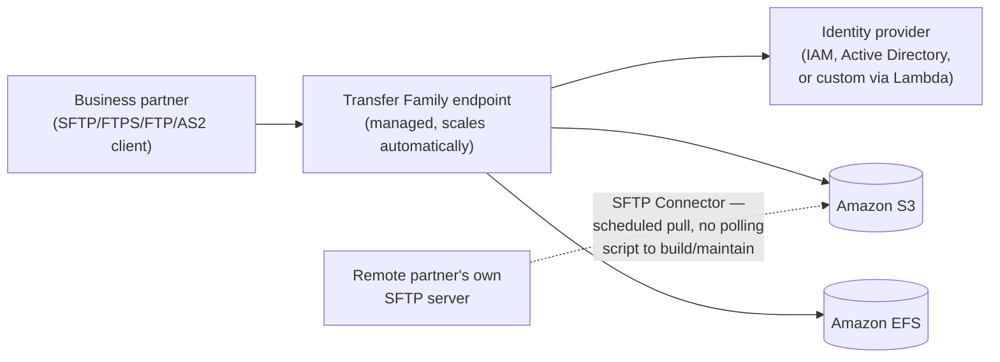

Walkthrough: partners connect using the exact same protocol clients and credentials workflow they
already use — the managed **endpoint** handles authentication (pluggable: IAM, Active Directory,
or a custom Lambda-based authorizer) and writes directly to **S3 or EFS**, with no EC2 instance
anywhere in this picture for you to patch or scale. The dashed **SFTP Connector** path (the
inverse direction — pulling from a partner's server rather than receiving pushes) removes an
entire category of custom polling-script engineering that would otherwise need its own hosting.

### Real AWS Image


*Source: [AWS Transfer Family User Guide — SFTP connectors](https://docs.aws.amazon.com/transfer/latest/userguide/create-sftp-connector.html)*

This diagram shows the SFTP Connector's real integration points: Secrets Manager for the remote
server's credentials (so they're never hardcoded anywhere), CloudWatch for transfer logging, and
IAM roles governing exactly what the connector can touch in S3 — the same security-and-
observability pattern AWS applies across its managed services, here specifically removing the
need for a custom script to re-implement credential storage and logging from scratch.

### Exam Tips

- "Partner/vendor requires SFTP/FTPS/FTP/AS2, data should land in S3 or EFS, currently running
  self-managed servers for this" → AWS Transfer Family, almost always the intended answer.
- **Worked cost math — retiring a self-managed SFTP fleet.** Two m5.large EC2 instances
  ($0.096/hr each) running 24/7 as an SFTP server pair (for HA) cost 2 × $0.096 × 730 ≈
  **$140/month** in compute alone, before counting patching labor (conservatively 4 hours/month
  at $120/hr loaded cost ≈ $480/month) — a combined real cost around **$620/month**. A Transfer
  Family endpoint handling a modest, business-hours-only volume (say 50 GB/month transferred)
  costs roughly $0.30/hour provisioned × 730 ≈ $219/month in endpoint-hours plus 50 × $0.04/GB
  ≈ $2 in transfer, call it **~$221/month** — cutting the fully-loaded cost by over 60% once
  patching labor is honestly counted, which the exam's framing of "fully managed" is specifically
  pointing you toward.
- Transfer Family's billing model (provisioned hours + data) means a partner integration with
  truly minimal, occasional volume should still budget for the endpoint-hour charge — it is not
  a "free unless used" service the way a Lambda function is.

---

## 11. AWS Trusted Advisor

### Definition
AWS Trusted Advisor is an automated service that inspects your AWS environment against best-
practice checks across five categories — **cost optimization**, security, fault tolerance,
performance, and service limits — and surfaces specific, actionable findings (e.g., "this EBS
volume has had zero I/O for 30 days," "this load balancer has no healthy targets").

### Plain-English Analogy
Trusted Advisor is like a building inspector who walks through your entire house on a recurring
schedule and hands you a specific checklist — "this faucet's been dripping money for months,"
"this room's smoke detector battery is dead," "this door doesn't lock properly" — rather than you
having to remember to personally check every room, every system, yourself.

### Purpose
Cost leaks (idle load balancers, unattached EBS volumes, underutilized EC2/RDS instances,
unused Elastic IPs) accumulate quietly in any sufficiently large or long-lived AWS environment,
and nobody manually audits for all of them regularly. Trusted Advisor exists to run that audit
continuously and automatically, surfacing findings proactively instead of waiting for a dedicated
cost-review project to stumble across them.

### When to Use
- Any ongoing cost-governance practice — Trusted Advisor's cost-optimization checks should be a
  recurring, low-effort first pass before a deeper manual cost review.
- Identifying genuinely idle or unattached resources (unattached EBS volumes, idle load balancers,
  underutilized EC2/RDS instances, unassociated Elastic IPs) that are pure waste with no
  tradeoff to removing them.
- A Business or Enterprise Support plan unlocks the *full* set of checks (the free tier only
  includes a handful of core checks) — a scenario implying comprehensive automated auditing is
  implicitly assuming at least Business-level support.

### When NOT to Use
- Trusted Advisor's findings are reactive/retrospective flags, not a purchasing-model or
  architecture-design tool — it tells you *what's wrong now*, not *which Reserved Instance term
  to buy*; pair it with Cost Explorer/Compute Optimizer for the forward-looking decision.
- The Core/free-tier support plan only exposes a limited check set — don't assume full cost-
  optimization coverage without at least Business support.

### Use Cases (cost-focused)
1. **Finding unattached EBS volumes left behind by terminated instances.** A routine Trusted
   Advisor review surfaces dozens of unattached volumes accumulated over two years of test-
   instance churn, each billing for its full provisioned size with zero function — a direct,
   no-tradeoff cost recovery once snapshotted and deleted.
2. **Flagging idle load balancers with no healthy, in-service targets.** An ALB left behind after
   a service migration, still running and billing hourly with nothing actually behind it, is
   surfaced and decommissioned.
3. **Identifying underutilized EC2 instances for right-sizing.** Trusted Advisor's "low
   utilization" EC2 check flags instances averaging well under typical thresholds, feeding the
   same right-sizing decision Compute Optimizer's deeper analysis supports.
4. **Surfacing unassociated Elastic IP addresses still being billed.** AWS charges for Elastic IPs
   not attached to a running instance; Trusted Advisor's check catches these before they
   accumulate across dozens of forgotten addresses.
5. **Reserved Instance/Savings Plan optimization checks flagging underused commitments.**
   Trusted Advisor flags Reserved Instances with declining utilization (e.g., the workload they
   were purchased for has shrunk), prompting a review of whether to modify, sell (on the RI
   Marketplace), or let the commitment run out.
6. **Running Trusted Advisor checks across a whole AWS Organization via the Organizational view
   (TAO).** A company with 40 member accounts runs Trusted Advisor's cost checks aggregated across
   all of them at once, rather than logging into each account individually — turning a 40-account
   manual audit into one dashboard.

### Why Important
Trusted Advisor is the domain's "automated detection of pure waste" tool, distinct from the
purchasing-model decisions (Reserved/Spot/Serverless) the four framework docs cover — a scenario
describing "idle/unattached/underutilized resources quietly adding to the bill" is a Trusted
Advisor signal specifically, not a different cost-management tool.

### Diagram

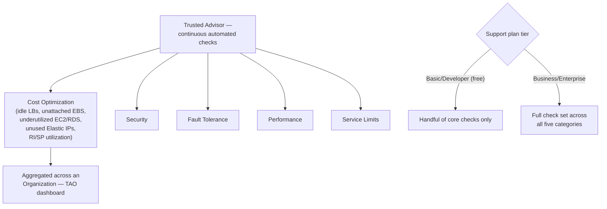

Walkthrough: the **support tier branch** is the single most commonly tested gotcha in this area —
a scenario implying "we're running Trusted Advisor's full cost-optimization check set" is
implicitly also describing at least a Business support plan, since the free Basic/Developer tier
exposes only a small number of core checks (not the full cost category). The **Organization**
branch (TAO) is the mechanism for running this once across many accounts instead of per-account.

### Real AWS Image


*Source: [AWS Guidance — Cloud Intelligence Dashboards, Trusted Advisor Organizational dashboard](https://docs.aws.amazon.com/guidance/latest/cloud-intelligence-dashboards/trusted-advisor-organizational-dashboard.html)*

This dashboard is exactly the aggregated, multi-account view from the diagram's "Org" branch —
findings broken down by category and by individual member account, which is how a central cloud-
governance team at a large organization turns dozens of separate Trusted Advisor consoles into
one reviewable report, without logging into every account one at a time.

### Exam Tips

- "Idle/unattached/underutilized resource quietly costing money" → Trusted Advisor's cost-
  optimization checks are the detection mechanism; the *fix* (delete the volume, right-size the
  instance, add an endpoint) is whatever that specific resource's framework doc recommends.
- **Worked cost math — recovering idle waste.** A Trusted Advisor audit finds 40 unattached
  200 GB gp3 EBS volumes (at roughly $0.08/GB-month) that have existed for an average of 14
  months. Monthly waste: 40 × 200 × $0.08 = **$640/month**. Across the 14-month average
  existence: 40 × 200 × $0.08 × 14 ≈ **$8,960** already spent on volumes attached to nothing —
  a number worth presenting to leadership as "recovered," not just "future savings," once the
  volumes are snapshotted and deleted.
- A question describing comprehensive cost-optimization check coverage ("all five categories,"
  "every check available") is implicitly requiring Business or Enterprise support — flag the
  support-tier detail if a scenario's stated plan is Basic/Developer and still expects full
  coverage, since that combination is internally inconsistent.

---

## 12. Additional Governance Services

### Definition
This section covers the lower-exam-weight management/governance services most relevant to cost
in Domain 4: **AWS Control Tower** (automated multi-account landing zone setup), **AWS Compute
Optimizer** (utilization-based right-sizing, also covered under Cost Management Tools), **AWS
Health Dashboard** (account-specific operational/service health events), and **Service Catalog**
(governed, pre-approved self-service product catalog for provisioning standardized resources).

### Plain-English Analogy
Control Tower is a franchise headquarters handing every new store a pre-approved blueprint, fire-
code checklist, and standard point-of-sale system on day one, instead of each store manager
inventing their own from scratch (and some inevitably skipping the fire code). Service Catalog is
that same franchise's approved equipment list — employees can order a new espresso machine, but
only from the pre-approved, pre-negotiated vendor list, not whatever they personally find online.

### Purpose
As an organization grows past a handful of AWS accounts, ungoverned self-service access to AWS
becomes a cost (and security) risk — anyone can spin up an oversized instance, pick an expensive
unapproved service, or skip tagging entirely, making later cost allocation impossible. Control
Tower and Service Catalog exist to make the *governed, standardized* path the easy path, so cost-
optimized defaults (tagging, approved instance types, budget guardrails) happen automatically
rather than by individual discipline.

### When to Use
- **Control Tower:** establishing a new multi-account AWS environment with consistent guardrails
  (including cost-related ones, like preventing public S3 buckets or mandating tagging) across
  every account from account creation onward.
- **Service Catalog:** letting developers self-service-provision infrastructure, but only from a
  centrally-governed, cost-approved set of templates (right-sized by default, correctly tagged,
  pre-vetted for cost) rather than freeform console access.
- **Compute Optimizer:** (see Section 2) any right-sizing decision before a purchasing-model
  commitment.

### When NOT to Use
- A single-account, small-team environment rarely needs Control Tower's multi-account landing-
  zone machinery — it's solving an organizational-scale governance problem, not a technical one a
  small team has yet.
- Service Catalog adds governance overhead that's unnecessary friction for a small, trusted team
  that doesn't have a cost-governance or compliance problem to solve with it.

### Use Cases (cost-focused)
1. **New account guardrails preventing an oversized resource from ever launching.** A Control
   Tower preventive guardrail blocks launching instance types outside an approved list in new
   member accounts, stopping an expensive mis-click before it ever generates a bill.
2. **Service Catalog standardizing a "right-sized by default" EC2 launch template.** Developers
   self-service-provision a new application stack from a pre-approved Service Catalog product
   that defaults to a cost-appropriate instance size and includes the correct cost-allocation
   tags automatically, removing both the oversizing risk and the "forgot to tag it" cost-
   allocation gap.
3. **Control Tower's mandatory tagging guardrail enabling accurate chargeback.** Before Control
   Tower, cost allocation across business units was guesswork due to inconsistent tagging; a
   mandatory tagging guardrail applied account-wide makes Cost Explorer's tag-based filtering
   actually trustworthy.
4. **Consolidating 12 previously separate AWS accounts under one Control Tower-managed
   Organization.** Beyond governance, this pools Savings Plan/Reserved Instance discounts and
   volume-tier pricing (S3, data transfer) across all member accounts — a direct cost benefit of
   the consolidation Control Tower makes operationally manageable.
5. **AWS Health Dashboard surfacing a deprecated-instance-type notice before it becomes an
   emergency migration.** An account-specific Health event flags an upcoming retirement of a
   legacy instance type/generation well in advance, letting a planned, unhurried migration to a
   newer (often cheaper, better price-performance) instance generation happen on the team's own
   schedule instead of under deadline pressure.
6. **Compute Optimizer feeding a Service Catalog product's default instance size.** An
   organization periodically updates its Service Catalog templates' default instance types based
   on Compute Optimizer's fleet-wide recommendations, so every *new* resource provisioned through
   the catalog starts right-sized rather than needing a later correction.

### Why Important
These services operationalize the cost discipline the rest of this domain describes — a
guardrail or a standardized template makes the cost-optimized choice the *default*, rather than
relying on every individual engineer remembering every lesson from the four decision-framework
docs. The exam's governance-adjacent cost questions ("how do you ensure consistent tagging/
guardrails across many accounts") map here.

### Diagram

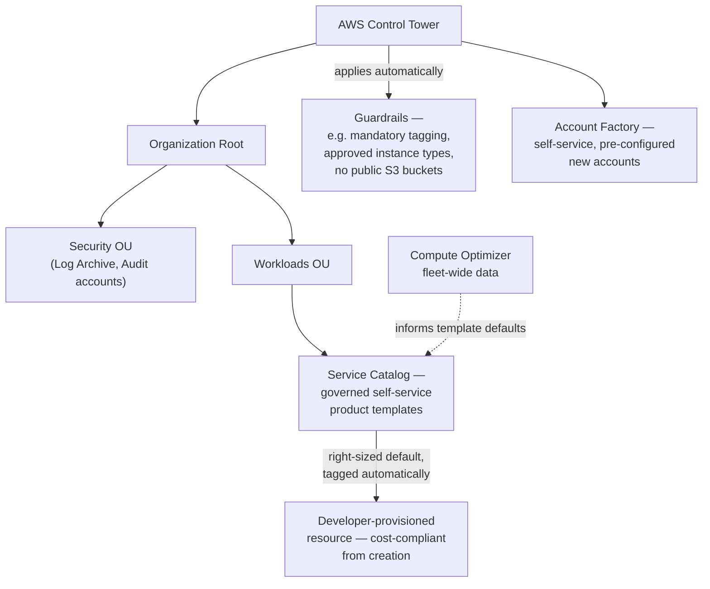

Walkthrough: **Control Tower's guardrails** apply the moment an account is created via **Account
Factory**, so cost-governance rules exist before anyone provisions a single resource. Within a
workload account, **Service Catalog** is the day-to-day mechanism developers actually interact
with — self-service provisioning, but from templates whose defaults (instance size, tags) are
centrally maintained and, per the dashed arrow, periodically refreshed using real fleet-wide
Compute Optimizer data rather than guesswork.

### Real AWS Image


*Source: [AWS Prescriptive Guidance — Designing an AWS Control Tower landing zone](https://docs.aws.amazon.com/prescriptive-guidance/latest/designing-control-tower-landing-zone/account-structure.html)*

This real reference architecture shows the OU structure Control Tower automates: a **Security OU**
for Log Archive/Audit accounts, an **Infrastructure OU** for shared services (including, notably,
a dedicated Backup account — tying directly back to Section 1), and a **Workloads OU** for actual
application accounts — the structural backbone that makes consistent guardrails and consolidated
billing/discounts across many accounts actually manageable at scale.

### Exam Tips

- "Consistent guardrails/tagging across many new AWS accounts from day one" → Control Tower.
  "Governed self-service provisioning from pre-approved, right-sized templates" → Service
  Catalog — these solve adjacent but distinct problems and the exam tests the distinction.
- **Worked cost math — consolidated billing's discount-pooling effect.** Twelve regional accounts
  each independently purchase Reserved Instances at their own (smaller) usage volume, qualifying
  only for standard tier discounts. Consolidating under one Control Tower-managed Organization
  pools all twelve accounts' usage for Savings Plans and S3 volume-tier pricing — if combined
  S3 storage crosses a volume-discount tier threshold (e.g., over 500 TB/month qualifying for a
  lower per-GB rate across the *whole* pooled volume instead of each account separately falling
  short of that threshold), the savings apply to every account's usage simultaneously with zero
  change to any individual workload.
- AWS Health Dashboard's account-specific events (as opposed to the public AWS Service Health
  Dashboard) are the ones that warn of things like upcoming EC2 instance retirement — a scenario
  about planning ahead for a deprecation is pointing here, not the public status page.

---

## 13. Amazon Aurora

### Definition
Amazon Aurora is AWS's MySQL- and PostgreSQL-compatible relational database engine, built on a
distributed, auto-scaling, self-healing shared storage layer decoupled from compute — storage
scales automatically in 10 GiB increments up to 128 TiB, and **Aurora Serverless v2** adds
on-demand, fine-grained compute scaling on top of that same storage layer.

### Plain-English Analogy
A standard RDS instance is a house you build at a fixed size — if the family grows, you're stuck
renovating. Aurora's storage layer is more like renting a storage unit facility that silently adds
more units as you need them and removes them as you empty them out, with the billing following
exactly what's filled, not a fixed unit size. Aurora Serverless v2 extends that same idea to the
*compute* side — the "staff on duty" scales up and down with actual customer traffic rather than
a fixed headcount scheduled for a guessed-at busy day.

### Purpose
Standard RDS requires pre-provisioning both storage and compute to a guessed capacity, with
storage in particular typically over-provisioned to avoid a disruptive resize later. Aurora's
separated, auto-scaling storage layer removes the storage-sizing guess entirely, and Aurora
Serverless v2 extends the same philosophy to compute, letting both halves track real usage rather
than a provisioned guess.

### When to Use
- A MySQL/PostgreSQL-compatible relational workload needing higher throughput/availability than
  standard RDS, where Aurora's architecture (6-way replicated storage across 3 AZs, fast
  failover) is worth its modest price premium over RDS.
- Variable, spiky, or hard-to-forecast relational load — Aurora Serverless v2 scales compute in
  real time without a manual resize or scheduled scaling action.
- Global applications needing low-latency reads across Regions — Aurora Global Database
  replicates with sub-second typical lag without the cost/complexity of building that
  replication yourself.

### When NOT to Use
- A genuinely steady, well-understood, small workload where standard RDS's lower baseline price
  (Aurora costs more than equivalent RDS MySQL/PostgreSQL for the same provisioned capacity) isn't
  offset by any throughput/availability benefit actually needed.
- Non-MySQL/PostgreSQL-compatible engine requirements (Oracle, SQL Server) — Aurora only supports
  those two engines; RDS is the only option for the others.

### Use Cases (cost-focused)
1. **A promotional-event database scaling to near-zero outside flash sales.** Aurora Serverless
   v2 scales from near-idle Aurora Capacity Units up to a configured maximum automatically during
   a flash sale, then back down afterward, with no standing reservation sized for a peak that
   occurs only a few days a year.
2. **Removing the storage over-provisioning tax that RDS workloads often carry.** A workload
   migrated from an RDS instance that had been pre-provisioned at 2 TB "to be safe" (using only
   600 GB) moves to Aurora, which bills for actual storage consumed and grows automatically —
   removing the wasted-headroom cost entirely.
3. **Aurora I/O-Optimized for an I/O-heavy reporting workload.** A workload whose per-I/O charges
   under Aurora's standard configuration exceed what a flat I/O-Optimized price would cost
   switches configurations (not instance size), directly reducing the bill for I/O-dominant
   access patterns.
4. **Per-tenant Aurora Serverless v2 clusters for a multi-tenant SaaS product.** Rather than one
   large, permanently-provisioned shared cluster sized for the sum of every tenant's peak, each
   premium tenant gets an isolated Serverless v2 cluster that scales to near-zero outside that
   specific customer's business hours.
5. **Aurora Global Database avoiding a custom cross-Region replication build.** A company needing
   low-latency reads in three Regions uses Aurora Global Database instead of engineering its own
   replication pipeline — both an engineering-cost avoidance and a performance win, with pricing
   based on replicated write I/O rather than a flat per-Region instance cost.
6. **Reserved pricing for Aurora's steady, well-understood production baseline.** Once a
   production Aurora cluster's load is confirmed stable over a year of observation, a Reserved
   Instance commitment captures the same ~discount mechanism as RDS/EC2 Reserved pricing, layered
   on top of Aurora's already-efficient storage model.

### Why Important
Aurora is the domain's example of "the database's own architecture can be the cost optimization" —
separate from any purchasing-model choice, the storage-compute separation and Serverless v2's
fine-grained scaling remove waste that a standard RDS deployment structurally can't avoid without
manual intervention. Task 4.3 explicitly lists "engine choice... serverless options," which is
Aurora (and Aurora Serverless v2 specifically) front and center.

### Diagram

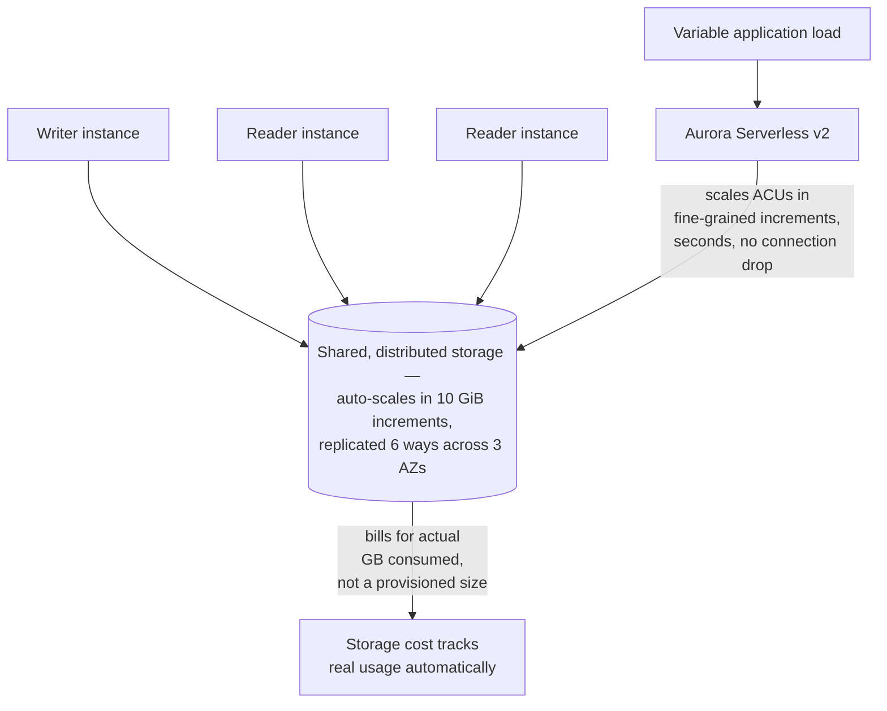

Walkthrough: every instance (one writer, any number of readers) shares the **same underlying
storage volume** rather than each having its own copy — this is both Aurora's performance/HA
trick (readers see the writer's changes almost immediately, failover is fast because a new writer
just attaches to the same storage) and its cost trick (storage is billed once, for actual bytes
used, auto-growing rather than pre-provisioned). **Serverless v2** scales the compute side
against that same shared storage, closing the loop on both dimensions tracking real usage.

### Real AWS Image


*Source: [Amazon Aurora User Guide — Amazon Aurora DB clusters](https://docs.aws.amazon.com/AmazonRDS/latest/AuroraUserGuide/Aurora.Overview.html)*

This official architecture diagram makes the shared-storage model visually obvious: one storage
volume underneath, multiple compute instances on top. The cost-relevant takeaway: adding a read
replica in Aurora means adding compute cost only — there's no duplicated storage cost the way
there would be if each replica needed its own full copy of the data, which is cheaper than the
mental model many candidates default to from non-Aurora relational databases.

### Exam Tips

- "MySQL/PostgreSQL-compatible, needs more throughput/availability than RDS, OR has spiky/
  unpredictable load" → Aurora (Serverless v2 specifically for the spiky case). "Steady, modest,
  cost-sensitive, standard engine fits fine" → plain RDS may actually be cheaper.
- **Worked cost math — Serverless v2 vs. provisioned for a 9-to-6 workload.** A reporting database
  needed only 9am-6pm on business days (9 hours × ~21.7 weekdays/month ≈ 195 active hours/month
  out of 730 total) runs on a db.r6g.xlarge equivalent (4 vCPU, 32 GB, ~8 ACUs) if provisioned
  24/7: 8 ACUs × $0.12/ACU-hr × 730 ≈ **$701/month**. On Aurora Serverless v2, scaling to roughly
  8 ACUs only during the 195 active hours and down to a 0.5 ACU floor the remaining 535 hours:
  (8 × 195 + 0.5 × 535) × $0.12 ≈ (1,560 + 267.5) × $0.12 ≈ 1,827.5 × $0.12 ≈ **$219/month** —
  roughly a 69% reduction for a workload whose actual usage pattern simply doesn't match 24/7
  provisioning.
- "No duplicated storage cost per read replica" is a detail worth stating explicitly if a
  question's cost comparison assumes Aurora replicas scale storage cost linearly the way a
  non-shared-storage engine would.

---

## 14. Amazon CloudFront

### Definition
Amazon CloudFront is AWS's global content delivery network (CDN) — it caches content (static
assets, API responses, video) at edge locations physically close to end users, serving cached
responses from the edge instead of the origin server for every cache hit, and reducing both
latency and the origin's data-transfer-out billing.

### Plain-English Analogy
Without a CDN, every single customer walks all the way to the one central warehouse to pick up
their order, no matter where in the world they live. CloudFront is a network of local pickup
lockers stocked with the most commonly requested items — most customers grab what they need from
the nearby locker and never make the trip to the warehouse at all, and the warehouse (the origin)
only has to ship to replenish lockers occasionally, not fulfill every single customer request
individually.

### Purpose
Serving every request directly from an origin server means paying that origin's full data-
transfer-out rate for every single byte, to every user, regardless of how repetitive the content
is. CloudFront exists to intercept the repetitive part: a cache hit at the edge means the origin
never sees that request at all, which is both a latency win (closer to the user) and a direct,
continuous reduction in the origin's billed data transfer.

### When to Use
- Static or semi-static content (images, CSS/JS, downloadable files) served to a geographically
  distributed audience, where caching at the edge meaningfully reduces repeat origin hits.
- Reducing the data-transfer-out cost of an S3-hosted website or API — CloudFront's data transfer
  pricing from AWS origins to CloudFront edge is free, and CloudFront's own data transfer to
  users, at volume, is often cheaper than S3's direct internet egress rate.
- Protecting an origin from traffic spikes (viral content, a launch event) by absorbing the bulk
  of repeat requests at the edge rather than letting the origin take the full brunt.

### When NOT to Use
- Highly dynamic, uncacheable, per-user-unique content gains little from CloudFront's caching —
  though it can still help via protocol optimizations and reduced origin connection overhead even
  for some dynamic content, it isn't the cost lever it is for cacheable assets.
- A purely internal, single-Region application with no geographically distributed audience likely
  doesn't need CDN caching at all — the added configuration isn't worth it without distributed
  users.

### Use Cases (cost-focused)
1. **An e-commerce site's product images served almost entirely from edge cache.** With a high
   cache-hit ratio on product photos, the vast majority of image requests never reach the origin
   S3 bucket at all, cutting S3's data-transfer-out bill dramatically versus serving images
   directly from S3 to every user.
2. **A software download site avoiding the origin's egress cost for a viral release.** A new
   version's installer, cached at edge locations worldwide, absorbs a launch-day traffic spike
   almost entirely at the edge — the origin serves the file once per edge location's cache miss,
   not once per actual download.
3. **Regional Edge Caches reducing origin trips for less-popular-but-still-cacheable content.**
   Content too infrequently requested to stay in every edge location's cache still benefits from
   an intermediate regional cache tier before falling back to the origin, reducing (though not
   eliminating) origin hits for the long tail of content.
4. **Reducing cross-Region data transfer cost for a global audience hitting a single-Region
   origin.** Rather than replicating an application to every Region purely to reduce transfer
   cost/latency, CloudFront's edge caching captures much of that benefit for cacheable content
   without the operational cost of multi-Region replication.
5. **Origin Shield reducing duplicate origin requests across many edge locations.** For an origin
   serving many edge locations, Origin Shield adds one additional caching layer that consolidates
   near-simultaneous cache misses from different edges into a single origin request, protecting
   origin capacity (and cost) during a traffic spike.
6. **Signed URLs/cookies controlling exactly who can rack up CloudFront's usage-based bill.** A
   premium video-streaming feature behind CloudFront signed URLs prevents unauthorized hot-
   linking from driving up data-transfer costs for content that should only be served to paying
   users.

### Why Important
CloudFront is the domain's example of "reducing *origin* cost by reducing requests that ever reach
it," distinct from every other network lever in this domain that's about choosing a cheaper *path*
for traffic that still happens — CloudFront reduces the amount of traffic that needs to happen in
the first place for a cacheable workload.

### Diagram

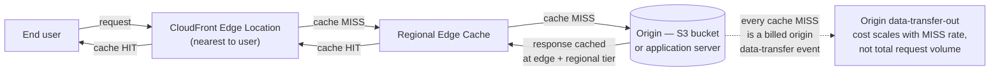

Walkthrough: the whole cost story lives in the gap between **total requests** and **cache
misses** — a high cache-hit ratio means the **Origin** box at the bottom only ever sees a small
fraction of total traffic, and that fraction (not the full request volume) is what drives the
origin's billed data transfer. The **Regional Edge Cache** tier exists specifically to catch
misses from individual edge locations before they become origin hits, improving the effective
hit ratio for content too long-tail to stay cached at every single edge location simultaneously.

### Real AWS Image


*Source: [Amazon CloudFront Developer Guide — How CloudFront delivers content](https://docs.aws.amazon.com/AmazonCloudFront/latest/DeveloperGuide/Introduction.html)*

This is AWS's own canonical request-flow diagram, and the detail worth internalizing for cost
purposes is exactly how few hops a cache **hit** takes (edge location straight back to the user)
versus a cache **miss** (edge → origin → edge → user) — every miss is strictly more expensive and
slower than a hit, which is the entire argument for tuning cache behavior (TTLs, cache keys,
Origin Shield) as a cost lever, not just a performance one.

### Exam Tips

- "Reduce latency AND origin data-transfer cost for geographically distributed users accessing
  cacheable content" → CloudFront — the exam frequently frames this as a dual-benefit question,
  and both halves are correct simultaneously.
- **Worked cost math — CloudFront cache hit ratio and origin savings.** An application serves
  10 TB/month of static assets. Direct-from-S3 data transfer out to the internet costs roughly
  $0.09/GB at that volume tier: 10,240 GB × $0.09 ≈ **$922/month**. With CloudFront achieving an
  85% cache-hit ratio, only 15% of that volume (1,536 GB) actually reaches the origin as an S3
  egress-to-CloudFront transfer (which, AWS-origin-to-CloudFront, is free), while CloudFront's own
  data transfer to users at that volume runs at a comparable or lower blended rate than direct S3
  egress at scale — the origin's own egress bill effectively drops to near **$0** (S3-to-
  CloudFront transfer isn't billed as internet egress), with CloudFront's separate data-transfer-
  out charge replacing it, typically at a similar or better rate at volume, plus the latency win
  from edge delivery as a bonus that cost math alone doesn't capture.
- "Viral spike, origin getting overwhelmed" is as much a CloudFront caching/Origin Shield question
  as it is an Auto Scaling one — don't reach only for "scale the origin bigger" when "stop most
  requests from reaching the origin at all" is the more directly cost-effective fix.

---

## 15. Amazon DynamoDB

### Definition
Amazon DynamoDB is a fully managed, serverless NoSQL key-value and document database offering
single-digit-millisecond latency at any scale, with two billing modes — **On-Demand** (pay per
request, no capacity planning) and **Provisioned** (pay for configured read/write capacity units,
optionally with Auto Scaling) — and no server to size, patch, or manage in either mode.

### Plain-English Analogy
Provisioned DynamoDB without Auto Scaling is like pre-ordering a fixed number of pizzas for a
party before you know the headcount — guess low and guests go hungry (throttling), guess high and
you're stuck with cold leftovers (paying for unused capacity). On-Demand is ordering exactly one
pizza per guest who actually shows up and asks for one — no guessing, though each individual slice
costs a little more than it would have in a well-guessed bulk order.

### Purpose
Relational databases require pre-provisioned instance capacity regardless of actual traffic.
DynamoDB's two modes exist to offer a genuine choice on that spectrum: On-Demand removes the
capacity-planning problem entirely (and the throttling risk from guessing wrong), while
Provisioned + Auto Scaling is cheaper per-request once a workload's traffic pattern is well
enough understood to forecast confidently.

### When to Use
- **On-Demand:** new, unpredictable, or highly spiky traffic where you have no reliable usage
  history to provision against, or where the cost of occasional throttling (on under-provisioned
  Provisioned capacity) is unacceptable.
- **Provisioned + Auto Scaling:** steady, well-understood traffic where the lower per-request
  rate at forecastable volume outweighs On-Demand's simplicity.
- Any workload whose access pattern is genuinely key-value/simple-document, regardless of billing
  mode choice — this is first and foremost a database-selection decision (see Section 23).

### When NOT to Use
- Provisioned mode *without* Auto Scaling for a growing or variable workload — this risks
  `ProvisionedThroughputExceededException` throttling the moment traffic exceeds the fixed
  capacity, which is a functional failure, not just a missed discount.
- Forcing complex multi-table joins or ad hoc relational queries onto DynamoDB when the access
  pattern genuinely needs a relational engine — that's a database-selection mismatch, not a
  billing-mode problem.

### Use Cases (cost-focused)
1. **A brand-new product feature launching with zero traffic history.** The table starts in
   On-Demand mode, avoiding both the risk of guessing capacity wrong (throttling at launch, the
   worst possible time) and the cost of over-provisioning "to be safe" for a traffic pattern
   nobody can forecast yet.
2. **A year-old table with stable, well-understood traffic switching to Provisioned + Auto
   Scaling.** Once On-Demand billing itself has revealed a clear, steady baseline request volume,
   moving to Provisioned captures a lower per-request rate for that now-predictable load, with
   Auto Scaling still covering any residual variability.
3. **DynamoDB Reserved Capacity purchased against a confirmed steady floor.** After Provisioned +
   Auto Scaling has run stably for a year, a Reserved Capacity commitment (DynamoDB's equivalent
   of a Reserved Instance/Savings Plan) locks in a further discount on top of Provisioned's
   already-lower per-request rate.
4. **Migrating a high-volume key-value workload out of RDS entirely.** A "recently viewed items"
   feature forced into the same relational instance as an order database moves to DynamoDB,
   removing a permanently-provisioned RDS cost for a workload with no relational need, replaced
   by DynamoDB cost that scales with actual item count/traffic.
5. **DynamoDB Standard-IA table class for a table with a large, rarely-accessed portion.** A
   table storing years of historical records, most of which are read rarely, moves to the
   Standard-Infrequent-Access table class, trading a lower storage price for a higher per-request
   price — a direct storage-vs-request cost tradeoff analogous to S3's Standard-IA tier.
6. **Avoiding DynamoDB Accelerator (DAX) cost for a workload that doesn't need microsecond
   latency.** A team correctly skips adding a DAX caching layer (itself a billed, provisioned
   resource) for a workload whose single-digit-millisecond DynamoDB latency is already fully
   sufficient, avoiding an unnecessary added cost layer.

### Why Important
DynamoDB's billing-mode choice is this domain's cleanest illustration of "pay-per-request vs.
pay-for-provisioned-capacity" as a general cost pattern that recurs across several services in
this domain (Aurora Serverless v2, Fargate, Lambda all share the same underlying logic). Task 4.3
names "DynamoDB vs RDS" explicitly.

### Diagram

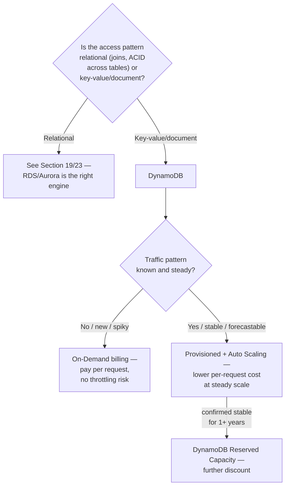

Walkthrough: the **first** decision (relational vs. key-value) is a database-selection question,
not a DynamoDB-internal one — getting this wrong (forcing a relational workload onto DynamoDB, or
vice versa) is a bigger cost mistake than any billing-mode choice downstream of it. Only once
you're confidently in the **key-value/document** branch does the On-Demand vs. Provisioned
decision apply, and even that has its own maturity path (On-Demand → Provisioned+AutoScaling →
Reserved Capacity) as confidence in the traffic pattern grows over time.

### Real AWS Image


*Source: [Amazon DynamoDB Developer Guide — Partitions and data distribution](https://docs.aws.amazon.com/amazondynamodb/latest/developerguide/HowItWorks.CoreComponents.html)*

This diagram shows *why* DynamoDB has no "instance" to right-size at all — data and throughput
are spread across partitions automatically based on the partition key's hash, which is also why a
poorly-chosen partition key (one with low cardinality, causing a "hot partition") can degrade
performance and effectively waste provisioned capacity concentrated on one overloaded partition
while the rest sit idle — a cost-relevant detail: hot-partition problems manifest as throttling
even with seemingly generous total provisioned capacity, because that capacity isn't evenly used.

### Exam Tips

- "New table / unpredictable / can't tolerate throttling risk" → On-Demand. "Steady, well-
  forecast, cost-sensitive at scale" → Provisioned + Auto Scaling. "Confirmed steady for 1+
  years" → layer on Reserved Capacity.
- **Worked cost math — On-Demand vs. Provisioned for a steady 1,000 WCU/500 RCU workload.** At
  roughly $1.25 per million write request units and $0.25 per million read request units
  (On-Demand rates), a table doing a steady 1,000 writes/sec and 500 reads/sec for 730 hours
  (2,628,000 seconds) processes 2,628,000,000 writes and 1,314,000,000 reads/month — On-Demand
  cost ≈ 2,628 × $1.25 + 1,314 × $0.25 ≈ $3,285 + $328.50 ≈ **$3,613.50/month**. The equivalent
  steady Provisioned capacity (1,000 WCU + 500 RCU, no Auto Scaling needed since it's genuinely
  flat) costs roughly 1,000 × $0.00065/WCU-hr × 730 + 500 × $0.00013/RCU-hr × 730 ≈ $474.50 +
  $47.45 ≈ **$522/month** — Provisioned is roughly **85% cheaper** for traffic this steady and
  well-understood, which is exactly why the exam never treats On-Demand as a universally cheaper
  default.
- A table class switch (Standard to Standard-IA) is a pure storage/request-price tradeoff
  independent of billing mode — both can combine (e.g., On-Demand + Standard-IA) if the access
  pattern justifies each independently.

---

## 16. Amazon EBS

### Definition
Amazon Elastic Block Store (EBS) provides persistent, network-attached block storage volumes for
EC2 instances, available in several volume types (gp3/gp2 general purpose SSD, io2/io1
provisioned IOPS SSD, st1/sc1 HDD for throughput-oriented workloads) billed for provisioned
capacity (and, for io2/io1, provisioned IOPS) regardless of actual usage or whether the volume is
even attached to a running instance.

### Plain-English Analogy
An EBS volume is like a storage unit you rent by the month — you pay for the entire unit's square
footage whether it's half-empty, completely full, or (easy to forget) the apartment it was
servicing has already moved out. That last case — a volume still billing after its instance is
long gone — is the single most common real-world and exam EBS cost leak.

### Purpose
EBS's provisioned-capacity billing model means cost is a direct function of **what you provision**,
not what you actually use — making right-sizing, snapshot lifecycle management, and (especially)
cleaning up unattached volumes the core cost levers, distinct from any purchasing-model decision
(EBS has no Reserved/Spot equivalent the way EC2 compute does).

### When to Use
- Persistent block storage for an EC2 instance's OS/application/database files, where data must
  survive instance stop/start or even termination (with the right settings).
- **gp3** as the default general-purpose choice (allows independently provisioning IOPS/
  throughput beyond the baseline without upsizing capacity, unlike gp2) for most workloads.
- **io2/io1** specifically for sustained, high, consistent IOPS requirements (large relational
  databases) where gp3's provisionable ceiling isn't sufficient.
- **st1/sc1** for large, throughput-oriented, sequential workloads (big data, log processing)
  where per-GB cost matters more than IOPS.

### When NOT to Use
- Ephemeral, easily-regenerable scratch data that doesn't need to survive instance termination
  can use instance store (physically attached, included in the instance's cost, faster, but gone
  if the instance stops/terminates) instead of paying for a separate EBS volume.
- Leaving io2/io1's provisioned IOPS set far above what the workload actually sustains is pure
  waste — provisioned IOPS bills regardless of whether they're ever used.

### Use Cases (cost-focused)
1. **Cleaning up unattached volumes left behind by terminated instances.** A Trusted Advisor-
   style audit (see Section 11) finds dozens of unattached EBS volumes accumulated over years of
   test-instance churn, each billing for its full provisioned size with zero function — snapshotted
   then deleted for a direct, risk-free cost recovery.
2. **Migrating gp2 volumes to gp3 for a flat ~20% cost reduction.** gp3 is priced lower per-GB
   than gp2 at the same baseline performance (3,000 IOPS / 125 MiB/s included), with IOPS/
   throughput provisionable independently beyond that baseline if ever needed — a mechanical
   migration with essentially no downside for most workloads still on gp2.
3. **Right-sizing over-provisioned io2 IOPS.** A database volume provisioned at 10,000 IOPS "to
   be safe" but observed (via CloudWatch) to sustain under 3,000 IOPS in practice is resized
   down, directly cutting the provisioned-IOPS charge without any performance impact on the
   actual workload.
4. **Leveraging incremental snapshots instead of full-volume-sized backups.** Because each EBS
   snapshot after the first stores only changed blocks, a frequent-snapshot strategy costs far
   less than the full volume size might suggest — though deleting an *early* snapshot in a chain
   doesn't necessarily free as much space as expected if later snapshots still reference its data.
5. **Fast Snapshot Restore used sparingly, not by default.** Fast Snapshot Restore (which
   eliminates the "first-touch" latency penalty when restoring a volume from snapshot) has its
   own hourly charge per snapshot per AZ — enabling it reflexively for snapshots that don't need
   instant restore performance is an avoidable added cost.
6. **Choosing st1 over gp3 for a large, throughput-bound big-data workload.** A workload doing
   large sequential reads/writes (log processing, big-data staging) at a size where per-GB cost
   dominates the decision moves to st1, which is priced meaningfully lower per-GB than SSD-backed
   options for exactly this access pattern.

### Why Important
EBS is the domain's primary example of storage cost being driven by **provisioned capacity**
regardless of use — unlike S3 (pay for what's stored) or DynamoDB (pay for requests/capacity
units), an EBS volume's bill doesn't shrink just because the data on it does, which is exactly why
unattached-volume cleanup and right-sizing provisioned IOPS are the two most frequently tested
EBS cost actions.

### Diagram

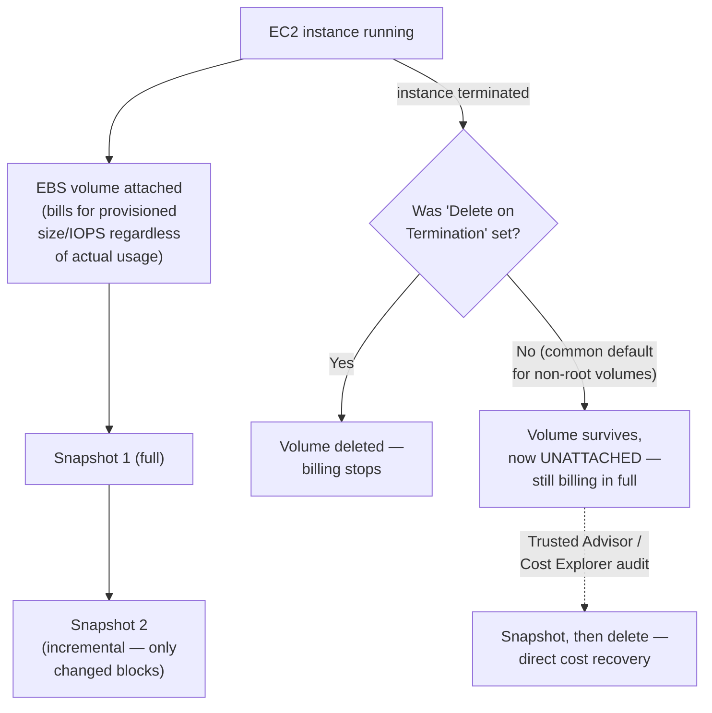

Walkthrough: the **Delete on Termination** flag at instance-termination time is the single
highest-leverage setting in this whole diagram — it's frequently left at its non-root-volume
default (often *not* delete), which is precisely how unattached volumes accumulate silently over
months or years of test-instance churn, feeding directly into the audit-and-cleanup cycle Trusted
Advisor automates.

### Real AWS Image


*Source: [Amazon EBS User Guide — Amazon EBS snapshots](https://docs.aws.amazon.com/ebs/latest/userguide/ebs-snapshots.html)*

This diagram is the exact mechanism behind Use Case 4: Snap A is a full copy, but Snap B stores
only the blocks that changed since Snap A, referencing the rest — so three snapshots of a 15 GiB
volume do **not** cost 3 × 15 GiB worth of storage; they cost roughly the size of the first full
snapshot plus only the changed data in each subsequent one, which is why frequent snapshotting is
far cheaper than a naive "full backup every time" mental model would suggest.

### Exam Tips

- "Unattached/orphaned EBS volumes quietly costing money" is one of the most recognizable exam
  tells in this entire domain — the fix is always "identify via Trusted Advisor/Cost Explorer,
  snapshot as a safety net, then delete," never "leave it running just in case" by default.
- **Worked cost math — gp2 to gp3 migration.** A fleet of 100 × 500 GB gp2 volumes at roughly
  $0.10/GB-month costs 100 × 500 × $0.10 = **$5,000/month**. Migrating to gp3 at roughly
  $0.08/GB-month (same baseline 3,000 IOPS / 125 MiB/s included, no extra charge needed for most
  of this fleet) costs 100 × 500 × $0.08 = **$4,000/month** — a flat **$1,000/month** ($12,000/
  year) reduction for a one-time, typically non-disruptive migration with no workload change.
- Provisioned IOPS (io2/io1) bills for the IOPS number itself, separate from and in addition to
  the GB-month storage charge — a scenario describing a database with modest storage size but a
  very high IOPS requirement is testing whether you remember provisioned IOPS is its own billed
  dimension, not bundled into the per-GB rate the way gp3's baseline IOPS is.

---

## 17. Amazon EC2

### Definition
Amazon EC2 provides resizable virtual compute instances across many families optimized for
different workload shapes (general purpose, compute-optimized, memory-optimized, storage-
optimized, accelerated computing), priced under multiple purchasing models — On-Demand, Reserved
Instances, Savings Plans, and Spot — on top of a choice of processor architecture (x86 Intel/AMD,
or Graviton/ARM) that itself affects price-performance.

### Plain-English Analogy
EC2 is a car rental counter offering every purchasing model at once: pay full daily rate with no
commitment (On-Demand), prepay for a guaranteed car over a year for a steep discount (Reserved/
Savings Plans), or take whatever car is sitting unused on the lot for a huge discount, understanding
the counter can reclaim it with two minutes' notice if someone else needs it more (Spot).

### Purpose
EC2's purchasing-model diversity exists because a single flat price can't efficiently serve both
"I need this guaranteed and running for 3 years" and "I need capacity occasionally and can tolerate
losing it" — the same underlying hardware capacity is priced differently depending on the
commitment and interruption-tolerance a workload is willing to offer AWS in exchange for a lower
rate.

### When to Use
- Essentially any workload needing a persistent, general-purpose virtual machine with full OS-
  level control — the starting point for most non-serverless compute decisions.
- Workloads needing specific instance families (GPU, high-memory, bare-metal) that Fargate/Lambda
  can't offer.
- See the Compute Cost-Optimization Decision Framework doc in this folder for the full
  purchasing-model decision tree (steady→Reserved/Savings Plans, interruptible→Spot,
  unpredictable→On-Demand, bursty-idle→serverless).

### When NOT to Use
- Workloads genuinely better served by serverless (Lambda/Fargate) shouldn't default to EC2 just
  out of familiarity — see Section 21's Containers vs. VMs vs. Serverless comparison for the
  decision criteria.
- Committing to Reserved Instances/Savings Plans for an instance size that hasn't been right-
  sized first locks in waste for the full commitment term.

### Use Cases (cost-focused)
1. **Graviton migration for a stateless, ARM-compatible web tier.** A team recompiles its
   application for arm64 and switches to Graviton (m7g family) instances, which offer better
   price-performance than the equivalent x86 instance for compatible workloads, with zero further
   architecture change.
2. **A 3-year Compute Savings Plan sized to a confirmed-stable baseline.** After two years of
   Cost Explorer data confirm the production fleet's load floor isn't shrinking, a 3-year
   commitment captures the deepest available discount tier for that portion of spend.
3. **Spot Instances absorbing a stateless web tier's burst capacity.** Traffic above a Savings-
   Plan-covered baseline runs on Spot within the same mixed-instances Auto Scaling group,
   capturing a deep discount for capacity that's genuinely optional and interruption-tolerant.
4. **Right-sizing an over-provisioned fleet using Compute Optimizer before any purchasing
   commitment.** A fleet running at 15% average CPU utilization is downsized to a smaller
   instance family first, so any subsequent Reserved/Savings Plan purchase is sized against real
   need, not inherited waste.
5. **Scheduling non-production instances to stop outside business hours.** Dev/test EC2 instances
   that only need to exist 10 hours a day, 5 days a week, are stopped the other ~76% of the time
   via Instance Scheduler or a scheduled Lambda, cutting their compute cost by roughly that same
   proportion.
6. **Choosing the right instance family instead of oversizing a general-purpose type.** A memory-
   bound caching workload moves from an oversized general-purpose instance to a smaller, memory-
   optimized (r-family) instance that matches the actual bottleneck resource, often both cheaper
   and better-performing for that specific workload shape.

### Why Important
EC2's purchasing-model spectrum is the foundational cost-optimization lesson the rest of Domain 4
generalizes to every other service (RDS/Aurora Reserved Instances, DynamoDB Reserved Capacity,
Fargate Savings Plans) — understanding it deeply here pays off across nearly every other section
in this file.

### Diagram

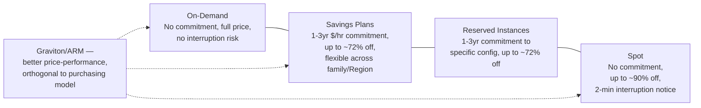

Walkthrough: the four purchasing models sit on one spectrum from zero commitment/zero discount
(On-Demand) to maximum discount/maximum interruption risk (Spot) — but **Graviton** is a
separate, orthogonal axis entirely: any of the four purchasing models can be applied to a
Graviton instance just as easily as an x86 one, stacking the architecture's price-performance
advantage on top of whichever purchasing discount already applies.

### Real AWS Image


*Source: [Amazon EC2 User Guide — Instance lifecycle](https://docs.aws.amazon.com/AWSEC2/latest/UserGuide/ec2-instance-lifecycle.html)*

The cost-relevant detail in this lifecycle diagram is the distinction between **stopped** and
**terminated** — a stopped instance no longer bills for compute but its *attached EBS volumes
still bill in full* (tying directly back to Section 16's unattached-volume lesson), while a
terminated instance (depending on the Delete on Termination setting) may or may not take its
volumes with it. "Stop outside business hours" (Use Case 5) relies on understanding exactly this
distinction — it saves compute cost, not storage cost.

### Exam Tips

- Memorize the four-way purchasing-model lookup: steady/known/long-term → Reserved/Savings Plans;
  flexible/interruptible → Spot; unpredictable/short-term → On-Demand; bursty/idle-mostly →
  serverless (Lambda/Fargate). Nearly every EC2 cost scenario on the exam reduces to this lookup.
- **Worked cost math — Savings Plan break-even vs. On-Demand.** A 1-year, no-upfront Compute
  Savings Plan commits to $10/hour of compute spend in exchange for up to a 66% discount off
  On-Demand rates for usage covered by that commitment (illustrative rate). Running the
  equivalent $10/hr-On-Demand-rate workload for a full year costs 10 × 8,760 = **$87,600**
  On-Demand. Under the Savings Plan at a 66% discount, that same usage costs roughly
  10 × 0.34 × 8,760 ≈ **$29,784** for the year — a **$57,816** difference, which is why the exam
  treats "known, steady, 24/7, multi-year" as close to an automatic Savings Plan/Reserved
  Instance signal rather than a judgment call.
- A stopped (not terminated) EC2 instance still bills for its attached EBS storage — a scenario
  claiming "we stopped the instance to save money" and still describing a large storage bill
  attached to it is testing exactly this distinction.

---

## 18. EC2 Auto Scaling

### Definition
EC2 Auto Scaling automatically adjusts the number of EC2 instances in a group based on demand —
defined by a minimum, maximum, and desired capacity, scaled by dynamic policies (target tracking,
step scaling), scheduled actions, or predictive scaling — and supports a **mixed instances
policy** blending purchasing models (On-Demand baseline + Spot burst) and instance types within
one group.

### Plain-English Analogy
Without Auto Scaling, staffing a retail store for the year's single busiest shopping day means
keeping that full peak-day staff on the clock all 365 days — Auto Scaling is hiring exactly the
right number of staff for each day's actual expected foot traffic, scaling the schedule up before
a known busy weekend and back down afterward, automatically.

### Purpose
A fixed-size EC2 fleet sized for peak load wastes money during every period below peak — which,
for nearly every real-world traffic pattern, is most of the time. Auto Scaling exists to track
actual (or predicted) demand and run only the capacity currently needed, removing the "sized for
the worst day, paid for every day" waste a static fleet carries.

### When to Use
- Any workload with variable traffic where a fixed fleet size would either waste money (sized for
  peak) or risk performance/availability (sized for average).
- Workloads needing a blended purchasing-model strategy (steady baseline on Reserved/Savings-
  Plan-covered On-Demand, burst on Spot) within a single managed group.
- Predictable traffic patterns (known business hours, known seasonal peaks) where scheduled or
  predictive scaling can pre-provision capacity ahead of demand rather than reactively.

### When NOT to Use
- A genuinely flat, unchanging workload gets little benefit from Auto Scaling's dynamic behavior
  — though even a flat workload can still use Auto Scaling purely for self-healing (replacing an
  unhealthy instance), which is a resilience benefit more than a cost one.
- Stateful workloads that can't tolerate instances being added/removed dynamically need careful
  design (or a different scaling unit entirely) before Auto Scaling is safely cost-effective.

### Use Cases (cost-focused)
1. **A mixed instances policy blending Reserved-covered On-Demand baseline with Spot burst.** An
   Auto Scaling group runs its known-floor capacity on On-Demand instances already covered by a
   Savings Plan, with any load above that floor served by Spot Instances — capturing deep burst
   discounts without exposing the baseline to interruption risk.
2. **Scheduled scaling anticipating a known weekly/seasonal pattern.** A retail site's Auto
   Scaling group scales up automatically every Friday afternoon ahead of a well-known weekend
   traffic increase and back down Monday morning, rather than reactively scaling (and briefly
   under-serving) after the traffic has already arrived.
3. **Target tracking scaling policy avoiding both over- and under-provisioning.** A policy
   targeting 50% average CPU utilization keeps the fleet closely matched to actual load
   continuously, rather than a manually-set static capacity that drifts out of alignment with
   real traffic over time.
4. **Predictive scaling for a workload with a recurring but not perfectly regular pattern.**
   Machine-learning-based predictive scaling pre-provisions capacity ahead of a daily demand curve
   that shifts slightly week to week, outperforming a fixed schedule while still avoiding the lag
   of purely reactive scaling.
5. **Scaling to zero outside business hours for a workload that genuinely needs none.** A non-
   production or batch-triggered Auto Scaling group's minimum capacity is set to 0 outside its
   needed window, scaling up only when a scheduled action or an event actually requires capacity.
6. **Instance refresh rolling in a cheaper instance family without manual intervention.** An Auto
   Scaling group's instance refresh feature replaces running instances with a newly-selected,
   better-price-performance instance type (e.g., migrating to Graviton) gradually and safely,
   without a manual fleet-wide cutover.

### Why Important
Auto Scaling is the mechanism that makes the Compute Cost-Optimization Decision Framework's
"blend baseline + burst" principle actually operational — it's rarely the purchasing model itself
that's being tested, but whether you recognize Auto Scaling (specifically a mixed instances
policy) as the thing that *implements* that blend.

### Diagram

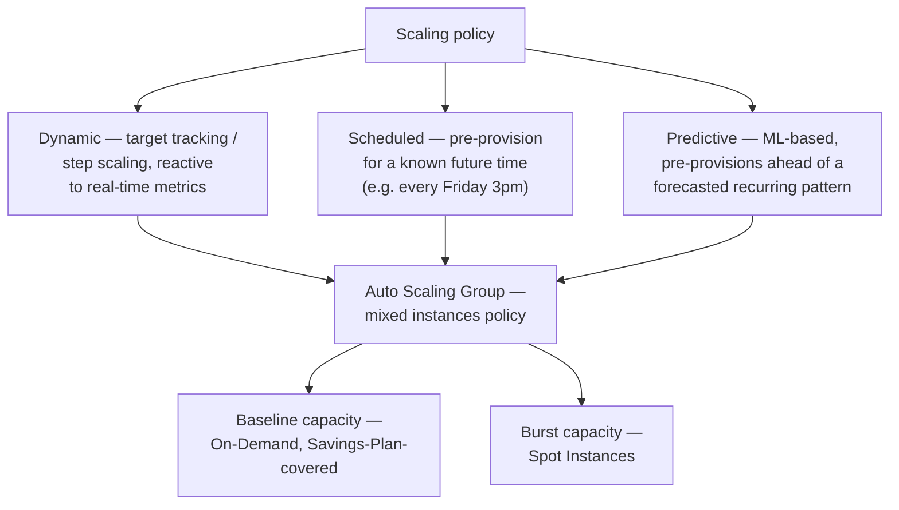

Walkthrough: the three **policy types** feeding into the Auto Scaling Group are not mutually
exclusive — a real production group often combines scheduled scaling (pre-provision ahead of a
known Friday spike) with dynamic scaling (handle whatever deviates from that schedule in real
time). Either way, the group's actual capacity splits into **baseline** (covered by a cheaper
purchasing model, since it's known to always be needed) and **burst** (Spot, since it's only
needed some of the time and can tolerate interruption) — the mixed instances policy is what makes
that split possible within one managed group instead of two separately-managed fleets.

### Real AWS Image


*Source: [Amazon EC2 Auto Scaling User Guide — Amazon EC2 Auto Scaling groups](https://docs.aws.amazon.com/autoscaling/ec2/userguide/auto-scaling-groups.html)*

This diagram shows the basic Auto Scaling group architecture spanning multiple Availability
Zones — the cost-relevant detail is that Auto Scaling actively launches *and terminates*
instances as policies dictate, meaning the group's billed instance-hours genuinely track its
scaling activity in real time, rather than simply representing a static, manually-managed fleet
count that happens to have a label attached.

### Exam Tips

- "Variable/seasonal/daily traffic pattern, fixed fleet is wasting money off-peak" → Auto Scaling
  with an appropriate policy type matched to how *predictable* the pattern is (scheduled for
  known patterns, dynamic for reactive, predictive for recurring-but-irregular).
- **Worked cost math — scaling to match a daily curve vs. a fixed peak-sized fleet.** A workload
  needs 50 instances at peak (business hours, 10 hrs/day) and only 10 instances the other 14
  hours. A fixed fleet sized for peak costs 50 × $0.10/hr (illustrative On-Demand rate) × 730
  hours ≈ **$3,650/month**. An Auto Scaling group tracking that daily curve costs roughly
  (50 × 10 + 10 × 14) × $0.10 × 30.4 days ≈ (500 + 140) × $0.10 × 30.4 ≈ 640 × $0.10 × 30.4 ≈
  **$1,946/month** — a reduction of roughly 47% for exactly matching capacity to the known daily
  shape instead of provisioning statically for the busiest hour of the day, all day.
- A mixed instances policy's baseline/burst split is the concrete implementation detail behind
  any exam answer that says "blend Reserved/Savings Plan coverage with Spot" — naming Auto
  Scaling's mixed instances policy specifically (not just "use both Spot and Reserved somehow")
  is the more precise, fully-correct answer.

---

## 19. Amazon RDS

### Definition
Amazon RDS is a managed relational database service supporting six engines (MySQL, PostgreSQL,
MariaDB, Oracle, SQL Server, and Aurora as a seventh/distinct option), handling patching, backups,
and (optionally) Multi-AZ synchronous standby failover and read replicas, priced by instance size,
storage, and purchasing model (On-Demand or Reserved).

### Plain-English Analogy
RDS is renting a fully-staffed apartment where the landlord handles plumbing repairs and security
patrols (patching, backups) — you still pick and pay for the apartment's size (instance class) and
whether you want a backup unit on standby (Multi-AZ), but you're not personally doing the
maintenance.

### Purpose
Self-managed databases on raw EC2 require you to handle patching, backup scheduling, and failover
orchestration yourself — real, recurring engineering time with real cost. RDS exists to remove
that operational burden, at the cost of less low-level control than a self-managed database would
offer, while still exposing the same cost levers (instance sizing, purchasing model, HA
tradeoffs) any database deployment has.

### When to Use
- A traditional relational (SQL, ACID, joins) workload where a specific, non-Aurora-compatible
  engine (Oracle, SQL Server, specific MariaDB features) is required.
- A steady workload size that benefits from Reserved Instance pricing, without needing Aurora's
  storage-architecture benefits specifically.
- Workloads needing Multi-AZ for production availability, understanding it roughly doubles
  compute cost (a second, synchronously-replicating standby instance is itself billed).

### When NOT to Use
- Dev/test environments mirroring production's Multi-AZ setting unnecessarily — non-production
  rarely needs the same availability tier as production, and removing Multi-AZ there is one of
  the most common, easy cost wins in this domain.
- A pure key-value access pattern forced into RDS instead of DynamoDB — paying for a
  permanently-provisioned instance for traffic that doesn't need relational capabilities at all.
- Workloads that would benefit meaningfully from Aurora's auto-scaling storage/better throughput
  at a modest price premium, if that premium pencils out favorably (see Section 23's selection
  guide for the full Aurora-vs-RDS tradeoff).

### Use Cases (cost-focused)
1. **Removing an unnecessary Multi-AZ standby from dev/test.** A non-production RDS instance
   mirroring production's Multi-AZ setting is switched to Single-AZ, cutting its compute cost
   roughly in half with zero functional loss for an environment that doesn't carry production's
   availability requirement.
2. **A 3-year Reserved Instance commitment for a stable, multi-year production database.** Once
   a production database's load has proven stable over an extended period, a long-term Reserved
   commitment captures a deep discount for capacity that was always going to be paid for anyway.
3. **Read replicas added only as far as the actual read-offload requirement justifies.** Each
   additional read replica is a separately billed instance — a team reviews actual read-query
   volume before adding a third or fourth replica "to be safe," avoiding paying for read capacity
   that isn't actually needed.
4. **Scheduling non-production RDS instances to stop outside business hours.** A dev database
   that only needs to exist during working hours is stopped nightly and on weekends (RDS supports
   stopping for up to 7 days at a time before an automatic restart), cutting its running time —
   and therefore compute cost — substantially.
5. **Storage Auto Scaling avoiding manual over-provisioning.** Rather than pre-provisioning a
   large storage ceiling "to be safe" against running out of space, RDS Storage Auto Scaling
   grows allocated storage automatically as needed, closer to Aurora's auto-scaling storage
   philosophy without switching engines.
6. **Right database engine avoiding unnecessary commercial licensing cost.** A workload running
   on licensed SQL Server or Oracle that doesn't actually need engine-specific features migrates
   to PostgreSQL or Aurora PostgreSQL, removing a recurring licensing cost line item entirely —
   separate from, and often larger than, any instance-sizing optimization.

### Why Important
RDS is the baseline relational option this domain's database framework compares every alternative
against (Aurora for throughput/auto-scaling, DynamoDB for key-value, Aurora Serverless v2 for
variable load) — understanding RDS's cost structure (instance + storage + Multi-AZ doubling +
purchasing model) is the prerequisite for every comparison in Section 23.

### Diagram

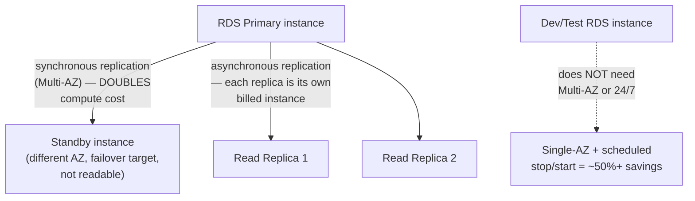

Walkthrough: **Multi-AZ** and **read replicas** are both "add another billed instance" levers,
but for different reasons — Multi-AZ's standby exists purely for failover and isn't even
readable, while read replicas exist to offload read traffic and *are* readable. Conflating the
two (assuming a Multi-AZ standby can serve reads, or that a read replica provides automatic
failover the way Multi-AZ does) is a common exam confusion this diagram is meant to prevent.

### Real AWS Image


*Source: [Amazon RDS User Guide — Multi-AZ deployments](https://docs.aws.amazon.com/AmazonRDS/latest/UserGuide/Concepts.MultiAZ.html)*

This official Multi-AZ diagram makes the "second billed instance" cost fact visually explicit —
there are genuinely two running database instances in this picture, not one instance with some
background replication magic, which is exactly why a scenario emphasizing cost-sensitivity for a
non-critical environment should prompt you to question whether Multi-AZ is really needed there.

### Exam Tips

- "Non-production environment mirrors production's HA/Multi-AZ settings" is one of the most
  reliable "here's the unoptimized answer" signals in the whole domain — the fix is almost always
  removing Multi-AZ and/or scheduling stop/start for dev/test.
- **Worked cost math — Multi-AZ cost doubling.** A db.r6g.xlarge Single-AZ instance costs roughly
  $0.504/hour; running it 24/7 costs 0.504 × 730 ≈ **$368/month**. The same instance with Multi-
  AZ enabled costs roughly double for compute (a second, synchronously-replicating standby
  instance) — 0.504 × 2 × 730 ≈ **$736/month** — a **$368/month** ($4,416/year) difference purely
  for the standby, before even counting storage (which Multi-AZ also effectively duplicates). For
  a dev/test environment with no genuine availability requirement, removing Multi-AZ alone
  recovers that full amount with zero functional loss.
- A read replica promoted to a standalone instance (to handle a permanent split of read-heavy
  traffic) stops being billed as a "replica" and starts being billed as its own independent
  instance — a scenario testing whether a promoted replica's cost structure changed is checking
  this detail specifically.

---

## 20. Amazon S3 Glacier

### Definition
Amazon S3 Glacier (now offered as two S3 storage classes — **Glacier Instant Retrieval**,
**Glacier Flexible Retrieval**, and **Glacier Deep Archive**) is S3's archival storage tier family
for data that's rarely or never accessed, trading retrieval speed and flexibility for a
dramatically lower per-GB storage price than S3 Standard.

### Plain-English Analogy
S3 Standard is a filing cabinet in your office — instant access, but office real estate is
expensive per square foot. Glacier Flexible Retrieval is an off-site records warehouse — cheap
storage, but you call ahead and wait a few hours for your box to be delivered. Glacier Deep
Archive is an underground salt-mine document vault — the cheapest storage that exists, but you
wait most of a day for anyone to physically go retrieve your box.

### Purpose
Long-term, rarely-accessed, compliance-driven, or purely archival data doesn't need Standard's
millisecond access — paying for that speed on data nobody's touching is wasted spend. The Glacier
tiers exist to let that same data cost a small fraction of Standard's price, in exchange for
accepting a retrieval delay and (for the deeper tiers) a retrieval fee proportional to how much is
pulled back.

### When to Use
- Regulatory/compliance retention data with a known, long retention period and a tolerable
  retrieval delay if ever actually needed (Glacier Deep Archive is the cheapest, 12-hour-retrieval
  option for exactly this).
- Backup/archival data that's genuinely "write once, almost never read," especially past the
  point a hand-written lifecycle rule or Intelligent-Tiering has already moved it there
  automatically from Standard.
- **Glacier Instant Retrieval** specifically for archival data that, unlike the other two tiers,
  still needs millisecond retrieval on the rare occasion it is accessed — trading a higher
  storage price than Flexible/Deep Archive for zero retrieval delay.

### When NOT to Use
- Data accessed more than a handful of times a year, or needing fast/unpredictable retrieval, is
  usually cheaper in Standard-IA than in Glacier once retrieval fees and delay-related
  operational cost are accounted for.
- Data that turns over (gets deleted/replaced) faster than the tier's minimum storage duration
  (90 days for Flexible Retrieval, 180 for Deep Archive) — moving short-lived data into Glacier
  can cost *more*, not less, due to early-deletion charges (see Section 27 for the full minimum-
  duration trap discussion).

### Use Cases (cost-focused)
1. **7-year regulatory retention at the lowest possible storage cost.** Financial or healthcare
   records required by law to be kept for 7 years, essentially never accessed after the first few
   months, move into Glacier Deep Archive — the cheapest per-GB rate available, appropriate
   because the 12-hour retrieval delay is explicitly tolerable for the rare compliance request.
2. **Glacier Instant Retrieval for archival media occasionally needed immediately.** A media
   archive of older content that's rarely requested but, when it is requested (a licensing deal,
   a sudden resurgence in popularity), needs to be available instantly uses Instant Retrieval
   instead of Flexible Retrieval or Deep Archive, avoiding the retrieval-delay mismatch with that
   business need.
3. **Expedited retrieval for a rare, urgent legal discovery request.** Flexible Retrieval's
   Expedited option (1-5 minutes, at a premium price per request) is used only for the rare,
   genuinely urgent retrieval need, while the far cheaper Standard or Bulk retrieval speeds handle
   the vast majority of planned, non-urgent restores.
4. **Bulk retrieval for a large-scale, planned restoration project.** Restoring an entire archived
   dataset for a one-time analytics project uses Bulk retrieval (the cheapest, slowest option, 5-12
   hours) rather than paying Expedited's premium for a restoration that was planned well in
   advance and isn't actually time-critical.
5. **Avoiding Deep Archive for data with an active, ongoing secondary business use.** A podcast
   network's back-catalog, initially moved to Deep Archive on a standard schedule, is moved back
   to Standard-IA once a licensing business line requiring same-day access to specific episodes
   makes the 12-hour Deep Archive delay operationally incompatible — a direct tier-mismatch
   correction.
6. **S3 Storage Lens surfacing Glacier-eligible data that lifecycle rules have missed.** A
   storage-analytics review using S3 Storage Lens identifies buckets/prefixes with old, untouched
   data that somehow lacks a lifecycle rule entirely, prompting a retroactive policy addition that
   captures savings the original configuration missed.

### Why Important
The Glacier tiers are the deep end of the storage-cost-tiering lesson this entire domain is built
around — Task 4.1's "lifecycle policies, storage classes" phrasing points here directly, and the
minimum-duration trap (covered fully in Section 27) is one of the most frequently tested specific
gotchas in the whole exam.

### Diagram

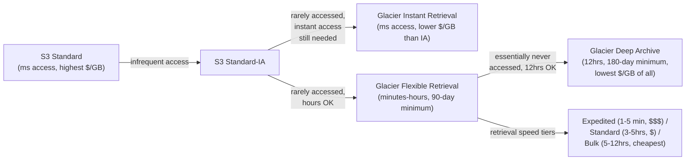

Walkthrough: moving down this chain trades increasing retrieval delay (and, past Standard-IA,
retrieval fees) for decreasing storage price — **Glacier Instant Retrieval** is the one branch
that breaks the "slower = cheaper" pattern slightly, offering instant access at a lower storage
price than Standard-IA specifically for truly archival-but-occasionally-urgent data. The
**retrieval speed tiers** branching off Flexible Retrieval are themselves a cost lever
independent of storage class — choosing Bulk over Expedited for a non-urgent restore is a direct,
often-overlooked savings.

### Real AWS Image


*Source: [AWS Storage Blog — Optimize Amazon S3 storage cost with storage analytics](https://aws.amazon.com/blogs/storage/optimize-amazon-s3-storage-cost-with-storage-analytics/)*

This pipeline is the *analytical* step before archiving — using S3 server access logs and S3
Inventory to actually confirm which data is cold (rarely/never accessed) rather than archiving
based on a guess, directly preventing the "moved genuinely-needed data into a slow tier" mistake
that an ungrounded lifecycle rule can make.

### Exam Tips

- "Compliance/regulatory retention, essentially never accessed, 12-hour retrieval is fine" →
  Glacier Deep Archive, the cheapest answer whenever that retrieval delay is explicitly
  acceptable. "Archival but occasionally needs instant access" → Glacier Instant Retrieval.
- **Worked cost math — Deep Archive savings at 7-year scale.** 10 TB (10,240 GB) of compliance
  data in S3 Standard at roughly $0.023/GB-month costs 10,240 × $0.023 ≈ **$235.52/month**, or
  over 7 years (84 months) ≈ **$19,784**. The same 10 TB in Glacier Deep Archive at roughly
  $0.00099/GB-month costs 10,240 × $0.00099 ≈ **$10.14/month**, or over 84 months ≈ **$852** —
  a reduction of roughly **96%**, over $18,900 saved across the retention period, for data that
  the compliance requirement itself says will almost certainly never be read.
- Retrieval fees (per-GB, scaled by speed tier) are a real, separate charge from storage — a
  scenario asking for *total* cost of an archival strategy that includes even an occasional
  planned restoration needs both the storage-cost math above and a retrieval-cost estimate, not
  storage cost alone.

---

## 21. Containers vs. VMs vs. Serverless

### Definition
This topic compares the three compute abstraction levels available on AWS — **virtual machines**
(EC2, full OS control, you manage everything above the hypervisor), **containers**
(ECS/EKS/Fargate, OS-level virtualization sharing a kernel, lighter-weight and faster-starting than
a VM), and **serverless/functions** (Lambda, no infrastructure concept at all, pure code-on-event)
— each trading progressively more operational control for progressively less idle cost and
management burden.

### Plain-English Analogy
A VM is owning a house — full control over every room, but you fix the roof and pay property tax
whether you're home or not. A container is renting a furnished apartment in a shared building —
less control over the building's structure, but far less maintenance burden, and you can move
apartments quickly. Serverless is a hotel room you only pay for the specific nights you actually
stay — maximum flexibility, zero cost when you're not there, but no ability to permanently
renovate the room to your exact specifications.

### Purpose
This comparison exists because the "right" compute abstraction is a direct function of a
workload's traffic shape and operational-control needs, not a universal best choice — AWS
deliberately offers all three so a cost-optimized architecture can place each component of a
system at the abstraction level that actually fits it, rather than running everything on the same
model out of habit.

### When to Use
- **VMs (EC2):** need full OS control, specific hardware (GPU, bare-metal), or a steady,
  high-density workload where Reserved/Savings-Plan-covered EC2's raw efficiency at scale beats
  the per-unit premium of the higher abstraction levels.
- **Containers (ECS/EKS, Fargate or EC2 launch type):** workloads already packaged as containers,
  needing portability, faster scaling than a VM, and (via Fargate) removing instance management
  for variable load.
- **Serverless (Lambda):** event-driven, bursty, or genuinely idle-most-of-the-time workloads
  where zero idle cost matters more than persistent-process convenience.

### When NOT to Use
- Serverless for anything exceeding its execution-duration/resource limits, or genuinely
  constant, high-volume, 24/7 invocation where a well-utilized EC2/Fargate fleet's steady-state
  economics win.
- Containers for a workload needing kernel-level isolation stronger than container
  virtualization provides, or needing a different OS/kernel version per workload than the shared
  host offers.
- VMs by default for workloads that would clearly benefit from containers' or serverless' lower
  idle cost — defaulting to EC2 "because that's what we know" is a real, frequently tested anti-
  pattern on this exam.

### Use Cases (cost-focused)
1. **A monolith migrating to containers before a full serverless rewrite.** A team containerizes
   an existing application (minimal code change) to run on ECS/Fargate first, capturing
   Fargate's variable-load cost benefits immediately, deferring a more invasive serverless
   rewrite to a later phase.
2. **A GPU-bound ML training job staying on EC2.** Despite the organization's general move toward
   containers/serverless elsewhere, this workload stays on EC2 because it needs specific GPU
   instance types neither Fargate nor Lambda can provide.
3. **A bursty webhook processor moving from a permanently-running EC2 instance to Lambda.** A
   workload invoked unpredictably, a few dozen times a day, moves off a 24/7-billed EC2 instance
   onto Lambda, cutting idle-time cost essentially to zero.
4. **A steady, high-density batch-processing fleet staying on EC2 with Reserved pricing.** A
   consistently busy, 24/7 processing fleet evaluates Fargate but finds, at that density and
   steadiness, a well-utilized Reserved-covered EC2 fleet comes out cheaper due to Fargate's
   per-vCPU premium not being offset by any variability benefit this particular workload doesn't have.
5. **Mixing all three abstraction levels within one application, by component.** A single
   e-commerce platform runs its core API on EC2 with Savings Plans (steady baseline), its
   nightly batch jobs on Fargate (variable, containerized), and its webhook handlers on Lambda
   (bursty, idle most of the time) — each component matched to the abstraction level that fits
   its own traffic shape rather than forcing one model across the whole system.
6. **Avoiding Lambda for a workload now exceeding its practical fit.** A function that's grown
   to run near its 15-minute timeout ceiling on nearly every invocation, with steady, predictable,
   high-frequency traffic, is migrated to Fargate instead — recognizing serverless has stopped
   being the cost-optimal (or even functionally appropriate) fit as the workload's shape changed.

### Why Important
This comparison is the meta-lesson underneath Task 4.2's "auto scaling, serverless, containers"
phrasing — the exam consistently rewards matching abstraction level to workload shape over
defaulting to one model, and this is the conceptual map for making that match correctly across
every compute scenario in the domain.

### Diagram

```mermaid
flowchart TD
    Shape{"Workload traffic shape<br/>and control needs"} -->|"Steady, high-density,<br/>needs OS/hardware control"| VM["EC2 (VM)<br/>— full control,<br/>bills for provisioned instance<br/>regardless of idle time"]
    Shape -->|"Containerized, variable load,<br/>wants portability"| Container["Containers — ECS/EKS<br/>(Fargate: no instance to manage;<br/>EC2 launch type: you manage it)"]
    Shape -->|"Event-driven, bursty,<br/>idle most of the time"| Serverless["Lambda — zero idle cost,<br/>no infrastructure concept at all"]

    VM -->|"abstraction increases,<br/>idle cost decreases,<br/>control decreases"| Container
    Container --> Serverless
```

Walkthrough: moving left to right along the bottom arrow trades **control for reduced idle
cost** — this is the single axis every exam question in this area is really testing, even when
phrased as "which service should handle this workload." The top branches are the actual decision
tree: match the workload's real shape (steady vs. variable vs. bursty) and real control needs
(hardware/OS specificity) to the abstraction level built for that shape, rather than defaulting.

### Real AWS Image


*Source: [AWS Compute Blog — Container vs. serverless: Choosing the right AWS compute option](https://aws.amazon.com/blogs/compute/comparing-aws-container-and-block-storage-options/)*

This diagram makes the abstraction progression explicit — each layer up, AWS takes on more
operational responsibility (and the cost model shifts from "pay for the box" toward "pay for
exactly what ran"), which is the visual summary of this entire section's cost argument in one
image.

### Exam Tips

- A scenario describing "variable/bursty load" paired with "wants to avoid managing servers" is
  almost always serverless-or-containers, not VMs — read for that phrase specifically as a
  signal against defaulting to EC2.
- **Worked cost math — idle-cost comparison across all three for a bursty workload.** A workload
  invoked roughly 2 hours of actual compute time per day, spread unpredictably: on EC2 (always-on
  to be ready), it costs 24 hours × $0.10/hr (illustrative) × 30 days = **$72/month** regardless
  of the 2 real hours of work. On Fargate, billing only for the ~2 hours/day actually running:
  2 × $0.10/hr-equivalent × 30 ≈ **$6/month**. On Lambda, billing per-millisecond for that same
  2 hours/day of actual execution, likely landing in a similar or lower range depending on memory
  allocation, frequently **under $5/month** for workloads this light — EC2 is roughly 12-14x more
  expensive here purely from unavoidable idle time, which is the entire argument for not
  defaulting to VMs for this traffic shape.
- The exam does test the *reverse* direction too — a steady, dense, 24/7 workload where Fargate/
  Lambda's per-unit premium, applied continuously with no idle time to save on, loses to a well-
  utilized Reserved EC2 fleet. Don't treat "serverless/containers are always cheaper" as a rule.

---

## 22. Data Transfer Pricing

### Definition
AWS data transfer pricing charges differently depending on **direction** (in vs. out) and
**path** (same AZ, cross-AZ, cross-Region, to/from the internet, to/from another AWS account) —
data transfer **in** to AWS is free in virtually all cases; data transfer **out** is tiered,
generally free within the same AZ, a small per-GB charge cross-AZ/cross-Region, and the highest
per-GB charge to the public internet.

### Plain-English Analogy
Think of it like a toll road system: driving *into* the city (data in) is free at every gate.
Driving around within the same city block (same AZ) is free. Crossing into a different
neighborhood of the same city (cross-AZ) has a small toll both ways. Driving to a different city
entirely (cross-Region) costs more. Driving out of the entire country to the public highway
network (internet egress) is the most expensive toll of all.

### Purpose
This pricing model exists because AWS's internal network capacity is genuinely cheaper to provide
than internet-facing bandwidth, and AWS passes that cost structure straight through — the
cost-optimization implication is that **architectural placement decisions** (same-AZ vs. cross-
AZ, same-Region vs. cross-Region, internal vs. internet-facing paths) are themselves direct,
continuous cost levers, not just technical ones.

### When to Use
- Every network-cost-optimization decision in this domain (NAT Gateway vs. VPC Endpoint, Direct
  Connect vs. VPN, CloudFront's origin-cost reduction, Transit Gateway vs. peering) is an
  application of this same underlying pricing model — understanding it deeply here is the
  prerequisite for every other network cost decision.
- Explicitly evaluating whether a multi-AZ or multi-Region architecture's resilience benefit is
  worth its continuous cross-AZ/cross-Region data transfer cost.

### When NOT to Use
- Don't assume data transfer pricing is symmetric — transfer *in* is free in nearly every case,
  while transfer *out* is the metered direction; a scenario emphasizing cost needs to identify
  which direction the bulk of traffic actually flows.
- Don't assume same-Region traffic is automatically free — only same-AZ traffic (and traffic to
  specific free-for-this-traffic endpoints like S3/DynamoDB Gateway Endpoints) is genuinely free;
  cross-AZ within the same Region still has a real, if smaller, charge.

### Use Cases (cost-focused)
1. **Consolidating a chatty two-service pair into the same AZ.** Two frequently-communicating
   microservices deliberately split across AZs purely out of habit, with no real availability
   requirement for that specific pair, are consolidated into the same AZ, removing a continuous
   cross-AZ data transfer charge with no availability tradeoff.
2. **CloudFront reducing origin data-transfer-out cost for cacheable content.** As covered fully
   in Section 14, a high cache-hit ratio means most user traffic never reaches the origin at all,
   avoiding the origin's (often pricier, direct-to-internet) data-transfer-out charge for that
   cached portion.
3. **VPC Gateway Endpoints removing NAT Gateway data-processing charges for S3/DynamoDB
   traffic.** As covered in the Network Cost-Optimization Decision Framework doc, this single
   change is one of the highest-leverage, most frequently tested individual fixes in the domain.
4. **Choosing Direct Connect over internet egress once sustained volume justifies it.** As
   covered in Section 5, Direct Connect's lower per-GB rate at high sustained volume directly
   reduces the most expensive pricing tier (internet egress) for hybrid traffic.
5. **Keeping cross-Region replication traffic to only what's genuinely needed for resilience/
   compliance.** A team reviews whether a cross-Region read replica or backup copy is actually
   required by the stated RTO/RPO or compliance need, rather than replicating broadly "to be
   safe" and paying the cross-Region transfer rate for data that didn't need to move.
6. **Measuring and tagging data-transfer cost by service/direction to find the real driver.**
   Rather than treating "data transfer" as one opaque line item, a Cost Explorer breakdown by
   usage type (e.g., isolating `DataTransfer-Out-Bytes` specifically) identifies which exact
   traffic flow is driving the charge, enabling a targeted fix rather than a guess.

### Why Important
Data transfer pricing is the underlying pricing model every network-cost decision in this domain
ultimately reduces to — it's listed explicitly in Task 4.4 ("data transfer cost minimization") and
is the conceptual foundation the Network Cost-Optimization Decision Framework doc and the
dedicated "Data Transfer Cost Traps" topic doc both build on.

### Diagram

```mermaid
flowchart TD
    SameAZ["Same AZ"] -->|"$0.00/GB<br/>(free)"| Cheapest
    CrossAZ["Cross-AZ,<br/>same Region"] -->|"small $/GB,<br/>BOTH directions"| Small
    CrossRegion["Cross-Region"] -->|"higher $/GB<br/>than cross-AZ"| Medium
    Internet["To the public<br/>internet"] -->|"highest $/GB<br/>of any tier"| Expensive

    In["Data transfer IN<br/>to AWS, any source"] -->|"$0.00/GB<br/>in nearly all cases"| FreeIn["Free"]
```

Walkthrough: this diagram is effectively a price list sorted from cheapest to most expensive —
**same-AZ** is free, **cross-AZ** has a small charge applied in *both* directions (sending and
receiving each incur the charge), **cross-Region** costs more than cross-AZ, and **internet
egress** is the most expensive tier of all. The separate **inbound** arrow is the detail many
candidates forget: almost nothing is charged for data coming *into* AWS, which is why cost-
optimization focus belongs almost entirely on the outbound side.

### Real AWS Image


*Source: [AWS Storage Blog — Reduce data transfer costs using VPC endpoints](https://aws.amazon.com/blogs/storage/reduce-data-transfer-costs-using-vpc-endpoints/)*

This image illustrates the exact distinction that underlies the single most commonly tested
pricing-model gotcha in this domain: traffic to an AWS service can take a **free, internal**
path or a **metered, NAT-Gateway-routed** path depending purely on how the VPC's routing is
configured — the same destination, the same data, two very different costs, based entirely on
architecture choice rather than anything about the traffic itself.

### Exam Tips

- Build the mental price ladder and never forget inbound is (almost always) free: same-AZ ($0) <
  cross-AZ (small, both ways) < cross-Region (more) < internet egress (most) — every network
  cost question in this domain is testing where on this ladder a described traffic flow sits.
- **Worked cost math — cross-AZ cost for a chatty pair.** Two services exchanging 500 GB/month
  between each other, split across AZs purely for redundancy with no real HA need for this
  specific pair, at a cross-AZ rate of roughly $0.01/GB each direction: 500 GB × $0.01 × 2
  directions = **$10/month** — modest alone, but multiplied across dozens of similarly-chatty
  service pairs in a microservices architecture, this becomes a real, continuously recurring
  cost purely from AZ placement, recoverable at $0 additional engineering cost by simply
  co-locating the pair in the same AZ where availability requirements genuinely permit it.
- See the dedicated "Data Transfer Cost Traps — Deep Dive" topic doc in this folder for several
  more fully worked numeric scenarios (NAT Gateway vs. endpoint, cross-Region replica cost,
  CloudFront's origin-shielding effect) beyond what fits in this summary section.

---

## 23. Database Selection Guide

### Definition
The database selection guide is the decision framework for choosing *which* AWS database engine
fits a workload's access pattern — relational (RDS/Aurora) for joins/ACID/complex queries,
key-value/document (DynamoDB) for simple, high-scale access patterns, plus specialized engines
(Redshift for OLAP analytics, ElastiCache for caching, Neptune for graph, DocumentDB for
MongoDB-compatible document workloads) each fitting a specific shape.

### Plain-English Analogy
Choosing a database engine is like choosing a vehicle for a job — a sedan (RDS) handles everyday
relational trips fine, a delivery van (DynamoDB) is built for high-volume simple pickups, a
freight train (Redshift) moves enormous analytical loads efficiently but isn't nimble, and a
motorcycle (ElastiCache) is blazing fast for the one specific narrow job of getting somewhere
instantly. Using the wrong one — a freight train for a quick errand, a motorcycle for a freight
load — isn't just the wrong tool, it's expensive in a very specific way for that mismatch.

### Purpose
The single most consequential cost decision in the entire database portion of this domain happens
*before* any purchasing model or capacity mode is even considered — picking an engine that
structurally doesn't fit the access pattern (forcing key-value traffic into RDS, or complex
relational joins into DynamoDB) creates cost (and performance) problems no amount of instance
right-sizing or Reserved pricing can fully undo.

### When to Use
- **RDS/Aurora:** relational data with joins, multi-table transactions, complex queries, ACID
  guarantees across related records.
- **DynamoDB:** simple key-value or document access by primary key (optionally with a sort key/
  GSI), extremely high scale, access patterns known in advance and modeled around specific
  queries rather than ad hoc joins.
- **Redshift:** large-scale analytical (OLAP) queries across historical data, separate from
  transactional (OLTP) production traffic.
- **ElastiCache:** sub-millisecond caching layer in front of a database to reduce read load (and
  therefore the size/cost of the database tier itself).
- **Aurora Serverless v2 / DynamoDB On-Demand:** either engine's variable-capacity option for
  unpredictable load within the already-correct engine choice.

### When NOT to Use
- Don't force a reporting/analytical workload directly against a production OLTP database
  (RDS/Aurora) — this both degrades production performance and often requires an oversized
  production instance to absorb analytical query load it shouldn't have to carry.
- Don't default to RDS "because that's what the team knows" for a workload whose actual access
  pattern (simple, high-volume, key-value) is a clear DynamoDB fit — this is one of the most
  frequently tested unoptimized-answer patterns in the domain.

### Use Cases (cost-focused)
1. **Splitting a "recently viewed items" feature out of a relational order database.** Identified
   as a pure key-value access pattern with no relational need, this feature moves to DynamoDB,
   removing both an engine mismatch and the RDS instance capacity that had been sized to absorb
   its traffic alongside the actual order data.
2. **Offloading analytical reporting to Redshift instead of scaling up production RDS.** Rather
   than repeatedly resizing a production database to absorb growing analytical query load,
   a separate Redshift cluster (fed by a data pipeline) takes over reporting entirely, letting
   production stay right-sized for its actual OLTP traffic.
3. **Adding ElastiCache in front of a read-heavy RDS database.** A cache layer absorbing the
   majority of read traffic allows the underlying RDS instance to be downsized (or avoid a
   previously-planned upsize), making a caching layer a direct database-cost lever, not just a
   performance one.
4. **Choosing DocumentDB over forcing a MongoDB-style workload into DynamoDB or RDS.** A workload
   built around MongoDB's document query API migrates to Amazon DocumentDB (MongoDB-compatible)
   rather than an awkward re-modeling into either DynamoDB's key-value shape or a relational
   schema, avoiding a costly and risky re-architecture.
5. **Avoiding a premature move to a specialized engine (Neptune) without a genuine graph access
   pattern.** A team evaluating Neptune for a feature that, on closer analysis, doesn't actually
   need graph traversal queries sticks with its existing relational database, avoiding the
   operational and cost overhead of standing up and learning a new specialized engine
   unnecessarily.
6. **Revisiting an earlier engine choice after traffic patterns matured.** A workload originally
   built on RDS, now observed to be almost entirely simple key-value lookups at very high
   volume, is migrated to DynamoDB once that pattern is confirmed — database selection is
   revisited as a workload's real-world usage becomes clearer, not locked in permanently at
   initial design time.

### Why Important
Every subsequent cost lever in the database portion of this domain (Reserved pricing, Aurora
Serverless v2, DynamoDB billing mode) only optimizes cost *within* an already-correct engine
choice — getting this selection wrong is a structural cost problem those levers can't fully fix,
which is why this guide sits conceptually upstream of the Database Cost-Optimization Decision
Framework doc in this folder.

### Diagram

```mermaid
flowchart TD
    Pattern{"What's the actual<br/>access pattern?"} -->|"Joins, ACID,<br/>complex relational queries"| Relational["RDS / Aurora"]
    Pattern -->|"Simple key-value/document,<br/>known access patterns,<br/>massive scale"| DDB["DynamoDB"]
    Pattern -->|"Large-scale analytical (OLAP)<br/>queries over historical data"| Redshift["Redshift"]
    Pattern -->|"Need sub-ms caching<br/>layer in front of a DB"| Cache["ElastiCache"]
    Pattern -->|"MongoDB-compatible<br/>document workload"| DocDB["DocumentDB"]
    Pattern -->|"Graph traversal<br/>(relationships-as-data)"| Graph["Neptune"]

    Relational -->|"variable load"| AuroraServerless["Aurora Serverless v2"]
    DDB -->|"unpredictable traffic"| DDBOnDemand["DynamoDB On-Demand"]
```

Walkthrough: this is the decision tree every other database section in this file sits downstream
of — the branch you take here determines which entire family of cost levers (Reserved pricing,
Serverless options, read replicas) even applies. The two bottom nodes (**Aurora Serverless v2**,
**DynamoDB On-Demand**) are *not* separate engine choices — they're capacity-model refinements
within whichever top-level engine branch the access pattern already pointed to.

### Real AWS Image


*Source: [Amazon Redshift Getting Started Guide — Redshift architecture](https://docs.aws.amazon.com/redshift/latest/gsg/working-with-clusters.html)*

Redshift's architecture — a leader node coordinating many compute nodes, each scanning a slice of
columnar-stored data in parallel — is structurally built for scanning huge volumes of historical
data across few, wide queries, the opposite shape from OLTP's many small, individual-record
queries. Trying to run OLTP-shaped traffic against this architecture (or vice versa) is exactly
the engine mismatch this entire section is about avoiding.

### Exam Tips

- The fastest way to answer a database-selection question: identify whether the described access
  pattern needs joins/ACID across related tables (relational) or simple lookups by key at scale
  (DynamoDB) — nearly every scenario reduces to this one fork before any cost-optimization
  consideration even applies.
- **Worked cost math — engine mismatch cost.** A "recently viewed items" feature doing 5,000
  writes/sec and 2,000 reads/sec is forced onto a provisioned RDS instance sized to handle that
  volume around the clock — a db.r6g.2xlarge-class instance at roughly $1.008/hour costs
  1.008 × 730 ≈ **$736/month**, running continuously regardless of how the feature's traffic
  actually fluctuates through the day. The same access pattern on DynamoDB On-Demand, billed per
  request at roughly $1.25/million writes and $0.25/million reads, assuming that volume is
  actually concentrated in an 8-hour business-traffic window rather than genuinely 24/7 flat
  (5,000 writes/sec × 8hrs × 3,600s ≈ 144M writes/day ≈ 4.32B/month; 2,000 reads/sec × same
  window ≈ 1.73B/month) costs roughly 4,320 × $1.25 + 1,730 × $0.25 ≈ $5,400 + $432.50 ≈ **$5,832/
  month** — in this specific high-volume case DynamoDB can actually cost *more* at sustained peak
  request rates than a flat-rate provisioned RDS instance, which is exactly why "simple key-value"
  alone doesn't automatically mean "cheaper on DynamoDB" — the full math (including whether
  Provisioned+Auto Scaling beats On-Demand at this volume, per Section 15's framework) must be
  run, not assumed.
- A question emphasizing "needs to join data across multiple related entities in a single query"
  is explicitly ruling out DynamoDB regardless of scale or cost pressure — DynamoDB's lack of
  native joins is a structural limitation, not a configuration choice.

---

## 24. Migration Services Overview

### Definition
This topic covers AWS's broader migration tooling beyond the data-movement services already
detailed elsewhere in this file: **AWS Application Discovery Service** (inventories on-premises
servers and their dependencies before a migration), **AWS Application Migration Service (MGN)**
(lift-and-shift rehosting of entire servers, including their OS, with minimal changes), and
**AWS Migration Hub** (a single place to track migration progress across multiple AWS and
partner migration tools).

### Plain-English Analogy
Application Discovery Service is the home inspector who catalogs everything in a house before a
move, including which appliances depend on which outlets. MGN is the moving company that picks
up the entire house's contents, including furniture nobody's measured properly for the new place,
and sets it up again with minimal reassembly. Migration Hub is the single tracking number you
check to see the status of every different moving truck involved in a multi-truck move, instead
of calling five different moving companies separately.

### Purpose
A large migration project — dozens or hundreds of on-premises servers — can't be planned, let
alone cost-estimated, without first knowing what actually exists and how it's interconnected.
These services exist to remove the guesswork (and the risk of migrating something whose
dependencies weren't understood, causing an expensive post-migration fire drill) from a
large-scale lift-and-shift.

### When to Use
- **Application Discovery Service:** before any large migration, to build an accurate server/
  dependency inventory that informs both the migration plan and the right-sized target
  architecture (avoiding both under- and over-provisioning the destination).
- **MGN:** rehosting (lift-and-shift) servers to AWS with minimal re-architecture, especially
  under deadline pressure (e.g., a data center lease expiring) where a full re-platform/refactor
  isn't feasible in the available time.
- **Migration Hub:** any migration using multiple tools/services simultaneously, needing one
  consolidated status view instead of checking several consoles separately.

### When NOT to Use
- MGN's lift-and-shift approach, by design, doesn't optimize the target architecture's cost
  beyond matching the source server's specs — a migration intended to also right-size or
  re-architect for cost should treat MGN's output as a starting point for *further* optimization
  (right-sizing, Reserved pricing, maybe later a true re-platform), not the final cost-optimized
  state.
- A small, simple migration (a handful of servers, well understood already) may not need the full
  discovery/tracking machinery these services provide — the overhead isn't justified at that
  scale.

### Use Cases (cost-focused)
1. **Avoiding a mid-migration surprise dependency that forces an expensive emergency fix.**
   Application Discovery Service's dependency mapping surfaces that a seemingly standalone server
   is actually tightly coupled to two others, letting the migration plan and cost estimate account
   for all three together rather than discovering the coupling mid-migration under pressure.
2. **MGN rehosting an entire data center ahead of a lease expiration deadline.** With only 90 days
   before a data center lease ends, MGN's minimal-change rehosting approach completes the move in
   time, with cost/architecture optimization explicitly deferred to a second phase after the
   deadline pressure is gone.
3. **Right-sizing the lift-and-shift target instead of matching source specs 1:1.** Application
   Discovery Service's actual utilization data (not just the source server's provisioned size)
   informs a target EC2 instance size that matches real usage, avoiding simply replicating any
   over-provisioning that existed on-premises into the new AWS environment.
4. **Migration Hub consolidating status across DMS, MGN, and a Snow Family physical transfer in
   one project.** A complex migration using all three tools simultaneously (databases via DMS,
   servers via MGN, bulk file data via Snowball) tracks overall progress from one dashboard,
   reducing the project-management overhead of checking three separate tool consoles.
5. **A phased migration prioritized by Application Discovery Service's dependency map.**
   Migrating tightly-coupled server groups together (as identified by the discovery phase) rather
   than in an arbitrary order avoids a costly partial-migration state where some dependent servers
   are on AWS and others are still on-premises, generating extra data-transfer and latency cost
   during the transition.
6. **Treating MGN's output as the starting point for a later re-platform, not the end state.** A
   company rehosts first under deadline pressure, then — once settled on AWS — runs a second
   project applying this domain's compute/database/storage frameworks to right-size, add
   Reserved/Savings Plan coverage, and potentially re-platform onto Aurora or DynamoDB where the
   access pattern fits, capturing the deeper savings a rushed lift-and-shift alone can't.

### Why Important
These services frame "migrate to AWS" itself as a cost-optimization-adjacent decision — a
well-discovered, well-tracked migration avoids both the direct cost of mid-migration surprises and
the indirect cost of carrying on-premises over-provisioning habits straight into the cloud
unexamined.

### Diagram

```mermaid
flowchart TD
    OnPrem["On-premises environment<br/>(unknown inventory)"] --> ADS["Application Discovery Service —<br/>inventories servers +<br/>dependencies + utilization"]
    ADS --> Plan["Migration plan —<br/>right-sized targets,<br/>dependency-aware sequencing"]
    Plan --> MGN["MGN — lift-and-shift<br/>rehosting (fast, minimal change)"]
    Plan --> DMSPath["DMS — database migration<br/>(see Section 4)"]
    Plan --> SnowPath["Snow Family — bulk data<br/>(see Section 9)"]

    MGN --> Hub["AWS Migration Hub —<br/>consolidated status<br/>across all tools"]
    DMSPath --> Hub
    SnowPath --> Hub

    MGN -.->|"later phase"| Optimize["Right-size, apply Reserved/<br/>Savings Plans, consider<br/>re-platform (Aurora/DynamoDB)"]
```

Walkthrough: **Application Discovery Service** feeds the **migration plan**, which fans out to
whichever specific migration tools the project actually needs (MGN for servers, DMS for
databases, Snow Family for bulk data) — all converging into **Migration Hub** for unified status
tracking. The dashed arrow at the bottom is the detail Use Case 6 emphasizes: MGN's rehosting is
explicitly a *starting point*, with real cost optimization (right-sizing, purchasing models,
potential re-platform) as a deliberate follow-on phase, not something MGN does automatically.

### Real AWS Image


*Source: [AWS Overview Whitepaper — Migration services](https://docs.aws.amazon.com/whitepapers/latest/aws-overview/migration-services.html)*

This overview diagram groups AWS's migration services by category — a useful mental map for
matching each piece of a complex migration (data, databases, entire servers, offline bulk
transfer) to the specific tool built for that piece, rather than trying to force one tool (e.g.,
MGN) to handle every migration need in a project that genuinely spans several different types.

### Exam Tips

- "Need to understand what's actually running on-premises and how it's connected before planning
  a migration" → Application Discovery Service, always the first step, before MGN or any other
  migration tool is selected.
- "Lift-and-shift, minimal changes, under deadline pressure" → MGN. If the scenario instead
  describes re-architecting *during* the migration (e.g., moving to a managed database engine),
  that's DMS (for the database piece) plus an application-level redesign, not MGN.
- A migration project's *initial* AWS bill is not the end state to judge the migration's cost
  success by — a scenario testing this nuance describes a rehosted environment still running
  on-premises-equivalent instance sizes, which should prompt recognizing the need for a follow-on
  right-sizing/purchasing-model pass, not concluding the migration "failed" to save money.

---

## 25. Niche Compute Services

### Definition
This section covers two lower-exam-weight, edge/hybrid compute services with a distinct cost
angle: **AWS Outposts** (AWS-managed hardware racks installed in your own data center, extending
a standard Region's APIs/services on-premises) and **AWS Wavelength** (AWS infrastructure embedded
within telecom providers' 5G networks, for ultra-low-latency edge compute).

### Plain-English Analogy
A standard AWS Region is ordering from a well-stocked central warehouse with great shipping
rates. Outposts is paying extra to have a smaller, dedicated version of that same warehouse's
inventory built *inside your own building*, because you have an operational reason (data
residency, extreme local latency) that a shipping truck — however fast — can't satisfy. Wavelength
is the same idea, but the dedicated mini-warehouse sits inside a telecom company's own building,
specifically to be milliseconds away from 5G mobile devices.

### Purpose
Both services exist for workloads where a standard Region's physical distance — even with a fast
network path — is structurally incompatible with a latency or data-residency requirement. They
both cost meaningfully more per unit of compute than an equivalent standard-Region instance,
because you're paying for dedicated, specialized hardware placement rather than shared Region-
scale economics.

### When to Use
- **Outposts:** a genuine data-residency requirement (data legally/contractually can't leave a
  specific physical premises) or a sub-10ms local-latency requirement a standard Region cannot
  structurally meet, even with excellent connectivity.
- **Wavelength:** mobile/5G application-tier latency requirements (AR/VR, real-time gaming,
  connected-vehicle processing) that need compute physically embedded within the telecom
  network itself.

### When NOT to Use
- Defaulting to Outposts/Wavelength out of a vague "lower latency is always better" instinct when
  a standard Region, possibly paired with CloudFront or Global Accelerator, would already meet
  the actual stated latency requirement at meaningfully lower cost.
- Any workload without a genuine regulatory, contractual, or hard-latency requirement that a
  standard Region structurally cannot meet — the premium these services carry is only justified
  when that specific requirement is real and unmet otherwise.

### Use Cases (cost-focused)
1. **A manufacturing facility with a contractual data-residency requirement.** Production data
   from a sensitive facility must never leave the premises per a client contract; Outposts
   extends AWS services on-site, satisfying that requirement in a way no standard Region ever
   could, despite its real cost premium.
2. **A hospital's real-time medical imaging processing needing sub-5ms local latency.** A
   standard Region's round-trip time, even over Direct Connect, can't meet this requirement — an
   Outposts rack physically inside the hospital's own data center does.
3. **A mobile AR gaming company evaluating, then rejecting, Wavelength for a feature that didn't
   actually need it.** After testing, the team finds standard Region latency (with CloudFront)
   is already within the acceptable range for the specific feature in question, avoiding
   Wavelength's premium for a requirement that, on closer measurement, was already satisfied.
4. **A connected-vehicle telemetry platform genuinely requiring Wavelength's embedded-in-network
   latency.** Real-time vehicle control feedback loops measured to require latency only achievable
   by compute physically inside the telecom's 5G network accept Wavelength's cost premium because
   the alternative (standard Region) measurably fails the requirement.
5. **Right-sizing an Outposts rack's capacity instead of over-ordering "to be safe."** Because an
   Outposts rack is a fixed, dedicated hardware commitment (not elastic the way a standard Region
   is), a team carefully sizes the order to actual projected need rather than over-provisioning,
   since excess Outposts capacity can't be as easily returned or resized as a standard EC2 fleet.
6. **Running the bulk of an application in a standard Region, with only the latency-critical
   component on Outposts/Wavelength.** Rather than moving an entire application's footprint to
   the premium edge location, only the specific component with the hard latency/residency
   requirement runs there, keeping everything else on standard Region pricing.

### Why Important
These services are the domain's example of "the premium is real, and the exam tests whether
you'll justify it correctly" — Task 4.2 explicitly frames the cost angle here as recognizing when
a hybrid/edge premium is actually earned by a structural requirement versus habit or an
unverified assumption.

### Diagram

```mermaid
flowchart TD
    Req{"Genuine data-residency<br/>OR sub-10ms latency<br/>requirement?"} -->|"No — standard Region<br/>+ CloudFront/Direct Connect<br/>already meets the need"| Region["Standard AWS Region<br/>(cheaper, elastic)"]
    Req -->|"Yes — on-prem<br/>data residency"| Outposts["AWS Outposts<br/>(dedicated rack,<br/>on-premises, premium cost)"]
    Req -->|"Yes — 5G/mobile<br/>embedded-network latency"| Wavelength["AWS Wavelength<br/>(telecom-embedded,<br/>premium cost)"]
```

Walkthrough: the single decision diamond at the top of this diagram is the entire cost-
optimization lesson — everything downstream of it is just "which specific premium option fits
which specific unmet requirement." The exam's cost-angle question is really testing whether a
candidate will correctly answer "No" at that diamond when the requirement doesn't actually demand
Outposts/Wavelength, not whether they know these services exist.

### Real AWS Image


*Source: [AWS Reference Architecture Diagrams — Outposts networking](https://docs.aws.amazon.com/reference-architecture-diagrams/latest/outposts-networking/outposts-networking.html)*

This diagram shows Outposts' real connectivity model: a dedicated rack on-premises, connected
back to its parent AWS Region via a required "service link" for management, while still serving
local LAN traffic with on-premises latency — the service link's ongoing connectivity requirement
is itself worth noting, since Outposts is not a fully disconnected/offline solution the way a
Snow Family device can be.

### Exam Tips

- "Data cannot leave a specific premises" or "requires single-digit-millisecond local latency a
  standard Region's network path cannot achieve" → Outposts/Wavelength is justified. Anything
  less extreme than that is testing whether you'll overreach for the premium option unnecessarily.
- **Worked cost math — the premium, stated plainly.** Outposts pricing (a 3-year commitment on a
  compute/storage-focused rack, illustrative) runs into the tens of thousands of dollars upfront
  plus ongoing support, versus an equivalent amount of standard-Region EC2 capacity under a
  3-year Reserved Instance/Savings Plan commitment, which (per Section 17's math) could run at
  roughly a third of On-Demand pricing — the Outposts premium over that already-discounted
  standard-Region cost can easily be **2-4x**, which is the order of magnitude the exam wants you
  to recognize must be justified by a genuinely unmet requirement, not assumed as a rounding
  error.
- Wavelength's billing is usage-based (similar structurally to standard EC2/Region pricing) but
  at a location-specific premium rate — a scenario shouldn't assume Wavelength pricing mirrors
  standard Region pricing exactly.

---

## 26. Niche Database Services

### Definition
This section covers three lower-exam-weight database services with a distinct cost profile:
**Aurora Serverless (v1 and v2)** (covered in depth cost-wise in Section 13, included here for
completeness), **Amazon Keyspaces** (serverless, Apache Cassandra-compatible wide-column
database), and **Amazon QLDB** (a fully managed ledger database providing a cryptographically
verifiable, immutable transaction log — now in maintenance mode per AWS's own guidance, with
migration to partner solutions recommended for new workloads).

### Plain-English Analogy
Amazon Keyspaces is Cassandra's "no servers, pay only for what you use" twin — if Cassandra is
running your own fleet of delivery trucks, Keyspaces is calling a logistics company that owns the
trucks and only bills you per package actually delivered. QLDB was AWS's purpose-built notary
public for data — a service whose entire job was producing a tamper-evident paper trail nobody
could quietly alter after the fact, though AWS's own current guidance steers new projects toward
alternative ledger/audit-log patterns instead.

### Purpose
Amazon Keyspaces exists so teams already invested in Cassandra's data model and query language
(CQL) don't have to run and scale their own Cassandra cluster — removing the node-provisioning,
patching, and capacity-planning overhead a self-managed Cassandra cluster carries, with the same
serverless, pay-for-what-you-use philosophy DynamoDB applies to its own data model. QLDB existed
to remove the significant engineering cost of building a cryptographically verifiable audit trail
from scratch.

### When to Use
- **Keyspaces:** an existing Cassandra-compatible workload (using CQL) that would otherwise
  require self-managing Cassandra nodes, where removing that operational burden is the explicit
  goal, similar in spirit to choosing DynamoDB over self-managed NoSQL infrastructure.
- **QLDB (for an existing workload, or where its specific immutable-ledger guarantee is uniquely
  required):** an application needing a complete, verifiable history of every change to a dataset
  — though for *new* projects, check AWS's current guidance on QLDB's status before committing to
  it as the long-term platform.

### When NOT to Use
- Keyspaces for a workload with no existing Cassandra/CQL investment — if starting fresh with a
  key-value/document access pattern and no Cassandra-specific requirement, DynamoDB is typically
  the more natural AWS-native fit.
- QLDB for a brand-new project given AWS's own maintenance-mode guidance — evaluate current
  alternatives (e.g., a verifiable audit-log pattern built on DynamoDB Streams + cryptographic
  hashing, or a partner ledger solution) rather than building new, long-term dependency on a
  service AWS itself is steering customers away from for new builds.

### Use Cases (cost-focused)
1. **Migrating off a self-managed Cassandra cluster to remove node-management cost.** A company
   running its own 9-node Cassandra cluster (with the associated EC2 instance cost and ongoing
   patching/tuning labor) migrates to Keyspaces, paying per-request/per-GB instead of for
   permanently-provisioned cluster nodes.
2. **Keyspaces On-Demand for an unpredictable, newly-migrated workload.** Immediately after
   migration, before the new platform's traffic pattern is well understood, Keyspaces' on-demand
   capacity mode (mirroring DynamoDB's) avoids guessing provisioned throughput wrong during the
   riskiest, least-understood early period.
3. **Avoiding a costly re-platform by keeping CQL compatibility.** Rather than rewriting an
   entire application's data access layer to fit DynamoDB's API (a real, potentially expensive
   engineering project), keeping the existing CQL-based code working against Keyspaces avoids
   that rewrite cost entirely.
4. **Reviewing QLDB's maintenance-mode status before a new project commits to it.** A team
   evaluating QLDB for a brand-new supply-chain audit-trail feature checks AWS's current guidance
   first, ultimately choosing an alternative pattern for the new build while leaving an existing,
   working QLDB-based system in place where it already functions.
5. **Right-sizing Keyspaces provisioned capacity once traffic stabilizes.** As with DynamoDB, a
   Keyspaces workload that starts on-demand moves to provisioned capacity with Auto Scaling once
   its traffic pattern is well-enough understood to forecast, capturing a lower per-request cost.
6. **Comparing Keyspaces' operational-cost removal against its per-unit premium versus self-
   managed Cassandra at very high, steady scale.** As with Fargate-vs-EC2 and Aurora-Serverless-
   vs-provisioned, a team at extremely high, steady scale runs the actual numbers rather than
   assuming "serverless/managed" is automatically cheaper — self-managed Cassandra at that scale
   might still win on raw per-unit cost, offset against the operational labor Keyspaces removes.

### Why Important
These niche services extend the same "managed/serverless removes operational cost at a per-unit
premium" pattern established by DynamoDB and Aurora Serverless v2 to a different data model
(wide-column) and a different problem entirely (immutable ledgers) — recognizing the pattern
generalizes faster than memorizing each service separately.

### Diagram

```mermaid
flowchart TD
    CassandraSelfManaged["Self-managed Cassandra<br/>cluster — node provisioning,<br/>patching, capacity planning"] -->|"migrate, keep CQL,<br/>remove ops burden"| Keyspaces["Amazon Keyspaces —<br/>serverless, pay per<br/>request/GB"]
    Keyspaces --> Mode{"Traffic pattern<br/>known?"}
    Mode -->|"No / new"| KOnDemand["On-Demand capacity"]
    Mode -->|"Yes / stable"| KProvisioned["Provisioned + Auto Scaling"]

    LedgerNeed["Need immutable,<br/>cryptographically verifiable<br/>audit trail"] -.->|"check current AWS<br/>guidance before<br/>new commitments"| QLDB["Amazon QLDB<br/>(maintenance mode)"]
```

Walkthrough: the Keyspaces path mirrors DynamoDB's exact on-demand/provisioned maturity curve
from Section 15, applied to a different query language and data model — the underlying cost
logic doesn't change just because the API does. The **QLDB** branch is deliberately drawn with a
dashed line and an explicit "check current guidance" label, reflecting that this is a service
whose future-facing recommendation has genuinely changed since it first launched — a detail worth
stating honestly rather than presenting QLDB as an unconditional default ledger solution.

### Real AWS Image


*Source: [Amazon Keyspaces Developer Guide — How it works](https://docs.aws.amazon.com/keyspaces/latest/devguide/how-it-works.html)*

This high-level diagram shows a client application connecting to Keyspaces via a predetermined
endpoint using standard CQL — no cluster of nodes behind it for you to see or manage, which is
the visual confirmation of the entire cost argument: compare this single-endpoint picture against
a real multi-node Cassandra cluster diagram, and the removed operational surface area (and its
associated cost) is immediately obvious.

### Exam Tips

- "Existing Cassandra/CQL-based workload, wants to stop managing cluster nodes" → Amazon
  Keyspaces specifically — not DynamoDB, since DynamoDB doesn't speak CQL and would require a
  data-access-layer rewrite Keyspaces avoids.
- **Worked cost math — Keyspaces migration avoiding cluster cost.** A self-managed 9-node
  Cassandra cluster on i3.xlarge instances (~$0.312/hr each) costs 9 × $0.312 × 730 ≈
  **$2,050/month** in raw compute alone, before storage, patching labor, or replication
  overhead. Migrating that workload's actual request volume to Keyspaces On-Demand, assuming a
  moderate, well-distributed load (illustrative figure around $400-600/month depending on exact
  read/write mix), can land meaningfully below that $2,050 compute floor even before counting the
  avoided patching/ops labor — though, per the framework's own caution, this comparison should
  always be run against the workload's *actual* measured request volume, not assumed.
- A scenario explicitly testing current service status/guidance (not just technical fit) is
  pointing at QLDB's maintenance-mode detail specifically — a correct, up-to-date answer
  acknowledges that status rather than treating QLDB as the unconditionally-recommended ledger
  solution it was positioned as at launch.

---

## 27. Amazon S3 Storage Classes

### Definition
Amazon S3 offers multiple storage classes along one cost-vs-access-pattern spectrum — Standard
(frequent access), Intelligent-Tiering (automated tier movement based on observed access),
Standard-IA and One Zone-IA (infrequent access, lower storage price, retrieval fee, minimum
duration), and the Glacier family (archival, covered in depth in Section 20) — with lifecycle
policies automating transitions between them as data ages.

### Plain-English Analogy
S3 storage classes are a spectrum of closet space in your home: Standard is the hallway closet you
open ten times a day (most convenient, priced like premium square footage), Standard-IA is the
basement storage room (cheaper, a bit of a walk, fine for things you grab a few times a year),
and One Zone-IA is that same basement room but in a cabin you only visit sometimes — cheaper
still, but if a storm takes that one cabin out, you lose everything in it, since there's no
backup copy elsewhere.

### Purpose
Not all data deserves the same per-GB price — S3's storage class spectrum exists so you can pay
Standard's premium only for genuinely hot data, and progressively less for data that's accessed
less often or more predictably, automating the movement with lifecycle rules so this optimization
doesn't require ongoing manual intervention.

### When to Use
- **Standard:** actively, frequently accessed data (the current product catalog, this week's logs).
- **Intelligent-Tiering:** genuinely unpredictable or unknown access patterns — it automates tier
  placement, trading a small monitoring fee for not having to guess a manual lifecycle schedule.
- **Standard-IA:** data accessed infrequently (roughly monthly or less) but still needing fast
  retrieval when it is accessed, and durable across multiple AZs.
- **One Zone-IA:** the same infrequent-access profile as Standard-IA, but *only* for data that's
  easily reproducible/re-derivable elsewhere — never for a sole copy of irreplaceable data.
- **Lifecycle rules:** automating the Standard → IA → Glacier progression for data whose access
  pattern is predictable enough to hand-schedule.

### When NOT to Use
- Intelligent-Tiering for data whose access pattern is, in fact, well known and predictable — the
  monitoring fee is wasted money when a plain lifecycle rule achieves the identical outcome for
  free.
- One Zone-IA for any data that cannot be regenerated or restored from elsewhere if that single
  AZ is lost — the savings aren't worth the durability tradeoff for irreplaceable data.
- Moving data into Standard-IA/Glacier faster than its minimum storage duration if it's likely to
  be deleted or re-transitioned before that minimum elapses — this risks an early-deletion
  penalty that can cost more than leaving it in Standard.

### Use Cases (cost-focused)
1. **A media catalog with unpredictable, trend-driven access using Intelligent-Tiering.**
   Individual video titles can unpredictably spike in popularity years after release; Intelligent-
   Tiering avoids both overpaying for Standard storage on cold titles and a costly early-
   retrieval penalty on a title that suddenly trends after being manually tiered down.
2. **Derivable analytics output using One Zone-IA deliberately.** Intermediate, easily-
   regeneratable analytics output (re-computable from source data stored safely elsewhere)
   stores on One Zone-IA for the lower price, accepting single-AZ risk specifically because
   nothing irreplaceable is lost if that AZ fails.
3. **A predictable, hand-scheduled lifecycle rule for compliance logs.** Logs known to be
   accessed heavily for 30 days, rarely for the next 60, then essentially never, use a precisely-
   scheduled lifecycle rule (cheaper than Intelligent-Tiering's monitoring fee) because the access
   pattern is genuinely well understood in advance.
4. **S3 Storage Lens surfacing buckets with no lifecycle policy at all.** An organization-wide
   Storage Lens review finds several legacy buckets accumulating years of Standard-tier storage
   with zero lifecycle automation, prompting a retroactive policy addition across all of them in
   one pass.
5. **Versioning combined with a noncurrent-version-expiration lifecycle rule.** A bucket with S3
   Versioning enabled (protecting against accidental overwrite/deletion) adds a rule expiring
   noncurrent versions after a set period, preventing unbounded storage growth from every past
   version of every object being kept forever.
6. **Avoiding Intelligent-Tiering's small monitoring fee at very small object counts/sizes where
   it doesn't pay for itself.** A bucket holding a modest number of small, genuinely-predictable-
   access objects skips Intelligent-Tiering, since the per-object monitoring fee could exceed any
   storage savings at that small scale — the automation is worth its fee mainly at larger,
   genuinely-uncertain-access scale.

### Why Important
This is the deepest, most directly tested storage topic in the domain — Task 4.1 names "lifecycle
policies, storage classes" explicitly, and the minimum-duration trap plus the Intelligent-Tiering-
vs-manual-lifecycle judgment call are two of the most reliably recurring specific exam gotchas.

### Diagram

```mermaid
flowchart LR
    Standard["S3 Standard"] -->|"30 days no access"| IA["Standard-IA"]
    IA -->|"90 days no access"| Glacier["Glacier tiers<br/>(see Section 20)"]
    Unknown["Unpredictable<br/>access pattern"] -.-> IT["Intelligent-Tiering —<br/>auto-moves, small<br/>monitoring fee"]
    Derivable["Infrequent access,<br/>easily re-derivable<br/>elsewhere"] -.-> OZIA["One Zone-IA —<br/>cheaper, single-AZ risk"]

    IA -->|"deleted/moved BEFORE<br/>30-day minimum elapses"| Penalty["Early-deletion charge —<br/>billed for full minimum<br/>regardless"]
```

Walkthrough: the top row is the standard, predictable-pattern lifecycle progression; the two
dashed branches are the **exceptions** to a plain schedule — Intelligent-Tiering for genuinely
unknown patterns, One Zone-IA for reproducible data willing to trade AZ redundancy for price.
The **Penalty** branch at the bottom right is the trap: every IA/Glacier tier enforces a minimum
storage duration, and the exam tests whether a described access pattern's actual turnover rate
is faster than that minimum before you reach for a "cheaper" tier that can, in that specific
case, cost more.

### Real AWS Image


*Source: [Amazon S3 User Guide — Transitioning objects using Amazon S3 Lifecycle](https://docs.aws.amazon.com/AmazonS3/latest/userguide/lifecycle-transition-general-considerations.html)*

This is AWS's authoritative transition-path diagram — the key detail it makes explicit is that
**not every transition is bidirectional or even allowed directly**; lifecycle rules can only move
data in the directions this diagram shows (generally toward cheaper/colder tiers), which is worth
knowing before assuming you can freely shuffle an object back and forth between tiers at will.

### Exam Tips

- Match the stated access pattern's frequency *and* predictability to a tier: predictable +
  infrequent → manual lifecycle rule; genuinely unknown → Intelligent-Tiering; reproducible +
  infrequent → consider One Zone-IA for the extra discount.
- **Worked cost math — Intelligent-Tiering's monitoring fee breakeven.** Intelligent-Tiering
  charges roughly $0.0025 per 1,000 objects monitored per month, on top of tier-appropriate
  storage pricing. For 100,000 objects, that's 100 × $0.0025 = **$0.25/month** in monitoring fee
  — trivial next to the storage savings if even a modest fraction of those objects would
  otherwise sit needlessly in Standard; the fee only becomes a real factor at very large object
  counts with uniformly tiny, cheap-to-store objects, where the per-object monitoring charge can
  approach or exceed the storage cost difference itself.
- **Worked cost math — the minimum-duration trap, concretely.** 1 TB (1,024 GB) of data
  incorrectly scheduled to transition to Glacier Flexible Retrieval (90-day minimum) but actually
  deleted on day 45: AWS still bills for the full 90-day minimum. At roughly $0.0036/GB-month,
  that's 1,024 × $0.0036 × 3 months ≈ **$11.06** billed for data that existed in that tier for
  only 45 of those 90 days — not a large single number here, but the exact mechanism the exam
  tests, and one that scales linearly with the mistake's size.

---

## 28. Transit Gateway & VPC Peering

### Definition
**VPC Peering** is a direct, one-to-one network connection between two VPCs (same or different
accounts/Regions) with no hourly charge, just data transfer pricing, but no transitive routing
(peered VPC A-B and B-C does *not* let A reach C). **Transit Gateway** is a centralized hub that
many VPCs (and VPNs, Direct Connect connections) attach to, routing between all of them through
one managed hub with an hourly-plus-per-GB charge, and does support transitive routing.

### Plain-English Analogy
VPC Peering is calling your neighbor directly, house to house — no monthly phone bill, just
pay for the call. Fine for one or two neighbors, obviously turns into a tangled mess of wires if
you try to directly connect fifteen houses that way. Transit Gateway is installing a shared
switchboard in the middle of the neighborhood — a bit of fixed monthly cost for the switchboard
itself, but every house just makes one connection to it and can reach every other house through
it, instead of everyone wiring directly to everyone else.

### Purpose
A full mesh of peering connections grows combinatorially (n VPCs need n(n-1)/2 peering
connections for full connectivity) — both the management overhead and the lack of transitive
routing become genuinely painful past a handful of VPCs. Transit Gateway exists to replace that
growing mesh with one hub, trading peering's zero hourly cost for a flat, predictable hourly-plus-
per-GB fee that becomes cheaper (in total cost of ownership, including the labor of managing many
peering connections) once VPC count grows large enough.

### When to Use
- **VPC Peering:** a small, stable number of VPCs (2-3, rarely more) needing direct connectivity,
  where the zero hourly charge outweighs any management overhead at that small scale.
- **Transit Gateway:** many VPCs (and/or VPNs, Direct Connect connections) needing to reach each
  other, especially if transitive routing (any-to-any, not just pairwise) is required.

### When NOT to Use
- VPC Peering once the VPC count grows large enough that the full-mesh connection count becomes
  operationally unwieldy — a scenario describing "growing number of VPCs, peering connections
  becoming hard to manage" is the Transit Gateway signal specifically.
- Transit Gateway for just 2-3 VPCs with no anticipated growth — its hourly-plus-per-GB charge
  isn't justified when a couple of free peering connections already do the job perfectly well.

### Use Cases (cost-focused)
1. **Two VPCs peered directly for a simple shared-services need.** A small company with a
   production VPC and one shared-services VPC peers them directly, paying no hourly fee at all
   for a connectivity need that will plausibly never grow beyond this pair.
2. **Replacing a 15-connection full-mesh peering tangle with one Transit Gateway hub.** Six
   regional VPCs, previously connected via a growing mesh approaching 15 individual peering
   connections, consolidate onto a single Transit Gateway, cutting both the connection-management
   overhead and, at that VPC count, the aggregate cost and complexity of maintaining the mesh.
3. **Transit Gateway VPN/Direct Connect attachments consolidating multiple sites' connectivity.**
   Several regional offices' individual Site-to-Site VPN connections attach to one Transit
   Gateway instead of each one separately attaching to a VPC, simplifying both routing and the
   connection count that needs to be managed and audited.
4. **Deliberately staying on peering for a two-VPC design that doesn't need transitive
   routing.** A team evaluating Transit Gateway for a simple two-VPC setup concludes the added
   hourly cost isn't justified, since peering already provides everything the (small, stable)
   requirement actually needs.
5. **Transit Gateway inter-Region peering for a global multi-Region architecture.** Rather than
   a complex mesh of cross-Region VPC peering connections, Transit Gateways in each Region peer
   with each other directly, simplifying the global routing topology at scale.
6. **Using Transit Gateway Network Manager for centralized visibility across a complex, multi-
   Region connectivity topology.** As an organization's Transit Gateway-based network grows
   across Regions and accounts, Network Manager provides one dashboard for monitoring and
   troubleshooting, reducing the operational cost of what would otherwise be a fragmented,
   per-Region manual review.

### Why Important
This is the domain's direct application of "architectural complexity has a cost, and a managed
hub trades a small fixed fee for removing that complexity at the point it stops being worth
managing yourself" — Task 4.4 names this tradeoff explicitly, and it's one of the cleaner
"crossover point" cost questions in the exam.

### Diagram

```mermaid
flowchart TD
    subgraph Peering["VPC Peering — small VPC count"]
        VPCA["VPC A"] <--> VPCB["VPC B"]
        VPCB <--> VPCC["VPC C"]
        VPCA -.->|"NOT reachable —<br/>peering isn't transitive"| VPCC
    end
    subgraph TGW["Transit Gateway — many VPCs"]
        TG["Transit Gateway"]
        VPC1["VPC 1"] --> TG
        VPC2["VPC 2"] --> TG
        VPC3["VPC 3"] --> TG
        VPC4["VPC 4"] --> TG
        TG -->|"any VPC can<br/>reach any other —<br/>transitive routing"| VPC1
    end
```

Walkthrough: the **Peering** subgraph deliberately shows the non-transitive limitation explicitly
— A and B are connected, B and C are connected, but **A cannot reach C** without a direct A-C
peering connection of its own, which is exactly the "growing mesh" problem that gets painful fast.
The **Transit Gateway** subgraph shows the fix: every VPC connects once to the hub, and the hub's
routing (not a web of individual connections) handles reachability between all of them.

### Real AWS Image


*Source: [Amazon VPC Transit Gateways guide — Transit Gateways](https://docs.aws.amazon.com/vpc/latest/tgw/what-is-transit-gateway.html)*

This official diagram shows the hub-and-spoke model in its simplest form — three VPCs, one
Transit Gateway, full any-to-any connectivity without a single direct VPC-to-VPC connection
anywhere in the picture, which is the structural reason Transit Gateway's routing table (not a
growing set of peering connections) is what scales cleanly as VPC count grows.

### Exam Tips

- "A handful of VPCs, stable count, simple connectivity" → Peering (free). "Growing VPC count,
  peering mesh unwieldy, OR need transitive routing, OR need to attach VPNs/Direct Connect
  alongside VPCs" → Transit Gateway.
- **Worked cost math — the mesh-vs-hub crossover.** A full mesh of n VPCs needs n(n-1)/2 peering
  connections: at 4 VPCs that's 6 connections (manageable); at 10 VPCs it's 45 connections; at 20
  VPCs it's 190 connections — the *management* cost (not a per-connection AWS fee, since peering
  itself is free) grows quadratically and becomes its own real operational cost well before AWS
  bills a cent for the connections themselves. A Transit Gateway, by contrast, costs a flat rate
  per attachment (roughly $0.05/hour per VPC attachment, ≈$36.50/month per VPC at 730 hours) plus
  per-GB processing — for 20 VPCs that's roughly 20 × $36.50 ≈ **$730/month** in attachment fees
  alone, which the exam frames as worth paying specifically once the *alternative's* management
  complexity (190 individual peering connections, each needing its own route-table entries) has
  become the larger, if less visible, cost.
- Peering connections support cross-account and cross-Region connectivity just like Transit
  Gateway does — the deciding factor between them is VPC count/topology complexity, not whether
  cross-account/cross-Region reach is needed at all.

---

## 29. VPC Endpoints & PrivateLink

### Definition
VPC Endpoints let resources inside a VPC reach AWS services without traversing the public
internet or a NAT Gateway. **Gateway Endpoints** (S3 and DynamoDB only) are free, route-table-
based, and require no additional networking component. **Interface Endpoints** (PrivateLink, for
most other AWS services plus many third-party/partner services) create an elastic network
interface (ENI) with a private IP in your subnet, carrying a small hourly-per-AZ and per-GB charge.

### Plain-English Analogy
Without an endpoint, reaching an AWS service from a private subnet is like driving your own car
out of a private neighborhood, through the public highway system, just to reach a store that's
actually also inside the same gated community — you pay a highway toll (NAT Gateway charge) for a
trip that never needed to leave the neighborhood at all. A Gateway Endpoint is a free, direct
back-door path straight into that in-community store. An Interface Endpoint is the same idea for
stores that need a staffed storefront (an ENI) rather than a direct back-door, charging a small
fee for that storefront instead of a highway toll.

### Purpose
Routing AWS-internal traffic (an app talking to S3, DynamoDB, SQS, KMS, Secrets Manager, etc.)
through a NAT Gateway and Internet Gateway is both unnecessary (the traffic never actually needs
the public internet) and costly (NAT Gateway's hourly-plus-per-GB charge applies to every byte).
VPC Endpoints exist to give that traffic a direct, private path that's free (for the two Gateway-
eligible services) or meaningfully cheaper than the NAT Gateway path it replaces (for everything
else, via PrivateLink).

### When to Use
- **Gateway Endpoints:** essentially always, for any private-subnet traffic to S3 or DynamoDB —
  there is no real reason not to use these; they're free and strictly better than the NAT
  Gateway alternative.
- **Interface Endpoints/PrivateLink:** private-subnet traffic to any other AWS service (SNS, SQS,
  KMS, Secrets Manager, CloudWatch, and dozens more), or to a partner/third-party service exposed
  via PrivateLink, where keeping traffic off the public internet and/or reducing NAT Gateway cost
  for that traffic matters.

### When NOT to Use
- Treating Interface Endpoints as free "like Gateway Endpoints" — they have a real, if usually
  favorable, cost; only S3/DynamoDB Gateway Endpoints are genuinely free.
- Adding an Interface Endpoint for a service with genuinely trivial traffic volume, where the
  endpoint's own hourly-per-AZ charge could exceed the NAT Gateway charge it would have replaced
  for that specific small amount of traffic — this is rare, but worth checking at very low volume.

### Use Cases (cost-focused)
1. **The single highest-leverage fix in the domain: an S3 Gateway Endpoint eliminating NAT
   Gateway charges for S3 traffic.** An application reading/writing S3 objects heavily from
   private subnets adds a free Gateway Endpoint, eliminating nearly the entire NAT Gateway
   data-processing charge for that traffic overnight, with a one-line route-table change.
2. **An SNS Interface Endpoint replacing a NAT-routed publish path.** Lambda functions
   publishing frequently to SNS from private subnets switch to an SNS Interface Endpoint, costing
   a small hourly-plus-per-GB fee but still coming in cheaper than the combined NAT Gateway
   hourly-plus-per-GB charge for the same traffic, while also keeping that traffic off the public-
   facing path entirely.
3. **Auditing a NAT Gateway bill and finding it's almost entirely AWS-internal traffic.** A Cost
   Explorer deep-dive traces the single largest network line item to a mix of S3 and SQS traffic
   from private subnets — fixed with a free S3 Gateway Endpoint plus an SQS Interface Endpoint,
   two targeted fixes for what initially looked like one undifferentiated problem.
4. **PrivateLink exposing a SaaS partner's service without that traffic touching the public
   internet.** A company consuming a third-party SaaS API via its own PrivateLink-exposed
   endpoint keeps that traffic entirely within AWS's network, both for security reasons and
   avoiding NAT Gateway charges for that traffic.
5. **A new Region expansion adding Gateway/Interface Endpoints from day one, not as an
   afterthought.** A disaster-recovery standby Region's app tier is wired up with the same
   endpoints as production from initial launch, avoiding a second, duplicate NAT Gateway cost
   discovery months after the standby Region quietly started costing more per byte than
   necessary.
6. **Reviewing whether a Gateway Endpoint policy is scoped correctly, avoiding an over-broad
   free path.** While Gateway Endpoints themselves are free regardless of scope, a company
   reviews its endpoint policy to ensure it isn't inadvertently providing free-path access to S3
   buckets outside its intended account/data boundary — a security-adjacent check that doesn't
   change the cost math but matters for the design's correctness.

### Why Important
VPC Endpoints are the domain's single most repeatable, highest-leverage, zero-downside cost fix —
Task 4.4 names "VPC endpoints" explicitly, and "NAT Gateway charges dominated by traffic to S3"
is likely the single most recognizable individual exam pattern in all of Domain 4.

### Diagram

```mermaid
flowchart TB
    subgraph Before["Before — routed through NAT Gateway"]
        App1["Private-subnet app"] --> NAT1["NAT Gateway<br/>(hourly + per-GB,<br/>on EVERY byte)"] --> IGW1["Internet Gateway"] --> Svc1[("S3 / DynamoDB /<br/>SNS / SQS / etc.")]
    end
    subgraph AfterGateway["After — S3/DynamoDB via Gateway Endpoint"]
        App2["Private-subnet app"] --> GWE["Gateway Endpoint —<br/>FREE, route-table based"] --> Svc2[("S3 / DynamoDB")]
    end
    subgraph AfterInterface["After — other services via Interface Endpoint"]
        App3["Private-subnet app"] --> IE["Interface Endpoint (ENI) —<br/>small hourly + per-GB,<br/>still cheaper than NAT"] --> Svc3[("SNS / SQS / KMS /<br/>Secrets Manager / etc.")]
    end
```

Walkthrough: all three subgraphs show the exact same originating app and the exact same
destination AWS services — the only thing that changes is the **path**, and with it, the cost.
The **Before** path's NAT Gateway charges apply regardless of the fact that the destination never
actually needed the public internet at all; both **After** paths remove that unnecessary hop,
with the Gateway-vs-Interface split determined purely by which AWS services support which
endpoint type (only S3 and DynamoDB get the free Gateway option).

### Real AWS Image


*Source: [AWS PrivateLink Guide — Access AWS services using an internet gateway](https://docs.aws.amazon.com/vpc/latest/privatelink/concepts.html)*

This diagram shows the **Before** state from a different angle — AWS is careful to note that even
traffic leaving through an Internet Gateway to reach an AWS service technically stays within
AWS's own network backbone rather than the literal public internet, but it still incurs NAT
Gateway's metered charge if a NAT Gateway is in that path, which is the specific, narrow detail
(security concern aside) that makes this a *cost* problem worth fixing with an endpoint,
independent of any security argument for doing the same thing.

### Exam Tips

- "NAT Gateway charges, traffic going to S3 or DynamoDB" → Gateway Endpoint, free, no reason not
  to use it. "NAT Gateway charges going to any other AWS service" → Interface Endpoint/
  PrivateLink, small but favorable cost versus the NAT path it replaces.
- **Worked cost math — the Gateway Endpoint fix, concretely.** An application generates 20 TB/
  month of S3 traffic through a NAT Gateway at roughly $0.045/hour + $0.045/GB processed
  (us-east-1 illustrative rates): monthly NAT charge ≈ $0.045 × 730 (≈$32.85 fixed) +
  20,480 GB × $0.045 ≈ $32.85 + $921.60 ≈ **$954.45/month** for this traffic alone. Adding a free
  S3 Gateway Endpoint eliminates essentially all of that — the fixed and processing charges both
  disappear for traffic now routed through the endpoint instead, leaving the data transfer cost
  that would have applied regardless and removing the NAT-specific charge entirely, a savings of
  roughly **$900+/month** for a configuration change requiring no code deployment.
- Interface Endpoints are deployed per-AZ for high availability (an ENI in each AZ you want
  covered) — a cost estimate for an Interface Endpoint needs to multiply the hourly rate by the
  number of AZs deployed into, not treat it as a single flat per-Region charge.

---

## Closing: The One Move This Entire Domain Teaches

Every one of the 29 sections above is the same underlying move, applied to a different service:
**match the purchasing model, capacity mode, or storage/network tier to the workload's actual,
observed pattern** — steady workloads get committed/reserved pricing, interruptible workloads get
Spot, unpredictable/bursty workloads get serverless or on-demand, hot data stays hot-tier, cold
data gets tiered down, and traffic that never needed the public internet or a NAT Gateway gets a
free or cheaper private path instead. If you can recognize which of these four "shapes" a scenario
is describing — steady, interruptible, unpredictable, or cold/rarely-accessed — you can derive the
correct answer for almost any Domain 4 question even for a service not explicitly covered above,
because AWS's own pricing structure is built around exactly this same logic everywhere.

## Related Documents In This Folder

- [`README.md`](README.md) — the domain overview, with the GreenLedger Logistics full case study
  and the four-task breakdown this master chunk's 29 sections map onto.
- [`compute-cost-optimization-decision-framework.md`](compute-cost-optimization-decision-framework.md),
  [`storage-cost-optimization-decision-framework.md`](storage-cost-optimization-decision-framework.md),
  [`database-cost-optimization-decision-framework.md`](database-cost-optimization-decision-framework.md),
  [`network-cost-optimization-decision-framework.md`](network-cost-optimization-decision-framework.md) —
  the four per-task decision frameworks, each with its own additional worked mini-case.
- [`reserved-savings-plans-vs-spot-worked-math.md`](reserved-savings-plans-vs-spot-worked-math.md) —
  a dedicated deep dive on the compute purchasing-model decision with extensive worked numeric
  comparisons beyond what Section 17/18 above could fit.
- [`data-transfer-cost-traps-deep-dive.md`](data-transfer-cost-traps-deep-dive.md) — a dedicated
  deep dive on the most commonly tested data-transfer cost mistakes, with more fully worked
  numeric scenarios than Section 22 above.
- [`database-capacity-mode-cost-crossover.md`](database-capacity-mode-cost-crossover.md) — a
  dedicated deep dive on the DynamoDB On-Demand vs. Provisioned and Aurora Serverless v2 vs.
  Provisioned crossover math, extending Sections 13, 15, and 19 above.
- [`labs.md`](labs.md) — hands-on Floci labs practicing the configuration mechanics behind several
  of the cost levers described throughout this file.
