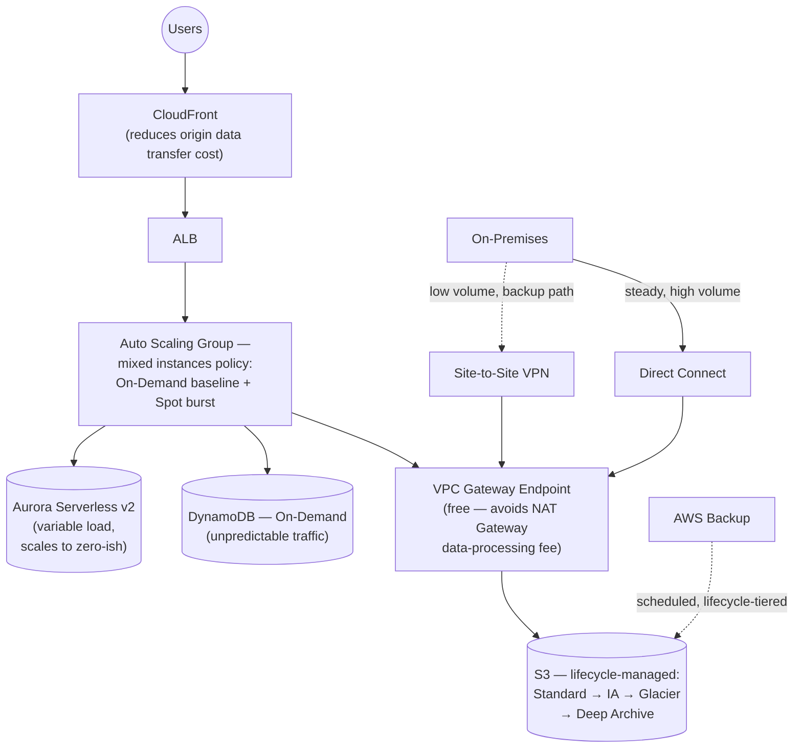

# Domain 4: Design Cost-Optimized Architectures (20%)

In plain terms: this domain assumes you can already design something that works (Domains 1-3) and
asks "now make it cheap without breaking it" — the same services, viewed through a different
lens, which is exactly why it's studied last.

## Task 4.1 — Design cost-optimized storage solutions

> Lifecycle policies, storage classes, backup strategy

| Concept | Doc |
|---|---|
| S3 storage classes | [`services/storage/s3-storage-classes.md`](../../../services/storage/s3-storage-classes.md) |
| S3 Glacier tiers | [`services/storage/s3-glacier.md`](../../../services/storage/s3-glacier.md) |
| EBS (unattached-volume cost leaks) | [`services/storage/ebs.md`](../../../services/storage/ebs.md) |
| AWS Backup | [`services/storage/aws-backup.md`](../../../services/storage/aws-backup.md) |
| Storage cost-optimization decision framework *(new — decision-level topic)* | [`storage-cost-optimization-decision-framework.md`](storage-cost-optimization-decision-framework.md) |

## Task 4.2 — Design cost-optimized compute solutions

> Spot/Reserved/Savings Plans, auto scaling, serverless, containers

| Concept | Doc |
|---|---|
| EC2 (purchasing options) | [`services/compute/ec2.md`](../../../services/compute/ec2.md) |
| EC2 Auto Scaling | [`services/compute/ec2-auto-scaling.md`](../../../services/compute/ec2-auto-scaling.md) |
| Lambda | [`services/compute/lambda.md`](../../../services/compute/lambda.md) |
| Fargate | [`services/compute/fargate.md`](../../../services/compute/fargate.md) |
| Containers vs. VMs vs. serverless | [`services/containers/containers-vs-vms-vs-serverless.md`](../../../services/containers/containers-vs-vms-vs-serverless.md) |
| Compute cost-optimization decision framework *(new — decision-level topic)* | [`compute-cost-optimization-decision-framework.md`](compute-cost-optimization-decision-framework.md) |

## Task 4.3 — Design cost-optimized database solutions

> Engine choice, DynamoDB vs RDS, serverless options

| Concept | Doc |
|---|---|
| Database selection guide | [`services/database/database-selection-guide.md`](../../../services/database/database-selection-guide.md) |
| RDS | [`services/database/rds.md`](../../../services/database/rds.md) |
| Aurora (incl. Aurora Serverless v2) | [`services/database/aurora.md`](../../../services/database/aurora.md) |
| DynamoDB (on-demand vs. provisioned) | [`services/database/dynamodb.md`](../../../services/database/dynamodb.md) |
| Database cost-optimization decision framework *(new — decision-level topic)* | [`database-cost-optimization-decision-framework.md`](database-cost-optimization-decision-framework.md) |

## Task 4.4 — Design cost-optimized network architectures

> NAT gateway cost, Direct Connect vs VPN vs internet, VPC endpoints, Transit Gateway, data
> transfer cost minimization

| Concept | Doc |
|---|---|
| Data transfer pricing (the full cost model) | [`services/networking-content-delivery/data-transfer-pricing.md`](../../../services/networking-content-delivery/data-transfer-pricing.md) |
| VPC endpoints / PrivateLink | [`services/networking-content-delivery/vpc-endpoints-privatelink.md`](../../../services/networking-content-delivery/vpc-endpoints-privatelink.md) |
| Transit Gateway & peering | [`services/networking-content-delivery/transit-gateway-and-peering.md`](../../../services/networking-content-delivery/transit-gateway-and-peering.md) |
| Direct Connect | [`services/networking-content-delivery/direct-connect.md`](../../../services/networking-content-delivery/direct-connect.md) |
| VPN | [`services/networking-content-delivery/vpn.md`](../../../services/networking-content-delivery/vpn.md) |
| Network cost-optimization decision framework *(new — decision-level topic)* | [`network-cost-optimization-decision-framework.md`](network-cost-optimization-decision-framework.md) |

Also relevant across all four tasks: [`services/management-governance/cost-management-tools.md`](../../../services/management-governance/cost-management-tools.md)
(Cost Explorer, budgets, Compute Optimizer) and
[`services/management-governance/trusted-advisor.md`](../../../services/management-governance/trusted-advisor.md)
(automated flags for idle/oversized/underutilized resources across every category above).

## Architecture: A Cost-Optimized System

Step by step: **CloudFront** caches responses at the edge, which cuts both latency *and* the data
transfer bill at the origin — a dual-purpose win. The **Auto Scaling group** blends an On-Demand
(or Reserved/Savings-Plan-covered) baseline with **Spot Instances** absorbing burst load, getting
the deep Spot discount without risking a fully-interruptible fleet. Instead of routing S3/DynamoDB
traffic through a **NAT Gateway** (hourly + per-GB charge on every byte), the app reaches them
through a **VPC Gateway Endpoint**, which is free for S3/DynamoDB. The **S3 bucket itself** runs a
lifecycle policy moving objects from Standard down through Standard-IA, Glacier, and eventually
Deep Archive as they age and stop being accessed — same data, shrinking cost over time with zero
code changes. **DynamoDB runs on-demand** because its traffic is unpredictable, while **Aurora
Serverless v2** handles the relational workload's variable load without permanently provisioning
for peak. For hybrid connectivity, **Direct Connect** carries the steady, high-volume path (cheaper
per-GB at that volume) with a **Site-to-Site VPN** as a lower-commitment backup/low-volume path.
**AWS Backup** applies one retention policy across resources, automatically tiering old backups
into cold storage rather than leaving them in expensive hot storage indefinitely.

## Common exam scenarios

- *"Logs older than 90 days are rarely accessed but must be retained for 7 years for
  compliance."* → S3 lifecycle policy transitioning to Glacier Deep Archive.
- *"A NAT Gateway's data processing charges are unexpectedly the largest line item on the
  bill, mostly from traffic to S3."* → Replace with a VPC Gateway Endpoint for S3 (free).
- *"A batch job can tolerate interruption and runs on a flexible schedule."* → Spot Instances.
- *"A production database runs 24/7 with a known, stable load for the next two years."* →
  Reserved Instances / Savings Plans, not On-Demand.
- *"Traffic to a DynamoDB table is highly unpredictable, sometimes zero, sometimes a huge
  spike."* → DynamoDB On-Demand billing mode, not provisioned capacity.
- *"A company connects many VPCs together and the peering connections are becoming unwieldy and
  costly to manage."* → Transit Gateway.
- *"An application needs steady, high-volume, cost-efficient connectivity to an on-prem data
  center."* → Direct Connect (cheaper per-GB than VPN/internet at that volume).
- *"Unattached EBS volumes and idle load balancers are quietly adding to the monthly bill."* →
  Trusted Advisor cost-optimization checks / Cost Explorer, as the tool that surfaces this.

## Hands-on Labs

See [`labs.md`](labs.md) for runnable Floci exercises covering this domain.
