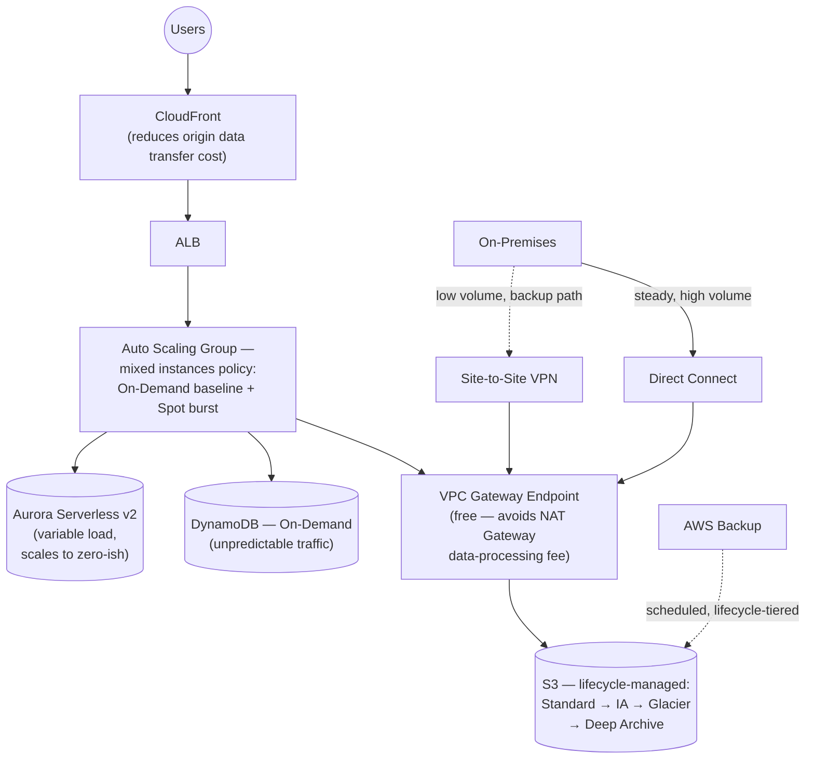
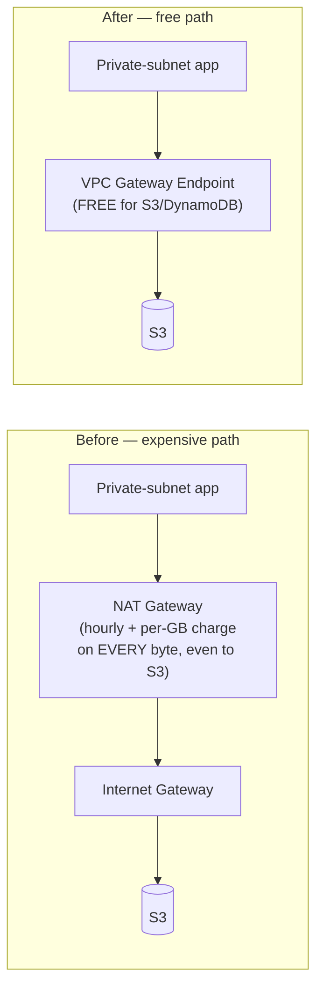
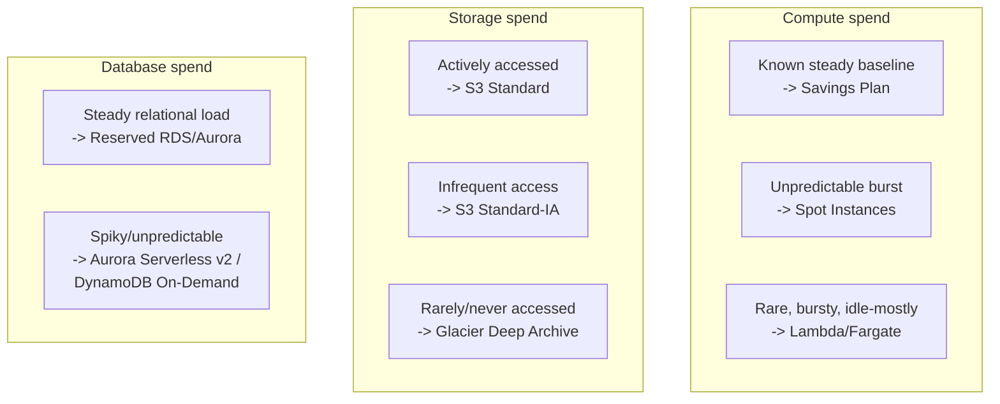

# Domain 4: Design Cost-Optimized Architectures (20%)

In plain terms: this domain assumes you can already design something that works (Domains 1-3) and
asks "now make it cheap without breaking it" — the same services, viewed through a different
lens, which is exactly why it's studied last.

Every cost question on the exam is a variation of one move: **match the purchasing model or
storage/compute tier to the actual, observed usage pattern**, rather than defaulting to the most
flexible (and most expensive) option out of habit. A steady-state workload should be reserved, not
on-demand; cold data should be tiered, not left in Standard; traffic to S3/DynamoDB should skip
the NAT Gateway via a free endpoint; a spiky workload should be serverless or on-demand, not a
fixed-size provisioned fleet. The four task statements below are the same move applied to storage,
compute, database, and network in turn — learn the move once, then recognize its four costumes.

*Source: [Amazon S3 User Guide — Transitioning objects using Amazon S3 Lifecycle](https://docs.aws.amazon.com/AmazonS3/latest/userguide/lifecycle-transition-general-considerations.html)*

## Task 4.1 — Design cost-optimized storage solutions

> Lifecycle policies, storage classes, backup strategy

| Concept | Doc |
|---|---|
| S3 storage classes | [`services/storage/s3-storage-classes.md`](../../../services/storage/s3-storage-classes.md) |
| S3 Glacier tiers | [`services/storage/s3-glacier.md`](../../../services/storage/s3-glacier.md) |
| EBS (unattached-volume cost leaks) | [`services/storage/ebs.md`](../../../services/storage/ebs.md) |
| AWS Backup | [`services/storage/aws-backup.md`](../../../services/storage/aws-backup.md) |
| Storage cost-optimization decision framework *(new — decision-level topic)* | [`storage-cost-optimization-decision-framework.md`](storage-cost-optimization-decision-framework.md) |

## Task 4.2 — Design cost-optimized compute solutions

> Spot/Reserved/Savings Plans, auto scaling, serverless, containers

| Concept | Doc |
|---|---|
| EC2 (purchasing options) | [`services/compute/ec2.md`](../../../services/compute/ec2.md) |
| EC2 Auto Scaling | [`services/compute/ec2-auto-scaling.md`](../../../services/compute/ec2-auto-scaling.md) |
| Lambda | [`services/compute/lambda.md`](../../../services/compute/lambda.md) |
| Fargate | [`services/compute/fargate.md`](../../../services/compute/fargate.md) |
| Containers vs. VMs vs. serverless | [`services/containers/containers-vs-vms-vs-serverless.md`](../../../services/containers/containers-vs-vms-vs-serverless.md) |
| Compute cost-optimization decision framework *(new — decision-level topic)* | [`compute-cost-optimization-decision-framework.md`](compute-cost-optimization-decision-framework.md) |

## Task 4.3 — Design cost-optimized database solutions

> Engine choice, DynamoDB vs RDS, serverless options

| Concept | Doc |
|---|---|
| Database selection guide | [`services/database/database-selection-guide.md`](../../../services/database/database-selection-guide.md) |
| RDS | [`services/database/rds.md`](../../../services/database/rds.md) |
| Aurora (incl. Aurora Serverless v2) | [`services/database/aurora.md`](../../../services/database/aurora.md) |
| DynamoDB (on-demand vs. provisioned) | [`services/database/dynamodb.md`](../../../services/database/dynamodb.md) |
| Database cost-optimization decision framework *(new — decision-level topic)* | [`database-cost-optimization-decision-framework.md`](database-cost-optimization-decision-framework.md) |

## Task 4.4 — Design cost-optimized network architectures

> NAT gateway cost, Direct Connect vs VPN vs internet, VPC endpoints, Transit Gateway, data
> transfer cost minimization

| Concept | Doc |
|---|---|
| Data transfer pricing (the full cost model) | [`services/networking-content-delivery/data-transfer-pricing.md`](../../../services/networking-content-delivery/data-transfer-pricing.md) |
| VPC endpoints / PrivateLink | [`services/networking-content-delivery/vpc-endpoints-privatelink.md`](../../../services/networking-content-delivery/vpc-endpoints-privatelink.md) |
| Transit Gateway & peering | [`services/networking-content-delivery/transit-gateway-and-peering.md`](../../../services/networking-content-delivery/transit-gateway-and-peering.md) |
| Direct Connect | [`services/networking-content-delivery/direct-connect.md`](../../../services/networking-content-delivery/direct-connect.md) |
| VPN | [`services/networking-content-delivery/vpn.md`](../../../services/networking-content-delivery/vpn.md) |
| Network cost-optimization decision framework *(new — decision-level topic)* | [`network-cost-optimization-decision-framework.md`](network-cost-optimization-decision-framework.md) |

Also relevant across all four tasks: [`services/management-governance/cost-management-tools.md`](../../../services/management-governance/cost-management-tools.md)
(Cost Explorer, budgets, Compute Optimizer) and
[`services/management-governance/trusted-advisor.md`](../../../services/management-governance/trusted-advisor.md)
(automated flags for idle/oversized/underutilized resources across every category above).

## Architecture: A Cost-Optimized System

Step by step: **CloudFront** caches responses at the edge, which cuts both latency *and* the data
transfer bill at the origin — a dual-purpose win. The **Auto Scaling group** blends an On-Demand
(or Reserved/Savings-Plan-covered) baseline with **Spot Instances** absorbing burst load, getting
the deep Spot discount without risking a fully-interruptible fleet. Instead of routing S3/DynamoDB
traffic through a **NAT Gateway** (hourly + per-GB charge on every byte), the app reaches them
through a **VPC Gateway Endpoint**, which is free for S3/DynamoDB. The **S3 bucket itself** runs a
lifecycle policy moving objects from Standard down through Standard-IA, Glacier, and eventually
Deep Archive as they age and stop being accessed — same data, shrinking cost over time with zero
code changes. **DynamoDB runs on-demand** because its traffic is unpredictable, while **Aurora
Serverless v2** handles the relational workload's variable load without permanently provisioning
for peak. For hybrid connectivity, **Direct Connect** carries the steady, high-volume path (cheaper
per-GB at that volume) with a **Site-to-Site VPN** as a lower-commitment backup/low-volume path.
**AWS Backup** applies one retention policy across resources, automatically tiering old backups
into cold storage rather than leaving them in expensive hot storage indefinitely.

## Architecture: NAT Gateway Cost Before/After VPC Endpoints

This single change — adding a free Gateway Endpoint instead of routing S3/DynamoDB traffic through
a billed NAT Gateway — is one of the most frequently tested, highest-leverage individual cost
fixes on the entire exam, precisely because it requires no application change and has literally no
downside once configured correctly.

## Architecture: Purchasing-Model Blend Across a Full Workload

The unifying lesson across all three sub-diagrams: **cost optimization is a sorting exercise, not
a single service swap** — real production workloads nearly always blend multiple purchasing
models/tiers across different parts of the same system, matched piece by piece to each piece's
actual pattern, rather than picking one model for the whole workload.

## Full Worked Case Study: GreenLedger Logistics — A Full-Stack Cost Optimization Pass

**Company requirements.** GreenLedger runs a logistics-tracking platform that has grown
organically for three years with no dedicated cost review. The CFO has mandated a 30% reduction in
AWS spend within one quarter, without degrading the application's performance or availability
commitments established in earlier domains.

**Findings and solution design, mapped to each task:**

1. **Storage (Task 4.1).** A Cost Explorer review shows S3 storage spend dominated by delivery-
   photo evidence uploaded by drivers, almost none of which is accessed after 60 days but all of
   which must be retained for 7 years for regulatory reasons. A lifecycle policy is added:
   Standard for 30 days, Standard-IA for the next 60, then Glacier Deep Archive for the remainder
   of the retention period — cutting the storage cost of that data by the majority of its
   multi-year lifetime with zero application changes. Separately, Trusted Advisor flags a set of
   unattached EBS volumes left behind by terminated test instances; these are snapshotted (in
   case needed) and deleted.
2. **Compute (Task 4.2).** The production API fleet runs 24/7 at a well-known, stable baseline
   load — previously 100% On-Demand. A 1-year Compute Savings Plan is purchased sized to that
   baseline, with the Auto Scaling group's burst capacity above baseline running on Spot
   Instances (the API tier tolerates brief interruption gracefully because it sits behind an ALB
   with health checks that simply route around a terminated instance). A separate nightly batch
   reconciliation job, previously running on a permanently-provisioned EC2 instance, is rewritten
   to run on AWS Batch with Spot-backed compute environments, since it's inherently interruption-
   tolerant and only needs to run for roughly two hours nightly.
3. **Database (Task 4.3).** The dev/test RDS instance, previously running 24/7 identically to
   production (including an unnecessary Multi-AZ standby), is switched off outside business
   hours via a scheduled Lambda and has its Multi-AZ setting removed (dev/test does not carry the
   same availability requirement as production, cutting its compute cost roughly in half on its
   own). A secondary workload — a high-volume, highly variable "package scan event" table
   previously forced into RDS — is identified as a pure key-value access pattern and migrated to
   **DynamoDB on-demand**, which bills near-zero during its many quiet hours instead of paying for
   a permanently-provisioned RDS instance sized for its rare peaks.
4. **Network (Task 4.4).** A review of the largest line items on the bill surfaces NAT Gateway
   data-processing charges as the single biggest network cost, driven almost entirely by
   application traffic to S3 and DynamoDB. Adding Gateway VPC Endpoints for both services (free)
   removes nearly all of that charge. Separately, the company's four regional distribution-center
   VPCs were connected via a growing full mesh of VPC peering connections; this is replaced with
   a single Transit Gateway hub, simplifying routing and reducing the connection management
   overhead that was starting to generate its own operational cost.

**Why this design, not a simpler one.** The team explicitly rejected a blanket "move everything to
Spot" instinct for task 2 — the dev/test Multi-AZ removal and the nightly batch job are genuinely
interruption-tolerant or non-critical, but the 24/7 production API baseline is not something the
team wanted exposed to full Spot interruption risk, which is why only the *burst* capacity above
a Savings-Plan-covered baseline runs on Spot. This mirrors the "match the model to the actual
pattern" principle this whole domain is built around, rather than reaching for whichever single
discount mechanism sounds most aggressive.

## Common exam scenarios

- *"Logs older than 90 days are rarely accessed but must be retained for 7 years for
  compliance."* → S3 lifecycle policy transitioning to Glacier Deep Archive.
- *"A NAT Gateway's data processing charges are unexpectedly the largest line item on the
  bill, mostly from traffic to S3."* → Replace with a VPC Gateway Endpoint for S3 (free).
- *"A batch job can tolerate interruption and runs on a flexible schedule."* → Spot Instances.
- *"A production database runs 24/7 with a known, stable load for the next two years."* →
  Reserved Instances / Savings Plans, not On-Demand.
- *"Traffic to a DynamoDB table is highly unpredictable, sometimes zero, sometimes a huge
  spike."* → DynamoDB On-Demand billing mode, not provisioned capacity.
- *"A company connects many VPCs together and the peering connections are becoming unwieldy and
  costly to manage."* → Transit Gateway.
- *"An application needs steady, high-volume, cost-efficient connectivity to an on-prem data
  center."* → Direct Connect (cheaper per-GB than VPN/internet at that volume).
- *"Unattached EBS volumes and idle load balancers are quietly adding to the monthly bill."* →
  Trusted Advisor cost-optimization checks / Cost Explorer, as the tool that surfaces this.
- *"A non-production environment runs identically to production, including Multi-AZ, 24/7."* →
  Remove Multi-AZ for dev/test and schedule it to stop outside business hours — a scenario
  explicitly testing whether you'll apply production-grade settings to a non-production workload
  out of habit.
- *"A workload's traffic is read-heavy, and a cache would reduce database load — does it also
  reduce cost?"* → Yes — fewer database reads can allow a smaller/cheaper provisioned database
  tier, making ElastiCache a cost lever as well as a performance one.
- *"A company wants a single bill across many teams' AWS accounts, with the potential for shared
  volume-based discounts."* → AWS Organizations consolidated billing, which also pools Savings
  Plan/Reserved Instance discounts and S3 volume-tier pricing across all member accounts.
- *"Engineers consistently over-provision EC2 instance sizes 'to be safe,' and the bill reflects
  significant unused capacity."* → AWS Compute Optimizer, which analyzes actual utilization and
  recommends right-sized instance types.
- *"A company wants to commit to a known AWS spend level across EC2, Fargate, and Lambda
  simultaneously, without being locked into one instance family."* → Compute Savings Plans (more
  flexible than EC2 Instance Savings Plans or Reserved Instances).
- *"A test/QA environment is rebuilt every morning and torn down every evening."* → Entirely
  On-Demand (or Spot, if interruption-tolerant) is correct here — a Reserved Instance/Savings
  Plan commitment would be wasted on infrastructure that only exists part of the day.
- *"A company's S3 access pattern for a specific prefix is highly unpredictable, and manually
  tuning lifecycle rules risks costly early-retrieval penalties if guessed wrong."* → S3
  Intelligent-Tiering, which automates tier placement based on observed access with a small
  monitoring fee, avoiding the risk of a poorly-guessed manual lifecycle rule.

## Hands-on Labs

See [`labs.md`](labs.md) for runnable Floci exercises covering this domain — expanded to 5 labs
covering S3 lifecycle policies, DynamoDB billing-mode switching, VPC endpoint configuration,
EBS volume cleanup, and a capstone cost-audit lab chaining several of these together.

## Where This Domain Connects

- Domain 1 (`../domain-1-secure-architectures/`) — AWS Backup's retention policy here is the same
  mechanism as that domain's compliance-driven backup requirement; cost tiering never removes
  the KMS encryption or access controls established there.
- Domain 2 (`../domain-2-resilient-architectures/`) — the Warm Standby DR fleet from that domain's
  case study is a direct, sizeable cost line item this domain's frameworks are built to optimize
  (e.g., right-sizing the standby's minimum capacity, or reconsidering Pilot Light if the RTO
  allows it).
- Domain 3 (`../domain-3-high-performing-architectures/`) — nearly every performance lever in that
  domain (bigger instance family, more read replicas, higher Provisioned IOPS) is revisited here
  from the opposite direction: is this much performance actually needed for the stated workload?
