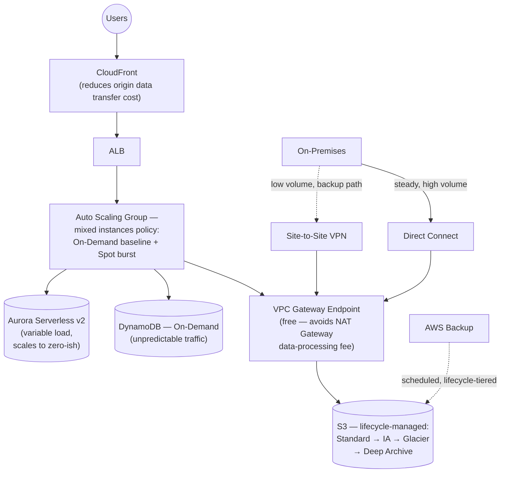
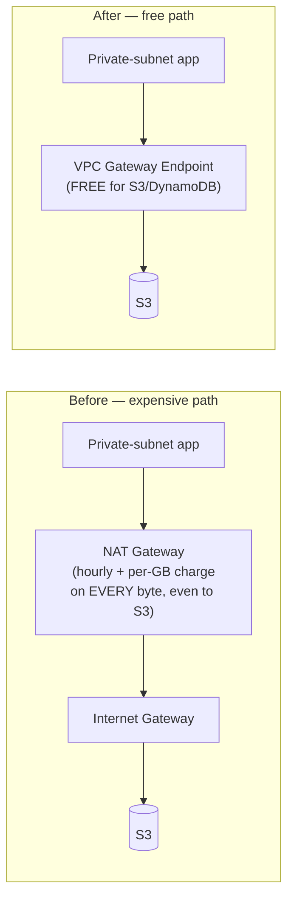
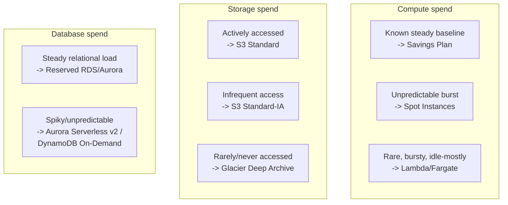
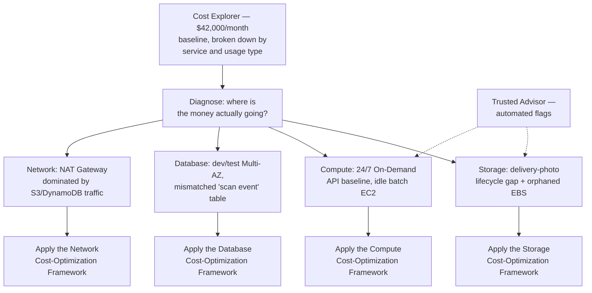

# Domain 4: Design Cost-Optimized Architectures (20%)

In plain terms: this domain assumes you can already design something that works (Domains 1-3) and
asks "now make it cheap without breaking it" — the same services, viewed through a different
lens, which is exactly why it's studied last.

Every cost question on the exam is a variation of one move: **match the purchasing model or
storage/compute tier to the actual, observed usage pattern**, rather than defaulting to the most
flexible (and most expensive) option out of habit. A steady-state workload should be reserved, not
on-demand; cold data should be tiered, not left in Standard; traffic to S3/DynamoDB should skip
the NAT Gateway via a free endpoint; a spiky workload should be serverless or on-demand, not a
fixed-size provisioned fleet. The four task statements below are the same move applied to storage,
compute, database, and network in turn — learn the move once, then recognize its four costumes.

*Source: [Amazon S3 User Guide — Transitioning objects using Amazon S3 Lifecycle](https://docs.aws.amazon.com/AmazonS3/latest/userguide/lifecycle-transition-general-considerations.html)*

## Plain-English Analogy for the Whole Domain

Think of running an AWS bill like running a household budget across four categories at once:
the pantry (storage) should hold perishables up front and canned goods in the back, not
everything at fridge temperature; staffing (compute) should flex a part-time shift for the
predictable dinner rush instead of paying full-time wages around the clock; the grocery budget
(database) should buy in bulk only for ingredients you use every single week, not for the one
exotic spice you might need twice a year; and the commute (network) should take the free direct
route home instead of paying a toll for a trip that never needed the highway. Every task
statement below is one of these four categories, and every "unoptimized" exam answer is some
version of paying fridge-temperature prices, full-time wages, bulk-buy money, or toll-road fees
for something that didn't actually need them.

## Task 4.1 — Design cost-optimized storage solutions

> Lifecycle policies, storage classes, backup strategy

| Concept | Doc |
|---|---|
| S3 storage classes | [`services/storage/s3-storage-classes.md`](../../../services/storage/s3-storage-classes.md) |
| S3 Glacier tiers | [`services/storage/s3-glacier.md`](../../../services/storage/s3-glacier.md) |
| EBS (unattached-volume cost leaks) | [`services/storage/ebs.md`](../../../services/storage/ebs.md) |
| AWS Backup | [`services/storage/aws-backup.md`](../../../services/storage/aws-backup.md) |
| Storage cost-optimization decision framework *(new — decision-level topic)* | [`storage-cost-optimization-decision-framework.md`](storage-cost-optimization-decision-framework.md) |

## Task 4.2 — Design cost-optimized compute solutions

> Spot/Reserved/Savings Plans, auto scaling, serverless, containers

*Source: [Amazon EC2 User Guide — How Spot Instances work](https://docs.aws.amazon.com/AWSEC2/latest/UserGuide/how-spot-instances-work.html)*

| Concept | Doc |
|---|---|
| EC2 (purchasing options) | [`services/compute/ec2.md`](../../../services/compute/ec2.md) |
| EC2 Auto Scaling | [`services/compute/ec2-auto-scaling.md`](../../../services/compute/ec2-auto-scaling.md) |
| Lambda | [`services/compute/lambda.md`](../../../services/compute/lambda.md) |
| Fargate | [`services/compute/fargate.md`](../../../services/compute/fargate.md) |
| Containers vs. VMs vs. serverless | [`services/containers/containers-vs-vms-vs-serverless.md`](../../../services/containers/containers-vs-vms-vs-serverless.md) |
| Compute cost-optimization decision framework *(new — decision-level topic)* | [`compute-cost-optimization-decision-framework.md`](compute-cost-optimization-decision-framework.md) |
| AWS Outposts & AWS Wavelength — hybrid/edge compute cost tradeoffs vs. a standard Region | [`services/compute/niche-compute-services.md`](../../../services/compute/niche-compute-services.md) |

**Outposts** and **Wavelength** both cost meaningfully more per unit of compute than an
equivalent standard Region, and the exam's cost-optimization angle on them is recognizing when
that premium is actually justified — a data-residency or sub-10ms-latency requirement a standard
Region structurally cannot meet — versus when a team has defaulted to on-premises/edge hardware
out of habit when a standard Region would have been both cheaper and sufficient.

## Task 4.3 — Design cost-optimized database solutions

> Engine choice, DynamoDB vs RDS, serverless options

| Concept | Doc |
|---|---|
| Database selection guide | [`services/database/database-selection-guide.md`](../../../services/database/database-selection-guide.md) |
| RDS | [`services/database/rds.md`](../../../services/database/rds.md) |
| Aurora (incl. Aurora Serverless v2) | [`services/database/aurora.md`](../../../services/database/aurora.md) |
| DynamoDB (on-demand vs. provisioned) | [`services/database/dynamodb.md`](../../../services/database/dynamodb.md) |
| Database cost-optimization decision framework *(new — decision-level topic)* | [`database-cost-optimization-decision-framework.md`](database-cost-optimization-decision-framework.md) |
| Aurora Serverless v2, Amazon Keyspaces, Amazon QLDB — niche database services, cost angle | [`services/database/niche-database-services.md`](../../../services/database/niche-database-services.md) |

Aurora Serverless v2 is this task's clearest database example of the domain's central move: a
workload with genuinely variable load pays for the capacity it actually uses, scaling down (not
just up) automatically, instead of a provisioned instance sized for peak and billed at that rate
around the clock even at 3am.

## Task 4.4 — Design cost-optimized network architectures

> NAT gateway cost, Direct Connect vs VPN vs internet, VPC endpoints, Transit Gateway, data
> transfer cost minimization

| Concept | Doc |
|---|---|
| Data transfer pricing (the full cost model) | [`services/networking-content-delivery/data-transfer-pricing.md`](../../../services/networking-content-delivery/data-transfer-pricing.md) |
| VPC endpoints / PrivateLink | [`services/networking-content-delivery/vpc-endpoints-privatelink.md`](../../../services/networking-content-delivery/vpc-endpoints-privatelink.md) |
| Transit Gateway & peering | [`services/networking-content-delivery/transit-gateway-and-peering.md`](../../../services/networking-content-delivery/transit-gateway-and-peering.md) |
| Direct Connect | [`services/networking-content-delivery/direct-connect.md`](../../../services/networking-content-delivery/direct-connect.md) |
| VPN | [`services/networking-content-delivery/vpn.md`](../../../services/networking-content-delivery/vpn.md) |
| Network cost-optimization decision framework *(new — decision-level topic)* | [`network-cost-optimization-decision-framework.md`](network-cost-optimization-decision-framework.md) |
| AWS DataSync (high-speed online transfer into AWS storage) | [`services/migration-transfer/datasync.md`](../../../services/migration-transfer/datasync.md) |
| AWS DMS — Database Migration Service (live database migration/replication) | [`services/migration-transfer/dms.md`](../../../services/migration-transfer/dms.md) |
| AWS Snow Family (offline bulk data transfer — Snowcone/Snowball/Snowmobile) | [`services/migration-transfer/snow-family.md`](../../../services/migration-transfer/snow-family.md) |
| AWS Transfer Family (managed SFTP/FTPS/FTP into S3/EFS) | [`services/migration-transfer/transfer-family.md`](../../../services/migration-transfer/transfer-family.md) |
| Migration services overview — Application Discovery Service, MGN, Migration Hub | [`services/migration-transfer/migration-services-overview.md`](../../../services/migration-transfer/migration-services-overview.md) |

Moving data itself has a cost dimension this task tests directly: **Snow Family** devices exist
specifically because, past a certain dataset size, physically shipping a device is *cheaper and
faster* than paying for the internet/Direct Connect transfer of the same bytes — a scenario
giving a petabyte-scale, one-time dataset and a deadline is testing whether you'll reach for
Snowball/Snowmobile instead of assuming everything must go over the wire. For ongoing, repeated
transfers, **DataSync** avoids the engineering cost of a hand-rolled, retry-handling copy script,
**Transfer Family** avoids standing up and patching your own SFTP server fleet, and **DMS**
replaces a bespoke database-replication pipeline with a managed one — three cases where the
"cost-optimized" answer is a managed service rather than "build it yourself cheaper."

Also relevant across all four tasks: [`services/management-governance/cost-management-tools.md`](../../../services/management-governance/cost-management-tools.md)
(Cost Explorer, budgets, Compute Optimizer) and
[`services/management-governance/trusted-advisor.md`](../../../services/management-governance/trusted-advisor.md)
(automated flags for idle/oversized/underutilized resources across every category above). For
the fuller write-up of Compute Optimizer's rightsizing mechanics (and other lower-frequency
governance services), see
[`services/management-governance/additional-governance-services.md`](../../../services/management-governance/additional-governance-services.md).

## Architecture: A Cost-Optimized System

Step by step: **CloudFront** caches responses at the edge, which cuts both latency *and* the data
transfer bill at the origin — a dual-purpose win. The **Auto Scaling group** blends an On-Demand
(or Reserved/Savings-Plan-covered) baseline with **Spot Instances** absorbing burst load, getting
the deep Spot discount without risking a fully-interruptible fleet. Instead of routing S3/DynamoDB
traffic through a **NAT Gateway** (hourly + per-GB charge on every byte), the app reaches them
through a **VPC Gateway Endpoint**, which is free for S3/DynamoDB. The **S3 bucket itself** runs a
lifecycle policy moving objects from Standard down through Standard-IA, Glacier, and eventually
Deep Archive as they age and stop being accessed — same data, shrinking cost over time with zero
code changes. **DynamoDB runs on-demand** because its traffic is unpredictable, while **Aurora
Serverless v2** handles the relational workload's variable load without permanently provisioning
for peak. For hybrid connectivity, **Direct Connect** carries the steady, high-volume path (cheaper
per-GB at that volume) with a **Site-to-Site VPN** as a lower-commitment backup/low-volume path.
**AWS Backup** applies one retention policy across resources, automatically tiering old backups
into cold storage rather than leaving them in expensive hot storage indefinitely.

## Architecture: NAT Gateway Cost Before/After VPC Endpoints

This single change — adding a free Gateway Endpoint instead of routing S3/DynamoDB traffic through
a billed NAT Gateway — is one of the most frequently tested, highest-leverage individual cost
fixes on the entire exam, precisely because it requires no application change and has literally no
downside once configured correctly.

## Architecture: Purchasing-Model Blend Across a Full Workload

The unifying lesson across all three sub-diagrams: **cost optimization is a sorting exercise, not
a single service swap** — real production workloads nearly always blend multiple purchasing
models/tiers across different parts of the same system, matched piece by piece to each piece's
actual pattern, rather than picking one model for the whole workload.

## How This Domain's Services Work Together (End-to-End Walkthrough)

Trace one request through the same e-commerce platform from the Domain 2 walkthrough, now viewed
purely through the cost lens — the same services, a different question asked of each one. A
customer loads the product page. (1) **CloudFront** serves the page's images and scripts from the
edge — besides the latency win, every one of those cached responses is a request that *never
reaches the origin*, directly shrinking the origin's billed data-transfer-out line item. (2) The
request that does reach the origin hits an **ALB** and lands on an **Auto Scaling group running a
mixed-instances policy** — a steady baseline of instances covered by a **Compute Savings Plan**
(purchased because Cost Explorer showed this baseline never drops below a known floor), with any
burst above that baseline served by **Spot Instances**, since the web tier is stateless and
tolerates an occasional interruption gracefully. (3) The app needs the product catalog, which it
reads from **S3** through a **VPC Gateway Endpoint** rather than a **NAT Gateway** — a free network
path instead of a metered one, for traffic that would otherwise rack up NAT Gateway data-processing
charges on every single product-image fetch. (4) The order itself writes to **Aurora**, provisioned
with **Reserved pricing** because order volume has a well-understood, stable floor; a separate,
much spikier "recently viewed items" table lives in **DynamoDB on-demand** instead, because forcing
that bursty, unpredictable access pattern into a permanently-provisioned relational instance would
mean paying for capacity that sits idle most of the day. (5) That same order record, once written,
eventually ages into **AWS Backup**'s retention policy, which doesn't just take the backup — it
automatically transitions it from hot backup storage into cold storage as it ages past the point
anyone would realistically restore from it, the same lifecycle-tiering idea S3 itself uses for the
product-photo evidence objects sitting in its own bucket (Standard → IA → Glacier → Deep Archive as
access frequency drops with age). (6) Separately, this company's four regional distribution-center
VPCs reach the production VPC through a **Transit Gateway** hub rather than a growing mesh of
individual peering connections, which became both an operational and cost problem once the VPC
count passed a handful. Every one of these six decisions is the *same resource* the Domain 1-3
walkthroughs already described — the ALB, the Aurora cluster, the S3 bucket, the VPC's data path —
just asked a new question: given that this already works securely, resiliently, and fast enough,
is there a cheaper way to buy the exact same capability? That reframing, applied consistently
across storage/compute/database/network, is the entirety of Domain 4.

## Full Worked Case Study: GreenLedger Logistics — A Full-Stack Cost Optimization Pass

**Company requirements.** GreenLedger runs a logistics-tracking platform that has grown
organically for three years with no dedicated cost review. The CFO has mandated a 30% reduction in
AWS spend within one quarter, without degrading the application's performance or availability
commitments established in earlier domains.

**Findings and solution design, mapped to each task:**

1. **Storage (Task 4.1).** A Cost Explorer review shows S3 storage spend dominated by delivery-
   photo evidence uploaded by drivers, almost none of which is accessed after 60 days but all of
   which must be retained for 7 years for regulatory reasons. A lifecycle policy is added:
   Standard for 30 days, Standard-IA for the next 60, then Glacier Deep Archive for the remainder
   of the retention period — cutting the storage cost of that data by the majority of its
   multi-year lifetime with zero application changes. Separately, Trusted Advisor flags a set of
   unattached EBS volumes left behind by terminated test instances; these are snapshotted (in
   case needed) and deleted.
2. **Compute (Task 4.2).** The production API fleet runs 24/7 at a well-known, stable baseline
   load — previously 100% On-Demand. A 1-year Compute Savings Plan is purchased sized to that
   baseline, with the Auto Scaling group's burst capacity above baseline running on Spot
   Instances (the API tier tolerates brief interruption gracefully because it sits behind an ALB
   with health checks that simply route around a terminated instance). A separate nightly batch
   reconciliation job, previously running on a permanently-provisioned EC2 instance, is rewritten
   to run on AWS Batch with Spot-backed compute environments, since it's inherently interruption-
   tolerant and only needs to run for roughly two hours nightly.
3. **Database (Task 4.3).** The dev/test RDS instance, previously running 24/7 identically to
   production (including an unnecessary Multi-AZ standby), is switched off outside business
   hours via a scheduled Lambda and has its Multi-AZ setting removed (dev/test does not carry the
   same availability requirement as production, cutting its compute cost roughly in half on its
   own). A secondary workload — a high-volume, highly variable "package scan event" table
   previously forced into RDS — is identified as a pure key-value access pattern and migrated to
   **DynamoDB on-demand**, which bills near-zero during its many quiet hours instead of paying for
   a permanently-provisioned RDS instance sized for its rare peaks.
4. **Network (Task 4.4).** A review of the largest line items on the bill surfaces NAT Gateway
   data-processing charges as the single biggest network cost, driven almost entirely by
   application traffic to S3 and DynamoDB. Adding Gateway VPC Endpoints for both services (free)
   removes nearly all of that charge. Separately, the company's four regional distribution-center
   VPCs were connected via a growing full mesh of VPC peering connections; this is replaced with
   a single Transit Gateway hub, simplifying routing and reducing the connection management
   overhead that was starting to generate its own operational cost.

**Why this design, not a simpler one.** The team explicitly rejected a blanket "move everything to
Spot" instinct for task 2 — the dev/test Multi-AZ removal and the nightly batch job are genuinely
interruption-tolerant or non-critical, but the 24/7 production API baseline is not something the
team wanted exposed to full Spot interruption risk, which is why only the *burst* capacity above
a Savings-Plan-covered baseline runs on Spot. This mirrors the "match the model to the actual
pattern" principle this whole domain is built around, rather than reaching for whichever single
discount mechanism sounds most aggressive.

## GreenLedger Logistics — The Same Case Study, With Real Numbers

Turning the narrative case study above into an actual illustrative budget makes the 30%-reduction
mandate concrete. Assume GreenLedger's starting monthly AWS bill is **$42,000**, broken down
roughly as: $12,000 storage, $18,000 compute, $8,000 database, $4,000 network.

| Area | Before | Fix | After | Monthly saving |
|---|---|---|---|---|
| Storage (4.1) | $12,000 | Lifecycle policy tiers delivery-photo evidence; unattached EBS volumes cleaned up | $12,000 × (1 − 0.55) ≈ **$5,400** | **$6,600** |
| Compute (4.2) | $18,000 | 1-yr Savings Plan on the stable API baseline (≈28% off that portion); nightly batch job moves to Spot-backed Batch | $18,000 × (1 − 0.30) ≈ **$12,600** | **$5,400** |
| Database (4.3) | $8,000 | Dev/test Multi-AZ removed + scheduled stop/start; "package scan event" table moved to DynamoDB On-Demand | $8,000 × (1 − 0.35) ≈ **$5,200** | **$2,800** |
| Network (4.4) | $4,000 | S3/DynamoDB Gateway Endpoints replace NAT Gateway traffic; VPC peering mesh consolidated to Transit Gateway | $4,000 × (1 − 0.60) ≈ **$1,600** | **$2,400** |
| **Total** | **$42,000** | | **$24,800** | **$17,200 (≈41%)** |

**The number the CFO actually asked for:** a 30% reduction target against a $42,000 baseline is
$42,000 × 0.70 = **$29,400** — this specific illustrative pass lands at $24,800, beating the
mandate with room to spare, specifically because storage and network (the two categories with the
most "pure waste" to remove — unattended lifecycle tiering and a misconfigured NAT path) delivered
proportionally larger percentage cuts than compute and database, where real commitments and
genuine availability tradeoffs limit how aggressively cost can be cut without risk.

## Architecture: Where Trusted Advisor and Cost Explorer Sit in the GreenLedger Workflow

Walkthrough: this diagram makes explicit what the narrative case study implies — **Cost
Explorer and Trusted Advisor are the diagnostic layer**, and the four per-task decision
frameworks in this folder are the *remediation* layer applied once the diagnosis points at a
specific category. A real cost-optimization engagement (and a well-constructed exam scenario)
almost always follows this same two-step shape: find the specific line item first, then apply the
matching framework, rather than guessing at a fix before confirming where the spend actually is.

## Use Cases — Real Scenarios

- **Podcast hosting network tiering five years of audio archives (Task 4.1).** Episodes older
  than 90 days make up roughly 80% of total storage footprint but under 2% of monthly download
  requests, so a lifecycle policy moves them from Standard through Standard-IA and into Glacier
  Deep Archive by day 180, while the still-hot latest-month catalog stays on Standard for
  instant playback — the same storage-shape-matches-access-pattern move as the domain's storage
  framework, applied at archive scale.
- **Regional bank's nightly fraud-review batch job migrating off a permanently-provisioned EC2
  fleet (Task 4.2).** The job runs roughly 90 minutes nightly and tolerates interruption cleanly
  (it checkpoints and resumes), so it moves onto AWS Batch backed by Spot Instances instead of a
  fleet that sat idle the other 22.5 hours a day fully billed at On-Demand rates.
- **Direct-to-consumer subscription box company splitting "recently viewed items" out of RDS
  (Task 4.3).** A high-write, purely key-value feature that had been forced into the same
  relational instance as the order database moves to DynamoDB on-demand, removing both an
  engine mismatch and a chunk of RDS instance cost that was sized for the feature's rare peaks,
  not its typical quiet traffic.
- **Logistics company replacing a NAT Gateway bill dominated by S3 traffic with a free Gateway
  Endpoint (Task 4.4).** A Cost Explorer review traces the single largest network line item to
  application traffic reading shipment-label PDFs from S3 through a NAT Gateway; adding an S3
  Gateway Endpoint eliminates nearly all of that charge with a one-line route-table change.
- **Mid-market SaaS vendor combining all four levers during Series B due-diligence prep.** In one
  quarter: stale log data gets a lifecycle policy (4.1), the steady API baseline gets a Savings
  Plan while burst runs on Spot (4.2), a mis-sized dev/test RDS cluster loses its unnecessary
  Multi-AZ setting (4.3), and NAT Gateway charges for S3/DynamoDB traffic are replaced with free
  VPC endpoints (4.4) — four independent fixes investors can see reflected in one bill.
- **Regional airline covering its steady 24/7 booking-engine baseline with a Savings Plan while
  keeping holiday-week burst on Spot (Task 4.2).** Years of traffic data show the booking API
  never drops below a known floor outside two annual holiday peaks, so the floor is covered by a
  1-year Compute Savings Plan while the predictable, short-lived peaks run on Spot-backed burst
  capacity in the same Auto Scaling group.
- **University research computing center stretching a fixed annual grant across a full year of
  GPU jobs (Task 4.2 + 4.1).** GPU training runs use Spot-backed instances with checkpointing to
  survive interruption, and completed model artifacts move into S3 Standard-IA within a week of
  a project's conclusion — together keeping the center inside its fixed grant instead of running
  out of budget by Q3.
- **E-commerce platform discovering a six-figure annual NAT Gateway bill was entirely S3 and
  DynamoDB traffic (Task 4.4).** What looked like an unavoidable cost of doing business turned
  out to be two missing free Gateway Endpoints — a fix that required no application code change
  and had already paid for the entire cost-review engagement within the first month.
- **Multinational retailer consolidating 12 regional AWS accounts under one Organization to
  unlock shared Savings Plan discounts (Task 4.2, with Domain 1's multi-account strategy as the
  prerequisite).** Each region had been separately buying Reserved Instances at its own smaller
  volume; consolidated billing under one Organization pools that same spend into a larger,
  better-discounted commitment with zero change to any individual workload.
- **Healthcare SaaS vendor right-sizing a Warm Standby DR fleet down to its true minimum capacity
  (Task 4.2, revisiting Domain 2's disaster-recovery choice).** Trusted Advisor flags the standby
  Region's always-on Auto Scaling group as running well above the minimum capacity the DR runbook
  actually requires; shrinking it to the documented floor cuts standing DR cost without changing
  the RTO/RPO the business signed off on.

## Common exam scenarios

- *"Logs older than 90 days are rarely accessed but must be retained for 7 years for
  compliance."* → S3 lifecycle policy transitioning to Glacier Deep Archive.
- *"A NAT Gateway's data processing charges are unexpectedly the largest line item on the
  bill, mostly from traffic to S3."* → Replace with a VPC Gateway Endpoint for S3 (free).
- *"A batch job can tolerate interruption and runs on a flexible schedule."* → Spot Instances.
- *"A production database runs 24/7 with a known, stable load for the next two years."* →
  Reserved Instances / Savings Plans, not On-Demand.
- *"Traffic to a DynamoDB table is highly unpredictable, sometimes zero, sometimes a huge
  spike."* → DynamoDB On-Demand billing mode, not provisioned capacity.
- *"A company connects many VPCs together and the peering connections are becoming unwieldy and
  costly to manage."* → Transit Gateway.
- *"An application needs steady, high-volume, cost-efficient connectivity to an on-prem data
  center."* → Direct Connect (cheaper per-GB than VPN/internet at that volume).
- *"Unattached EBS volumes and idle load balancers are quietly adding to the monthly bill."* →
  Trusted Advisor cost-optimization checks / Cost Explorer, as the tool that surfaces this.
- *"A non-production environment runs identically to production, including Multi-AZ, 24/7."* →
  Remove Multi-AZ for dev/test and schedule it to stop outside business hours — a scenario
  explicitly testing whether you'll apply production-grade settings to a non-production workload
  out of habit.
- *"A workload's traffic is read-heavy, and a cache would reduce database load — does it also
  reduce cost?"* → Yes — fewer database reads can allow a smaller/cheaper provisioned database
  tier, making ElastiCache a cost lever as well as a performance one.
- *"A company wants a single bill across many teams' AWS accounts, with the potential for shared
  volume-based discounts."* → AWS Organizations consolidated billing, which also pools Savings
  Plan/Reserved Instance discounts and S3 volume-tier pricing across all member accounts.
- *"Engineers consistently over-provision EC2 instance sizes 'to be safe,' and the bill reflects
  significant unused capacity."* → AWS Compute Optimizer, which analyzes actual utilization and
  recommends right-sized instance types.
- *"A company wants to commit to a known AWS spend level across EC2, Fargate, and Lambda
  simultaneously, without being locked into one instance family."* → Compute Savings Plans (more
  flexible than EC2 Instance Savings Plans or Reserved Instances).
- *"A test/QA environment is rebuilt every morning and torn down every evening."* → Entirely
  On-Demand (or Spot, if interruption-tolerant) is correct here — a Reserved Instance/Savings
  Plan commitment would be wasted on infrastructure that only exists part of the day.
- *"A company's S3 access pattern for a specific prefix is highly unpredictable, and manually
  tuning lifecycle rules risks costly early-retrieval penalties if guessed wrong."* → S3
  Intelligent-Tiering, which automates tier placement based on observed access with a small
  monitoring fee, avoiding the risk of a poorly-guessed manual lifecycle rule.
- *"A steady Reserved Instance commitment was purchased, but the workload's traffic has since
  become spiky and unpredictable."* → the commitment itself can't be undone mid-term, but future
  capacity decisions should re-evaluate toward On-Demand/Spot/serverless for the new pattern,
  and Savings Plans (unlike Reserved Instances) at least survive an instance-family change
  without losing value.
- *"A database cluster's read replicas have grown over time and nobody has reviewed whether all
  of them are still needed."* → each read replica is its own billed instance; review actual
  read-offload need before assuming more replicas are automatically beneficial.
- *"A newly-launched DR Region's bill per byte of traffic is higher than production's for
  identical traffic."* → check whether the DR Region's VPC Endpoints were actually replicated
  alongside its compute/database resources, a frequently-missed step in DR Region setup.

## Hands-on Labs

See [`labs.md`](labs.md) for runnable Floci exercises covering this domain — expanded to 7 labs
covering S3 lifecycle policies, DynamoDB billing-mode switching, VPC endpoint configuration,
EBS volume cleanup, a mixed-instances Auto Scaling policy, an AWS Backup lifecycle plan, and a
capstone cost-audit lab chaining all of these together.

## Deeper Dives and the Master Reference

Beyond the four per-task decision frameworks above, this folder also includes:

- [`MASTER-CHUNK.md`](MASTER-CHUNK.md) — a single, standalone file covering all 29 services/
  topics in this domain's scope (Definition, Analogy, Use Cases, a Mermaid diagram, a real AWS
  image, and worked exam-tip math for each) — useful as a final-review, open-once-and-don't-
  leave reference.
- [`reserved-savings-plans-vs-spot-worked-math.md`](reserved-savings-plans-vs-spot-worked-math.md) —
  a dedicated worked-math deep dive on the compute purchasing-model decision (On-Demand vs.
  Reserved vs. Savings Plans vs. Spot), with real numeric crossover points.
- [`data-transfer-cost-traps-deep-dive.md`](data-transfer-cost-traps-deep-dive.md) — six specific,
  numerically-worked architectural patterns that silently inflate network cost beyond what the
  core decision framework covers.
- [`database-capacity-mode-cost-crossover.md`](database-capacity-mode-cost-crossover.md) — the
  exact formulas and crossover points for DynamoDB On-Demand vs. Provisioned and Aurora
  Serverless v2 vs. flat-provisioned capacity.

## Where This Domain Connects

- Domain 1 (`../domain-1-secure-architectures/`) — AWS Backup's retention policy here is the same
  mechanism as that domain's compliance-driven backup requirement; cost tiering never removes
  the KMS encryption or access controls established there.
- Domain 2 (`../domain-2-resilient-architectures/`) — the Warm Standby DR fleet from that domain's
  case study is a direct, sizeable cost line item this domain's frameworks are built to optimize
  (e.g., right-sizing the standby's minimum capacity, or reconsidering Pilot Light if the RTO
  allows it).
- Domain 3 (`../domain-3-high-performing-architectures/`) — nearly every performance lever in that
  domain (bigger instance family, more read replicas, higher Provisioned IOPS) is revisited here
  from the opposite direction: is this much performance actually needed for the stated workload?
