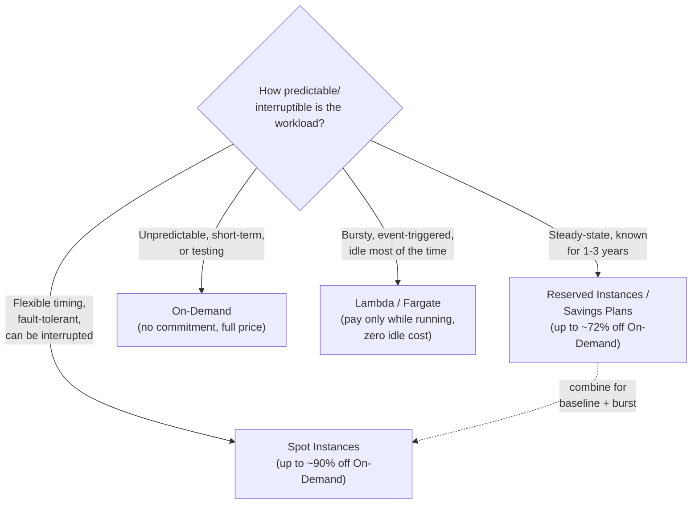
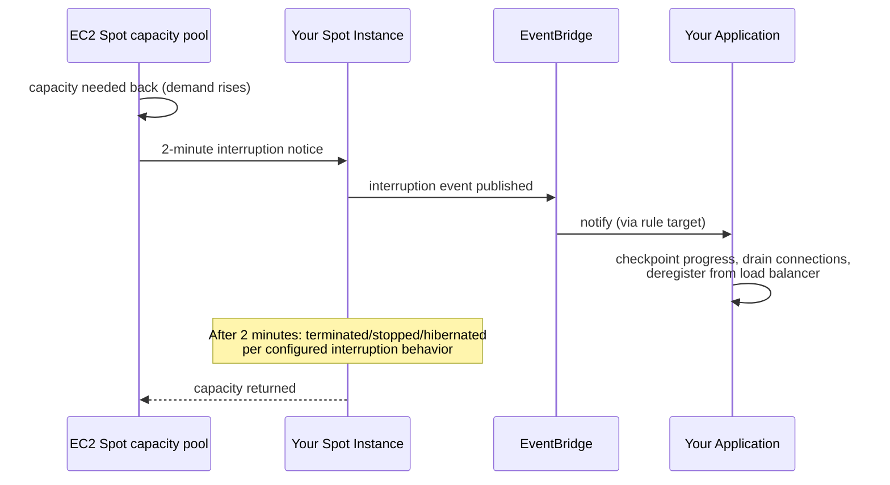
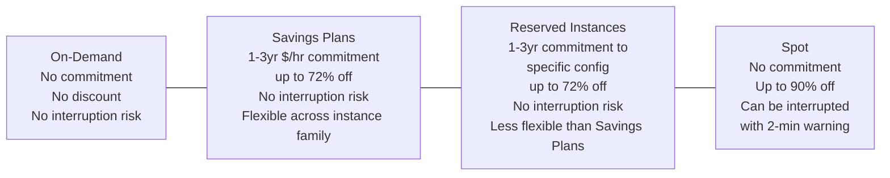
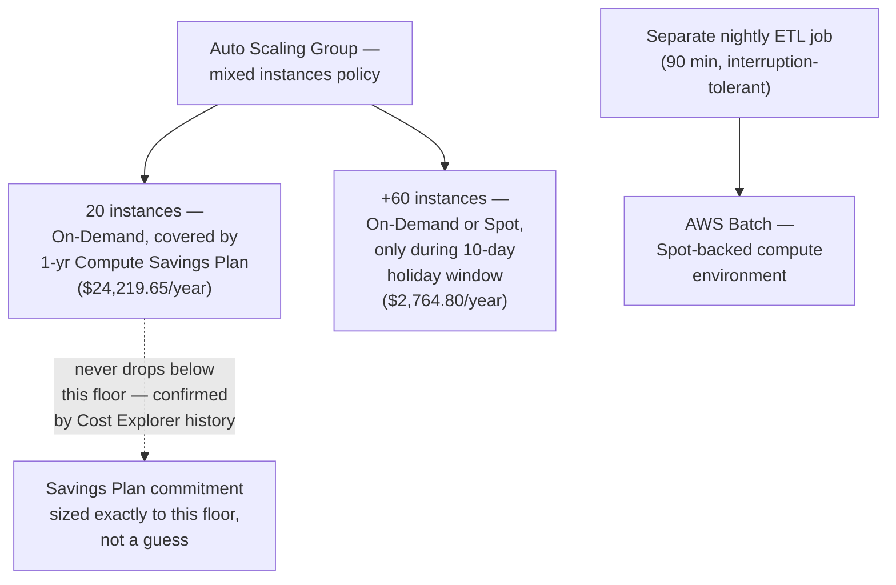

# Compute Cost-Optimization Decision Framework

*Source: [Amazon EC2 User Guide — How Spot Instances work](https://docs.aws.amazon.com/AWSEC2/latest/UserGuide/how-spot-instances-work.html)*

## Definition

A decision framework for minimizing compute spend — on top of `ec2.md`, `ec2-auto-scaling.md`,
`lambda.md`, `fargate.md`, `containers-vs-vms-vs-serverless.md`.

## Plain-English Analogy

Buying EC2 capacity across these purchasing models is like booking airline travel for a whole
year. A business traveler flying the exact same route every single week books an annual pass
(Reserved Instance/Savings Plan) — a big discount in exchange for committing to that route ahead
of time. A standby-fare flyer (Spot) gets the cheapest seat on the plane, but only if a full-fare
passenger doesn't show up and bump them with short notice. Someone booking a single, one-off trip
with no idea if they'll ever need to fly that route again (On-Demand) pays full fare, because
paying full fare once is still cheaper than committing to a year of flights they might not take.
And someone who genuinely only needs transportation a few random days a year calls a taxi each
time instead of buying any kind of pass at all (Lambda/Fargate) — the taxi's per-trip rate is
higher, but paying for 363 unused travel days a year would be far worse.

## Purpose

EC2 pricing isn't one number — AWS offers multiple purchasing models for the *same* instance,
priced for different commitment levels and interruption tolerance, plus entirely serverless
models that remove idle cost altogether. Cost optimization here means matching the purchasing
model (or compute model) to how predictable and interruptible the workload actually is.

## How It Works — Matching Workload to Purchasing Model

Step by step: for a **steady, predictable baseline** (a workload you know will run continuously
for a year or more), **Reserved Instances or Savings Plans** trade an upfront commitment for a
deep discount (up to roughly 72% versus On-Demand) — Savings Plans are the more flexible of the
two (commit to a $/hour spend, applies across instance families/Regions automatically) while
Reserved Instances commit to a specific instance configuration. For **flexible, fault-tolerant
work that can tolerate being interrupted** (batch processing, CI/CD runners, stateless web tiers
behind an Auto Scaling group, big-data processing that checkpoints progress), **Spot Instances**
offer the deepest discount (up to ~90%) by using AWS's spare capacity, which can be reclaimed with
a two-minute warning — never put a stateful, uninterruptible workload on Spot. A very common
real architecture **blends both**: a baseline of Reserved/Savings-Plan capacity sized to the
known minimum load, with Spot Instances scaling up to absorb bursts on top. For genuinely
**unpredictable or short-lived** needs (a one-off test, an unknown new workload before you have
usage data to commit against), **On-Demand** is the right default despite being the most
expensive per hour — the exam flags "paying full On-Demand price for a known, 2-year, steady
workload" as the wrong (unoptimized) answer. Finally, workloads that are **bursty and idle most
of the time** (an API triggered occasionally, a nightly batch job) are often cheaper on
**Lambda or Fargate**, which bill only for actual execution time with zero cost while idle —
removing the instance-sizing decision from the cost equation entirely.

## Architecture: The Spot Interruption Lifecycle and Why It Matters for Cost

The cost argument for Spot only holds if the architecture actually *uses* this two-minute window —
a stateless web tier behind an ALB handles this gracefully (ALB simply stops routing to the
terminated instance; Auto Scaling launches a replacement, possibly On-Demand if Spot capacity is
tight); a long-running stateful batch job needs to checkpoint its progress during this window or
risk losing hours of work. This mechanism is why "fault-tolerant" is the load-bearing qualifier in
every Spot-eligible exam scenario.

## Architecture: EC2 Purchasing Options Compared

The exam's modern framing increasingly favors **Savings Plans over Reserved Instances** as the
"best practice" answer when both are offered for a flexible, multi-instance-family workload —
Reserved Instances remain correct specifically when a scenario needs a capacity reservation
guarantee tied to one exact configuration, which Savings Plans do not provide.

## Key Decision Points

- **Savings Plans vs. Reserved Instances** — Savings Plans are the generally-preferred modern
  answer for flexibility (apply automatically across instance family/size/Region changes);
  Reserved Instances suit a narrower, very stable configuration or specific reservation needs
  (e.g., capacity reservation guarantees).
- **Spot interruption handling is itself a design requirement** — Spot only saves money if the
  architecture tolerates interruption (checkpointing, stateless design, Auto Scaling replacing
  terminated instances) — a scenario describing a stateful, non-fault-tolerant workload rules
  Spot out regardless of cost savings.
- **Auto Scaling mixed instances policy** lets one Auto Scaling group blend On-Demand (baseline)
  and Spot (burst) automatically, which is the practical mechanism behind "blend both" above.
- **Serverless removes the sizing/purchasing decision entirely** for the right workload shape —
  the cost optimization *is* choosing serverless in the first place, not tuning instance
  purchasing options that no longer apply.
- **Right-sizing still matters** before any purchasing-model decision — a Reserved Instance
  commitment to an oversized instance just locks in waste for 1-3 years instead of removing it.
- **Compute Optimizer** analyzes actual CloudWatch utilization history and recommends the
  right-sized instance type/family before you commit to a Savings Plan or Reserved Instance term
  — using it first prevents locking in an oversized baseline.
- **Spot diversification across instance types/AZs** reduces the practical interruption rate for
  a fleet — a mixed instances policy spanning several compatible instance types makes it less
  likely that all of them are reclaimed from the Spot pool simultaneously.
- **Dev/test environments rarely need 24/7 compute** — scheduling non-production instances to
  stop outside business hours (via Instance Scheduler or a scheduled Lambda) is a simple,
  frequently-tested cost lever distinct from purchasing-model choice entirely.

## Use Cases — Real Scenarios

- **Regional airline's flight-booking engine with a known, flat, 24/7 baseline.** Years of traffic
  data show the booking API never drops below a floor of 40 instances' worth of load — a 3-year
  Compute Savings Plan sized to that floor locks in a deep discount for capacity the airline was
  always going to pay for anyway.
- **University's annual course-registration system active only two weeks per semester.** Rather
  than any standing compute commitment, the registration API runs entirely on Lambda, billing
  essentially nothing the other fifty weeks of the year and scaling instantly during the two
  registration windows.
- **Game studio's matchmaking servers tolerating interruption during off-peak hours.** Overnight,
  lower-player-count matchmaking capacity runs on Spot Instances, since a brief two-minute
  interruption simply means a small number of matches get reshuffled rather than any real
  user-facing failure, capturing a deep discount for capacity that's genuinely optional at that hour.
- **Marketing agency's nightly batch report-generation job.** A two-hour nightly job that resizes
  client ad creatives runs on AWS Batch with Spot-backed compute environments — short, bursty,
  checkpoint-tolerant, and never justifying any standing reservation.
- **Enterprise migrating off an over-provisioned fleet discovered during a cost review.**
  Compute Optimizer flags that half the production fleet is running at under 15% average CPU
  utilization; the team right-sizes to a smaller instance family *before* committing to a Savings
  Plan, avoiding locking in a discount on wasted capacity.
- **Media company's video-transcoding pipeline needing cost predictability for a 2-year content
  deal.** Knowing transcoding volume is contractually guaranteed for two years, the compute fleet
  behind it is covered by a 2-year EC2 Instance Savings Plan rather than left on-demand, which the
  team had been doing out of habit from the pipeline's earlier, less-certain days.
- **Retailer running identical dev/staging/prod EC2 fleets around the clock.** An Instance
  Scheduler stops the dev and staging fleets outside business hours, cutting their compute cost by
  roughly two-thirds for environments that have no legitimate reason to run unattended overnight.
- **ARM-compatible internal tools team cutting its EC2 bill without any architecture change.** A
  stateless internal reporting service, already confirmed to run cleanly on ARM, is switched to
  Graviton instances purely for the better price-performance ratio, with zero code changes beyond a
  recompile.

## Common Mistakes

- Running a known, steady, 24/7 production workload entirely On-Demand instead of covering its
  baseline with a Savings Plan or Reserved Instances.
- Putting a stateful, non-checkpointing, business-critical workload on Spot purely to save money,
  ignoring the interruption risk a scenario explicitly describes as unacceptable.
- Committing to a 1- or 3-year Reserved Instance for an instance size later found to be
  oversized — right-size first, commit second.
- Leaving dev/test environments running 24/7 identically to production when they only need to
  exist during business hours.
- Choosing Reserved Instances by default when Savings Plans would offer the same or better
  discount with meaningfully more flexibility for a workload whose instance family may change.

## Full Worked Mini-Case: Sizing a Purchasing Strategy to a Real Traffic Pattern

**Scenario:** an e-commerce API's traffic is flat at roughly 20 instances' worth of load nearly
all year, except for a predictable 10-day holiday peak requiring roughly 80 instances, and an
entirely separate nightly ETL job that runs for 90 minutes and can tolerate being restarted if
interrupted.

**Applying the framework:** the steady 20-instance baseline is covered by a **1-year Compute
Savings Plan**, locking in the deep discount for load that genuinely never drops below that
level. The additional 60 instances needed only during the 10-day holiday peak are **not** worth a
1-3 year commitment for 10 days of use a year — they run as **On-Demand or Spot** burst capacity
in a mixed-instances Auto Scaling policy, scaling up automatically as holiday traffic arrives and
back down after. The nightly ETL job, being short, interruption-tolerant, and schedule-flexible,
runs on **Spot-backed AWS Batch**, capturing the deepest available discount for a workload that
was never going to need a standing commitment at all.

## Full Worked Numeric Case: The Exact Dollar Difference, Computed

Putting real illustrative numbers against the mini-case above makes the size of the win concrete
rather than conceptual. Assume an On-Demand rate of $0.192/hour per instance (m5.xlarge-
equivalent, illustrative).

- **Naive baseline — 80 instances On-Demand year-round** (treating the holiday peak capacity as
  if it needed to exist all year, a common over-provisioning instinct): 80 × $0.192 × 8,760 ≈
  **$134,553.60/year**.
- **Correct baseline — 20 instances On-Demand year-round, no commitment at all:** 20 × $0.192 ×
  8,760 ≈ **$33,638.40/year**, plus the 60-instance holiday burst for 10 days (240 hours): 60 ×
  $0.192 × 240 ≈ **$2,764.80/year** — a combined **$36,403.20/year**, already a massive
  improvement over the naive 80-instance-year-round baseline purely from not over-provisioning.
- **Fully optimized — 20-instance baseline on a 1-year Compute Savings Plan (≈28% discount,
  illustrative) + the same 60-instance holiday burst On-Demand:** 20 × $0.192 × 0.72 × 8,760 ≈
  **$24,219.65/year**, plus the same $2,764.80/year burst ≈ **$26,984.45/year** total.
- **Total improvement from naive to fully optimized:** $134,553.60 − $26,984.45 ≈ **$107,569.15/
  year**, an 80% reduction — split roughly 73 percentage points from simply not provisioning
  holiday-peak capacity year-round, and a further 7 percentage points from applying a Savings
  Plan to the genuinely steady remainder. This split matters on the exam: right-sizing
  (removing the 80-vs-20 instance over-provisioning) is consistently the larger lever than the
  purchasing-model discount layered on top of it, even though Savings Plans/Reserved Instances
  get more airtime in study material.

## Architecture: A Second Real Diagram — Mixed Instances Policy Implementing the Blend

Walkthrough: this diagram is the mini-case's purchasing decisions made concrete as infrastructure
— one Auto Scaling group's mixed instances policy carries both the Savings-Plan-covered baseline
and the holiday burst, while the unrelated nightly batch job sits entirely outside that group on
its own Spot-backed AWS Batch environment, since it has a completely different traffic shape
(short, nightly, interruption-tolerant) that doesn't belong blended into the web tier's scaling
policy at all.

## Real AWS Image: Mapping Services to Their Commitment-Discount Options

*Source: [AWS Well-Architected Framework — FND06-BP06, Build strategies for commitment discounts and volume-based pricing](https://docs.aws.amazon.com/wellarchitected/latest/framework/fnd06-bp06.html)*

This is AWS's own Well-Architected reference diagram, and it makes a detail worth stating
explicitly: **not every service in a typical stack has the same commitment-discount mechanism** —
EC2 has both Reserved Instances and Savings Plans, RDS/ElastiCache/Redshift/DynamoDB have their
own service-specific Reserved Instance variants, while CloudFront, S3, and Route 53 have no
Reserved/Savings Plan mechanism at all (their own pricing is already volume-tiered or usage-based
by design). A scenario asking you to "apply a purchasing-model discount" across an entire stack
is implicitly asking which of its components even *have* that lever available.

## Why It's Important

**Exam mapping:** SAA-C03 Domain 4, Task 4.2 ("design cost-optimized compute solutions —
Spot/Reserved/Savings Plans, auto scaling, serverless, containers") is exactly this purchasing-
model-to-workload matching exercise.

## Exam Tips

- "Known, steady, long-term" → Savings Plans/Reserved Instances. "Flexible, interruptible,
  fault-tolerant" → Spot. "Unpredictable/short-term/testing" → On-Demand. "Bursty, idle most of
  the time" → Lambda/Fargate. Memorize this four-way split as a single lookup table.
- A scenario that pairs "steady baseline" with "unpredictable burst" wants a *blended* answer
  (Savings Plan baseline + Spot/On-Demand burst), not a single purchasing model for the whole
  fleet.
- Compute Optimizer and right-sizing are a prerequisite step, not a substitute, for purchasing-
  model optimization — both can be correct answers to different parts of the same scenario.

## Related Terms

- [`../../../services/compute/ec2.md`](../../../services/compute/ec2.md),
  [`../../../services/compute/ec2-auto-scaling.md`](../../../services/compute/ec2-auto-scaling.md)
- [`../../../services/compute/lambda.md`](../../../services/compute/lambda.md),
  [`../../../services/compute/fargate.md`](../../../services/compute/fargate.md)
- [`../../../services/containers/containers-vs-vms-vs-serverless.md`](../../../services/containers/containers-vs-vms-vs-serverless.md)
- [`../../../services/management-governance/cost-management-tools.md`](../../../services/management-governance/cost-management-tools.md)
- [`../../../services/management-governance/trusted-advisor.md`](../../../services/management-governance/trusted-advisor.md) — flags idle/oversized resources
- [`../domain-3-high-performing-architectures/compute-performance-decision-framework.md`](../domain-3-high-performing-architectures/compute-performance-decision-framework.md) —
  the same instance-family/compute-model choice, revisited for raw performance
- [`database-cost-optimization-decision-framework.md`](database-cost-optimization-decision-framework.md) —
  the identical Reserved/Serverless pattern, applied to RDS/Aurora/DynamoDB
