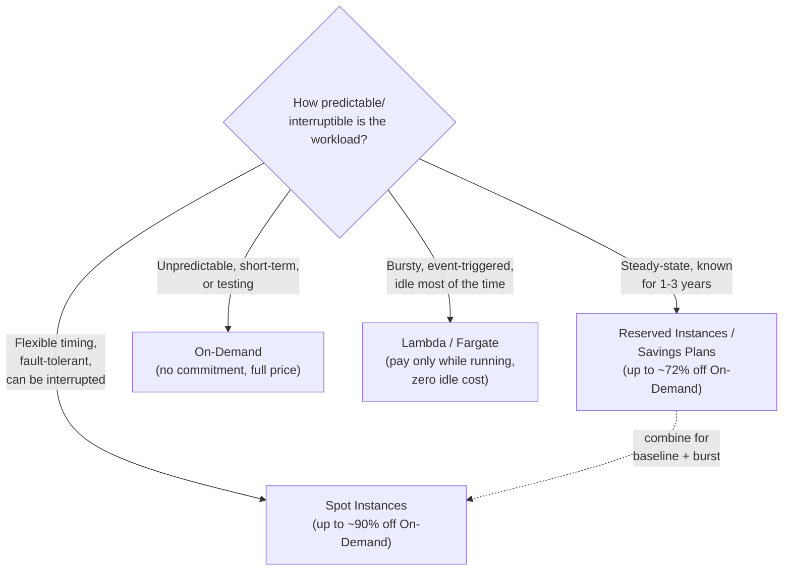

# Compute Cost-Optimization Decision Framework

## Definition

A decision framework for minimizing compute spend — on top of `ec2.md`, `ec2-auto-scaling.md`,
`lambda.md`, `fargate.md`, `containers-vs-vms-vs-serverless.md`.

## Purpose

EC2 pricing isn't one number — AWS offers multiple purchasing models for the *same* instance,
priced for different commitment levels and interruption tolerance, plus entirely serverless
models that remove idle cost altogether. Cost optimization here means matching the purchasing
model (or compute model) to how predictable and interruptible the workload actually is.

## How It Works — Matching Workload to Purchasing Model

Step by step: for a **steady, predictable baseline** (a workload you know will run continuously
for a year or more), **Reserved Instances or Savings Plans** trade an upfront commitment for a
deep discount (up to roughly 72% versus On-Demand) — Savings Plans are the more flexible of the
two (commit to a $/hour spend, applies across instance families/Regions automatically) while
Reserved Instances commit to a specific instance configuration. For **flexible, fault-tolerant
work that can tolerate being interrupted** (batch processing, CI/CD runners, stateless web tiers
behind an Auto Scaling group, big-data processing that checkpoints progress), **Spot Instances**
offer the deepest discount (up to ~90%) by using AWS's spare capacity, which can be reclaimed with
a two-minute warning — never put a stateful, uninterruptible workload on Spot. A very common
real architecture **blends both**: a baseline of Reserved/Savings-Plan capacity sized to the
known minimum load, with Spot Instances scaling up to absorb bursts on top. For genuinely
**unpredictable or short-lived** needs (a one-off test, an unknown new workload before you have
usage data to commit against), **On-Demand** is the right default despite being the most
expensive per hour — the exam flags "paying full On-Demand price for a known, 2-year, steady
workload" as the wrong (unoptimized) answer. Finally, workloads that are **bursty and idle most
of the time** (an API triggered occasionally, a nightly batch job) are often cheaper on
**Lambda or Fargate**, which bill only for actual execution time with zero cost while idle —
removing the instance-sizing decision from the cost equation entirely.

## Key Decision Points

- **Savings Plans vs. Reserved Instances** — Savings Plans are the generally-preferred modern
  answer for flexibility (apply automatically across instance family/size/Region changes);
  Reserved Instances suit a narrower, very stable configuration or specific reservation needs
  (e.g., capacity reservation guarantees).
- **Spot interruption handling is itself a design requirement** — Spot only saves money if the
  architecture tolerates interruption (checkpointing, stateless design, Auto Scaling replacing
  terminated instances) — a scenario describing a stateful, non-fault-tolerant workload rules
  Spot out regardless of cost savings.
- **Auto Scaling mixed instances policy** lets one Auto Scaling group blend On-Demand (baseline)
  and Spot (burst) automatically, which is the practical mechanism behind "blend both" above.
- **Serverless removes the sizing/purchasing decision entirely** for the right workload shape —
  the cost optimization *is* choosing serverless in the first place, not tuning instance
  purchasing options that no longer apply.
- **Right-sizing still matters** before any purchasing-model decision — a Reserved Instance
  commitment to an oversized instance just locks in waste for 1-3 years instead of removing it.

## Why It's Important

**Exam mapping:** SAA-C03 Domain 4, Task 4.2 ("design cost-optimized compute solutions —
Spot/Reserved/Savings Plans, auto scaling, serverless, containers") is exactly this purchasing-
model-to-workload matching exercise.

## Related Terms

- [`../../../services/compute/ec2.md`](../../../services/compute/ec2.md),
  [`../../../services/compute/ec2-auto-scaling.md`](../../../services/compute/ec2-auto-scaling.md)
- [`../../../services/compute/lambda.md`](../../../services/compute/lambda.md),
  [`../../../services/compute/fargate.md`](../../../services/compute/fargate.md)
- [`../../../services/containers/containers-vs-vms-vs-serverless.md`](../../../services/containers/containers-vs-vms-vs-serverless.md)
- [`../../../services/management-governance/cost-management-tools.md`](../../../services/management-governance/cost-management-tools.md)
- [`../../../services/management-governance/trusted-advisor.md`](../../../services/management-governance/trusted-advisor.md) — flags idle/oversized resources
