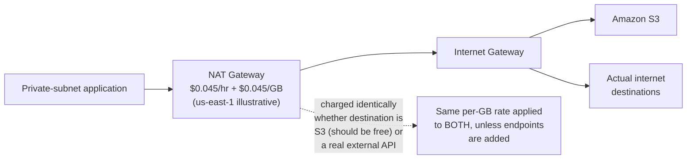
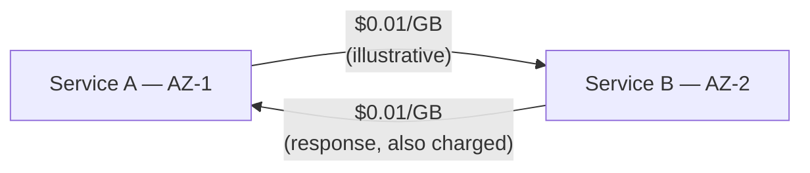
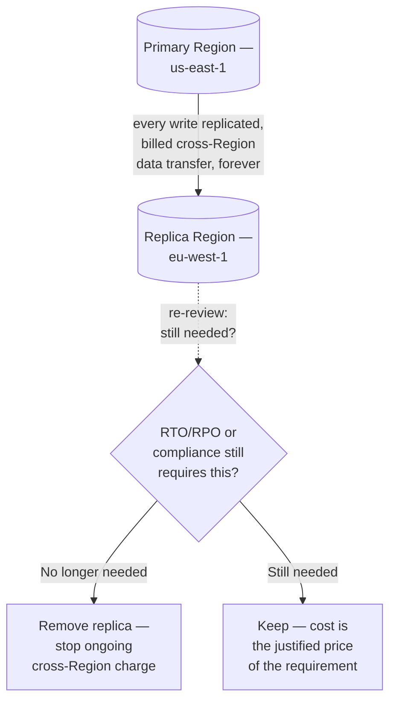
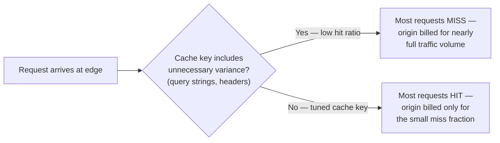
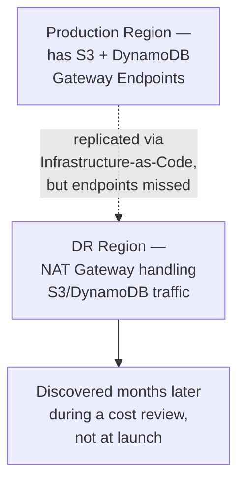
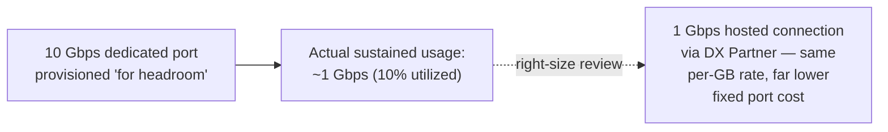

# Data Transfer Cost Traps — A Deep Dive

> **Appears in:** [SAA-C03](../../README.md) | [Domain 4 README](README.md) | [MASTER-CHUNK.md](MASTER-CHUNK.md)

The [Network Cost-Optimization Decision Framework](network-cost-optimization-decision-framework.md)
in this folder covers the core decision tree (NAT Gateway vs. VPC Endpoint, Peering vs. Transit
Gateway, Direct Connect vs. VPN). This doc exists because data transfer is consistently the
single most *surprising* line item on a real AWS bill — not because the pricing model is secret,
but because it's genuinely easy to build an architecture that accidentally routes traffic through
every expensive tier at once without anyone deciding to. Each trap below is a real, specific
architectural pattern that silently inflates a bill, with the worked numbers to recognize it.

## Definition

A deep dive into the specific architectural patterns that cause AWS data transfer costs to be
higher than expected — distinct from the Network Cost-Optimization Decision Framework's "which
service to choose" framing, this doc is about "how does an architecture that already chose the
*right* services still end up with a surprising transfer bill."

## Plain-English Analogy

Data transfer traps are like a phone plan with free calls to some numbers, cheap calls to others,
and expensive international rates — and discovering, only when the bill arrives, that an
automated system was quietly routing every call through the most expensive carrier available
because nobody had configured it to prefer the free path first. Nothing was "broken" — the calls
all connected and worked fine — the bill is just needlessly huge because of a routing choice no
one audited.

## Purpose

This doc exists to make each trap concrete and numeric, because "data transfer pricing is tiered
by distance and direction" is easy to state abstractly and easy to forget to apply when actually
designing a specific piece of an architecture — a NAT Gateway placed without thinking, two chatty
services split across AZs by default, a multi-Region DR setup that duplicates a Region's entire
traffic pattern without re-checking endpoint coverage.

## Trap 1 — The NAT Gateway "Processes Everything" Trap

**The trap:** a NAT Gateway charges both an hourly fee *and* a per-GB data-processing fee for
**every byte that passes through it**, including traffic to other AWS services (S3, DynamoDB,
SNS, SQS) that never actually needed to touch the public internet or even leave AWS's own
network. Many private-subnet architectures route 100% of outbound traffic through a NAT Gateway
by default, because that's simply what the default route table looks like when a VPC is first
created with public/private subnet templates.

**Worked math:** an application transferring 15 TB/month to S3 through a NAT Gateway, plus a
genuine 2 TB/month to external APIs that do need the internet path: total NAT-processed traffic
is 17 TB (17,408 GB). Monthly cost: $0.045 × 730 (fixed) + 17,408 × $0.045 ≈ $32.85 + $783.36 ≈
**$816.21/month**. Adding an S3 Gateway Endpoint removes the 15 TB of S3 traffic from this path
entirely (free), leaving only the genuine 2 TB (2,048 GB) of external-API traffic on the NAT
path: $32.85 + 2,048 × $0.045 ≈ $32.85 + $92.16 ≈ **$125.01/month** — a reduction of roughly
**$691.20/month ($8,294.40/year)** for a one-line route-table change with zero application impact.

### Real AWS Image: The Free Path This Trap's Fix Relies On

*Source: [AWS PrivateLink Guide — Gateway endpoints](https://docs.aws.amazon.com/vpc/latest/privatelink/gateway-endpoints.html)*

This is the exact "after" picture for Trap 1's fix — note there is no NAT Gateway, no Internet
Gateway, and no ENI anywhere in this path; the Gateway Endpoint is purely a route-table entry,
which is precisely why it costs nothing and has no capacity limit to size or scale.

## Trap 2 — The Multi-AZ "Chatty Pair" Trap

**The trap:** spreading every service across multiple AZs is good practice for availability, but
two services that call each other **very frequently** and are placed in *different* AZs purely by
default (not because that specific pair needs cross-AZ redundancy) incur a real, continuous
cross-AZ charge in **both directions** for every single call.

**Worked math:** two microservices exchanging 2 TB/month total (1 TB each direction) split
across AZs: 1,024 GB × $0.01 × 2 directions ≈ **$20.48/month** for this one pair alone. In a
microservices architecture with, say, 15 similarly chatty pairs averaging that same volume, the
aggregate cross-AZ charge reaches roughly **$307.20/month ($3,686.40/year)** — not one dramatic
line item, but a continuously recurring cost that a single Cost Explorer "data transfer" category
review can miss if it isn't broken down by usage type specifically. Consolidating pairs that don't
have a genuine per-pair availability requirement into the same AZ removes this cost entirely with
zero redundancy lost, since the *service* (not that specific pair's placement) is still spread
across AZs via its own Auto Scaling group or equivalent.

## Trap 3 — The Cross-Region Replica "Set And Forget" Trap

**The trap:** cross-Region replication (an RDS/Aurora cross-Region read replica, S3 Cross-Region
Replication, a DynamoDB Global Table) is often enabled once, for a real resilience or latency
reason, and never revisited — but it bills for data transfer out to the destination Region
*continuously*, for every write, indefinitely, regardless of whether the original business
justification still holds.

**Worked math:** a database writing 500 GB/month of changes, replicated cross-Region at roughly
$0.02/GB (illustrative, varies by Region pair): 500 × $0.02 ≈ **$10/month** sounds trivial at
first glance — but across 3 years of a replica nobody re-evaluated after the original DR
requirement changed (e.g., the RTO/RPO target was later relaxed, or a different DR pattern was
adopted), that's 500 × $0.02 × 36 ≈ **$360** of pure, avoidable cost, plus the replica
*instance's* own ongoing compute/storage cost on top — the data-transfer piece alone is rarely
the dominant cost here, but it's the signal worth noticing on a periodic architecture review.

## Trap 4 — The CloudFront Cache-Miss "Silent Origin Hit" Trap

**The trap:** CloudFront reduces origin data-transfer cost specifically by serving cache *hits*
from the edge — but a poorly-tuned cache configuration (overly short TTLs, cache keys that
include query-string parameters or headers that vary per-request without actually affecting the
response, or a `Cache-Control: no-cache` header set reflexively on cacheable content) can produce
a cache-hit ratio far lower than an architecture diagram implies, silently routing most "cached"
traffic straight through to the origin anyway.

**Worked math:** 10 TB/month of traffic through CloudFront. At a tuned 85% hit ratio, only 1.5 TB
reaches the origin (per Section 14's math in MASTER-CHUNK.md, this is close to free since S3-to-
CloudFront isn't billed as internet egress). At an *untuned*, cache-key-bloated 30% hit ratio
(a realistic outcome when every request's irrelevant query-string variant is treated as a unique
cache key), 7 TB reaches the origin instead — roughly **4.7x more origin-facing traffic** for
the exact same CloudFront distribution and the exact same user traffic, purely from a cache-key
configuration detail that's invisible in the architecture diagram itself.

## Trap 5 — The Disaster-Recovery Region "Forgot the Endpoints" Trap

**The trap:** a Warm Standby or Pilot Light DR Region, built as a near-copy of production, often
gets its compute/database/storage resources replicated carefully but its **VPC Endpoint
configuration** copied incompletely or forgotten entirely — meaning the standby Region's app
tier routes its S3/DynamoDB traffic through a NAT Gateway from day one, silently costing more per
byte than production for an identical workload shape.

**Worked math:** a DR Region's app tier generates the same 5 TB/month of S3 traffic as
production, but (missing the Gateway Endpoint) routes it through a NAT Gateway: 5,120 GB ×
$0.045 + $32.85 (fixed) ≈ **$262.25/month** of entirely avoidable cost for a standby environment
that, by design, is supposed to be the *cheaper*, rarely-active half of the architecture — the
irony being that the standby Region costing more per byte than production for identical traffic
is the opposite of what a cost-conscious DR design intends.

## Trap 6 — The Underutilized Direct Connect Port Trap

**The trap:** Direct Connect's fixed port-hour cost exists whether or not the circuit is
actually carrying traffic near its provisioned capacity — a company that provisions a 10 Gbps
dedicated connection for traffic that only ever reaches 1 Gbps is paying the larger circuit's
full fixed cost while realizing none of the larger circuit's benefit, and still paying standard
Direct Connect per-GB rates on top for the traffic that does flow.

**Worked math:** a 10 Gbps dedicated Direct Connect port costs roughly $2.25/hour ($1,642.50/
month, illustrative) regardless of utilization. A right-sized 1 Gbps hosted connection through a
Direct Connect Partner, sufficient for the actual ~1 Gbps sustained load, costs roughly $0.30/
hour ($219/month) — a difference of **$1,423.50/month ($17,082/year)** in fixed port cost alone,
recovered purely by matching the provisioned circuit size to actual sustained throughput instead
of a headroom guess, with zero change to the per-GB data transfer rate paid for the traffic
itself.

## Key Decision Points

- **Audit by traffic flow, not by category** — "data transfer" as a single Cost Explorer category
  hides which specific path (NAT, cross-AZ, cross-Region, CloudFront miss) is actually responsible;
  break it down by usage type before concluding anything.
- **A one-time architectural decision (replica placement, AZ spread, endpoint config) produces a
  continuously recurring charge** — these traps don't show up as one-time costs, they compound
  monthly for as long as the underlying configuration exists unreviewed.
- **New Regions/environments should inherit the SAME network cost configuration as the
  environment they're modeled on**, checked explicitly at launch time, not discovered as a gap
  months later.
- **Cache-hit ratio is a configuration outcome, not a given** — "we use CloudFront" doesn't
  automatically mean a high hit ratio; the cache key and TTL configuration determines the actual
  number.

## Use Cases — Real Scenarios

- **A logistics company's Cost Explorer deep-dive tracing a NAT Gateway bill to S3 traffic**,
  fixing it with a Gateway Endpoint exactly per Trap 1, recovering several hundred dollars a
  month with no application change.
- **A media company's microservices audit finding 15 chatty service pairs scattered across AZs
  by historical accident**, consolidating the pairs with no genuine per-pair HA need into shared
  AZs per Trap 2.
- **A healthcare SaaS company's annual DR review discovering a cross-Region read replica kept
  active long after the original RTO/RPO requirement was relaxed**, removing it per Trap 3 and
  recovering both the transfer and the replica's own standing compute cost.
- **An e-commerce platform's CDN audit discovering an overly specific cache key was dropping hit
  ratio from an expected 85% to an actual 30%**, retuning the CloudFront cache policy per Trap 4
  and immediately reducing origin-facing traffic by roughly 80%.
- **A fintech company's new DR Region launch checklist now explicitly including "VPC Endpoint
  parity with production"** as a launch-blocking item, after Trap 5 was discovered the hard way
  in an earlier expansion.
- **A FinOps team running this file's five traps as a standing quarterly checklist** across every
  production and DR Region, catching configuration drift (a forgotten endpoint, a newly chatty
  cross-AZ pair introduced by a recent feature) before it accumulates into a large annual total.

## Common Mistakes

- Treating "data transfer cost is high" as a single problem rather than auditing for which of
  these five (or more) specific patterns is actually responsible.
- Assuming a DR/secondary Region automatically inherits the primary Region's network cost
  configuration without explicitly verifying it.
- Assuming CloudFront's presence alone guarantees a good cache-hit ratio without checking the
  actual cache-key/TTL configuration against real traffic.
- Treating a one-time architectural decision (AZ placement, replica setup) as a cost that doesn't
  need periodic re-review, when it in fact compounds monthly.

## Why It's Important

**Exam mapping:** SAA-C03 Domain 4, Task 4.4's "data transfer cost minimization" phrasing is
tested less often as "name the pricing tiers" and increasingly as "given this specific
architecture, where is the traffic actually flowing, and is that the cheapest available path for
it" — exactly the pattern-recognition skill this doc's five traps build.

## Exam Tips

- When a scenario names a specific, large network cost line item, mentally check it against each
  of these five traps before reaching for a generic "add a VPC endpoint" answer — the trap (and
  therefore the specific fix) may be cross-AZ placement, a stale replica, or a cache-key issue
  instead.
- "NAT Gateway cost, traffic to S3/DynamoDB" is Trap 1 and remains the single most frequently
  tested individual pattern in this whole domain — always check this first.
- A scenario describing a second Region or environment that "mirrors" an existing one should
  prompt a check of whether *everything* was mirrored, including the parts (like VPC Endpoints)
  that are easy to leave out of an infrastructure template.

## Related Terms

- [`network-cost-optimization-decision-framework.md`](network-cost-optimization-decision-framework.md) —
  the core decision tree these traps assume you already understand.
- [`MASTER-CHUNK.md`](MASTER-CHUNK.md) — Section 22 (Data Transfer Pricing), Section 14
  (CloudFront), Section 28 (Transit Gateway & VPC Peering), Section 29 (VPC Endpoints &
  PrivateLink).
- [`../../../services/networking-content-delivery/data-transfer-pricing.md`](../../../services/networking-content-delivery/data-transfer-pricing.md)
- [`../../../services/networking-content-delivery/cloudfront.md`](../../../services/networking-content-delivery/cloudfront.md)
- [`../domain-2-resilient-architectures/README.md`](../domain-2-resilient-architectures/README.md) —
  the DR patterns (Warm Standby, Pilot Light) Trap 5 assumes as context.
