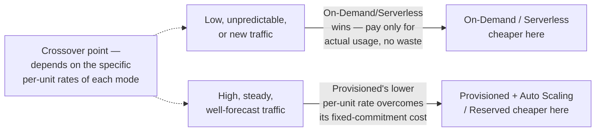

# Database Capacity Mode Cost Crossover — DynamoDB and Aurora Serverless v2, Worked Math

> **Appears in:** [SAA-C03](../../README.md) | [Domain 4 README](README.md) | [MASTER-CHUNK.md](MASTER-CHUNK.md)

The [Database Cost-Optimization Decision Framework](database-cost-optimization-decision-framework.md)
names the conceptual rule: unpredictable load favors on-demand/serverless billing, steady load
favors provisioned/Reserved billing. This doc exists to pin down exactly **where** that crossover
sits for DynamoDB and Aurora Serverless v2 specifically, with real formulas and worked numbers —
because "it depends on the traffic pattern" is true but not actionable on its own, and the exam
increasingly gives you enough numeric detail to actually locate the crossover point yourself.

## Definition

A worked-math companion doc establishing the request-volume and utilization thresholds at which
DynamoDB On-Demand becomes more expensive than Provisioned + Auto Scaling, and at which Aurora
Serverless v2 becomes more expensive than an equivalent right-sized provisioned Aurora instance —
so the capacity-mode decision can be checked against a real number instead of a category alone.

## Plain-English Analogy

Choosing between a taxi (pay per ride, no commitment) and a leased car (fixed monthly payment,
cheaper per mile once you're driving enough) is the same crossover problem — below a certain
number of miles a month, the taxi is cheaper; above it, the lease wins, and the exact crossover
point is a number you can calculate from the taxi's per-mile rate and the lease's fixed payment,
not a guess.

## Purpose

DynamoDB On-Demand and Aurora Serverless v2 both exist to remove the *risk* of guessing capacity
wrong — but "removes risk" and "is cheaper" are different claims, and conflating them leads to
leaving a provisioned-mode discount on the table for a workload that's actually stable enough to
claim it. This doc exists to separate those two claims with real formulas.

## How It Works — The General Crossover Shape

Walkthrough: every capacity-mode decision in this domain has this same shape — a flat, usage-based
rate that's cheap at low volume and a provisioned rate that's cheap at high, steady volume,
crossing at a specific point determined by the two modes' actual per-unit prices. The sections
below compute that crossover point explicitly for DynamoDB and Aurora Serverless v2.

## Worked Math 1 — DynamoDB On-Demand vs. Provisioned, Finding the Crossover

**The rates** (illustrative, us-east-1): On-Demand ≈ $1.25 per million write request units (WRU),
$0.25 per million read request units (RRU). Provisioned ≈ $0.00065 per WCU-hour, $0.00013 per
RCU-hour.

**Setting up the crossover equation for writes:** On-Demand cost for W million writes/month =
W × $1.25. Provisioned cost to sustain an equivalent steady write rate for a full month (730
hours) at C WCU = C × $0.00065 × 730 = C × $0.4745. A steady rate of C WCU sustained for the
whole month processes roughly C × 2,628,000 writes/month (2,628,000 seconds in 730 hours) — so
W (in millions) = C × 2.628.

Setting the two costs equal to find the crossover:
C × 2.628 × $1.25 = C × $0.4745
$3.285 × C = $0.4745 × C

This shows On-Demand's per-unit cost structurally exceeds Provisioned's for any **steady** rate
sustained the full month — the real crossover isn't about volume alone, it's about **how
consistently** that volume is sustained. The crossover is actually a *utilization* question:

**Worked math, utilization framing:** a table provisioned at 100 WCU costs 100 × $0.00065 × 730 ≈
**$47.45/month** flat, supporting up to 100 × 2,628,000 ≈ 262.8 million writes/month if fully
utilized every second. The same 262.8 million writes on On-Demand would cost 262.8 × $1.25 ≈
**$328.50/month** — Provisioned is cheaper **as long as the actual traffic uses a meaningful
share of that provisioned capacity**. If the table is actually only doing 10 million writes/month
against that same 100-WCU provision (massively over-provisioned, ~3.8% utilized), On-Demand for
just those 10 million writes costs 10 × $1.25 = **$12.50/month** — now On-Demand wins by a wide
margin, because the Provisioned capacity was sized for traffic that never materialized.

**The actionable rule this produces:** Provisioned beats On-Demand once **sustained utilization
of the provisioned capacity exceeds roughly 14-15%** of its theoretical maximum throughput (the
exact figure drifts with AWS's published rates, but the order of magnitude is stable) — below
that utilization floor, On-Demand's pay-per-actual-request model wins even though its headline
per-unit price looks higher.

## Worked Math 2 — Aurora Serverless v2 vs. Provisioned, Finding the Crossover

**The rates** (illustrative): Aurora Serverless v2 ≈ $0.12 per ACU-hour. An equivalent
provisioned instance sized to roughly the same peak capacity (e.g., an 8-ACU-equivalent
db.r6g.xlarge) costs roughly $0.504/hour flat, 24/7, regardless of load.

**Provisioned, flat 24/7:** $0.504 × 730 ≈ **$367.92/month**, supporting up to the instance's
full peak capacity at every hour, used or not.

**Serverless v2, tracking actual load:** if the workload needs the full 8-ACU-equivalent capacity
only H hours/month and a 0.5-ACU floor the remaining (730 − H) hours: cost ≈ (8 × H + 0.5 ×
(730 − H)) × $0.12.

- At **H = 730** (genuinely needs peak capacity every single hour — no variability at all):
  (8 × 730) × $0.12 ≈ **$700.80/month** — *more* expensive than the flat provisioned rate,
  because Serverless v2's per-ACU-hour rate carries a premium over an equivalent provisioned
  instance's effective per-unit rate, with no idle time to offset it.
- At **H = 195** (business-hours-only, the Section 13 worked example in MASTER-CHUNK.md): (8 ×
  195 + 0.5 × 535) × $0.12 ≈ (1,560 + 267.5) × $0.12 ≈ **$219.30/month** — well below the flat
  provisioned rate.
- **Solving for the crossover H** where Serverless v2 cost equals the flat provisioned cost of
  $367.92: (8H + 0.5(730 − H)) × 0.12 = 367.92 → 8H + 365 − 0.5H = 3,066 → 7.5H = 2,701 → H ≈
  **360.1 hours/month**.

**The actionable rule this produces:** for this specific rate comparison, Aurora Serverless v2
beats an equivalent flat-provisioned instance once the workload needs **less than roughly
360 hours/month (≈49% of the month) at full/peak capacity** — past that point, enough of the
month is spent at peak that the flat-rate provisioned instance's lack of a per-unit premium wins
out, even though it wastes capacity during the remaining idle hours.

## Real AWS Image: The Scaling Behavior This Crossover Math Depends On

*Source: [Amazon Aurora User Guide — Performance and scaling for Aurora Serverless](https://docs.aws.amazon.com/AmazonRDS/latest/AuroraUserGuide/aurora-serverless-v2.setting-capacity.html)*

This graph is the real mechanism Worked Math 2's "H hours at peak, remainder at floor" model is
approximating — actual ACU consumption tracks load far more continuously than the simplified
two-level (peak/floor) model used above, which means a workload with a smooth daily ramp (rather
than a hard on/off business-hours cutoff) will land somewhere between the two calculated
extremes, closer to the floor-dominated end if most hours are genuinely low-load.

## Worked Math 3 — The "Moving Target" Problem: Re-Checking the Crossover Over Time

**Scenario:** a table launched 18 months ago on DynamoDB On-Demand, during a period when traffic
was genuinely unpredictable, now does a steady 50 million writes/month with very little
variance month to month.

- **Current On-Demand cost:** 50 × $1.25 = **$62.50/month**.
- **Equivalent Provisioned capacity** sized to that steady rate (50,000,000 ÷ 2,628,000 ≈ 19 WCU
  sustained): 19 × $0.00065 × 730 ≈ **$9.02/month**.
- **Gap being left on the table:** $62.50 − $9.02 ≈ **$53.48/month ($641.76/year)** — purely
  because nobody revisited the original (correct, at the time) On-Demand decision after the
  traffic pattern matured into something genuinely steady.

**The lesson:** the crossover isn't a one-time decision — a workload's position relative to the
crossover point drifts as its traffic matures, and the exam's "switch billing mode once the
pattern is understood" framing is really asking you to recheck this math periodically, not just
once at initial launch.

## Worked Math 4 — Combining Both Crossovers in One Multi-Tier Application

**Scenario:** a single application has three data stores, and a team wants to apply this doc's
exact crossover math to each rather than making one blanket capacity-mode decision for the whole
system (mirroring the Database Cost-Optimization Decision Framework's own three-workload mini-
case, but with the numbers worked through here).

1. **Order-processing table:** a steady 80 million writes/month, very low variance. Equivalent
   provisioned capacity: 80,000,000 ÷ 2,628,000 ≈ 30.4 WCU. Provisioned cost: 30.4 × $0.00065 ×
   730 ≈ **$14.43/month**. On-Demand cost for the same volume: 80 × $1.25 = **$100/month** —
   Provisioned wins by roughly **86%**, consistent with Worked Math 1's utilization rule, since
   this workload's steadiness puts it well above the ~14.4% utilization floor.
2. **"Recently viewed items" table:** 500 million writes/month but concentrated almost entirely
   into a 4-hour evening traffic window, otherwise near-zero. Provisioning flat capacity to cover
   the peak rate would mean paying for 20 idle hours a day; On-Demand, billing only for the
   actual 500 million writes regardless of when they occur: 500 × $1.25 = **$625/month** — even
   though this is a large absolute number, it beats a peak-sized provisioned table's flat 24/7
   cost for a load this concentrated into a short daily window (the same logic as Worked Math 3
   in the EC2-focused companion doc, applied to a database instead of compute).
3. **Nightly batch-reporting database (Aurora):** needs full capacity for only a 3-hour nightly
   ETL window (90 hours/month) and near-idle the rest of the time. Using Worked Math 2's formula
   with H = 90: (8 × 90 + 0.5 × 640) × $0.12 ≈ (720 + 320) × $0.12 ≈ **$124.80/month** — well
   below the $367.92/month flat-provisioned equivalent, consistent with H = 90 sitting far below
   the ≈360-hour crossover point computed earlier.

**The combined lesson:** none of these three data stores should share one capacity-mode
decision — each one's own position relative to its own crossover point (utilization for
DynamoDB, active-hours-fraction for Aurora Serverless v2) determines its answer independently,
even within a single application.

## Key Decision Points

- **The real crossover variable is utilization/consistency, not raw volume** — a high-volume but
  wildly spiky workload can still favor On-Demand/Serverless; a modest but rock-steady workload
  can favor Provisioned even at relatively low absolute volume.
- **Aurora Serverless v2's premium over flat-provisioned pricing is real** and must be weighed
  against its idle-time savings — it is not unconditionally cheaper just because it's
  "serverless."
- **Re-run this math periodically**, not just at initial design time — a workload's actual
  position relative to the crossover point changes as traffic patterns mature.
- **The crossover point itself shifts whenever AWS changes published rates** — treat the
  specific numeric thresholds in this doc as illustrative of the *method*, and recompute against
  current rates for a real decision.

## Use Cases — Real Scenarios

- **A platform team building a lightweight internal dashboard that recomputes each major table's
  position relative to its DynamoDB crossover point monthly**, flagging any table where On-Demand
  billing now costs meaningfully more than right-sized Provisioned would.
- **A database team rejecting a proposal to move a highly variable reporting database to Aurora
  Serverless v2 at full capacity nearly all month**, having run Worked Math 2's formula and found
  this specific workload sits on the wrong side of the crossover (too close to 100% H).
- **A FinOps review using Worked Math 3's framing to catch tables that outgrew their original
  On-Demand justification**, switching several to Provisioned + Auto Scaling and recovering a
  measurable, if individually modest, recurring saving across dozens of tables.
- **A startup deliberately staying on DynamoDB On-Demand through its first year** despite rising
  absolute volume, because the *pattern* (which days/hours see traffic) remains too unpredictable
  for Provisioned's utilization-dependent math to favor switching yet.

## Common Mistakes

- Assuming higher request volume alone justifies switching to Provisioned, without checking
  whether that volume is actually *steady* enough to hit the utilization threshold where
  Provisioned wins.
- Assuming Aurora Serverless v2 is cheaper than provisioned capacity by default, without checking
  what fraction of the month the workload actually needs peak capacity.
- Never revisiting an On-Demand/Serverless decision made at launch, even after a year of data
  shows the workload has matured into a steady, Provisioned-favorable pattern.

## Why It's Important

**Exam mapping:** this doc operationalizes SAA-C03 Domain 4, Task 4.3's "serverless options"
phrasing with the actual arithmetic behind "when" rather than just "what" — a scenario giving
request volume, instance size, and active-hours detail is handing you exactly the inputs this
doc's two formulas need.

## Exam Tips

- If a question gives you a request volume AND describes the traffic as steady/predictable,
  check whether that volume, spread evenly, would exceed the roughly-15%-utilization floor where
  Provisioned beats On-Demand for DynamoDB — don't assume volume alone decides it.
  - If a question gives you active-hours-per-month for a variable Aurora workload, compare
  against the roughly-50%-of-the-month threshold (recomputed for the question's own rates) where
  Serverless v2 stops being favorable versus a flat-provisioned equivalent.
- "We migrated to On-Demand/Serverless a year ago and traffic has become steady since" is the
  specific phrasing that should trigger Worked Math 3's re-check, not a decision to leave alone.
- A multi-store application (Worked Math 4) rarely has one correct answer for every table/
  database — resist collapsing a scenario's three distinct data stores into one capacity-mode
  recommendation if their actual traffic shapes differ.

## Related Terms

- [`database-cost-optimization-decision-framework.md`](database-cost-optimization-decision-framework.md) —
  the conceptual framework this doc adds worked crossover math to.
- [`MASTER-CHUNK.md`](MASTER-CHUNK.md) — Section 13 (Aurora), Section 15 (DynamoDB), Section 19
  (RDS), Section 23 (Database Selection Guide).
- [`reserved-savings-plans-vs-spot-worked-math.md`](reserved-savings-plans-vs-spot-worked-math.md) —
  the identical crossover-math discipline, applied to EC2 purchasing models.
- [`../../../services/database/dynamodb.md`](../../../services/database/dynamodb.md),
  [`../../../services/database/aurora.md`](../../../services/database/aurora.md)
