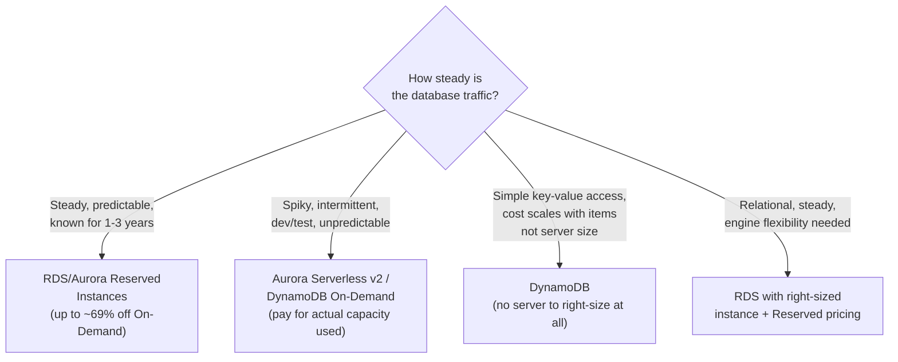
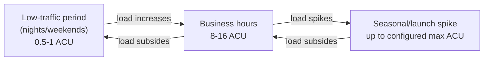
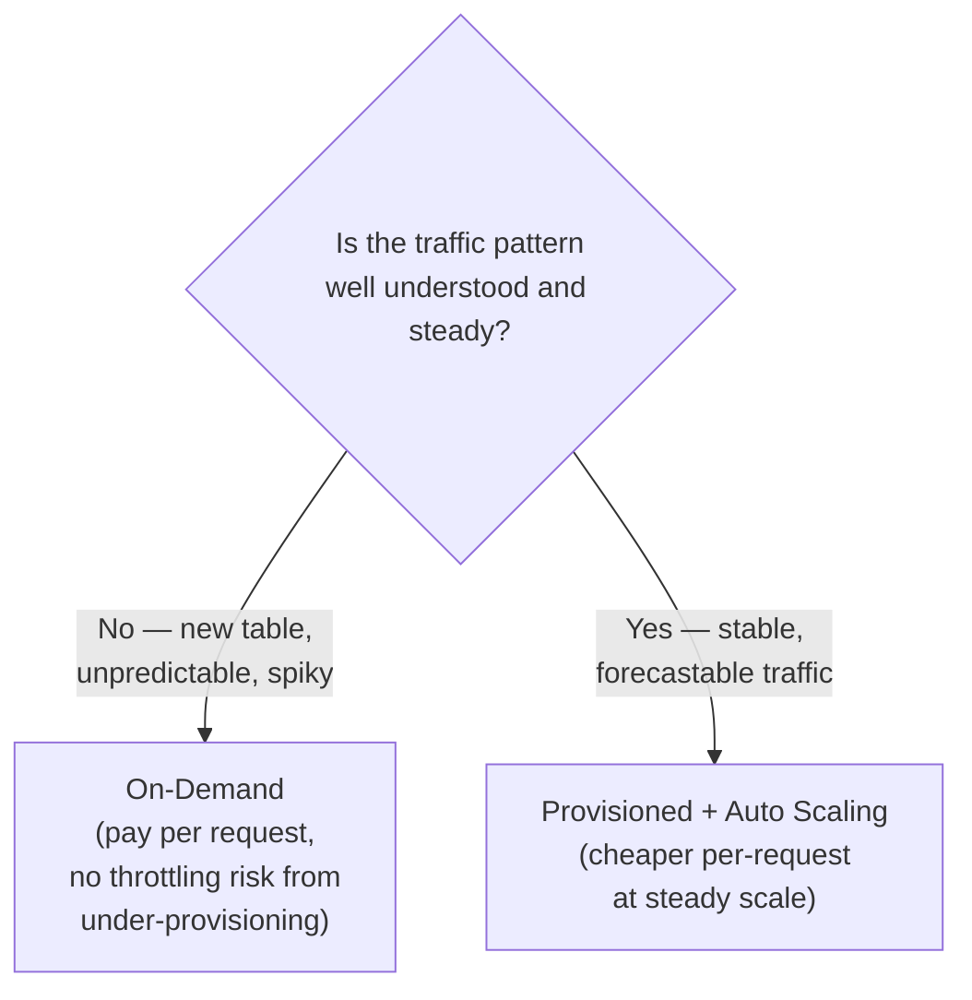

# Database Cost-Optimization Decision Framework

*Source: [Amazon Aurora User Guide — Performance and scaling for Aurora Serverless](https://docs.aws.amazon.com/AmazonRDS/latest/AuroraUserGuide/aurora-serverless-v2.setting-capacity.html)*

## Definition

A decision framework for minimizing database spend — on top of `database-selection-guide.md`,
`rds.md`, `aurora.md`, `dynamodb.md`.

## Purpose

Database cost optimization layers on top of the performance-driven engine choice from
`database-selection-guide.md`: once you know *which kind* of database fits the workload, the
cost question is which **capacity/billing model** fits its actual traffic pattern, and whether a
serverless variant removes the sizing problem entirely.

## How It Works

Step by step: for a **steady-state relational workload** with a known long-term baseline,
**RDS/Aurora Reserved Instances** (or Aurora's equivalent reservation) give a large discount in
exchange for a 1- or 3-year commitment — the same principle as EC2 Reserved Instances, applied to
the database tier. For **spiky or unpredictable** relational traffic (a dev/test environment used
only during work hours, an app with large seasonal swings), **Aurora Serverless v2** scales
capacity up and down automatically — in increments as small as 0.5 Aurora Capacity Units — and
bills by actual capacity consumed, avoiding both the waste of provisioning for peak and the manual
effort of resizing. For workloads that are naturally **key-value/NoSQL**, **DynamoDB's on-demand
billing mode** removes capacity planning entirely — you pay per request, which is ideal for new or
unpredictable workloads, while **provisioned capacity with Auto Scaling** is cheaper once the
traffic pattern is well understood and steady enough to forecast. Across all of these, the first
cost lever is still the one from `database-selection-guide.md` — using a cheaper, simpler database
(DynamoDB) instead of a heavier relational engine (RDS) for a workload that never actually needed
relational joins/ACID in the first place is itself a major cost optimization, separate from any
purchasing model.

## Architecture: Aurora Serverless v2 Scaling Behavior

The image above shows exactly what this cost lever looks like in practice: capacity (in Aurora
Capacity Units, each roughly 2 GiB of memory plus matching vCPU/network) tracks the configured
minimum-to-maximum range and adjusts automatically as load changes, rather than sitting fixed at
whatever size was provisioned at creation time.

The cost implication: a dev/test Aurora cluster that used to run 24/7 at a fixed, always-On-Demand
instance size can instead scale down to near its minimum ACU setting outside work hours
automatically, with no scheduled Lambda or manual resize needed — a meaningfully simpler
alternative to the "stop/start on a schedule" pattern RDS instances typically need for the same
savings.

## Architecture: DynamoDB Capacity Mode Decision

A detail the exam tests directly: **Provisioned capacity without Auto Scaling enabled** risks
throttling (`ProvisionedThroughputExceededException`) the moment traffic exceeds the fixed
capacity — Auto Scaling is what makes Provisioned mode a safe, still-cheaper-at-scale alternative
to On-Demand, not a reason to avoid Provisioned mode altogether.

## Key Decision Points

- **Aurora Serverless v2 vs. Reserved Aurora** — serverless costs more per unit of capacity but
  eliminates waste from over-provisioning variable workloads; Reserved wins once the baseline
  load is well known and steady.
- **DynamoDB on-demand vs. provisioned + Auto Scaling** — on-demand suits new/unpredictable
  traffic (no risk of throttling from under-provisioning, no risk of overpaying for unused
  provisioned capacity); provisioned is cheaper at steady, well-forecast scale.
- **Read replicas add cost, not just performance** — every additional read replica is billed as
  its own instance; only add as many as the read-offload requirement actually justifies.
- **Right database choice is itself a cost decision** — forcing a simple, high-volume key-value
  workload into RDS (which bills for a provisioned instance regardless of load) instead of
  DynamoDB (which can bill near-zero at low/no traffic) is a common unoptimized-answer pattern
  on the exam.
- **Multi-AZ doubles compute cost** (a synchronous standby is a second billed instance) — a
  valid HA/cost tradeoff to flag explicitly when a question asks specifically about minimizing
  cost for a non-critical environment (e.g., dev/test often skips Multi-AZ deliberately).
- **DynamoDB storage cost scales with item count/size, not a pre-provisioned disk** — unlike RDS,
  there's no equivalent of "paying for unused allocated storage," which is itself a cost advantage
  for workloads whose data volume is hard to forecast in advance.
- **Aurora I/O-Optimized vs. standard configuration** — for I/O-heavy workloads, Aurora's
  I/O-Optimized pricing (flat compute/storage price, no per-I/O charge) can be cheaper than the
  standard configuration's pay-per-I/O pricing once I/O volume crosses a certain threshold — a
  scenario describing unusually high I/O relative to compute size is pointing at this option.

## Use Cases — Real Scenarios

- **Mid-size insurer's policy-management database with a well-known steady load.** A 1-year RDS
  Reserved Instance commitment is purchased for the core policy database after two years of stable
  usage data confirm the baseline isn't going to shrink, locking in a meaningful discount for
  capacity the company was paying full On-Demand price for out of inertia.
- **Seasonal retailer's promotional-event database spiking only during flash sales.** Aurora
  Serverless v2 scales from near-idle capacity up to the configured maximum automatically during a
  flash sale announcement, then back down afterward, with no manual resize and no standing
  reservation wasted the other 50 weeks of the year.
- **Mobile app's "recently viewed" feature forced into RDS during an earlier, less-informed
  design phase.** Migrating this pure key-value workload to DynamoDB removes a permanently-
  provisioned RDS instance that was billing 24/7 for a workload DynamoDB can serve near-free during
  its many quiet hours.
- **Software company's dev/test RDS instances mirroring production unnecessarily.** Dev and test
  databases previously ran Multi-AZ identically to production; removing Multi-AZ for non-production
  environments (which don't carry production's availability requirement) roughly halves their
  compute cost with no functional loss.
- **High-growth startup's DynamoDB table outgrowing its initial provisioned capacity guesses.**
  Early in the product's life, Provisioned capacity without Auto Scaling caused repeated throttling
  during unexpected growth spurts; enabling Auto Scaling (or, for the least mature product stage,
  switching to On-Demand entirely) removed both the throttling risk and the manual capacity-tuning
  burden.
- **Analytics company choosing DynamoDB Provisioned over On-Demand once traffic stabilized.**
  After a year of On-Demand billing established a clear, steady traffic baseline, the team switches
  to Provisioned capacity with Auto Scaling, capturing a lower per-request cost now that the
  guesswork that On-Demand was protecting against is gone.
- **Enterprise reporting workload moving to Aurora I/O-Optimized.** A reporting database with
  unusually high I/O volume relative to its compute size sees its per-I/O charges exceed what a flat
  I/O-Optimized configuration would cost — switching configurations (not instance size) directly
  reduces the bill.
- **Streaming platform's content-metadata table evaluated for DynamoDB Reserved Capacity.** Once a
  year of On-Demand billing establishes a stable, well-understood baseline request volume, the
  platform purchases DynamoDB Reserved Capacity sized to that floor, capturing a further discount
  on top of the already-cheaper provisioned-mode rate for traffic that's no longer a guess.
- **Multi-tenant HR SaaS company isolating one premium tier's data on Aurora Serverless v2 per
  customer.** Rather than running one shared, permanently-provisioned Aurora cluster sized for the
  sum of every tenant's peak, each premium tenant gets its own Serverless v2 cluster that scales to
  near-zero between that specific customer's business hours — trading a small per-tenant overhead
  for avoiding one cluster permanently sized for an aggregate peak that rarely actually occurs.

## Common Mistakes

- Running a dev/test database identically to production (same instance size, Multi-AZ enabled,
  24/7) when the workload doesn't require that availability tier.
- Forcing a high-volume, simple key-value access pattern into RDS/Aurora instead of recognizing
  DynamoDB as both the cheaper and better-fitting choice.
- Leaving DynamoDB in Provisioned mode without Auto Scaling enabled for a growing workload,
  risking both throttling and either over- or under-provisioned capacity.
- Adding more RDS read replicas than the actual read-offload requirement justifies, each one
  billed as its own running instance regardless of how lightly it's used.
- Choosing Aurora Serverless v2 for a workload that is, in fact, perfectly steady and well
  understood — Reserved pricing on a right-sized provisioned instance is usually cheaper once a
  workload's capacity needs are genuinely stable.

## Full Worked Mini-Case: Picking the Right Database Cost Model for Three Workloads

**Scenario:** a single application has three distinct data stores: (1) the core order-processing
relational database, under constant, well-understood, steady load; (2) a "recently viewed items"
table with extremely high read/write volume but simple key-value access and no relational needs;
(3) a reporting database used only during a 9am-6pm business-hours analytics job, idle the rest of
the day.

**Mapped to this framework:** (1) is a clear fit for **RDS/Aurora with a Reserved Instance/Savings
Plan commitment** — steady, predictable, relational, exactly the profile Reserved pricing rewards.
(2) should never have been relational in the first place — migrating it to **DynamoDB** (ideally
starting On-Demand, moving to Provisioned + Auto Scaling once the pattern is well understood)
removes both the engine mismatch and the cost of a permanently-provisioned RDS instance for
pure key-value traffic. (3) is the textbook **Aurora Serverless v2** case — rather than paying
for a fixed instance size 24 hours a day for a workload only active 9 hours, Serverless v2 scales
down to near-zero capacity outside the business-hours window automatically.

## Why It's Important

**Exam mapping:** SAA-C03 Domain 4, Task 4.3 ("design cost-optimized database solutions —
engine choice, DynamoDB vs RDS, serverless options") is this exact capacity-model and
engine-choice cost tradeoff.

## Exam Tips

- "Steady, known, long-term" relational load → Reserved RDS/Aurora. "Spiky/unpredictable"
  relational load → Aurora Serverless v2. "Simple key-value, unpredictable" → DynamoDB On-Demand.
  "Simple key-value, steady" → DynamoDB Provisioned + Auto Scaling.
- A scenario describing a dev/test database with identical settings to production is almost
  always pointing at a cost-optimization gap (unnecessary Multi-AZ, unnecessary 24/7 uptime),
  not a database engine problem.
- "No server to manage/size at all" language points at DynamoDB specifically, distinguishing it
  from Aurora Serverless v2 (which still has a notion of capacity units to configure).

## Related Terms

- [`../../../services/database/database-selection-guide.md`](../../../services/database/database-selection-guide.md)
- [`../../../services/database/rds.md`](../../../services/database/rds.md),
  [`../../../services/database/aurora.md`](../../../services/database/aurora.md)
- [`../../../services/database/dynamodb.md`](../../../services/database/dynamodb.md)
- [`../../../services/management-governance/cost-management-tools.md`](../../../services/management-governance/cost-management-tools.md)
- [`compute-cost-optimization-decision-framework.md`](compute-cost-optimization-decision-framework.md) —
  the identical Reserved/Serverless pattern, applied to compute instead of databases
- [`../domain-3-high-performing-architectures/README.md`](../domain-3-high-performing-architectures/README.md) —
  the cache-aside pattern that reduces database load (and therefore cost) before any capacity-model
  decision is even made
- [`../domain-2-resilient-architectures/README.md`](../domain-2-resilient-architectures/README.md) —
  the Multi-AZ/read-replica mechanisms this doc flags as extra cost, explained there as resilience
  features first
