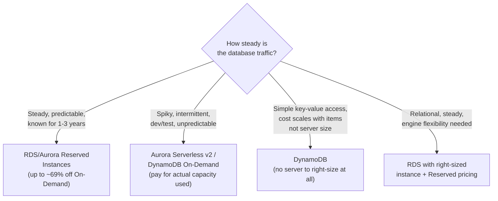

# Database Cost-Optimization Decision Framework

## Definition

A decision framework for minimizing database spend — on top of `database-selection-guide.md`,
`rds.md`, `aurora.md`, `dynamodb.md`.

## Purpose

Database cost optimization layers on top of the performance-driven engine choice from
`database-selection-guide.md`: once you know *which kind* of database fits the workload, the
cost question is which **capacity/billing model** fits its actual traffic pattern, and whether a
serverless variant removes the sizing problem entirely.

## How It Works

Step by step: for a **steady-state relational workload** with a known long-term baseline,
**RDS/Aurora Reserved Instances** (or Aurora's equivalent reservation) give a large discount in
exchange for a 1- or 3-year commitment — the same principle as EC2 Reserved Instances, applied to
the database tier. For **spiky or unpredictable** relational traffic (a dev/test environment used
only during work hours, an app with large seasonal swings), **Aurora Serverless v2** scales
capacity up and down automatically and bills by actual capacity consumed, avoiding both the
waste of provisioning for peak and the manual effort of resizing. For workloads that are
naturally **key-value/NoSQL**, **DynamoDB's on-demand billing mode** removes capacity planning
entirely — you pay per request, which is ideal for new or unpredictable workloads, while
**provisioned capacity with Auto Scaling** is cheaper once the traffic pattern is well understood
and steady enough to forecast. Across all of these, the first cost lever is still the one from
`database-selection-guide.md` — using a cheaper, simpler database (DynamoDB) instead of a
heavier relational engine (RDS) for a workload that never actually needed relational joins/ACID
in the first place is itself a major cost optimization, separate from any purchasing model.

## Key Decision Points

- **Aurora Serverless v2 vs. Reserved Aurora** — serverless costs more per unit of capacity but
  eliminates waste from over-provisioning variable workloads; Reserved wins once the baseline
  load is well known and steady.
- **DynamoDB on-demand vs. provisioned + Auto Scaling** — on-demand suits new/unpredictable
  traffic (no risk of throttling from under-provisioning, no risk of overpaying for unused
  provisioned capacity); provisioned is cheaper at steady, well-forecast scale.
- **Read replicas add cost, not just performance** — every additional read replica is billed as
  its own instance; only add as many as the read-offload requirement actually justifies.
- **Right database choice is itself a cost decision** — forcing a simple, high-volume key-value
  workload into RDS (which bills for a provisioned instance regardless of load) instead of
  DynamoDB (which can bill near-zero at low/no traffic) is a common unoptimized-answer pattern
  on the exam.
- **Multi-AZ doubles compute cost** (a synchronous standby is a second billed instance) — a
  valid HA/cost tradeoff to flag explicitly when a question asks specifically about minimizing
  cost for a non-critical environment (e.g., dev/test often skips Multi-AZ deliberately).

## Why It's Important

**Exam mapping:** SAA-C03 Domain 4, Task 4.3 ("design cost-optimized database solutions —
engine choice, DynamoDB vs RDS, serverless options") is this exact capacity-model and
engine-choice cost tradeoff.

## Related Terms

- [`../../../services/database/database-selection-guide.md`](../../../services/database/database-selection-guide.md)
- [`../../../services/database/rds.md`](../../../services/database/rds.md),
  [`../../../services/database/aurora.md`](../../../services/database/aurora.md)
- [`../../../services/database/dynamodb.md`](../../../services/database/dynamodb.md)
- [`../../../services/management-governance/cost-management-tools.md`](../../../services/management-governance/cost-management-tools.md)
