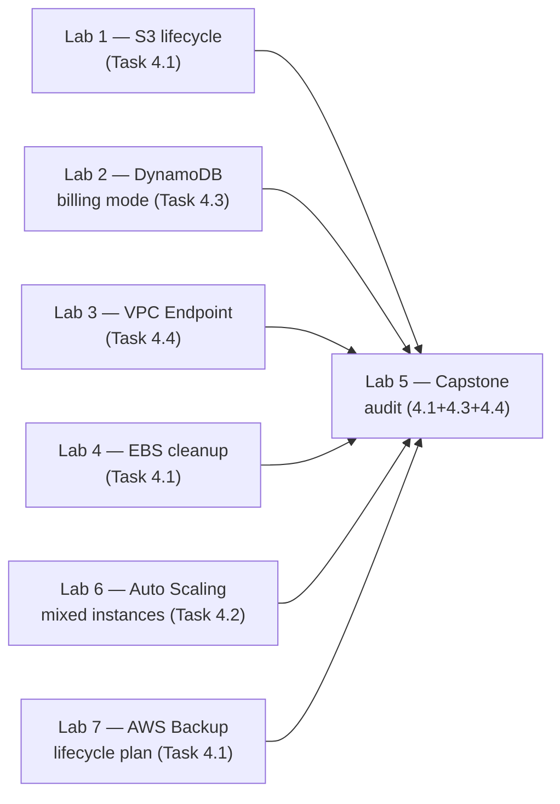

# Domain 4 Labs — Design Cost-Optimized Architectures (Floci)

Setup once: see [`labs-floci/README.md`](../../../labs-floci/README.md). These labs use S3 and
DynamoDB — genuinely emulated by Floci. Floci does not simulate actual AWS billing, so these labs
practice the **API calls and configuration** behind each cost lever; the dollar savings
themselves are conceptual (see the linked decision-framework docs for the real numbers).



Walkthrough: Labs 1-4 and 6-7 each practice one isolated cost lever from one specific task
statement; Lab 5 (the capstone) deliberately chains several of them together, mirroring how a
real cost-optimization pass almost never touches just one category at a time — exactly the same
multi-category shape as the README's GreenLedger Logistics case study.

## Lab 1 — S3 lifecycle policy: Standard → IA → Glacier (Task 4.1)

Goal: configure the exact automation that moves aging data into progressively cheaper storage
tiers with zero application changes.

```bash
# 1. Create a bucket and put a test object in it
awslocal s3 mb s3://cost-optimized-archive
awslocal s3 cp README.md s3://cost-optimized-archive/logs/sample-log.txt

# 2. Define a lifecycle configuration: IA after 30 days, Glacier after 90, Deep Archive after 180
cat > lifecycle.json << 'EOF'
{
  "Rules": [
    {
      "ID": "tiered-archive",
      "Status": "Enabled",
      "Filter": { "Prefix": "logs/" },
      "Transitions": [
        { "Days": 30, "StorageClass": "STANDARD_IA" },
        { "Days": 90, "StorageClass": "GLACIER" },
        { "Days": 180, "StorageClass": "DEEP_ARCHIVE" }
      ]
    }
  ]
}
EOF
awslocal s3api put-bucket-lifecycle-configuration --bucket cost-optimized-archive \
  --lifecycle-configuration file://lifecycle.json

# 3. Confirm the rule is attached
awslocal s3api get-bucket-lifecycle-configuration --bucket cost-optimized-archive
```

Why this matters: this is literally the mechanism tested in Task 4.1 — one JSON config
replaces a manual (or custom-scripted) process of moving old data to cheaper storage.

## Lab 2 — DynamoDB on-demand vs. provisioned billing mode (Task 4.3)

Goal: practice switching a table's billing mode — the real-world action behind "this table's
traffic became predictable, switch it to save money" or vice versa.

```bash
# 1. Create a table starting in provisioned mode
awslocal dynamodb create-table --table-name UserProfiles \
  --attribute-definitions AttributeName=userId,AttributeType=S \
  --key-schema AttributeName=userId,KeyType=HASH \
  --billing-mode PROVISIONED --provisioned-throughput ReadCapacityUnits=5,WriteCapacityUnits=5

# 2. Switch it to on-demand (simulating "traffic became unpredictable, stop guessing capacity")
awslocal dynamodb update-table --table-name UserProfiles --billing-mode PAY_PER_REQUEST

# 3. Confirm the change
awslocal dynamodb describe-table --table-name UserProfiles --query 'Table.BillingModeSummary'
```

Why this matters: this two-way switch is exactly the lever described in
`database-cost-optimization-decision-framework.md` — on-demand for unpredictable/new traffic,
provisioned (ideally with Auto Scaling) once the pattern is well understood and stable.

## Lab 3 — VPC endpoint configuration to bypass NAT Gateway cost (Task 4.4)

Goal: practice creating the control-plane object behind the single most commonly tested network
cost optimization — routing S3 traffic off the NAT Gateway path entirely.

```bash
# 1. Create a VPC and subnet to attach the endpoint to
awslocal ec2 create-vpc --cidr-block 10.0.0.0/16
awslocal ec2 create-subnet --vpc-id <vpc-id> --cidr-block 10.0.1.0/24

# 2. Create an S3 Gateway endpoint (free — no hourly or per-GB charge) attached to the VPC's
#    route table, so traffic to S3 never needs to leave through a NAT Gateway
awslocal ec2 create-vpc-endpoint --vpc-id <vpc-id> --service-name com.amazonaws.us-east-1.s3 \
  --route-table-ids <route-table-id> --vpc-endpoint-type Gateway

# 3. Confirm it's attached
awslocal ec2 describe-vpc-endpoints --filters Name=vpc-id,Values=<vpc-id>
```

Why this matters: this is the concrete fix for the "NAT Gateway data processing charges are the
largest line item, mostly traffic to S3" exam scenario — a Gateway endpoint for S3/DynamoDB costs
nothing and keeps that traffic off the metered NAT path entirely.

## Lab 4 — Finding and cleaning up unattached EBS volumes (Task 4.1)

Goal: practice the Trusted Advisor-style audit action behind "idle resources quietly adding to
the bill" — a direct, mechanical cost leak distinct from any purchasing-model decision.

```bash
# 1. Create a volume and attach it to a (simulated) instance, then detach it — mimicking the
#    common real-world leftover from a terminated instance
awslocal ec2 create-volume --availability-zone us-east-1a --size 20 --volume-type gp3

# 2. List all volumes and filter for ones with no attachments — the exact audit query
#    Trusted Advisor/Cost Explorer effectively automates
awslocal ec2 describe-volumes --query 'Volumes[?length(Attachments)==`0`].{Id:VolumeId,Size:Size,State:State}'

# 3. Snapshot it first in case it's still needed (cheap, incremental, safe) before deleting
awslocal ec2 create-snapshot --volume-id <volume-id> --description "pre-deletion safety snapshot"

# 4. Delete the unattached volume once the snapshot confirms successfully
awslocal ec2 delete-volume --volume-id <volume-id>
```

Why this matters: unattached EBS volumes billing for their full provisioned size regardless of
use is one of the most common, easiest-to-miss real-world cost leaks — snapshotting before
deleting captures the "safety net" behavior a careful cost-optimization pass should always follow
rather than deleting data outright.

## Lab 5 — Mixed instances Auto Scaling group: baseline + burst (Task 4.2)

Goal: practice configuring the control-plane object behind the "blend a steady baseline with
burst capacity" pattern from the Compute Cost-Optimization Decision Framework — one Auto Scaling
group spanning multiple purchasing-model intents within a single mixed instances policy.

```bash
# 1. Create a launch template defining the instance configuration
awslocal ec2 create-launch-template --launch-template-name cost-optimized-web-tier \
  --launch-template-data '{"ImageId":"ami-12345678","InstanceType":"t3.medium"}'

# 2. Create an Auto Scaling group with a mixed instances policy — multiple instance types
#    for Spot diversification, and an explicit base capacity intended for On-Demand/Reserved
awslocal autoscaling create-auto-scaling-group --auto-scaling-group-name cost-optimized-asg \
  --mixed-instances-policy '{
    "LaunchTemplate": {
      "LaunchTemplateSpecification": {"LaunchTemplateName": "cost-optimized-web-tier", "Version": "$Latest"},
      "Overrides": [{"InstanceType": "t3.medium"}, {"InstanceType": "t3a.medium"}]
    },
    "InstancesDistribution": {
      "OnDemandBaseCapacity": 2,
      "OnDemandPercentageAboveBaseCapacity": 0,
      "SpotAllocationStrategy": "capacity-optimized"
    }
  }' \
  --min-size 2 --max-size 10 --desired-capacity 4 \
  --availability-zones us-east-1a us-east-1b

# 3. Confirm the policy split — baseline instances vs. Spot burst capacity
awslocal autoscaling describe-auto-scaling-groups --auto-scaling-group-names cost-optimized-asg \
  --query 'AutoScalingGroups[0].MixedInstancesPolicy'
```

Why this matters: `OnDemandBaseCapacity` is the exact mechanism behind "cover the known floor on
On-Demand/Savings-Plan-eligible capacity, let everything above it run on Spot" — the single
highest-leverage compute pattern in the Compute Cost-Optimization Decision Framework's worked
math, made concrete as one API call instead of two separately-managed fleets.

## Lab 6 — AWS Backup plan with a tiered lifecycle rule (Task 4.1)

Goal: practice configuring the centralized, policy-based retention lifecycle behind Section 1 of
MASTER-CHUNK.md — one backup plan applying a tiered retention schedule instead of hand-rolling
per-service snapshot lifecycle rules.

```bash
# 1. Create a backup vault to hold recovery points
awslocal backup create-backup-vault --backup-vault-name cost-optimized-vault

# 2. Create a backup plan with a tiered lifecycle — move to cold storage after 30 days,
#    delete after the full retention period
awslocal backup create-backup-plan --backup-plan '{
  "BackupPlanName": "tiered-retention-plan",
  "Rules": [{
    "RuleName": "daily-with-cold-transition",
    "TargetBackupVaultName": "cost-optimized-vault",
    "ScheduleExpression": "cron(0 5 * * ? *)",
    "Lifecycle": {"MoveToColdStorageAfterDays": 30, "DeleteAfterDays": 365}
  }]
}'

# 3. Confirm the plan's lifecycle rule
awslocal backup get-backup-plan --backup-plan-id <plan-id> \
  --query 'BackupPlan.Rules[0].Lifecycle'
```

Why this matters: `MoveToColdStorageAfterDays` is the exact lever behind the worked cost-math
example in MASTER-CHUNK.md Section 1 — tiering backup storage from hot to cold after 30 days
instead of leaving everything in hot storage for the full retention period, cutting the blended
storage rate by roughly three-quarters in that worked example.

## Lab 7 — Capstone: a mini cost audit across storage, compute, database, and network (Tasks 4.1-4.4)

Goal: chain the previous labs into one scenario resembling the domain README's GreenLedger
Logistics case study — tier aging data, right-size database billing mode, remove a NAT
Gateway dependency, and confirm the mixed-instances compute policy, in one pass.

```bash
# 1. Storage: confirm the lifecycle policy from Lab 1 is active on the archive bucket
awslocal s3api get-bucket-lifecycle-configuration --bucket cost-optimized-archive

# 2. Database: confirm the billing-mode switch from Lab 2 took effect
awslocal dynamodb describe-table --table-name UserProfiles --query 'Table.BillingModeSummary'

# 3. Network: confirm the VPC endpoint from Lab 3 is attached and associated with the right
#    route table
awslocal ec2 describe-vpc-endpoints --filters Name=vpc-id,Values=<vpc-id> \
  --query 'VpcEndpoints[].{Service:ServiceName,State:State,RouteTables:RouteTableIds}'

# 4. Storage cleanup: confirm no unattached volumes remain after Lab 4's cleanup
awslocal ec2 describe-volumes --query 'Volumes[?length(Attachments)==`0`]'

# 5. Compute: confirm the mixed instances policy from Lab 5 still shows the intended
#    On-Demand baseline / Spot burst split
awslocal autoscaling describe-auto-scaling-groups --auto-scaling-group-names cost-optimized-asg \
  --query 'AutoScalingGroups[0].MixedInstancesPolicy.InstancesDistribution'

# 6. Backup: confirm the tiered lifecycle rule from Lab 6 is still attached to the plan
awslocal backup get-backup-plan --backup-plan-id <plan-id> --query 'BackupPlan.Rules[0].Lifecycle'

# 7. Summarize the audit the way a real cost review would — one line per lever checked
echo "Audit complete: lifecycle=OK, billing-mode=OK, VPC-endpoint=OK, orphaned-volumes=0, mixed-instances=OK, backup-lifecycle=OK"
```

Why this matters: real cost-optimization work is rarely one dramatic fix — it's a checklist pass
across storage tiering, compute purchasing model, database billing mode, network routing, and
backup lifecycle, exactly mirroring this domain's four task statements (4.1 storage, 4.2 compute,
4.3 database, 4.4 network) applied together to one system, the same synthesis the domain
README's case study (and its fully worked dollar table) walks through end to end.

## Use Cases — Real Scenarios

- **Mid-size retailer's year-one cost optimization pass.** The quarterly cost review mandated by a
  new CFO closely mirrors this folder's GreenLedger Logistics case study — a storage lifecycle
  audit, a compute purchasing-model review, a database engine/billing-mode check, and a NAT
  Gateway/VPC-endpoint network review, run as one coordinated pass rather than four separate
  projects.
- **Startup preparing its AWS bill for investor due diligence.** Ahead of a funding round, the
  founding engineer runs through exactly this labs.md checklist — lifecycle policies, billing
  modes, VPC endpoints, orphaned volumes — to be able to tell investors confidently that spend is
  deliberately managed, not simply "whatever it ended up being."
- **Agency managing cost across a dozen client AWS accounts.** The same seven-lab pattern (storage
  tiering, billing-mode review, endpoint configuration, EBS cleanup, mixed-instances compute
  policy, backup lifecycle, consolidated audit) is run as
  a standardized monthly checklist against every client account, rather than being reinvented per
  client.
- **New cloud engineer's first assigned ticket: "why is our AWS bill so high."** Working through
  these labs in order mirrors the actual diagnostic path a junior engineer is coached through —
  check storage tiering first (often the biggest easy win), then database billing mode, then
  network routing, then orphaned resources.
- **Finance team requesting monthly evidence that cost-optimization recommendations were actually
  implemented, not just identified.** The capstone lab's final "audit complete" checklist format is
  the exact structure a FinOps team uses to report back to finance that each flagged item was
  resolved, not merely acknowledged.
- **SaaS company standardizing a quarterly FinOps review around this exact checklist.** What began
  as an ad-hoc cost cleanup becomes a recurring calendar item — Lab 1 through Lab 4's four checks,
  run in the same order every quarter, so cost drift (a new NAT-routed service, a forgotten EBS
  volume) gets caught within three months instead of accumulating silently for a year.
- **Non-profit stretching a limited annual AWS credit grant across a full fiscal year.** With a
  fixed, non-renewable credit balance, the organization runs Lab 1's lifecycle policy and Lab 2's
  billing-mode review every month rather than once, since every dollar saved directly extends how
  long the grant covers the organization's operations.
- **Solo consultant auditing a legacy AWS account inherited from a previous developer.** With no
  documentation to go on, the consultant runs this file's seven labs in order against the real
  account as a fast, structured first pass — surfacing a dormant NAT Gateway, an unmonitored
  provisioned DynamoDB table, and a stack of orphaned EBS volumes within the first afternoon.

## Honest limitation

Floci does not model actual AWS billing, Spot interruption behavior, or Reserved
Instance/Savings Plan discount math — these labs build the configuration muscle memory; read
the four decision-framework docs in this folder for the real cost reasoning and numbers.
