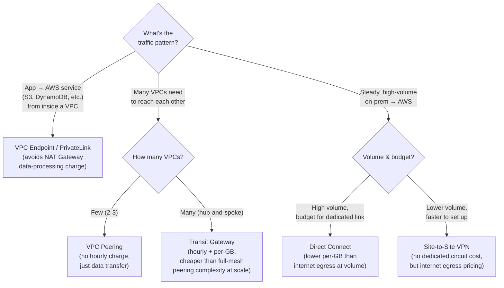

# Network Cost-Optimization Decision Framework

## Definition

A decision framework for minimizing network spend — on top of `data-transfer-pricing.md`
(the detailed pricing model this doc assumes), `vpc-endpoints-privatelink.md`,
`transit-gateway-and-peering.md`, `direct-connect.md`, `vpn.md`.

## Purpose

Network cost surprises are one of the most common sources of an unexpectedly large AWS bill,
precisely because data transfer is priced by distance/direction rather than a single flat rate —
this framework names the specific architecture choices that reduce the *amount* and *cost tier*
of data movement, on top of understanding the pricing model itself.

## How It Works

Step by step: the single highest-leverage, most frequently tested move is replacing a **NAT
Gateway** (which charges both an hourly fee and a per-GB data processing fee for every byte that
passes through it, even for AWS-internal traffic like calls to S3 or DynamoDB) with a **VPC
Endpoint** (Gateway endpoints for S3/DynamoDB are free; Interface endpoints/PrivateLink have a
small hourly + per-GB cost, but still typically cheaper than routing that same traffic through a
NAT Gateway, and it never leaves the AWS network at all). Connecting **many VPCs together** scales
differently depending on count: a handful of VPCs can peer directly with no hourly charge (just
data transfer pricing), but **a full mesh gets expensive and unwieldy past a few VPCs** — a
**Transit Gateway** centralizes that connectivity for a predictable hourly-plus-per-GB cost that
becomes cheaper than managing (and troubleshooting) dozens of peering connections once the VPC
count grows. For **hybrid connectivity**, **Direct Connect** has a real monthly port-hour cost and
often needs a partner circuit, but its per-GB data transfer rate is cheaper than standard internet
egress at high sustained volume — the breakeven point matters: for lower, intermittent volume, a
**Site-to-Site VPN** (no dedicated circuit to pay for) is usually the cheaper choice despite
riding on standard internet egress pricing. Across every pattern, the overarching lever is
**keeping traffic inside a Region/AZ wherever the architecture allows** — same-AZ traffic is
free, cross-AZ has a small charge in both directions, cross-Region costs more, and internet
egress costs the most — so placing resources that talk to each other constantly in the same
AZ/Region whenever latency/HA requirements permit is a direct, continuous cost saving.

## Key Decision Points

- **VPC Gateway Endpoints (S3, DynamoDB) are free** — there's effectively no reason not to use
  them instead of routing that traffic through a NAT Gateway; a scenario describing "high NAT
  Gateway data processing charges for traffic going to S3" has VPC endpoints as the direct
  unoptimized-cost fix.
- **Peering vs. Transit Gateway is a cost-at-scale question**, not just a technical one — the
  crossover point where Transit Gateway's flat hourly fee beats the complexity/transfer cost of
  many peering connections is a recurring exam framing.
- **Direct Connect has a cost floor (port-hours) that VPN doesn't** — Direct Connect only wins on
  cost at sustained high volume; low/bursty hybrid traffic is usually cheaper over VPN.
- **CloudFront can reduce origin data transfer cost**, not just latency — cached responses served
  from the edge never hit the origin's (often pricier) data transfer meter at all.
- **Same-AZ placement is free, cross-AZ isn't** — chatty services split across AZs purely for
  redundancy incur a real, continuous per-GB cost that's easy to miss when first wiring up a
  multi-AZ design; weigh it against the HA requirement rather than defaulting to maximum spread.

## Why It's Important

**Exam mapping:** SAA-C03 Domain 4, Task 4.4 ("design cost-optimized network architectures —
NAT gateway cost, Direct Connect vs VPN vs internet, VPC endpoints, Transit Gateway, data transfer
cost minimization") is this exact set of tradeoffs, and is one of the most literally-named task
statements in the whole exam guide.

## Related Terms

- [`../../../services/networking-content-delivery/data-transfer-pricing.md`](../../../services/networking-content-delivery/data-transfer-pricing.md) — full pricing model detail
- [`../../../services/networking-content-delivery/vpc-endpoints-privatelink.md`](../../../services/networking-content-delivery/vpc-endpoints-privatelink.md)
- [`../../../services/networking-content-delivery/transit-gateway-and-peering.md`](../../../services/networking-content-delivery/transit-gateway-and-peering.md)
- [`../../../services/networking-content-delivery/direct-connect.md`](../../../services/networking-content-delivery/direct-connect.md),
  [`../../../services/networking-content-delivery/vpn.md`](../../../services/networking-content-delivery/vpn.md)
- [`../../../services/networking-content-delivery/cloudfront.md`](../../../services/networking-content-delivery/cloudfront.md)
