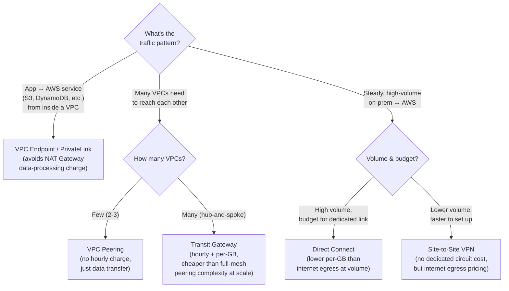
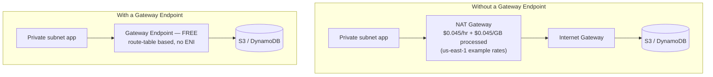
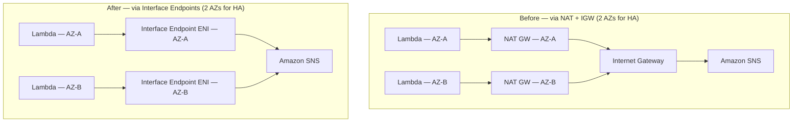
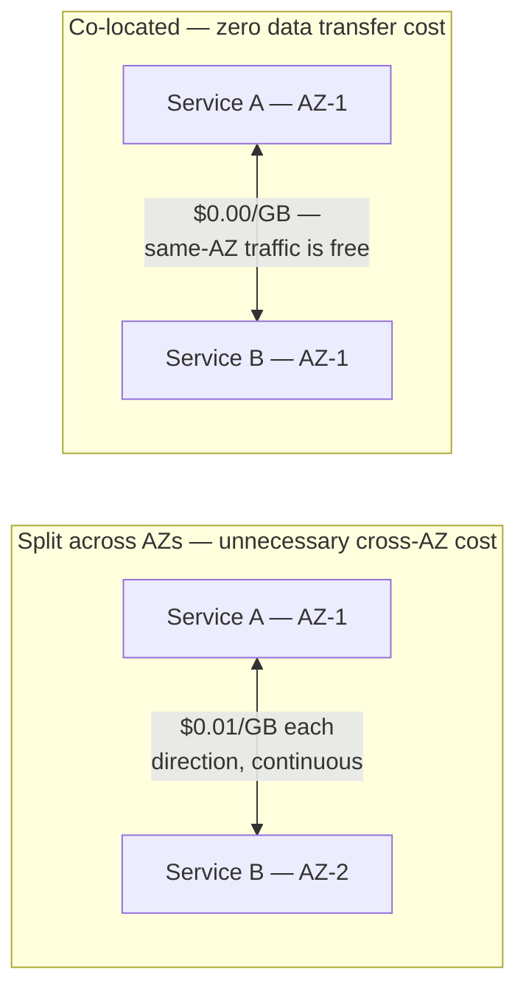

# Network Cost-Optimization Decision Framework

*Source: [AWS PrivateLink Guide — Gateway endpoints](https://docs.aws.amazon.com/vpc/latest/privatelink/gateway-endpoints.html)*

## Definition

A decision framework for minimizing network spend — on top of `data-transfer-pricing.md`
(the detailed pricing model this doc assumes), `vpc-endpoints-privatelink.md`,
`transit-gateway-and-peering.md`, `direct-connect.md`, `vpn.md`.

## Plain-English Analogy

AWS network pricing is a toll-road system, and this framework is the GPS that routes around
unnecessary tolls. Driving within your own neighborhood (same-AZ traffic) is free. Crossing into
the next neighborhood over (cross-AZ) has a small toll both ways. Driving to a different city
(cross-Region) costs more. Taking the public interstate out to anywhere on the internet (internet
egress) is the priciest toll road of all — and routing a trip that only needed to go two doors
down (traffic to S3/DynamoDB) out onto that interstate anyway, purely because nobody built the
free back-alley shortcut (a VPC endpoint), is the single costliest unforced error this whole
framework exists to catch.

## Purpose

Network cost surprises are one of the most common sources of an unexpectedly large AWS bill,
precisely because data transfer is priced by distance/direction rather than a single flat rate —
this framework names the specific architecture choices that reduce the *amount* and *cost tier*
of data movement, on top of understanding the pricing model itself.

## How It Works

Step by step: the single highest-leverage, most frequently tested move is replacing a **NAT
Gateway** (which charges both an hourly fee and a per-GB data processing fee for every byte that
passes through it, even for AWS-internal traffic like calls to S3 or DynamoDB) with a **VPC
Endpoint** (Gateway endpoints for S3/DynamoDB are free; Interface endpoints/PrivateLink have a
small hourly + per-GB cost, but still typically cheaper than routing that same traffic through a
NAT Gateway, and it never leaves the AWS network at all). Connecting **many VPCs together** scales
differently depending on count: a handful of VPCs can peer directly with no hourly charge (just
data transfer pricing), but **a full mesh gets expensive and unwieldy past a few VPCs** — a
**Transit Gateway** centralizes that connectivity for a predictable hourly-plus-per-GB cost that
becomes cheaper than managing (and troubleshooting) dozens of peering connections once the VPC
count grows. For **hybrid connectivity**, **Direct Connect** has a real monthly port-hour cost and
often needs a partner circuit, but its per-GB data transfer rate is cheaper than standard internet
egress at high sustained volume — the breakeven point matters: for lower, intermittent volume, a
**Site-to-Site VPN** (no dedicated circuit to pay for) is usually the cheaper choice despite
riding on standard internet egress pricing. Across every pattern, the overarching lever is
**keeping traffic inside a Region/AZ wherever the architecture allows** — same-AZ traffic is
free, cross-AZ has a small charge in both directions, cross-Region costs more, and internet
egress costs the most — so placing resources that talk to each other constantly in the same
AZ/Region whenever latency/HA requirements permit is a direct, continuous cost saving.

## Architecture: Before and After — NAT Gateway vs. VPC Endpoint

*Source: [AWS PrivateLink Guide — Gateway endpoints](https://docs.aws.amazon.com/vpc/latest/privatelink/gateway-endpoints.html)*

At meaningful traffic volumes, this one architectural change (adding a route-table entry pointing
at a Gateway Endpoint) can eliminate what is frequently the single largest network cost line item
on a bill for an application that talks to S3/DynamoDB heavily from private subnets — with zero
downside, since the endpoint is free and the traffic path is equally (if not more) secure.

## Architecture: Interface Endpoints for Non-Gateway Services

For AWS services other than S3/DynamoDB (SNS, SQS, KMS, Secrets Manager, and most others),
**Interface Endpoints (PrivateLink)** replace the NAT+IGW path instead of a free Gateway Endpoint
— they carry a small hourly-per-AZ and per-GB charge, but that combination is still typically
cheaper than two NAT Gateways' combined hourly and data-processing charges for the same traffic,
on top of keeping the traffic off the public-facing Internet Gateway path entirely.

## Key Decision Points

- **VPC Gateway Endpoints (S3, DynamoDB) are free** — there's effectively no reason not to use
  them instead of routing that traffic through a NAT Gateway; a scenario describing "high NAT
  Gateway data processing charges for traffic going to S3" has VPC endpoints as the direct
  unoptimized-cost fix.
- **Peering vs. Transit Gateway is a cost-at-scale question**, not just a technical one — the
  crossover point where Transit Gateway's flat hourly fee beats the complexity/transfer cost of
  many peering connections is a recurring exam framing.
- **Direct Connect has a cost floor (port-hours) that VPN doesn't** — Direct Connect only wins on
  cost at sustained high volume; low/bursty hybrid traffic is usually cheaper over VPN.
- **CloudFront can reduce origin data transfer cost**, not just latency — cached responses served
  from the edge never hit the origin's (often pricier) data transfer meter at all.
- **Same-AZ placement is free, cross-AZ isn't** — chatty services split across AZs purely for
  redundancy incur a real, continuous per-GB cost that's easy to miss when first wiring up a
  multi-AZ design; weigh it against the HA requirement rather than defaulting to maximum spread.
- **Interface Endpoints carry a small cost but still typically beat NAT Gateway** for non-
  Gateway-eligible services — the comparison is Interface Endpoint cost vs. NAT Gateway cost for
  the same traffic, not "endpoint cost vs. free," which is only true for S3/DynamoDB specifically.
- **Data transfer OUT to the internet is the most expensive tier** in almost every pricing table
  — any architectural change that keeps traffic inside AWS (endpoints, same-Region replication,
  CloudFront caching) is reducing exposure to that most expensive tier specifically.

## Use Cases — Real Scenarios

- **SaaS analytics company's NAT Gateway bill dominated by S3 traffic.** Adding a free S3 Gateway
  Endpoint removes nearly the entire NAT Gateway data-processing charge overnight, since almost all
  of that traffic was the app tier reading/writing S3 objects that never needed to transit a NAT
  Gateway at all.
- **Enterprise consolidating a sprawling VPC-peering mesh connecting 25 regional offices.** What
  had grown into dozens of individual peering connections (each one a separate thing to manage and
  troubleshoot) is replaced with a single Transit Gateway hub, cutting both the management overhead
  and, at that VPC count, the aggregate cost of the connectivity itself.
- **Manufacturing company choosing between Direct Connect and VPN for a new factory's connection.**
  A smaller, newly-acquired factory with modest, intermittent data needs connects via Site-to-Site
  VPN rather than paying for a dedicated Direct Connect circuit whose fixed port-hour cost wouldn't
  be justified by that factory's actual traffic volume.
- **Media company reducing cross-AZ data transfer charges for a chatty microservices
  architecture.** A review finds two frequently-communicating services deliberately split across
  AZs purely out of habit, racking up continuous cross-AZ transfer charges with no real availability
  benefit for that specific service pair — consolidating them into the same AZ (where the
  availability requirement genuinely permits it) removes that recurring cost.
- **Logistics platform replacing NAT-routed SNS publishing with an Interface Endpoint.** Lambda
  functions publishing frequently to SNS from private subnets switch to an SNS Interface Endpoint,
  which costs a small hourly-plus-per-GB fee but still comes in cheaper than the NAT Gateway path
  it replaces, while also keeping that traffic off the public-facing Internet Gateway route.
- **Global retailer auditing its single biggest network cost line item.** A Cost Explorer deep-dive
  finds NAT Gateway data processing is the single largest network charge, traced to both S3 traffic
  (fixed with a free Gateway Endpoint) and SQS polling traffic from a dozen Lambda functions (fixed
  with an SQS Interface Endpoint) — two fixes addressing what looked like one problem.
- **Startup initially over-engineering with Direct Connect before it had the traffic volume to
  justify it.** An early-stage company paying for a Direct Connect circuit sized for traffic it
  hadn't yet grown into switches back to Site-to-Site VPN, reversing the decision once the numbers
  showed the dedicated circuit's fixed cost wasn't yet paying for itself.
- **Telehealth platform revisiting its NAT Gateway bill after a second-Region expansion.** Standing
  up a Warm Standby DR Region (per Domain 2's disaster-recovery framework) doubled NAT Gateway
  spend overnight, since the standby Region's app tier was wired up the same way as production —
  adding Gateway Endpoints in the new Region at launch time, instead of discovering the gap months
  later, keeps the DR Region from silently costing more per byte than production for no benefit.

## Common Mistakes

- Routing all private-subnet traffic to AWS services through a NAT Gateway without checking
  whether a (free, for S3/DynamoDB) Gateway Endpoint could carry it instead.
- Building a growing full mesh of VPC peering connections well past the point where a Transit
  Gateway would be both simpler to manage and cheaper overall.
- Assuming VPN is always cheaper than Direct Connect — true at low volume, false at sustained
  high volume where Direct Connect's lower per-GB rate wins out over its fixed port-hour cost.
- Spreading every tier of an application across multiple AZs by default, without weighing the
  continuous cross-AZ data transfer cost against the actual availability requirement.
- Treating Interface Endpoints as "free like Gateway Endpoints" — they have a real (if usually
  favorable) cost, and only S3/DynamoDB Gateway Endpoints are genuinely free.

## Full Worked Mini-Case: Auditing a Network Bill

**Scenario:** a Cost Explorer review of a three-tier application's bill shows NAT Gateway data
processing charges as the single largest network line item, driven mostly by (a) application
traffic reading/writing S3 objects and (b) Lambda functions publishing to SNS, both from private
subnets across two AZs. A second, smaller line item is VPC peering data transfer across six
regional VPCs connected in a growing mesh.

**Fixes mapped to this framework:** (a) is fixed by adding a free **S3 Gateway Endpoint**,
eliminating that portion of NAT Gateway charges entirely with no further cost. (b) is fixed by
adding **SNS Interface Endpoints** in both AZs — not free, but meaningfully cheaper than the
combined NAT Gateway hourly-plus-per-GB charge for the same traffic, while also removing that
traffic from the public-facing Internet Gateway path. The six-VPC peering mesh (already at
roughly 15 individual peering connections to be fully meshed) is replaced with a single **Transit
Gateway** hub-and-spoke, cutting both the connection-management overhead and, at that VPC count,
the aggregate cost versus maintaining the full mesh.

## Full Worked Numeric Case: Quantifying the Audit's Three Fixes

Putting real illustrative numbers against the mini-case's three fixes shows the relative size of
each lever. Assume the application generates 30 TB/month of S3 traffic and 3 TB/month of SNS
traffic through the NAT Gateway path, plus the six-VPC peering mesh carrying 5 TB/month of
inter-VPC traffic.

- **(a) S3 Gateway Endpoint:** NAT Gateway cost for 30 TB (30,720 GB) at $0.045/GB processed plus
  the fixed hourly charge: $0.045 × 730 + 30,720 × $0.045 ≈ $32.85 + $1,382.40 ≈ **$1,415.25/
  month** eliminated entirely by the free endpoint.
- **(b) SNS Interface Endpoints (2 AZs):** NAT Gateway cost for the same 3 TB (3,072 GB) of SNS
  traffic: 3,072 × $0.045 ≈ **$138.24/month** (plus a share of the fixed NAT cost). The Interface
  Endpoint alternative costs roughly $0.01/hour per AZ × 2 AZs × 730 + 3,072 × $0.01 ≈ $14.60 +
  $30.72 ≈ **$45.32/month** — still a real cost, but roughly **$93/month cheaper** than the NAT
  path it replaces.
- **(c) Transit Gateway replacing the 6-VPC peering mesh:** peering itself has no hourly fee, so
  this fix's saving is primarily *management overhead*, not a direct AWS bill reduction — the
  Transit Gateway's own cost (6 attachments × ~$0.05/hour × 730 ≈ **$219/month**) can actually be
  a net *increase* in raw AWS billing versus free peering, which is the detail that makes this
  specific fix a complexity/scalability decision rather than a pure cost-reduction one at only 6
  VPCs — the math only favors Transit Gateway once the VPC count (and the resulting peering
  connection count) grows enough that the *operational* cost of managing the mesh exceeds $219/
  month in engineering time, which is a judgment call the exam expects you to make qualitatively,
  not purely from the AWS bill alone.
- **Combined direct AWS-bill saving from (a) and (b) alone:** roughly $1,415.25 + $93 ≈
  **$1,508/month ($18,096/year)** — fix (c)'s value is real but shows up as reduced management
  overhead rather than a comparable line-item reduction at this specific VPC count.

## Architecture: A Second Diagram — Same-AZ Placement as a Network Cost Lever

Walkthrough: this diagram isolates the **AZ-placement lever** from everything else in this
framework — the same two services, the same traffic volume, the only variable changed is
which AZ each one lives in. This is deliberately drawn as its own minimal diagram because it's
easy to overlook amid NAT Gateway and Transit Gateway discussions, even though it's a real,
continuously recurring charge with zero availability tradeoff *when the specific pair doesn't
need per-pair AZ redundancy* — see Section 22 of MASTER-CHUNK.md and the dedicated Data Transfer
Cost Traps doc for the fuller numeric treatment.

## Real AWS Image: Reducing Cross-AZ/Region Traffic Through Thoughtful Placement

*Source: [AWS Well-Architected Framework — FND06-BP06](https://docs.aws.amazon.com/wellarchitected/latest/framework/fnd06-bp06.html)*

This same reference architecture (reused from the Compute framework doc, shown here for its
*topology*, not its purchasing-model mapping) is worth a second look through the network-cost
lens: every arrow between these services is a potential cross-AZ or cross-Region data-transfer
charge depending on how the underlying resources are actually placed — a Well-Architected review
walks this exact diagram twice, once for cost-of-commitment (compute/database purchasing models)
and once for cost-of-movement (this doc's network placement question).

## Why It's Important

**Exam mapping:** SAA-C03 Domain 4, Task 4.4 ("design cost-optimized network architectures —
NAT gateway cost, Direct Connect vs VPN vs internet, VPC endpoints, Transit Gateway, data transfer
cost minimization") is this exact set of tradeoffs, and is one of the most literally-named task
statements in the whole exam guide.

## Exam Tips

- "NAT Gateway charges, traffic to S3/DynamoDB" is the single most recognizable fix-it pattern on
  this entire exam — always reach for a Gateway Endpoint first.
- "Growing number of VPCs, peering getting unwieldy" is the Transit Gateway tell; a small, fixed
  number of VPCs doesn't need it yet.
- "Steady, high-volume, sustained hybrid connection" → Direct Connect; "lower volume, backup, or
  faster to provision" → VPN — read for the word "sustained" or "steady" specifically.
- Don't assume multi-AZ or multi-Region spread is free — a cost scenario may be testing whether
  you'll correctly identify cross-AZ/cross-Region data transfer as a real, continuous charge.

## Related Terms

- [`../../../services/networking-content-delivery/data-transfer-pricing.md`](../../../services/networking-content-delivery/data-transfer-pricing.md) — full pricing model detail
- [`../../../services/networking-content-delivery/vpc-endpoints-privatelink.md`](../../../services/networking-content-delivery/vpc-endpoints-privatelink.md)
- [`../../../services/networking-content-delivery/transit-gateway-and-peering.md`](../../../services/networking-content-delivery/transit-gateway-and-peering.md)
- [`../../../services/networking-content-delivery/direct-connect.md`](../../../services/networking-content-delivery/direct-connect.md),
  [`../../../services/networking-content-delivery/vpn.md`](../../../services/networking-content-delivery/vpn.md)
- [`../../../services/networking-content-delivery/cloudfront.md`](../../../services/networking-content-delivery/cloudfront.md)
- [`../domain-1-secure-architectures/vpc-security-architecture-patterns.md`](../domain-1-secure-architectures/vpc-security-architecture-patterns.md) —
  the same VPC endpoint pattern, explained there primarily for its security benefit
- [`../domain-3-high-performing-architectures/network-performance-architecture-patterns.md`](../domain-3-high-performing-architectures/network-performance-architecture-patterns.md) —
  the same Direct Connect/Transit Gateway choices, revisited for raw performance
