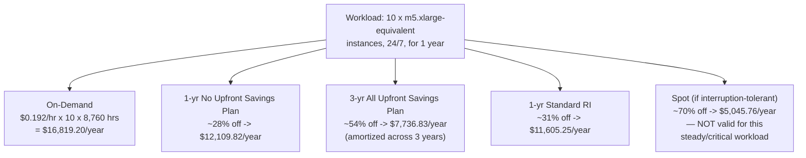
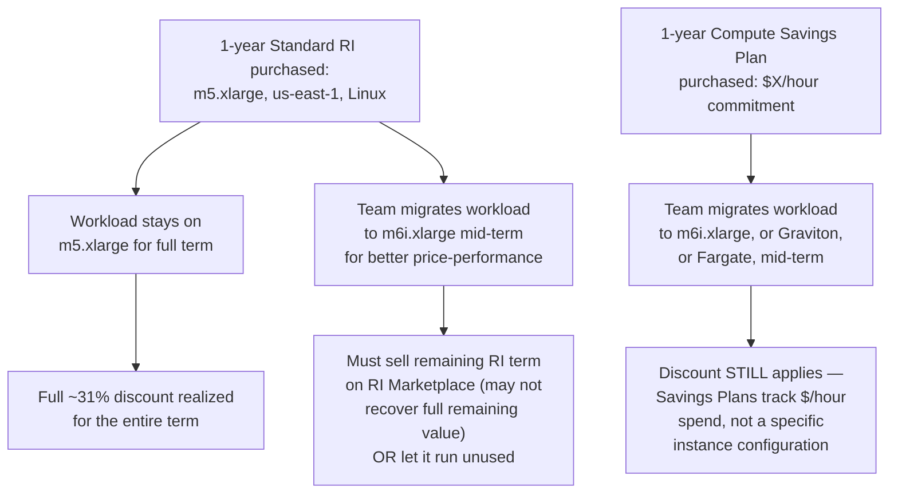

# Reserved Instances vs. Savings Plans vs. Spot vs. On-Demand — A Worked Math Decision Framework

> **Appears in:** [SAA-C03](../../README.md) | [Domain 4 README](README.md) | [MASTER-CHUNK.md](MASTER-CHUNK.md)

The [Compute Cost-Optimization Decision Framework](compute-cost-optimization-decision-framework.md)
in this folder covers the conceptual four-way split (steady → Reserved/Savings Plans,
interruptible → Spot, unpredictable → On-Demand, bursty-idle → serverless). This doc goes one
level deeper: it exists specifically because the exam increasingly tests *which number wins*,
not just which category applies — and the only reliable way to get that right is to actually run
the math for the specific commitment term, discount rate, and workload shape a scenario
describes, rather than pattern-matching to "Reserved is cheaper" and stopping there.

## Definition

A worked-math companion framework comparing all four EC2 (and, by extension, Fargate/RDS/
Aurora-equivalent) purchasing models side by side on the same workload, using real illustrative
On-Demand rates and realistic discount percentages, so the crossover points between models are
concrete numbers rather than a memorized ranking.

## Plain-English Analogy

Choosing a phone plan is the same decision shape: a flat pay-as-you-go rate (On-Demand) costs the
most per minute but has zero commitment; a 2-year contract (Reserved/Savings Plan) is much
cheaper per minute but you're paying it whether you use all your minutes or not; a "stand-by
seat" airline fare (Spot) is the cheapest way to fly by far, but you can be bumped with short
notice if a full-fare passenger needs the seat. Nobody picks a phone plan by always choosing "the
contract" or always choosing "pay as you go" — they run the numbers against their own actual usage
first.

## Purpose

A purchasing-model decision made by category alone ("this is steady, so Reserved wins") skips the
step that actually determines the dollar outcome: the specific discount percentage, the specific
term length, and whether the workload's *true* utilization of that commitment is high enough to
realize the advertised discount. This doc exists to force that math every time, using concrete
numbers, so "Reserved/Savings Plan always wins for steady workloads" is understood as a strong
default that can still be checked, not an unconditional law.

## How It Works — The Four-Way Comparison, With Real Numbers

Walkthrough: holding the workload exactly constant (10 instances, 24/7, for a year) and only
changing the purchasing model shows the real spread — **On-Demand** is the ceiling at
$16,819.20/year, **Spot** is the floor at roughly $5,045.76/year but is explicitly *not a valid
choice* for a steady, uninterruptible workload regardless of how attractive that number looks, and
the three commitment-based models land in between, each trading a longer or more upfront-heavy
commitment for a deeper discount. The diagram deliberately keeps Spot in the comparison with a
strikethrough-style callout, because the exam's most common wrong-answer trap is picking the
cheapest number on the page without checking whether the workload's interruption tolerance
actually permits it.

## Real AWS Image: The Spot Lifecycle That Makes Worked Math 3 Valid

*Source: [Amazon EC2 User Guide — How Spot Instances work](https://docs.aws.amazon.com/AWSEC2/latest/UserGuide/how-spot-instances-work.html)*

This is the same lifecycle diagram referenced in the Compute Cost-Optimization Decision Framework
doc, worth revisiting here specifically because Worked Math 3's entire justification for choosing
Spot over a Savings Plan for the nightly batch job depends on this lifecycle actually being
survivable — the job must reach a **checkpointed state** before an interruption notice expires,
or the "~70% discount" number in that calculation would need to be weighed against the cost of
redoing lost work, which would reduce or eliminate the apparent savings depending on how often
interruption actually occurs and how much progress is lost each time.

## Architecture: Where a Reserved Instance Discount Survives vs. Breaks

Walkthrough: the top branch and the bottom branch both start from "a mid-term instance-family
change happens" — but only the Reserved Instance path (middle branch) actually loses value from
it, landing the team in RI Marketplace resale territory with no guarantee of recovering the
unused commitment's full value. The Savings Plan path absorbs the exact same change with zero
discount loss, which is the structural reason Worked Math 2's roughly $500/year gap is often worth
paying for a fleet with any realistic chance of changing instance family within the term.

## Worked Math 1 — On-Demand vs. 1-Year Savings Plan vs. 3-Year Savings Plan

**Scenario:** a steady production API fleet needs 10 instances' worth of m5.xlarge-equivalent
capacity, running 24/7, for the foreseeable future (confirmed stable for at least 3 years by two
years of Cost Explorer history).

**The math** (illustrative On-Demand rate of $0.192/hour per instance, 8,760 hours/year):

- **On-Demand:** 10 × $0.192 × 8,760 = **$16,819.20/year**, every year, indefinitely.
- **1-Year No Upfront Compute Savings Plan** (~28% discount off On-Demand, illustrative):
  $16,819.20 × (1 − 0.28) = $16,819.20 × 0.72 ≈ **$12,109.82/year**.
- **3-Year All Upfront Compute Savings Plan** (~54% discount off On-Demand, illustrative):
  $16,819.20 × (1 − 0.54) = $16,819.20 × 0.46 ≈ **$7,736.83/year**, amortized — paid upfront as a
  single $23,210.50 payment covering all 3 years (3 × $7,736.83 ≈ $23,210.50), with the discount
  rate improving specifically *because* the upfront payment removes AWS's revenue-timing risk.
- **Over 3 years:** On-Demand totals $50,457.60; the 1-year Savings Plan (renewed three times)
  totals roughly $36,329.46; the 3-year All Upfront Savings Plan totals $23,210.50 — a difference
  of **$27,247.10** between the most expensive and least expensive valid option for this exact
  workload.

**The lesson:** the discount rate itself scales with commitment length *and* payment timing (All
Upfront > Partial Upfront > No Upfront, and 3-year > 1-year) — a scenario confirming 3-year
stability but defaulting to a 1-year commitment "to be safe" is leaving a specific, calculable
amount of money on the table, and the exam increasingly expects you to recognize that gap exists
even without memorizing AWS's exact published discount percentages.

## Worked Math 2 — Reserved Instances vs. Savings Plans for the Same Commitment

**Scenario:** the same 10-instance, 1-year, steady workload, comparing a Standard Reserved
Instance against a Compute Savings Plan at a comparable discount tier.

- **1-Year Standard Reserved Instance** (~31% discount, illustrative, tied to this *specific*
  instance family/size/Region/tenancy): $16,819.20 × 0.69 ≈ **$11,605.25/year** — but this
  discount is void if the team needs to change instance family (e.g., moving from m5 to m6i for
  better price-performance) before the term ends; a mid-term family change typically requires
  selling the RI on the Reserved Instance Marketplace or simply losing the remaining discount
  value.
- **1-Year Compute Savings Plan** (~28% discount, illustrative, a $/hour commitment applying
  automatically across instance family/size/Region/OS): $16,819.20 × 0.72 ≈ **$12,109.82/year** —
  nominally about **$504.57/year more expensive** than the RI in this specific comparison, but
  the commitment survives a family change to m6i, Graviton, or a different Region with zero
  discount loss.

**The lesson:** the exam's modern framing treats the **Savings Plan's slightly lower raw discount
as usually worth it** for the flexibility, *unless* a scenario specifically needs a capacity
reservation guarantee tied to one exact configuration (which only RIs provide) — this is a real
dollar tradeoff (roughly $500/year in this example, scaling with fleet size), not just a stylistic
preference, and a scenario describing active instance-family modernization plans should weight
that flexibility value against the RI's larger discount.

## Worked Math 3 — When Spot Actually Wins, Honestly Computed

**Scenario:** a nightly batch reconciliation job needs roughly 20 instances' worth of capacity for
2 hours a night, 365 nights a year, and checkpoints its progress every 5 minutes (fully
interruption-tolerant).

- **On-Demand** for the actual 2-hour nightly window: 20 × $0.192 × 2 × 365 ≈ **$2,803.20/year**.
- **Spot** at a ~70% discount (illustrative) for the same window: $2,803.20 × 0.30 ≈
  **$840.96/year**.
- **A 1-year Savings Plan sized to this job** would be actively *wrong* here, despite "1-year,
  recurring" sounding like a commitment signal — a Savings Plan bills its committed $/hour rate
  **continuously**, 24/7, regardless of whether the job is running. Committing to even the
  minimum $/hour covering this job's 2-hour nightly peak would bill for the other 22 idle hours
  too: roughly 20 × $0.192 × 0.72 (1-yr SP discount) × 8,760 ≈ **$24,219.65/year** — nearly **29x
  more expensive** than just running Spot (or even On-Demand) for the actual 2-hour window.

**The lesson:** a Savings Plan/Reserved Instance commitment only makes sense against a workload
that's actually running (or a baseline that's always running) for a meaningful fraction of the
committed hours — committing a 24/7-rate instrument against a 2-hours-a-night workload is one of
the more costly conceptual mistakes this whole decision space allows, and the exam occasionally
tests this exact "short daily window, but phrased to sound like a commitment-worthy recurring job"
trap.

## Worked Math 4 — The Blended Baseline + Burst Fleet (Putting It All Together)

**Scenario (same as the Compute Cost-Optimization Decision Framework's mini-case, re-run here
with full numbers):** an e-commerce API's traffic is flat at 20 instances nearly all year, with a
predictable 10-day holiday peak requiring 80 instances total (60 additional instances above
baseline).

- **Naive, all-On-Demand approach:** 20 instances × $0.192 × 8,760 (the full year) + 60
  additional instances × $0.192 × 240 hours (10 days × 24 hrs) ≈ $33,638.40 + $2,764.80 ≈
  **$36,403.20/year**.
- **Optimized, blended approach:** the 20-instance baseline on a 1-year Compute Savings Plan (28%
  discount) costs 20 × $0.192 × 0.72 × 8,760 ≈ **$24,219.65/year**; the 60-instance holiday burst
  stays On-Demand (too short and non-recurring-enough within the year to justify any commitment)
  at 60 × $0.192 × 240 ≈ **$2,764.80/year**. Total: 24,219.65 + 2,764.80 ≈ **$26,984.45/year**.
- **Savings from blending:** $36,403.20 − $26,984.45 ≈ **$9,418.75/year (≈26%)** — captured purely
  by applying a Savings Plan to the portion of the fleet that's genuinely always running, while
  correctly leaving the short-lived peak capacity on-demand rather than forcing a commitment onto
  it.

## Worked Math 5 — The Same Decision Tree, Applied to RDS Reserved Instances

The exact same math structure applies outside EC2 — RDS and Aurora offer their own Reserved
Instance mechanism with a similar discount curve, and the same "don't apply a 24/7 instrument to
a part-time workload" trap recurs there too.

**Scenario:** a db.r6g.xlarge RDS instance (illustrative On-Demand rate $0.504/hour) backing a
confirmed-stable production database needs to run 24/7 for the next 3 years.

- **On-Demand, 3 years:** $0.504 × 8,760 × 3 ≈ **$13,245.12**.
- **1-Year RDS Reserved Instance** (~42% discount, illustrative, No Upfront): $0.504 × 0.58 ×
  8,760 ≈ **$2,560.72/year**, renewed three times ≈ **$7,682.17** over 3 years.
- **3-Year RDS Reserved Instance, All Upfront** (~60% discount, illustrative): $0.504 × 0.40 ×
  8,760 × 3 ≈ **$5,298.05** total, paid upfront.
- **Savings vs. On-Demand over 3 years:** $13,245.12 − $5,298.05 ≈ **$7,947.07 (≈60%)** — and
  exactly as in Worked Math 1, this discount only exists because the workload is genuinely
  running continuously for the full committed period; applying this same 3-year, 24/7-rate
  commitment to a database that's only needed 10 hours a day would reproduce Worked Math 3's
  mistake in a different service.

## Key Decision Points

- **Commitment length and payment timing both independently increase the discount** — a 3-year,
  All Upfront commitment is never worse than a 1-year, No Upfront one for the same workload
  profile; the exam tests whether you'll default to the shallower commitment "to be safe" when a
  scenario has already confirmed multi-year stability.
- **Savings Plans' flexibility has a real, computable dollar cost** relative to Reserved
  Instances' deeper discount — it's usually worth paying for actively-evolving fleets, and
  usually not worth it for a genuinely frozen, single-configuration workload.
- **Never apply a 24/7-rate commitment instrument to a workload that only runs part of the
  day/month** — this is the single costliest mistake this framework exists to prevent, and it's
  easy to make when "recurring" is mistaken for "always-on."
- **Spot's discount is real but must be checked against actual interruption tolerance**, not
  assumed available just because the raw number looks best.

## Use Cases — Real Scenarios

- **A SaaS company confirming 3-year stability via two years of Cost Explorer history before
  signing a 3-year All Upfront Savings Plan**, capturing the deepest discount tier specifically
  because the data actually supports that term length, not just a hopeful guess.
- **A platform team keeping its core fleet on Savings Plans (for flexibility) while a separate,
  frozen-configuration compliance workload specifically uses Reserved Instances** for the
  marginally deeper discount, since that workload's instance type is contractually fixed and
  won't be changed regardless.
- **An operations team catching a proposed Savings Plan sized against a nightly batch job's peak
  rate**, correctly identifying (per Worked Math 3) that this would massively overpay for 22
  idle hours a day, and switching the recommendation to Spot/On-Demand for just the active window.
- **A retailer's holiday-peak capacity planning deliberately leaving the 10-day seasonal burst
  on-demand** while committing only the true year-round floor to a Savings Plan, following
  Worked Math 4's blended approach exactly.
- **A finance team asked to justify a Reserved Instance purchase over a Savings Plan**, producing
  the real dollar gap (Worked Math 2) so the decision is made on an actual number rather than
  "RIs are the traditional choice."
- **An engineering team re-running this framework's math annually** as part of a Savings Plan/
  Reserved Instance renewal review, since AWS's published discount percentages and the
  organization's own workload shape both drift over time.

## Common Mistakes

- Choosing the deepest-discount model (Spot) without first confirming the workload's actual
  interruption tolerance, treating the cost column as the only decision input.
- Applying a long-term, 24/7-billing commitment instrument against a workload that only runs for
  a small fraction of each day or month.
- Defaulting to Reserved Instances out of habit when a Savings Plan would cost only slightly more
  but provide meaningfully more flexibility for a fleet still evolving its instance mix.
- Under-committing (1-year instead of a data-confirmed 3-year term) "to be safe," leaving a
  calculable amount of available discount unclaimed.
- Forgetting that Reserved Instance discounts are void (or require Marketplace resale) if the
  underlying instance family changes mid-term, while Savings Plans survive that same change.

## Why It's Important

**Exam mapping:** this doc is the quantitative backbone behind SAA-C03 Domain 4, Task 4.2's
"Spot/Reserved/Savings Plans" language — recent exam versions increasingly present scenarios with
enough numeric detail (hourly rate, commitment term, workload hours) to actually compute, not
just categorize, which purchasing model wins.

## Exam Tips

- If a question gives you an hourly rate, a term length, and a discount percentage, it is asking
  you to compute the actual total cost for at least two candidate options — don't skip the
  arithmetic and answer from the category alone.
- The giveaway for the "Savings Plan sized to a short daily window" trap (Worked Math 3): the
  scenario describes a workload that runs for a bounded number of hours per day/night, but
  frames the *decision* as if it were a 24/7 commitment question. Recompute the actual committed-
  rate cost across all 24 hours before answering.
- "Confirmed stable for 3 years via historical data" is a different, stronger signal than
  "probably stable" — the former should push you toward the longer-term, deeper-discount
  commitment the math in Worked Math 1 actually supports.

## Related Terms

- [`compute-cost-optimization-decision-framework.md`](compute-cost-optimization-decision-framework.md) —
  the conceptual four-way split this doc adds worked numbers to.
- [`MASTER-CHUNK.md`](MASTER-CHUNK.md) — Sections 17 and 18 (EC2, EC2 Auto Scaling) for the
  broader purchasing-model and mixed-instances-policy context.
- [`../../../services/compute/ec2.md`](../../../services/compute/ec2.md),
  [`../../../services/compute/ec2-auto-scaling.md`](../../../services/compute/ec2-auto-scaling.md)
- [`database-cost-optimization-decision-framework.md`](database-cost-optimization-decision-framework.md) —
  the identical Reserved/Serverless pattern, applied to RDS/Aurora/DynamoDB, with its own worked
  mini-case.
