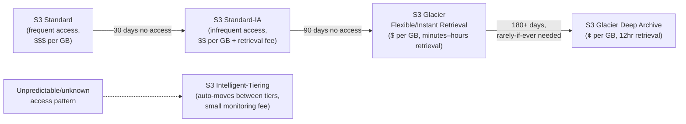
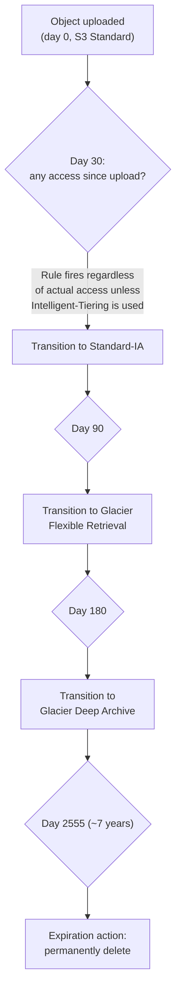
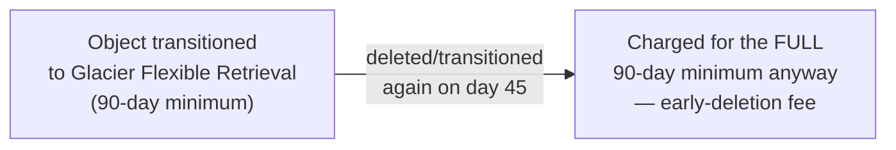
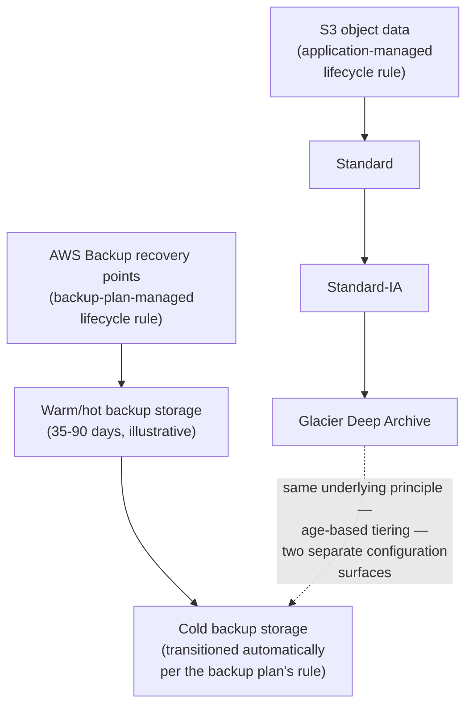

# Storage Cost-Optimization Decision Framework

*Source: [Amazon S3 User Guide — Transitioning objects using Amazon S3 Lifecycle](https://docs.aws.amazon.com/AmazonS3/latest/userguide/lifecycle-transition-general-considerations.html)*

## Definition

A decision framework for minimizing storage spend without losing data you actually need — on
top of `s3-storage-classes.md`, `s3-glacier.md`, `ebs.md`, `aws-backup.md`.

## Plain-English Analogy

Storage tiering is exactly how a busy restaurant manages its pantry. Today's ingredients sit on
the counter (S3 Standard) — instant reach, but counter space is the most expensive square footage
in the kitchen. Ingredients used a few times a week move to the walk-in fridge (Standard-IA) —
cheaper per shelf, a short walk away. Things used once a season go to the basement freezer
(Glacier) — very cheap, but you plan ahead because defrosting takes time. And the box of decade-
old tax receipts nobody has opened in years goes to an off-site storage unit across town (Glacier
Deep Archive) — the cheapest option by far, accepted only because nobody expects to need same-day
access to it, ever.

## Purpose

Storage cost optimization is rarely "use a cheaper service" — it's almost always "match each
piece of data's actual access pattern to the storage tier priced for that pattern," because AWS
prices storage along a spectrum of retrieval speed vs. per-GB cost. Getting this wrong either
wastes money (paying for instant access to data nobody's touched in a year) or creates a nasty
surprise (data moved somewhere so cheap that retrieving it is slow or costly when it's actually
needed).

## How It Works — The Lifecycle

Step by step: a **lifecycle policy** automates this entire chain — you define rules like "move
objects to Standard-IA after 30 days, to Glacier after 90, to Deep Archive after 180" and S3
transitions objects automatically with zero application code changes. The key judgment call is
**how confident you are in the access pattern**: if you can predict it (logs nobody reads after
30 days, backups nobody restores after a year), hand-write the lifecycle rule — it's the cheapest
option because there's no monitoring overhead. If access is **unpredictable** (you genuinely
don't know which objects will suddenly become hot again), **Intelligent-Tiering** pays a small
monitoring fee per object to move things automatically based on actual observed access, trading a
little cost for not having to guess. Separately, **EBS** volumes attached to stopped instances
still bill for provisioned size — a very common real-world/exam cost leak is forgotten EBS
volumes left behind after an instance terminates; deleting unattached volumes (or snapshotting
then deleting) is a direct storage-cost action. **AWS Backup** lets you apply one retention/cost
policy (daily backups kept 7 days, weekly kept a month, monthly kept a year, with automatic
transition to cold storage) across many resource types at once instead of hand-rolling lifecycle
rules per service.

## Architecture: S3 Lifecycle Rule, End to End

A detail that trips candidates up: a standard **lifecycle rule transitions objects on a fixed
schedule regardless of whether they're actually still being accessed** — it does not watch real
access patterns the way Intelligent-Tiering does. This is precisely why the choice between a
hand-written lifecycle rule and Intelligent-Tiering hinges on how *confident* you are in the
predicted access pattern, not simply which one is "better" in the abstract.

## Architecture: Minimum Storage Duration Trap

Standard-IA, One Zone-IA, and the Glacier tiers all enforce a **minimum storage duration charge**
(commonly 30 days for IA tiers, 90 days for Glacier Flexible Retrieval, 180 days for Deep
Archive) — deleting or re-transitioning an object before that minimum elapses still bills for the
full minimum period. A scenario describing data that turns over *faster* than a tier's minimum
duration is describing a case where moving it to that "cheap" tier can actually cost **more**,
not less — a frequently tested exam trap.

## Key Decision Points

- **Lifecycle policies vs. Intelligent-Tiering** — predictable pattern → lifecycle rule (cheapest,
  no monitoring fee); unpredictable pattern → Intelligent-Tiering (small fee, but avoids costly
  early-retrieval penalties from guessing wrong).
- **Minimum storage duration charges** — Standard-IA, One Zone-IA, and the Glacier tiers all
  charge a minimum number of days even if you delete early; moving data that turns over faster
  than that minimum into a "cold" tier can backfire and cost more, not less.
- **Retrieval cost, not just storage cost** — Glacier/Deep Archive are cheap to store in but
  charge for retrieval and take hours; a scenario needing frequent restores from "archived" data
  is often cheaper to keep in Standard-IA despite the higher per-GB storage price.
- **One Zone-IA** trades AZ redundancy for a lower price — appropriate only for data that's
  easily reproducible (re-derivable from a source elsewhere), never for a sole copy of
  irreplaceable data.
- **Versioning + lifecycle together** — without a lifecycle rule to expire old versions,
  S3 Versioning can silently multiply storage costs by keeping every version forever.
- **EBS snapshots are incremental**, which is itself a cost lever — each snapshot after the first
  stores only changed blocks, so frequent snapshotting is cheaper than the full-volume size might
  suggest, but deleting an *early* snapshot in a chain doesn't necessarily reduce cost as much as
  expected if later snapshots still reference its data.
- **AWS Backup Vault Lock** adds immutability without changing the underlying cost model — a
  compliance requirement for immutable backups does not, on its own, force a more expensive
  storage tier; it's a policy setting layered on top of the same lifecycle-tiered storage.

## Use Cases — Real Scenarios

- **Healthcare company retaining 10 years of patient records at the lowest safe cost.** The same
  lifecycle ladder this doc's worked example walks through — Standard for 60 days, Standard-IA to
  2 years, Glacier Deep Archive after — is deployed company-wide once this first use case proves
  the pattern, covering every regulated-retention dataset the company holds.
- **Media company storing an enormous back-catalog of rarely-reaccessed but occasionally-trending
  video assets.** Because individual titles can unpredictably spike in popularity years after
  release, the catalog uses S3 Intelligent-Tiering rather than a fixed lifecycle schedule, avoiding
  both overpaying for Standard storage on cold titles and costly early-retrieval penalties on a
  title that suddenly trends.
- **Engineering team discovering hundreds of orphaned EBS volumes during a cost audit.** Trusted
  Advisor's unattached-volume check surfaces volumes left behind by terminated test instances over
  several years; the team snapshots each (as a safety net) before deleting, recovering a meaningful
  chunk of monthly spend that had been silently accruing.
- **Financial services firm nearly triggering an early-deletion penalty.** A proposed lifecycle
  rule would have moved short-lived trading-session logs (deleted after 45 days by policy) into
  Glacier Flexible Retrieval (90-day minimum storage duration) — caught during review before
  deployment, avoiding paying the full 90-day minimum for data gone in 45.
- **E-commerce company accumulating cost from unbounded S3 Versioning.** Years of Versioning being
  enabled with no lifecycle rule expiring old versions had silently multiplied storage cost many
  times over for frequently-updated product images; adding a noncurrent-version-expiration rule
  brings the bucket's cost back in line with its actual current-version footprint.
- **Research institute storing a sole, irreplaceable copy of decades of field data.** The team
  explicitly avoids One Zone-IA for this dataset despite its lower price, because the data cannot
  be regenerated if that single Availability Zone is lost — the cost savings aren't worth the risk
  for genuinely irreplaceable data.
- **Enterprise applying AWS Backup Vault Lock for a compliance mandate without a budget increase.**
  The compliance team required immutable backups; Vault Lock in compliance mode satisfies that
  requirement as a policy setting layered on the existing lifecycle-tiered backup storage, with no
  separate, more expensive storage tier required.
- **Podcast network reconsidering Glacier Deep Archive for a catalog with an active licensing
  business.** Older episodes initially moved to Deep Archive on a standard schedule, but the
  licensing team regularly needs same-day access to license specific back-catalog episodes to
  other platforms — the 12-hour Deep Archive retrieval delay conflicts with that business need, so
  the catalog is moved to Standard-IA instead, trading a higher per-GB storage price for retrieval
  speed the licensing deals actually require.

## Common Mistakes

- Writing a lifecycle rule that transitions data to Glacier/Deep Archive on a schedule faster
  than the tier's minimum storage duration, actually increasing cost through early-deletion
  penalties.
- Leaving S3 Versioning enabled with no lifecycle rule expiring noncurrent versions, silently
  accumulating storage cost for every version of every object ever written.
- Using One Zone-IA for the sole copy of data that cannot be regenerated or restored from
  elsewhere if that one Availability Zone is lost.
- Forgetting that EBS snapshots and unattached volumes continue billing after an instance is
  terminated — a very common, easy-to-miss cost leak Trusted Advisor is built to surface.
- Choosing Intelligent-Tiering reflexively for data whose access pattern is, in fact, well known
  and predictable — the monitoring fee is wasted money when a plain lifecycle rule would achieve
  the identical outcome for free.

## Full Worked Mini-Case: Designing a Compliant, Cost-Optimized Retention Policy

**Scenario:** a healthcare company must retain patient record documents for 10 years for
regulatory reasons. Records are accessed frequently in the first 60 days after creation (active
treatment), rarely accessed between 60 days and 2 years (follow-up queries), and essentially never
accessed after 2 years except for the rare legal discovery request, which can tolerate a
12-hour retrieval delay.

**Applying this framework:** objects start in **S3 Standard** for the first 60 days (frequent
access justifies the higher per-GB cost). A lifecycle rule transitions them to **Standard-IA** at
day 60 (infrequent-but-possible access, avoiding Glacier's retrieval delay during the follow-up
window where speed still occasionally matters). A second rule transitions them to **Glacier Deep
Archive** at the 2-year mark, since the stated access pattern beyond that point is "essentially
never, and 12-hour retrieval is tolerable" — exactly Deep Archive's profile. The policy also
applies **S3 Object Lock** in compliance mode for the full 10-year retention window, satisfying
the regulatory immutability requirement without changing which storage class/cost tier the
documents sit in at any given time.

## Full Worked Numeric Case: Lifecycle Savings at Real Scale

Putting real numbers against the healthcare retention mini-case above, for 5 TB (5,120 GB) of
patient records, using illustrative per-GB-month rates (Standard $0.023, Standard-IA $0.0125,
Glacier Deep Archive $0.00099):

- **Naive approach — everything stays in S3 Standard for the full 10-year retention:** 5,120 ×
  $0.023 × 120 months ≈ **$14,131.20** total over 10 years.
- **Tiered approach per the framework** (60 days Standard, then Standard-IA to 2 years, then
  Deep Archive for the remaining ~8 years): roughly 5,120 × $0.023 × 2 months (the first 60 days)
  ≈ $235.52, plus 5,120 × $0.0125 × 22 months (day 60 to 2 years) ≈ $1,408, plus 5,120 ×
  $0.00099 × 96 months (years 2-10) ≈ $486.78 — a total of roughly **$2,130.30** over the same
  10 years.
- **Savings:** $14,131.20 − $2,130.30 ≈ **$12,000.90**, an **85% reduction** for data whose actual
  access pattern (per the scenario) genuinely supports every one of these transitions without a
  single early-deletion penalty, since each transition happens well past that tier's minimum
  storage duration.

## Architecture: Where AWS Backup's Lifecycle Fits Alongside S3's

Walkthrough: this diagram exists to clear up a common point of confusion — an **S3 lifecycle
rule** and an **AWS Backup plan's lifecycle rule** are two entirely separate configuration
surfaces, even though they implement the identical underlying principle (age-based tiering to
cheaper storage). A scenario about *data* living in S3 needs an S3 lifecycle policy; a scenario
about *backup recovery points* managed by AWS Backup needs that service's own backup-plan rule —
conflating the two is a common exam trap when a question describes a backup strategy but the
candidate reaches for S3's lifecycle configuration instead.

## Real AWS Image: EBS Snapshot Lifecycle Automation

*Source: [Amazon EBS User Guide — Amazon EBS snapshots](https://docs.aws.amazon.com/ebs/latest/userguide/ebs-snapshots.html)*

This is the cross-volume incremental case worth knowing beyond the simpler single-volume example
earlier in this doc: a snapshot taken from a *restored* volume still only stores the blocks that
changed since the snapshot it was restored from, referencing that earlier snapshot for everything
unchanged — which is exactly why deleting an early snapshot in a chain that later snapshots still
reference doesn't necessarily free as much space as its own listed size might suggest, a detail
the Key Decision Points section above calls out explicitly.

## Why It's Important

**Exam mapping:** SAA-C03 Domain 4, Task 4.1 ("design cost-optimized storage solutions —
lifecycle policies, storage classes, backup strategy") is precisely this tier-matching skill.

## Exam Tips

- Match the stated access pattern's *frequency* and *predictability* to a tier — predictable and
  infrequent points to a manual lifecycle rule; genuinely unknown points to Intelligent-Tiering.
- Watch for minimum-duration traps — a scenario describing short-lived data being moved into
  Glacier/Deep Archive is often testing whether you catch the early-deletion cost penalty.
- "Must tolerate hours of retrieval delay" is the Glacier Flexible Retrieval/Deep Archive signal;
  "occasionally still needs fast access" rules those out in favor of Standard-IA.
- Compliance/immutability requirements (Object Lock, Vault Lock) are a separate axis from storage
  class/cost — don't assume a compliance requirement forces a more expensive tier.

## Related Terms

- [`../../../services/storage/s3-storage-classes.md`](../../../services/storage/s3-storage-classes.md)
- [`../../../services/storage/s3-glacier.md`](../../../services/storage/s3-glacier.md)
- [`../../../services/storage/ebs.md`](../../../services/storage/ebs.md)
- [`../../../services/storage/aws-backup.md`](../../../services/storage/aws-backup.md)
- [`../../../services/management-governance/cost-management-tools.md`](../../../services/management-governance/cost-management-tools.md)
- [`../domain-3-high-performing-architectures/storage-performance-decision-framework.md`](../domain-3-high-performing-architectures/storage-performance-decision-framework.md) —
  the same object/file/block storage shapes, revisited for raw performance rather than cost
- [`../domain-1-secure-architectures/README.md`](../domain-1-secure-architectures/README.md) —
  the KMS encryption and backup requirements that must survive every lifecycle transition
  described in this doc
