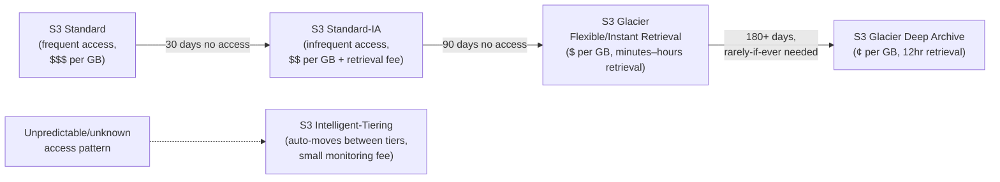

# Storage Cost-Optimization Decision Framework

## Definition

A decision framework for minimizing storage spend without losing data you actually need — on
top of `s3-storage-classes.md`, `s3-glacier.md`, `ebs.md`, `aws-backup.md`.

## Purpose

Storage cost optimization is rarely "use a cheaper service" — it's almost always "match each
piece of data's actual access pattern to the storage tier priced for that pattern," because AWS
prices storage along a spectrum of retrieval speed vs. per-GB cost. Getting this wrong either
wastes money (paying for instant access to data nobody's touched in a year) or creates a nasty
surprise (data moved somewhere so cheap that retrieving it is slow or costly when it's actually
needed).

## How It Works — The Lifecycle

Step by step: a **lifecycle policy** automates this entire chain — you define rules like "move
objects to Standard-IA after 30 days, to Glacier after 90, to Deep Archive after 180" and S3
transitions objects automatically with zero application code changes. The key judgment call is
**how confident you are in the access pattern**: if you can predict it (logs nobody reads after
30 days, backups nobody restores after a year), hand-write the lifecycle rule — it's the cheapest
option because there's no monitoring overhead. If access is **unpredictable** (you genuinely
don't know which objects will suddenly become hot again), **Intelligent-Tiering** pays a small
monitoring fee per object to move things automatically based on actual observed access, trading a
little cost for not having to guess. Separately, **EBS** volumes attached to stopped instances
still bill for provisioned size — a very common real-world/exam cost leak is forgotten EBS
volumes left behind after an instance terminates; deleting unattached volumes (or snapshotting
then deleting) is a direct storage-cost action. **AWS Backup** lets you apply one retention/cost
policy (daily backups kept 7 days, weekly kept a month, monthly kept a year, with automatic
transition to cold storage) across many resource types at once instead of hand-rolling lifecycle
rules per service.

## Key Decision Points

- **Lifecycle policies vs. Intelligent-Tiering** — predictable pattern → lifecycle rule (cheapest,
  no monitoring fee); unpredictable pattern → Intelligent-Tiering (small fee, but avoids costly
  early-retrieval penalties from guessing wrong).
- **Minimum storage duration charges** — Standard-IA, One Zone-IA, and the Glacier tiers all
  charge a minimum number of days even if you delete early; moving data that turns over faster
  than that minimum into a "cold" tier can backfire and cost more, not less.
- **Retrieval cost, not just storage cost** — Glacier/Deep Archive are cheap to store in but
  charge for retrieval and take hours; a scenario needing frequent restores from "archived" data
  is often cheaper to keep in Standard-IA despite the higher per-GB storage price.
- **One Zone-IA** trades AZ redundancy for a lower price — appropriate only for data that's
  easily reproducible (re-derivable from a source elsewhere), never for a sole copy of
  irreplaceable data.
- **Versioning + lifecycle together** — without a lifecycle rule to expire old versions,
  S3 Versioning can silently multiply storage costs by keeping every version forever.

## Why It's Important

**Exam mapping:** SAA-C03 Domain 4, Task 4.1 ("design cost-optimized storage solutions —
lifecycle policies, storage classes, backup strategy") is precisely this tier-matching skill.

## Related Terms

- [`../../../services/storage/s3-storage-classes.md`](../../../services/storage/s3-storage-classes.md)
- [`../../../services/storage/s3-glacier.md`](../../../services/storage/s3-glacier.md)
- [`../../../services/storage/ebs.md`](../../../services/storage/ebs.md)
- [`../../../services/storage/aws-backup.md`](../../../services/storage/aws-backup.md)
- [`../../../services/management-governance/cost-management-tools.md`](../../../services/management-governance/cost-management-tools.md)
