# SAA-C03 Exam Bank 1 — Study-Mode Practice Exam (65 Questions)

This is a **study-mode** exam bank: every question is immediately followed by its answer and
a full explanation, right where you're reading it — not in a separate answer-key file. Use it
for active drilling and review, not timed simulation. For the timed, blind-until-you-finish
mock-exam experience, see [`../practice-questions/full-exams/`](../practice-questions/full-exams/index.md)
instead. See [`./README.md`](README.md) for how this bank fits with Bank 2, Bank 3, and the
rest of the SAA-C03 material in this repo.

Like the real exam, this bank has **65 questions** (50 scored + 15 unscored equivalents — all
65 count for practice), domains **interleaved/mixed** rather than grouped, and weighted to the
official blueprint:

| Domain | Weight | Questions in this bank |
|---|---|---|
| [Domain 1 — Secure Architectures](../domain-1-secure-architectures/README.md) | 30% | 20 |
| [Domain 2 — Resilient Architectures](../domain-2-resilient-architectures/README.md) | 26% | 17 |
| [Domain 3 — High-Performing Architectures](../domain-3-high-performing-architectures/README.md) | 24% | 15 |
| [Domain 4 — Cost-Optimized Architectures](../domain-4-cost-optimized-architectures/README.md) | 20% | 13 |
| **Total** | **100%** | **65** |

All scenarios in this bank are original and distinct from the domain-split
[`practice-questions/`](../practice-questions/index.md) bank and the
[`practice-questions/full-exams/`](../practice-questions/full-exams/index.md) mock exams, and
distinct from Bank 2 and Bank 3 in this folder.

---

## Question 1

*(Domain 1 — Secure Architectures)*

Meridian Health just acquired a 40-person telehealth startup. The startup's engineers need
scoped, temporary access into 12 of Meridian's existing AWS accounts (one per product line)
immediately, without Meridian creating a single new IAM user or access key in any of those
accounts, and without the startup's engineers juggling 12 separate sets of credentials. Both
companies already run Okta as their identity provider. What should the Solutions Architect do?

A) In each of the 12 accounts, create an IAM user per startup engineer and attach a managed policy scoped to that account's resources
B) Federate Okta with AWS IAM Identity Center at the Organization's management account, and assign the startup engineers permission sets scoped to the relevant 12 accounts
C) Create one cross-account IAM role in the management account that trusts Okta directly via SAML, and have engineers assume it manually through the CLI for each account
D) Issue each startup engineer a long-lived access key tied to a shared "contractor" IAM user replicated into all 12 accounts

**Correct Answer: B**

**Why correct:** [IAM Identity Center](../../../services/security-identity-compliance/iam-identity-center-sso.md) federates once against an external IdP (Okta) and lets administrators assign **permission sets** — reusable permission templates — to specific AWS accounts inside an Organization. A startup engineer logs in once through the Identity Center portal (their existing Okta credentials) and sees only the accounts/roles they've been assigned, receiving short-lived [STS](../../../services/security-identity-compliance/sts-and-role-switching.md) credentials behind the scenes. This satisfies "one login, scoped per-account access, zero new IAM users or keys" exactly, and scales cleanly as more accounts or engineers are added later.

**Why the others are wrong:**
- **A** is the literal anti-pattern the prompt rules out: 12 accounts × 40 engineers means up to 480 IAM users to create, rotate, and eventually delete, with no single sign-on and a large credential-sprawl surface.
- **C** federates SAML directly to a single role rather than using Identity Center's account/permission-set model, forcing every engineer to manually run `aws sts assume-role` for each of the 12 accounts separately — it technically avoids new IAM users, but reintroduces exactly the "juggling 12 sets of access" friction the prompt wants removed, and doesn't scale to assigning different permissions per account cleanly.
- **D** combines the long-lived-credential anti-pattern with a *shared* identity, which also kills individual accountability in CloudTrail — every action from any of the 40 engineers would show up under the same principal.

Reference: [`services/security-identity-compliance/iam-identity-center-sso.md`](../../../services/security-identity-compliance/iam-identity-center-sso.md)

---

## Question 2

*(Domain 2 — Resilient Architectures)*

A regional bank runs its core transaction-processing database on Amazon RDS for PostgreSQL.
Compliance requires that a single Availability Zone failure cause **no data loss and minimal
downtime**, with failover handled automatically — the operations team should not need to
manually promote a replica during an incident. What should the Solutions Architect configure?

A) A read replica in a second Availability Zone, promoted manually by an on-call engineer during an outage
B) Multi-AZ deployment for the RDS instance, which maintains a synchronously replicated standby in a second AZ and fails over automatically
C) Nightly automated snapshots copied to a second AZ, restored into a new instance if the primary AZ fails
D) A single-AZ RDS instance with Auto Scaling configured on the DB instance to relaunch it in another AZ on failure

**Correct Answer: B**

**Why correct:** RDS [Multi-AZ](../../../services/database/rds.md) deployments maintain a **synchronous** standby replica in a different AZ. Because replication is synchronous, a committed transaction exists on both the primary and standby before being acknowledged — so an AZ failure loses no committed data. RDS automatically detects the failure and flips the DNS endpoint to the standby, typically within 60–120 seconds, with zero manual intervention, exactly matching "automatic, minimal downtime, no data loss."

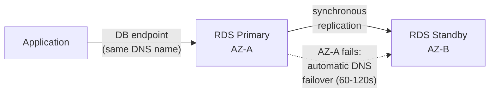

Step by step: (1) every committed write is replicated synchronously to the standby in AZ-B
before being acknowledged to the application, so the standby is always current; (2) the
application always connects through the same DB endpoint name, never a hardcoded IP; (3) if
AZ-A fails, RDS detects it and repoints that same DNS endpoint at the standby in AZ-B
automatically — the application reconnects using the identical endpoint, with no code change
and no data loss, since the standby was already fully caught up.

**Why the others are wrong:**
- **A** uses asynchronous replication for read replicas, so some in-flight transactions can be lost during failover, and "promoted manually by an on-call engineer" directly violates the "automatic, no manual step" requirement.
- **C** has an RPO measured in up to 24 hours (since the last nightly snapshot) — any transactions after the last snapshot are gone, which fails the "no data loss" bar outright, and restoring a snapshot into a running instance takes many minutes to hours, not matching "minimal downtime."
- **D** doesn't exist as described — RDS instances aren't part of an EC2 Auto Scaling group, and there is no native "relaunch in another AZ" mechanism outside of Multi-AZ; this option describes a feature RDS doesn't have.

Reference: [`services/database/rds.md`](../../../services/database/rds.md)

---

## Question 3

*(Domain 2 — Resilient Architectures)*

A global trading platform needs a database that can serve low-latency reads from three
Regions (US, EU, APAC) and, in a full Regional outage, promote a secondary Region to primary
**in under a minute** with minimal data loss. The existing engine is Amazon Aurora PostgreSQL.
What should the Solutions Architect recommend?

A) Aurora Multi-AZ with cross-Region automated backups copied to the other two Regions
B) Aurora Global Database, with one primary Region and up to five secondary read-only Regions kept in sync via dedicated storage-layer replication, using managed planned failover or unplanned failover promotion for the secondary
C) Three independent Aurora clusters, one per Region, with application-level dual writes to keep them in sync
D) A single Aurora cluster in the US Region, fronted by CloudFront for the EU and APAC users

**Correct Answer: B**

**Why correct:** [Aurora Global Database](../../../services/database/aurora.md) replicates at the storage layer across Regions with typical replication lag under one second, independent of compute — exactly what "low-latency reads from three Regions" needs, since each secondary Region has its own local read endpoint. Its managed **failover/promotion** of a secondary to a standalone writable primary is designed to complete in about a minute (unplanned failover is explicitly built for the under-a-minute target in a Regional outage), satisfying both the RTO and low-RPO requirements.

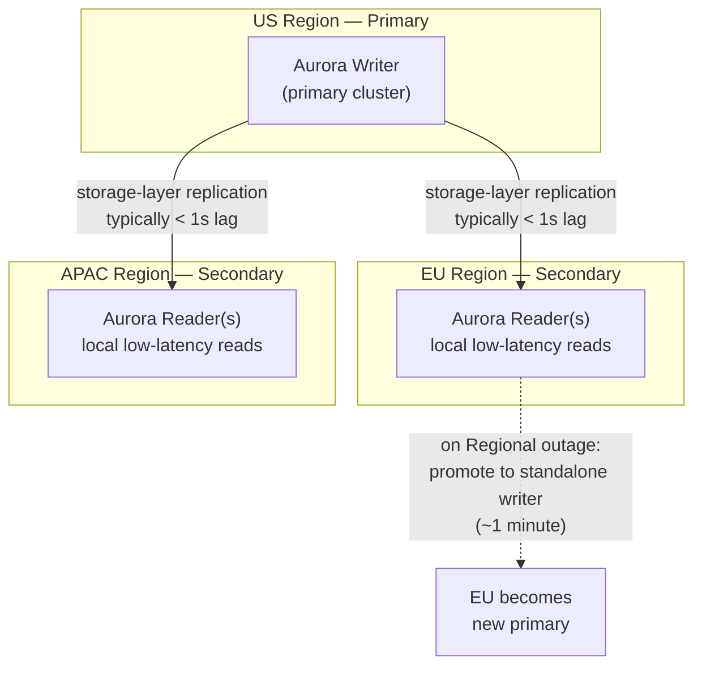

Step by step: (1) the US Region holds the single writable primary cluster; (2) the EU and APAC
clusters are read-only secondaries receiving continuous storage-layer replication, so local
users get fast reads without crossing an ocean; (3) if the US Region fails entirely, an
operator (or an automated runbook) promotes one secondary — say EU — to a standalone writable
primary in roughly a minute, after which that Region serves both reads and writes until the
original Region recovers.

**Why the others are wrong:**
- **A** confuses Multi-AZ (same-Region HA) with cross-Region DR — automated backups copied cross-Region give you an RPO of however old the last backup/log shipment is and require a full restore (many minutes to hours), nowhere near "under a minute."
- **C** pushes the hard problem (conflict-free multi-master writes across three Regions) onto the application, which is far more complex and error-prone than using Aurora's native replication, and risks write conflicts/data divergence that Aurora Global Database's single-writer model avoids entirely.
- **D** doesn't solve the read-latency problem at all — CloudFront caches HTTP responses, not direct database query results, and EU/APAC users querying a US-only database still pay full cross-ocean round-trip latency for every query; it also provides zero failover capability.

Reference: [`services/database/aurora.md`](../../../services/database/aurora.md)

---

## Question 4

*(Domain 1 — Secure Architectures)*

A cybersecurity insurer requires, as a condition of coverage, that **GuardDuty can never be
disabled or suspended in any of a client company's 30 AWS accounts, by anyone, including the
account root user**, and that this be provable to an auditor without relying on any individual
administrator's good judgment. What should the Solutions Architect implement?

A) An IAM policy denying `guardduty:DeleteDetector` and `guardduty:StopMonitoringMembers`, attached to every human IAM role across the 30 accounts
B) A Service Control Policy attached at the Organization root (or an OU containing all 30 accounts) that denies the relevant GuardDuty disable/delete actions for all principals, including root
C) A GuardDuty detector per account with an EventBridge rule that re-enables GuardDuty if it's found disabled, checked hourly
D) A written security policy document requiring administrators to get written approval before disabling GuardDuty

**Correct Answer: B**

**Why correct:** A [Service Control Policy](../../../services/security-identity-compliance/organizations-and-scps.md) is a permission **ceiling** enforced by AWS Organizations at the account boundary — it applies to every principal in the account, including that account's own root user, and a member account cannot remove or override an SCP applied from above it. That is the only mechanism in this list that is both preventive (not detect-and-react) and literally un-bypassable by anyone inside the 30 accounts, which is exactly what "can never be disabled, by anyone, including root, provably" requires.

**Why the others are wrong:**
- **A** is an IAM policy, which by definition does not apply to the root user and can be edited or detached by anyone with sufficient IAM permissions inside that same account — it's bypassable from within, failing the "including root" and "provable" bars.
- **C** is reactive, not preventive: there's a window (up to an hour, by the scenario's own check interval) where GuardDuty is off and the environment is unmonitored, and "re-enable after the fact" isn't the same guarantee as "can never be disabled."
- **D** is a paper policy with no technical enforcement at all — it relies entirely on individual compliance and leaves no automatic proof that it was actually followed, which an insurer's auditor would reject as a control.

Reference: [`services/security-identity-compliance/organizations-and-scps.md`](../../../services/security-identity-compliance/organizations-and-scps.md)

---

## Question 5

*(Domain 3 — High-Performing Architectures)*

An online furniture retailer's product-catalog page issues the same handful of "get product
details" and "get current price" database queries millions of times per hour, and the RDS
MySQL primary is now CPU-bound purely from read traffic, even though the underlying data
changes only a few times a day. What should the Solutions Architect add to improve performance
most cost-effectively, without re-architecting the database layer?

A) Upgrade the RDS instance to the largest available instance class
B) Add an Amazon ElastiCache (Redis or Memcached) layer in front of RDS, caching the catalog/price query results with a short TTL
C) Add more RDS read replicas and round-robin all catalog reads across them
D) Migrate the catalog data into DynamoDB with on-demand capacity

**Correct Answer: B**

**Why correct:** [ElastiCache](../../../services/database/elasticache.md) is purpose-built for exactly this pattern — a small set of frequently-repeated, rarely-changing read queries. Caching those results in memory means the vast majority of requests never touch RDS at all, cutting load (and CPU) on the database dramatically for a fraction of the cost of scaling RDS itself, and it requires no changes to the data model — the application just checks the cache before querying the database.

**Why the others are wrong:**
- **A** throws more (expensive) compute at a problem that's actually about redundant, repeated identical reads — it treats the symptom and keeps paying for capacity the workload doesn't structurally need, rather than eliminating the redundant work.
- **C** scales read capacity but each replica is still a full database instance paying to re-execute the same repeated query over and over — it's more expensive than caching and still carries replication lag, when the data barely changes anyway.
- **D** is a much larger re-architecture ("without re-architecting the database layer" is explicitly ruled out by the prompt) — migrating an existing relational catalog schema to DynamoDB is a significant data-modeling and application-rewrite effort just to solve a caching problem that ElastiCache solves directly.

Reference: [`services/database/elasticache.md`](../../../services/database/elasticache.md)

---

## Question 6

*(Domain 1 — Secure Architectures)*

A healthcare SaaS company encrypts its RDS databases with a customer-managed KMS key. As part
of its disaster recovery plan, encrypted snapshots must be copied to a secondary Region and be
restorable there **without manually re-creating and re-granting a brand-new KMS key** in that
Region during an actual disaster. What should the Solutions Architect set up ahead of time?

A) Copy the encrypted snapshot to the DR Region using the AWS managed `aws/rds` key, which exists by default in every Region
B) Create a KMS multi-Region key in the primary Region, replicate it as a multi-Region replica key in the DR Region, and use the replica key when copying/restoring the snapshot there
C) Disable encryption on the snapshot before copying it cross-Region, then re-encrypt after restore completes
D) Store the KMS key material as a Secrets Manager secret and manually re-import it into a new key in the DR Region during the disaster

**Correct Answer: B**

**Why correct:** [KMS multi-Region keys](../../../services/security-identity-compliance/kms.md) are created as a set — a primary key and one or more independently-manageable replica keys in other Regions that share the same underlying key material and key ID. A snapshot encrypted with the primary key can be copied cross-Region and decrypted/restored there using the replica key, with no cross-Region re-encryption step and no manual key regeneration needed during the actual incident — exactly the "set it up ahead of time, usable instantly during DR" requirement.

**Why the others are wrong:**
- **A** is wrong because AWS managed keys (`aws/rds`) are Region-specific and cannot be shared or replicated across Regions — the whole point of needing something at all here is that the default per-Region managed key can't satisfy cross-Region restore without the owner's involvement.
- **C** removes encryption during transit/copy, which is itself a compliance violation for a healthcare company (likely subject to HIPAA), and manually re-encrypting afterward is exactly the manual, in-the-moment step the prompt says to avoid.
- **D** describes exporting raw key material, which KMS customer-managed keys backed by AWS's default key store do not support exporting at all, and even where key import is used, doing this manually mid-disaster is precisely the slow, error-prone, in-the-moment process the requirement rules out.

Reference: [`services/security-identity-compliance/kms.md`](../../../services/security-identity-compliance/kms.md)

---

## Question 7

*(Domain 2 — Resilient Architectures)*

A publicly traded company must retain its application audit logs for seven years and keep a
geographically separate copy in a different AWS Region in case the primary Region's S3 data is
ever lost or corrupted. Logs are written continuously to an S3 bucket in `us-east-1`. What
should the Solutions Architect configure?

A) A scheduled Lambda function that lists and copies new objects from the `us-east-1` bucket to a `eu-west-1` bucket once per day
B) S3 Cross-Region Replication (CRR) from the `us-east-1` bucket to a bucket in `eu-west-1`, with versioning enabled on both buckets
C) A single S3 bucket with multiple Availability Zones selected during creation
D) AWS Backup configured to back up the S3 bucket to Amazon Glacier in the same Region

**Correct Answer: B**

**Why correct:** [S3 Cross-Region Replication](../../../services/storage/s3.md) automatically and asynchronously copies new (and optionally existing) objects from a source bucket to a destination bucket in a different Region, continuously and near-real-time, as objects are written — not on a batch schedule. Versioning is a hard prerequisite for CRR on both the source and destination bucket, which also gives the added benefit of protecting against accidental overwrite/delete in either location.

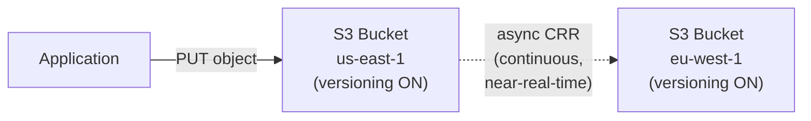

Step by step: (1) the application writes audit logs to the `us-east-1` bucket as usual, with no
change to the write path; (2) S3's replication engine detects each new object version and
asynchronously copies it to the `eu-west-1` bucket, typically within seconds to a few minutes;
(3) if `us-east-1`'s S3 data were ever lost or corrupted, the seven-year audit trail still
exists, independently durable, in `eu-west-1`.

**Why the others are wrong:**
- **A** reinvents CRR poorly: a once-a-day batch job means up to 24 hours of data could be lost if the primary Region fails between runs, it's custom code to build and maintain, and it doesn't handle deletes, versioning, or failure retries the way the managed CRR feature does.
- **C** is not a real S3 feature — S3 buckets exist within a single Region and are already redundant *across* multiple AZs within that Region automatically (that's the baseline S3 durability model), but "select multiple AZs during creation" is not something you configure, and it does nothing to protect against a Regional-scale event.
- **D** backs up within the same Region, which does not satisfy "geographically separate copy in a different Region" — it protects against accidental deletion but not a Regional-level event affecting that Region's AWS infrastructure.

Reference: [`services/storage/s3.md`](../../../services/storage/s3.md)

---

## Question 8

*(Domain 2 — Resilient Architectures)* **(Choose TWO)**

A global marketplace's shopping-cart service must accept writes with single-digit-millisecond
latency from shoppers in North America, Europe, and Asia simultaneously, and must keep running
(read and write) in every Region even if one Region goes down entirely. Which **two** design
choices satisfy this?

A) Use Amazon DynamoDB Global Tables with a table replicated across all three Regions, so each Region has a local, fully read/write replica
B) Use a single DynamoDB table in one Region, and have the other two Regions access it over cross-Region API calls
C) Design the application to write to whichever Region's local DynamoDB Global Tables replica is nearest the shopper, accepting that DynamoDB's last-writer-wins conflict resolution will reconcile any near-simultaneous conflicting writes to the same item
D) Use RDS Multi-AZ in one Region as the single source of truth, with read replicas in the other two Regions
E) Use S3 Transfer Acceleration to speed up cart-data synchronization between Regions

**Correct Answer: A, C**

**Why correct:** [DynamoDB Global Tables](../../../services/database/dynamodb.md) (**A**) provision a fully replicated, active-active table in each chosen Region — every Region's replica accepts both reads and writes locally, satisfying both the low-latency requirement (no cross-Region round trip) and the "keeps running everywhere even if one Region is down" requirement, since the other Regions are independent, fully functional replicas, not dependent on a single source-of-truth Region. Because every Region can write independently (**C**), the application has to accept DynamoDB Global Tables' built-in **last-writer-wins** conflict resolution for the rare case where the same item is updated in two Regions within the same propagation window — this is the documented, expected trade-off of true multi-Region active-active writes, and designing for it (e.g., using cart line-items that are easy to reconcile, or per-user partition keys that are rarely touched from two Regions simultaneously) is the correct approach.

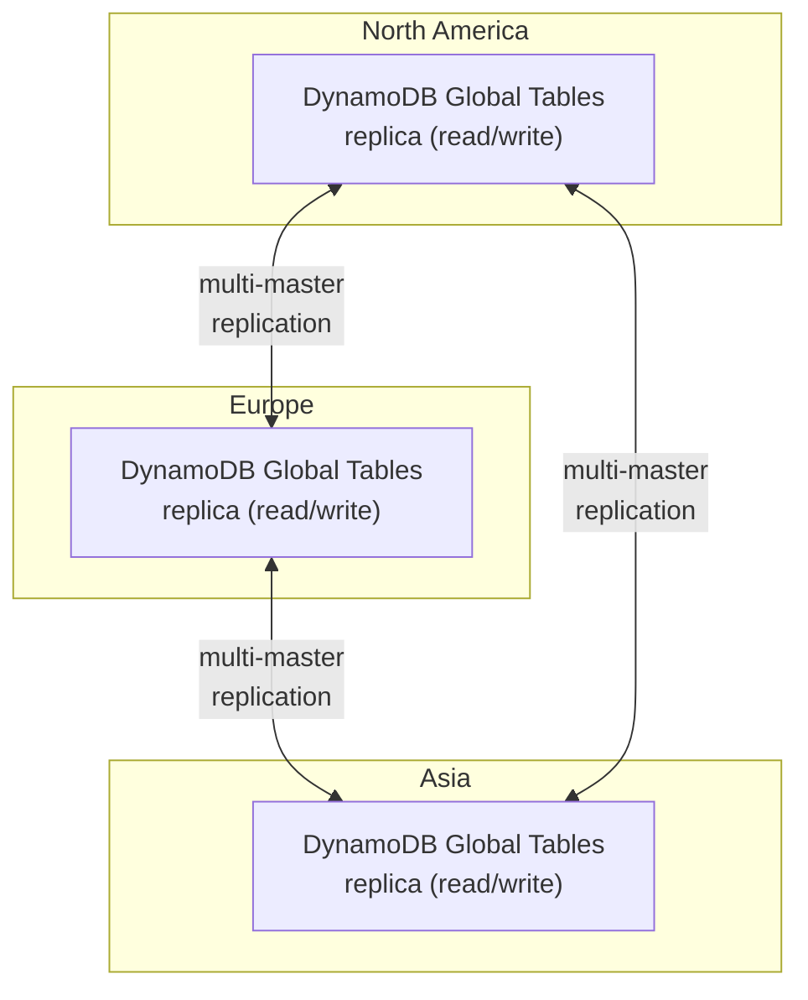

Step by step: (1) each Region has its own fully functional, locally-written replica of the
cart table, so a shopper's write lands in the nearest Region with single-digit-millisecond
latency; (2) every replica propagates its writes to the other two Regions in the background;
(3) if any one Region goes down entirely, the other two keep serving both reads and writes
locally with zero dependency on the failed Region, satisfying true active-active resilience.

**Why the others are wrong:**
- **B** defeats the entire point: cross-Region API calls to a single-Region table reintroduce exactly the hundred-plus-millisecond cross-ocean latency the requirement rules out, and that one Region becomes a single point of failure for the other two.
- **D** makes RDS the single source of truth in one Region, so if that Region fails, writes stop everywhere (read replicas in other Regions can't accept writes) — this fails "keep running everywhere even if one Region is down."
- **E** solves a completely different problem (accelerating large object uploads into S3) and has nothing to do with multi-Region database replication or cart-write latency.

Reference: [`services/database/dynamodb.md`](../../../services/database/dynamodb.md)

---

## Question 9

*(Domain 1 — Secure Architectures)*

A fintech company has 200 Lambda functions that all connect to the same RDS for MySQL
database using a single master credential. Security policy requires that the database password
be rotated automatically every 30 days **without any application downtime or manual code
changes to retrieve the new password**. What should the Solutions Architect implement?

A) Store the password in a `.env` file bundled into each Lambda function's deployment package, and redeploy all 200 functions every 30 days with a new password
B) Store the credential in AWS Secrets Manager with automatic rotation enabled (using the built-in RDS MySQL rotation Lambda), and have each of the 200 functions retrieve the credential from Secrets Manager at runtime
C) Store the password as a plaintext environment variable on each Lambda function's configuration, updated via a scheduled script
D) Store the credential in Systems Manager Parameter Store as a `String` parameter, with a reminder set for an engineer to manually update it every 30 days

**Correct Answer: B**

**Why correct:** [Secrets Manager's](../../../services/security-identity-compliance/secrets-manager-vs-parameter-store.md) native rotation integrates directly with RDS: it provides a pre-built rotation Lambda function that creates a new password, updates it on the RDS instance, and updates the secret — all automatically on a schedule, with zero manual steps. Because the 200 functions retrieve the credential *at runtime* by calling Secrets Manager (rather than having it baked into a deployment), none of them need redeploying when the password rotates, and Secrets Manager briefly keeps both the old and new credential valid during the rotation window specifically to avoid any connection downtime.

**Why the others are wrong:**
- **A** requires redeploying all 200 functions every 30 days just to update a password — that's both a manual/scripted operational burden and creates a redeploy-synchronization risk (if even one function isn't redeployed in time, it starts failing auth), which directly violates "without manual code changes."
- **C** has the same redeployment problem as A, and additionally stores the secret in plaintext configuration rather than an encrypted secret store, which is a weaker security posture than Secrets Manager's KMS-backed encryption.
- **D** uses Parameter Store's plain `String` type with no automatic rotation capability at all (SecureString + rotation support exists only through integration with Secrets Manager or custom rotation Lambdas you'd have to build yourself) and explicitly relies on a human "reminder" — exactly the manual process the requirement forbids.

Reference: [`services/security-identity-compliance/secrets-manager-vs-parameter-store.md`](../../../services/security-identity-compliance/secrets-manager-vs-parameter-store.md)

---

## Question 10

*(Domain 2 — Resilient Architectures)*

An events-ticketing site runs its web tier on EC2 instances behind an Application Load
Balancer. During a popular on-sale event, a handful of instances occasionally become
unresponsive (hung process) while still passing basic network-level health checks. The
Solutions Architect needs the unhealthy instances automatically detected and replaced without
manual intervention. What should be configured?

A) CloudWatch billing alarms that notify the on-call engineer by email to manually terminate hung instances
B) An Auto Scaling group with an ALB target group health check configured to use the application's `/health` HTTP endpoint (not just TCP), so the ASG replaces instances the ALB marks unhealthy
C) EC2 instance termination protection enabled on all web-tier instances
D) A Network Load Balancer in front of the web tier instead of an Application Load Balancer, relying on its TCP-level health checks

**Correct Answer: B**

**Why correct:** An [Auto Scaling group](../../../services/compute/ec2-auto-scaling.md) configured with **ELB health checks** (rather than only EC2 status checks) asks the attached ALB target group to determine instance health using an **application-layer** check — typically an HTTP GET against a `/health` endpoint that the app only returns 200 for when it's actually able to serve requests. A hung process that still responds at the TCP level but can't serve HTTP requests will be marked unhealthy by this check, and the ASG will automatically terminate and replace it with no human involvement — exactly what's needed.

**Why the others are wrong:**
- **A** is purely a notification mechanism requiring a human to act — it doesn't automatically detect-and-replace anything, violating the "without manual intervention" requirement.
- **C** does the opposite of what's needed: termination protection actively *prevents* an instance from being terminated (manually or automatically), which would stop the ASG from being able to replace a hung instance at all.
- **D**'s core issue remains unsolved: a Network Load Balancer's default health checks operate at TCP (or optionally HTTP, but the option specifically says "relying on its TCP-level health checks") — a hung process that still accepts TCP connections but can't process requests would still pass a TCP-level check and never get flagged unhealthy.

Reference: [`services/compute/ec2-auto-scaling.md`](../../../services/compute/ec2-auto-scaling.md)

---

## Question 11

*(Domain 1 — Secure Architectures)*

A media company's video-transcoding fleet runs on EC2 instances in private subnets with no
internet gateway route. The instances need to read and write large video files to S3
frequently, with high throughput, **without** traversing the public internet or a NAT Gateway
(cost and security both matter here). What should the Solutions Architect configure?

A) A NAT Gateway in the public subnet, with a route from the private subnet's route table
B) A Gateway VPC endpoint for S3, with a route added to the private subnet's route table pointing at the endpoint
C) An Interface VPC endpoint for S3, since Gateway endpoints don't support EC2 traffic
D) A VPN connection from the VPC to the nearest S3 Regional endpoint

**Correct Answer: B**

**Why correct:** [S3 Gateway VPC endpoints](../../../services/networking-content-delivery/vpc-endpoints-privatelink.md) are free, add a route-table entry (a prefix list pointing at the endpoint) so S3 traffic flows over AWS's private backbone network instead of the internet, and support full S3 throughput — ideal for exactly this "high-throughput, no internet/NAT, cost matters" scenario, since Gateway endpoints have no hourly or per-GB processing charge (unlike NAT Gateway or Interface endpoints).

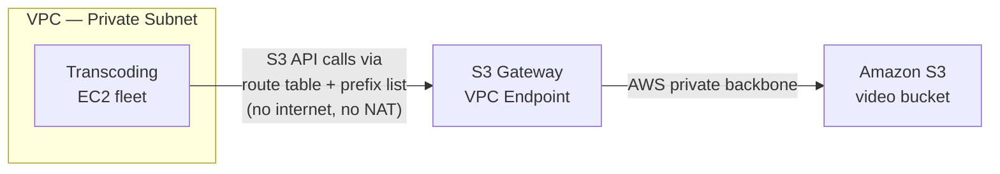

Step by step: (1) the private subnet's route table gets a new route whose destination is the
S3-service prefix list and whose target is the Gateway endpoint; (2) when an instance calls the
S3 API, that route sends the traffic to the endpoint instead of to a NAT Gateway or internet
gateway; (3) the endpoint forwards the request over AWS's internal network directly to S3,
never touching the public internet, and at no additional per-GB cost.

**Why the others are wrong:**
- **A** routes through a NAT Gateway, which does work functionally but bills per-hour and per-GB processed — directly against the "cost matters" requirement, and it also means traffic leaves the VPC's private network path (via the internet gateway) rather than staying fully internal.
- **C** is factually backwards — S3 (and DynamoDB) are specifically the two services supported by the free Gateway endpoint type; Interface endpoints (PrivateLink, billed hourly + per-GB) are used for most *other* AWS services, not S3, so this claim misstates which endpoint type applies.
- **D** describes using a VPN tunnel to reach a public AWS service endpoint, which is not how S3 access works, adds unnecessary complexity and cost, and VPNs are meant for connecting *networks* (e.g., on-prem to VPC), not for providing private access to in-Region AWS services.

Reference: [`services/networking-content-delivery/vpc-endpoints-privatelink.md`](../../../services/networking-content-delivery/vpc-endpoints-privatelink.md)

---

## Question 12

*(Domain 2 — Resilient Architectures)*

An online bookstore's order-processing Lambda function occasionally fails due to a downstream
inventory service timing out under load. Orders that fail must never be silently dropped, and
the system should automatically retry transient failures a few times before setting aside any
order that still can't be processed, for later investigation. What should the Solutions
Architect design?

A) Have the storefront call the order-processing Lambda function directly and synchronously, with the frontend displaying an error if it fails
B) Place an SQS queue in front of the order-processing Lambda (as an event source), configure a redrive policy with a maximum receive count, and set up a dead-letter queue (DLQ) to catch orders that exceed that count
C) Have the Lambda function catch exceptions internally and simply log them to CloudWatch Logs before returning success
D) Increase the Lambda function's timeout to the maximum (15 minutes) so it has more time to succeed on every invocation

**Correct Answer: B**

**Why correct:** [SQS](../../../services/application-integration/sqs.md) decouples the order submission from processing: a message that fails processing becomes visible again after its visibility timeout and is retried, and the **redrive policy's `maxReceiveCount`** controls exactly "retry a few times" before the message is automatically moved to the configured **dead-letter queue** — satisfying "never silently dropped" (it's preserved in the DLQ) and "automatically retry before setting aside for investigation" precisely as specified.

**Why the others are wrong:**
- **A** has no retry or persistence mechanism at all — a failed synchronous call just shows the customer an error, and if they don't retry manually themselves, the order is lost with no record of it for investigation.
- **C** is worse than doing nothing: swallowing the exception and returning success means the caller (and any monitoring) believes the order succeeded when it didn't, hiding the failure entirely rather than preserving it for review.
- **D** doesn't address the problem described — the issue is a downstream service timing out under load (an external dependency issue), not the Lambda function running out of its own execution time; a longer timeout doesn't add retry logic or preserve failed orders.

Reference: [`services/application-integration/sqs.md`](../../../services/application-integration/sqs.md)

---

## Question 13

*(Domain 2 — Resilient Architectures)*

A logistics company publishes a single "shipment status changed" event that must reliably
reach three completely independent systems: a customer-notification service, a billing
reconciliation service, and a data warehouse ingestion pipeline. Each consumer processes at
its own pace, and a slow or failed consumer must never block or lose events for the others.
What should the Solutions Architect design?

A) Have the shipment service call all three downstream systems' APIs directly and synchronously, one after another
B) Publish the event to an SNS topic with three separate SQS queues subscribed (fan-out pattern), one queue per consumer
C) Write the event directly into each of the three consumers' databases from the shipment service
D) Use a single SQS queue that all three consumer services poll from

**Correct Answer: B**

**Why correct:** The [SNS fan-out to SQS](../../../services/application-integration/sns.md) pattern publishes one message once to an SNS topic, and SNS delivers a durable copy to **each** subscribed SQS queue independently. Each consumer then has its own queue to poll at its own pace — a slow billing-reconciliation consumer backing up its queue has zero effect on the notification or warehouse queues, and if one consumer's queue processing fails, the message isn't lost (it stays in that queue, retried per its own redrive policy) without affecting the others at all.

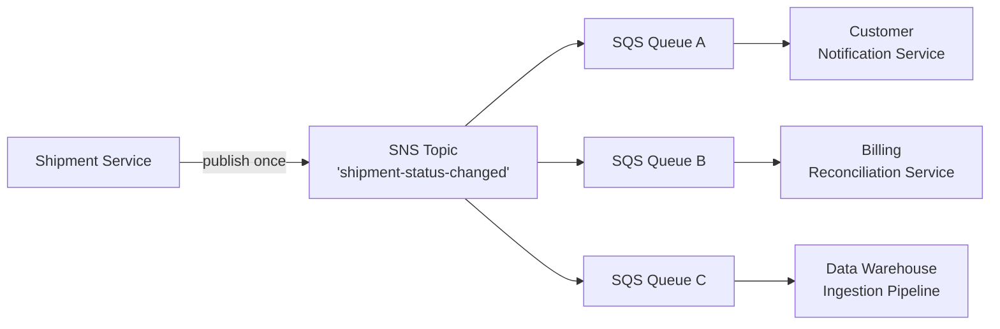

Step by step: (1) the shipment service publishes the event exactly once to the SNS topic;
(2) SNS fans that single publish out to all three subscribed queues, giving each consumer its
own independent, durable copy; (3) each consumer polls only its own queue on its own schedule —
a backlog or outage in the billing queue has no visibility to, or effect on, the notification
or warehouse queues.

**Why the others are wrong:**
- **A** makes the shipment service responsible for calling three downstream APIs synchronously — if any one is slow or down, it blocks (or fails) the whole chain, and there's no retry or durability if a call fails partway through.
- **C** requires the shipment service to know the internal database schema of three unrelated services and write directly to them, which is tight coupling across team/service boundaries (a maintenance and security anti-pattern), and offers none of SQS/SNS's durability or retry semantics.
- **D** with a single shared queue means whichever consumer polls a message first deletes it (or, without careful design, all three consumers race for the same messages) — a single queue cannot deliver the same message independently to three different consumers; that is specifically what the fan-out pattern with per-consumer queues solves.

Reference: [`services/application-integration/sns.md`](../../../services/application-integration/sns.md)

---

## Question 14

*(Domain 1 — Secure Architectures)*

A company uses a third-party SaaS vulnerability-scanning tool that exposes its API via AWS
PrivateLink. Security policy requires that traffic to this scanner never traverse the public
internet and that the connection be reachable only from inside the company's VPC. What should
the Solutions Architect configure?

A) An Interface VPC endpoint in the company's VPC pointing at the SaaS vendor's VPC endpoint service, with a security group restricting which internal resources can reach it
B) A NAT Gateway with an outbound-only route to the vendor's public API endpoint
C) A Site-to-Site VPN connection directly to the SaaS vendor's data center
D) A public Elastic IP attached to an EC2 proxy instance that forwards traffic to the vendor's API

**Correct Answer: A**

**Why correct:** [Interface VPC endpoints (PrivateLink)](../../../services/networking-content-delivery/vpc-endpoints-privatelink.md) are exactly the mechanism third-party SaaS vendors expose via "endpoint services" for private connectivity — creating an Interface endpoint in the company's VPC gives it a private IP (via an ENI) that routes directly to the vendor's service over AWS's internal network, never touching the public internet, and a security group on the endpoint's ENI controls exactly which internal resources may reach it, satisfying both the "never traverses the internet" and "reachable only from inside the VPC" requirements.

**Why the others are wrong:**
- **B** explicitly sends traffic out to a public API endpoint over the internet (a NAT Gateway's whole purpose is enabling outbound *internet* access) — the opposite of "never traverses the public internet."
- **C** is designed for connecting two private networks (e.g., on-prem to a VPC), not for reaching a SaaS vendor's PrivateLink-exposed API — the vendor almost certainly doesn't offer VPN endpoints for this purpose, and it's a far heavier solution than what PrivateLink already provides out of the box.
- **D** builds a custom internet-facing proxy specifically to reach a public endpoint, which both violates "never traverses the public internet" and adds an unnecessary, unmanaged single point of failure and security liability (a publicly reachable EC2 instance) that PrivateLink eliminates.

Reference: [`services/networking-content-delivery/vpc-endpoints-privatelink.md`](../../../services/networking-content-delivery/vpc-endpoints-privatelink.md)

---

## Question 15

*(Domain 2 — Resilient Architectures)*

An e-commerce company's primary Region is `us-east-1`. Leadership wants a disaster recovery
plan for `us-west-2` that can take over serving live traffic **within 10–15 minutes** of a
declared disaster, while keeping steady-state DR costs meaningfully lower than running a full
duplicate production environment 24/7. What DR strategy should the Solutions Architect design?

A) Backup and restore: nightly snapshots copied to `us-west-2`, with infrastructure provisioned from scratch only after a disaster is declared
B) Pilot light: a minimal always-on core (e.g., a continuously replicated database) in `us-west-2`, with the rest of the stack (app/web tier) defined as infrastructure-as-code but scaled to zero until needed
C) Warm standby: a scaled-down but fully functional copy of the entire stack running continuously in `us-west-2`, scaled up to full capacity during failover
D) Multi-site active/active: full production capacity running in both Regions simultaneously at all times

**Correct Answer: C**

**Why correct:** [Warm standby](../../../services/database/database-selection-guide.md) keeps a scaled-down but end-to-end functional copy of every tier running continuously in the DR Region — database replicating, app and web tiers running at low capacity — so failover is just a matter of scaling that already-running stack up and redirecting traffic (typically minutes, matching the 10–15 minute target), while costing meaningfully less than full multi-site active/active because the standby runs at reduced (not full) capacity until needed.

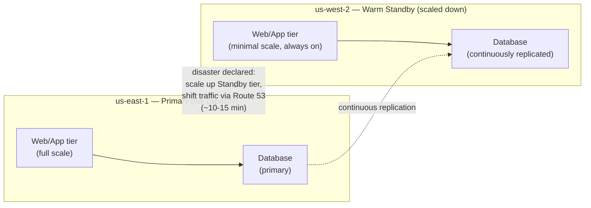

Step by step: (1) in steady state, `us-east-1` serves 100% of traffic at full capacity while
`us-west-2` runs the same application stack at a fraction of the capacity, purely to stay warm
and ready; (2) the database replicates continuously to the standby Region so data is always
current; (3) on a declared disaster, Auto Scaling in `us-west-2` scales the already-running web
and app tiers up to full capacity (fast, because the stack is already deployed and running —
unlike pilot light, which must still launch its app/web tier from scratch) and Route 53 is
updated to send traffic there, achieving the 10–15 minute target.

**Why the others are wrong:**
- **A** has an RTO measured in hours (provisioning infrastructure from scratch after the disaster is declared, then restoring data) — far slower than the 10–15 minute requirement, even though it's the cheapest option.
- **B** (pilot light) only keeps the data tier warm; the app/web tier still has to be launched from infrastructure-as-code and scaled up from zero during the actual disaster, which typically takes longer than the already-running (just scaled-down) tiers of warm standby — pilot light generally targets tens of minutes, not the aggressive 10–15 minute bar here.
- **D** satisfies the RTO easily (near-zero, since both Regions are already full-capacity) but directly violates "meaningfully lower than running a full duplicate production environment 24/7," since that's a literal description of what multi-site active/active costs.

Reference: [`services/database/database-selection-guide.md`](../../../services/database/database-selection-guide.md) and [`domain-2-resilient-architectures/disaster-recovery-strategies.md`](../domain-2-resilient-architectures/disaster-recovery-strategies.md)

---

## Question 16

*(Domain 1 — Secure Architectures)*

A security team wants compromised EC2 instances automatically contained the moment GuardDuty
detects malicious activity (such as the instance communicating with a known command-and-control
IP) — specifically, the instance's security group should be automatically swapped to a
"quarantine" security group with no outbound access, without waiting for a human to act. What
should the Solutions Architect implement?

A) A GuardDuty finding that emails the security team, who then manually isolate the instance in the AWS console
B) An EventBridge rule matching the relevant GuardDuty finding type, triggering a Lambda function that replaces the instance's security group with a quarantine security group
C) A scheduled Lambda function that runs every hour and checks GuardDuty findings from the past hour, then isolates any matching instances
D) AWS Config rules that mark the instance as non-compliant when a GuardDuty finding exists for it

**Correct Answer: B**

**Why correct:** [GuardDuty](../../../services/security-identity-compliance/guardduty.md) publishes findings as events that [EventBridge](../../../services/application-integration/eventbridge.md) can match in near-real-time; a rule filtered to the specific finding type (e.g., `UnauthorizedAccess:EC2/MaliciousIPCaller.Custom`) can trigger a Lambda function immediately — within seconds of the finding — that calls `ec2:ModifySecurityGroups` to swap the instance onto a locked-down quarantine security group, with zero human involvement, exactly matching "automatically... without waiting for a human to act."

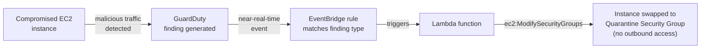

Step by step: (1) GuardDuty continuously analyzes VPC Flow Logs, DNS logs, and CloudTrail for
threat indicators and raises a finding the instant it sees this instance talking to a known-bad
IP; (2) that finding is published as an event, and an EventBridge rule scoped to this specific
finding type (so unrelated findings don't trigger containment) catches it within seconds;
(3) the triggered Lambda function detaches the instance's current security groups and attaches
the quarantine group — which allows no outbound traffic — stopping any further data
exfiltration or C2 communication immediately, long before a human could react.

**Why the others are wrong:**
- **A** is purely reactive and depends on human response time — minutes to hours typically — during which the compromised instance keeps talking to its C2 server; this directly fails "without waiting for a human to act."
- **C** introduces up to an hour of delay before even checking, let alone acting — far too slow for active containment of an ongoing compromise, and it's needlessly complex compared to an event-driven trigger that reacts the moment the finding is created.
- **D** only marks the resource non-compliant in Config's inventory — it's a compliance/reporting signal, not a remediation action, and does nothing to actually change the instance's security group or stop its network access.

Reference: [`services/security-identity-compliance/guardduty.md`](../../../services/security-identity-compliance/guardduty.md)

---

## Question 17

*(Domain 4 — Cost-Optimized Architectures)*

A company runs a steady baseline of EC2 instances (various families, resized occasionally as
workloads evolve), plus a growing amount of Lambda and Fargate usage, all with predictable
24/7 usage going forward. Finance wants a cost commitment that reduces compute spend
significantly without locking the company into a specific EC2 instance family, size, or Region
for the next year. What should the Solutions Architect recommend?

A) Standard Reserved Instances for the exact instance types currently in use, purchased for a 1-year term
B) A Compute Savings Plan, committing to a consistent hourly dollar amount of usage across EC2, Lambda, and Fargate regardless of instance family, size, Region, or OS
C) On-Demand pricing for everything, revisited quarterly for optimization opportunities
D) Convertible Reserved Instances scoped to a single Availability Zone for guaranteed capacity

**Correct Answer: B**

**Why correct:** [Compute Savings Plans](../../../services/management-governance/cost-management-tools.md) are the most flexible discount commitment available — you commit to a steady hourly *dollar* amount (not a specific instance type), and that commitment automatically applies across EC2 (any family, size, OS, Region, tenancy), Fargate, and Lambda usage, discounted similarly to Convertible RIs (up to ~66%) without ever needing to specify or lock in which instance types you'll run — exactly matching "reduces spend significantly" plus "without locking into a specific family, size, or Region," and it covers Lambda/Fargate which Reserved Instances don't cover at all.

**Why the others are wrong:**
- **A** locks the discount to the *exact* instance family/size purchased — if the team resizes or changes instance families later (stated as a likelihood here), the RI no longer matches and its discount is wasted; Standard RIs also don't cover Lambda or Fargate usage at all.
- **C** leaves all of this spend at full on-demand price with no commitment-based discount at all, directly failing "reduce compute spend significantly."
- **D** is more flexible than Standard RIs (convertible RIs can change instance attributes) but is still an EC2-only mechanism that doesn't cover Lambda or Fargate, and scoping it to a single AZ is about capacity reservation, not the broad flexible discount the company is asking for.

Reference: [`services/management-governance/cost-management-tools.md`](../../../services/management-governance/cost-management-tools.md)

---

## Question 18

*(Domain 4 — Cost-Optimized Architectures)*

A visual-effects studio runs nightly batch rendering jobs on EC2. Each job is broken into
thousands of independent frame-render tasks, checkpointed so any individual task can be
restarted elsewhere if interrupted, and the studio has a flexible overnight window rather than
a hard deadline. What EC2 purchasing option minimizes cost for this workload?

A) On-Demand Instances, to guarantee no task is ever interrupted
B) Spot Instances, since the workload tolerates interruption and isn't time-critical
C) Standard Reserved Instances purchased for a 3-year term
D) Dedicated Hosts, to guarantee physical server isolation for each render task

**Correct Answer: B**

**Why correct:** [Spot Instances](../../../services/compute/ec2.md) offer the deepest EC2 discount (often 60–90% off On-Demand) in exchange for the possibility of a two-minute-warning interruption when AWS needs the capacity back — a perfect trade for workloads that are explicitly fault-tolerant, checkpointed, and not time-critical, exactly as described (independent restartable tasks, flexible overnight window). This is the textbook Spot use case called out repeatedly in AWS's own guidance: batch processing, rendering, and similar interruption-tolerant jobs.

**Why the others are wrong:**
- **A** pays full price specifically to avoid interruption risk the workload doesn't actually need protection from — the scenario explicitly states tasks can restart elsewhere, so paying the On-Demand premium for a guarantee that isn't needed wastes money.
- **C** is a poor fit for a nightly *batch* workload that isn't running 24/7 — Reserved Instances discount continuous, steady-state usage; a workload that only runs overnight still pays for the RI's full-time commitment whether or not it's rendering during the day, making it far more expensive than Spot for this usage pattern.
- **D** solves a compliance/licensing isolation problem (dedicated physical hardware), which has nothing to do with this scenario's cost-minimization goal for a fault-tolerant, bursty batch job, and Dedicated Hosts are typically more expensive than On-Demand, let alone Spot.

Reference: [`services/compute/ec2.md`](../../../services/compute/ec2.md)

---

## Question 19

*(Domain 3 — High-Performing Architectures)*

A news publisher's website serves images, CSS, and JavaScript to a global readership, with the
origin S3 bucket in `us-east-1`. Readers in Asia and Europe report the site feels slow compared
to US readers. The content changes only when a new article is published. What should the
Solutions Architect add to improve perceived load time for all readers worldwide?

A) Enable S3 Transfer Acceleration on the origin bucket
B) Deploy Amazon CloudFront in front of the S3 bucket, caching objects at edge locations close to each reader
C) Create additional copies of the S3 bucket in every Region readers are located in, and route readers to their nearest bucket with Route 53 latency-based routing
D) Increase the S3 bucket's provisioned request-rate capacity

**Correct Answer: B**

**Why correct:** [CloudFront](../../../services/networking-content-delivery/cloudfront.md) caches content at edge locations physically close to end users worldwide — after the first request from a given region warms the cache, every subsequent reader in Asia or Europe gets the asset served from a nearby edge location at local-network latency instead of crossing an ocean to `us-east-1` for every request, which is exactly the right tool for mostly-static content ("changes only when a new article is published") read far more often than it's written.

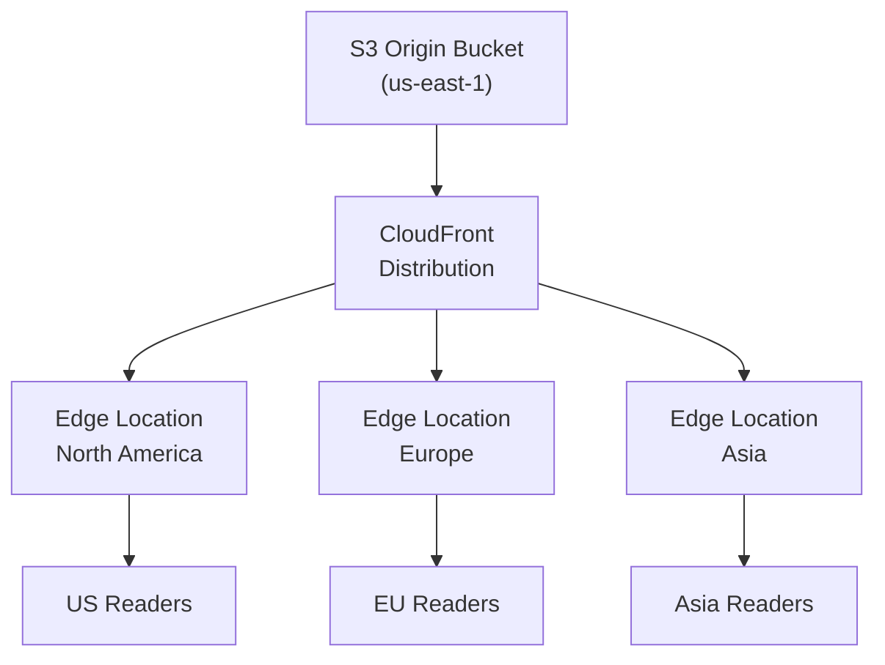

Step by step: (1) CloudFront sits in front of the S3 origin as a single distribution;
(2) the first reader from a given edge location triggers a cache miss, which CloudFront fetches
once from the `us-east-1` origin and then caches; (3) every subsequent reader served by that
same edge location — whether in Tokyo, Singapore, or Frankfurt — gets the cached object
directly from the nearby edge with no round trip to `us-east-1` at all, cutting latency
dramatically for non-US readers without duplicating any origin infrastructure.

**Why the others are wrong:**
- **A** speeds up *uploads into* S3 over long distances using CloudFront's edge network under the hood for the upload path — it accelerates writes to the origin, not reads/downloads by website visitors, so it doesn't address slow page loads for readers at all.
- **C** technically could work but is far more operationally complex and expensive than necessary: it means manually replicating the bucket, keeping copies in sync on every publish, and managing Route 53 routing — all to solve a problem CloudFront already solves natively, automatically, and more cheaply for cacheable static content.
- **D** addresses a request-rate/throughput ceiling, not latency — Asia/Europe readers are slow because of physical distance to `us-east-1`, not because the bucket is being rate-limited; raising request capacity does nothing about the speed of light.

Reference: [`services/networking-content-delivery/cloudfront.md`](../../../services/networking-content-delivery/cloudfront.md)

---

## Question 20

*(Domain 1 — Secure Architectures)*

A healthcare data platform ingests millions of files per day from hospital partners into a
multi-petabyte S3 data lake, and must automatically discover and tag any file containing PII or
PHI (patient health information) for downstream access-control enforcement, without engineers
manually reviewing files. What should the Solutions Architect implement?

A) A nightly EC2 batch job that regex-searches every new file for patterns resembling Social Security numbers
B) Amazon Macie, configured with scheduled or continuous jobs scanning the S3 buckets, using its managed data identifiers to detect PII/PHI and generate findings, integrated with tagging automation
C) S3 Object Lambda, configured to redact content on every GetObject request
D) AWS Config rules checking S3 bucket encryption settings

**Correct Answer: B**

**Why correct:** [Macie](../../../services/security-identity-compliance/macie.md) is purpose-built for exactly this: it uses machine learning and pattern matching (managed data identifiers, and custom identifiers where needed) to scan S3 content at scale for sensitive data types including PII and healthcare-specific identifiers, surfacing findings that can drive automated tagging/remediation workflows (e.g., via EventBridge + Lambda) — all without requiring engineers to hand-review files, which is the only option here that actually performs content-aware sensitive-data discovery at data-lake scale.

**Why the others are wrong:**
- **A** is a much weaker, custom-built, narrow pattern-matcher (catches only what its regexes are written for, e.g., SSNs) that the team would have to build and maintain themselves, won't scale cost-effectively to multi-petabyte daily ingestion the way a managed service does, and won't catch the broader range of PII/PHI types Macie's built-in identifiers already cover.
- **C** redacts content *on read*, which is a data-masking/access-shaping technique, not a discovery mechanism — it doesn't tell you *which* files contain sensitive data or *tag* them, and you'd still need some way to know what to redact.
- **D** only checks whether encryption settings are configured correctly on buckets — a security-posture check, completely unrelated to inspecting file *content* for PII/PHI.

Reference: [`services/security-identity-compliance/macie.md`](../../../services/security-identity-compliance/macie.md)

---

## Question 21

*(Domain 3 — High-Performing Architectures)*

A mobile game's leaderboard service reads the top-100 scores from DynamoDB on nearly every
screen load, generating massive, repetitive read traffic against a small, frequently-changing
set of items. Read latency must be in the microseconds, not single-digit milliseconds. What
should the Solutions Architect add?

A) Increase the DynamoDB table's provisioned read capacity units substantially
B) Add Amazon DynamoDB Accelerator (DAX) as an in-memory caching layer in front of the table
C) Switch the table to on-demand capacity mode
D) Add a DynamoDB Global Secondary Index on the score attribute

**Correct Answer: B**

**Why correct:** [DAX](../../../services/database/dynamodb.md) is a DynamoDB-specific, API-compatible in-memory cache that sits between the application and DynamoDB, serving cached reads in **microseconds** instead of DynamoDB's native single-digit-millisecond latency — precisely the latency tier this requirement calls for, and it requires minimal code changes since it implements the same DynamoDB API client interface.

**Why the others are wrong:**
- **A** throws more provisioned throughput at the table, which can reduce throttling but does not change DynamoDB's underlying latency floor (single-digit milliseconds) — it cannot get you to microsecond reads, no matter how much capacity is provisioned.
- **C** changes the billing/capacity model (pay-per-request vs. provisioned) but has no effect on per-request latency at all — it solves unpredictable-traffic cost/capacity management, not a latency requirement.
- **D** helps you query by a different attribute efficiently (e.g., querying by score instead of only by primary key) but doesn't change the fundamental read latency for the hot, repeated "top 100" query — it's an indexing/query-shape fix, not a caching/latency fix.

Reference: [`services/database/dynamodb.md`](../../../services/database/dynamodb.md)

---

## Question 22

*(Domain 2 — Resilient Architectures)*

A manufacturing company runs a legacy on-prem-style ERP system (lifted into EC2) that's
important but not mission-critical. Leadership wants a DR plan for a secondary Region with a
tolerable RTO of a few hours and a modest ongoing DR budget — they explicitly do not want to
pay for continuously-running application servers in the DR Region. What DR strategy fits best?

A) Multi-site active/active across both Regions
B) Warm standby with the full application tier running at reduced capacity in the DR Region
C) Pilot light: keep only the database continuously replicated/running in the DR Region, with the application/web tier defined as infrastructure-as-code (e.g., CloudFormation) that is launched only when a disaster is declared
D) Do nothing extra beyond standard EBS snapshots, and rebuild everything manually from documentation if needed

**Correct Answer: C**

**Why correct:** [Pilot light](../../../certifications/saa-c03/domain-2-resilient-architectures/disaster-recovery-strategies.md) keeps only the critical "always-on core" — here, the database, continuously replicating — running in the DR Region, while the rest of the stack (app/web tier) is pre-defined as infrastructure-as-code but not running, incurring no compute cost, until a disaster is declared. That directly matches "modest DR budget," "explicitly don't want continuously-running application servers," and an RTO of a few hours (enough time to launch the IaC-defined app/web tier and point it at the already-current database) rather than minutes.

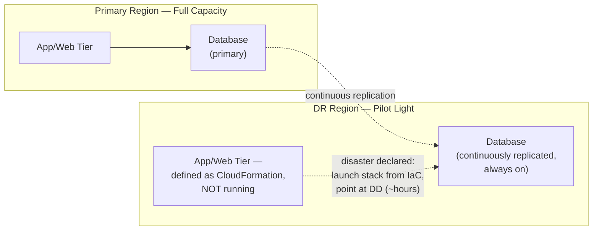

Step by step: (1) only the database is kept continuously running and replicating in the DR
Region — the "pilot light" that's always lit; (2) the app/web tier exists only as
CloudFormation/IaC templates, incurring no compute cost while idle; (3) when a disaster is
declared, those templates are launched for the first time in the DR Region and pointed at the
already-current database, which takes longer than warm standby's "just scale up" step (since
compute has to be created from scratch) but still lands well within a multi-hour RTO.

**Why the others are wrong:**
- **A** runs full production capacity in both Regions continuously, which is the most expensive DR strategy and the opposite of "modest ongoing DR budget" and "don't want continuously-running application servers."
- **B** keeps the *application tier itself* running continuously (even if scaled down), which directly violates the stated requirement not to pay for continuously-running application servers in the DR Region — that's specifically what distinguishes it from pilot light.
- **D** has no tested, repeatable recovery process at all — "rebuild everything manually from documentation" during an actual incident is slow, error-prone, and likely to blow well past a "few hours" RTO, and isn't really a defined DR strategy at all.

Reference: [`domain-2-resilient-architectures/disaster-recovery-strategies.md`](../domain-2-resilient-architectures/disaster-recovery-strategies.md)

---

## Question 23

*(Domain 1 — Secure Architectures)*

A SaaS company's login API, behind an Application Load Balancer, is being hit by a
credential-stuffing attack: a botnet is attempting thousands of logins per minute from a wide
range of IP addresses, each individual IP making a moderate number of requests. The security
team wants to automatically block any single IP that exceeds a defined request threshold within
a 5-minute window, without blocking normal users. What should the Solutions Architect configure?

A) A Network ACL rule blocking all inbound traffic on the ALB's port
B) AWS WAF with a rate-based rule attached to the ALB, blocking source IPs that exceed a configured request-count threshold within the rolling time window
C) Security group rules limiting the ALB to a fixed allow-list of IP ranges
D) Amazon GuardDuty, configured to automatically terminate the ALB during the attack

**Correct Answer: B**

**Why correct:** [AWS WAF's rate-based rules](../../../services/security-identity-compliance/waf.md) are specifically designed for this: they count requests per originating IP over a rolling window (commonly 5 minutes) and automatically block (or challenge/CAPTCHA) any IP that exceeds the configured threshold, while leaving IPs under the threshold — i.e., normal users — completely unaffected, which is exactly "automatically block IPs over a threshold... without blocking normal users."

**Why the others are wrong:**
- **A** blocking all inbound traffic takes the login API down for everyone, including legitimate users — the opposite of "without blocking normal users," and NACLs don't have rate-based or per-IP-threshold logic anyway (they're simple stateless allow/deny by CIDR).
- **C** requires knowing the complete legitimate user base's IP ranges in advance, which is impossible for a public login API serving unpredictable end users worldwide — this would block real customers, not just attackers.
- **D** GuardDuty is a detection service, not a mitigation/blocking service, and terminating the load balancer itself would take down the login service for every legitimate user too — a drastically disproportionate and incorrect response.

Reference: [`services/security-identity-compliance/waf.md`](../../../services/security-identity-compliance/waf.md)

---

## Question 24

*(Domain 3 — High-Performing Architectures)*

A SaaS analytics company's customers run heavy, long-running reporting queries against the
same RDS PostgreSQL database that the live application uses for transactional writes, and
these reports are now slowing down the live application for all users. What should the
Solutions Architect do to isolate the reporting workload's performance impact?

A) Increase the primary RDS instance's storage IOPS allocation
B) Create one or more RDS read replicas and point all reporting queries at a read replica instead of the primary instance
C) Move all reporting queries to run during a nightly maintenance window on the same primary instance
D) Enable RDS Multi-AZ so reporting queries can run against the standby instance

**Correct Answer: B**

**Why correct:** [RDS read replicas](../../../services/database/rds.md) are asynchronous copies specifically intended to **offload read-only query workloads** from the primary instance — pointing heavy, long-running reporting queries at one or more replicas means they consume the replica's compute/IO budget, not the primary's, so transactional writes and the live application's reads on the primary are no longer competing with reporting queries for the same resources.

**Why the others are wrong:**
- **A** adds more storage throughput capacity but doesn't separate the two workloads at all — the reporting queries and the live application are still contending for the same instance's CPU, memory, and connection slots; it may help marginally but doesn't isolate the impact.
- **C** doesn't scale to a SaaS company with (implied) many customers running reports whenever they want — "run only at night" removes the on-demand reporting capability customers presumably expect, and even during the maintenance window it's still the same primary instance being loaded.
- **D** is a common and important misconception: the standard Multi-AZ standby is **not a readable replica** — it exists purely for failover and cannot serve read queries at all (that's specifically what read replicas are for, which is a separate feature from Multi-AZ).

Reference: [`services/database/rds.md`](../../../services/database/rds.md)

---

## Question 25

*(Domain 2 — Resilient Architectures)*

A company runs its customer portal in `us-east-1` as primary, with a fully provisioned
duplicate environment sitting idle in `us-east-2` as a standby. They want traffic to
automatically shift to `us-east-2` if `us-east-1` becomes unreachable, and automatically shift
back once `us-east-1` recovers, with no DNS changes made by hand. What should the Solutions
Architect configure?

A) Route 53 simple routing with a single record pointing at `us-east-1`, updated manually during an incident
B) Route 53 failover routing policy with health checks on the `us-east-1` endpoint, and a secondary record pointing at the `us-east-2` endpoint
C) Route 53 weighted routing split 50/50 between both Regions at all times
D) An Application Load Balancer that spans both Regions directly

**Correct Answer: B**

**Why correct:** [Route 53 failover routing](../../../services/networking-content-delivery/route53.md) is purpose-built for active-passive DR: a health check continuously probes the primary (`us-east-1`) endpoint, and as long as it's healthy, Route 53 answers DNS queries with the primary record; the instant the health check fails, Route 53 automatically starts answering with the secondary (`us-east-2`) record instead — and automatically reverts once the primary's health check passes again — with zero manual DNS changes at any point.

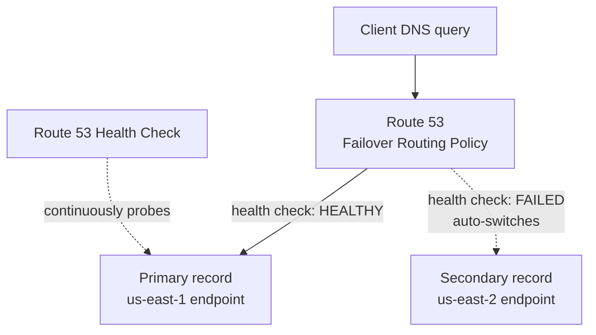

Step by step: (1) a Route 53 health check continuously probes the `us-east-1` endpoint;
(2) while it reports healthy, every DNS query for the portal resolves to the `us-east-1`
record; (3) the moment the health check fails, Route 53 starts answering with the `us-east-2`
secondary record instead — and switches back automatically once `us-east-1` is healthy again —
with no engineer touching a DNS console at any point in the process.

**Why the others are wrong:**
- **A** requires a human to notice the outage and manually repoint DNS, which is both slow (adds detection + human response time on top of DNS TTL propagation) and explicitly against "no DNS changes made by hand."
- **C** sends roughly half of all traffic to `us-east-2` at all times even when `us-east-1` is perfectly healthy, which isn't an active-*passive* failover pattern at all (it's closer to active-active) and doesn't match "automatically shift to standby only when primary is unreachable."
- **D** is not how Application Load Balancers work — an ALB is a Regional resource and cannot itself span two separate AWS Regions; cross-Region traffic routing is a job for Route 53 (or Global Accelerator), not a single ALB.

Reference: [`services/networking-content-delivery/route53.md`](../../../services/networking-content-delivery/route53.md)

---

## Question 26

*(Domain 2 — Resilient Architectures)*

An online food-delivery platform's order flow involves several steps in sequence: charge
payment, reserve inventory, notify the restaurant, and dispatch a driver. Any step can fail
transiently (e.g., the payment gateway times out occasionally) and should be retried
automatically with backoff; if a step fails permanently, the whole order should be marked
failed and compensating actions (like a refund) triggered. What should the Solutions Architect
use to orchestrate this?

A) A single large Lambda function that calls each step's logic in sequence inside a try/catch block
B) AWS Step Functions, with each step as a state in a state machine, using built-in `Retry` fields for transient errors and `Catch` fields to route permanent failures to a compensation workflow
C) Chained SQS queues, one per step, with no retry or error-handling configuration
D) EventBridge Scheduler, firing each step's Lambda function on a fixed schedule regardless of whether the prior step succeeded

**Correct Answer: B**

**Why correct:** [Step Functions](../../../services/application-integration/step-functions.md) is designed exactly for this kind of multi-step orchestration with explicit error-handling semantics: each state's `Retry` field declares which errors to retry and with what backoff, and `Catch` fields route unrecoverable failures to a different branch of the state machine (e.g., a refund/compensation state) — giving visual, auditable, built-in retry-and-compensate logic rather than hand-rolled code, and Step Functions also tracks the full execution history for every order, which is valuable for debugging and compliance.

**Why the others are wrong:**
- **A** requires hand-writing all retry/backoff/compensation logic inside application code, which is harder to get right, harder to audit (no built-in execution history), and a single large function mixing all four steps' logic is a maintenance and testing burden compared to Step Functions' declarative state definitions.
- **C** chaining bare SQS queues with no retry/DLQ/error-handling configuration provides no backoff logic and no mechanism to trigger a compensating action on permanent failure — it would need the same orchestration logic built on top of it anyway.
- **D** running each step on a fixed schedule regardless of prior success breaks the fundamental requirement that steps happen *in sequence, dependent on* each other's outcome — payment, inventory, notification, and dispatch aren't independent scheduled jobs; they're a dependent chain.

Reference: [`services/application-integration/step-functions.md`](../../../services/application-integration/step-functions.md)

---

## Question 27

*(Domain 3 — High-Performing Architectures)*

A construction company has field offices on five continents, each generating large daily
drone-survey image sets (tens of GB per office) that must be uploaded into a single centralized
S3 bucket in `ap-southeast-2` for processing. Offices far from that Region report painfully
slow upload speeds. What should the Solutions Architect enable to speed up these uploads
without changing the destination bucket or Region?

A) S3 Transfer Acceleration on the destination bucket, so uploads enter through the nearest CloudFront edge location and travel to the bucket over AWS's backbone network
B) CloudFront configured as a read-through cache in front of the bucket
C) Cross-Region Replication from a bucket local to each office, into the `ap-southeast-2` bucket
D) Multipart upload with a part size of 5 MB, with no other changes

**Correct Answer: A**

**Why correct:** [S3 Transfer Acceleration](../../../services/networking-content-delivery/cloudfront.md) uses CloudFront's globally distributed edge network purely as an *upload accelerator*: a client uploads to the geographically nearest edge location (far closer than `ap-southeast-2` for most field offices), and from there the data travels to the destination bucket over AWS's optimized internal backbone rather than the public internet's often-congested long-haul routes — directly solving "far from that Region, slow uploads" without changing the bucket's Region or requiring any new destination infrastructure.

**Why the others are wrong:**
- **B** CloudFront as a read-through cache accelerates *downloads/reads* of objects that are fetched repeatedly — it has nothing to do with speeding up *uploads* of new drone imagery into the bucket.
- **C** would require a separate bucket (and ongoing replication infrastructure) in or near each of five continents, which is far more complex and costly than enabling one feature on the existing bucket, and CRR is designed for ongoing object-replication between buckets, not as an upload-acceleration mechanism for a single centralized destination.
- **D** multipart upload helps parallelize and resume large-file uploads over a given connection, which helps somewhat, but doesn't address the root cause here — physical distance/network-path latency to `ap-southeast-2` — the way Transfer Acceleration's edge-network routing does.

Reference: [`services/networking-content-delivery/cloudfront.md`](../../../services/networking-content-delivery/cloudfront.md)

---

## Question 28

*(Domain 3 — High-Performing Architectures)*

A multiplayer game studio runs UDP-based game servers on EC2 in two Regions. Players worldwide
report inconsistent latency and occasional disconnects when a Region has networking issues,
since the game currently connects directly to a fixed Regional endpoint. The studio wants
consistently low latency and automatic routing around network problems, without re-architecting
the game servers themselves (which must keep using UDP). What should the Solutions Architect
add?

A) Amazon CloudFront, since it's AWS's primary tool for reducing latency globally
B) AWS Global Accelerator, providing static anycast IP addresses that route player traffic over AWS's global network backbone to the optimal healthy Regional endpoint
C) Application Load Balancer with cross-Region target groups
D) Route 53 geolocation routing pointing each continent at its nearest Region, with no health-check-based failover

**Correct Answer: B**

**Why correct:** [Global Accelerator](../../../services/networking-content-delivery/global-accelerator.md) works at the network layer (TCP **and UDP**) rather than the HTTP layer, giving players static anycast IPs that automatically route their traffic onto AWS's global backbone network to whichever healthy Regional endpoint currently performs best — continuously health-checking both Regions and shifting traffic within seconds if one degrades, all transparent to the game server code (no re-architecture, and crucially it supports UDP, which CloudFront and ALB generally do not for arbitrary game traffic).

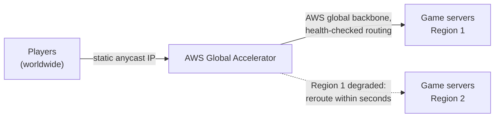

Step by step: (1) players connect to two static anycast IP addresses advertised from every AWS
edge location, entering AWS's network as close to them as possible; (2) Global Accelerator
continuously health-checks both Regions' game server endpoints and routes each player's
UDP/TCP traffic over AWS's low-latency backbone to whichever Region is currently healthiest and
closest; (3) if Region 1 degrades, Global Accelerator reroutes affected players to Region 2
within seconds, with no DNS change or client reconnect logic needed.

**Why the others are wrong:**
- **A** CloudFront is an HTTP/HTTPS content-delivery and caching service — it is not designed for arbitrary UDP game traffic and doesn't fit "must keep using UDP" at all.
- **C** Application Load Balancers only operate at Layer 7 (HTTP/HTTPS) and are Regional resources — they cannot load-balance UDP traffic and cannot natively span two Regions as a single target-group construct.
- **D** geolocation routing without health checks sends players to their nearest Region unconditionally, even when that Region is the one having networking issues — it explicitly lacks the "automatic routing around network problems" requirement, since there's no failover logic at all.

Reference: [`services/networking-content-delivery/global-accelerator.md`](../../../services/networking-content-delivery/global-accelerator.md)

---

## Question 29

*(Domain 4 — Cost-Optimized Architectures)*

A diagnostic imaging center generates several TB of MRI and CT scan images monthly, stored in
S3. Radiologists actively re-review a patient's scans within the first 45 days after a visit
(for follow-ups and second opinions), access drops to occasional between day 45 and day 2
years (rare follow-up years later), and medical records regulations require the raw images be
retained for 10 years overall, essentially never accessed after year 2 except for a rare
malpractice-related legal discovery request. What should the Solutions Architect configure to
minimize storage cost while meeting the retention requirement?

A) Keep all scan images in S3 Standard for the full 10 years, to guarantee radiologists always have instant access
B) An S3 Lifecycle policy: transition objects to S3 Standard-IA at 45 days, then to S3 Glacier Deep Archive at 2 years, with expiration after 10 years
C) Delete scan images older than 45 days to save cost, keeping only a radiologist-written text summary for anything older
D) Store all scan images in S3 One Zone-IA from day one, for lower cost than Standard

**Correct Answer: B**

**Why correct:** An [S3 Lifecycle policy](../../../services/storage/s3-storage-classes.md) can automatically transition objects through storage classes matching each phase of this access pattern: Standard for the first 45 days (frequent re-review, needs millisecond retrieval), Standard-IA from day 45 through year 2 (occasional follow-up access, still millisecond retrieval if needed, cheaper per-GB storage), and Glacier Deep Archive from year 2 onward (cheapest storage tier available, acceptable because the images are "essentially never accessed" at that point, with retrieval still possible, just slower, for the rare legal discovery request), expiring automatically at the 10-year regulatory retention mark — this sequence minimizes storage cost at every phase while still meeting the retention requirement throughout.

**Why the others are wrong:**
- **A** pays S3 Standard's (relatively highest "hot" tier) per-GB rate for the entire 10-year retention period on images that are barely ever accessed after year 2 — dramatically more expensive than necessary, and "guarantee instant access" isn't actually a stated requirement for scans this old.
- **C** violates the explicit 10-year regulatory retention requirement for the raw images outright — a text summary is not the same as the original diagnostic image a legal discovery request would need, so this isn't a cost optimization, it's a compliance failure.
- **D** One Zone-IA stores data in only a single Availability Zone (no multi-AZ redundancy), an inappropriate durability trade-off for irreplaceable original medical images that must be retained for 10 years — losing an AZ could mean permanently losing a scan needed for patient care or legal discovery, and it also doesn't match the "frequently accessed in the first 45 days" phase where Standard's full redundancy and performance are more appropriate anyway.

Reference: [`services/storage/s3-storage-classes.md`](../../../services/storage/s3-storage-classes.md)

---

## Question 30

*(Domain 3 — High-Performing Architectures)*

A data-science team runs a nightly batch job that performs heavy numerical computation
(statistical modeling) on EC2, currently using general-purpose `m6i` instances. The workload is
entirely CPU-bound, stateless per run, and tolerant of being restarted. The team wants the best
price-performance for this specific CPU-bound profile. What should the Solutions Architect
recommend evaluating first?

A) Migrating to `c7g` (Graviton3, compute-optimized, Arm-based) instances, after validating the workload's software stack supports Arm
B) Moving to the largest available memory-optimized instance family, regardless of CPU profile
C) Switching to Dedicated Hosts for this workload
D) Keeping `m6i` general-purpose instances, since changing instance family is rarely worth the effort

**Correct Answer: A**

**Why correct:** [Graviton](../../../services/compute/ec2.md) (Arm-based) compute-optimized instances like `c7g` are specifically built for CPU-bound workloads and AWS reports meaningfully better price-performance (commonly cited around 20–40% better) versus comparable x86 instances for compatible workloads — directly matching "entirely CPU-bound" and "best price-performance." The caveat correctly included in this option — validating Arm compatibility first — reflects the real migration consideration (the software stack and any dependencies must support the Arm architecture, which is why "evaluate/validate first" rather than "switch blindly" is the right framing).

**Why the others are wrong:**
- **B** moves to a memory-optimized family for a workload explicitly described as CPU-bound, not memory-bound — that mismatches the instance family to the actual resource bottleneck and would waste money paying for memory capacity the workload doesn't need.
- **C** Dedicated Hosts address licensing/compliance/physical-isolation requirements, not price-performance for a batch compute job — they're typically a more expensive option, not a cost-performance optimization.
- **D** "rarely worth the effort" is a generic, non-evidence-based assumption; instance family/generation choice is one of the most common and highest-leverage performance/cost levers available, and the exam rewards actively evaluating options like Graviton for a CPU-bound workload, not defaulting to inertia.

Reference: [`services/compute/ec2.md`](../../../services/compute/ec2.md)

---

## Question 31

*(Domain 3 — High-Performing Architectures)*

A ride-hailing app's demand swings dramatically by time of day — near idle at 4am, a huge
morning-commute spike, moderate midday, and a huge evening spike. The web tier runs on EC2
behind an ALB. The Solutions Architect wants capacity to automatically track actual CPU
utilization throughout the day, scaling out during spikes and back in during lulls, without
manually defining time-based schedules. What should be configured?

A) A fixed number of EC2 instances sized for the evening peak, running at that size all day
B) An Auto Scaling group with a target tracking scaling policy set to a target average CPU utilization (e.g., 50%)
C) Manually scheduled scaling actions for each known peak and trough time of day
D) A single, larger EC2 instance that is vertically resized by a cron job at set times

**Correct Answer: B**

**Why correct:** [Target tracking scaling policies](../../../services/compute/ec2-auto-scaling.md) continuously monitor a chosen metric (here, average CPU utilization) and automatically adjust the Auto Scaling group's desired capacity to keep that metric at the configured target — scaling out as real demand (and therefore CPU load) rises and scaling back in as it falls, with no need to predict or hand-schedule specific times, which directly matches "automatically track actual... utilization... without manually defining time-based schedules."

**Why the others are wrong:**
- **A** sized for the evening peak runs that same (expensive) capacity at 4am when demand is near idle — massively over-provisioned and wasteful for most of the day, and it doesn't scale at all in response to changing load.
- **C** scheduled scaling requires predicting and hand-defining each peak/trough time in advance — it does track real-time utilization and explicitly contradicts "without manually defining time-based schedules"; it's also brittle if actual demand patterns shift from what was scheduled.
- **D** vertically resizing a single instance requires a stop/resize/start cycle (brief downtime) and still depends on a fixed cron schedule rather than reacting to real utilization, and a single instance has no redundancy if it fails.

Reference: [`services/compute/ec2-auto-scaling.md`](../../../services/compute/ec2-auto-scaling.md)

---

## Question 32

*(Domain 4 — Cost-Optimized Architectures)*

A photo-sharing app stores user-uploaded images in S3. Some images go viral and are accessed
millions of times within days, while most are viewed heavily for the first week and then almost
never again — and there's no reliable way to predict in advance which photos will go viral.
What S3 storage approach minimizes cost without manual lifecycle management or risking slow
retrieval on a photo that unexpectedly goes viral months later?

A) S3 Standard for all images permanently, to guarantee fast access to any photo at any time
B) S3 Intelligent-Tiering, which automatically moves objects between frequent-access and infrequent-access tiers based on actual observed access patterns, with no retrieval delay
C) A manually scripted Lambda function that moves objects to S3 Standard-IA after exactly 7 days, with no further changes
D) S3 Glacier Flexible Retrieval for all images from day one

**Correct Answer: B**

**Why correct:** [S3 Intelligent-Tiering](../../../services/storage/s3-storage-classes.md) is specifically designed for unpredictable or unknown access patterns: it monitors each object's actual access and automatically moves it between the frequent-access and infrequent-access tiers (and optionally archive tiers) without any manual lifecycle rule authoring, and critically, **moving between its frequent/infrequent tiers has no retrieval delay or fee** — so a photo that goes cold for months and then unexpectedly goes viral again is served instantly and automatically moved back to the frequent tier, exactly matching "no manual management" and "no risk of slow retrieval on an unpredictable future spike."

**Why the others are wrong:**
- **A** guarantees fast access but pays the highest per-GB storage rate for the (likely large majority of) photos that go cold after the first week — directly failing the cost-minimization goal.
- **C** a fixed 7-day-to-IA rule is a reasonable guess for the "typical" photo but can't adapt to the stated unpredictability (some photos stay hot far longer, others go cold sooner), and once moved to IA it doesn't automatically respond to a later unpredictable access spike the way Intelligent-Tiering does — plus it's custom code to build and maintain rather than a managed feature.
- **D** Glacier Flexible Retrieval has retrieval delays (minutes to hours depending on tier) and per-request retrieval fees — putting a user-facing photo-sharing app's images there from day one would make normal viewing slow and would be a poor fit for an app where photos are viewed immediately after upload.

Reference: [`services/storage/s3-storage-classes.md`](../../../services/storage/s3-storage-classes.md)

---

## Question 33

*(Domain 3 — High-Performing Architectures)*

A ticket-booking flash-sale event causes a Lambda-based checkout function's invocation volume
to jump from near-zero to thousands of requests per second within seconds, several times a
year on announced sale dates. The team wants Lambda to absorb these predictable but extreme
bursts without cold-start-related latency spikes hurting the checkout experience, specifically
during these announced windows. What should the Solutions Architect configure?

A) Nothing — Lambda's default burst concurrency scaling will absorb any traffic spike automatically with no cold starts
B) Provisioned Concurrency on the checkout function, scheduled to scale up shortly before each announced sale and back down afterward
C) Convert the checkout function to run on an EC2 instance sized for the flash-sale peak, running 24/7
D) Reserved Concurrency set to a very low number, to protect other functions from being starved

**Correct Answer: B**

**Why correct:** [Provisioned Concurrency](../../../services/compute/lambda.md) pre-initializes a specified number of execution environments so invocations hit an already-warm environment instead of triggering a cold start — and because the exact sale dates are known in advance, scheduling Provisioned Concurrency to ramp up shortly before each announced sale (and scale back down afterward, via Application Auto Scaling on a schedule) avoids paying for pre-warmed capacity the rest of the year while still eliminating cold-start latency during the predictable burst windows that matter.

**Why the others are wrong:**
- **A** is a common misconception: Lambda's default (non-provisioned) scaling does absorb bursts by launching new execution environments, but each *new* environment still incurs a cold start, and there are also initial burst concurrency limits per Region before more gradual scaling kicks in — so "no cold starts" is false, and that's exactly the latency problem described.
- **C** running a 24/7 EC2 instance sized for a few-times-a-year peak abandons Lambda's pay-per-use model and wastes money the rest of the year running peak-sized capacity for a workload that's otherwise idle — the opposite of matching cost to the actual usage pattern.
- **D** Reserved Concurrency *caps* the maximum concurrency a function can use (to protect account-level limits for other functions) — it doesn't pre-warm anything, and in fact setting it "very low" could make the cold-start/throttling problem during a flash sale *worse*, not better, by limiting how much the checkout function can scale at all.

Reference: [`services/compute/lambda.md`](../../../services/compute/lambda.md)

---

## Question 34

*(Domain 3 — High-Performing Architectures)*

A genomics research lab runs a tightly-coupled simulation across hundreds of EC2 instances
that must read and write a shared dataset concurrently with very high aggregate throughput and
low latency, far beyond what NFS-based EFS can deliver for this workload profile. What storage
should the Solutions Architect provision?

A) Amazon EFS Standard, mounted on every instance via NFS
B) Amazon FSx for Lustre, providing a high-performance parallel file system backed by S3, mounted across the compute fleet
C) Individual EBS volumes attached to each instance, with manual application-level file syncing between instances
D) Amazon S3 directly, with each instance using the S3 API to read/write shared files

**Correct Answer: B**

**Why correct:** [FSx for Lustre](../../../services/storage/fsx.md) is purpose-built for exactly this: a high-performance **parallel** file system designed for HPC/genomics/ML workloads needing hundreds of instances to read/write a shared dataset concurrently with sub-millisecond latency and throughput that scales with the file system size, and it integrates with S3 as a durable data repository so datasets can be linked in and results linked back out.

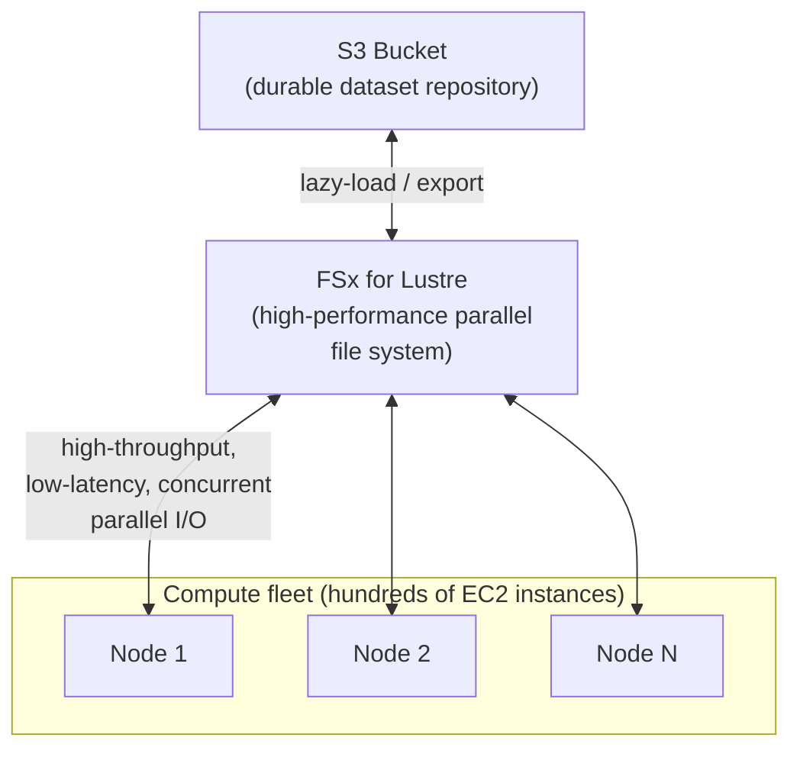

Step by step: (1) the research dataset lives durably in S3 and is linked to an FSx for Lustre
file system, which lazily loads objects on first access; (2) all simulation nodes mount the
same FSx for Lustre file system and read/write it in parallel, with Lustre's distributed
architecture striping data across many backing storage servers to deliver throughput that scales
with the file system's size — far beyond a single NFS server's ceiling; (3) results can be
exported back to S3 for durable, long-term storage once the simulation completes.

**Why the others are wrong:**
- **A** is explicitly ruled out by the scenario itself ("far beyond what NFS-based EFS can deliver") — EFS is a strong general-purpose shared file system, but it isn't designed for the extreme concurrent-throughput profile of tightly-coupled HPC workloads the way a parallel file system is.
- **C** gives up shared storage entirely — individual EBS volumes are attached to one instance at a time, so "manual application-level file syncing" would mean building a distributed file-syncing system from scratch, which is far more complex and error-prone than using a managed parallel file system.
- **D** using the raw S3 API for every read/write in a tightly-coupled simulation would be far slower (S3 request latency vs. a POSIX-like file system interface) and far more complex to code against than mounting a real file system — S3's strength is durable object storage, not a low-latency shared file system for live concurrent compute.

Reference: [`services/storage/fsx.md`](../../../services/storage/fsx.md)

---

## Question 35

*(Domain 4 — Cost-Optimized Architectures)*

A company's AWS bill has grown steadily, and a cost review reveals several EC2 instances
running well below 10% average CPU utilization for the past 60 days, alongside a few instances
that are frequently CPU-throttled above 90% utilization. Leadership wants data-driven
recommendations for resizing instances appropriately, rather than guesswork. What should the
Solutions Architect use?

A) Manually review CloudWatch CPU graphs for every instance in the fleet and guess at appropriate new sizes
B) AWS Compute Optimizer, which analyzes historical CloudWatch utilization metrics and recommends specific instance type/size changes for better cost and performance fit
C) Delete the underutilized instances entirely, since low CPU usage means they're unnecessary
D) Purchase additional Reserved Instances matching the current (unoptimized) instance sizes to lock in a discount

**Correct Answer: B**

**Why correct:** [AWS Compute Optimizer](../../../services/management-governance/cost-management-tools.md) is a managed service that analyzes historical CloudWatch metrics (CPU, memory where available, network, etc.) across EC2 instances, Auto Scaling groups, EBS volumes, and Lambda functions, and produces specific, data-driven recommendations — e.g., "downsize this instance from `m5.2xlarge` to `m5.large`" for the underutilized ones, and "upsize this one" for the throttled ones — which directly replaces "guesswork" with a managed analysis, exactly as requested.

**Why the others are wrong:**
- **A** is literally the "guesswork" the prompt explicitly wants to avoid, and manually reviewing CloudWatch graphs for an entire fleet doesn't scale and lacks Compute Optimizer's statistical rigor (it also considers more signals than just a quick visual CPU check).
- **C** assumes low CPU automatically means "unnecessary," but the instance might be memory-bound, I/O-bound, or simply correctly sized for a bursty/low-average workload that still needs to exist — deleting it outright without analysis risks an outage, and doesn't address the *throttled* instances at all.
- **D** locks in a discount on the *current, already-identified-as-wrong* instance sizes — it bakes the sizing mistake in for a 1- or 3-year term rather than fixing it first, which is backwards: right-size first, then consider a Savings Plan/RI commitment on the corrected sizes.

Reference: [`services/management-governance/cost-management-tools.md`](../../../services/management-governance/cost-management-tools.md)

---

## Question 36

*(Domain 1 — Secure Architectures)* **(Choose TWO)**

A flash-sale retail site is hit by a large-scale volumetric DDoS attack during a major
promotional event, overwhelming its Application Load Balancer. The business has AWS Business
Support and wants both infrastructure-layer DDoS protection with cost protection against
scaling charges caused by the attack, and application-layer (Layer 7) protection against
malicious request patterns. Which **two** AWS capabilities should the Solutions Architect
combine to satisfy both needs?

A) AWS Shield Advanced, providing enhanced DDoS detection/mitigation plus DDoS cost protection crediting scaling charges incurred during the attack
B) AWS WAF attached to the ALB, providing Layer 7 protection (blocking malicious request patterns, rate limiting, managed rule groups) that Shield does not itself provide
C) Security groups with strict inbound CIDR allow-lists
D) Amazon GuardDuty configured to automatically scale the ALB during detected attacks
E) AWS Shield Standard alone, since it already includes DDoS cost protection and Layer 7 filtering

**Correct Answer: A, B**

**Why correct:** [Shield Advanced (A)](../../../services/security-identity-compliance/shield.md) provides enhanced detection and mitigation for larger/more sophisticated DDoS attacks (beyond Shield Standard's always-on baseline), includes 24/7 access to the AWS DDoS Response Team (DRT), and crucially includes **DDoS cost protection** — crediting charges for scaling (e.g., ALB, CloudFront, Route 53) that resulted specifically from the attack, directly satisfying the infrastructure-layer-plus-cost-protection half of the requirement. [WAF (B)](../../../services/security-identity-compliance/waf.md) attached to the ALB adds the requested Layer 7 protection (blocking malicious request patterns, rate limiting, managed rule groups) that Shield, at any tier, does not itself provide, since Shield operates at the network/transport layer — together, these two services cover both stated needs; neither alone covers both.

**Why the others are wrong:**
- **C** static CIDR allow-lists can't distinguish a legitimate customer's IP from an attacker's IP during a public retail flash sale (anyone, anywhere, is a potential legitimate customer), and this does nothing for volumetric attack mitigation at AWS's scale.
- **D** GuardDuty is a detection and findings service — it has no built-in mechanism to "automatically scale the ALB during detected attacks," and that isn't a real GuardDuty capability or how DDoS mitigation at the infrastructure layer actually works.
- **E** Shield Standard is indeed free and automatic, but it only provides baseline protection against common, more automated network/transport-layer (L3/L4) attacks — it doesn't include the DRT engagement, advanced mitigations for larger attacks, the cost-protection guarantee, or any Layer 7 filtering at all; the claim that it includes these is simply false.

Reference: [`services/security-identity-compliance/shield.md`](../../../services/security-identity-compliance/shield.md)

---

## Question 37

*(Domain 4 — Cost-Optimized Architectures)*

A startup's engineering team has a shared Aurora PostgreSQL dev/test database that's actively
queried during work hours on weekdays but sits almost completely idle nights, weekends, and
holidays — a pattern that's hard to predict exactly but generally follows business hours. They
want to avoid paying for a fixed-capacity instance that's idle most of the time, without
engineers manually starting/stopping a database. What should the Solutions Architect configure?

A) A fixed-size Aurora Provisioned instance sized for peak weekday query load, running continuously
B) Aurora Serverless v2, which scales capacity (in fine-grained ACUs) up and down automatically based on actual load, including scaling down toward the configured minimum when idle
C) A Lambda function on an EventBridge schedule that stops the database every evening and starts it every morning
D) Migrate to DynamoDB on-demand, since it's the only AWS database with automatic scaling

**Correct Answer: B**

**Why correct:** [Aurora Serverless v2](../../../services/database/aurora.md) scales database capacity automatically and near-instantly in fine-grained increments (Aurora Capacity Units) in response to actual load — scaling up when engineers are actively querying during work hours and scaling down toward a configured minimum (which can be very low) during nights/weekends/holidays — with no engineer action required and no need to predict the exact idle schedule, since it reacts to real-time load rather than a fixed calendar.

**Why the others are wrong:**
- **A** pays for peak capacity 24/7, which is squarely the waste the team is trying to eliminate — most of that capacity sits unused nights, weekends, and holidays.
- **C** a fixed stop/start schedule requires manually predicting the exact idle windows (which the scenario says is "hard to predict exactly"), and a stopped Aurora instance isn't available at all if someone needs it outside the scheduled hours (e.g., working a weekend) — Serverless v2 handles irregular patterns gracefully since it's reactive, not calendar-based.
- **D** migrating an existing relational Postgres workload to DynamoDB is a drastic, unnecessary re-architecture just to get autoscaling — and it's also factually wrong that DynamoDB is "the only" AWS database with automatic scaling, since Aurora Serverless v2 (and Aurora's own storage auto-scaling) does this for a relational engine without a rewrite.

Reference: [`services/database/aurora.md`](../../../services/database/aurora.md)

---

## Question 38

*(Domain 4 — Cost-Optimized Architectures)*

A new IoT startup is launching a product that stores device telemetry in DynamoDB. Traffic
volume for the first six months is completely unknown — it depends on how many customers
adopt the product, and could range from near-zero to a sudden large spike if a partnership
announcement goes well. The team wants to avoid both over-provisioning (paying for unused
capacity) and under-provisioning (throttling real traffic) during this uncertain period. What
capacity mode should the Solutions Architect choose?

A) Provisioned capacity, sized generously above the highest realistic estimate, to avoid any risk of throttling
B) DynamoDB on-demand capacity mode, which bills per actual request and automatically accommodates unpredictable traffic changes without capacity planning
C) Provisioned capacity sized at the lowest realistic estimate, with Application Auto Scaling configured to react after utilization crosses a high threshold
D) Provisioned capacity with reserved capacity purchased for a 1-year term, to lock in the lowest per-request cost immediately

**Correct Answer: B**

**Why correct:** [DynamoDB on-demand capacity mode](../../../services/database/dynamodb.md) bills per actual read/write request with no capacity planning at all, and automatically scales to handle traffic that's completely unknown and could swing from near-zero to a sudden large spike — exactly the described situation — eliminating both failure modes at once: there's no idle provisioned capacity to overpay for, and no throttling risk from guessing wrong on a provisioned number, because there's no provisioned number to guess.

**Why the others are wrong:**
- **A** provisioning generously "above the highest realistic estimate" means paying for a large amount of capacity that sits unused during the likely near-zero early traffic — this is exactly the over-provisioning cost the team wants to avoid.
- **C** Application Auto Scaling with provisioned capacity reacts to a CloudWatch alarm crossing a threshold, which has a reaction lag (typically a few minutes) — for a "sudden large spike" (e.g., immediately after a partnership announcement goes live), that lag can mean real throttling before capacity catches up, which on-demand mode avoids entirely since it has no fixed capacity ceiling to scale from.
- **D** reserved capacity is a 1- or 3-year commitment to a specific throughput level, which is the opposite of appropriate for a workload whose traffic for even the next six months is "completely unknown" — locking in a long-term capacity commitment against an unknown number is a direct mismatch.

Reference: [`services/database/dynamodb.md`](../../../services/database/dynamodb.md)

---

## Question 39

*(Domain 2 — Resilient Architectures)*

A logistics platform's microservices currently call each other directly via synchronous HTTP
APIs. When the "address validation" service has a brief outage, the "order creation" service
fails outright, and that failure cascades to the "payment" service too, even though neither of
those services actually depends on address validation finishing *immediately*. The team wants
to decouple these services so one service's temporary failure doesn't cascade into others. What
should the Solutions Architect introduce?

A) Retry logic with no backoff, calling the failing service repeatedly until it responds
B) Amazon EventBridge as an event bus between services, with each service publishing events and subscribing only to the events it actually needs, replacing direct synchronous calls where immediate responses aren't required
C) A single shared RDS database that all three services write to directly, removing the need for service-to-service calls
D) Increasing the HTTP client timeout on every service to 5 minutes, so calls have more time to succeed

**Correct Answer: B**

**Why correct:** [EventBridge](../../../services/application-integration/eventbridge.md) decouples producers from consumers: instead of "order creation" synchronously blocking on an "address validation" HTTP call, order creation can publish an "order created" event and move on, while address validation (and any other interested service) subscribes to relevant events asynchronously and processes them independently — so a temporary outage in one service means its own event processing is delayed, but it no longer blocks or cascades failures into unrelated services that don't need its *immediate* response to proceed.

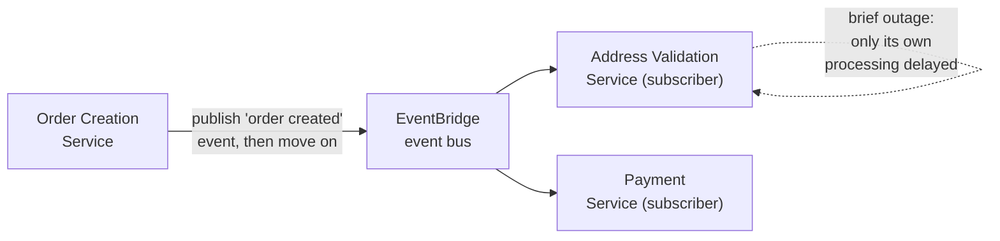

Step by step: (1) order creation publishes an event and immediately continues, rather than
blocking on a synchronous call; (2) EventBridge fans that event out to every subscribed
service — address validation and payment each receive their own copy independently;
(3) if address validation has a brief outage, only *its* event processing backs up or retries —
payment and order creation are completely unaffected, since neither of them was ever waiting on
address validation's synchronous response.

**Why the others are wrong:**
- **A** retrying immediately and repeatedly with no backoff against a struggling/failing service can actually make an outage worse (a "retry storm" adding load to an already-unhealthy service) and does nothing to stop the cascading failure — it's tightly coupled, synchronous calling, just repeated.
- **C** having three independent microservices write directly to one shared database defeats the purpose of having separate services at all — it creates a different kind of tight coupling (a shared schema/database dependency) and a single point of failure, which is a known anti-pattern, not a decoupling solution.
- **D** a longer timeout just makes the calling service wait longer before failing — it doesn't remove the dependency or stop the cascade, it only delays when the cascade happens (and ties up the calling service's resources longer in the meantime).

Reference: [`services/application-integration/eventbridge.md`](../../../services/application-integration/eventbridge.md)

---

## Question 40

*(Domain 4 — Cost-Optimized Architectures)*

A company's VPC has a single NAT Gateway handling a large volume of outbound traffic, most of
which is actually calls to other AWS services (S3, DynamoDB, Secrets Manager, KMS) rather than
true third-party internet traffic. The NAT Gateway's per-GB data processing charges have grown
into a significant line item. What should the Solutions Architect do to reduce this cost
without reducing security or availability?

A) Remove the NAT Gateway entirely and give every private-subnet instance a public IP
B) Add Gateway VPC endpoints for S3 and DynamoDB, and Interface VPC endpoints (PrivateLink) for Secrets Manager and KMS, routing that AWS-service traffic off the NAT Gateway's path entirely
C) Replace the NAT Gateway with a single larger NAT Gateway instance, assuming it will process data more cheaply at scale
D) Move all private-subnet instances into the public subnet to avoid needing a NAT Gateway at all

**Correct Answer: B**

**Why correct:** [VPC endpoints](../../../services/networking-content-delivery/vpc-endpoints-privatelink.md) let traffic to specific AWS services bypass the NAT Gateway (and the internet) entirely: Gateway endpoints (free) cover S3 and DynamoDB, and Interface endpoints (hourly + modest per-GB charge, but typically far cheaper than NAT Gateway's per-GB processing fee at volume) cover services like Secrets Manager and KMS — once these endpoints exist with appropriate route-table/DNS configuration, that large share of "actually AWS-service traffic" stops flowing through (and being billed by) the NAT Gateway, while instances remain in private subnets with no change to their security posture, and genuine third-party internet traffic still uses the NAT Gateway as before.

**Why the others are wrong:**
- **A** removing the NAT Gateway and giving every instance a public IP eliminates the NAT cost but directly increases the attack surface (every instance is now potentially internet-reachable) — "without reducing security" rules this out explicitly.
- **C** NAT Gateway doesn't have a "larger instance" concept that changes its per-GB processing rate — it's a managed, scalable service billed per-GB processed regardless of size, so this wouldn't actually change the underlying per-GB cost driver at all.
- **D** moving instances into the public subnet means assigning them public IPs/direct internet exposure (and likely breaking existing network architecture assumptions and security-group designs built around a private-subnet model) — again trading away security for cost, which the requirement explicitly disallows.

Reference: [`services/networking-content-delivery/vpc-endpoints-privatelink.md`](../../../services/networking-content-delivery/vpc-endpoints-privatelink.md)

---

## Question 41

*(Domain 3 — High-Performing Architectures)*

A weather-forecasting agency runs a tightly-coupled MPI (Message Passing Interface) simulation
across 200 EC2 instances that must communicate with each other extremely frequently during the
computation, where inter-node network latency directly limits how fast the whole simulation
runs. Instances are currently spread arbitrarily across the Region's Availability Zones. What
should the Solutions Architect do to minimize inter-node latency?

A) Spread the instances across as many Availability Zones as possible, for maximum fault tolerance
B) Launch the instances into a cluster placement group, packing them close together on the underlying hardware within a single Availability Zone for low-latency, high-throughput networking
C) Move the instances into a spread placement group, which spreads each instance onto distinct underlying hardware
D) Enable Multi-AZ on the instances, which automatically optimizes inter-node network paths

**Correct Answer: B**

**Why correct:** [Cluster placement groups](../../../services/compute/ec2.md) pack instances close together on the underlying hardware within a single Availability Zone specifically to minimize inter-node network latency and maximize network throughput between them — exactly what a tightly-coupled MPI simulation needs, since its performance is bottlenecked by how fast nodes can exchange messages, not by surviving an AZ failure (which is a different, and here explicitly lower, priority than raw inter-node speed).

**Why the others are wrong:**
- **A** spreading across many AZs actively *increases* inter-node latency (cross-AZ network hops are slower than same-AZ, same-rack hops) — this is the opposite of what the scenario needs; it optimizes for fault isolation, not throughput/latency for a tightly-coupled workload.
- **C** a spread placement group deliberately places each instance on **distinct** underlying hardware specifically to reduce the chance of simultaneous hardware failures affecting multiple instances — it's used for critical, small numbers of individual instances needing isolation from each other, which is the opposite goal of a cluster placement group's "pack tightly for speed."
- **D** "Multi-AZ" isn't an EC2 instance placement feature at all (it's a database/managed-service HA concept, e.g., RDS Multi-AZ) — there's no such EC2 setting, and even if there were, spanning AZs would hurt, not help, inter-node latency.

Reference: [`services/compute/ec2.md`](../../../services/compute/ec2.md)

---

## Question 42

*(Domain 4 — Cost-Optimized Architectures)*

A mobile app's product-images bucket in S3 receives the same few hundred images requested
repeatedly by hundreds of thousands of app users throughout the day, with each request served
directly from S3 over the internet today. S3 data-transfer-out costs have grown significantly
as the user base has scaled. What should the Solutions Architect add to reduce this specific
cost driver, given the content barely changes?

A) Move the images to S3 One Zone-IA to reduce storage cost
B) Put CloudFront in front of the bucket, caching the images at edge locations so repeat requests for the same popular images are served from cache instead of generating a new S3 data-transfer-out charge each time
C) Enable S3 Transfer Acceleration on the bucket
D) Increase the bucket's provisioned request-rate capacity

**Correct Answer: B**

**Why correct:** [CloudFront](../../../services/networking-content-delivery/cloudfront.md) caches responses at edge locations; once a popular image is cached after its first request, every subsequent request for that same image — potentially from hundreds of thousands of users — is served from the CloudFront cache rather than generating a fresh trip back to the S3 origin, which both improves latency and, critically here, dramatically reduces the number of times data actually has to flow out of S3 (data transfer from S3 to CloudFront is free/discounted versus data transfer from S3 directly to the internet, and CloudFront's own data-transfer-out pricing is typically cheaper at volume than S3's direct internet egress pricing) — directly targeting the stated cost driver for a mostly-static, repeatedly-requested asset set.

**Why the others are wrong:**
- **A** One Zone-IA reduces *storage* cost per GB, but the cost driver named in the scenario is *data-transfer-out*, not storage — this doesn't address the actual problem, and also trades away multi-AZ durability for images served live in a mobile app.
- **C** Transfer Acceleration speeds up and is billed for *uploads* into S3 over long distances — it has nothing to do with reducing the cost of serving repeated *downloads* to end users.
- **D** raising request-rate capacity addresses a throughput/throttling concern, not the per-GB data-transfer-out cost being driven by the sheer repetition of identical requests — the fix here is reducing how many times data actually leaves S3, which caching (not more request capacity) achieves.

Reference: [`services/networking-content-delivery/cloudfront.md`](../../../services/networking-content-delivery/cloudfront.md)

---

## Question 43

*(Domain 1 — Secure Architectures)*

A card-payment processor must generate and store cryptographic keys used for payment-card
tokenization in a way that meets PCI-DSS requirements for FIPS 140-2 Level 3 validated,
**single-tenant** hardware security modules — the compliance team has explicitly said a
shared, multi-tenant key-management service does not meet this specific contractual
requirement. What should the Solutions Architect provision?

A) AWS KMS customer-managed keys using AWS's default (shared, multi-tenant) key store
B) AWS CloudHSM, providing dedicated, single-tenant FIPS 140-2 Level 3 validated hardware security modules under the customer's exclusive control
C) AWS Secrets Manager with automatic rotation enabled
D) S3 server-side encryption with Amazon S3-managed keys (SSE-S3)

**Correct Answer: B**

**Why correct:** [CloudHSM](../../../services/security-identity-compliance/kms.md) provisions dedicated, single-tenant hardware security modules in the customer's own VPC, validated to FIPS 140-2 Level 3, giving the customer exclusive administrative control over the HSM and its keys — directly satisfying a compliance requirement that explicitly rules out shared/multi-tenant key management, which is exactly the attribute distinguishing it from default KMS.

**Why the others are wrong:**
- **A** AWS KMS's default key store, while itself FIPS 140-2 validated, runs on HSMs shared across multiple AWS customers (multi-tenant) — the scenario explicitly states this does not satisfy the compliance team's single-tenant requirement (note: KMS does support a "custom key store" backed by CloudHSM for cases needing single-tenant HSMs with KMS's API convenience, but the plain default key store described in this option does not).
- **C** Secrets Manager stores and rotates secrets (like passwords/API keys) — it's not a hardware security module and doesn't address the FIPS 140-2 Level 3 single-tenant HSM requirement for cryptographic key generation/storage at all.
- **D** SSE-S3 uses AWS-managed keys with no customer visibility or control over the underlying key infrastructure at all — far short of "single-tenant HSM under customer control," and not something a compliance team evaluating HSM-level requirements would even consider as meeting the bar.

Reference: [`services/security-identity-compliance/kms.md`](../../../services/security-identity-compliance/kms.md)

---

## Question 44

*(Domain 1 — Secure Architectures)*

An industrial IoT company is deploying 50,000 field sensors that must mutually authenticate
with AWS IoT Core using individual X.509 certificates, with the ability to issue, rotate, and
revoke certificates for devices at this scale without operating their own public CA
infrastructure. What should the Solutions Architect use to issue these device certificates?

A) AWS Certificate Manager (ACM) public certificates, one issued per device
B) AWS Private Certificate Authority (Private CA), issuing short-lived X.509 certificates to each device from a managed private CA hierarchy
C) A self-managed OpenSSL-based CA running on an EC2 instance
D) IAM users with access keys assigned to each of the 50,000 devices

**Correct Answer: B**

**Why correct:** [AWS Private CA](../../../services/security-identity-compliance/acm-and-private-ca.md) provides a managed private certificate authority specifically suited for exactly this use case — issuing large volumes of X.509 certificates for device identity/mutual-TLS authentication (a very common IoT pattern) — without the company having to build, secure, and operate its own CA infrastructure, while still supporting short-lived certs, rotation, and revocation (via CRLs/OCSP) at the scale of tens of thousands of devices.

**Why the others are wrong:**
- **A** ACM's *public* certificates are meant for publicly trusted TLS endpoints (like a website's HTTPS certificate validated against public domain ownership) — they're not designed for issuing private device-identity certificates to 50,000 IoT sensors, and ACM public certs aren't the right tool for mutual-TLS client-device authentication at this scale.
- **C** running a self-managed CA on EC2 is exactly the "operating their own public CA infrastructure" the requirement explicitly wants to avoid — it also pushes all of the operational burden (security hardening, availability, revocation infrastructure, audit) onto the company instead of using a managed service built for this.
- **D** IAM users and access keys authenticate to **AWS APIs**, not to AWS IoT Core's device-to-cloud MQTT/TLS mutual authentication model, and creating 50,000 IAM users for physical sensors is both the wrong authentication mechanism and a severe IAM anti-pattern (IAM has account-level user limits and this isn't what IAM users are for).

Reference: [`services/security-identity-compliance/acm-and-private-ca.md`](../../../services/security-identity-compliance/acm-and-private-ca.md)

---

## Question 45

*(Domain 3 — High-Performing Architectures)*

A fintech company's core OLTP database on RDS is hitting the IOPS ceiling of its current gp3
EBS volumes during peak trading hours, causing query latency spikes. The database requires
sustained IOPS well beyond what gp3 can provide and consistent sub-millisecond latency. What
EBS volume type should the Solutions Architect migrate to?

A) Stay on gp3 and simply increase the allocated storage size, since IOPS scales directly with size on gp3
B) io2 Block Express, which supports very high sustained IOPS (up into the hundreds of thousands per volume) and sub-millisecond latency, independent of volume size
C) Switch to st1 (throughput-optimized HDD) for higher IOPS
D) Switch to EC2 instance store, since it's always faster than any EBS volume type

**Correct Answer: B**

**Why correct:** [io2 Block Express](../../../services/storage/ebs.md) is designed for the most demanding, latency-sensitive, high-IOPS workloads — it can provision IOPS independently of volume size up to levels far beyond gp3's ceiling, and delivers sub-millisecond latency with very high durability, which is exactly the profile a peak-hour OLTP database needing to push past gp3's IOPS limit requires.

**Why the others are wrong:**
- **A** gp3's IOPS can be provisioned somewhat independently of size already (up to its own ceiling, which is fixed and well below io2 Block Express's), but the scenario says the database needs IOPS "well beyond" what gp3 can provide at all — simply increasing storage size on gp3 doesn't raise its maximum IOPS ceiling past that limit.
- **C** st1 is optimized for high-**throughput**, sequential workloads (like big data/log processing), not high-**IOPS**, low-latency random-access OLTP patterns — it's explicitly the wrong tool for this access pattern and generally has a much lower IOPS ceiling than gp3, let alone io2 Block Express.
- **D** instance store is ephemeral (data is lost if the instance stops or fails) and tied to a specific physical host — using it for a core OLTP *database's* persistent data is a durability non-starter regardless of its raw speed, and "always faster than any EBS type" is also not a reliable blanket claim given io2 Block Express's performance tier.

Reference: [`services/storage/ebs.md`](../../../services/storage/ebs.md)

---

## Question 46

*(Domain 2 — Resilient Architectures)*

A Solutions Architect is conducting a pre-launch resilience review of a new VPC before a
major product goes live. The VPC spans three Availability Zones, each with its own private
application subnet, but the review finds only one NAT Gateway exists for the entire VPC,
sitting in a single public subnet, with every AZ's private subnet route table pointing at
that same NAT Gateway. The architect flags this as a single point of failure that would take
down outbound internet access for all three AZs if just that one AZ were ever impaired, even
though the other two would otherwise be perfectly healthy. What should be changed before
launch to make outbound connectivity resilient to a single-AZ failure?

A) Replace the single NAT Gateway with a larger NAT Gateway instance type in the same AZ
B) Deploy one NAT Gateway per Availability Zone, each in its own public subnet, with each AZ's private subnet route table pointing only at the NAT Gateway in its own AZ
C) Add a second NAT Gateway in the same public subnet as the first, as a hot spare
D) Remove the NAT Gateways entirely and use a single Internet Gateway shared across all three AZs' private subnets

**Correct Answer: B**

**Why correct:** [One NAT Gateway per AZ](../../../services/networking-content-delivery/subnets-route-tables-igw-natgw.md) — each deployed in that AZ's own public subnet, with that AZ's private-subnet route table pointing only at its own local NAT Gateway — means an AZ impairment only takes down outbound internet access for *that* AZ's private subnets; the other two AZs' NAT Gateways and their dependent private subnets are entirely unaffected, since each AZ's path to the internet is now independent. This is AWS's own documented best practice for AZ-resilient outbound connectivity, illustrated directly in the AWS VPC documentation's NAT Gateway architecture diagram below.

*Source: [AWS VPC User Guide — NAT gateways](https://docs.aws.amazon.com/vpc/latest/userguide/vpc-nat-gateway.html).* The diagram shows the
recommended pattern: a NAT gateway provisioned in a public subnet within each Availability
Zone, with private-subnet route tables in that same AZ directed at the local NAT gateway rather
than at a single, shared NAT gateway elsewhere in the VPC — exactly eliminating the single-AZ
blast radius described in this scenario.

**Why the others are wrong:**
- **A** a NAT Gateway's size doesn't matter here — the problem isn't throughput capacity, it's that the single NAT Gateway (regardless of size) sits in only one AZ, so that AZ's impairment still takes down everyone depending on it.
- **C** a second NAT Gateway in the *same* public subnet doesn't help — that public subnet lives in the same AZ as the original, so an AZ-level impairment takes both NAT Gateways down together; redundancy has to be spread across AZs, not duplicated within one.
- **D** removing NAT Gateways and using a shared Internet Gateway for private subnets doesn't work as described — private subnets specifically have no route to an Internet Gateway (that's what makes them private); routing them directly to an IGW would require assigning public IPs, which also isn't what NAT Gateway resilience is about and changes the security model entirely.

Reference: [`services/networking-content-delivery/subnets-route-tables-igw-natgw.md`](../../../services/networking-content-delivery/subnets-route-tables-igw-natgw.md)

---

## Question 47

*(Domain 4 — Cost-Optimized Architectures)*

A mid-sized company's monthly AWS bill has several unexplained cost line items: Elastic IPs
not associated with any resource, a Classic Load Balancer with zero registered targets left
over from a decommissioned project, and a few EC2 instances that appear to be running with
almost no activity. Finance wants a repeatable
way to surface these waste sources going forward, not just a one-time manual audit. What should
the Solutions Architect set up?

A) A one-time manual review of the Cost Explorer dashboard, repeated whenever finance happens to ask
B) AWS Trusted Advisor's cost-optimization checks (underutilized EC2 instances, idle load balancers, unassociated Elastic IPs, unattached EBS volumes) reviewed on a recurring schedule, combined with Cost Explorer and Cost Anomaly Detection for ongoing visibility
C) Deleting every EBS volume and Elastic IP in the account immediately, without checking what they're for
D) Switching the entire account to Reserved Instances, since that locks in savings regardless of utilization

**Correct Answer: B**

**Why correct:** [Trusted Advisor's](../../../services/management-governance/trusted-advisor.md) cost-optimization category checks for exactly these waste patterns — idle/underutilized EC2 instances, unassociated Elastic IPs, unattached EBS volumes, idle load balancers — on an ongoing basis (not a one-time snapshot), and pairing it with Cost Explorer (trend visibility) and Cost Anomaly Detection (automatic alerts on unusual spend) gives the company a **repeatable**, largely automated process for continuously catching this kind of drift, directly matching "a repeatable way... going forward."

**Why the others are wrong:**
- **A** a one-time, ad-hoc manual review doesn't create the repeatable, ongoing process the company explicitly wants, and manually reviewing Cost Explorer doesn't surface specific waste *types* the way Trusted Advisor's purpose-built checks do.
- **C** deleting resources blindly without verifying what they're used for risks breaking something still in use (e.g., an Elastic IP reserved for a planned future resource, or an EBS volume kept intentionally as a backup) — this is reckless, not a sound cost-optimization process.
- **D** committing to Reserved Instances locks in a discount on *whatever* is running, including the waste itself (e.g., an idle, barely-used instance now has a 1-3 year RI commitment on it) — it doesn't identify or eliminate waste at all, it just pre-pays for it.

Reference: [`services/management-governance/trusted-advisor.md`](../../../services/management-governance/trusted-advisor.md)

---

## Question 48

*(Domain 1 — Secure Architectures)*

A ride-sharing app's mobile client needs to let users upload a profile photo directly to S3 and
read their own ride history from DynamoDB, without the app embedding any long-lived AWS
credentials in the mobile binary (which could be extracted by a motivated attacker) and without
operating a custom backend authentication server. Users already sign in with email/password or
Google. What should the Solutions Architect design?

A) Embed a single shared IAM user's access key in the mobile app, used by every installed copy of the app
B) Amazon Cognito user pools for user sign-up/sign-in (including federation with Google), paired with a Cognito identity pool that exchanges the authenticated user's token for short-lived, scoped AWS credentials via STS
C) Create an individual IAM user and access key for every registered app user, distributed to their device after sign-up
D) Have the mobile app call AWS APIs through a static API key with no user-level distinction at all

**Correct Answer: B**

**Why correct:** [Cognito user pools](../../../services/security-identity-compliance/cognito.md) handle the actual authentication (built-in email/password plus federation with identity providers like Google), and a **Cognito identity pool** takes that authenticated identity and exchanges it (via STS `AssumeRoleWithWebIdentity` under the hood) for temporary, scoped AWS credentials tied to an IAM role — giving the mobile app exactly the permissions needed (e.g., write access to only that user's own S3 profile-photo path, read access to only their own DynamoDB ride-history items via fine-grained policy variables) with credentials that expire automatically, with no long-lived keys ever embedded in the app and no custom backend auth server required.

**Why the others are wrong:**
- **A** a single shared access key embedded in every copy of a distributed mobile binary is both a long-lived credential (exactly what's being avoided) and immediately extractable by any user who decompiles the app — one compromised key compromises every user's AWS access at once.
- **C** creating a unique IAM user per app user doesn't scale (IAM has account-level user-count limits far below what a consumer ride-sharing app's user base would need) and still means managing and distributing long-lived access keys to untrusted mobile devices, which is exactly the long-lived-credential risk being avoided.
- **D** a static API key shared across all users provides no per-user access scoping or accountability at all, and if extracted from the app binary (trivial for a static key), grants whatever access that key has to anyone.

Reference: [`services/security-identity-compliance/cognito.md`](../../../services/security-identity-compliance/cognito.md)

---

## Question 49

*(Domain 3 — High-Performing Architectures)*

A real-time collaborative document-editing app needs a caching layer that supports
pub/sub messaging (to broadcast live edits to all connected clients editing the same document)
and optional data persistence (so recent edit state survives a cache node restart). Between
Memcached and Redis engines on ElastiCache, which should the Solutions Architect choose, and
why?

A) Memcached, because it's simpler to operate and this app has no specific requirements beyond basic caching
B) Redis, because it natively supports pub/sub messaging and offers optional persistence (snapshotting/AOF) and replication — both explicitly required here, which Memcached does not provide
C) Either engine is functionally identical for this use case; the choice should be based on price alone
D) Memcached, because it supports multi-threading across all CPU cores, which outweighs the missing pub/sub capability

**Correct Answer: B**

**Why correct:** [ElastiCache for Redis](../../../services/database/elasticache.md) natively supports pub/sub messaging channels (ideal for broadcasting live edits to subscribed clients) and offers optional persistence via snapshotting (RDB) and/or append-only file (AOF) logging plus built-in replication for durability/HA — both of which this scenario explicitly requires and Memcached, which is a simpler, pure, non-persistent, no-pub/sub key-value cache, does not provide at all.

**Why the others are wrong:**
- **A** "no specific requirements beyond basic caching" is factually wrong per the scenario — pub/sub messaging and optional persistence are both explicitly stated requirements, and Memcached supports neither.
- **C** the two engines are not functionally identical — Redis has a materially richer feature set (data structures, pub/sub, persistence, replication, transactions) that Memcached intentionally omits in favor of simplicity and raw multi-threaded throughput for pure caching; choosing "on price alone" while ignoring a hard functional requirement (pub/sub) would produce a broken design.
- **D** Memcached's multi-threading is a genuine strength for pure, large-scale, simple key-value caching — but it doesn't change the fact that Memcached has no pub/sub capability at all, so no amount of threading performance compensates for a missing hard requirement the application needs to function (broadcasting live edits).

Reference: [`services/database/elasticache.md`](../../../services/database/elasticache.md)

---

## Question 50

*(Domain 1 — Secure Architectures)*

A company delegates day-to-day IAM administration within each business unit to a "team admin"
role, which is allowed to create new IAM roles and attach policies for their own team's
engineers. Security is concerned a team admin could accidentally (or intentionally) grant a
role permissions broader than the team admin's own — including, in the worst case,
administrator access to the whole account. What should the Solutions Architect add to prevent
this specific escalation risk, while still letting team admins manage their own team's roles?

A) Remove the team admin role's ability to create or modify IAM roles entirely, centralizing all IAM changes with a single central security team
B) Attach a permissions boundary to every role the team admin creates, capping the maximum permissions any of those roles can ever have — regardless of what policy the team admin attaches
C) Rely on quarterly manual access reviews to catch any over-permissioned roles after the fact
D) Require the team admin to get a second team admin's email approval before creating any new role, with no technical enforcement

**Correct Answer: B**

**Why correct:** An [IAM permissions boundary](../../../services/security-identity-compliance/iam.md) is a managed policy that sets the **maximum** permissions an IAM role (or user) can ever have — even if the team admin attaches a broad or overly permissive policy to a role they create, the *effective* permissions are the intersection of that attached policy and the boundary, so no role the team admin creates can ever exceed the boundary's ceiling, regardless of mistake or intent. This directly and preventively solves the escalation concern while still letting team admins create and manage roles for their own team day-to-day, satisfying both halves of the requirement.

**Why the others are wrong:**
- **A** removing the ability to create/modify roles entirely solves the escalation risk but violates the explicit requirement to "still let team admins manage their own team's roles" — it over-corrects into full centralization, defeating the delegation the business wants.
- **C** quarterly manual reviews are purely detective and after-the-fact — an over-permissioned role (or a privilege-escalation path) could exist and be exploited for up to a quarter before anyone notices, which doesn't prevent the risk at all.
- **D** an email-approval process with "no technical enforcement" relies entirely on human diligence and leaves no automatic, provable guarantee that it was followed or that an approved role actually respects any permission ceiling — it's a process control, not a technical one, and easy to bypass accidentally or deliberately.

Reference: [`services/security-identity-compliance/iam.md`](../../../services/security-identity-compliance/iam.md)

---

## Question 51

*(Domain 1 — Secure Architectures)*

Two separate business units, operated as separate AWS accounts within the same Organization,
need to integrate: Account A's order-processing Lambda function must invoke Account B's
fulfillment Lambda function directly. Only Account A's specific function should be allowed to
invoke it — not any other principal in Account A, and not any other account. What should the
Solutions Architect configure on Account B's fulfillment function?

A) Make the fulfillment function publicly invokable with no authentication, and rely on obscurity of its ARN
B) Attach a resource-based (Lambda) policy to the fulfillment function granting `lambda:InvokeFunction` only to the specific ARN of Account A's order-processing function's execution role
C) Create an IAM user in Account B, share its access key with Account A's team out-of-band, for use when invoking the function
D) Make the fulfillment function part of a VPC shared with Account A via VPC peering, and rely on network-layer reachability alone

**Correct Answer: B**

**Why correct:** A [resource-based policy on the Lambda function](../../../services/compute/lambda.md) (sometimes called the function's "policy") lets you grant invoke permission to a specific principal in another account — scoping the `Principal` to exactly Account A's order-processing function's execution role ARN means only that specific role, not "any other principal in Account A" and not any other account, can call `lambda:InvokeFunction` on this function, which precisely matches the tightly-scoped cross-account access requirement.

**Why the others are wrong:**
- **A** "public with no auth, relying on obscurity" is not an access control at all — an ARN isn't a secret, and anyone who discovers (or guesses/enumerates) it could invoke the function; this fails even the baseline requirement that *only* Account A's specific function may invoke it.
- **C** sharing a long-lived IAM user access key "out-of-band" is exactly the long-lived-credential anti-pattern the exam consistently flags as wrong, and it grants access to whoever holds that key rather than a specific, auditable principal/role — far less precise and far riskier than a resource policy scoped to an exact role ARN.
- **D** network-layer reachability (VPC peering) only controls whether packets *can* route between the VPCs — it says nothing about *authorization* to invoke the Lambda function's API, and Lambda invocation is an AWS API call authenticated via IAM, not a raw network connection that peering alone would secure or restrict.

Reference: [`services/compute/lambda.md`](../../../services/compute/lambda.md)

---

## Question 52

*(Domain 3 — High-Performing Architectures)*

A weather-data API, built on API Gateway and Lambda, serves the same "current conditions for
ZIP code X" response to thousands of different client apps, where the underlying data updates
only once every 10 minutes but the API currently invokes Lambda (and its backend data lookup)
on every single request, driving up both latency and Lambda invocation cost. What should the
Solutions Architect configure to reduce both, given the data's refresh cadence?

A) Increase the Lambda function's memory allocation to execute faster per invocation
B) Enable API Gateway response caching with a TTL of around 10 minutes, matching the data's actual refresh cadence, so repeated identical requests are served from the cache without invoking Lambda at all
C) Switch the API from REST API Gateway to WebSocket API Gateway
D) Add an SQS queue between API Gateway and Lambda to throttle invocation rate

**Correct Answer: B**

**Why correct:** [API Gateway's built-in response caching](../../../services/networking-content-delivery/api-gateway.md) caches a method's response (keyed by configured request parameters, such as the ZIP code) for a configured TTL — setting that TTL to roughly match the 10-minute data refresh cadence means the vast majority of repeated requests for the same ZIP code get served directly from the API Gateway cache, never invoking Lambda or hitting the backend data source at all, which cuts both response latency (cache hits are much faster than a full Lambda invocation) and Lambda invocation cost (fewer actual invocations) simultaneously — directly matching the data's own staleness tolerance.

**Why the others are wrong:**
- **A** more memory can reduce a single invocation's execution time somewhat, but it does nothing to reduce the *number* of invocations happening for identical, cacheable, rarely-changing data — it optimizes the wrong lever for this specific redundant-request problem.
- **C** WebSocket APIs are for persistent, bidirectional, stateful connections (e.g., live chat, streaming updates) — switching protocols doesn't address the actual problem (redundant computation of a cacheable response) and would be a significant unnecessary architecture change for what's fundamentally a caching problem.
- **D** an SQS queue is designed to decouple and buffer asynchronous processing, not to serve cached responses to synchronous "get current conditions" API requests — inserting a queue here would add latency and complexity without caching anything, and a client expecting an immediate HTTP response wouldn't get one straightforwardly through a queue-based flow.

Reference: [`services/networking-content-delivery/api-gateway.md`](../../../services/networking-content-delivery/api-gateway.md)

---

## Question 53

*(Domain 4 — Cost-Optimized Architectures)*

A growing company runs a mix of workloads: steady-state EC2 instances across several
different families that get resized periodically as needs change, a significant and growing
amount of Lambda usage, and Fargate for a few containerized services — all expected to
continue running consistently for the next year, though the exact mix of EC2 vs. Lambda vs.
Fargate usage is expected to shift over time. What cost-commitment option gives the broadest
coverage and flexibility across this entire mix?

A) EC2 Instance Savings Plans, since they offer the deepest discount of any Savings Plan type
B) Compute Savings Plans, since the commitment (a steady hourly dollar amount) applies automatically across EC2 (any family/size/Region/OS), Fargate, and Lambda, accommodating the expected shift in usage mix over time
C) Standard Reserved Instances purchased separately for each current EC2 instance family in use
D) No commitment at all, since the usage mix is expected to change, making any 1-year commitment "too risky"

**Correct Answer: B**

**Why correct:** [Compute Savings Plans](../../../services/management-governance/cost-management-tools.md) are the most flexible of the Savings Plan types — the commitment is a hourly dollar amount of compute usage, and it automatically applies (at its discount rate) across EC2 regardless of family, size, Region, OS, or tenancy, plus Fargate and Lambda — meaning if the mix shifts (say, EC2 usage for one family declines while Lambda usage grows), the same committed dollar amount simply continues applying its discount across whatever combination of those three is actually being used, which exactly matches "broadest coverage" and accommodates an expected shift in usage mix without needing to repurchase or restructure anything.

**Why the others are wrong:**
- **A** EC2 Instance Savings Plans do offer a slightly deeper discount than Compute Savings Plans, but that discount is locked to a specific instance *family* in a specific Region — it provides no coverage at all for Lambda or Fargate usage, and even within EC2, if the company resizes or changes families as stated, an EC2 Instance Savings Plan locked to the old family stops matching, unlike Compute Savings Plans' flexibility.
- **C** Standard RIs purchased per current family lock in the discount to those exact families — if families change (explicitly expected here) or Lambda/Fargate usage grows (also stated as happening), the RIs don't adapt or cover that growth at all, unlike a Compute Savings Plan.
- **D** forgoing any commitment at all for workloads explicitly described as "expected to continue running consistently for the next year" leaves significant On-Demand-rate savings on the table for no good reason — the flexibility of a Compute Savings Plan specifically exists to de-risk exactly the "mix might shift" concern raised here, making "too risky" an inaccurate objection to this particular commitment type.

Reference: [`services/management-governance/cost-management-tools.md`](../../../services/management-governance/cost-management-tools.md)

---

## Question 54

*(Domain 1 — Secure Architectures)*

A law firm is handling ongoing, multi-year litigation and must ensure that specific case-file
documents in S3 remain completely undeletable and unmodifiable **for as long as the case stays
open — an indefinite, not-yet-known duration** — rather than a fixed, pre-determined number of
years, and this protection must hold even against the firm's own IT administrators. Once the
case eventually closes, the documents should become normally deletable again without needing
to have predicted the exact closure date in advance. What S3 Object Lock feature fits this
specific requirement?

A) S3 Object Lock Compliance mode with a retention period set to 99 years, as an approximation of "indefinite"
B) S3 Object Lock Legal Hold, which places an independent, indefinite lock on an object version with no expiration date — removable only by a principal with explicit `s3:PutObjectLegalHold` permission once the case closes, distinct from (and usable instead of or alongside) a fixed retention period
C) S3 Versioning alone, relying on the firm to simply never delete the relevant versions by convention
D) A bucket policy denying delete actions, manually removed by an administrator once the case closes

**Correct Answer: B**

**Why correct:** [S3 Object Lock's Legal Hold](../../../services/storage/s3-glacier.md) feature is specifically designed for exactly this "indefinite, duration-unknown-in-advance" protection need — unlike a retention period (fixed-mode or compliance-mode), a Legal Hold has no expiration date at all and stays in effect until explicitly removed by a principal with the specific `s3:PutObjectLegalHold` permission, at which point the object becomes normally deletable again (assuming no separate retention period is also still active) — directly matching "for as long as the case stays open" without needing to guess a duration up front, while still being just as unbypassable by ordinary administrators as a retention-period lock.

**Why the others are wrong:**
- **A** a 99-year retention period is a workaround approximation, not a genuine match for "indefinite, not-yet-known duration" — it also can't be shortened once set in Compliance mode, meaning if the case closes in 2 years, the documents remain locked for 97 more years with no way to release them early, directly failing "should become normally deletable again" once the case closes.
- **C** relying on "convention" (a human agreement not to delete something) provides no technical enforcement at all — it doesn't protect against a careless or malicious administrator, which directly fails "must hold even against the firm's own IT administrators."
- **D** a bucket policy can be edited or removed by anyone with sufficient IAM permissions (including bypassing it entirely before manually "removing" it) and does not apply to the root user — it provides no genuine technical immutability guarantee the way Object Lock does, and "manually removed by an administrator" is itself the kind of bypassable, non-technical control the requirement wants to avoid.

Reference: [`services/storage/s3-glacier.md`](../../../services/storage/s3-glacier.md)

---

## Question 55

*(Domain 4 — Cost-Optimized Architectures)*

A media company stores millions of objects in a single S3 bucket but isn't sure what lifecycle
transition thresholds (e.g., "move to IA after how many days?") would actually fit the real
observed access patterns of their data, rather than guessing. What should the Solutions
Architect use first, before writing any lifecycle policy rules?

A) Write a lifecycle rule using AWS's generic default recommendation of 30 days to IA, 90 days to Glacier, without reviewing this bucket's actual data
B) S3 Storage Class Analysis, which observes actual object access patterns over time and provides data-driven recommendations for appropriate lifecycle transition thresholds for this specific bucket/prefix
C) Manually sample a handful of objects and extrapolate a transition policy from that small sample
D) Immediately move all objects to Glacier Deep Archive, since it's the cheapest storage class available

**Correct Answer: B**

**Why correct:** [S3 Storage Class Analysis](../../../services/storage/s3-storage-classes.md) observes an entire bucket's (or prefix's) actual access patterns over time (typically 30+ days of data) and produces specific, data-driven recommendations for lifecycle transition thresholds tailored to how *this* dataset is actually accessed — directly replacing a generic guess with real evidence before committing to lifecycle rules, which is exactly the "before writing any lifecycle policy rules" step the scenario calls for.

**Why the others are wrong:**
- **A** a generic default threshold with no analysis of this bucket's actual access pattern could easily be wrong in either direction — transitioning too early (causing early-deletion/retrieval fees or performance issues for data still accessed frequently) or too late (overpaying for Standard storage longer than necessary) — exactly the guesswork the scenario wants to replace with evidence.
- **C** manually sampling "a handful of objects" across a multi-million object bucket is statistically unreliable and won't capture the real distribution of access patterns across the whole dataset the way an automated, comprehensive analysis tool does.
- **D** jumping straight to the cheapest storage class without any analysis ignores whether any of that data is still being actively accessed — Glacier Deep Archive has retrieval delays measured in hours and per-request retrieval costs, so moving actively-accessed data there blind could badly hurt both performance and (via retrieval fees) cost.

Reference: [`services/storage/s3-storage-classes.md`](../../../services/storage/s3-storage-classes.md)

---

## Question 56

*(Domain 1 — Secure Architectures)*

A company wants to guarantee that **every** new EBS volume created anywhere in the account
from now on is encrypted by default — including volumes created by developers who might forget
to tick the "encrypt" checkbox — and wants to be automatically alerted (and ideally
auto-remediated) if any unencrypted volume ever slips through. What combination should the
Solutions Architect implement?

A) Rely on a written policy telling developers to always check the "encrypt volume" box when creating EBS volumes
B) Enable EBS encryption by default at the account/Region level (so every new volume is automatically encrypted regardless of what the creator specifies), combined with an AWS Config managed rule that flags (and optionally triggers Systems Manager Automation to remediate) any unencrypted volume found
C) Manually audit the EBS console once a month for any unencrypted volumes
D) Delete any unencrypted volume immediately upon creation with no further investigation

**Correct Answer: B**

**Why correct:** [EBS encryption by default](../../../services/storage/ebs.md), enabled per Region, makes every *newly created* volume (and snapshot) in that Region automatically encrypted regardless of whether the creator explicitly requested it — closing off the "developer forgets to check the box" gap at the source — and layering an [AWS Config](../../../services/management-governance/aws-config.md) managed rule (e.g., checking for encrypted EBS volumes) on top gives continuous, automatic detection of any volume that somehow isn't encrypted (e.g., created before the setting was enabled, or via an edge case), with optional Systems Manager Automation wired up for auto-remediation — covering both the "guarantee going forward" and "automatically alerted/remediated if any slip through" halves of the requirement.

**Why the others are wrong:**
- **A** a written policy with no technical enforcement relies entirely on humans remembering every time, which is exactly the failure mode ("developers who might forget") the scenario is trying to eliminate.
- **C** a monthly manual audit is both infrequent (an unencrypted volume could exist and be in use, with data at risk, for up to a month before detection) and manual — it's detective, not preventive, and doesn't scale as the account grows.
- **D** deleting a newly created unencrypted volume immediately with no investigation could destroy legitimate data or break a deployment in progress, and it's a blunt, potentially destructive overreaction rather than a measured detect-and-remediate (or better, prevent-at-source) approach.

Reference: [`services/storage/ebs.md`](../../../services/storage/ebs.md) and [`services/management-governance/aws-config.md`](../../../services/management-governance/aws-config.md)

---

## Question 57

*(Domain 2 — Resilient Architectures)*

A gaming company stores player session state in ElastiCache for Redis. If the primary node in
the replication group fails, in-progress game sessions for every connected player are
currently lost and must be manually recovered by restarting the Redis cluster from scratch —
an unacceptable experience during peak hours. What should the Solutions Architect configure to
make session-state storage resilient to a primary node failure?

A) A single large ElastiCache node with no replicas, relying on frequent manual snapapshots for recovery
B) An ElastiCache for Redis replication group with Multi-AZ enabled, so a replica is automatically promoted to primary within seconds of a primary node failure, with minimal data loss and no manual intervention
C) Switch to ElastiCache for Memcached, since it's simpler to operate
D) Store session state only in each web server's local memory instead of ElastiCache

**Correct Answer: B**

**Why correct:** An [ElastiCache for Redis replication group with Multi-AZ enabled](../../../services/database/elasticache.md) maintains one or more read replicas continuously synchronized with the primary; if the primary fails, ElastiCache automatically detects the failure and promotes a replica to primary within seconds — with DNS endpoint updates handled automatically — meaning connected clients experience a brief interruption rather than a total loss of session state, and no manual cluster rebuild is required, directly solving the described failure mode.

**Why the others are wrong:**
- **A** a single node with no replicas has no automatic failover at all — a primary failure means total data loss until a snapshot is manually restored (which, as the scenario states, is the exact unacceptable behavior happening today).
- **C** Memcached has no built-in replication or automatic failover mechanism at all (it's a simpler, non-persistent, non-replicated cache by design) — switching to it would make the resilience problem worse, not better, despite being simpler to operate.
- **D** storing session state in each web server's local memory ties a player's session to one specific server instance — if that instance fails or the player's request is routed to a different server (common behind a load balancer), their session state is lost entirely; this removes the shared, centralized session store's benefit altogether rather than making it resilient.

Reference: [`services/database/elasticache.md`](../../../services/database/elasticache.md)

---

## Question 58

*(Domain 1 — Secure Architectures)*

Following a suspected security breach, a company's incident-response team needs to reconstruct
exactly which IP addresses connected to a specific EC2 instance's network interface over the
past 30 days, including rejected connection attempts, and run ad-hoc queries against that data
without standing up new infrastructure mid-investigation. What should the Solutions Architect
have had in place beforehand to make this possible?

A) CloudTrail management-event logging only, since it records all account-level API activity
B) VPC Flow Logs delivered to an S3 bucket, queryable on demand using Amazon Athena with a table defined over the flow log data
C) AWS Config, since it continuously tracks configuration changes to the instance
D) GuardDuty findings alone, since it already summarizes all suspicious network activity

**Correct Answer: B**

**Why correct:** [VPC Flow Logs](../../../services/networking-content-delivery/vpc.md) capture metadata about IP traffic going to and from network interfaces in a VPC — including source/destination IP, port, and whether traffic was **accepted or rejected** — and delivering them to S3 means the data persists and is available for exactly this kind of after-the-fact forensic reconstruction; [Athena](../../../services/analytics/athena.md) can then run ad-hoc SQL queries directly against that S3 data with no new infrastructure to provision mid-investigation, which is precisely "query on demand without standing up new infrastructure."

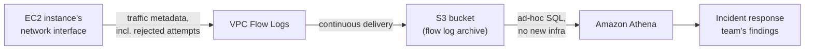

Step by step: (1) Flow Logs capture every connection attempt (accepted and rejected) to/from
the instance's ENI continuously, long before any incident occurs; (2) that data is delivered
to S3, accumulating a 30+ day forensic record at low cost; (3) when the breach is suspected,
the team defines an Athena table over the existing S3 data and starts running SQL queries
immediately — no log pipeline or new infrastructure has to be built in the middle of the
investigation.

**Why the others are wrong:**
- **A** CloudTrail records **API calls** made against AWS services (e.g., who launched an instance, who called `DescribeInstances`) — it does not record **network-level IP traffic** to/from an ENI, so it can't answer "which IPs connected to this instance's network interface," which is specifically a Flow Logs question.
- **C** AWS Config tracks **configuration state changes** (e.g., a security group rule was modified, an instance's attributes changed) over time — it has no visibility into actual network traffic/connections at all, so it can't reconstruct IP-level connection history either.
- **D** GuardDuty findings are threat-detection alerts based on its own analysis (which does consume Flow Logs, DNS logs, and CloudTrail internally) — but it only surfaces findings it deemed suspicious, not the complete, queryable raw connection history needed for a thorough forensic reconstruction of *everything* that connected, rejected or not.

Reference: [`services/networking-content-delivery/vpc.md`](../../../services/networking-content-delivery/vpc.md) and [`services/analytics/athena.md`](../../../services/analytics/athena.md)

---

## Question 59

*(Domain 2 — Resilient Architectures)*

An internal HR document-management tool is important to the business but considered low
priority for disaster recovery — a multi-hour or even next-business-day recovery is acceptable
if the primary Region were ever lost, as long as data isn't permanently lost. The team wants
the cheapest DR approach that still guarantees data is recoverable in a second Region. What
should the Solutions Architect configure?

A) Aurora Global Database for cross-Region replication with fast failover
B) AWS Backup configured with a backup plan that includes a cross-Region copy rule, regularly backing up the application's resources (e.g., EBS volumes, RDS) to a second Region
C) A warm standby environment running continuously at reduced capacity in a second Region
D) Multi-site active/active across two Regions

**Correct Answer: B**

**Why correct:** [AWS Backup's cross-Region copy](../../../services/storage/aws-backup.md) rule implements the **backup-and-restore** DR strategy — the cheapest tier on the DR spectrum — by automatically copying backups (of EBS, RDS, and other supported resources) to a second Region on a schedule, with no infrastructure running continuously in that second Region at all; recovery means restoring from those backups and standing up infrastructure from scratch, which fits "multi-hour or next-business-day recovery is acceptable" exactly, while still guaranteeing the data itself is recoverable from the second Region if the primary is lost.

**Why the others are wrong:**
- **A** Aurora Global Database is built for fast (near-minute) cross-Region failover with minimal RPO — far more capability (and cost) than a low-priority tool needing only "multi-hour or next-business-day" recovery actually requires; it's solving a tighter RTO/RPO bar than this workload has.
- **C** warm standby keeps a scaled-down environment running continuously in the second Region, which costs meaningfully more than pure backup-and-restore for no benefit here, since the stated RTO tolerance (hours to a full business day) doesn't need an already-running standby environment.
- **D** multi-site active/active is the most expensive DR tier (full production capacity in both Regions at all times) — using it for an internal tool explicitly described as "low priority" with a generous RTO tolerance would be a significant and unnecessary overspend.

Reference: [`services/storage/aws-backup.md`](../../../services/storage/aws-backup.md)

---

## Question 60

*(Domain 4 — Cost-Optimized Architectures)*

A web hosting company runs its customer-facing front end on an Auto Scaling group of EC2
instances behind an ALB. The workload is stateless, horizontally scalable, and tolerant of
occasional instance interruption (the ASG simply launches a replacement). Leadership wants to
cut compute cost for this tier substantially while keeping it resilient if some capacity is
reclaimed by AWS. What Auto Scaling group configuration should the Solutions Architect use?

A) 100% On-Demand Instances across a single instance type, to guarantee consistent capacity
B) A mixed-instances policy combining a base of On-Demand capacity with a larger proportion of Spot Instances spread across several compatible instance types/sizes, so a Spot interruption on one instance type or AZ doesn't take down the whole fleet
C) 100% Spot Instances of a single specific instance type and size, for maximum discount
D) Reserved Instances covering 100% of the fleet's peak historical size, purchased for a 3-year term

**Correct Answer: B**

**Why correct:** An [Auto Scaling group mixed-instances policy](../../../services/compute/ec2-auto-scaling.md) lets you combine a resilient baseline of On-Demand capacity (covering some guaranteed minimum) with a larger share of much-cheaper Spot capacity, diversified across **several** compatible instance types and AZs — if AWS reclaims Spot capacity for one instance type/AZ, the ASG can still fulfill desired capacity from the other instance types/AZs in the mix, rather than losing the whole Spot portion of the fleet at once, which directly fits "cut cost substantially" plus "resilient if some capacity is reclaimed" for a stateless, horizontally-scalable, interruption-tolerant workload.

**Why the others are wrong:**
- **A** 100% On-Demand guarantees capacity stability but forgoes the substantial discount available for a workload explicitly described as interruption-tolerant — it doesn't meet "cut compute cost substantially" at all.
- **C** using a single specific instance type/size for 100% Spot concentrates all interruption risk into one Spot capacity pool — if AWS reclaims that specific pool's capacity (a real, not uncommon occurrence), the entire fleet could be interrupted at once, which is the opposite of the diversification that makes Spot usage resilient.
- **D** Reserved Instances sized at 100% of *peak* capacity, on a 3-year term, locks in paying for peak-sized capacity continuously regardless of actual (likely lower, most of the time) demand — this is a poor cost fit for a workload where Spot's deep discount plus diversified resilience is explicitly the better-suited option given the stated interruption tolerance.

Reference: [`services/compute/ec2-auto-scaling.md`](../../../services/compute/ec2-auto-scaling.md)

---

## Question 61

*(Domain 2 — Resilient Architectures)*

A retailer's inventory-management application accidentally ran a buggy batch job this morning
that overwrote thousands of correct inventory records with incorrect values. The team caught
it 40 minutes later. The database is RDS for MySQL with automated backups and a 7-day
retention window enabled. What is the fastest way to recover the correct data without losing
any of today's legitimate transactions that happened both before and after the bad batch job?

A) Restore the most recent daily automated snapshot, accepting the loss of any transactions since that snapshot
B) Use RDS point-in-time recovery to restore a new instance to the exact timestamp one minute before the bad batch job ran, then reconcile/migrate the correct data back, preserving legitimate transactions recorded separately
C) Delete the affected rows and manually recreate them from memory of their original values
D) Fail over to the Multi-AZ standby, since it will not have the bad batch job's changes

**Correct Answer: B**

**Why correct:** [RDS point-in-time recovery (PITR)](../../../services/database/rds.md), available because automated backups are enabled, lets you restore a **new** instance to any second within the retention window — including a timestamp precisely *before* the bad batch job executed — recovering the correct pre-incident data without waiting for or being limited to a daily snapshot boundary; because this restores to a **new** instance rather than overwriting the current one, the team can then reconcile the correct historical data back against the current database, specifically preserving legitimate transactions that happened both before and after the bad job ran (which a less granular recovery method would risk losing).

**Why the others are wrong:**
- **A** restoring the "most recent daily automated snapshot" could be from hours before the incident (or at best is tied to the snapshot's exact creation time, not precisely before the bad job), and more importantly, this answer explicitly accepts losing legitimate transactions since that snapshot — a worse outcome than PITR's second-level precision, and inconsistent with the requirement not to lose legitimate transactions.
- **C** manually recreating overwritten values "from memory" across thousands of records is error-prone, slow, and nowhere close to "fastest" or reliable — it has no guarantee of actually restoring the correct original values.
- **D** the Multi-AZ standby is **synchronously replicated** from the primary — it received and applied the exact same bad batch job's writes essentially in real time, so failing over to it provides no protection from, or recovery for, application-level data corruption at all; Multi-AZ protects against infrastructure failure, not bad data written by a buggy job.

Reference: [`services/database/rds.md`](../../../services/database/rds.md)

---

## Question 62

*(Domain 1 — Secure Architectures)*

A two-tier web application (web tier in a public subnet, database tier in a private subnet)
stopped working immediately after a network engineer added a set of restrictive Network ACL
rules to "tighten security." Inbound rules allow port 443 from the internet and port 3306 from
the web tier's subnet; outbound rules allow port 443 and port 3306 to the respective
destinations — but nothing else. What is the most likely cause of the outage, and what fixes
it?

A) The security groups must be misconfigured instead; NACLs are stateless and therefore cannot cause this kind of failure
B) The NACL rules only account for the known request ports (443, 3306) but omit the ephemeral port range (typically 1024–65535) needed for *return* traffic, since NACLs are stateless and require explicit rules in both directions for both the request and its response
C) NACLs apply only to traffic between subnets in different VPCs, so this configuration should have had no effect at all
D) The NACL's rule numbers are evaluated in reverse order from how they were intended, so renumbering them in ascending order will fix it

**Correct Answer: B**

**Why correct:** [Network ACLs](../../../services/networking-content-delivery/security-groups-vs-nacls.md) are **stateless** — unlike security groups, allowing an inbound request does not automatically allow its corresponding outbound response; a client's HTTPS request to the web tier arrives from a high, ephemeral source port and is sent to port 443, but the **response** leaves the web tier *from* port 443 *to* that same high ephemeral port on the client side, which must be separately allowed by an outbound rule (and the reverse logic applies to the database tier's responses back to the web tier) — omitting rules for the ephemeral port range (typically 1024–65535) in both the inbound and outbound direction is one of the most common NACL misconfigurations and exactly matches "worked before, broke after someone added restrictive NACL rules that only covered the known service ports."

**Why the others are wrong:**
- **A** is wrong on both counts: NACLs absolutely can cause exactly this failure mode because they're stateless (that's the root cause here), and the scenario explicitly states the outage began right after NACL changes were made, not security group changes.
- **C** is factually incorrect — NACLs operate at the **subnet** boundary regardless of whether traffic is staying within one VPC or crossing VPCs; subnet-to-subnet traffic within the *same* VPC is absolutely still subject to each subnet's NACL rules, which is exactly the situation described (public and private subnets within one VPC).
- **D** NACL rule numbers do matter for *evaluation order within a given direction* (lowest number matching first wins), but there's no "reverse order" bug in how AWS evaluates them, and simply renumbering existing (still-incomplete) rules wouldn't add the missing ephemeral-port return-traffic rules that are the actual root cause.

Reference: [`services/networking-content-delivery/security-groups-vs-nacls.md`](../../../services/networking-content-delivery/security-groups-vs-nacls.md)

---

## Question 63

*(Domain 1 — Secure Architectures)*

A 60-person startup has been operating with a single, flat AWS account where every engineer
has broad IAM permissions, and production, staging, and a shared security tooling setup
(CloudTrail, GuardDuty) are all mixed together with no isolation. As the company grows, the
security team wants to establish proper account-level isolation (prod vs. non-prod), with
centralized, tamper-resistant logging and security tooling that applies uniformly, following
AWS's recommended multi-account strategy. What should the Solutions Architect propose as the
foundational structure?

A) Keep the single account, and rely entirely on IAM policies and tagging conventions to separate "prod" from "non-prod" resources logically
B) Set up AWS Organizations with a dedicated management account, separate member accounts for production and non-production workloads, and a dedicated security/log-archive account that aggregates CloudTrail logs and centralizes GuardDuty/Security Hub findings via delegated administration
C) Create one additional AWS account purely for staging, while production and all security tooling remain combined in the original account
D) Use separate IAM Identity Center permission sets within the single account to simulate account-level isolation between prod and non-prod

**Correct Answer: B**

**Why correct:** [AWS Organizations with a multi-account strategy](../../../certifications/saa-c03/domain-1-secure-architectures/multi-account-security-strategy.md) is AWS's own recommended foundational pattern for exactly this growth stage: separate accounts provide genuine, hard isolation between production and non-production (an IAM mistake or compromise in one account cannot directly reach resources in another, unlike logical separation within one account), and a dedicated security/log-archive account — receiving an aggregated, cross-account CloudTrail trail and centralizing GuardDuty/Security Hub findings via delegated administration — gives tamper-resistant, centralized visibility that doesn't depend on any single workload account's own (potentially compromised) administrators.

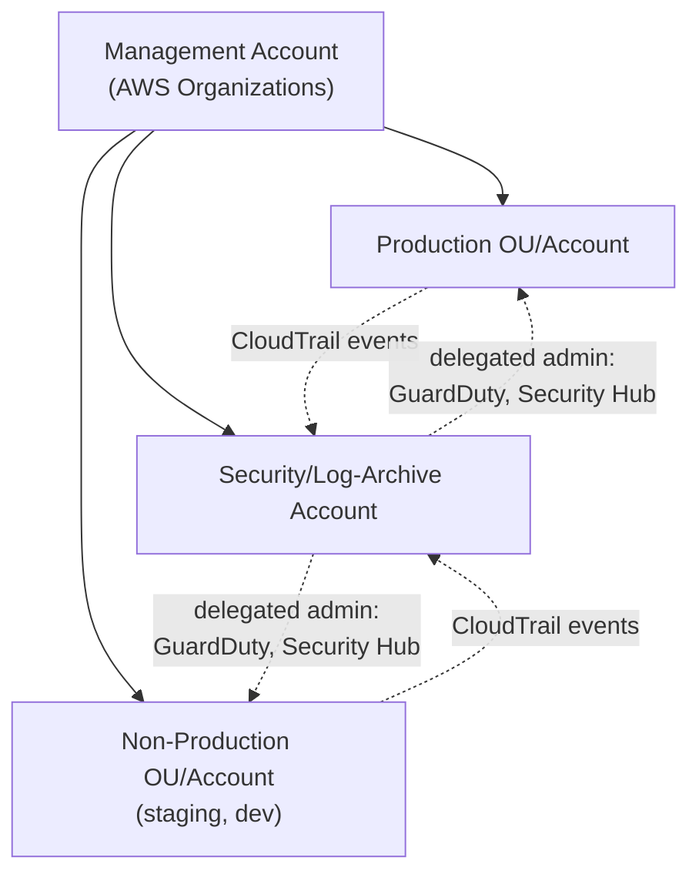

Step by step: (1) the management account creates the Organization and dedicated member
accounts for production, non-production, and security; (2) every account's CloudTrail events
flow into the security account's aggregated, tamper-resistant trail, which production/non-prod
administrators cannot alter since it lives outside their own account; (3) the security account
is also designated the delegated administrator for GuardDuty and Security Hub, giving one team
a single, centralized view of findings across every account without needing admin rights
inside each workload account itself.

**Why the others are wrong:**
- **A** IAM policies and tagging conventions are *logical* separation only — a misconfigured policy, a compromised credential, or simple human error in the single account can still reach "staging" resources from "production" context (or vice versa) since there's no hard account boundary; this is explicitly the weaker posture the security team wants to move away from.
- **C** adding only a staging account while leaving production and all security tooling combined in the original account still leaves production unisolated from the account holding (and able to tamper with) its own security logs/tooling — it's a partial step that misses the core problem (prod isolation and tamper-resistant centralized logging) entirely.
- **D** IAM Identity Center permission sets control *who can access what within/across* accounts — they don't create account-level resource isolation at all; "simulating" account isolation with permission sets inside a single account provides none of the hard boundary benefits (blast-radius containment, independent service limits, isolated billing) that separate accounts actually provide.

Reference: [`domain-1-secure-architectures/multi-account-security-strategy.md`](../domain-1-secure-architectures/multi-account-security-strategy.md)

---

## Question 64

*(Domain 3 — High-Performing Architectures)*

A ride-sharing app ingests GPS location pings from millions of active drivers' phones,
arriving continuously at a very high rate, and needs to process this stream in near-real-time
to update live driver positions on the rider's map, while also feeding the same stream into a
separate analytics pipeline. What should the Solutions Architect use to ingest this
high-throughput stream such that both consumers can independently process it?

A) Write each GPS ping directly into DynamoDB with no intermediate layer, and have both consumers poll DynamoDB directly
B) Amazon Kinesis Data Streams, ingesting the high-throughput GPS ping stream durably and ordered-per-shard, with both the live-map-update consumer and the analytics consumer reading independently from the same stream via separate consumer applications
C) A single SQS standard queue, with both consumers competing to read the same messages
D) Amazon SNS, publishing each GPS ping as a notification with no retention

**Correct Answer: B**

**Why correct:** [Kinesis Data Streams](../../../services/analytics/kinesis-family.md) is designed for exactly this kind of high-throughput, continuous data stream (GPS pings from millions of devices), retaining data for a configurable window (so multiple consumers can read it independently, at their own pace, without affecting each other) and supporting multiple independent consumer applications reading the **same** stream concurrently — the live-map-update consumer and the analytics pipeline each maintain their own position/checkpoint in the stream, satisfying "near-real-time" processing and "both consumers independently" reading the same underlying data.

**Why the others are wrong:**
- **A** writing every GPS ping directly to DynamoDB and having two different consumers "poll" it isn't how DynamoDB is meant to be consumed for a continuous stream use case (no native multi-consumer streaming semantics for this pattern), and polling a database table at the volume of millions of continuous pings would be far more expensive and less scalable than a purpose-built streaming service.
- **C** an SQS standard queue delivers each message to whichever consumer happens to receive and delete it first — it does **not** support multiple independent consumers each seeing every message (that's specifically the gap Kinesis's multi-consumer model, or SNS fan-out to separate queues, solves) — the map-update consumer and analytics consumer would end up splitting/competing for messages rather than both processing every ping.
- **D** SNS has no built-in retention of messages for later/replayed reading — once delivered, the message is gone; a streaming analytics pipeline often needs to reprocess or catch up on historical stream data, which SNS's no-retention/push model doesn't support the way Kinesis's retained, replayable stream does.

Reference: [`services/analytics/kinesis-family.md`](../../../services/analytics/kinesis-family.md)

---

## Question 65

*(Domain 2 — Resilient Architectures)*

A company's Application Load Balancer distributes traffic to an Auto Scaling group spanning
two Availability Zones. Due to a recent scale-in event, AZ-A currently has 8 running instances
while AZ-B has only 2, but the ALB is still sending roughly half of all requests to each AZ —
overloading AZ-B's 2 instances while AZ-A's 8 instances sit comparatively idle. What ALB
setting addresses this imbalance?

A) Enable cross-zone load balancing, so the ALB distributes requests evenly across all registered **targets** regardless of which AZ they're in, rather than evenly across AZs first
B) Add more Availability Zones to the ALB to dilute the imbalance
C) Manually rebalance by terminating instances in AZ-A until both AZs have the same count
D) Switch from an Application Load Balancer to a Network Load Balancer, which always balances evenly regardless of target distribution

**Correct Answer: A**

**Why correct:** [Cross-zone load balancing](../../../services/networking-content-delivery/elastic-load-balancing.md) changes the ALB's distribution behavior from "split traffic evenly across AZs, then evenly across that AZ's targets" (which is what creates the imbalance when AZs have unequal target counts) to "distribute evenly across **all** registered targets in all enabled AZs combined" — so with cross-zone load balancing enabled, each of the 10 total instances (8 in AZ-A, 2 in AZ-B) gets a roughly equal share of total requests, regardless of how unevenly they happen to be distributed across AZs at this moment. (Note: Application Load Balancers have cross-zone load balancing enabled by default at the load balancer level, but this is explicitly the setting/concept being tested and is worth understanding deeply since it can be toggled per target group and behaves differently for NLBs.)

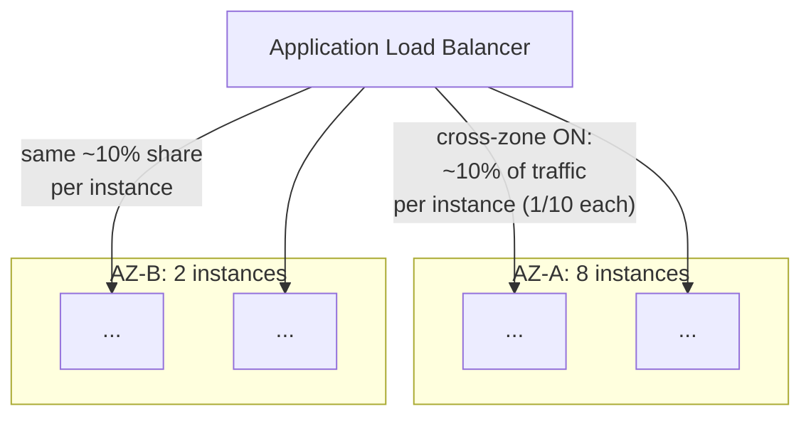

Step by step: (1) without cross-zone load balancing, the ALB would first split traffic 50/50
between AZ-A and AZ-B, then divide each half evenly among that AZ's targets — meaning each of
AZ-B's 2 instances gets 25% of all traffic while each of AZ-A's 8 instances gets just 6.25%;
(2) with cross-zone load balancing enabled, the ALB instead pools all 10 targets together and
divides total traffic evenly across all of them, so every instance (in either AZ) gets roughly
10% of total requests; (3) this removes the AZ-B overload entirely without needing to touch
the Auto Scaling group's instance counts at all.

**Why the others are wrong:**
- **B** adding more AZs doesn't fix the underlying per-target distribution mechanism — it could even make an uneven-target-count problem worse by adding yet another AZ with its own potentially different instance count.
- **C** manually terminating healthy instances in AZ-A to force an equal count is a fragile, manual workaround that fights against the Auto Scaling group's own scaling decisions, rather than fixing the actual distribution *mechanism* — and it would need to be repeated every time the ASG rebalances again.
- **D** Network Load Balancers do not "always balance evenly regardless of target distribution" by default either — NLBs historically balance primarily at the AZ level in a comparable way unless cross-zone load balancing is explicitly enabled for the NLB too (and NLBs operate at Layer 4, not Layer 7 — switching load balancer types is also an unnecessary architecture change just to fix a load-balancing distribution setting).

Reference: [`services/networking-content-delivery/elastic-load-balancing.md`](../../../services/networking-content-delivery/elastic-load-balancing.md)
