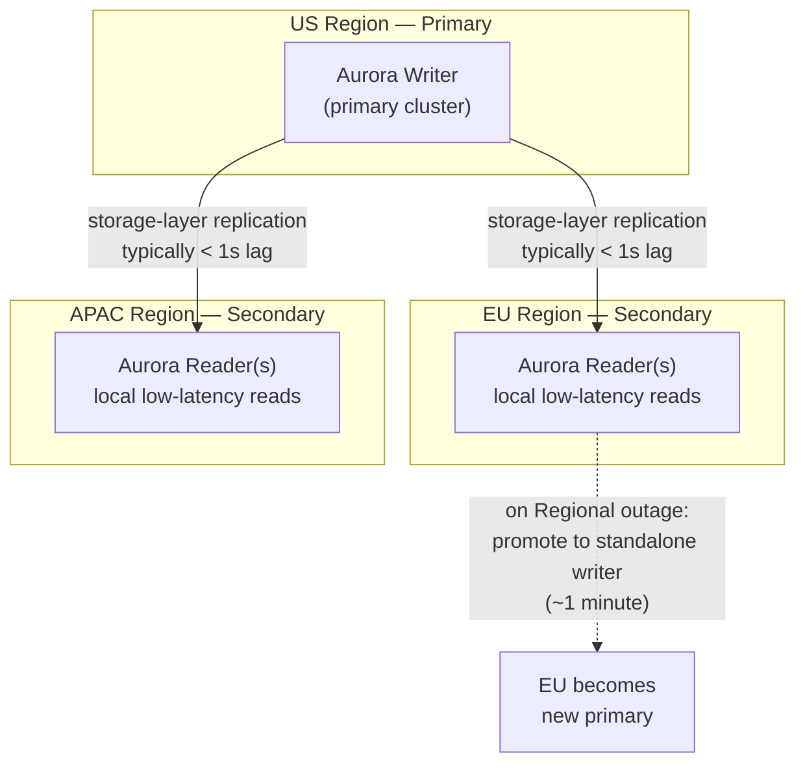
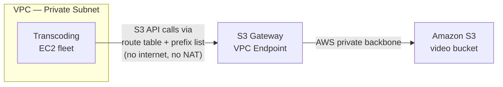
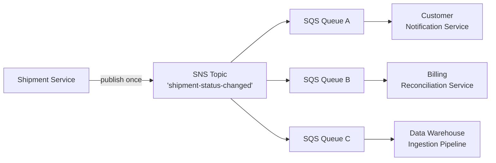
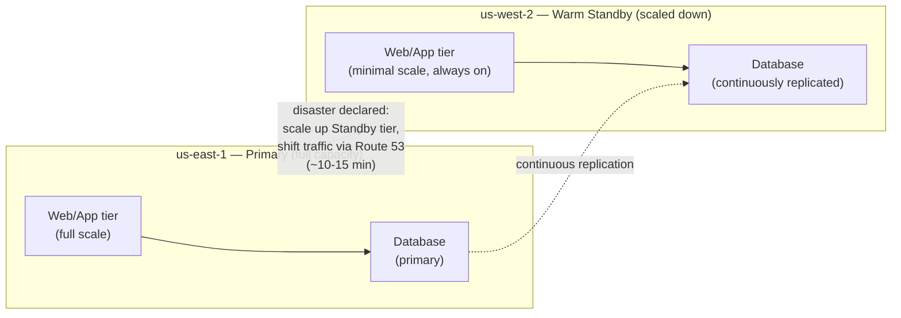
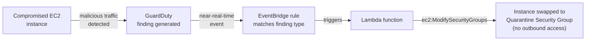
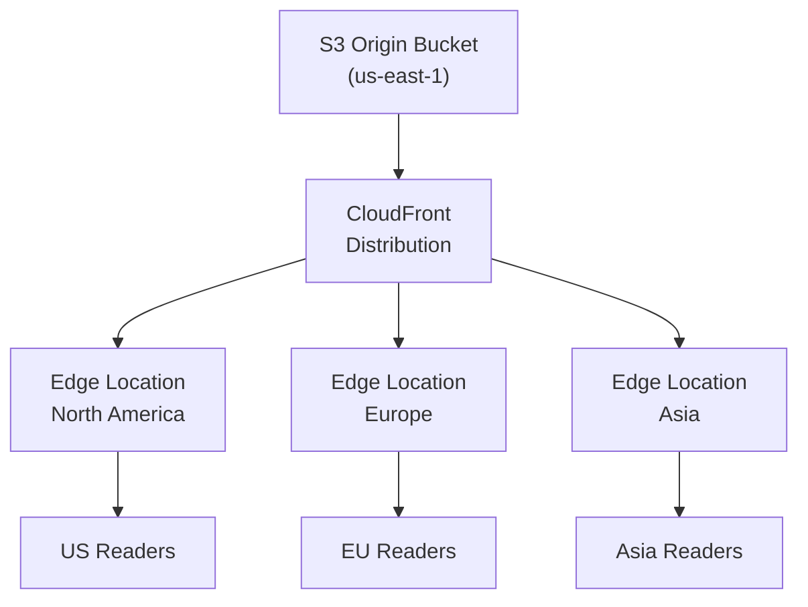

# SAA-C03 Exam Bank 1 — Study-Mode Practice Exam (65 Questions)

This is a **study-mode** exam bank: every question is immediately followed by its answer and
a full explanation, right where you're reading it — not in a separate answer-key file. Use it
for active drilling and review, not timed simulation. For the timed, blind-until-you-finish
mock-exam experience, see [`../practice-questions/full-exams/`](../practice-questions/full-exams/index.md)
instead. See [`./README.md`](README.md) for how this bank fits with Bank 2, Bank 3, and the
rest of the SAA-C03 material in this repo.

Like the real exam, this bank has **65 questions** (50 scored + 15 unscored equivalents — all
65 count for practice), domains **interleaved/mixed** rather than grouped, and weighted to the
official blueprint:

| Domain | Weight | Questions in this bank |
|---|---|---|
| [Domain 1 — Secure Architectures](../domain-1-secure-architectures/README.md) | 30% | 20 |
| [Domain 2 — Resilient Architectures](../domain-2-resilient-architectures/README.md) | 26% | 17 |
| [Domain 3 — High-Performing Architectures](../domain-3-high-performing-architectures/README.md) | 24% | 15 |
| [Domain 4 — Cost-Optimized Architectures](../domain-4-cost-optimized-architectures/README.md) | 20% | 13 |
| **Total** | **100%** | **65** |

All scenarios in this bank are original and distinct from the domain-split
[`practice-questions/`](../practice-questions/index.md) bank and the
[`practice-questions/full-exams/`](../practice-questions/full-exams/index.md) mock exams, and
distinct from Bank 2 and Bank 3 in this folder.

---

## Question 1

*(Domain 1 — Secure Architectures)*

Meridian Health just acquired a 40-person telehealth startup. The startup's engineers need
scoped, temporary access into 12 of Meridian's existing AWS accounts (one per product line)
immediately, without Meridian creating a single new IAM user or access key in any of those
accounts, and without the startup's engineers juggling 12 separate sets of credentials. Both
companies already run Okta as their identity provider. What should the Solutions Architect do?

A) In each of the 12 accounts, create an IAM user per startup engineer and attach a managed policy scoped to that account's resources
B) Federate Okta with AWS IAM Identity Center at the Organization's management account, and assign the startup engineers permission sets scoped to the relevant 12 accounts
C) Create one cross-account IAM role in the management account that trusts Okta directly via SAML, and have engineers assume it manually through the CLI for each account
D) Issue each startup engineer a long-lived access key tied to a shared "contractor" IAM user replicated into all 12 accounts

**Correct Answer: B**

**Why correct:** [IAM Identity Center](../../../services/security-identity-compliance/iam-identity-center-sso.md) federates once against an external IdP (Okta) and lets administrators assign **permission sets** — reusable permission templates — to specific AWS accounts inside an Organization. A startup engineer logs in once through the Identity Center portal (their existing Okta credentials) and sees only the accounts/roles they've been assigned, receiving short-lived [STS](../../../services/security-identity-compliance/sts-and-role-switching.md) credentials behind the scenes. This satisfies "one login, scoped per-account access, zero new IAM users or keys" exactly, and scales cleanly as more accounts or engineers are added later.

**Why the others are wrong:**
- **A** is the literal anti-pattern the prompt rules out: 12 accounts × 40 engineers means up to 480 IAM users to create, rotate, and eventually delete, with no single sign-on and a large credential-sprawl surface.
- **C** federates SAML directly to a single role rather than using Identity Center's account/permission-set model, forcing every engineer to manually run `aws sts assume-role` for each of the 12 accounts separately — it technically avoids new IAM users, but reintroduces exactly the "juggling 12 sets of access" friction the prompt wants removed, and doesn't scale to assigning different permissions per account cleanly.
- **D** combines the long-lived-credential anti-pattern with a *shared* identity, which also kills individual accountability in CloudTrail — every action from any of the 40 engineers would show up under the same principal.

Reference: [`services/security-identity-compliance/iam-identity-center-sso.md`](../../../services/security-identity-compliance/iam-identity-center-sso.md)

---

## Question 2

*(Domain 2 — Resilient Architectures)*

A regional bank runs its core transaction-processing database on Amazon RDS for PostgreSQL.
Compliance requires that a single Availability Zone failure cause **no data loss and minimal
downtime**, with failover handled automatically — the operations team should not need to
manually promote a replica during an incident. What should the Solutions Architect configure?

A) A read replica in a second Availability Zone, promoted manually by an on-call engineer during an outage
B) Multi-AZ deployment for the RDS instance, which maintains a synchronously replicated standby in a second AZ and fails over automatically
C) Nightly automated snapshots copied to a second AZ, restored into a new instance if the primary AZ fails
D) A single-AZ RDS instance with Auto Scaling configured on the DB instance to relaunch it in another AZ on failure

**Correct Answer: B**

**Why correct:** RDS [Multi-AZ](../../../services/database/rds.md) deployments maintain a **synchronous** standby replica in a different AZ. Because replication is synchronous, a committed transaction exists on both the primary and standby before being acknowledged — so an AZ failure loses no committed data. RDS automatically detects the failure and flips the DNS endpoint to the standby, typically within 60–120 seconds, with zero manual intervention, exactly matching "automatic, minimal downtime, no data loss."

**Why the others are wrong:**
- **A** uses asynchronous replication for read replicas, so some in-flight transactions can be lost during failover, and "promoted manually by an on-call engineer" directly violates the "automatic, no manual step" requirement.
- **C** has an RPO measured in up to 24 hours (since the last nightly snapshot) — any transactions after the last snapshot are gone, which fails the "no data loss" bar outright, and restoring a snapshot into a running instance takes many minutes to hours, not matching "minimal downtime."
- **D** doesn't exist as described — RDS instances aren't part of an EC2 Auto Scaling group, and there is no native "relaunch in another AZ" mechanism outside of Multi-AZ; this option describes a feature RDS doesn't have.

Reference: [`services/database/rds.md`](../../../services/database/rds.md)

---

## Question 3

*(Domain 2 — Resilient Architectures)*

A global trading platform needs a database that can serve low-latency reads from three
Regions (US, EU, APAC) and, in a full Regional outage, promote a secondary Region to primary
**in under a minute** with minimal data loss. The existing engine is Amazon Aurora PostgreSQL.
What should the Solutions Architect recommend?

A) Aurora Multi-AZ with cross-Region automated backups copied to the other two Regions
B) Aurora Global Database, with one primary Region and up to five secondary read-only Regions kept in sync via dedicated storage-layer replication, using managed planned failover or unplanned failover promotion for the secondary
C) Three independent Aurora clusters, one per Region, with application-level dual writes to keep them in sync
D) A single Aurora cluster in the US Region, fronted by CloudFront for the EU and APAC users

**Correct Answer: B**

**Why correct:** [Aurora Global Database](../../../services/database/aurora.md) replicates at the storage layer across Regions with typical replication lag under one second, independent of compute — exactly what "low-latency reads from three Regions" needs, since each secondary Region has its own local read endpoint. Its managed **failover/promotion** of a secondary to a standalone writable primary is designed to complete in about a minute (unplanned failover is explicitly built for the under-a-minute target in a Regional outage), satisfying both the RTO and low-RPO requirements.

Step by step: (1) the US Region holds the single writable primary cluster; (2) the EU and APAC
clusters are read-only secondaries receiving continuous storage-layer replication, so local
users get fast reads without crossing an ocean; (3) if the US Region fails entirely, an
operator (or an automated runbook) promotes one secondary — say EU — to a standalone writable
primary in roughly a minute, after which that Region serves both reads and writes until the
original Region recovers.

**Why the others are wrong:**
- **A** confuses Multi-AZ (same-Region HA) with cross-Region DR — automated backups copied cross-Region give you an RPO of however old the last backup/log shipment is and require a full restore (many minutes to hours), nowhere near "under a minute."
- **C** pushes the hard problem (conflict-free multi-master writes across three Regions) onto the application, which is far more complex and error-prone than using Aurora's native replication, and risks write conflicts/data divergence that Aurora Global Database's single-writer model avoids entirely.
- **D** doesn't solve the read-latency problem at all — CloudFront caches HTTP responses, not direct database query results, and EU/APAC users querying a US-only database still pay full cross-ocean round-trip latency for every query; it also provides zero failover capability.

Reference: [`services/database/aurora.md`](../../../services/database/aurora.md)

---

## Question 4

*(Domain 1 — Secure Architectures)*

A cybersecurity insurer requires, as a condition of coverage, that **GuardDuty can never be
disabled or suspended in any of a client company's 30 AWS accounts, by anyone, including the
account root user**, and that this be provable to an auditor without relying on any individual
administrator's good judgment. What should the Solutions Architect implement?

A) An IAM policy denying `guardduty:DeleteDetector` and `guardduty:StopMonitoringMembers`, attached to every human IAM role across the 30 accounts
B) A Service Control Policy attached at the Organization root (or an OU containing all 30 accounts) that denies the relevant GuardDuty disable/delete actions for all principals, including root
C) A GuardDuty detector per account with an EventBridge rule that re-enables GuardDuty if it's found disabled, checked hourly
D) A written security policy document requiring administrators to get written approval before disabling GuardDuty

**Correct Answer: B**

**Why correct:** A [Service Control Policy](../../../services/security-identity-compliance/organizations-and-scps.md) is a permission **ceiling** enforced by AWS Organizations at the account boundary — it applies to every principal in the account, including that account's own root user, and a member account cannot remove or override an SCP applied from above it. That is the only mechanism in this list that is both preventive (not detect-and-react) and literally un-bypassable by anyone inside the 30 accounts, which is exactly what "can never be disabled, by anyone, including root, provably" requires.

**Why the others are wrong:**
- **A** is an IAM policy, which by definition does not apply to the root user and can be edited or detached by anyone with sufficient IAM permissions inside that same account — it's bypassable from within, failing the "including root" and "provable" bars.
- **C** is reactive, not preventive: there's a window (up to an hour, by the scenario's own check interval) where GuardDuty is off and the environment is unmonitored, and "re-enable after the fact" isn't the same guarantee as "can never be disabled."
- **D** is a paper policy with no technical enforcement at all — it relies entirely on individual compliance and leaves no automatic proof that it was actually followed, which an insurer's auditor would reject as a control.

Reference: [`services/security-identity-compliance/organizations-and-scps.md`](../../../services/security-identity-compliance/organizations-and-scps.md)

---

## Question 5

*(Domain 3 — High-Performing Architectures)*

An online furniture retailer's product-catalog page issues the same handful of "get product
details" and "get current price" database queries millions of times per hour, and the RDS
MySQL primary is now CPU-bound purely from read traffic, even though the underlying data
changes only a few times a day. What should the Solutions Architect add to improve performance
most cost-effectively, without re-architecting the database layer?

A) Upgrade the RDS instance to the largest available instance class
B) Add an Amazon ElastiCache (Redis or Memcached) layer in front of RDS, caching the catalog/price query results with a short TTL
C) Add more RDS read replicas and round-robin all catalog reads across them
D) Migrate the catalog data into DynamoDB with on-demand capacity

**Correct Answer: B**

**Why correct:** [ElastiCache](../../../services/database/elasticache.md) is purpose-built for exactly this pattern — a small set of frequently-repeated, rarely-changing read queries. Caching those results in memory means the vast majority of requests never touch RDS at all, cutting load (and CPU) on the database dramatically for a fraction of the cost of scaling RDS itself, and it requires no changes to the data model — the application just checks the cache before querying the database.

**Why the others are wrong:**
- **A** throws more (expensive) compute at a problem that's actually about redundant, repeated identical reads — it treats the symptom and keeps paying for capacity the workload doesn't structurally need, rather than eliminating the redundant work.
- **C** scales read capacity but each replica is still a full database instance paying to re-execute the same repeated query over and over — it's more expensive than caching and still carries replication lag, when the data barely changes anyway.
- **D** is a much larger re-architecture ("without re-architecting the database layer" is explicitly ruled out by the prompt) — migrating an existing relational catalog schema to DynamoDB is a significant data-modeling and application-rewrite effort just to solve a caching problem that ElastiCache solves directly.

Reference: [`services/database/elasticache.md`](../../../services/database/elasticache.md)

---

## Question 6

*(Domain 1 — Secure Architectures)*

A healthcare SaaS company encrypts its RDS databases with a customer-managed KMS key. As part
of its disaster recovery plan, encrypted snapshots must be copied to a secondary Region and be
restorable there **without manually re-creating and re-granting a brand-new KMS key** in that
Region during an actual disaster. What should the Solutions Architect set up ahead of time?

A) Copy the encrypted snapshot to the DR Region using the AWS managed `aws/rds` key, which exists by default in every Region
B) Create a KMS multi-Region key in the primary Region, replicate it as a multi-Region replica key in the DR Region, and use the replica key when copying/restoring the snapshot there
C) Disable encryption on the snapshot before copying it cross-Region, then re-encrypt after restore completes
D) Store the KMS key material as a Secrets Manager secret and manually re-import it into a new key in the DR Region during the disaster

**Correct Answer: B**

**Why correct:** [KMS multi-Region keys](../../../services/security-identity-compliance/kms.md) are created as a set — a primary key and one or more independently-manageable replica keys in other Regions that share the same underlying key material and key ID. A snapshot encrypted with the primary key can be copied cross-Region and decrypted/restored there using the replica key, with no cross-Region re-encryption step and no manual key regeneration needed during the actual incident — exactly the "set it up ahead of time, usable instantly during DR" requirement.

**Why the others are wrong:**
- **A** is wrong because AWS managed keys (`aws/rds`) are Region-specific and cannot be shared or replicated across Regions — the whole point of needing something at all here is that the default per-Region managed key can't satisfy cross-Region restore without the owner's involvement.
- **C** removes encryption during transit/copy, which is itself a compliance violation for a healthcare company (likely subject to HIPAA), and manually re-encrypting afterward is exactly the manual, in-the-moment step the prompt says to avoid.
- **D** describes exporting raw key material, which KMS customer-managed keys backed by AWS's default key store do not support exporting at all, and even where key import is used, doing this manually mid-disaster is precisely the slow, error-prone, in-the-moment process the requirement rules out.

Reference: [`services/security-identity-compliance/kms.md`](../../../services/security-identity-compliance/kms.md)

---

## Question 7

*(Domain 2 — Resilient Architectures)*

A publicly traded company must retain its application audit logs for seven years and keep a
geographically separate copy in a different AWS Region in case the primary Region's S3 data is
ever lost or corrupted. Logs are written continuously to an S3 bucket in `us-east-1`. What
should the Solutions Architect configure?

A) A scheduled Lambda function that lists and copies new objects from the `us-east-1` bucket to a `eu-west-1` bucket once per day
B) S3 Cross-Region Replication (CRR) from the `us-east-1` bucket to a bucket in `eu-west-1`, with versioning enabled on both buckets
C) A single S3 bucket with multiple Availability Zones selected during creation
D) AWS Backup configured to back up the S3 bucket to Amazon Glacier in the same Region

**Correct Answer: B**

**Why correct:** [S3 Cross-Region Replication](../../../services/storage/s3.md) automatically and asynchronously copies new (and optionally existing) objects from a source bucket to a destination bucket in a different Region, continuously and near-real-time, as objects are written — not on a batch schedule. Versioning is a hard prerequisite for CRR on both the source and destination bucket, which also gives the added benefit of protecting against accidental overwrite/delete in either location.

**Why the others are wrong:**
- **A** reinvents CRR poorly: a once-a-day batch job means up to 24 hours of data could be lost if the primary Region fails between runs, it's custom code to build and maintain, and it doesn't handle deletes, versioning, or failure retries the way the managed CRR feature does.
- **C** is not a real S3 feature — S3 buckets exist within a single Region and are already redundant *across* multiple AZs within that Region automatically (that's the baseline S3 durability model), but "select multiple AZs during creation" is not something you configure, and it does nothing to protect against a Regional-scale event.
- **D** backs up within the same Region, which does not satisfy "geographically separate copy in a different Region" — it protects against accidental deletion but not a Regional-level event affecting that Region's AWS infrastructure.

Reference: [`services/storage/s3.md`](../../../services/storage/s3.md)

---

## Question 8

*(Domain 2 — Resilient Architectures)* **(Choose TWO)**

A global marketplace's shopping-cart service must accept writes with single-digit-millisecond
latency from shoppers in North America, Europe, and Asia simultaneously, and must keep running
(read and write) in every Region even if one Region goes down entirely. Which **two** design
choices satisfy this?

A) Use Amazon DynamoDB Global Tables with a table replicated across all three Regions, so each Region has a local, fully read/write replica
B) Use a single DynamoDB table in one Region, and have the other two Regions access it over cross-Region API calls
C) Design the application to write to whichever Region's local DynamoDB Global Tables replica is nearest the shopper, accepting that DynamoDB's last-writer-wins conflict resolution will reconcile any near-simultaneous conflicting writes to the same item
D) Use RDS Multi-AZ in one Region as the single source of truth, with read replicas in the other two Regions
E) Use S3 Transfer Acceleration to speed up cart-data synchronization between Regions

**Correct Answer: A, C**

**Why correct:** [DynamoDB Global Tables](../../../services/database/dynamodb.md) (**A**) provision a fully replicated, active-active table in each chosen Region — every Region's replica accepts both reads and writes locally, satisfying both the low-latency requirement (no cross-Region round trip) and the "keeps running everywhere even if one Region is down" requirement, since the other Regions are independent, fully functional replicas, not dependent on a single source-of-truth Region. Because every Region can write independently (**C**), the application has to accept DynamoDB Global Tables' built-in **last-writer-wins** conflict resolution for the rare case where the same item is updated in two Regions within the same propagation window — this is the documented, expected trade-off of true multi-Region active-active writes, and designing for it (e.g., using cart line-items that are easy to reconcile, or per-user partition keys that are rarely touched from two Regions simultaneously) is the correct approach.

**Why the others are wrong:**
- **B** defeats the entire point: cross-Region API calls to a single-Region table reintroduce exactly the hundred-plus-millisecond cross-ocean latency the requirement rules out, and that one Region becomes a single point of failure for the other two.
- **D** makes RDS the single source of truth in one Region, so if that Region fails, writes stop everywhere (read replicas in other Regions can't accept writes) — this fails "keep running everywhere even if one Region is down."
- **E** solves a completely different problem (accelerating large object uploads into S3) and has nothing to do with multi-Region database replication or cart-write latency.

Reference: [`services/database/dynamodb.md`](../../../services/database/dynamodb.md)

---

## Question 9

*(Domain 1 — Secure Architectures)*

A fintech company has 200 Lambda functions that all connect to the same RDS for MySQL
database using a single master credential. Security policy requires that the database password
be rotated automatically every 30 days **without any application downtime or manual code
changes to retrieve the new password**. What should the Solutions Architect implement?

A) Store the password in a `.env` file bundled into each Lambda function's deployment package, and redeploy all 200 functions every 30 days with a new password
B) Store the credential in AWS Secrets Manager with automatic rotation enabled (using the built-in RDS MySQL rotation Lambda), and have each of the 200 functions retrieve the credential from Secrets Manager at runtime
C) Store the password as a plaintext environment variable on each Lambda function's configuration, updated via a scheduled script
D) Store the credential in Systems Manager Parameter Store as a `String` parameter, with a reminder set for an engineer to manually update it every 30 days

**Correct Answer: B**

**Why correct:** [Secrets Manager's](../../../services/security-identity-compliance/secrets-manager-vs-parameter-store.md) native rotation integrates directly with RDS: it provides a pre-built rotation Lambda function that creates a new password, updates it on the RDS instance, and updates the secret — all automatically on a schedule, with zero manual steps. Because the 200 functions retrieve the credential *at runtime* by calling Secrets Manager (rather than having it baked into a deployment), none of them need redeploying when the password rotates, and Secrets Manager briefly keeps both the old and new credential valid during the rotation window specifically to avoid any connection downtime.

**Why the others are wrong:**
- **A** requires redeploying all 200 functions every 30 days just to update a password — that's both a manual/scripted operational burden and creates a redeploy-synchronization risk (if even one function isn't redeployed in time, it starts failing auth), which directly violates "without manual code changes."
- **C** has the same redeployment problem as A, and additionally stores the secret in plaintext configuration rather than an encrypted secret store, which is a weaker security posture than Secrets Manager's KMS-backed encryption.
- **D** uses Parameter Store's plain `String` type with no automatic rotation capability at all (SecureString + rotation support exists only through integration with Secrets Manager or custom rotation Lambdas you'd have to build yourself) and explicitly relies on a human "reminder" — exactly the manual process the requirement forbids.

Reference: [`services/security-identity-compliance/secrets-manager-vs-parameter-store.md`](../../../services/security-identity-compliance/secrets-manager-vs-parameter-store.md)

---

## Question 10

*(Domain 2 — Resilient Architectures)*

An events-ticketing site runs its web tier on EC2 instances behind an Application Load
Balancer. During a popular on-sale event, a handful of instances occasionally become
unresponsive (hung process) while still passing basic network-level health checks. The
Solutions Architect needs the unhealthy instances automatically detected and replaced without
manual intervention. What should be configured?

A) CloudWatch billing alarms that notify the on-call engineer by email to manually terminate hung instances
B) An Auto Scaling group with an ALB target group health check configured to use the application's `/health` HTTP endpoint (not just TCP), so the ASG replaces instances the ALB marks unhealthy
C) EC2 instance termination protection enabled on all web-tier instances
D) A Network Load Balancer in front of the web tier instead of an Application Load Balancer, relying on its TCP-level health checks

**Correct Answer: B**

**Why correct:** An [Auto Scaling group](../../../services/compute/ec2-auto-scaling.md) configured with **ELB health checks** (rather than only EC2 status checks) asks the attached ALB target group to determine instance health using an **application-layer** check — typically an HTTP GET against a `/health` endpoint that the app only returns 200 for when it's actually able to serve requests. A hung process that still responds at the TCP level but can't serve HTTP requests will be marked unhealthy by this check, and the ASG will automatically terminate and replace it with no human involvement — exactly what's needed.

**Why the others are wrong:**
- **A** is purely a notification mechanism requiring a human to act — it doesn't automatically detect-and-replace anything, violating the "without manual intervention" requirement.
- **C** does the opposite of what's needed: termination protection actively *prevents* an instance from being terminated (manually or automatically), which would stop the ASG from being able to replace a hung instance at all.
- **D**'s core issue remains unsolved: a Network Load Balancer's default health checks operate at TCP (or optionally HTTP, but the option specifically says "relying on its TCP-level health checks") — a hung process that still accepts TCP connections but can't process requests would still pass a TCP-level check and never get flagged unhealthy.

Reference: [`services/compute/ec2-auto-scaling.md`](../../../services/compute/ec2-auto-scaling.md)

---

## Question 11

*(Domain 1 — Secure Architectures)*

A media company's video-transcoding fleet runs on EC2 instances in private subnets with no
internet gateway route. The instances need to read and write large video files to S3
frequently, with high throughput, **without** traversing the public internet or a NAT Gateway
(cost and security both matter here). What should the Solutions Architect configure?

A) A NAT Gateway in the public subnet, with a route from the private subnet's route table
B) A Gateway VPC endpoint for S3, with a route added to the private subnet's route table pointing at the endpoint
C) An Interface VPC endpoint for S3, since Gateway endpoints don't support EC2 traffic
D) A VPN connection from the VPC to the nearest S3 Regional endpoint

**Correct Answer: B**

**Why correct:** [S3 Gateway VPC endpoints](../../../services/networking-content-delivery/vpc-endpoints-privatelink.md) are free, add a route-table entry (a prefix list pointing at the endpoint) so S3 traffic flows over AWS's private backbone network instead of the internet, and support full S3 throughput — ideal for exactly this "high-throughput, no internet/NAT, cost matters" scenario, since Gateway endpoints have no hourly or per-GB processing charge (unlike NAT Gateway or Interface endpoints).

Step by step: (1) the private subnet's route table gets a new route whose destination is the
S3-service prefix list and whose target is the Gateway endpoint; (2) when an instance calls the
S3 API, that route sends the traffic to the endpoint instead of to a NAT Gateway or internet
gateway; (3) the endpoint forwards the request over AWS's internal network directly to S3,
never touching the public internet, and at no additional per-GB cost.

**Why the others are wrong:**
- **A** routes through a NAT Gateway, which does work functionally but bills per-hour and per-GB processed — directly against the "cost matters" requirement, and it also means traffic leaves the VPC's private network path (via the internet gateway) rather than staying fully internal.
- **C** is factually backwards — S3 (and DynamoDB) are specifically the two services supported by the free Gateway endpoint type; Interface endpoints (PrivateLink, billed hourly + per-GB) are used for most *other* AWS services, not S3, so this claim misstates which endpoint type applies.
- **D** describes using a VPN tunnel to reach a public AWS service endpoint, which is not how S3 access works, adds unnecessary complexity and cost, and VPNs are meant for connecting *networks* (e.g., on-prem to VPC), not for providing private access to in-Region AWS services.

Reference: [`services/networking-content-delivery/vpc-endpoints-privatelink.md`](../../../services/networking-content-delivery/vpc-endpoints-privatelink.md)

---

## Question 12

*(Domain 2 — Resilient Architectures)*

An online bookstore's order-processing Lambda function occasionally fails due to a downstream
inventory service timing out under load. Orders that fail must never be silently dropped, and
the system should automatically retry transient failures a few times before setting aside any
order that still can't be processed, for later investigation. What should the Solutions
Architect design?

A) Have the storefront call the order-processing Lambda function directly and synchronously, with the frontend displaying an error if it fails
B) Place an SQS queue in front of the order-processing Lambda (as an event source), configure a redrive policy with a maximum receive count, and set up a dead-letter queue (DLQ) to catch orders that exceed that count
C) Have the Lambda function catch exceptions internally and simply log them to CloudWatch Logs before returning success
D) Increase the Lambda function's timeout to the maximum (15 minutes) so it has more time to succeed on every invocation

**Correct Answer: B**

**Why correct:** [SQS](../../../services/application-integration/sqs.md) decouples the order submission from processing: a message that fails processing becomes visible again after its visibility timeout and is retried, and the **redrive policy's `maxReceiveCount`** controls exactly "retry a few times" before the message is automatically moved to the configured **dead-letter queue** — satisfying "never silently dropped" (it's preserved in the DLQ) and "automatically retry before setting aside for investigation" precisely as specified.

**Why the others are wrong:**
- **A** has no retry or persistence mechanism at all — a failed synchronous call just shows the customer an error, and if they don't retry manually themselves, the order is lost with no record of it for investigation.
- **C** is worse than doing nothing: swallowing the exception and returning success means the caller (and any monitoring) believes the order succeeded when it didn't, hiding the failure entirely rather than preserving it for review.
- **D** doesn't address the problem described — the issue is a downstream service timing out under load (an external dependency issue), not the Lambda function running out of its own execution time; a longer timeout doesn't add retry logic or preserve failed orders.

Reference: [`services/application-integration/sqs.md`](../../../services/application-integration/sqs.md)

---

## Question 13

*(Domain 2 — Resilient Architectures)*

A logistics company publishes a single "shipment status changed" event that must reliably
reach three completely independent systems: a customer-notification service, a billing
reconciliation service, and a data warehouse ingestion pipeline. Each consumer processes at
its own pace, and a slow or failed consumer must never block or lose events for the others.
What should the Solutions Architect design?

A) Have the shipment service call all three downstream systems' APIs directly and synchronously, one after another
B) Publish the event to an SNS topic with three separate SQS queues subscribed (fan-out pattern), one queue per consumer
C) Write the event directly into each of the three consumers' databases from the shipment service
D) Use a single SQS queue that all three consumer services poll from

**Correct Answer: B**

**Why correct:** The [SNS fan-out to SQS](../../../services/application-integration/sns.md) pattern publishes one message once to an SNS topic, and SNS delivers a durable copy to **each** subscribed SQS queue independently. Each consumer then has its own queue to poll at its own pace — a slow billing-reconciliation consumer backing up its queue has zero effect on the notification or warehouse queues, and if one consumer's queue processing fails, the message isn't lost (it stays in that queue, retried per its own redrive policy) without affecting the others at all.

Step by step: (1) the shipment service publishes the event exactly once to the SNS topic;
(2) SNS fans that single publish out to all three subscribed queues, giving each consumer its
own independent, durable copy; (3) each consumer polls only its own queue on its own schedule —
a backlog or outage in the billing queue has no visibility to, or effect on, the notification
or warehouse queues.

**Why the others are wrong:**
- **A** makes the shipment service responsible for calling three downstream APIs synchronously — if any one is slow or down, it blocks (or fails) the whole chain, and there's no retry or durability if a call fails partway through.
- **C** requires the shipment service to know the internal database schema of three unrelated services and write directly to them, which is tight coupling across team/service boundaries (a maintenance and security anti-pattern), and offers none of SQS/SNS's durability or retry semantics.
- **D** with a single shared queue means whichever consumer polls a message first deletes it (or, without careful design, all three consumers race for the same messages) — a single queue cannot deliver the same message independently to three different consumers; that is specifically what the fan-out pattern with per-consumer queues solves.

Reference: [`services/application-integration/sns.md`](../../../services/application-integration/sns.md)

---

## Question 14

*(Domain 1 — Secure Architectures)*

A company uses a third-party SaaS vulnerability-scanning tool that exposes its API via AWS
PrivateLink. Security policy requires that traffic to this scanner never traverse the public
internet and that the connection be reachable only from inside the company's VPC. What should
the Solutions Architect configure?

A) An Interface VPC endpoint in the company's VPC pointing at the SaaS vendor's VPC endpoint service, with a security group restricting which internal resources can reach it
B) A NAT Gateway with an outbound-only route to the vendor's public API endpoint
C) A Site-to-Site VPN connection directly to the SaaS vendor's data center
D) A public Elastic IP attached to an EC2 proxy instance that forwards traffic to the vendor's API

**Correct Answer: A**

**Why correct:** [Interface VPC endpoints (PrivateLink)](../../../services/networking-content-delivery/vpc-endpoints-privatelink.md) are exactly the mechanism third-party SaaS vendors expose via "endpoint services" for private connectivity — creating an Interface endpoint in the company's VPC gives it a private IP (via an ENI) that routes directly to the vendor's service over AWS's internal network, never touching the public internet, and a security group on the endpoint's ENI controls exactly which internal resources may reach it, satisfying both the "never traverses the internet" and "reachable only from inside the VPC" requirements.

**Why the others are wrong:**
- **B** explicitly sends traffic out to a public API endpoint over the internet (a NAT Gateway's whole purpose is enabling outbound *internet* access) — the opposite of "never traverses the public internet."
- **C** is designed for connecting two private networks (e.g., on-prem to a VPC), not for reaching a SaaS vendor's PrivateLink-exposed API — the vendor almost certainly doesn't offer VPN endpoints for this purpose, and it's a far heavier solution than what PrivateLink already provides out of the box.
- **D** builds a custom internet-facing proxy specifically to reach a public endpoint, which both violates "never traverses the public internet" and adds an unnecessary, unmanaged single point of failure and security liability (a publicly reachable EC2 instance) that PrivateLink eliminates.

Reference: [`services/networking-content-delivery/vpc-endpoints-privatelink.md`](../../../services/networking-content-delivery/vpc-endpoints-privatelink.md)

---

## Question 15

*(Domain 2 — Resilient Architectures)*

An e-commerce company's primary Region is `us-east-1`. Leadership wants a disaster recovery
plan for `us-west-2` that can take over serving live traffic **within 10–15 minutes** of a
declared disaster, while keeping steady-state DR costs meaningfully lower than running a full
duplicate production environment 24/7. What DR strategy should the Solutions Architect design?

A) Backup and restore: nightly snapshots copied to `us-west-2`, with infrastructure provisioned from scratch only after a disaster is declared
B) Pilot light: a minimal always-on core (e.g., a continuously replicated database) in `us-west-2`, with the rest of the stack (app/web tier) defined as infrastructure-as-code but scaled to zero until needed
C) Warm standby: a scaled-down but fully functional copy of the entire stack running continuously in `us-west-2`, scaled up to full capacity during failover
D) Multi-site active/active: full production capacity running in both Regions simultaneously at all times

**Correct Answer: C**

**Why correct:** [Warm standby](../../../services/database/database-selection-guide.md) keeps a scaled-down but end-to-end functional copy of every tier running continuously in the DR Region — database replicating, app and web tiers running at low capacity — so failover is just a matter of scaling that already-running stack up and redirecting traffic (typically minutes, matching the 10–15 minute target), while costing meaningfully less than full multi-site active/active because the standby runs at reduced (not full) capacity until needed.

Step by step: (1) in steady state, `us-east-1` serves 100% of traffic at full capacity while
`us-west-2` runs the same application stack at a fraction of the capacity, purely to stay warm
and ready; (2) the database replicates continuously to the standby Region so data is always
current; (3) on a declared disaster, Auto Scaling in `us-west-2` scales the already-running web
and app tiers up to full capacity (fast, because the stack is already deployed and running —
unlike pilot light, which must still launch its app/web tier from scratch) and Route 53 is
updated to send traffic there, achieving the 10–15 minute target.

**Why the others are wrong:**
- **A** has an RTO measured in hours (provisioning infrastructure from scratch after the disaster is declared, then restoring data) — far slower than the 10–15 minute requirement, even though it's the cheapest option.
- **B** (pilot light) only keeps the data tier warm; the app/web tier still has to be launched from infrastructure-as-code and scaled up from zero during the actual disaster, which typically takes longer than the already-running (just scaled-down) tiers of warm standby — pilot light generally targets tens of minutes, not the aggressive 10–15 minute bar here.
- **D** satisfies the RTO easily (near-zero, since both Regions are already full-capacity) but directly violates "meaningfully lower than running a full duplicate production environment 24/7," since that's a literal description of what multi-site active/active costs.

Reference: [`services/database/database-selection-guide.md`](../../../services/database/database-selection-guide.md) and [`domain-2-resilient-architectures/disaster-recovery-strategies.md`](../domain-2-resilient-architectures/disaster-recovery-strategies.md)

---

## Question 16

*(Domain 1 — Secure Architectures)*

A security team wants compromised EC2 instances automatically contained the moment GuardDuty
detects malicious activity (such as the instance communicating with a known command-and-control
IP) — specifically, the instance's security group should be automatically swapped to a
"quarantine" security group with no outbound access, without waiting for a human to act. What
should the Solutions Architect implement?

A) A GuardDuty finding that emails the security team, who then manually isolate the instance in the AWS console
B) An EventBridge rule matching the relevant GuardDuty finding type, triggering a Lambda function that replaces the instance's security group with a quarantine security group
C) A scheduled Lambda function that runs every hour and checks GuardDuty findings from the past hour, then isolates any matching instances
D) AWS Config rules that mark the instance as non-compliant when a GuardDuty finding exists for it

**Correct Answer: B**

**Why correct:** [GuardDuty](../../../services/security-identity-compliance/guardduty.md) publishes findings as events that [EventBridge](../../../services/application-integration/eventbridge.md) can match in near-real-time; a rule filtered to the specific finding type (e.g., `UnauthorizedAccess:EC2/MaliciousIPCaller.Custom`) can trigger a Lambda function immediately — within seconds of the finding — that calls `ec2:ModifySecurityGroups` to swap the instance onto a locked-down quarantine security group, with zero human involvement, exactly matching "automatically... without waiting for a human to act."

Step by step: (1) GuardDuty continuously analyzes VPC Flow Logs, DNS logs, and CloudTrail for
threat indicators and raises a finding the instant it sees this instance talking to a known-bad
IP; (2) that finding is published as an event, and an EventBridge rule scoped to this specific
finding type (so unrelated findings don't trigger containment) catches it within seconds;
(3) the triggered Lambda function detaches the instance's current security groups and attaches
the quarantine group — which allows no outbound traffic — stopping any further data
exfiltration or C2 communication immediately, long before a human could react.

**Why the others are wrong:**
- **A** is purely reactive and depends on human response time — minutes to hours typically — during which the compromised instance keeps talking to its C2 server; this directly fails "without waiting for a human to act."
- **C** introduces up to an hour of delay before even checking, let alone acting — far too slow for active containment of an ongoing compromise, and it's needlessly complex compared to an event-driven trigger that reacts the moment the finding is created.
- **D** only marks the resource non-compliant in Config's inventory — it's a compliance/reporting signal, not a remediation action, and does nothing to actually change the instance's security group or stop its network access.

Reference: [`services/security-identity-compliance/guardduty.md`](../../../services/security-identity-compliance/guardduty.md)

---

## Question 17

*(Domain 4 — Cost-Optimized Architectures)*

A company runs a steady baseline of EC2 instances (various families, resized occasionally as
workloads evolve), plus a growing amount of Lambda and Fargate usage, all with predictable
24/7 usage going forward. Finance wants a cost commitment that reduces compute spend
significantly without locking the company into a specific EC2 instance family, size, or Region
for the next year. What should the Solutions Architect recommend?

A) Standard Reserved Instances for the exact instance types currently in use, purchased for a 1-year term
B) A Compute Savings Plan, committing to a consistent hourly dollar amount of usage across EC2, Lambda, and Fargate regardless of instance family, size, Region, or OS
C) On-Demand pricing for everything, revisited quarterly for optimization opportunities
D) Convertible Reserved Instances scoped to a single Availability Zone for guaranteed capacity

**Correct Answer: B**

**Why correct:** [Compute Savings Plans](../../../services/management-governance/cost-management-tools.md) are the most flexible discount commitment available — you commit to a steady hourly *dollar* amount (not a specific instance type), and that commitment automatically applies across EC2 (any family, size, OS, Region, tenancy), Fargate, and Lambda usage, discounted similarly to Convertible RIs (up to ~66%) without ever needing to specify or lock in which instance types you'll run — exactly matching "reduces spend significantly" plus "without locking into a specific family, size, or Region," and it covers Lambda/Fargate which Reserved Instances don't cover at all.

**Why the others are wrong:**
- **A** locks the discount to the *exact* instance family/size purchased — if the team resizes or changes instance families later (stated as a likelihood here), the RI no longer matches and its discount is wasted; Standard RIs also don't cover Lambda or Fargate usage at all.
- **C** leaves all of this spend at full on-demand price with no commitment-based discount at all, directly failing "reduce compute spend significantly."
- **D** is more flexible than Standard RIs (convertible RIs can change instance attributes) but is still an EC2-only mechanism that doesn't cover Lambda or Fargate, and scoping it to a single AZ is about capacity reservation, not the broad flexible discount the company is asking for.

Reference: [`services/management-governance/cost-management-tools.md`](../../../services/management-governance/cost-management-tools.md)

---

## Question 18

*(Domain 4 — Cost-Optimized Architectures)*

A visual-effects studio runs nightly batch rendering jobs on EC2. Each job is broken into
thousands of independent frame-render tasks, checkpointed so any individual task can be
restarted elsewhere if interrupted, and the studio has a flexible overnight window rather than
a hard deadline. What EC2 purchasing option minimizes cost for this workload?

A) On-Demand Instances, to guarantee no task is ever interrupted
B) Spot Instances, since the workload tolerates interruption and isn't time-critical
C) Standard Reserved Instances purchased for a 3-year term
D) Dedicated Hosts, to guarantee physical server isolation for each render task

**Correct Answer: B**

**Why correct:** [Spot Instances](../../../services/compute/ec2.md) offer the deepest EC2 discount (often 60–90% off On-Demand) in exchange for the possibility of a two-minute-warning interruption when AWS needs the capacity back — a perfect trade for workloads that are explicitly fault-tolerant, checkpointed, and not time-critical, exactly as described (independent restartable tasks, flexible overnight window). This is the textbook Spot use case called out repeatedly in AWS's own guidance: batch processing, rendering, and similar interruption-tolerant jobs.

**Why the others are wrong:**
- **A** pays full price specifically to avoid interruption risk the workload doesn't actually need protection from — the scenario explicitly states tasks can restart elsewhere, so paying the On-Demand premium for a guarantee that isn't needed wastes money.
- **C** is a poor fit for a nightly *batch* workload that isn't running 24/7 — Reserved Instances discount continuous, steady-state usage; a workload that only runs overnight still pays for the RI's full-time commitment whether or not it's rendering during the day, making it far more expensive than Spot for this usage pattern.
- **D** solves a compliance/licensing isolation problem (dedicated physical hardware), which has nothing to do with this scenario's cost-minimization goal for a fault-tolerant, bursty batch job, and Dedicated Hosts are typically more expensive than On-Demand, let alone Spot.

Reference: [`services/compute/ec2.md`](../../../services/compute/ec2.md)

---

## Question 19

*(Domain 3 — High-Performing Architectures)*

A news publisher's website serves images, CSS, and JavaScript to a global readership, with the
origin S3 bucket in `us-east-1`. Readers in Asia and Europe report the site feels slow compared
to US readers. The content changes only when a new article is published. What should the
Solutions Architect add to improve perceived load time for all readers worldwide?

A) Enable S3 Transfer Acceleration on the origin bucket
B) Deploy Amazon CloudFront in front of the S3 bucket, caching objects at edge locations close to each reader
C) Create additional copies of the S3 bucket in every Region readers are located in, and route readers to their nearest bucket with Route 53 latency-based routing
D) Increase the S3 bucket's provisioned request-rate capacity

**Correct Answer: B**

**Why correct:** [CloudFront](../../../services/networking-content-delivery/cloudfront.md) caches content at edge locations physically close to end users worldwide — after the first request from a given region warms the cache, every subsequent reader in Asia or Europe gets the asset served from a nearby edge location at local-network latency instead of crossing an ocean to `us-east-1` for every request, which is exactly the right tool for mostly-static content ("changes only when a new article is published") read far more often than it's written.

Step by step: (1) CloudFront sits in front of the S3 origin as a single distribution;
(2) the first reader from a given edge location triggers a cache miss, which CloudFront fetches
once from the `us-east-1` origin and then caches; (3) every subsequent reader served by that
same edge location — whether in Tokyo, Singapore, or Frankfurt — gets the cached object
directly from the nearby edge with no round trip to `us-east-1` at all, cutting latency
dramatically for non-US readers without duplicating any origin infrastructure.

**Why the others are wrong:**
- **A** speeds up *uploads into* S3 over long distances using CloudFront's edge network under the hood for the upload path — it accelerates writes to the origin, not reads/downloads by website visitors, so it doesn't address slow page loads for readers at all.
- **C** technically could work but is far more operationally complex and expensive than necessary: it means manually replicating the bucket, keeping copies in sync on every publish, and managing Route 53 routing — all to solve a problem CloudFront already solves natively, automatically, and more cheaply for cacheable static content.
- **D** addresses a request-rate/throughput ceiling, not latency — Asia/Europe readers are slow because of physical distance to `us-east-1`, not because the bucket is being rate-limited; raising request capacity does nothing about the speed of light.

Reference: [`services/networking-content-delivery/cloudfront.md`](../../../services/networking-content-delivery/cloudfront.md)

---

## Question 20

*(Domain 1 — Secure Architectures)*

A healthcare data platform ingests millions of files per day from hospital partners into a
multi-petabyte S3 data lake, and must automatically discover and tag any file containing PII or
PHI (patient health information) for downstream access-control enforcement, without engineers
manually reviewing files. What should the Solutions Architect implement?

A) A nightly EC2 batch job that regex-searches every new file for patterns resembling Social Security numbers
B) Amazon Macie, configured with scheduled or continuous jobs scanning the S3 buckets, using its managed data identifiers to detect PII/PHI and generate findings, integrated with tagging automation
C) S3 Object Lambda, configured to redact content on every GetObject request
D) AWS Config rules checking S3 bucket encryption settings

**Correct Answer: B**

**Why correct:** [Macie](../../../services/security-identity-compliance/macie.md) is purpose-built for exactly this: it uses machine learning and pattern matching (managed data identifiers, and custom identifiers where needed) to scan S3 content at scale for sensitive data types including PII and healthcare-specific identifiers, surfacing findings that can drive automated tagging/remediation workflows (e.g., via EventBridge + Lambda) — all without requiring engineers to hand-review files, which is the only option here that actually performs content-aware sensitive-data discovery at data-lake scale.

**Why the others are wrong:**
- **A** is a much weaker, custom-built, narrow pattern-matcher (catches only what its regexes are written for, e.g., SSNs) that the team would have to build and maintain themselves, won't scale cost-effectively to multi-petabyte daily ingestion the way a managed service does, and won't catch the broader range of PII/PHI types Macie's built-in identifiers already cover.
- **C** redacts content *on read*, which is a data-masking/access-shaping technique, not a discovery mechanism — it doesn't tell you *which* files contain sensitive data or *tag* them, and you'd still need some way to know what to redact.
- **D** only checks whether encryption settings are configured correctly on buckets — a security-posture check, completely unrelated to inspecting file *content* for PII/PHI.

Reference: [`services/security-identity-compliance/macie.md`](../../../services/security-identity-compliance/macie.md)

---
