# SAA-C03 Exam Bank 2 — Study-Mode Practice Exam (65 Questions)

This is a **study-mode** exam bank: every question is immediately followed by its answer and
a full explanation, right where you're reading it — not in a separate answer-key file. Use it
for active drilling and review, not timed simulation. For the timed, blind-until-you-finish
mock-exam experience, see [`../practice-questions/full-exams/`](../practice-questions/full-exams/index.md)
instead. See [`./README.md`](README.md) for how this bank fits with Bank 1, Bank 3, and the
rest of the SAA-C03 material in this repo.

Like the real exam, this bank has **65 questions**, domains **interleaved/mixed** rather than
grouped, and weighted to the official blueprint:

| Domain | Weight | Questions in this bank |
|---|---|---|
| [Domain 1 — Secure Architectures](../domain-1-secure-architectures/README.md) | 30% | 20 |
| [Domain 2 — Resilient Architectures](../domain-2-resilient-architectures/README.md) | 26% | 17 |
| [Domain 3 — High-Performing Architectures](../domain-3-high-performing-architectures/README.md) | 24% | 15 |
| [Domain 4 — Cost-Optimized Architectures](../domain-4-cost-optimized-architectures/README.md) | 20% | 13 |
| **Total** | **100%** | **65** |

All scenarios in this bank are original and distinct from Bank 1, Bank 3, the domain-split
[`practice-questions/`](../practice-questions/index.md) bank, and the
[`practice-questions/full-exams/`](../practice-questions/full-exams/index.md) mock exams.

---

## Question 1

*(Domain 4 — Cost-Optimized Architectures)*

A seismology lab runs a large-scale HPC simulation batch job once a week that takes about 30
hours to complete on a fixed cluster of EC2 instances. The job **must** run to completion once
started — a mid-run interruption would force restarting the entire 30-hour job from scratch,
which is unacceptable. The workload is otherwise steady and well understood a year in advance.
What EC2 purchasing option should the Solutions Architect choose for this cluster?

A) Spot Instances, for the deepest possible discount
B) Standard Reserved Instances (1-year term) for the exact instance type/size needed, sized to run only during the weekly job windows
C) On-Demand Instances only, since any commitment is unnecessary for a once-a-week job
D) A mixed-instances Auto Scaling group with 80% Spot and 20% On-Demand

**Correct Answer: B**

**Why correct:** [Reserved Instances](../../../services/compute/ec2.md) fit a workload that is **steady, predictable a year in advance, and must not be interrupted** — exactly the opposite profile of Spot's "fault-tolerant, interruptible" sweet spot. A 1-year Standard RI for the specific instance type/size locks in a meaningful discount over On-Demand for a known, recurring need, without any interruption risk, which directly satisfies "must run to completion" as a hard requirement over squeezing out the absolute lowest price.

**Why the others are wrong:**
- **A** Spot Instances can be reclaimed by AWS with only a two-minute warning — for a job that explicitly "must run to completion" with an unacceptable restart cost, this is precisely the risk profile the requirement rules out, regardless of the discount.
- **C** On-Demand with no commitment pays full price for a workload that is explicitly steady and predictable a year out — exactly the scenario Reserved Instances are designed to discount; passing on that savings here is leaving money on the table for no benefit.
- **D** a mixed Spot/On-Demand fleet still carries meaningful interruption risk on the 80% Spot portion — if AWS reclaims Spot capacity mid-run, those nodes drop out and (per the requirement) the entire job would need restarting, failing "must run to completion" even with only a fifth of the fleet affected, since a tightly-coupled HPC job typically can't easily lose any nodes mid-run.

Reference: [`services/compute/ec2.md`](../../../services/compute/ec2.md)

---

## Question 2

*(Domain 2 — Resilient Architectures)*

A subscription-billing company's Aurora PostgreSQL cluster serves both transactional writes
(billing events) and a growing volume of read-only reporting queries from an internal
dashboard. They need both: (1) automatic failover to a standby if the writer instance fails,
and (2) the ability to scale out read capacity for the dashboard without affecting write
performance. What Aurora configuration satisfies both needs?

A) A single Aurora writer instance with no reader instances, relying on automated backups for recovery
B) An Aurora cluster with one writer instance and multiple Aurora Replicas (reader instances); on writer failure, Aurora automatically promotes a reader to writer, and the dashboard's reporting queries are pointed at the reader endpoint
C) Two independent, unconnected Aurora clusters, manually kept in sync by a nightly data-export job
D) A single Aurora writer instance with RDS Multi-AZ enabled, and reporting queries sent to the Multi-AZ standby

**Correct Answer: B**

**Why correct:** [Aurora's cluster architecture](../../../services/database/aurora.md) natively supports both needs simultaneously: multiple Aurora Replicas share the same underlying distributed storage volume as the writer (so replica lag for reads is typically very low), and if the writer instance fails, Aurora automatically promotes one of the existing replicas to be the new writer — giving both automatic failover and read-scaling from the very same set of reader instances, with the dashboard's queries routed via the cluster's dedicated reader endpoint so they never compete with write traffic on the writer instance.

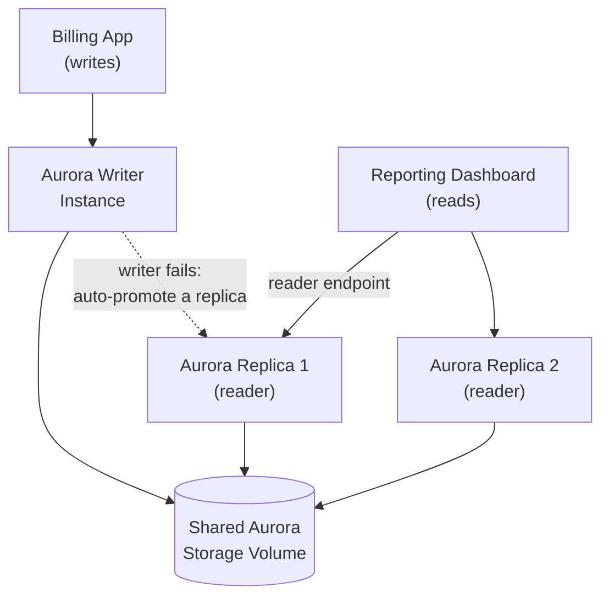

Step by step: (1) all instances — writer and replicas — read from the same shared storage
volume, so replicas don't need their own separate copy of the data and stay nearly in sync;
(2) the billing application writes only through the writer instance, and the dashboard reads
only through the reader endpoint, which load-balances across the replicas — keeping read load
off the writer entirely; (3) if the writer fails, Aurora promotes one of the existing,
already-current replicas to writer automatically, typically within seconds to tens of seconds.

**Why the others are wrong:**
- **A** has no automatic failover at all (a single instance with no replica means restoring from backup after a failure, which is slow) and provides no separate read capacity, so reporting queries would compete directly with billing writes on the same instance.
- **C** two unconnected clusters synced only nightly means the dashboard's data is up to 24 hours stale, and "manually kept in sync" has no automatic failover characteristics at all — it's a fragile, custom-built approximation of what Aurora replicas do natively.
- **D** Multi-AZ's standby replica (in the classic RDS sense) is not readable — it exists purely for failover, so reporting queries cannot be sent to it at all; this option describes a capability RDS/Aurora Multi-AZ standbys don't have (Aurora Replicas, which *are* readable, are a distinct feature from the Multi-AZ standby concept).

Reference: [`services/database/aurora.md`](../../../services/database/aurora.md)

---

## Question 3

*(Domain 2 — Resilient Architectures)*

An esports platform runs latency-critical UDP game servers in `us-west-2` and `eu-central-1`.
During a recent partial network degradation in `eu-central-1`, European players experienced
severe lag because their client traffic kept routing there regardless of the degradation, with
no automatic rerouting to `us-west-2` even though `us-west-2` was healthy and reachable
(at higher, but tolerable, latency) for those players. What should the Solutions Architect add?

A) Route 53 geolocation routing, permanently routing European players to `eu-central-1`
B) AWS Global Accelerator, continuously health-checking both Regional endpoints and automatically shifting affected players' traffic to the healthy Region within seconds of detecting degradation
C) A second, independent set of DNS records for `eu-central-1`, to provide redundancy at the DNS layer
D) CloudFront configured with two origins, one per Region

**Correct Answer: B**

**Why correct:** [Global Accelerator](../../../services/networking-content-delivery/global-accelerator.md) continuously performs fast health checks against each Regional endpoint and automatically shifts traffic at the network layer (supporting UDP) to the next-best healthy endpoint within seconds of detecting degradation — directly solving "kept routing there regardless of degradation" by replacing static/geography-only routing with active, health-based automatic failover, all without requiring any DNS change or client-side logic.

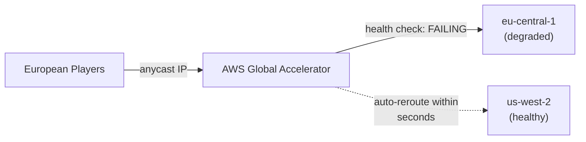

Step by step: (1) Global Accelerator continuously health-checks both `eu-central-1` and
`us-west-2` game server endpoints; (2) the moment `eu-central-1` is detected as degraded,
Global Accelerator reroutes affected players' traffic onto AWS's backbone toward the healthy
`us-west-2` endpoint instead; (3) players experience higher latency (crossing the Atlantic)
but no sustained lag or disconnects, and traffic automatically shifts back once `eu-central-1`
recovers.

**Why the others are wrong:**
- **A** geolocation routing is explicitly static by geography with no health-check-based failover described — it's precisely the "permanently routing there regardless of health" behavior causing the problem in the first place, just stated more explicitly.
- **C** a second set of DNS records for the *same, degraded* Region does nothing to reroute traffic to the healthy `us-west-2` Region — redundant records pointing at a degraded Region don't solve a cross-Region failover problem.
- **D** CloudFront is an HTTP/HTTPS caching service, not suited for arbitrary low-latency UDP game traffic (the scenario implies UDP, consistent with "latency-critical game servers"), and even for HTTP workloads, CloudFront's multi-origin failover model works differently and isn't the standard tool for this Regional-failover-for-game-servers use case the way Global Accelerator is.

Reference: [`services/networking-content-delivery/global-accelerator.md`](../../../services/networking-content-delivery/global-accelerator.md)

---

## Question 4

*(Domain 1 — Secure Architectures)*

A 3,000-employee enterprise already manages all identities in an on-prem Active Directory
domain. They want employees to access AWS accounts (several, organized under AWS
Organizations) using their existing AD credentials — with no separate AWS-specific password to
remember, and no need to create or sync individual IAM users for each employee. What should the
Solutions Architect configure?

A) Create an IAM user in every AWS account for every employee, with a password set to match their AD password manually
B) Configure IAM Identity Center with SAML 2.0 federation against the on-prem Active Directory (via AD Connector or a SAML-compatible federation pathway), assigning permission sets mapped to AD groups
C) Use AWS Directory Service to create a brand-new, separate Simple AD directory, migrating all 3,000 users into it manually
D) Have each employee create their own individual AWS account using their corporate email

**Correct Answer: B**

**Why correct:** [IAM Identity Center](../../../services/security-identity-compliance/iam-identity-center-sso.md) supports federating against external identity providers via SAML 2.0, including on-prem Active Directory (commonly via AD Connector, which proxies authentication back to the existing AD without duplicating the directory) — employees sign in with their existing AD credentials, and administrators map AD groups to Identity Center permission sets scoped to specific AWS accounts, satisfying "existing AD credentials, no new password, no per-employee IAM users" entirely.

**Why the others are wrong:**
- **A** manually creating and password-syncing 3,000 IAM users per account is exactly the "no need to create... individual IAM users" the requirement rules out, and manually keeping passwords in sync with AD is unscalable and insecure (passwords would drift out of sync immediately).
- **C** creating a brand-new Simple AD directory and manually migrating 3,000 users duplicates the existing AD rather than federating against it — this creates a second identity source to keep in sync forever, the opposite of "use existing AD credentials" directly.
- **D** individual personal AWS accounts per employee have nothing to do with centralized enterprise identity federation into an Organization's existing accounts, and this would fragment billing, security, and access management across 3,000 ungoverned accounts.

Reference: [`services/security-identity-compliance/iam-identity-center-sso.md`](../../../services/security-identity-compliance/iam-identity-center-sso.md)

---

## Question 5

*(Domain 4 — Cost-Optimized Architectures)*

A growing startup now has 15 separate AWS accounts (one per team, set up under one AWS
Organization) and finance has noticed each account's S3 and data-transfer usage individually
falls short of AWS's volume pricing discount tiers, even though combined usage across all 15
accounts would clear those tiers easily. What should the Solutions Architect confirm or enable
to ensure the company benefits from volume pricing across all linked accounts?

A) Nothing extra is needed — AWS Organizations automatically applies consolidated billing, aggregating usage across all linked accounts in the Organization for the purposes of volume pricing tiers and Reserved Instance/Savings Plan discount sharing
B) Manually request a custom enterprise discount from an AWS account manager for each of the 15 accounts individually
C) Migrate all 15 teams' workloads into a single shared account to combine usage
D) Purchase 15 separate Reserved Instances, one per account, sized identically

**Correct Answer: A**

**Why correct:** [Consolidated billing under AWS Organizations](../../../services/management-governance/cost-management-tools.md) is enabled automatically for all accounts in an Organization and aggregates eligible usage (such as S3 storage tiers and data transfer) across every linked account when calculating volume-pricing discount tiers, and it also enables sharing of Reserved Instance and Savings Plan discounts across accounts — meaning the company's combined 15-account usage, once consolidated, can clear discount thresholds that no individual account would reach alone, with no extra configuration required beyond having the accounts joined to the Organization.

**Why the others are wrong:**
- **B** manually requesting a custom discount is a separate (and much heavier, sales-engagement-dependent) negotiation path — it isn't the mechanism that naturally and automatically aggregates usage for existing public volume-pricing tiers, which consolidated billing already does for free.
- **C** collapsing 15 team-scoped accounts into one shared account sacrifices the account-level isolation (blast-radius containment, independent limits, clean per-team cost visibility) that was presumably the reason for separate accounts in the first place — an unnecessary and disruptive step just to get volume pricing, which consolidated billing already provides without merging accounts.
- **D** purchasing 15 separate, identically-sized RIs doesn't address the volume-discount-tier aggregation question at all, and in fact Organizations' RI/Savings Plan sharing can already let a single purchase's discount apply flexibly across multiple accounts' matching usage — buying 15 redundant copies ignores that sharing capability.

Reference: [`services/management-governance/cost-management-tools.md`](../../../services/management-governance/cost-management-tools.md)

---

## Question 6

*(Domain 1 — Secure Architectures)*

A startup's serverless mobile app needs authenticated users to upload photos directly to S3
and query a DynamoDB table, with AWS credentials obtained dynamically per-session and no
backend server mediating every request. The team wants to avoid embedding any IAM user access
key in the app and avoid building a custom token-exchange server. What should the Solutions
Architect implement?

A) A custom Lambda function behind API Gateway that holds a single IAM user's access key server-side and proxies every S3/DynamoDB call on the client's behalf
B) A Cognito identity pool configured with `AssumeRoleWithWebIdentity`, exchanging the authenticated user's identity token for temporary, scoped IAM role credentials via STS, used directly by the mobile app's AWS SDK calls
C) Embed a single long-lived IAM access key, scoped narrowly with an IAM policy, directly in the app's source code
D) Use the AWS root account's access key for all app-to-AWS calls, since it has unrestricted permissions

**Correct Answer: B**

**Why correct:** [Cognito identity pools](../../../services/security-identity-compliance/cognito.md) implement exactly the `AssumeRoleWithWebIdentity` [STS](../../../services/security-identity-compliance/sts-and-role-switching.md) pattern: after the user authenticates (via Cognito user pools or another supported IdP), the identity pool exchanges that proven identity for short-lived, scoped AWS credentials tied to an IAM role — the mobile app's SDK then calls S3/DynamoDB directly with those temporary credentials, with no backend proxy server needed and no long-lived key ever embedded in the app, satisfying every constraint in the prompt simultaneously.

**Why the others are wrong:**
- **A** works but directly contradicts "no backend server mediating every request" — it's a valid *alternative* architecture (and sometimes appropriate for extra validation), but it's not what this scenario is asking for, and it also still requires securely storing a long-lived key server-side.
- **C** embedding any long-lived access key in client-side app source code is extractable by anyone who decompiles the app, regardless of how narrowly its attached IAM policy is scoped — this is the specific long-lived-credential risk the prompt explicitly wants avoided.
- **D** using root account credentials for routine application traffic is a severe security anti-pattern under any circumstance — root has unrestricted account-wide power, and embedding it in a distributed mobile app would be catastrophic if extracted.

Reference: [`services/security-identity-compliance/cognito.md`](../../../services/security-identity-compliance/cognito.md)

---

## Question 7

*(Domain 2 — Resilient Architectures)*

A design agency stores client project files in S3. An employee accidentally deleted an entire
folder of a client's files three days ago, and this was only discovered today during a client
review. The bucket has versioning enabled but no lifecycle rules configured. What is the
correct way to recover the deleted files, and what should be added going forward to reduce the
blast radius of future accidental deletes?

A) The files are permanently gone since versioning only protects against overwrites, not deletes; going forward, enable Cross-Region Replication to a second bucket for backup
B) Deleting a versioned object only adds a delete marker (hiding the object from normal listings) rather than erasing prior versions — recover by removing the delete markers (or restoring the previous version IDs) for the affected objects; going forward, consider MFA Delete to require multi-factor authentication for permanent version deletion
C) Restore the entire bucket from the most recent AWS Backup snapshot, accepting the three-day-old state
D) Files cannot be recovered without versioning being enabled at the time of the delete; nothing further can be done

**Correct Answer: B**

**Why correct:** [S3 versioning](../../../services/storage/s3.md) means a "delete" on a versioned object doesn't actually erase the prior version — it adds a **delete marker** that makes the object appear deleted in normal (non-versioned) listings, while every previous version remains fully intact and retrievable; recovery is simply removing the delete marker or explicitly restoring/copying the desired prior version ID back as the current version. Adding **MFA Delete** going forward requires a second factor specifically to permanently delete a version or change the bucket's versioning state, raising the bar against an accidental (or malicious) permanent deletion in the future.

**Why the others are wrong:**
- **A** is simply incorrect about how S3 versioning handles deletes — "only protects against overwrites" misunderstands the delete-marker mechanism, which absolutely does protect against (accidental) deletes too, by preserving the prior version.
- **C** restoring from a backup snapshot would discard three days of legitimate changes other than the deleted files, which is unnecessary when the correct version is still sitting right there in S3's version history, retrievable without any data loss at all.
- **D** is factually wrong on two counts: versioning *was* enabled (stated in the scenario), and even without versioning, deleted S3 objects are frequently unrecoverable (not "nothing further can be done" as a blanket, unconditional claim that applies regardless of configuration) — but critically, the premise that recovery is impossible here is false given versioning was on.

Reference: [`services/storage/s3.md`](../../../services/storage/s3.md)

---

## Question 8

*(Domain 4 — Cost-Optimized Architectures)*

A company takes nightly EBS snapshots of all its EC2 instances for backup purposes, but no one
ever configured expiration — the account has accumulated over two years of nightly snapshots
per volume, most of which are far older than any realistic recovery need, and EBS snapshot
storage cost has become a meaningful recurring line item. What should the Solutions Architect
implement to automate ongoing snapshot lifecycle management going forward, rather than a
one-time manual cleanup?

A) A one-time script to delete all snapshots older than 30 days, run once, with no ongoing process
B) Amazon Data Lifecycle Manager (DLM), with a policy that automatically creates snapshots on a schedule and automatically deletes them once they exceed a defined retention count/age
C) Move all existing snapshots to S3 Glacier Deep Archive to reduce their cost, keeping them forever
D) Disable EBS snapshots entirely going forward, relying only on AMIs for backup

**Correct Answer: B**

**Why correct:** [Data Lifecycle Manager (DLM)](../../../services/storage/ebs.md) automates both the creation and the retention/expiration of EBS snapshots on an ongoing, policy-driven schedule — defining a retention count (e.g., "keep the last 14 daily snapshots") or age threshold means every future snapshot is automatically cleaned up once it ages out, with zero manual intervention required going forward, which directly matches "automate ongoing... rather than a one-time cleanup."

**Why the others are wrong:**
- **A** a one-time script fixes the existing backlog but does nothing about tomorrow's new snapshot, or the one after that — the same unbounded accumulation problem returns within weeks, since there's still no retention policy in place.
- **C** EBS snapshots are already stored in S3 behind the scenes at a cost roughly comparable to (and optimized similarly to) S3 Standard-IA-like pricing — there's no direct, supported way to "move an EBS snapshot" into Glacier Deep Archive as a separate action, and "keeping them forever" (even cheaper) still doesn't solve the underlying problem of snapshots with no realistic recovery value accumulating indefinitely.
- **D** disabling snapshots entirely removes the ability to restore from backup at all, which is a far worse outcome than optimizing retention — the goal is smarter retention, not eliminating the backup capability altogether.

Reference: [`services/storage/ebs.md`](../../../services/storage/ebs.md)

---

## Question 9

*(Domain 1 — Secure Architectures)*

A company has 300 engineers who need administrative access to EC2 instances for debugging and
patching. Security policy now prohibits opening port 22 (SSH) on any instance's security group
from any source, including a bastion host, and requires every administrative session to be
fully logged for audit. What should the Solutions Architect implement to replace SSH-based
bastion access?

A) Keep the bastion host, but restrict its security group to allow SSH only from the corporate office's static IP
B) AWS Systems Manager Session Manager, which establishes administrative sessions over the Systems Manager agent (no inbound port 22 needed on any instance, no bastion host required) and logs every session's full command history to CloudWatch Logs/S3
C) Replace password-based SSH with SSH key-pair authentication only, keeping port 22 open
D) Use AWS Site-to-Site VPN so engineers connect to the VPC directly, then SSH over the VPN tunnel

**Correct Answer: B**

**Why correct:** [Systems Manager Session Manager](../../../services/management-governance/systems-manager.md) establishes a secure shell session over the SSM agent's outbound connection to the Systems Manager service — there's no need to open any inbound port (22 or otherwise) on the instance's security group at all, and no bastion host is needed as an intermediate hop, directly satisfying "prohibits opening port 22... from any source, including a bastion host." Session Manager also natively logs full session activity (commands and output) to CloudWatch Logs and/or S3, satisfying the audit requirement without any additional logging infrastructure.

**Why the others are wrong:**
- **A** still has port 22 open on the bastion host (even if restricted to one IP), which directly violates "prohibits opening port 22... from any source" — a single allowed source is still a source.
- **C** keeping port 22 open at all (regardless of authentication method used over it) violates the explicit port-22 prohibition — the requirement is about the open port itself, not which authentication mechanism rides over it.
- **D** connecting over a VPN tunnel and then still using SSH to reach the instance means port 22 would still need to be open on the instance's security group for the VPN-connected client to reach it — the port-22 requirement is specifically about the instance's own security group rule, which a VPN tunnel doesn't eliminate the need for.

Reference: [`services/management-governance/systems-manager.md`](../../../services/management-governance/systems-manager.md)

---

## Question 10

*(Domain 2 — Resilient Architectures)*

A payments company's fraud-review Lambda function (triggered by SQS) takes up to 12 minutes to
fully analyze a single complex transaction, but the SQS queue's visibility timeout was left at
its default 30 seconds. The team is seeing the same transaction analyzed multiple times
concurrently by different Lambda invocations, wasting compute and occasionally producing
conflicting fraud decisions. What is the root cause and the fix?

A) SQS is simply unreliable at scale; switch to a different queueing technology entirely
B) The visibility timeout (30 seconds) is far shorter than the actual processing time (up to 12 minutes), so SQS makes the message visible again to other consumers well before the first invocation finishes — the fix is setting the queue's visibility timeout to comfortably exceed the function's maximum processing time (and/or extending it dynamically from within the function as it runs)
C) The Lambda function's memory allocation is too low, causing it to silently restart and reprocess the same message
D) SNS fan-out is duplicating the message to multiple subscribers; switching from SNS to SQS will fix it

**Correct Answer: B**

**Why correct:** [SQS's visibility timeout](../../../services/application-integration/sqs.md) controls how long a message stays invisible to other consumers after being received — if it expires before the original consumer finishes processing (here, 30 seconds vs. up to 12 minutes of actual work), SQS assumes that consumer failed and makes the message visible again, which another (or the same) Lambda invocation then picks up and processes concurrently — exactly the "analyzed multiple times concurrently" symptom. The fix is setting the visibility timeout to comfortably exceed the realistic maximum processing time (commonly set to several times the function's timeout, or extended dynamically via `ChangeMessageVisibility` calls as long processing continues), so the message stays invisible for the entire duration of legitimate processing.

**Why the others are wrong:**
- **A** SQS is not "simply unreliable" — this is a specific, well-documented, and very common misconfiguration (visibility timeout too short for the actual workload), not a fundamental flaw in the service; switching technologies would be a drastic, unnecessary overreaction to a one-line configuration fix.
- **C** low memory causing a "silent restart" isn't how Lambda failures manifest, and isn't consistent with the described symptom — the scenario already points directly at the queue's visibility timeout being mismatched with the function's actual runtime, which is the real root cause.
- **D** the scenario describes a direct SQS-triggered Lambda, not an SNS fan-out architecture at all — there's no SNS component mentioned, so "switching from SNS to SQS" is solving a different (non-existent, in this scenario) problem.

Reference: [`services/application-integration/sqs.md`](../../../services/application-integration/sqs.md)

---

## Question 11

*(Domain 3 — High-Performing Architectures)*

An airline's fare-lookup Lambda function, invoked via API Gateway, is latency-sensitive —
customers expect sub-200ms responses during active searches. The function has a large
initialization step (loading a pricing model into memory) that causes cold starts to take
2–3 seconds, well outside the acceptable latency budget, and search traffic is consistent and
predictable throughout business hours. What should the Solutions Architect configure?

A) Reduce the Lambda function's timeout setting to force faster execution
B) Enable Provisioned Concurrency on the function, sized to the expected steady business-hours traffic level, keeping execution environments pre-initialized and ready
C) Increase the function's reserved concurrency limit, since that eliminates cold starts
D) Rewrite the function in a different, faster programming language, without addressing the initialization step

**Correct Answer: B**

**Why correct:** [Provisioned Concurrency](../../../services/compute/lambda.md) pre-initializes a specified number of execution environments — including running the expensive pricing-model-loading initialization code ahead of time — so invocations during business hours hit an already-warm environment and respond within the latency budget, with no cold start at all; because traffic is "consistent and predictable," sizing provisioned concurrency to match business-hours volume (potentially scheduled to scale down overnight) directly solves the described 2–3 second cold-start problem.

**Why the others are wrong:**
- **A** reducing the timeout setting doesn't make initialization faster — it would just make the function more likely to be killed mid-cold-start for exceeding its (now shorter) timeout, making the user experience worse, not better.
- **C** reserved concurrency caps/guarantees a maximum number of concurrent executions for the function (protecting it from being starved by other functions' usage of the account-wide limit) — it does not pre-initialize environments or eliminate cold starts on its own; that's specifically what provisioned concurrency (a related but distinct setting) does.
- **D** rewriting the function in a faster language might marginally help raw execution speed, but doesn't directly address the stated root cause — the expensive initialization step loading a pricing model into memory — and "without addressing the initialization step" explicitly leaves the actual bottleneck untouched.

Reference: [`services/compute/lambda.md`](../../../services/compute/lambda.md)

---

## Question 12

*(Domain 2 — Resilient Architectures)*

A global SaaS company wants its web application to serve users from whichever of three
Regions (US, EU, APAC) gives them the lowest latency, with each Region fully capable of
serving both reads and writes against the same logical dataset, and no single Region being a
dependency for the others to keep functioning. What combination of services achieves this?

A) A single Region's Aurora cluster with CloudFront caching static assets for the other two Regions
B) Route 53 latency-based routing directing users to their lowest-latency Region's application tier, backed by DynamoDB Global Tables providing a fully read/write replica of the dataset in each of the three Regions
C) Route 53 geolocation routing with a single centralized RDS instance that all three Regions' application tiers connect to over the internet
D) AWS Global Accelerator alone, with no changes to the database layer

**Correct Answer: B**

**Why correct:** [Route 53 latency-based routing](../../../services/networking-content-delivery/route53.md) measures real-world latency from AWS's perspective and directs each user's DNS resolution to whichever Region's endpoint is fastest *for them specifically*, and pairing it with [DynamoDB Global Tables](../../../services/database/dynamodb.md) — which maintains a fully active, independently read/write-capable replica of the table in each of the three Regions — means every Region's application tier can serve both reads and writes locally, with no cross-Region dependency for normal operation, satisfying "no single Region being a dependency for the others."

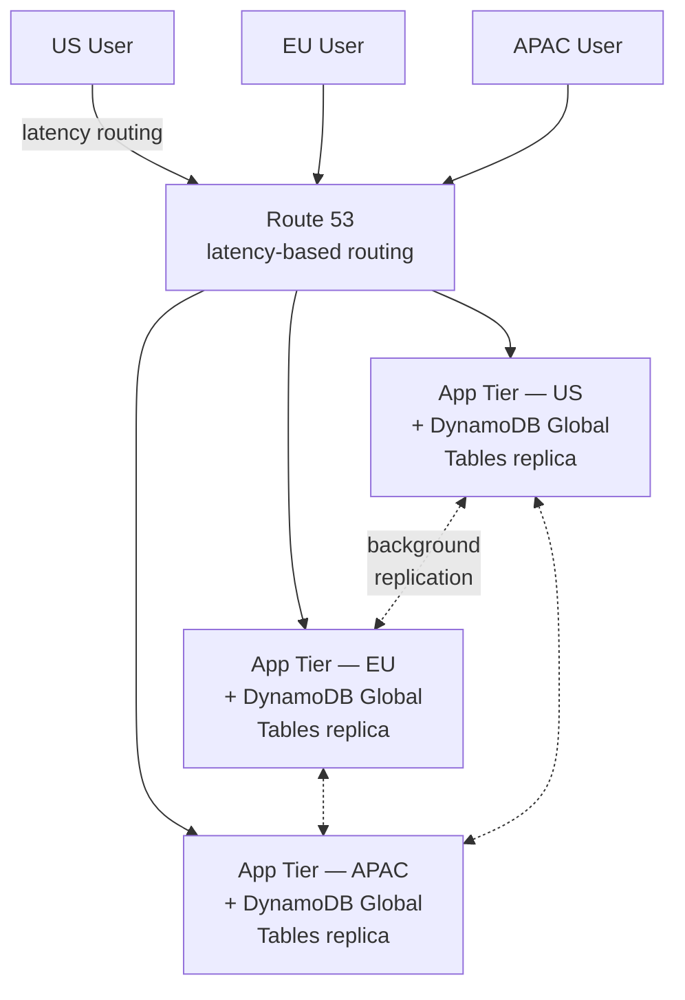

Step by step: (1) each user's DNS query is answered with whichever Regional endpoint currently
measures lowest latency for their location; (2) that Region's app tier reads and writes its
own local DynamoDB Global Tables replica, with no round trip to another Region required for
normal operation; (3) each replica propagates its changes to the other two Regions in the
background, so all three stay eventually consistent without any Region depending on another to
function in the meantime.

**Why the others are wrong:**
- **A** a single Region's Aurora cluster means every write (and most reads, since CloudFront only caches static assets, not dynamic database queries) still has to reach that one Region — the other two Regions are entirely dependent on it, which is exactly what the requirement rules out.
- **C** a single centralized RDS instance means every Region's application tier makes cross-Region database calls over the internet for every query — this reintroduces high latency for two of the three Regions and makes that one Region a single point of failure for the entire system.
- **D** Global Accelerator alone optimizes network path routing but does nothing about the database layer — without a multi-Region-capable data store, you still end up with one Region being the dependency for data reads/writes, regardless of how optimized the network path to reach it is.

Reference: [`services/networking-content-delivery/route53.md`](../../../services/networking-content-delivery/route53.md) and [`services/database/dynamodb.md`](../../../services/database/dynamodb.md)

---

## Question 13

*(Domain 1 — Secure Architectures)*

A multinational retailer's AWS Organization spans 40 accounts across different business units.
The security team needs every account to enforce a specific set of PCI-DSS-aligned AWS Config
rules (e.g., "S3 buckets must not be public," "EBS volumes must be encrypted") automatically,
including any new accounts created in the future, without manually deploying Config rules to
each account one at a time. What should the Solutions Architect implement?

A) Manually enable the required AWS Config rules in each of the 40 accounts individually, repeating the process whenever a new account is created
B) An AWS Config conformance pack deployed via AWS Organizations, which automatically applies the defined set of Config rules across all accounts in the Organization (or a target OU), including future accounts added to that scope
C) A single AWS Config rule created in the management account only, assuming it automatically applies account-wide across the Organization
D) SCPs that deny any action that would create a public S3 bucket or an unencrypted EBS volume

**Correct Answer: B**

**Why correct:** [AWS Config conformance packs](../../../services/management-governance/aws-config.md) deployed through AWS Organizations let you define a collection of Config rules once and have them automatically deployed to every account within the targeted scope (the whole Organization or specific OUs) — critically, this includes accounts added to that scope **later**, with no manual per-account deployment step ever required again, directly matching "including any new accounts created in the future... without manually deploying... one at a time."

**Why the others are wrong:**
- **A** manually enabling rules in 40 accounts (and repeating this for every future account) is exactly the manual, non-scalable, error-prone process the requirement explicitly wants eliminated.
- **C** AWS Config rules are evaluated per-account against that account's own resources — a rule created only in the management account does not automatically reach into and evaluate resources in 40 other member accounts; Config rules aren't account-wide across an Organization by default the way this option assumes.
- **D** SCPs can *preventively block* certain actions account-wide, which is a different (and complementary) control type — but the scenario specifically describes Config rules (compliance *detection/reporting*, e.g., flagging non-compliant resources for review), not blocking the action outright; an SCP denying the action wholesale is a more drastic, different mechanism than what was asked for (detecting existing non-compliant resources via Config rules), and doesn't by itself deploy or evaluate Config rules at all.

Reference: [`services/management-governance/aws-config.md`](../../../services/management-governance/aws-config.md)

---

## Question 14

*(Domain 1 — Secure Architectures)*

A financial services company's security policy requires proof that CloudTrail logs have not
been tampered with after being written, in case they're ever needed as evidence in a legal or
regulatory proceeding. The company already has an Organization trail covering all 25 accounts,
delivering logs to a central S3 bucket. What additional feature should the Solutions Architect
enable to provide this tamper-evidence guarantee?

A) S3 versioning on the log bucket, since older versions can't be modified
B) CloudTrail log file integrity validation, which generates periodic digest files (cryptographically hashed and chained) that can be used to prove whether any log file has been altered or deleted since delivery
C) Enable MFA Delete on the S3 bucket holding the logs
D) Encrypt the log bucket with a customer-managed KMS key

**Correct Answer: B**

**Why correct:** [CloudTrail log file integrity validation](../../../services/management-governance/cloudtrail.md) generates a digest file (on a schedule) containing hashes of the log files delivered in that period, cryptographically chained to the previous digest file — this specifically allows someone to later cryptographically **prove** whether any log file was modified or deleted after delivery, which is exactly the "proof that logs have not been tampered with" requirement, suitable for legal/regulatory evidentiary purposes.

**Why the others are wrong:**
- **A** S3 versioning preserves prior versions when an object is overwritten, but it doesn't provide a cryptographic proof mechanism that a given log file's *content* matches what was originally delivered — someone with sufficient permissions could still replace the "current" version, and versioning alone doesn't generate the kind of auditable integrity digest a tamper-evidence requirement calls for.
- **C** MFA Delete adds friction to permanently deleting object versions or disabling versioning — a security hardening measure, but it's not a tamper-evidence/proof mechanism; it doesn't generate any cryptographic digest proving log content integrity.
- **D** encryption protects log content confidentiality (who can read it), not integrity (whether it was altered) — an actor with both decrypt and write permissions could still tamper with an encrypted log file's content; encryption and integrity validation solve different problems.

Reference: [`services/management-governance/cloudtrail.md`](../../../services/management-governance/cloudtrail.md)

---

## Question 15

*(Domain 2 — Resilient Architectures)*

A manufacturing company is migrating a large fleet of on-prem physical and virtual servers to
AWS, but wants continuous, near-real-time block-level replication running *during* the
migration project so that, if anything urgent happens to the on-prem environment before cutover
is complete, they can launch recovery instances in AWS within minutes using the most recently
replicated data. What AWS service is purpose-built for this?

A) AWS Database Migration Service (DMS), configured for continuous replication
B) AWS Elastic Disaster Recovery (AWS DRS), which continuously replicates on-prem servers at the block level into a low-cost staging area in AWS, ready to launch full recovery instances within minutes if needed
C) AWS Snowball Edge, shipped on a recurring schedule to capture incremental changes
D) A manually scripted rsync job between on-prem servers and an S3 bucket, run hourly

**Correct Answer: B**

**Why correct:** [AWS Elastic Disaster Recovery (AWS DRS)](../../../services/management-governance/aws-config.md) is purpose-built for exactly this: it installs lightweight agents on source servers (physical or virtual, on-prem or elsewhere) that continuously replicate block-level changes into a low-cost staging area in AWS, and when needed, it can launch fully-provisioned, up-to-date recovery instances within minutes — making it equally suited to ongoing DR protection during a migration project and to actual disaster recovery after migration completes, directly matching "continuous, near-real-time... launch recovery instances within minutes."

Step by step: (1) a lightweight agent installed on each on-prem server continuously streams
block-level changes into a low-cost AWS staging area throughout the migration project, well
before cutover; (2) if something urgent happens to the on-prem environment mid-migration, the
team declares a recovery and AWS DRS launches fully-provisioned EC2 instances built from the
most recently replicated data; (3) because replication was continuous, those recovery
instances reflect data from moments before the incident, not from whatever the last scheduled
backup happened to be.

**Why the others are wrong:**
- **A** DMS is designed for migrating and replicating **database** workloads specifically (schema and data), not whole-server block-level replication of arbitrary physical/virtual servers including OS and application files — it solves a narrower, different problem than full-server DR replication.
- **C** Snowball Edge is designed for bulk, often one-time or infrequent, offline data transfer (physically shipping a device) — it's not a continuous, near-real-time replication mechanism, and a recurring-shipment schedule would have RPO measured in days/weeks, far short of "near-real-time."
- **D** a manually scripted hourly rsync job has up to an hour of potential data loss (RPO), doesn't replicate at the block level or capture full server state (OS, running applications) typically, and is a fragile, custom-built approximation of a managed service already built for this exact purpose.

Reference: [`domain-2-resilient-architectures/disaster-recovery-strategies.md`](../domain-2-resilient-architectures/disaster-recovery-strategies.md)

---

## Question 16

*(Domain 2 — Resilient Architectures)*

A video-encoding platform runs each encoding job on a dedicated EC2 instance in an Auto
Scaling group; a job typically takes 10–20 minutes to finish. When the ASG scales in during a
demand drop, instances are sometimes terminated mid-job, losing the in-progress encode and
wasting the customer's wait time. What should the Solutions Architect configure to let
in-progress jobs finish before an instance is terminated during scale-in?

A) Increase the ASG's cooldown period to several hours
B) An Auto Scaling lifecycle hook on the `EC2_INSTANCE_TERMINATING` transition, which pauses termination and invokes custom logic (e.g., a Lambda function checking job status) to wait until the in-progress job completes before allowing termination to proceed
C) Set the ASG's termination policy to "OldestInstance" so newer instances are never terminated
D) Enable instance scale-in protection as a permanent, unconditional setting on every instance

**Correct Answer: B**

**Why correct:** [Auto Scaling lifecycle hooks](../../../services/compute/ec2-auto-scaling.md) on the `EC2_INSTANCE_TERMINATING` transition put a selected instance into a `Terminating:Wait` state before it's actually terminated, giving custom logic (commonly a Lambda function triggered via EventBridge/SNS) a window to check whether the instance's current job is still running and delay completion of the termination until it finishes (up to the hook's configured timeout) — this directly solves "let in-progress jobs finish before termination" in a targeted, automatic way without blocking scale-in indefinitely for instances that are actually idle.

**Why the others are wrong:**
- **A** a cooldown period controls how long the ASG waits *between* scaling activities, not whether an individual instance being terminated right now gets to finish its current job first — it doesn't address the mid-job termination problem at all.
- **C** a termination policy decides *which* instance(s) get chosen for termination (e.g., oldest, newest, closest to billing hour) — it has no concept of "is this instance currently mid-job," so it can't guarantee an instance with an in-progress job is spared; it only changes the selection criteria among all instances, any of which could still be mid-job.
- **D** permanent, unconditional scale-in protection on every instance would prevent the ASG from ever scaling in those instances at all, defeating the purpose of having an Auto Scaling group — the goal is *conditional*, job-aware delay, not a blanket ban on termination.

Reference: [`services/compute/ec2-auto-scaling.md`](../../../services/compute/ec2-auto-scaling.md)

---

## Question 17

*(Domain 3 — High-Performing Architectures)*

A travel-booking platform's availability-search Lambda function has highly variable runtime
and resource needs depending on query complexity, and the team doesn't know, without testing,
whether a higher memory allocation (which also scales proportional CPU) would make the function
both faster and cheaper overall (since Lambda bills by GB-seconds, a faster-but-higher-memory
configuration can sometimes cost less net, not more). What should the Solutions Architect use
to find the optimal memory setting?

A) Guess a high memory value (e.g., the maximum allowed) and assume more is always better
B) AWS Lambda Power Tuning, an open-source tool that runs the function at multiple memory configurations and measures actual execution time and cost, identifying the configuration with the best cost/performance trade-off for this specific function
C) Set memory to the minimum allowed value, since minimizing per-invocation memory always minimizes total cost
D) Leave the memory setting at its default and do not test it further

**Correct Answer: B**

**Why correct:** [AWS Lambda Power Tuning](../../../services/compute/lambda.md) executes the target function across a range of memory configurations with representative input, measuring both duration and actual cost for each, and produces a visualization/recommendation of the configuration that best fits the chosen optimization goal (cost, speed, or a balance) — directly answering "doesn't know without testing" by actually testing it systematically, rather than guessing in either direction.

**Why the others are wrong:**
- **A** "more is always better" ignores that cost scales with memory × duration — if execution time doesn't drop proportionally as memory increases, a higher memory setting can increase total cost for no speed benefit; this is exactly the behavior that needs measuring, not assuming.
- **C** the inverse assumption is equally unfounded — minimum memory can sometimes mean the function runs so much slower that GB-seconds (and therefore cost) actually end up *higher* than a moderately larger memory setting that finishes much faster; Lambda's cost model doesn't guarantee "less memory = less cost."
- **D** leaving the default untested forgoes any chance of finding a better cost/performance point and explicitly contradicts the stated goal of actually determining the optimal setting for this specific function's behavior.

Reference: [`services/compute/lambda.md`](../../../services/compute/lambda.md)

---

## Question 18

*(Domain 1 — Secure Architectures)*

A payroll-processing company needs to let a third-party tax-filing partner's AWS account
decrypt specific payroll files in S3 that are encrypted with the payroll company's own
customer-managed KMS key — but only for a 48-hour filing window each quarter, and without
permanently modifying the key's policy or sharing any long-lived credentials with the partner.
What should the Solutions Architect use?

A) Permanently add the partner's AWS account as a principal in the KMS key policy with `kms:Decrypt` permission, removing it manually after each 48-hour window
B) A temporary KMS grant, created specifically for the 48-hour window, giving the partner account's role `kms:Decrypt` permission on the key, which can be explicitly retired immediately after the window closes
C) Share the actual KMS key material with the partner company via a secure file transfer
D) Create an IAM user in the payroll company's account for the partner, with an access key emailed to them each quarter

**Correct Answer: B**

**Why correct:** [KMS grants](../../../services/security-identity-compliance/kms.md) are specifically designed for temporary, fine-grained, programmatically-managed permission delegation on a key — a grant can be created right before the filing window authorizing the partner account's role to call `kms:Decrypt`, and explicitly retired (revoked) immediately after the window closes, all without ever touching or permanently modifying the key's policy document, and without sharing any long-lived credential — directly matching every constraint in the prompt.

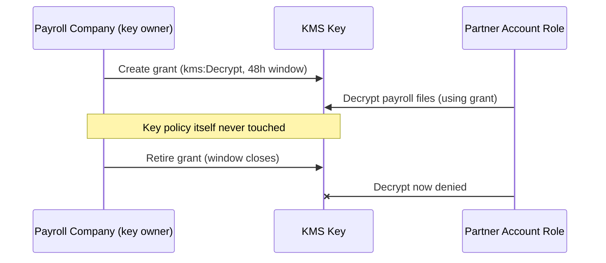

Step by step: (1) right before the filing window opens, the payroll company creates a KMS
grant authorizing the partner's role to call `kms:Decrypt` on the specific key; (2) during the
48-hour window, the partner's role can decrypt the payroll files using that grant, with no
long-lived credential ever exchanged; (3) immediately after the window closes, the payroll
company retires the grant, instantly cutting off decrypt access — all without the key's
underlying policy document ever being edited.

**Why the others are wrong:**
- **A** "permanently add... removing it manually after" is exactly the manual, easy-to-forget process the prompt is trying to avoid, and it means the key policy itself (a sensitive, foundational security document) has to be edited and re-edited every quarter — a grant achieves the same temporary access without ever touching that policy.
- **C** KMS does not support exporting raw key material from its default (AWS-managed) key store at all — this isn't an available mechanism, and even if it somehow were, sharing raw key material with an external party is a severe security anti-pattern regardless of how it's "securely" transferred.
- **D** creating an IAM user and emailing an access key is the long-lived-credential-sharing anti-pattern explicitly ruled out by the prompt ("without sharing any long-lived credentials"), and doesn't by itself grant KMS decrypt permission on the specific key either — it would still need a grant or key-policy change layered on top.

Reference: [`services/security-identity-compliance/kms.md`](../../../services/security-identity-compliance/kms.md)

---

## Question 19

*(Domain 4 — Cost-Optimized Architectures)*

A logistics company's x86-based EC2 fleet runs a Java-based route-optimization service that's
CPU-intensive but otherwise unremarkable in its dependencies (standard JVM, no x86-specific
native libraries). The team wants to evaluate whether moving to Graviton would meaningfully cut
cost without a major rewrite. What is the most accurate description of this migration's
likely effort and benefit?

A) Graviton instances require a complete application rewrite in a different programming language, making migration impractical
B) Since the JVM runs natively on Arm and there are no x86-specific native dependencies, migrating to Graviton (`c7g`/`m7g`/`r7g` family) is likely to require minimal code changes (primarily rebuilding/validating the JVM runtime and any native dependencies for Arm) while delivering meaningfully better price-performance for this CPU-intensive workload
C) Graviton instances are only available for Windows-based workloads, so a Java/Linux service wouldn't be eligible
D) There is no price-performance difference between Graviton and comparable x86 instances; the switch provides no benefit

**Correct Answer: B**

**Why correct:** [Graviton](../../../services/compute/ec2.md) processors are Arm-based, and runtimes like the JVM that don't depend on x86-specific native code generally run on Graviton with little to no application code changes — mainly validating/rebuilding any native dependencies for the Arm architecture and testing — while AWS commonly reports meaningfully better price-performance (often cited around 20–40%, workload-dependent) for CPU-intensive workloads like this one, making it a reasonably low-effort, potentially high-value migration to evaluate.

**Why the others are wrong:**
- **A** is a significant overstatement — Graviton doesn't require a different programming language at all; a managed-runtime language like Java typically needs validation/rebuild of native dependencies, not a full application rewrite.
- **C** is factually wrong — Graviton instances are predominantly used with Linux-based workloads (and historically have more limited or no support for certain Windows scenarios), which is the *opposite* of this option's claim; a Java/Linux service is actually a well-suited candidate for Graviton, not an excluded one.
- **D** is also factually wrong — AWS has published and third parties have independently validated meaningful price-performance improvements for many compatible workloads on Graviton versus comparable x86 instances; "no difference... no benefit" contradicts the documented and commonly tested evidence.

Reference: [`services/compute/ec2.md`](../../../services/compute/ec2.md)

---

## Question 20

*(Domain 2 — Resilient Architectures)*

An insurance company's claims-processing system publishes a "claim submitted" event that three
subscribers care about, but each cares about a different subset: the fraud-review team only
cares about claims over $50,000, the audit team wants every claim, and the customer
notification service only wants claims from first-time filers. Publishing to three separately
hand-filtered SQS queues via custom Lambda logic has become error-prone to maintain. What
should the Solutions Architect use instead?

A) A single SQS queue that all three services poll, each discarding messages they don't need after receiving them
B) SNS message filtering policies, one per subscription, so each of the three SQS queues subscribed to the claims SNS topic only receives the subset of messages matching its own filter policy — removing the need for custom Lambda filtering logic
C) Three separate SNS topics, with the claims system manually deciding which topic(s) to publish each claim to based on hand-written business logic in the publisher
D) EventBridge Scheduler, polling the claims database every minute for new claims matching each team's criteria

**Correct Answer: B**

**Why correct:** [SNS message filtering](../../../services/application-integration/sns.md) lets each subscription to a topic declare a filter policy (matching on message attributes, e.g., claim amount or filer-status flags) — SNS evaluates the filter at delivery time and only forwards matching messages to that specific subscriber's queue, meaning the claims system publishes once to one topic with the right attributes, and SNS itself handles the "which subscriber wants which subset" logic declaratively, replacing fragile custom Lambda filtering code entirely.

**Why the others are wrong:**
- **A** a single shared queue only lets whichever consumer polls first receive (and typically delete) a given message — it doesn't support three independent, full-or-filtered views of the same event stream the way per-subscriber filtered queues do, and "discarding after receiving" still means each consumer fetches and processes irrelevant messages first.
- **C** making the *publisher* responsible for deciding which topic(s) to send each claim to re-introduces exactly the custom, hand-maintained business logic at the center of the problem the scenario says has become error-prone — it just moves that logic from Lambda filtering into the publisher instead of removing it.
- **D** polling the claims database on a schedule introduces latency (up to a minute, in this design) and re-implements event filtering as recurring database queries — a heavier, less real-time, and more fragile approach than SNS's native declarative filter policies evaluated per-message as events are published.

Reference: [`services/application-integration/sns.md`](../../../services/application-integration/sns.md)

---

## Question 21

*(Domain 4 — Cost-Optimized Architectures)*

A manufacturing company's new predictive-maintenance service runs on EC2 and expects steady,
predictable usage, but the team is also evaluating whether Graviton instances would be a better
fit than their current x86 fleet, given the workload is a standard containerized Node.js
service with no unusual native dependencies. Assuming Graviton compatibility testing passes,
which combination gives the deepest overall discount for this steady-state workload?

A) On-Demand pricing on x86 instances, since switching architectures is too risky to combine with a pricing commitment
B) Migrate to Graviton instances for the underlying price-performance improvement, and additionally cover the migrated fleet with a Compute Savings Plan (or EC2 Instance Savings Plan sized to the Graviton family) for the steady-state usage, stacking the architecture benefit with the commitment-based discount
C) Stay on x86 and purchase only Spot Instances, since Spot always provides a deeper discount than any Savings Plan regardless of workload characteristics
D) Migrate to Graviton but avoid any Savings Plan or RI commitment, since Graviton's price-performance benefit alone is "enough" optimization

**Correct Answer: B**

**Why correct:** These two cost levers are complementary, not alternatives: [Graviton](../../../services/compute/ec2.md) migration improves the underlying price-performance of the compute itself (same or better performance for a lower hourly rate), and a [Savings Plan](../../../services/management-governance/cost-management-tools.md) commitment then applies an *additional* discount on top of whatever instance type/family is actually running — for a steady, predictable workload (exactly the profile Savings Plans are built for), stacking both gets the deepest achievable total discount, since neither lever alone captures the full available savings.

**Why the others are wrong:**
- **A** On-Demand pricing forgoes the Savings Plan discount entirely for a workload explicitly described as "steady, predictable" — exactly the profile where a commitment-based discount is the correct, low-risk choice (nothing about committing to a steady, already-tested workload's usage is especially risky).
- **C** Spot Instances are for fault-tolerant, interruptible workloads — nothing in the scenario says this predictive-maintenance service tolerates interruption, and "Spot always provides a deeper discount... regardless of workload characteristics" ignores that Spot's discount comes with real interruption risk that may be completely inappropriate for this service's availability needs.
- **D** skipping the Savings Plan after migrating leaves real, additional savings on the table for no stated reason — Graviton's price-performance benefit and a Savings Plan's commitment discount are not substitutes for each other; "enough" optimization isn't a a technical reason to forgo further, straightforward, low-risk savings for a steady workload.

Reference: [`services/compute/ec2.md`](../../../services/compute/ec2.md) and [`services/management-governance/cost-management-tools.md`](../../../services/management-governance/cost-management-tools.md)

---

## Question 22

*(Domain 1 — Secure Architectures)*

An enterprise with 40 AWS accounts under one Organization wants a single team to review
security findings from GuardDuty, Security Hub, and Macie across every account, without that
team needing individual IAM access granted inside each of the 40 accounts separately, and
without routing everything through the fragile, high-blast-radius Organization management
account. What should the Solutions Architect configure?

A) Grant the security team's IAM role `AdministratorAccess` in the management account, since the management account can see everything
B) Designate a dedicated member account as the delegated administrator for GuardDuty, Security Hub, and Macie, which lets that account centrally view and manage findings across all Organization accounts without needing to use (or grant broad access in) the management account
C) Have the security team log into each of the 40 accounts individually every day to check each service's console
D) Create a cross-account IAM role in each of the 40 accounts for the security team, requiring 40 separate role-assumption steps to review findings across the Organization

**Correct Answer: B**

**Why correct:** [Delegated administration](../../../services/security-identity-compliance/security-hub-and-inspector.md) for GuardDuty, Security Hub, and Macie lets the Organization management account designate a specific **member** account (not the management account itself) as the central point for viewing and managing findings across every account in the Organization — this is exactly AWS's recommended pattern for giving a security team centralized visibility without expanding access to (or routing operational work through) the sensitive, high-blast-radius management account, and the security team only needs access to that one delegated-admin account, not 40 individual accounts.

**Why the others are wrong:**
- **A** granting broad administrative access in the management account directly contradicts "without routing everything through... the management account," and the management account is specifically the account AWS recommends keeping minimally used and tightly locked down, since compromising it compromises the entire Organization's governance.
- **C** manually logging into 40 accounts daily is exactly the inefficient, non-scalable, error-prone process the scenario is trying to replace with centralized tooling.
- **D** creating 40 individual cross-account roles technically avoids touching the management account, but directly violates "without that team needing individual IAM access granted inside each of the 40 accounts separately" — that's precisely what this option does, and it requires 40 manual assume-role steps instead of one consolidated view.

Reference: [`services/security-identity-compliance/security-hub-and-inspector.md`](../../../services/security-identity-compliance/security-hub-and-inspector.md)

---

## Question 23

*(Domain 4 — Cost-Optimized Architectures)*

A retail company's core order-management database runs on RDS for MySQL, sized the same way
every day, with usage that has been stable and well-understood for over a year, and no planned
major architecture changes for the foreseeable future. Finance wants to minimize this
database's ongoing cost given its proven, unchanging usage pattern. What should the Solutions
Architect recommend?

A) Keep the database on On-Demand pricing, since commitments are inherently risky
B) Purchase an RDS Reserved Instance matching the instance class/Region/engine actually in use, for a 1- or 3-year term
C) Migrate to Aurora Serverless v2, since serverless is always cheaper than provisioned instances
D) Switch to DynamoDB on-demand mode for better cost efficiency

**Correct Answer: B**

**Why correct:** [RDS Reserved Instances](../../../services/database/rds.md) are specifically designed for exactly this profile — a workload with "stable and well-understood" usage for over a year and "no planned major architecture changes" — committing to a 1- or 3-year term on the exact instance class/Region/engine already in steady use captures a substantial discount (commonly 30-60%+ versus On-Demand) with essentially no practical risk, since the usage pattern justifying the commitment is already proven, not speculative.

**Why the others are wrong:**
- **A** "commitments are inherently risky" is a generic objection that doesn't hold up against a workload explicitly described as stable, proven, and unchanging for over a year with no planned changes — this is precisely the low-risk profile Reserved Instances are built to discount; treating every commitment as equally risky ignores the specifics given.
- **C** "serverless is always cheaper" is not a universally true statement — Aurora Serverless v2 is optimized for variable or unpredictable load where paying only for active capacity saves money; for a workload with stable, constant, well-understood usage, a correctly-sized Reserved provisioned instance is typically cheaper than paying Serverless v2's per-ACU rate for the same constant capacity level.
- **D** migrating a relational MySQL workload to DynamoDB is a drastic, unnecessary re-architecture that also doesn't match the actual cost driver being discussed (a stable, already-proven relational workload's instance cost) — this introduces major migration risk and effort for a problem a simple RI purchase already solves without any application changes.

Reference: [`services/database/rds.md`](../../../services/database/rds.md)

---

## Question 24

*(Domain 4 — Cost-Optimized Architectures)*

A media company generates derivative video-thumbnail images from master video files; these
thumbnails are cheap and fast to regenerate from the master file if ever lost, and are stored
in a separate S3 bucket from the (durably protected) master files. The company wants to
minimize storage cost for this specific derivative-thumbnail bucket, accepting a higher (but
not catastrophic) risk of needing to regenerate thumbnails occasionally if a rare
single-AZ-level event were to affect that bucket's data. What storage class fits?

A) S3 Standard, to guarantee maximum durability regardless of the data's regenerability
B) S3 One Zone-IA, which stores data in a single Availability Zone at a lower cost than Standard or Standard-IA, appropriate specifically for easily-recreatable, non-critical data like these derivative thumbnails
C) S3 Glacier Deep Archive, for the lowest possible storage cost
D) S3 Intelligent-Tiering, since it automatically optimizes cost regardless of durability needs

**Correct Answer: B**

**Why correct:** [S3 One Zone-IA](../../../services/storage/s3-storage-classes.md) stores data redundantly within a single Availability Zone (rather than across multiple AZs like Standard and Standard-IA), at a lower storage cost than multi-AZ storage classes — this is explicitly designed for and recommended for exactly this kind of data: easily regenerated derivative/secondary data where losing an AZ means some inconvenience (regenerating thumbnails) rather than permanent, catastrophic data loss, since the master files are durably protected separately.

**Why the others are wrong:**
- **A** S3 Standard's multi-AZ durability is valuable for data that can't be easily recreated, but paying for that extra durability on data explicitly described as "cheap and fast to regenerate" overspends for a durability guarantee this specific dataset doesn't need.
- **C** Glacier Deep Archive has retrieval delays measured in hours and per-request retrieval fees — thumbnails are presumably served relatively promptly to users/applications, making an archive tier a poor fit for actively-served derivative content, even though it's the cheapest storage tier in isolation.
- **D** Intelligent-Tiering optimizes cost based on *access frequency* patterns (moving between frequent/infrequent tiers), but all of its tiers still maintain multi-AZ durability by default — it doesn't address the durability-tradeoff-for-cost lever that One Zone-IA specifically offers, so it isn't the most cost-optimal choice for data where multi-AZ durability itself is explicitly not required.

Reference: [`services/storage/s3-storage-classes.md`](../../../services/storage/s3-storage-classes.md)

---

## Question 25

*(Domain 2 — Resilient Architectures)* **(Choose TWO)**

A Solutions Architect is asked to recommend the right high-availability configuration for an
RDS PostgreSQL database supporting a reporting application that needs both automatic failover
protection and a separate instance to run heavy analytical queries without impacting the
primary. The current setup has neither — just a single, unprotected instance. Which **two**
features should be added to satisfy both needs?

A) Enable Multi-AZ deployment, which provides a synchronously-replicated standby for automatic failover protection
B) Create one or more Read Replicas, which provide readable, asynchronously-replicated copies suitable for offloading analytical query load
C) Rely on the Multi-AZ standby instance itself to serve the analytical queries, since it already exists once Multi-AZ is enabled
D) Enable S3 Cross-Region Replication on the RDS instance's underlying storage
E) Increase the primary instance's storage IOPS allocation

**Correct Answer: A, B**

**Why correct:** [Multi-AZ (A)](../../../services/database/rds.md) adds a synchronously-replicated standby purely for automatic failover protection, addressing the "automatic failover" requirement directly. [Read Replicas (B)](../../../services/database/rds.md) are a *separate* feature — readable, asynchronously-replicated copies specifically meant to offload read-heavy workloads like analytical reporting queries from the primary — addressing the "separate instance for heavy analytical queries without impacting the primary" requirement. These are complementary, independent features (you can and often should run both together on the same RDS deployment) that together cover both stated needs; neither one alone covers both.

**Why the others are wrong:**
- **C** is the classic Multi-AZ misconception: the standard Multi-AZ standby instance is **not readable** — it exists purely for failover and cannot serve any query traffic at all, so it cannot be used to offload analytical queries; that's specifically the gap Read Replicas fill.
- **D** S3 Cross-Region Replication is an S3 bucket feature, not an RDS feature — RDS instances don't have "underlying storage" that's directly replicated via S3 CRR in this way; this option describes a capability that doesn't apply here.
- **E** increasing storage IOPS might help overall instance performance somewhat, but it does nothing to provide automatic failover or a dedicated, isolated instance for analytical queries — it doesn't address either of the two stated requirements.

Reference: [`services/database/rds.md`](../../../services/database/rds.md)

---

## Question 26

*(Domain 1 — Secure Architectures)*

A SaaS company stores customer-uploaded tax documents in a private S3 bucket. They want to
guarantee that **only** traffic originating from their own VPC (where their application
servers run) can access the bucket's objects — even if an IAM credential with S3 permissions
were somehow leaked and used from outside the VPC, access should still be denied. What
combination should the Solutions Architect configure?

A) An S3 bucket policy alone, with a `Deny` statement for any request where the `aws:SourceIp` is not in the corporate office's IP range
B) An Interface VPC endpoint for S3... (not applicable, since S3 uses Gateway endpoints) — combine a Gateway VPC endpoint for S3 with a bucket policy that denies access unless the request's `aws:SourceVpce` (or `aws:SourceVpc`) matches the specific VPC endpoint ID, and a matching VPC endpoint policy
C) Rely solely on IAM policies attached to the application servers' role, since IAM is sufficient to restrict access by network origin
D) Enable S3 server-side encryption, since encrypted objects can only be decrypted from within the originating VPC

**Correct Answer: B**

**Why correct:** A [Gateway VPC endpoint for S3](../../../services/networking-content-delivery/vpc-endpoints-privatelink.md) combined with a bucket policy condition on `aws:SourceVpce` (the specific endpoint ID) or `aws:SourceVpc` creates a hard technical restriction: the bucket policy denies any request that didn't arrive through that specific VPC endpoint, which means even a leaked, otherwise-valid IAM credential used from outside the VPC (e.g., from an attacker's own machine, calling the public S3 API directly) would be denied, because the request wouldn't carry the matching `aws:SourceVpce` context key at all — directly satisfying "even if a credential were leaked and used from outside the VPC, access should still be denied."

**Why the others are wrong:**
- **A** `aws:SourceIp` matches the IP address a request originates from — for an S3 Gateway endpoint, requests still route through the endpoint and this condition key behaves differently/isn't reliably matchable the way `aws:SourceVpce` is designed for exactly this endpoint-based restriction pattern; using source IP for a VPC-endpoint-scoped restriction is also fragile (corporate IP ranges can change, VPNs complicate it) compared to anchoring on the specific VPC endpoint ID.
- **C** IAM policies control *what actions* a principal can take, not *the network path the request took* — a leaked credential used from anywhere (inside or outside the VPC) would still satisfy a pure IAM policy check, since IAM alone has no visibility into network origin without an explicit condition key like `aws:SourceVpce`, which this option doesn't include.
- **D** encryption controls data confidentiality, not network-origin-based access control — SSE-encrypted objects are still accessible to anyone with valid IAM permissions and decrypt rights, from any network location; there's no "only decryptable from the originating VPC" mechanism tied to standard S3 encryption.

Reference: [`services/networking-content-delivery/vpc-endpoints-privatelink.md`](../../../services/networking-content-delivery/vpc-endpoints-privatelink.md)

---

## Question 27

*(Domain 3 — High-Performing Architectures)*

A video-streaming startup's catalog of a few thousand popular videos is served through
CloudFront, but during peak evening hours, cache misses at edge locations (for less-popular,
longer-tail titles) are causing a high volume of simultaneous requests back to the S3 origin,
occasionally overwhelming it. What CloudFront feature should the Solutions Architect enable to
reduce this origin load, without changing the origin infrastructure itself?

A) Increase the TTL on all cache behaviors to the maximum possible value
B) Enable Origin Shield, adding a centralized caching layer between CloudFront's edge locations and the origin, so multiple edge locations' cache misses for the same object are consolidated into a single request to the origin instead of one request per edge location
C) Switch the origin from S3 to an EC2-based web server, assuming it will handle concurrent requests better
D) Disable caching entirely, so every request goes straight to the origin and there's no cache-miss stampede behavior to manage

**Correct Answer: B**

**Why correct:** [CloudFront Origin Shield](../../../services/networking-content-delivery/cloudfront.md) sits as an additional caching layer between the regular edge locations and the origin — when many different edge locations experience a cache miss for the same long-tail title around the same time, Origin Shield consolidates those into a single request to the origin (serving the other edge locations from its own cache once that one request returns), dramatically reducing the number of simultaneous origin requests during exactly this "many edges miss the same object at once" pattern, with zero changes needed to the S3 origin itself.

*Source: [AWS CloudFront Developer Guide — How CloudFront delivers content](https://docs.aws.amazon.com/AmazonCloudFront/latest/DeveloperGuide/Introduction.html).*
The diagram shows requests flowing from viewers to the nearest CloudFront edge location, and
only on a cache miss does that edge location go back to the origin — Origin Shield inserts one
more consolidation point in that origin-fetch path specifically to prevent many edges from all
independently hitting the origin for the same object at once.

**Why the others are wrong:**
- **A** a longer TTL helps *popular* titles that are already cached effectively, but doesn't address the specific pattern described — long-tail titles that are each individually less popular will still eventually expire/miss and cause the same multi-edge-simultaneous-origin-request spike regardless of TTL length; TTL tuning is a different, complementary lever, not a fix for the "stampede" pattern itself.
- **C** switching the origin type doesn't address the root cause (many edge locations independently requesting the same object at once) — an EC2-based origin could still be overwhelmed by the same concurrent-request spike pattern, and this also violates "without changing the origin infrastructure itself."
- **D** disabling caching entirely sends every single request to the origin — this makes origin load dramatically worse, not better, which is the opposite of the stated goal.

Reference: [`services/networking-content-delivery/cloudfront.md`](../../../services/networking-content-delivery/cloudfront.md)

---

## Question 28

*(Domain 4 — Cost-Optimized Architectures)*

A fast-growing startup's monthly AWS bill jumped 40% in a single month with no corresponding
business event the team is aware of. By the time finance noticed it reviewing the monthly
invoice, the unexpected spend had already accumulated for weeks. Going forward, the team wants
to be alerted **as the unusual spending pattern emerges**, not just see it after the fact on a
monthly bill. What should the Solutions Architect configure?

A) A monthly calendar reminder for finance to manually check the AWS bill
B) AWS Cost Anomaly Detection, which uses machine learning to learn normal spend patterns per service/account and sends alerts (e.g., via SNS/email) as soon as spending deviates significantly from the learned baseline, combined with AWS Budgets for threshold-based alerts
C) A fixed monthly budget alert that only fires once the entire month's spending exceeds a static dollar threshold
D) Switching the entire account to Reserved Instances, since fixed commitments prevent any billing surprises

**Correct Answer: B**

**Why correct:** [AWS Cost Anomaly Detection](../../../services/management-governance/cost-management-tools.md) continuously monitors spend patterns using machine learning (not a static threshold) and alerts as soon as it detects an anomaly relative to the account/service's own learned normal pattern — catching an emerging spike days or weeks before a monthly invoice would ever surface it; pairing it with [AWS Budgets](../../../services/management-governance/cost-management-tools.md) adds complementary, explicit threshold-based alerting (e.g., "alert at 80% of monthly budget"), together giving both pattern-based and threshold-based early warning exactly as requested.

**Why the others are wrong:**
- **A** a manual monthly reminder is literally the exact process already in place that failed to catch the spike early (described as discovered "reviewing the monthly invoice") — it doesn't change anything about the detection timing.
- **C** a fixed monthly budget alert that only fires once the *entire month's* spend crosses a static threshold still waits until a meaningful chunk of the month (and the overspend) has already happened — it's more proactive than reviewing an invoice after the month closes, but still far less responsive than ML-based anomaly detection catching a deviation within days of it starting.
- **D** Reserved Instances lock in a discount on committed usage but do nothing to prevent or detect unexpected spend from *other* services, usage growth, or misconfiguration (e.g., an accidentally oversized resource, a runaway Lambda loop, a forgotten test environment) — "prevent any billing surprises" overstates what a pricing commitment actually does.

Reference: [`services/management-governance/cost-management-tools.md`](../../../services/management-governance/cost-management-tools.md)

---

## Question 29

*(Domain 1 — Secure Architectures)*

A company with 20 VPCs across several AWS accounts wants all outbound internet-bound traffic
from every VPC to pass through a single, centralized set of next-generation firewall rules
(deep packet inspection, domain filtering) before leaving AWS, rather than configuring and
maintaining firewall rules independently in each of the 20 VPCs. What architecture should the
Solutions Architect design?

A) Deploy a separate instance of AWS Network Firewall independently in each of the 20 VPCs, with identical rule sets manually kept in sync
B) A Transit Gateway connecting all 20 VPCs to a centralized "inspection VPC" running AWS Network Firewall, with all outbound traffic routed through the inspection VPC before reaching the internet via a shared NAT Gateway/Internet Gateway
C) Security groups configured identically across all 20 VPCs, since security groups support deep packet inspection natively
D) A single NAT Gateway shared across all 20 VPCs via VPC peering, with no firewall component at all

**Correct Answer: B**

**Why correct:** A [Transit Gateway](../../../services/networking-content-delivery/transit-gateway-and-peering.md) hub-and-spoke design, with a dedicated centralized inspection VPC running [AWS Network Firewall](../../../services/security-identity-compliance/waf.md), lets every one of the 20 spoke VPCs route their outbound traffic through Transit Gateway into the one inspection VPC, where a single, centrally-managed firewall rule set (deep packet inspection, domain filtering, etc.) is applied before traffic continues out to the internet — satisfying "single, centralized... rather than configuring... independently in each VPC" exactly, since the rule set exists and is maintained in exactly one place.

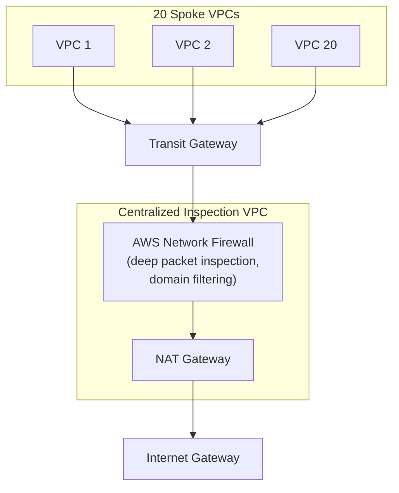

Step by step: (1) every spoke VPC's route table sends outbound internet-bound traffic to the
Transit Gateway rather than to its own local NAT Gateway; (2) Transit Gateway forwards that
traffic into the single centralized inspection VPC, where AWS Network Firewall applies one
unified rule set to all of it, regardless of which of the 20 VPCs it came from; (3) traffic
that passes inspection continues out through the inspection VPC's own NAT Gateway and Internet
Gateway to the internet — meaning a firewall rule change only ever needs to be made in one
place to take effect for all 20 VPCs.

**Why the others are wrong:**
- **A** deploying and manually syncing identical rule sets across 20 separate Network Firewall instances is exactly the decentralized, duplicated-maintenance-burden approach the requirement explicitly wants replaced with centralization.
- **C** security groups are stateful Layer 3/4 packet filters (based on IP/port/protocol) — they have no deep packet inspection or domain-filtering capability at all; this option describes a capability security groups fundamentally don't have.
- **D** a shared NAT Gateway with no firewall component provides shared internet egress infrastructure but doesn't satisfy the actual requirement at all — there's no deep packet inspection or domain filtering happening anywhere in this design.

Reference: [`services/networking-content-delivery/transit-gateway-and-peering.md`](../../../services/networking-content-delivery/transit-gateway-and-peering.md)

---

## Question 30

*(Domain 1 — Secure Architectures)*

A company wants a "break-glass" emergency IAM role that senior engineers can assume during a
declared incident to get broad permissions quickly, but wants this role usable **only** when
the requester has recently authenticated with MFA, and only from the corporate office's known
IP range — rejecting any attempt that doesn't meet both conditions, even with otherwise valid
credentials. What should the Solutions Architect configure on the role's trust/permissions
policy?

A) A policy with no conditions, relying on the role being given only to senior engineers who are trusted not to misuse it
B) A policy condition block requiring both `aws:MultiFactorAuthPresent` to be `true` and `aws:SourceIp` to match the corporate office's CIDR range, combined with `Deny` statements for requests failing either condition
C) A policy requiring only a strong IAM password, since MFA adds unnecessary friction during an emergency
D) A separate IAM user (not role) created specifically for break-glass access, shared among senior engineers via a password manager

**Correct Answer: B**

**Why correct:** [IAM policy condition keys](../../../services/security-identity-compliance/iam.md) `aws:MultiFactorAuthPresent` and `aws:SourceIp` let you express exactly "this role may only be used when both of these are true" — structuring this as explicit `Deny` statements for requests that *fail* either condition (rather than relying solely on an `Allow` with conditions) gives a stronger, defense-in-depth guarantee that the role genuinely cannot be used without both MFA and the correct source IP, regardless of what other permissions or paths might otherwise apply.

**Why the others are wrong:**
- **A** "relying on trust" provides no technical enforcement at all — the scenario explicitly asks for a policy that enforces both conditions mechanically, not a policy of trusting good behavior.
- **C** explicitly removing MFA (the opposite of what's asked) for the sake of "emergency speed" directly contradicts the stated requirement that MFA be required — a break-glass role unlocking broad permissions is exactly the kind of access that should have *more*, not less, authentication rigor given its power.
- **D** a long-lived IAM user with a shared password-manager credential is the long-lived, shared-credential anti-pattern (no individual accountability, higher leak risk) that IAM roles with temporary STS credentials and proper conditions are specifically meant to replace — this doesn't achieve the MFA/source-IP enforcement goal either, since there's no equivalent condition mechanism described for it here.

Reference: [`services/security-identity-compliance/iam.md`](../../../services/security-identity-compliance/iam.md)

---

## Question 31

*(Domain 4 — Cost-Optimized Architectures)*

A media company serves its global audience through CloudFront, but analysis shows 95% of
viewers are in North America and Europe — the remaining 5% in regions served by the most
expensive edge-location price class add meaningfully to the bill without proportional
business value. What CloudFront setting should the Solutions Architect adjust to reduce cost
while continuing to serve the vast majority of viewers from nearby edge locations?

A) Reduce the distribution's cache TTL to force more frequent origin fetches
B) Select a CloudFront price class that excludes the most expensive edge locations (e.g., "Use North America, Europe, Asia, and Oceania" or a similarly scoped price class) instead of "Use all edge locations," routing the small remaining percentage of viewers to the nearest included edge location (at marginally higher latency for them) rather than paying for the priciest regions' edge locations at all
C) Switch from CloudFront to direct S3 website hosting, removing CDN caching entirely
D) Delete the CloudFront distribution and redirect all traffic to a single Regional endpoint

**Correct Answer: B**

**Why correct:** [CloudFront price classes](../../../services/networking-content-delivery/cloudfront.md) let you choose which set of edge locations are eligible to serve your content, trading off some latency for viewers in excluded regions (they're served from the nearest *included* edge location instead) against meaningfully lower cost, since the priciest edge locations (commonly some of the most expensive Regions) are excluded — given that only 5% of viewers are affected and the business value from serving them from the absolute nearest edge is explicitly described as not proportional to the cost, this directly reduces spend while still serving 95% of the audience from a fully optimal nearby edge location.

**Why the others are wrong:**
- **A** reducing cache TTL has nothing to do with edge-location pricing — it would actually *increase* origin-fetch frequency (and associated cost/load), working against cost optimization, not toward it.
- **C** removing CDN caching entirely degrades performance for 100% of viewers (including the 95% majority who are genuinely well-served today) just to save cost on the 5% minority — a drastic overcorrection that throws away a working, valuable optimization for most of the audience.
- **D** deleting the distribution removes CDN benefits globally, including for the 95% of viewers CloudFront is serving well today — this solves the cost question for the wrong 95% of the audience by making their experience worse too.

Reference: [`services/networking-content-delivery/cloudfront.md`](../../../services/networking-content-delivery/cloudfront.md)

---

## Question 32

*(Domain 3 — High-Performing Architectures)*

A logistics company's internal reporting tool makes frequent calls to several AWS APIs
(S3, DynamoDB, SNS) from EC2 instances in a private subnet, currently routed through a NAT
Gateway. The team wants to both reduce the latency of these calls (currently adding
noticeable round-trip time) and keep the traffic off the public internet entirely. What should
the Solutions Architect add?

A) A larger NAT Gateway instance type, assuming it reduces latency proportionally to size
B) Interface VPC endpoints (PrivateLink) for the services being called frequently (SNS, and any services without a Gateway endpoint option), plus a Gateway VPC endpoint for S3 and DynamoDB, routing this traffic over AWS's private network directly to each service instead of out through the NAT Gateway and public internet
C) A VPN connection from the VPC to each AWS service's public endpoint
D) CloudFront configured in front of each AWS service's API endpoint

**Correct Answer: B**

**Why correct:** [VPC endpoints](../../../services/networking-content-delivery/vpc-endpoints-privatelink.md) — Gateway endpoints for S3/DynamoDB (free) and Interface endpoints (PrivateLink) for services like SNS that don't have a Gateway endpoint option — route traffic to each AWS service directly over AWS's internal network rather than out through a NAT Gateway and across the public internet, which both reduces latency (shorter, more direct network path, no NAT processing hop) and keeps traffic off the public internet entirely, satisfying both stated goals simultaneously.

**Why the others are wrong:**
- **A** a NAT Gateway's instance size (to the extent it's even a configurable concept, which it isn't in the traditional "instance type" sense for the managed NAT Gateway service) doesn't change the fundamental network path (still through the internet gateway) or reliably reduce the per-call latency of reaching AWS service public endpoints the way a direct, private endpoint path does.
- **C** a VPN tunnel to each AWS service's *public* endpoint still ultimately reaches a public API endpoint and adds VPN encapsulation overhead — it doesn't provide the direct, AWS-backbone private path that VPC endpoints do, and setting up and maintaining a VPN per AWS service would be a far heavier, non-standard approach compared to native VPC endpoints.
- **D** CloudFront is designed for caching and accelerating HTTP content delivery (typically for end-user-facing content) — it isn't the standard mechanism for internal, private, low-latency access from a VPC to AWS service APIs like S3/DynamoDB/SNS, and inserting it here adds unnecessary complexity without addressing the private-connectivity requirement.

Reference: [`services/networking-content-delivery/vpc-endpoints-privatelink.md`](../../../services/networking-content-delivery/vpc-endpoints-privatelink.md)

---

## Question 33

*(Domain 3 — High-Performing Architectures)*

A marketing analytics team needs to run ad-hoc SQL queries against several years of
clickstream data sitting as Parquet files in S3, with queries run only occasionally (a few
times a week) and no desire to stand up, manage, or pay for an always-on database cluster just
for this intermittent analytical need. What should the Solutions Architect recommend?

A) Load all the data into a permanently-running RDS instance sized for the largest expected query
B) Amazon Athena, which runs serverless, ad-hoc SQL queries directly against data in S3 (including Parquet), billed per query/data scanned, with no cluster to provision or manage
C) Launch an EMR cluster that runs continuously, ready for any query at any time
D) Export the S3 data into a single large CSV file and have analysts download and query it locally in a spreadsheet tool

**Correct Answer: B**

**Why correct:** [Athena](../../../services/analytics/athena.md) is a serverless interactive query service that runs standard SQL directly against data sitting in S3 (with native, efficient support for columnar formats like Parquet), billed per query based on data scanned — there's no cluster to provision, size, or pay for while idle, which is exactly suited to "occasional... a few times a week" ad-hoc analytical querying without any always-on infrastructure cost.

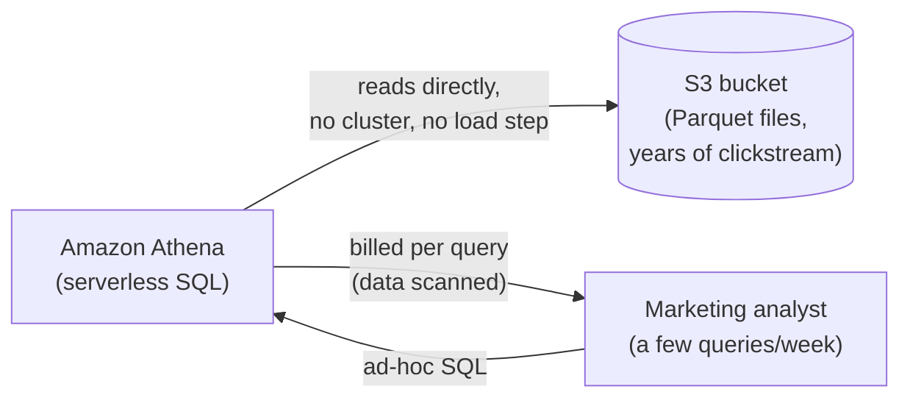

Step by step: (1) the clickstream data stays exactly where it already is, in S3, in its native
Parquet format; (2) when an analyst needs to run a query, Athena reads directly from S3 for
that single query, with no cluster ever provisioned or left running; (3) the team pays only
for the data scanned by each query, not for idle infrastructure between the few queries run
each week.

**Why the others are wrong:**
- **A** a permanently-running RDS instance sized for the largest expected query pays for that capacity 24/7 even though queries only happen a few times a week — a significant, unnecessary ongoing cost for infrequent usage, and loading years of clickstream data into RDS is also a heavier data-engineering lift than querying it in place.
- **C** a continuously-running EMR cluster has the same "always-on cost for occasional use" problem as option A — EMR is a strong choice for frequent, heavy, cluster-based big-data processing, but not for lightweight, occasional ad-hoc SQL against data that's already sitting in S3.
- **D** a single giant CSV downloaded locally doesn't scale to "several years of clickstream data" at all (spreadsheet tools have practical row/size limits far below realistic clickstream volumes), loses the efficiency benefits of querying columnar Parquet in place, and turns a shared, governable dataset into untracked local copies.

Reference: [`services/analytics/athena.md`](../../../services/analytics/athena.md)

---

## Question 34

*(Domain 4 — Cost-Optimized Architectures)*

A media-processing company runs a containerized video-transcoding batch workload on Amazon
ECS, where each job is independent, checkpointed, and tolerant of being restarted if
interrupted — similar to the earlier rendering-job scenario, but for containers specifically.
The team wants the deepest possible discount for this fault-tolerant containerized workload
without managing any underlying EC2 instances directly. What should the Solutions Architect
configure?

A) ECS on EC2 with Reserved Instances covering the underlying instances
B) ECS tasks running on Fargate Spot, which provides Fargate's serverless container experience (no EC2 instances to manage) combined with Spot-level pricing discounts, suited to fault-tolerant, interruptible batch workloads
C) ECS on EC2 with On-Demand Instances only, to guarantee no task is ever interrupted
D) Migrate the workload off containers entirely onto Lambda, since Lambda is always cheaper than any container option

**Correct Answer: B**

**Why correct:** [Fargate Spot](../../../services/containers/fargate.md) combines two things the scenario explicitly wants: Fargate's serverless container model (no EC2 instances to provision, patch, or manage at all) and Spot-level pricing (a deep discount, commonly up to ~70% versus Fargate On-Demand) specifically appropriate for workloads described as "independent, checkpointed, and tolerant of being restarted if interrupted" — exactly matching the fault-tolerance profile Spot-based pricing is designed for, while keeping the "no underlying EC2 instances to manage" requirement satisfied, which EC2-based ECS options cannot.

**Why the others are wrong:**
- **A** ECS on EC2 requires managing the underlying EC2 instances (capacity, patching, scaling the cluster) directly, which violates "without managing any underlying EC2 instances directly," regardless of whether Reserved Instances are used for a cost discount.
- **C** ECS on EC2 with On-Demand both fails the "no EC2 management" requirement and also forgoes any Spot-level discount for a workload that's explicitly fault-tolerant and doesn't need interruption protection — paying full price for a resilience guarantee the workload doesn't need.
- **D** "Lambda is always cheaper than any container option" is not a reliable blanket claim — for sustained, resource-intensive batch workloads like video transcoding (especially long-running jobs, which can exceed Lambda's maximum execution duration entirely), Fargate (especially Fargate Spot) is frequently the more appropriate and cost-effective choice; this ignores both Lambda's execution-time limits and the workload's actual resource profile.

Reference: [`services/containers/fargate.md`](../../../services/containers/fargate.md)

---

## Question 35

*(Domain 3 — High-Performing Architectures)*

A fintech company's payment-authorization API runs on Lambda, invoked via API Gateway, and
calls an RDS PostgreSQL database for every request. During traffic spikes, Lambda scales out to
hundreds of concurrent executions, each opening its own database connection, and the database
starts rejecting new connections once it hits its max-connections limit, causing request
failures. What should the Solutions Architect add to solve this without redesigning the
payment logic itself?

A) Increase the RDS instance size, since a larger instance always has a proportionally higher max-connections limit sufit to the traffic spike
B) Amazon RDS Proxy, which pools and multiplexes database connections from the many concurrent Lambda executions over a much smaller number of actual connections to the database, preventing connection exhaustion
C) Reduce the Lambda function's reserved concurrency to 1, serializing all requests through a single execution at a time
D) Switch the database engine from PostgreSQL to DynamoDB, since DynamoDB has no connection limit concept at all

**Correct Answer: B**

**Why correct:** [RDS Proxy](../../../services/database/rds.md) sits between Lambda (or any application tier) and the database, maintaining a pool of actual database connections and multiplexing many application-side logical connections (from hundreds of concurrent Lambda executions) over that much smaller pool — this directly prevents the max-connections exhaustion problem during traffic spikes, without requiring any change to the payment-authorization logic itself (the Lambda function just connects to the proxy endpoint instead of the database directly).

**Why the others are wrong:**
- **A** a larger instance size does raise the max-connections limit somewhat, but connection limits don't scale linearly or indefinitely with instance size, and "hundreds of concurrent Lambda executions" during a spike can still exceed even a much higher ceiling — this treats the symptom without addressing the fundamental one-connection-per-execution pattern that RDS Proxy's pooling/multiplexing solves structurally.
- **C** serializing all payment-authorization requests through a single concurrent execution would eliminate the connection problem but at the cost of making a payment API handle only one request at a time — a severe availability/throughput regression that's a far worse outcome than the original problem for a payment-authorization workload.
- **D** migrating to DynamoDB is a drastic re-architecture of the data layer and explicitly violates "without redesigning the payment logic itself" — RDS Proxy solves the stated connection-exhaustion problem directly without touching the application or data model at all.

Reference: [`services/database/rds.md`](../../../services/database/rds.md)

---

## Question 36

*(Domain 1 — Secure Architectures)*

A healthcare company needs its disaster-recovery Region to be able to start serving traffic
immediately after a failover, which requires application secrets (database credentials, API
keys) stored in Secrets Manager to already exist in the DR Region — but the team doesn't want
to manually re-create every secret there and keep them in sync by hand going forward. What
should the Solutions Architect configure?

A) Store all secrets in a single S3 bucket instead of Secrets Manager, and use S3 Cross-Region Replication
B) Secrets Manager multi-Region secret replication, which keeps a read-only replica of each secret continuously synchronized in the DR Region, automatically reflecting updates made to the primary-Region secret
C) Export each secret's value and manually paste it into a new secret created in the DR Region, repeating this every time a secret changes
D) Rely on IAM cross-Region replication to make secrets available in any Region automatically

**Correct Answer: B**

**Why correct:** [Secrets Manager's multi-Region replication](../../../services/security-identity-compliance/secrets-manager-vs-parameter-store.md) feature creates and maintains a read-only replica of a secret in one or more specified Regions, automatically propagating any update to the primary secret's value to the replicas — so the DR Region always has an up-to-date copy ready to use the moment a failover happens, without any manual re-creation or ongoing manual sync step.

**Why the others are wrong:**
- **A** Secrets Manager provides secret-specific features (automatic rotation, fine-grained IAM/resource policies, audit integration) that a raw S3-object-based approach doesn't replicate — storing secrets as plain S3 objects (even with CRR) is a weaker security and operational model than using the purpose-built secrets service's own native replication.
- **C** manually re-exporting and pasting secret values every time one changes is exactly the manual, error-prone, "keep them in sync by hand" process the requirement explicitly wants to avoid.
- **D** there's no such thing as "IAM cross-Region replication" making secrets available automatically — IAM is a global service in terms of policy/role definitions, but it has no mechanism for replicating the *contents* of a separate service's secrets; this option describes a non-existent capability.

Reference: [`services/security-identity-compliance/secrets-manager-vs-parameter-store.md`](../../../services/security-identity-compliance/secrets-manager-vs-parameter-store.md)

---

## Question 37

*(Domain 2 — Resilient Architectures)*

An engineering firm's shared file storage for CAD drawings is accessed concurrently by
engineers' workstations across two Availability Zones in the same Region. Access must remain
available even if one entire AZ becomes unreachable, without the team provisioning or managing
any extra replication themselves. What storage service and configuration should the Solutions
Architect use?

A) A single EBS volume attached to one EC2 instance acting as a file server, with a second instance on standby in another AZ that the team manually fails over to
B) Amazon EFS (General Purpose), which stores data redundantly across multiple Availability Zones within the Region automatically and natively, as part of the standard EFS storage model, with no extra replication setup required
C) Amazon S3 with Cross-Region Replication configured to a bucket in a second Region
D) FSx for Windows File Server deployed as a Single-AZ file system in just one of the two AZs

**Correct Answer: B**

**Why correct:** [Amazon EFS's](../../../services/storage/efs.md) standard (Regional, General Purpose) storage model stores file data and metadata redundantly across multiple Availability Zones within the Region automatically, as an inherent part of how EFS works — no extra configuration, replication setup, or failover process is required, and workstations/instances in either AZ mount the same file system and keep working transparently even if one AZ becomes unreachable, matching "remain available... without the team provisioning or managing any extra replication themselves" exactly.

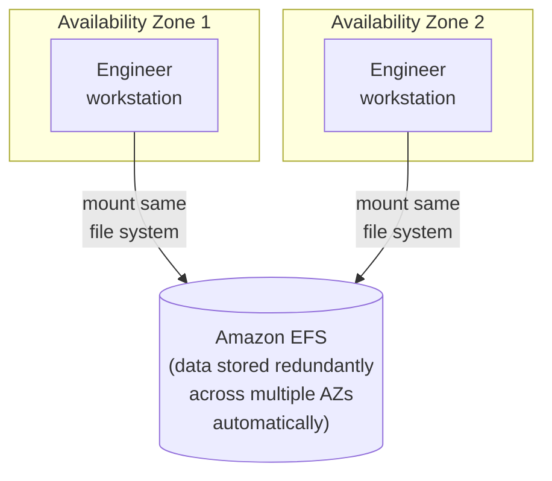

Step by step: (1) both AZs' engineer workstations mount the exact same EFS file system, not
separate copies; (2) EFS itself stores the underlying data redundantly across multiple AZs as
part of its standard architecture, with no separate replication job to configure; (3) if AZ-1
becomes unreachable, engineers in AZ-2 keep reading and writing the same CAD files without
interruption, since EFS's redundancy was never tied to either AZ specifically.

**Why the others are wrong:**
- **A** a single EBS volume is inherently tied to one Availability Zone (EBS volumes don't span AZs) — losing that AZ means losing access to the volume, and the described "manual failover to a standby instance" is both a manual process (violating "without the team managing it themselves") and still wouldn't be true shared concurrent access for engineers' workstations the way a shared file system like EFS provides.
- **C** S3 CRR solves a different problem (object storage replication to a second Region, often for DR/compliance) — it isn't a concurrent, POSIX-style shared file system that engineers' CAD workstations could mount and collaborate on directly the way EFS is.
- **D** explicitly choosing the Single-AZ FSx deployment type defeats the entire purpose — deploying in just one of the two AZs means an outage of that specific AZ takes the file system down entirely, which is the opposite of what's needed (FSx does offer a Multi-AZ deployment option, but this option specifically describes the Single-AZ configuration).

Reference: [`services/storage/efs.md`](../../../services/storage/efs.md)

---

## Question 38

*(Domain 1 — Secure Architectures)*

A legal-document management company lets users upload large (multi-GB) confidential files
directly from their browsers to S3. Security policy requires that file contents be encrypted
by the client **before** leaving the user's browser, so that neither the network path nor S3
itself ever has access to an unencrypted version, and the encryption key material must not be
stored alongside the encrypted object in a way that a compromised bucket alone would expose it.
What encryption approach should the Solutions Architect design?

A) S3 server-side encryption with Amazon S3-managed keys (SSE-S3), since encryption happens automatically
B) Client-side envelope encryption: the browser requests a data key from KMS, encrypts the file locally using that data key before upload, and uploads both the encrypted file and the KMS-encrypted (wrapped) data key — the plaintext data key never touches S3 or the network in cleartext, and decrypting the wrapped key still requires a separate call back to KMS with appropriate permissions
C) S3 server-side encryption with customer-managed keys (SSE-KMS), performed after the file reaches the S3 service
D) Base64-encode the file in the browser before uploading, as a simple way to obscure its contents

**Correct Answer: B**

**Why correct:** [Client-side envelope encryption using KMS](../../../services/security-identity-compliance/kms.md) encrypts the file's content locally, in the browser, *before* any network transmission — satisfying "encrypted by the client before leaving the user's browser" exactly — and because only the KMS-*wrapped* (encrypted) data key is stored alongside the encrypted object (not the plaintext data key), a compromised bucket alone doesn't expose anything decryptable: an attacker would also need separate IAM/KMS permissions to call KMS and unwrap the data key, satisfying "key material must not be stored... in a way that a compromised bucket alone would expose it."

**Why the others are wrong:**
- **A** and **C** (SSE-S3/SSE-KMS) both perform encryption **server-side**, meaning the unencrypted file content travels over the network to S3 and is only encrypted once it arrives at the AWS side — this directly violates "encrypted by the client before leaving the user's browser," since the data is plaintext in transit up until it reaches S3's encryption step.
- **D** Base64 encoding is not encryption at all — it's a reversible, non-secret encoding scheme that anyone can decode trivially with no key whatsoever; it provides zero actual confidentiality protection.

Reference: [`services/security-identity-compliance/kms.md`](../../../services/security-identity-compliance/kms.md)

---

## Question 39

*(Domain 1 — Secure Architectures)*

A social platform lets users upload profile photos and short video clips that are immediately
made available to other users. The security team wants every uploaded file automatically
scanned for malware **before** it's ever served to another user, with infected files
automatically quarantined, using a managed AWS capability rather than a custom-built antivirus
pipeline. What should the Solutions Architect implement?

A) Amazon Macie, configured to flag any file containing suspicious binary patterns
B) Amazon GuardDuty Malware Protection for S3, which automatically scans newly uploaded S3 objects for malware and can trigger automated tagging/quarantine actions (e.g., via EventBridge) for files flagged as malicious, before they're served onward
C) AWS WAF, configured with a rule blocking file uploads containing executable file signatures
D) Amazon Inspector, configured to scan the S3 bucket's access logs for malware signatures

**Correct Answer: B**

**Why correct:** [GuardDuty Malware Protection for S3](../../../services/security-identity-compliance/guardduty.md) is a managed capability specifically built to scan objects uploaded to S3 for malware, generating findings for infected files that can drive automated response (e.g., an EventBridge rule triggering a Lambda function to tag the object and move/quarantine it, or block access) — this is exactly "managed AWS capability" (not custom-built) scanning for malware before files are served onward to other users.

**Why the others are wrong:**
- **A** Macie is purpose-built for discovering **sensitive data** (PII/PHI-style content patterns), not malware — "suspicious binary patterns" isn't a Macie capability; it's solving a content-classification problem, not a malware-scanning one.
- **C** WAF inspects and filters HTTP requests (e.g., blocking SQLi/XSS patterns, rate-limiting) at the point of the web request — it doesn't perform deep malware scanning of uploaded file *content*, and "blocking executable file signatures" within a generic WAF rule isn't a realistic or supported WAF malware-detection mechanism.
- **D** Amazon Inspector scans EC2 instances, container images, and Lambda functions for software vulnerabilities (CVEs) — it does not scan S3 bucket access logs for malware signatures, and access logs (records of who accessed what) don't even contain the uploaded file content to scan in the first place.

Reference: [`services/security-identity-compliance/guardduty.md`](../../../services/security-identity-compliance/guardduty.md)

---

## Question 40

*(Domain 3 — High-Performing Architectures)*

A quant trading firm runs a latency-sensitive risk-calculation workload that writes large
temporary intermediate datasets during each calculation run, discarding them immediately after
the run completes, and needs the absolute lowest possible storage latency for this ephemeral,
non-durable scratch data — durability across an instance stop/terminate is explicitly not
required for this specific dataset. What storage should the Solutions Architect use for the
temporary intermediate data?

A) Amazon EFS, for its shared multi-AZ durability
B) EC2 instance store (local NVMe SSD), which is physically attached to the host and offers the lowest possible latency of any EC2 storage option, appropriate here since durability across stop/terminate is explicitly not required
C) EBS gp3 volumes, since they offer the best balance of cost and durability
D) S3 Standard, since it's the cheapest storage option per GB

**Correct Answer: B**

**Why correct:** [EC2 instance store](../../../services/storage/ebs.md) is physically attached directly to the host hardware, delivering the lowest latency and highest IOPS of any EC2 storage option (no network hop to a separate storage service, unlike EBS) — its key trade-off is that data is lost if the instance stops, hibernates, or terminates, which the scenario explicitly says is acceptable for this specific, intentionally-ephemeral intermediate dataset, making it the ideal (and cheapest, since it's typically included with eligible instance types) choice specifically for this use case.

**Why the others are wrong:**
- **A** EFS's multi-AZ durability is valuable for data that needs to survive and be shared durably — but it involves network-attached storage with higher latency than local instance store, and durability is explicitly *not* a requirement here, so EFS is solving for a property (durability) the scenario doesn't need while being slower for the property (latency) that actually matters.
- **C** EBS gp3, while fast, is still network-attached storage (a separate service accessed over the network, even if optimized) — it does not match instance store's physically-local, lowest-possible-latency profile, and EBS's durability (which gp3 is also optimized to preserve) is a feature the scenario explicitly doesn't need for this ephemeral data.
- **D** S3 is an object store accessed over HTTP APIs with latency far higher than either local instance store or EBS — entirely unsuited for a latency-sensitive, frequently-read/written scratch-data use case during active computation.

Reference: [`services/storage/ebs.md`](../../../services/storage/ebs.md)

---

## Question 41

*(Domain 4 — Cost-Optimized Architectures)*

A regional retailer currently runs its e-commerce order database on a self-managed PostgreSQL
instance on-prem, requiring a dedicated DBA team for patching, backups, and failover testing,
plus ongoing commercial database licensing fees. They want to reduce both operational overhead
and total cost of ownership by moving to a managed AWS database, with minimal changes to the
application's existing PostgreSQL-compatible SQL and drivers. What should the Solutions
Architect recommend?

A) Migrate to Amazon RDS for PostgreSQL (or Aurora PostgreSQL-compatible), eliminating the self-managed patching/backup/failover operational burden and the commercial licensing cost that PostgreSQL itself doesn't carry, while keeping the same SQL dialect and client drivers
B) Migrate to DynamoDB, since NoSQL databases are inherently cheaper than any relational database
C) Keep the on-prem PostgreSQL instance, since migrating a production database is "never" worth the risk
D) Migrate to a different commercial relational database engine with a different SQL dialect, to access a specific feature set

**Correct Answer: A**

**Why correct:** [RDS for PostgreSQL](../../../services/database/rds.md) (or [Aurora PostgreSQL-compatible](../../../services/database/aurora.md)) is a managed service that handles patching, automated backups, and Multi-AZ failover natively — removing the dedicated DBA operational burden described — and because PostgreSQL itself is already open-source with no AWS-added commercial licensing fee, this directly reduces total cost of ownership versus a self-managed, DBA-operated on-prem setup, all while requiring "minimal changes" since the SQL dialect and standard PostgreSQL drivers remain the same (unlike migrating to a different engine entirely).

**Why the others are wrong:**
- **B** "NoSQL is inherently cheaper than any relational database" is not a reliable, universal claim, and more importantly, migrating a mature relational e-commerce order schema with existing SQL queries to DynamoDB is a significant data-modeling and application rewrite — directly contradicting "minimal changes to the application's existing... SQL and drivers."
- **C** refusing to ever migrate a production database ignores that this is one of the most common, well-trodden AWS migration patterns (often using DMS for minimal-downtime cutover) — "never worth the risk" is an absolute, non-evidence-based objection that ignores the real operational and cost benefits on offer, and the risk is manageable with standard migration tooling and practices.
- **D** switching to a *different* commercial engine (with a different SQL dialect) explicitly fails "minimal changes to the application's existing... SQL and drivers," and would likely introduce new licensing costs of its own — working against the stated cost-reduction goal rather than toward it.

Reference: [`services/database/rds.md`](../../../services/database/rds.md)

---

## Question 42

*(Domain 2 — Resilient Architectures)*

An insurance company's claims-adjudication process involves 15 sequential steps, some taking
hours (waiting on external adjuster review) and some taking milliseconds (automated rule
checks), running at a volume of a few hundred claims per day, where full execution history and
exactly-once step execution are both important for audit purposes. A separate, much
higher-volume (millions-per-day) IoT sensor-validation pipeline inside the same company has
very short-lived steps and can tolerate at-least-once (occasionally duplicate) processing.
Which Step Functions workflow type fits each, and why?

A) Both should use Express workflows, since Express is always the better choice for new workflows
B) The claims-adjudication process should use a Standard workflow (long-running, up to one year, exactly-once execution, full execution history for audit), while the IoT sensor-validation pipeline should use an Express workflow (high event rates, short duration, at-least-once execution, lower cost per execution at that volume)
C) Both should use Standard workflows, since Standard is always safer for audit purposes regardless of volume or duration
D) The claims process should use Express (for lower cost) and the IoT pipeline should use Standard (for durability)

**Correct Answer: B**

**Why correct:** [Step Functions Standard workflows](../../../services/application-integration/step-functions.md) support long-running executions (up to a year), guarantee exactly-once step execution, and retain full execution history — directly matching the claims process's hours-long waits, audit requirements, and (relatively) low per-day volume, where Standard's higher per-transition cost isn't a concern at only a few hundred executions a day. [Express workflows](../../../services/application-integration/step-functions.md) are built for high-volume, short-duration workloads with at-least-once semantics and much lower cost per execution — exactly matching the IoT pipeline's millions-per-day volume and explicit tolerance for occasional duplicate processing, where Standard's audit/history overhead would be unnecessary cost at that scale.

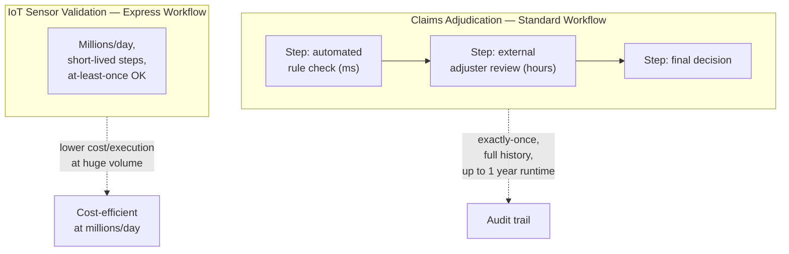

Step by step: (1) the claims process runs as a Standard workflow because its steps can take
hours and every execution needs exactly-once guarantees and a full history for regulators to
review; (2) the IoT pipeline runs as an Express workflow because its steps are short, its
volume is enormous, and occasional duplicate processing is explicitly acceptable; (3) using
Standard's pricing model for the IoT pipeline's volume, or Express's weaker guarantees for the
claims process, would be the wrong trade-off in each direction.

**Why the others are wrong:**
- **A** "Express is always better" ignores that Express cannot guarantee exactly-once execution and doesn't retain the same detailed execution history — both of which the claims-adjudication audit requirement explicitly needs; it's the wrong fit for that specific workflow despite being well-suited to the IoT pipeline.
- **C** "Standard is always safer... regardless of volume" ignores that Standard's pricing (per state transition) becomes comparatively expensive at IoT-pipeline-scale (millions per day) where Express's pricing model (per execution, duration, and memory) is specifically optimized for exactly that volume profile.
- **D** swaps the correct assignments: it puts the audit-sensitive, long-running claims process on Express (losing exactly-once guarantees and full history it needs) and puts the massive-volume, duplicate-tolerant IoT pipeline on Standard (paying a cost premium for audit/exactly-once guarantees that pipeline explicitly doesn't need).

Reference: [`services/application-integration/step-functions.md`](../../../services/application-integration/step-functions.md)

---

## Question 43

*(Domain 3 — High-Performing Architectures)*

A scientific computing cluster runs a distributed simulation across 500 EC2 instances that
exchange large volumes of data between nodes constantly throughout the computation, and the
team has already placed all instances in a single cluster placement group but still sees
network throughput bottlenecks between specific instance pairs. What additional EC2 networking
feature should the Solutions Architect verify is enabled to maximize network performance
between instances in this placement group?

A) Elastic IP addresses on every instance, to ensure consistent public connectivity
B) Enhanced Networking (via the Elastic Network Adapter, ENA), which provides higher bandwidth, higher packet-per-second performance, and more consistent lower-latency networking between instances, and should be combined with instance types/sizes that support the highest available network bandwidth tier
C) Multiple Elastic Network Interfaces (ENIs) attached to each instance, assuming more network interfaces always yields proportionally more throughput
D) Placement groups alone are sufficient; no additional networking feature exists or is relevant

**Correct Answer: B**

**Why correct:** [Enhanced networking via ENA](../../../services/compute/ec2.md) is the mechanism that actually delivers higher bandwidth, higher packets-per-second, and more consistent low latency between instances — a cluster placement group provides the *physical proximity* (low-latency network path), but ENA-based enhanced networking is what lets the instances' network interfaces actually take advantage of that proximity at the bandwidth/throughput levels the scenario needs; choosing instance types/sizes with the highest available network bandwidth tier compounds this further, since network bandwidth generally scales with instance size within a family.

**Why the others are wrong:**
- **A** Elastic IPs provide static public IP addresses for internet-facing connectivity — they have no bearing on internal, instance-to-instance network throughput within a placement group at all.
- **C** attaching multiple ENIs to a single instance doesn't automatically multiply that instance's total network throughput proportionally — overall instance network bandwidth is still bounded by the instance type/size's own network performance ceiling, and this option's premise ("always yields proportionally more throughput") misunderstands how EC2 networking bandwidth allocation actually works.
- **D** is incorrect — enhanced networking (ENA) is a real, distinct, and highly relevant feature on top of placement groups; claiming "no additional feature exists" ignores a well-documented and commonly tested EC2 networking performance lever.

Reference: [`services/compute/ec2.md`](../../../services/compute/ec2.md)

---

## Question 44

*(Domain 2 — Resilient Architectures)*

A multinational company's hybrid network connects its on-prem data centers (via Direct
Connect) to AWS VPCs in two separate Regions. They want traffic between a VPC in `us-east-1`
and a VPC in `eu-west-1` to flow privately over AWS's backbone network (not over the public
internet or back out through on-prem infrastructure), surviving the loss of either Region's
Direct Connect link without losing inter-Region VPC-to-VPC connectivity. What should the
Solutions Architect configure?

A) VPC peering directly between the `us-east-1` and `eu-west-1` VPCs, since peering always supports inter-Region traffic natively with no further configuration
B) Transit Gateway in each Region, peered together via Transit Gateway inter-Region peering, so VPC-to-VPC traffic between the two Regions flows over AWS's private backbone independent of either Region's Direct Connect link status
C) Route all inter-VPC, inter-Region traffic back through the on-prem data center, using the Direct Connect links as the path between the two Regions
D) Site-to-Site VPN tunnels configured between the two VPCs directly, routed over the public internet

**Correct Answer: B**

**Why correct:** [Transit Gateway inter-Region peering](../../../services/networking-content-delivery/transit-gateway-and-peering.md) connects two Transit Gateways in different Regions over AWS's private global backbone network — VPCs attached to each respective Transit Gateway can then reach each other across Regions without touching the public internet or relying on on-prem infrastructure at all, and because this path is independent of either Region's Direct Connect link, a Direct Connect outage in either Region has no effect on `us-east-1`-to-`eu-west-1` VPC connectivity specifically.

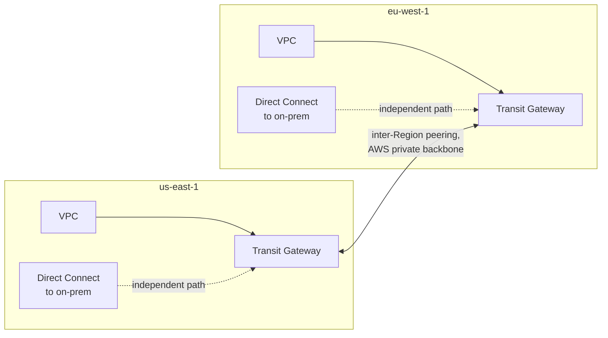

Step by step: (1) each Region's VPC attaches to its own local Transit Gateway; (2) the two
Transit Gateways are peered across Regions, creating a private path over AWS's backbone that
has nothing to do with either Region's Direct Connect link; (3) if either Region's Direct
Connect connection to on-prem fails, VPC-to-VPC traffic between `us-east-1` and `eu-west-1`
keeps flowing unaffected, since it never depended on that link in the first place.

**Why the others are wrong:**
- **A** standard VPC peering does support inter-Region connections, but it doesn't involve Direct Connect or on-prem infrastructure at all in the way this option implies, and more importantly it doesn't address or interact with the stated Direct Connect resilience concern meaningfully differently than Transit Gateway peering — however, the bigger issue is that at any meaningful scale/number of VPCs, Transit Gateway's hub-and-spoke model is the AWS-recommended pattern over a growing mesh of individual peering connections, and this question's hybrid, multi-Region, Direct-Connect-resilience framing specifically points to Transit Gateway's capabilities.
- **C** deliberately routing inter-Region AWS traffic back through on-prem infrastructure means a Direct Connect failure in *either* Region would break the only path between the two VPCs — the opposite of the stated resilience goal, and also adds unnecessary latency routing AWS-to-AWS traffic through an external network.
- **D** a VPN over the public internet directly contradicts "not over the public internet," and also doesn't provide the AWS-backbone-private, Direct-Connect-independent path that Transit Gateway inter-Region peering offers.

Reference: [`services/networking-content-delivery/transit-gateway-and-peering.md`](../../../services/networking-content-delivery/transit-gateway-and-peering.md)

---

## Question 45

*(Domain 3 — High-Performing Architectures)*

A mobile ad-tech company's DynamoDB table uses `device_id` as its partition key, and a small
number of devices generate dramatically more write traffic than the rest (particularly during
promotional campaigns when some test/demo devices rack up disproportionate activity), causing
`ProvisionedThroughputExceededException` throttling on those specific partitions even though
the table's aggregate consumed capacity is well under its overall provisioned total. What
should the Solutions Architect do to resolve this hot-partition problem?

A) Increase the table's overall provisioned write capacity substantially, even though aggregate usage is already well under the current total
B) Redesign the partition key to spread writes more evenly — e.g., a composite/sharded key such as `device_id#shard_suffix` — so a single hot device's writes are distributed across multiple physical partitions instead of concentrating on one, and consider switching to on-demand capacity mode to let DynamoDB absorb bursty, uneven access patterns automatically
C) Switch the table to use a Global Secondary Index as the primary access pattern instead of the base table
D) Enable DynamoDB Accelerator (DAX), since caching resolves write-throttling issues

**Correct Answer: B**

**Why correct:** [DynamoDB partitions throughput per physical partition](../../../services/database/dynamodb.md), not just in aggregate across the table — a hot partition key (a small number of devices generating disproportionate traffic) can throttle even when the table's *overall* provisioned capacity has plenty of headroom, because that specific partition's share of the capacity is exceeded. Redesigning the key (sharding/adding a suffix) spreads a hot device's writes across multiple physical partitions, directly fixing the root cause, and DynamoDB's on-demand mode additionally has built-in capability to adapt to uneven, bursty access patterns automatically without needing to predict exact hot-partition behavior.

**Why the others are wrong:**
- **A** increasing *overall* table capacity doesn't help a hot-partition problem at all — the aggregate capacity is already stated to be underused; the issue is the *distribution* of traffic across partitions, not the total amount of capacity provisioned, so adding more total capacity without addressing distribution leaves the same specific partitions throttled.
- **C** switching the primary access pattern to a GSI doesn't fix the underlying hot-key distribution problem — a GSI has its own partition key (which could suffer the identical hot-partition issue if it's also skewed), and this doesn't address the root cause of uneven key design at all.
- **D** DAX caches **read** results in-memory for microsecond read latency — it has no bearing on **write** throughput or `ProvisionedThroughputExceededException` errors, which are specifically a write-capacity/partition-distribution problem, not a read-latency problem.

Reference: [`services/database/dynamodb.md`](../../../services/database/dynamodb.md)

---

## Question 46

*(Domain 2 — Resilient Architectures)* **(Choose TWO)**

A healthcare data company takes nightly backups of its critical databases via AWS Backup, but
security is concerned that if an attacker (or malicious insider) obtained administrative
credentials, they could delete all backups just before or during a ransomware attack, removing
the company's ability to recover at all. Which **two** actions should the Solutions Architect
take to make the backups resistant to deletion, even by a compromised account administrator?

A) Enable S3 versioning on the underlying backup storage
B) Apply AWS Backup Vault Lock in compliance mode, which makes backups within the locked vault immutable and undeletable for their configured retention period — not even the account's root user or an administrator with full Backup permissions can delete them before the lock expires
C) Require MFA for all administrative IAM users, as the primary deletion-prevention control
D) Configure AWS Backup's cross-account copy to replicate backups into a separate, dedicated backup account that the production account's administrators have no access to
E) Increase the backup vault's retention period setting without enabling Vault Lock

**Correct Answer: B, D**

**Why correct:** [AWS Backup Vault Lock (B)](../../../services/storage/aws-backup.md) in compliance mode makes recovery points within the locked vault genuinely immutable and undeletable for their configured minimum retention period, applying even to the account's root user and full-permission administrators — directly defeating a compromised-credential deletion attempt. [Cross-account copy (D)](../../../services/storage/aws-backup.md) to a genuinely separate backup account adds a second, independent layer: even if an attacker somehow had sufficient access to disable or work around protections in the production account, they would have no access at all to the separate backup account holding the copies — true account-boundary isolation. Together, immutability (B) plus account isolation (D) give defense in depth against exactly the described threat; neither alone is as strong as both combined.

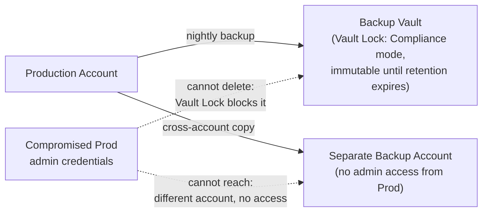

Step by step: (1) nightly backups land in a Vault-Locked vault in the production account,
where Compliance mode technically prevents deletion by anyone, including an attacker who has
obtained full administrative credentials in that account; (2) a cross-account copy rule
additionally replicates those backups into a dedicated backup account that production
administrators have no access to at all, so even a novel attack vector that somehow bypassed
Vault Lock in the production account still couldn't reach the isolated copy; (3) recovery is
possible from either location, giving two independent lines of defense against the same threat.

**Why the others are wrong:**
- **A** S3 versioning protects against accidental overwrite/delete by preserving prior versions, but it doesn't make backups *immutable* against a determined actor with sufficient permissions — someone with full access could still permanently delete specific versions or disable versioning itself, which doesn't meet "even by an account administrator" level immutability.
- **C** MFA on administrative users is a good general security hardening practice, but it's a *preventive-access* control, not an immutability guarantee on the backups themselves — if an attacker does obtain valid, MFA-authenticated administrative access (the exact threat model described), MFA alone doesn't stop them from deleting backups.
- **E** a longer retention period without Vault Lock enabled is still just a regular, mutable setting — an administrator (or attacker with administrative credentials) can simply reduce the retention period or delete the recovery points directly, since nothing is actually locked.

Reference: [`services/storage/aws-backup.md`](../../../services/storage/aws-backup.md)

---

## Question 47

*(Domain 4 — Cost-Optimized Architectures)*

A company's Cost Explorer review surfaces several Elastic IP addresses that are not associated
with any running instance or load balancer, two Classic Load Balancers with zero healthy
targets registered for the past 90 days, and a handful of EBS volumes in the "available"
(unattached) state — all quietly accumulating charges every month. What is the most efficient
way to identify and act on this category of waste going forward, rather than a one-time
cleanup?

A) A one-time script that deletes every resource matching these patterns immediately, run once
B) Trusted Advisor's cost-optimization checks surface exactly these categories (unassociated Elastic IPs, idle load balancers, unattached EBS volumes) automatically and on an ongoing basis — review them on a recurring cadence (e.g., monthly) and investigate/clean up flagged resources after confirming they're genuinely unused
C) Increase the account's service quotas for Elastic IPs and EBS volumes, since more headroom avoids hitting limits
D) Ignore it, since these costs are each individually small and not worth the engineering time to address

**Correct Answer: B**

**Why correct:** [Trusted Advisor's](../../../services/management-governance/trusted-advisor.md) cost-optimization category check list specifically includes unassociated Elastic IPs, idle load balancers (zero/low traffic), and unattached EBS volumes — exactly the three waste categories described — and reviewing these checks on a recurring cadence (rather than a single cleanup) turns this into an ongoing, repeatable governance process that catches new instances of the same waste patterns as they accumulate over time, which is both efficient (leverages an existing managed check rather than custom tooling) and sustainable.

**Why the others are wrong:**
- **A** deleting flagged resources immediately without any verification step risks removing something still intentionally reserved or in a transitional state (e.g., an Elastic IP held for a planned resource, an EBS volume kept as an ad-hoc backup) — a brief confirmation step before deletion is the responsible approach, and a pure one-time script also doesn't address future recurrence the way an ongoing review cadence does.
- **C** increasing quotas for these resource types does nothing to address the cost of the *existing* unused resources — it actually makes it easier to accumulate even more of them without addressing the underlying waste at all.
- **D** "individually small, not worth it" dismisses the fact that these charges are described as accumulating monthly and in multiple categories — over time (and potentially across many such resources company-wide) this adds up, and Trusted Advisor's checks already make the identification nearly free, removing the main cost (engineering time) objection.

Reference: [`services/management-governance/trusted-advisor.md`](../../../services/management-governance/trusted-advisor.md)

---

## Question 48

*(Domain 3 — High-Performing Architectures)*

A news site's homepage is a mix of long-lived static assets (logos, CSS, images that rarely
change) and a frequently-changing "breaking news" API response that still benefits from being
served fast to a huge simultaneous audience during major news events, though it can tolerate
being up to 10 seconds stale. What multi-layer caching strategy should the Solutions Architect
design to minimize both latency and backend load across this mixed content profile?

A) A single layer: CloudFront caching everything (static and dynamic) with one long TTL applied uniformly
B) CloudFront caching static assets with a long TTL via one cache behavior, plus a separate cache behavior for the breaking-news API path with a short TTL (~10 seconds) matching its staleness tolerance, with the API backend itself additionally using ElastiCache to serve the underlying data quickly on each CloudFront-to-origin cache miss
C) No caching anywhere, since breaking news must always be "real-time" and any caching risks serving stale data
D) ElastiCache alone, with no CDN layer, relying on the application servers to serve all traffic directly

**Correct Answer: B**

**Why correct:** A [layered caching strategy](../../../services/networking-content-delivery/cloudfront.md) matches each cache's TTL to its content's actual staleness tolerance: static assets (rarely changing) get a long CloudFront TTL, minimizing origin requests almost entirely, while the breaking-news API gets its own cache behavior with a short TTL that matches the stated "up to 10 seconds stale is fine" tolerance — still absorbing the vast majority of simultaneous requests during a traffic spike at the edge, rather than hitting the origin for every single request. Layering [ElastiCache](../../../services/database/elasticache.md) underneath means that even on the (now much rarer, roughly once every 10 seconds) CloudFront cache misses, the backend itself responds quickly from an in-memory cache rather than hitting a database directly — defense in depth across both the CDN and application layers.

**Why the others are wrong:**
- **A** a single long TTL applied uniformly would mean the breaking-news API response gets stuck serving the same (now actually stale, beyond its own 10-second tolerance) cached response far longer than acceptable — mismatching the cache lifetime to the content's real staleness requirement.
- **C** "no caching anywhere" for a "huge simultaneous audience" during major news events is a scalability risk — every single request hitting the origin directly during a traffic spike is exactly the pattern CDN/caching layers exist to prevent, and the scenario explicitly states up to 10 seconds of staleness is tolerable, so a short-TTL cache is appropriate, not a caching ban.
- **D** removing the CDN layer entirely means every request, even for long-lived static assets, travels all the way back to the application servers — losing CloudFront's edge-proximity latency benefit and its ability to absorb the bulk of a traffic spike before it ever reaches the backend.

Reference: [`services/networking-content-delivery/cloudfront.md`](../../../services/networking-content-delivery/cloudfront.md) and [`services/database/elasticache.md`](../../../services/database/elasticache.md)

---

## Question 49

*(Domain 2 — Resilient Architectures)*

A fintech startup runs a containerized API on ECS (Fargate) behind an ALB. During a recent
traffic spike, response times degraded badly before the service eventually scaled out, and
separately, a container that started throwing errors due to a bad deployment kept receiving
traffic for several minutes before being replaced. What should the Solutions Architect
configure to address both issues?

A) A fixed, large number of ECS tasks running at all times, sized for worst-case peak traffic
B) ECS Service Auto Scaling with a target-tracking policy (e.g., on ALB request count per target or average CPU) to react to load faster, combined with ALB target group health checks configured against the application's actual health endpoint, so unhealthy tasks are detected and replaced promptly rather than continuing to receive traffic
C) Increase the ALB's idle timeout setting, since that controls how quickly new tasks are added
D) Disable health checks entirely to avoid prematurely killing tasks that are just "warming up"

**Correct Answer: B**

**Why correct:** [ECS Service Auto Scaling](../../../services/containers/ecs.md) with a target-tracking policy continuously monitors a load-related metric and adjusts the desired task count to react to real demand faster than a fixed-size fleet ever could, addressing the "degraded before scaling out" symptom; separately, [ALB target group health checks](../../../services/networking-content-delivery/elastic-load-balancing.md) configured against a real application health endpoint will mark the bad-deployment container unhealthy and have it deregistered/replaced promptly, rather than it continuing to serve errors to users for several minutes — together these address both distinct problems described.

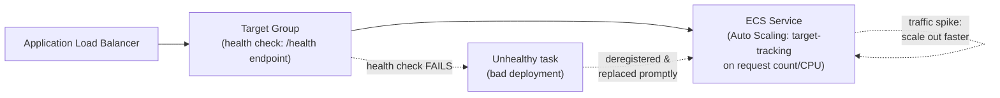

Step by step: (1) ECS Service Auto Scaling watches a load metric continuously and adds tasks as
real demand rises, reacting faster than a fixed-size fleet; (2) the ALB's target group
independently runs health checks against each task's actual `/health` endpoint, not just basic
reachability; (3) the moment the bad-deployment task fails that check, it's deregistered from
the target group and ECS launches a replacement — stopping it from serving errors to users for
the next several minutes, as was happening before the health check was properly configured.

**Why the others are wrong:**
- **A** a fixed, large fleet sized for worst-case peak wastes money nearly all the time outside of peak, and does nothing at all about the second problem (the bad-deployment container continuing to receive traffic) — health checking, not fleet size, is what catches and replaces an unhealthy task.
- **C** the ALB's idle timeout controls how long an idle, established connection is kept open — it has nothing to do with how quickly new ECS tasks are provisioned in response to load, nor with detecting an unhealthy task.
- **D** disabling health checks entirely removes the exact mechanism that would have caught and replaced the bad-deployment container faster — it directly makes the second problem permanent rather than solving it (a more correct fix for "false positives during warm-up" would be tuning the health check's grace period/start period, not disabling it).

Reference: [`services/containers/ecs.md`](../../../services/containers/ecs.md)

---

## Question 50

*(Domain 1 — Secure Architectures)*

A photo-hosting startup serves images exclusively through CloudFront, but a security review
found that the underlying S3 bucket is still directly reachable via its public S3 URL, letting
users bypass CloudFront (and its caching, WAF rules, and access logging) entirely by hitting
S3 directly. What should the Solutions Architect configure to ensure images are **only**
accessible through CloudFront?

A) Make the S3 bucket private with no public access at all, and rely on users never discovering the direct S3 URL
B) Configure CloudFront Origin Access Control (OAC) for the S3 origin, and update the S3 bucket policy to allow `s3:GetObject` only when the request comes from that specific CloudFront distribution (via the OAC-signed request), then block all other public access to the bucket
C) Add a `robots.txt` file to the S3 bucket instructing search engines not to index direct S3 URLs
D) Rename the S3 bucket to something not easily guessable

**Correct Answer: B**

**Why correct:** [CloudFront Origin Access Control (OAC)](../../../services/networking-content-delivery/cloudfront.md) has CloudFront sign its requests to the S3 origin, and the bucket policy is updated to only allow `s3:GetObject` when the request's signature proves it came from that specific CloudFront distribution — combined with blocking all other direct public access to the bucket (e.g., via S3 Block Public Access), this technically enforces "only accessible through CloudFront," closing the direct-S3-URL bypass completely, rather than relying on anyone not discovering or guessing the URL.

**Why the others are wrong:**
- **A** "rely on users never discovering the URL" is exactly "security through obscurity," which is not a real access control — bucket names and URLs are discoverable through many means (search engines, referrer leaks, enumeration, breach of any system that references the URL), and this option explicitly does nothing to technically restrict access even if discovered — it says "private" but doesn't describe any actual enforcement mechanism tied to CloudFront.
- **C** a `robots.txt` file only asks well-behaved search engine crawlers not to index a URL — it has zero enforcement power over a browser, script, or malicious actor directly requesting the URL, and does nothing to prevent direct S3 access technically.
- **D** renaming the bucket to something "not easily guessable" is also security through obscurity — once the name is known (which is easy to discover from the CloudFront distribution's own origin configuration, browser dev tools, etc.), access is just as open as before; it provides no technical access restriction at all.

Reference: [`services/networking-content-delivery/cloudfront.md`](../../../services/networking-content-delivery/cloudfront.md)

---

## Question 51

*(Domain 4 — Cost-Optimized Architectures)*

A pharmaceutical company must retain clinical trial raw data for 15 years for regulatory
compliance, accessed perhaps once or twice in that entire period (e.g., an audit or legal
inquiry), with a tolerance for a multi-hour (not instant) retrieval time on the rare occasion
it's needed, in exchange for the lowest possible storage cost. What S3 storage class and
retrieval configuration fits best?

A) S3 Standard, to guarantee instant access at any time, despite the rare and tolerant retrieval requirement
B) S3 Glacier Deep Archive, using the Standard (not Bulk/Expedited) retrieval tier, which offers the lowest storage cost of any S3 storage class, appropriate for data accessed perhaps once or twice across 15 years with explicit tolerance for multi-hour (not instant) retrieval
C) S3 Standard-IA, for frequent-enough access with millisecond retrieval
D) S3 One Zone-IA, to save additional cost over Standard-IA

**Correct Answer: B**

**Why correct:** [S3 Glacier Deep Archive](../../../services/storage/s3-glacier.md) offers the lowest per-GB storage cost of any S3 storage class, specifically designed for data retained for long compliance periods and accessed extremely rarely — its Standard retrieval tier (typically within about 12 hours) directly matches "tolerance for a multi-hour (not instant) retrieval time," and at an access frequency of "once or twice... in 15 years," the retrieval delay is an irrelevant, acceptable trade-off for the dramatically lower ongoing storage cost over such a long retention period.

**Why the others are wrong:**
- **A** S3 Standard guarantees instant retrieval the data doesn't need (explicit tolerance for multi-hour delay is stated) and charges the highest per-GB storage rate among S3 classes for 15 years of retention — a significant, unnecessary cost for an access pattern that's this infrequent.
- **C** Standard-IA is optimized for data accessed infrequently but still needing millisecond retrieval — paying for that fast-retrieval capability is wasted here, since the scenario explicitly tolerates multi-hour retrieval; Standard-IA's per-GB storage cost is also meaningfully higher than Glacier Deep Archive's.
- **D** One Zone-IA trades away multi-AZ durability for a modest additional discount over Standard-IA, but still carries Standard-IA's millisecond-retrieval cost structure and remains far more expensive for storage than Glacier Deep Archive — and for 15-year regulatory retention, the reduced durability of single-AZ storage is also a risky trade-off compliance teams would likely reject outright.

Reference: [`services/storage/s3-glacier.md`](../../../services/storage/s3-glacier.md)

---

## Question 52

*(Domain 1 — Secure Architectures)*

An internal procurement system, used only by employees on the corporate network, exposes a
REST API built on API Gateway and Lambda. Security policy requires this API be completely
unreachable from the public internet — not just access-controlled, but genuinely inaccessible
outside the corporate network path into the VPC. What API Gateway configuration should the
Solutions Architect use?

A) A public (Edge-optimized or Regional) API Gateway endpoint, secured with an IAM authorizer requiring valid AWS credentials for every request
B) A Private API Gateway endpoint, accessible only via a specific Interface VPC endpoint, with a resource policy restricting access to that VPC endpoint, so the API has no public DNS-reachable path at all
C) A public API Gateway endpoint, with AWS WAF blocking all IP ranges except the corporate office's known range
D) A public API Gateway endpoint secured with Amazon Cognito user pool authorization

**Correct Answer: B**

**Why correct:** [Private API Gateway endpoints](../../../services/networking-content-delivery/api-gateway.md) have no public DNS-reachable path at all — they are only reachable through a specific Interface VPC endpoint, and a resource policy on the API can further restrict access to that exact VPC endpoint, meaning there is no internet-exposed address to reach the API through in the first place, directly satisfying "genuinely inaccessible outside the corporate network path into the VPC" (assuming the corporate network reaches the VPC via Direct Connect/VPN/etc.) rather than merely access-controlled-but-still-publicly-reachable.

**Why the others are wrong:**
- **A** a public endpoint, even with strong IAM-based authorization, is still reachable over the public internet by anyone who sends a request — authentication controls *who* can successfully call it, but the endpoint itself remains internet-addressable, which fails "genuinely inaccessible... not just access-controlled."
- **C** a WAF IP allow-list filters by source IP, but the API Gateway endpoint itself is still a publicly resolvable, internet-facing address — a misconfigured rule, a WAF bypass technique, or simply the endpoint being probed directly (depending on configuration) means this is still fundamentally a public endpoint with an access filter layered on, not a genuinely non-public one.
- **D** Cognito user pool authorization is, like IAM authorization in option A, an access-control mechanism layered on top of a still-public, internet-reachable endpoint — it doesn't change the fundamental reachability of the API from the public internet.

Reference: [`services/networking-content-delivery/api-gateway.md`](../../../services/networking-content-delivery/api-gateway.md)

---

## Question 53

*(Domain 1 — Secure Architectures)*

A company discovers that an RDS MySQL instance holding customer PII has never had encryption
at rest enabled — it was created years ago before the team adopted an encryption-by-default
policy, and RDS does not support enabling encryption on an existing, already-running
unencrypted instance directly. What is the correct migration path to get this instance
encrypted with minimal data risk and acceptable downtime?

A) Export all data via `mysqldump`, delete the instance, create a new encrypted instance, and manually re-import the dump
B) Take a snapshot of the unencrypted instance, copy that snapshot while specifying a KMS key (which produces an encrypted copy of the snapshot), restore a new RDS instance from the encrypted snapshot copy, then cut the application over to the new encrypted instance and decommission the old one
C) Enable "Encryption at rest" in the RDS console on the existing instance; RDS will encrypt it in place during the next maintenance window
D) Add a KMS key to the instance's parameter group, which applies encryption retroactively without any instance replacement

**Correct Answer: B**

**Why correct:** [RDS doesn't support turning on encryption on an already-running unencrypted instance directly](../../../services/database/rds.md) — the standard, correct path is: snapshot the unencrypted instance, use "copy snapshot" while specifying a KMS key (snapshot copying is the specific operation that can produce an *encrypted* copy from an unencrypted source snapshot), restore a brand-new RDS instance from that now-encrypted snapshot copy, validate it, and cut the application over — minimizing data risk (the data is only ever read, never "dumped" to an intermediate insecure format) with downtime limited to the final cutover window rather than a full export/reimport cycle.

**Why the others are wrong:**
- **A** a manual `mysqldump` export/reimport works but is slower, more error-prone for large datasets, and riskier (an intermediate unencrypted dump file existing somewhere, however briefly, plus the application being fully down for the entire length of the export-then-import process) than the native snapshot-copy-and-restore path, which AWS provides specifically to avoid this heavier manual process.
- **C** is factually wrong — there's no such in-place encryption toggle for existing RDS instances; encryption at rest is set at instance creation, and the documented fact is that this isn't something applied retroactively "during a maintenance window."
- **D** parameter groups control database engine configuration parameters, not instance-level storage encryption — there's no KMS-key-via-parameter-group mechanism that retroactively encrypts existing storage.

Reference: [`services/database/rds.md`](../../../services/database/rds.md)

---

## Question 54

*(Domain 3 — High-Performing Architectures)*

An engineering firm's Windows-based CAD team needs a shared file system that preserves native
Windows file permissions (NTFS ACLs), integrates with their existing Active Directory for
authentication, and performs well for large CAD file read/write operations over SMB — Linux-
based NFS semantics (as in standard EFS) don't meet their permission-model or protocol needs.
What should the Solutions Architect provision?

A) Amazon EFS, since it's AWS's general-purpose managed file storage service for all operating systems
B) Amazon FSx for Windows File Server, which provides native SMB protocol support, full NTFS ACL compatibility, and native Active Directory integration for authentication, purpose-built for exactly this Windows-based shared-storage profile
C) Amazon S3 with an SMB gateway built by the engineering team themselves
D) Amazon FSx for Lustre, since it offers the highest raw throughput of any FSx file system type

**Correct Answer: B**

**Why correct:** [FSx for Windows File Server](../../../services/storage/fsx.md) is purpose-built specifically for this profile: native SMB protocol support (not NFS), full compatibility with NTFS file permissions/ACLs, and native integration with Active Directory for authentication — directly matching every specific requirement stated (Windows permission model, AD auth, SMB protocol, good performance for large CAD files) that standard EFS (Linux/NFS-oriented) explicitly does not meet.

**Why the others are wrong:**
- **A** EFS uses the NFS protocol and a Linux-oriented permission model — it does not natively support NTFS ACLs or native SMB access the way the CAD team's workflow requires; the scenario explicitly states this model doesn't fit their needs.
- **C** building a custom SMB gateway in front of S3 is a significant, unsupported engineering effort to approximate a capability (native SMB + NTFS ACLs + AD integration) that FSx for Windows File Server already provides as a fully managed service — reinventing a wheel that already exists and is purpose-built for this.
- **D** FSx for Lustre is built for high-throughput parallel HPC/ML workloads using a Lustre file system (not SMB, not NTFS ACLs, not AD-integrated in the way Windows environments expect) — raw throughput isn't the deciding factor here; the deciding factors are Windows protocol/permission/AD compatibility, which Lustre doesn't provide.

Reference: [`services/storage/fsx.md`](../../../services/storage/fsx.md)

---

## Question 55

*(Domain 2 — Resilient Architectures)*

For each of the following three systems, the business has stated a required RTO/RPO. Match
each to the most cost-appropriate DR strategy: **System 1** (internal wiki: RTO 24 hours, RPO
24 hours), **System 2** (order-processing API: RTO 10 minutes, RPO near-zero), **System 3**
(core trading platform: RTO near-zero, RPO near-zero, must survive a full Regional outage with
no perceptible interruption). Which assignment is correct?

A) System 1 → Multi-site active/active; System 2 → Backup and restore; System 3 → Pilot light
B) System 1 → Backup and restore; System 2 → Warm standby; System 3 → Multi-site active/active
C) System 1 → Pilot light; System 2 → Multi-site active/active; System 3 → Backup and restore
D) All three systems should use the same DR strategy for consistency and operational simplicity

**Correct Answer: B**

**Why correct:** This correctly maps each system's actual RTO/RPO bar to the [cheapest DR strategy capable of meeting it](../domain-2-resilient-architectures/disaster-recovery-strategies.md): **System 1**'s generous 24-hour RTO/RPO is comfortably met by backup-and-restore (the cheapest tier, provisioning infrastructure from scratch and restoring from backups after a disaster), with no need to pay for anything running continuously in a DR Region for a low-stakes internal wiki. **System 2**'s 10-minute RTO with near-zero RPO needs warm standby's already-running-but-scaled-down stack that can be scaled up and cut over within minutes — pilot light's "launch the app tier from scratch" step would likely be too slow, and backup-and-restore (hours) is far too slow. **System 3**'s near-zero RTO/RPO with "no perceptible interruption" during a full Regional outage requires multi-site active/active, since every cheaper tier involves at least some failover/scale-up time that would be perceptible — a trading platform at this bar needs full capacity already running and serving in multiple Regions simultaneously.

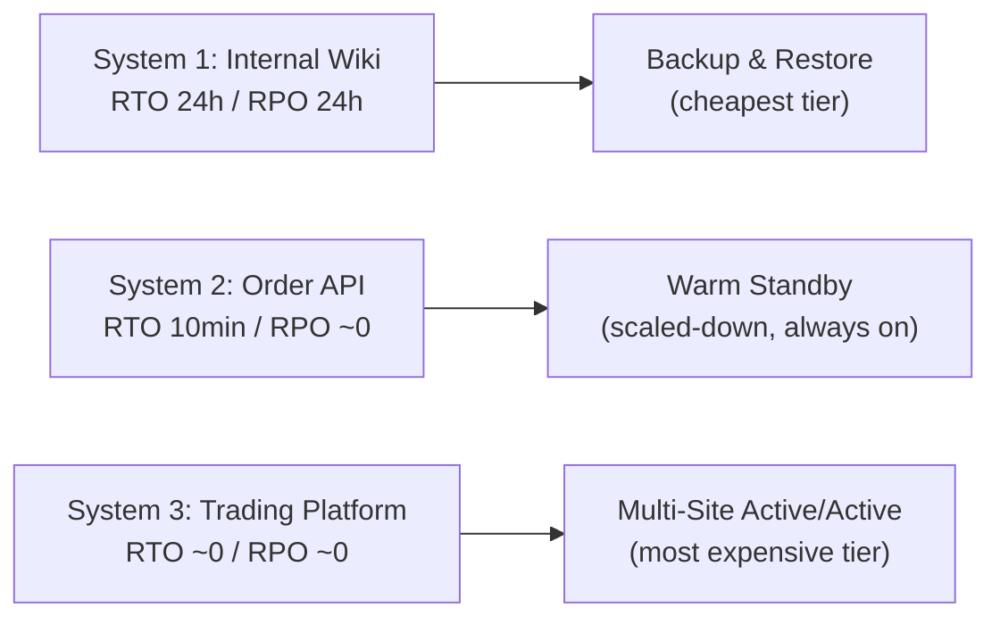

Step by step: (1) each system's stated RTO/RPO is matched to the cheapest DR tier that can
actually meet it, not a one-size-fits-all default; (2) the wiki's generous 24-hour tolerance
means paying for anything more than backup-and-restore would be wasted spend; (3) the trading
platform's "no perceptible interruption" bar rules out every tier except already-running,
full-capacity multi-Region service, since any failover/scale-up step — however fast — would
still be perceptible at that standard.

**Why the others are wrong:**
- **A** assigns multi-site active/active (the most expensive strategy) to the lowest-stakes system (internal wiki, 24-hour tolerance) — a significant, unnecessary overspend — while assigning pilot light (too slow to launch from scratch within 10 minutes reliably) to the order-processing API and backup-and-restore (hours of RTO) to the trading platform that needs near-zero interruption — both badly under-provisioned for their actual requirements.
- **C** similarly mismatches every system: pilot light for the lowest-stakes wiki overspends relative to backup-and-restore's sufficiency, multi-site active/active for a 10-minute-RTO order API overspends relative to warm standby's sufficiency, and backup-and-restore (hours of recovery) for a near-zero-RTO trading platform is a severe under-provisioning that would fail the business requirement outright.
- **D** "one strategy for all three for simplicity" ignores that DR strategy should be driven by each system's actual business-critical RTO/RPO requirement — using multi-site active/active for the wiki wastes significant money, while using backup-and-restore for the trading platform would be a business-threatening outage risk; cost-optimization and resilience both require matching the strategy to the specific need, not a one-size-fits-all default.

Reference: [`domain-2-resilient-architectures/disaster-recovery-strategies.md`](../domain-2-resilient-architectures/disaster-recovery-strategies.md)

---

## Question 56

*(Domain 3 — High-Performing Architectures)*

A logistics company's package-scanning IoT devices publish millions of tiny telemetry
messages per minute that must be validated and written to a time-series store with minimal
per-message latency; the company doesn't need Step Functions' full execution history or
exactly-once guarantees for this specific pipeline, and cost per execution at this volume
matters a great deal. What Step Functions workflow type fits, and why?

A) Standard workflows, because exactly-once execution is always the safer default regardless of workload profile
B) Express workflows, since they're designed for high-event-rate, short-duration workloads with a per-execution/duration/memory pricing model that's dramatically more cost-effective than Standard at this volume, and the scenario explicitly doesn't need Standard's exactly-once/full-history guarantees
C) Neither — Step Functions cannot handle any workload above a few thousand events per minute
D) Standard workflows, because Express workflows cannot be triggered by IoT telemetry at all

**Correct Answer: B**

**Why correct:** [Express workflows](../../../services/application-integration/step-functions.md) are specifically built for exactly this profile — high event rates, short-duration executions, at-least-once semantics — with a pricing model (based on number of executions, duration, and memory consumption) that's dramatically cheaper at millions-per-minute volumes than Standard's per-state-transition pricing, and since the scenario explicitly states Standard's exactly-once/full-history guarantees aren't needed here, there's no reason to pay Standard's cost premium for capabilities this pipeline doesn't require.

**Why the others are wrong:**
- **A** "exactly-once is always the safer default regardless of workload" ignores that the scenario explicitly says this guarantee isn't needed, and applying Standard's pricing model at millions-of-events-per-minute volume would be dramatically more expensive for no practical benefit to this specific pipeline.
- **C** is factually wrong — Step Functions Express workflows are specifically designed to handle very high event rates (well into the millions of events), which is precisely the use case Express was built to address; "cannot handle" misstates its actual capability.
- **D** is also factually wrong — Express workflows can be triggered by a wide range of event sources (including via EventBridge, which IoT Core can publish to, or direct SDK/API calls from an ingestion layer) — there's no inherent incompatibility between Express workflows and IoT-originated events.

Reference: [`services/application-integration/step-functions.md`](../../../services/application-integration/step-functions.md)

---

## Question 57

*(Domain 3 — High-Performing Architectures)*

A stock-market data provider publishes price-tick updates to thousands of downstream consumer
applications via SQS, and profiling shows that making one `SendMessage` and one
`DeleteMessage` API call per individual tick is itself a meaningful source of overhead at the
system's message volume. What should the Solutions Architect do to increase overall throughput
without changing the underlying processing logic?

A) Switch from SQS Standard to SQS FIFO, since FIFO queues always have higher throughput
B) Use SQS batch operations (`SendMessageBatch`, `ReceiveMessage` with multiple messages, `DeleteMessageBatch`) to send, receive, and delete up to 10 messages per API call instead of one call per message, reducing per-message API overhead
C) Increase the SQS queue's visibility timeout substantially
D) Switch from SQS to a single large SNS topic with no queue at all, since SNS is inherently faster

**Correct Answer: B**

**Why correct:** [SQS batch operations](../../../services/application-integration/sqs.md) let a producer or consumer send, receive, or delete **up to 10 messages in a single API call**, directly cutting the number of individual network round-trips and API calls needed for a given volume of messages — exactly addressing "per-message API call overhead" without requiring any change to how each individual message is actually processed.

**Why the others are wrong:**
- **A** SQS FIFO queues provide ordering and exactly-once processing guarantees, not inherently higher raw throughput than Standard — in fact FIFO has its own (higher, but still bounded) throughput characteristics and is a different trade-off (ordering/dedup vs. maximum throughput), not simply "always higher throughput."
- **C** visibility timeout controls how long a received message stays invisible to other consumers — it has no bearing on the number of API calls needed per message or the per-call overhead the scenario describes.
- **D** switching to a pure SNS topic with no queue changes the delivery model entirely (push-based fan-out rather than pull-based queue) and removes the durability/retry semantics SQS provides — it isn't simply "faster" in a way that fixes the stated per-message-API-call-overhead problem, and this is also a significant architecture change rather than the straightforward batching optimization that directly addresses the described bottleneck.

Reference: [`services/application-integration/sqs.md`](../../../services/application-integration/sqs.md)

---

## Question 58

*(Domain 1 — Secure Architectures)*

A company's AWS account hosts resources for three separate internal product teams, each
responsible for their own EC2 instances and RDS databases, but all within one shared account.
Security wants each team to be able to manage (start, stop, modify, terminate) only the
resources belonging to their own team, without creating three separate AWS accounts and
without any single, large handwritten policy per team listing specific resource ARNs that
would need manual updates every time a new resource is created. What should the Solutions
Architect implement?

A) Three identical IAM policies, each manually listing out every current resource ARN belonging to that team, updated by hand whenever a resource is added or removed
B) Tag every resource with a `Team` tag at creation, and write each team's IAM policy using the `aws:ResourceTag/Team` condition key to scope permissions to only resources tagged with that team's value — automatically covering any future resource tagged the same way, with no policy updates needed
C) Create a fourth, shared IAM role with access to everything, trusting each team to only touch their own resources voluntarily
D) Use three separate VPCs, one per team, and assume VPC boundaries alone restrict IAM permissions

**Correct Answer: B**

**Why correct:** [Tag-based (attribute-based) IAM access control](../../../services/security-identity-compliance/iam.md) using the `aws:ResourceTag/Team` condition key scopes a policy's permissions to only resources carrying a matching tag value — once a team's policy is written this way, it automatically applies to **any** resource tagged appropriately, including ones created in the future, with zero need to update the policy's text as the team's resource inventory grows or changes, directly satisfying "without any... handwritten policy... that would need manual updates every time a new resource is created."

**Why the others are wrong:**
- **A** manually listing ARNs is exactly the brittle, constantly-updated-by-hand process the requirement explicitly wants avoided — every new resource requires a policy edit, and a forgotten update means a team either can't manage their own new resource or (worse, if overly broad) can touch something they shouldn't.
- **C** "trusting each team voluntarily" with a shared broad-access role provides no actual technical access restriction at all — it directly fails "each team should be able to manage only... their own resources," since nothing stops a team from touching another team's resources.
- **D** IAM permissions are not inherently scoped by VPC boundaries — a VPC is a networking construct; it doesn't on its own restrict which IAM principals can call `ec2:StartInstances` or `rds:ModifyDBInstance` on resources within it, so "assume VPC boundaries restrict IAM permissions" is a fundamental misunderstanding of how IAM and VPCs relate.

Reference: [`services/security-identity-compliance/iam.md`](../../../services/security-identity-compliance/iam.md)

---

## Question 59

*(Domain 3 — High-Performing Architectures)*

A global SaaS company's user-profile data lives in DynamoDB, replicated via Global Tables to
three Regions for low-latency local writes, but a specific "get my profile" read pattern (the
single most frequent operation in the entire application) still shows single-digit-millisecond
latency that the product team wants pushed down to microseconds in every Region, without
introducing a separate caching service to operate and keep consistent across three Regions
themselves.

A) Add a separate, independently-managed ElastiCache cluster in each Region, synced manually with DynamoDB
B) Deploy DynamoDB Accelerator (DAX) alongside the Global Tables replica in each Region, giving each Region's local "get my profile" reads a microsecond-latency in-memory cache layer directly in front of its own local DynamoDB replica, with no custom cross-Region cache-sync logic needed
C) Switch the entire table to DynamoDB on-demand capacity mode, since on-demand mode includes built-in microsecond caching
D) Increase the provisioned read capacity units on each Regional replica substantially

**Correct Answer: B**

**Why correct:** [DAX deployed per-Region](../../../services/database/dynamodb.md), one cluster sitting in front of each Region's own Global Tables replica, gives each Region's "get my profile" reads the microsecond latency DAX provides — because each DAX cluster caches its own local replica's data (which Global Tables already keeps synchronized across Regions at the DynamoDB layer), there's no need to build or operate any custom cross-Region cache-synchronization logic; DAX just rides on top of data that's already locally present and current in each Region.

**Why the others are wrong:**
- **A** a separately-managed ElastiCache cluster per Region, manually synced with DynamoDB, requires building custom cache-invalidation/sync logic across three Regions from scratch — exactly the "separate caching service to operate and keep consistent... themselves" the requirement explicitly wants to avoid; DAX provides this integration natively.
- **C** on-demand capacity mode is a billing/capacity-management model (pay per request, auto-scales), not a caching feature — it has no built-in microsecond-latency caching layer at all; this option describes a capability on-demand mode doesn't have.
- **D** more provisioned read capacity increases the *amount* of throughput available but does not change DynamoDB's underlying single-digit-millisecond latency floor — it cannot achieve microsecond latency no matter how much capacity is allocated, since that requires an actual in-memory caching layer like DAX.

Reference: [`services/database/dynamodb.md`](../../../services/database/dynamodb.md)

---

## Question 60

*(Domain 1 — Secure Architectures)*

A healthcare company operating in the EU must ensure that regulated patient data is never
stored or processed in any AWS Region outside the EU, across all 12 of its AWS accounts, as a
hard, provable guarantee rather than a best-effort developer guideline. What should the
Solutions Architect implement?

A) A written policy document instructing developers to always select an EU Region when creating resources
B) A Service Control Policy attached at the Organization root (or relevant OU) that denies resource-creation actions in any Region outside an explicit allow-list of EU Regions, for all principals including account administrators
C) Tag all resources with a `Region: EU` tag for tracking purposes, reviewed quarterly
D) Rely on each account administrator's judgment, since they are trusted senior staff

**Correct Answer: B**

**Why correct:** A [Service Control Policy](../../../services/security-identity-compliance/organizations-and-scps.md) using a condition on `aws:RequestedRegion` (denying actions unless the Region is in an explicit allow-list of EU Regions) enforces this restriction account-wide, for every principal including administrators, and cannot be bypassed from within any of the 12 member accounts — turning "developers should pick an EU Region" from a guideline into a technical, provable, un-bypassable guarantee, which is exactly what "hard, provable guarantee rather than a best-effort guideline" requires.

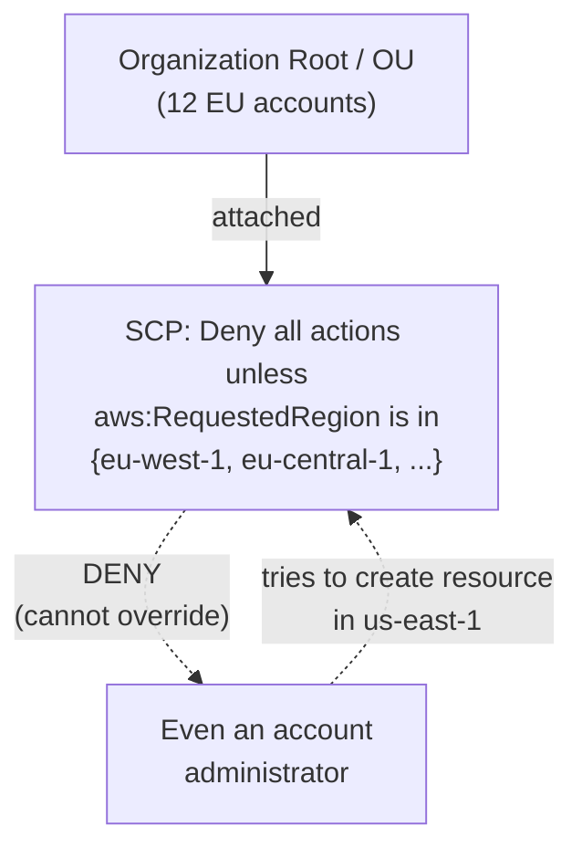

Step by step: (1) the SCP is attached once, at the Organization root or the OU containing all
12 accounts, so it applies everywhere without per-account setup; (2) its condition checks the
Region every API call targets against an explicit allow-list of EU Regions; (3) any attempt —
by a developer or even an account administrator — to create a resource outside that list is
denied automatically, with no way to override it from inside the account.

**Why the others are wrong:**
- **A** a written policy with no technical enforcement is, by definition, a best-effort guideline — exactly what the requirement explicitly wants to move beyond, and provides no proof it was actually followed.
- **C** tagging for tracking, reviewed quarterly, is purely detective (and infrequent) — a non-compliant resource could exist in a non-EU Region for up to a quarter before being noticed, and tagging doesn't prevent the action from happening in the first place.
- **D** "rely on trust" provides zero technical enforcement regardless of how senior or trusted the staff are — human judgment, however well-intentioned, is not a provable guarantee, and mistakes (not just bad intent) are exactly what preventive technical controls exist to catch.

Reference: [`services/security-identity-compliance/organizations-and-scps.md`](../../../services/security-identity-compliance/organizations-and-scps.md)

---

## Question 61

*(Domain 2 — Resilient Architectures)*

An e-commerce platform's order-confirmation email service, triggered via SQS, occasionally
fails to send an email because of a malformed message from an upstream system — these
malformed messages currently get retried repeatedly by the consumer (since the retry logic
can't tell "malformed" from "transient"), cycling endlessly and preventing the queue from
making forward progress on legitimate messages behind them. What should the Solutions
Architect configure to isolate these specific poison messages?

A) Delete the email-sending consumer entirely and process orders manually until the malformed-message issue is fixed in the upstream system
B) Configure a redrive policy on the source queue with a `maxReceiveCount`, and a dead-letter queue (DLQ) to receive any message that exceeds that count — isolating malformed/poison messages away from the main queue after a bounded number of retries, so legitimate messages keep flowing
C) Increase the queue's visibility timeout to several hours, giving malformed messages more time to eventually succeed
D) Set the queue's message retention period to the maximum (14 days), assuming this fixes the retry loop

**Correct Answer: B**

**Why correct:** [A redrive policy with `maxReceiveCount` plus a dead-letter queue](../../../services/application-integration/sqs.md) is the standard mechanism for exactly this "poison message" problem: after a message has been received and failed to process (and become visible again) a bounded number of times, SQS automatically moves it to the configured DLQ instead of leaving it to cycle indefinitely in the main queue — this isolates the malformed messages (which can be inspected/fixed/discarded separately in the DLQ) while letting legitimate messages behind them continue to be processed normally, directly solving "cycling endlessly and preventing... forward progress."

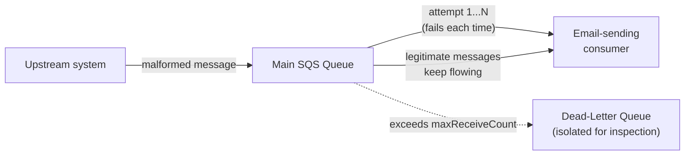

Step by step: (1) the malformed message is received and fails processing, becoming visible
again and retried, same as any message; (2) once it has been received and failed
`maxReceiveCount` times, SQS automatically moves it out of the main queue into the DLQ instead
of letting it retry forever; (3) with the poison message removed from the head of the queue,
legitimate messages behind it are no longer stuck waiting and resume normal processing — the
DLQ holds the malformed message separately for the team to inspect and fix later.

**Why the others are wrong:**
- **A** abandoning automation and processing orders manually is a drastic overreaction to what a one-time queue configuration (redrive policy + DLQ) solves cleanly, and it doesn't actually fix anything about the malformed-message handling — it just removes automation entirely while the root cause remains unaddressed.
- **C** a longer visibility timeout gives each retry attempt more time before the message becomes visible again, but a genuinely malformed message will never succeed no matter how long it's given — this doesn't stop the endless retry cycle, since the real problem is message *content*, not timing.
- **D** increasing retention period controls how long an *unconsumed* message stays in the queue before being discarded entirely — it has nothing to do with the redrive/poison-message cycling behavior being described, which is about repeated failed processing attempts, not retention duration.

Reference: [`services/application-integration/sqs.md`](../../../services/application-integration/sqs.md)

---

## Question 62

*(Domain 3 — High-Performing Architectures)*

A real-time fraud-scoring system reads and writes a small, extremely hot set of records
(active transaction states) on a mission-critical database, where the business has set a hard
requirement that every read and write complete in **sub-millisecond** latency, with very high
and sustained IOPS, or the fraud check effectively times out and the transaction is
auto-approved (a business risk the company wants to avoid). What EBS volume type should back
this database's storage?

A) gp3, since its baseline performance is sufficient for "most" production workloads
B) io2 Block Express, purpose-built for the most demanding, latency- and IOPS-sensitive workloads, delivering sub-millisecond latency and very high sustained IOPS independent of volume size
C) st1 (throughput-optimized HDD), since it offers the lowest cost per GB
D) sc1 (cold HDD), since the data set is described as "small"

**Correct Answer: B**

**Why correct:** [io2 Block Express](../../../services/storage/ebs.md) is specifically designed for the most demanding tier of latency- and IOPS-sensitive workloads — delivering consistent sub-millisecond latency and very high sustained IOPS (far beyond gp3's ceiling) — directly matching a hard business requirement with real financial-risk consequences (auto-approving potentially fraudulent transactions) if that latency/IOPS bar isn't met.

**Why the others are wrong:**
- **A** gp3's baseline performance is a reasonable default for general-purpose production workloads, but "sufficient for most workloads" is explicitly not good enough here — the scenario states a hard sub-millisecond requirement with real business risk attached, which is precisely the tier gp3 isn't designed to guarantee the way io2 Block Express is.
- **C** st1 is optimized for high-**throughput**, sequential access patterns (e.g., big data, log processing) — it is not designed for low-latency, high-IOPS, random-access patterns at all, and using it here would almost certainly fail the sub-millisecond requirement badly.
- **D** sc1 is the lowest-cost, lowest-performance EBS HDD type, intended for infrequently accessed, non-performance-sensitive data — "small data set" doesn't imply "low performance needs"; the scenario's actual requirement is about latency and IOPS intensity, not data volume, and sc1 is the worst possible fit for a sub-millisecond, high-IOPS requirement.

Reference: [`services/storage/ebs.md`](../../../services/storage/ebs.md)

---

## Question 63

*(Domain 1 — Secure Architectures)*

A company's security team wants to grant a brand-new GuardDuty/Security Hub delegated
administrator account read-level visibility across the Organization, without routing any
operational work through the Organization's management account. Separately, they're setting
up a dedicated log-archive account to be the destination for an Organization-wide CloudTrail
trail. What governance pattern best describes the role each account should play, and why keep
them conceptually separate from the management account?

A) The management account should perform all of this work directly, since it already has Organization-wide visibility by default
B) Dedicated member accounts (one for security tooling delegated administration, one for centralized log archival) should be used specifically so that the sensitive, high-blast-radius management account stays minimally used, reducing the impact if any single workload or operational account were ever compromised, and reducing the operational surface area of the account that controls the entire Organization's billing and account lifecycle
C) There's no meaningful reason to separate these from the management account; it's purely a stylistic preference
D) The log-archive and security-tooling responsibilities should be combined into a single application workload account alongside production resources, for simplicity

**Correct Answer: B**

**Why correct:** [AWS's own best-practice multi-account guidance](../domain-1-secure-architectures/multi-account-security-strategy.md) explicitly recommends keeping the management account minimally used — ideally performing little beyond Organization/billing administration — specifically because it has unique, Organization-wide control (billing, account creation/closure, SCPs) that makes it an outsized target; delegating GuardDuty/Security Hub administration and CloudTrail log destination duties to **dedicated, purpose-specific member accounts** reduces the management account's operational surface and blast radius, and also means a compromise of a single workload account doesn't threaten the Organization's centralized security visibility or tamper-resistant log archive (since those live in a separate account the workload account has no control over).

**Why the others are wrong:**
- **A** having the management account perform all of this work directly increases its operational surface area and makes it a far more valuable (and frequently-touched, therefore higher-risk) target — exactly the opposite of AWS's recommended minimal-use pattern for that account.
- **C** is incorrect — the separation isn't "purely stylistic"; it has concrete, specific security benefits (blast-radius containment, reduced management-account exposure, tamper-resistance of logs from any single compromised workload account) that a stylistic framing understates.
- **D** combining log-archival and security-tooling responsibilities into a workload account alongside production resources means that account's own compromise (or even an over-permissioned administrator) could tamper with or access the very logs/findings meant to detect and investigate that compromise — undermining the entire point of centralizing and isolating those functions separately.

Reference: [`domain-1-secure-architectures/multi-account-security-strategy.md`](../domain-1-secure-architectures/multi-account-security-strategy.md)

---

## Question 64

*(Domain 2 — Resilient Architectures)*

A retailer is migrating its on-prem Oracle order database to Amazon Aurora PostgreSQL, and the
business requires the cutover to happen with only a few minutes of downtime, with ongoing
changes made to the on-prem database during the migration window captured and applied to the
new Aurora database right up until the final cutover moment. What AWS service and migration
approach fits this requirement?

A) A one-time `pg_dump`/manual export-import process, scheduled for a single weekend downtime window
B) AWS Database Migration Service (DMS), using full-load-plus-CDC (change data capture) replication to continuously apply ongoing on-prem changes to the Aurora target throughout the migration, right up until a brief final cutover
C) AWS Snowball Edge, shipped with a copy of the database, to avoid using the production network at all
D) Simply point the application at both databases simultaneously and let it write to each independently, reconciling any differences afterward

**Correct Answer: B**

**Why correct:** [AWS DMS](../../../services/database/database-selection-guide.md) with full-load-plus-CDC specifically supports exactly this pattern: an initial full load migrates the existing data, and CDC then continuously captures and applies ongoing changes made to the source database throughout the migration window — keeping the Aurora target nearly in sync with the still-live on-prem source — so the actual cutover (stopping writes to on-prem, confirming the last changes have replicated, and repointing the application to Aurora) can be a matter of minutes, rather than needing a long batch window, directly matching "only a few minutes of downtime" with continuous capture "right up until the final cutover moment."

**Why the others are wrong:**
- **A** a one-time dump/import captures only a single point-in-time snapshot — any changes made to the on-prem database during the (likely lengthy, for a production order database) export/import process would be lost unless writes are frozen for that entire window, which would mean far more than "a few minutes" of downtime.
- **C** Snowball Edge is designed for bulk, often offline, one-time data transfer — it has no continuous change-capture capability, and using it here would mean the data is only as fresh as whenever the device was shipped/loaded, not continuously current up to cutover.
- **D** having the application write to two independent databases simultaneously with "reconcile differences afterward" risks real data conflicts and inconsistency between the two systems during the transition — this is a fragile, risky, ad-hoc approach compared to DMS's purpose-built, managed CDC replication designed specifically for this migration pattern.

Reference: [`services/database/database-selection-guide.md`](../../../services/database/database-selection-guide.md)

---

## Question 65

*(Domain 1 — Secure Architectures)* **(Choose TWO)**

During a routine review, a security engineer wants to find out whether any S3 bucket in a
45-account Organization is accessible from outside the Organization — for example, a bucket
policy accidentally granting access to an external, untrusted AWS account or to the public —
without manually inspecting every bucket policy in every account by hand. Which **two** AWS
capabilities should the Solutions Architect use together to surface this?

A) Manually open each bucket's permissions tab in the console across all 45 accounts and read every policy by eye
B) IAM Access Analyzer, which continuously analyzes resource-based policies (including S3 bucket policies) across accounts and automatically generates findings for any resource that grants access to a principal outside the defined zone of trust (e.g., outside the Organization)
C) AWS Trusted Advisor's S3 Bucket Permissions check, which flags buckets with open access permissions (public read/write) as part of its security checks category
D) AWS Config, since it records configuration history and will flag any bucket policy change automatically as a security issue
E) Macie, since it specializes in detecting unauthorized access patterns to S3 buckets

**Correct Answer: B, C**

**Why correct:** [IAM Access Analyzer (B)](../../../services/security-identity-compliance/iam.md) is purpose-built to continuously analyze resource-based policies (S3 bucket policies, KMS key policies, IAM role trust policies, and others) and automatically generate a finding whenever a resource grants access to a principal outside your defined zone of trust (e.g., outside the Organization) — directly surfacing the "accidentally accessible from outside" scenario at the policy-logic level. [Trusted Advisor's S3 Bucket Permissions check (C)](../../../services/management-governance/trusted-advisor.md) independently flags buckets with open public read/write access as part of its security checks — a simpler, complementary signal that catches plainly public buckets even faster, as part of a dashboard the team may already review regularly. Using both together gives broader, overlapping coverage (deep policy-logic analysis plus a quick public-access check) than relying on either single tool alone.

**Why the others are wrong:**
- **A** manually reading every bucket policy across 45 accounts by eye is slow, error-prone, and exactly the manual process the requirement explicitly wants replaced with automated analysis.
- **D** AWS Config tracks configuration *changes over time* and can flag non-compliance against rules you define, but it doesn't inherently perform the specific "is this resource-based policy granting access outside my trust zone" analysis the way Access Analyzer does out of the box — you'd have to build/author a custom Config rule to approximate what Access Analyzer already provides natively.
- **E** Macie specializes in discovering **sensitive data content** (PII/PHI) within S3 objects — it does not analyze bucket *policies* for unintended external access; that's a fundamentally different capability (content classification vs. access-policy analysis).

Reference: [`services/security-identity-compliance/iam.md`](../../../services/security-identity-compliance/iam.md) and [`services/management-governance/trusted-advisor.md`](../../../services/management-governance/trusted-advisor.md)
