# SAA-C03 Exam Bank 3 — Study-Mode Practice Exam (65 Questions)

This is a **study-mode** exam bank: every question is immediately followed by its answer and
a full explanation, right where you're reading it — not in a separate answer-key file. Use it
for active drilling and review, not timed simulation. For the timed, blind-until-you-finish
mock-exam experience, see [`../practice-questions/full-exams/`](../practice-questions/full-exams/index.md)
instead. See [`./README.md`](README.md) for how this bank fits with Bank 1, Bank 2, and the
rest of the SAA-C03 material in this repo. This is the **final review bank** — work through it
last, right before attempting the timed full-exams.

Like the real exam, this bank has **65 questions**, domains **interleaved/mixed** rather than
grouped, and weighted to the official blueprint:

| Domain | Weight | Questions in this bank |
|---|---|---|
| [Domain 1 — Secure Architectures](../domain-1-secure-architectures/README.md) | 30% | 20 |
| [Domain 2 — Resilient Architectures](../domain-2-resilient-architectures/README.md) | 26% | 17 |
| [Domain 3 — High-Performing Architectures](../domain-3-high-performing-architectures/README.md) | 24% | 15 |
| [Domain 4 — Cost-Optimized Architectures](../domain-4-cost-optimized-architectures/README.md) | 20% | 13 |
| **Total** | **100%** | **65** |

All scenarios in this bank are original and distinct from Bank 1, Bank 2, the domain-split
[`practice-questions/`](../practice-questions/index.md) bank, and the
[`practice-questions/full-exams/`](../practice-questions/full-exams/index.md) mock exams.

---

## Question 1

*(Domain 2 — Resilient Architectures)*

A regional news outlet runs its public website on an Elastic Beanstalk environment with
instances spread across two Availability Zones. During a recent AZ-level network impairment,
the site stayed up for most users, but the team wants to confirm the environment is actually
configured to tolerate a full AZ loss, not just a partial network blip, without manual
intervention. What Elastic Beanstalk configuration should the Solutions Architect verify is in
place?

A) A single-instance environment, since Elastic Beanstalk automatically relaunches a failed instance in any AZ
B) A load-balanced, Auto Scaling Elastic Beanstalk environment explicitly configured to span multiple Availability Zones, so the ALB and Auto Scaling group can continue serving traffic from the healthy AZ's instances if one AZ becomes fully unavailable
C) A single large instance type, since bigger instances are inherently more fault-tolerant
D) Elastic Beanstalk's "enhanced health reporting" feature alone, since it automatically provides Multi-AZ resilience

**Correct Answer: B**

**Why correct:** [Elastic Beanstalk](../../../services/compute/elastic-beanstalk.md) environments running in load-balanced, Auto Scaling mode, explicitly configured with subnets in multiple Availability Zones, place instances across those AZs behind an ALB — if one AZ becomes fully unavailable, the ALB stops routing to that AZ's (now unreachable) targets and the Auto Scaling group can launch replacement capacity in the remaining healthy AZ(s), keeping the site available with no manual intervention required.

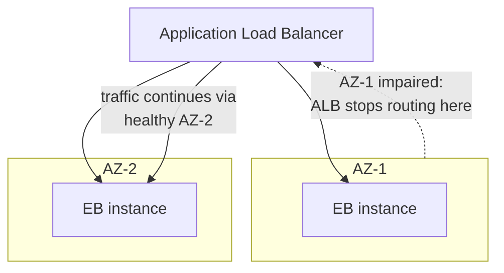

Step by step: (1) the Elastic Beanstalk environment is explicitly configured with subnets in
two (or more) AZs, not just one; (2) the ALB continuously health-checks instances in both AZs;
(3) if AZ-1 becomes fully unreachable, the ALB simply stops sending traffic to AZ-1's targets
and continues serving all traffic from AZ-2's instances, with the Auto Scaling group able to
add more capacity in AZ-2 if needed — no human has to intervene for the site to stay up.

**Why the others are wrong:**
- **A** a single-instance environment has no load balancer or Auto Scaling group at all — if that one instance's AZ becomes unavailable, the site goes down until Elastic Beanstalk relaunches it (which takes time and isn't instantaneous failover), which is a materially worse availability posture than a load-balanced Multi-AZ environment.
- **C** instance size (vertical scaling) has nothing to do with AZ-level fault tolerance — a single large instance in a single AZ is still a single point of failure if that AZ goes down, regardless of how large it is.
- **D** enhanced health reporting improves the *visibility* into instance/environment health (more granular health data) — it is a monitoring feature, not a resilience mechanism, and doesn't by itself provide Multi-AZ failover; that capability comes from the load-balanced, Multi-AZ environment configuration itself.

Reference: [`services/compute/elastic-beanstalk.md`](../../../services/compute/elastic-beanstalk.md)

---

## Question 2

*(Domain 2 — Resilient Architectures)*

A retailer's Aurora Global Database spans a primary Region and a secondary Region. The
operations team needs to perform planned maintenance (an engine version upgrade) on the
primary Region's writer cluster and wants to temporarily shift write traffic to the secondary
Region during the maintenance window, then shift it back afterward, with no data loss and
without triggering a full disaster-recovery-style unplanned failover process. What Aurora
Global Database capability should the Solutions Architect use?

A) Unplanned failover, since any Region switch requires the same disaster-recovery process regardless of whether it's planned
B) Managed planned failover, which is specifically designed to switch the primary role to a secondary Region (and back) in a controlled, data-loss-free way for planned events like maintenance, as distinct from the unplanned-failover path used for actual disasters
C) Deleting and recreating the Global Database with the secondary Region as the new primary
D) Simply stopping the writer instance and waiting for Aurora to automatically promote a secondary without any explicit action

**Correct Answer: B**

**Why correct:** [Aurora Global Database's managed planned failover](../../../services/database/aurora.md) is a distinct, purpose-built operation from unplanned (disaster) failover — it's designed for exactly this scenario: controlled, data-loss-free switching of the primary role to a secondary Region for planned events like engine maintenance or Regional testing, with the process validating replication is caught up before switching, and the same mechanism can be used to switch back afterward — matching "temporarily shift... then shift back... no data loss... without triggering a full disaster-recovery-style unplanned failover."

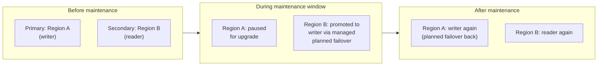

Step by step: (1) before starting maintenance, the team initiates managed planned failover,
which confirms the secondary Region's replication is fully caught up and then switches it to
be the new writer with no data loss; (2) the primary Region's writer cluster undergoes its
engine upgrade undisturbed, since it's no longer taking write traffic; (3) once maintenance
completes, the team runs managed planned failover again to switch the writer role back to the
original Region — the same controlled mechanism, used twice, for a fully reversible,
maintenance-friendly operation.

**Why the others are wrong:**
- **A** unplanned failover is designed for genuine disaster response and doesn't offer the same controlled, validated, reversible switch — using the disaster-path mechanism for routine planned maintenance is using the wrong tool, even though it might technically also move the writer role.
- **C** deleting and recreating the entire Global Database is a drastic, slow, and risky way to temporarily swap which Region is primary — it throws away the existing replication topology entirely just to achieve something the managed planned failover feature already does safely and quickly.
- **D** simply stopping the writer instance and hoping for automatic promotion isn't how Aurora Global Database's planned maintenance workflow is designed to work, and without using the managed planned failover feature explicitly, there's no guarantee of a clean, data-loss-free, orderly transition.

Reference: [`services/database/aurora.md`](../../../services/database/aurora.md)

---

## Question 3

*(Domain 3 — High-Performing Architectures)*

A manufacturing company is closing an on-prem data center and must move 400 TB of historical
sensor data into S3 within three weeks. Their current internet uplink is only 100 Mbps, which
would take months to transfer this volume online, and a Direct Connect circuit cannot be
provisioned in time given the deadline. What should the Solutions Architect use to meet this
deadline?

A) Increase the internet uplink speed temporarily, assuming the ISP can provision a faster circuit within the three-week deadline
B) AWS Snowball Edge devices, ordered to ship data physically: load the 400 TB onto one or more Snowball Edge devices on-site, ship them to AWS, and have the data ingested directly into S3 — avoiding the network bottleneck entirely
C) S3 Transfer Acceleration, since it can increase a 100 Mbps link's effective throughput by 10x or more
D) Break the data into smaller chunks and upload them in parallel using multipart upload over the same 100 Mbps link

**Correct Answer: B**

**Why correct:** [Snowball Edge](../../../services/storage/storage-gateway.md) is specifically designed for exactly this situation: large data volumes (400 TB, well beyond what a 100 Mbps link can move in three weeks) with a hard deadline that rules out waiting for a new network circuit — loading the data onto one or more physical devices and shipping them to AWS moves the data at "the speed of a truck/courier" rather than the speed of the existing uplink, entirely bypassing the network bottleneck.

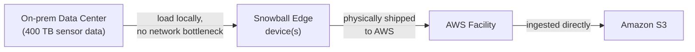

Step by step: (1) one or more Snowball Edge devices are shipped to the data center and loaded
with the 400 TB locally, over the data center's own fast internal network, not the slow
internet uplink; (2) the loaded devices are shipped back to AWS via courier; (3) AWS ingests
the data directly into the target S3 bucket — the whole process typically completes well
within the three-week window, since it was never limited by the 100 Mbps link in the first
place.

**Why the others are wrong:**
- **A** assuming an ISP can provision a meaningfully faster circuit within three weeks is a significant and often unrealistic assumption — circuit provisioning timelines commonly extend well beyond a few weeks, and the scenario explicitly already ruled out Direct Connect for the same deadline reason.
- **C** Transfer Acceleration optimizes the network *path* (routing through CloudFront edge locations onto AWS's backbone) but is still fundamentally bounded by the underlying 100 Mbps link's actual bandwidth — it cannot manufacture bandwidth that doesn't exist on the link, so a "10x or more" claim vastly overstates what path optimization alone can achieve on a bandwidth-constrained circuit.
- **D** parallelizing the upload via multipart upload can better utilize the *available* bandwidth (reducing per-connection overhead and allowing concurrent transfer of parts), but the aggregate bandwidth ceiling is still the 100 Mbps link itself — parallelism doesn't exceed the physical throughput limit of the connection.

Reference: [`services/storage/storage-gateway.md`](../../../services/storage/storage-gateway.md)

---

## Question 4

*(Domain 2 — Resilient Architectures)*

A bank's fraud-investigation team needs an immutable, continuously-updated copy of all
transaction audit logs isolated into a separate AWS account that the production account's own
administrators have no delete access to — specifically to survive a scenario where production
account credentials are fully compromised. The logs currently live in an S3 bucket in the
production account. What replication approach fits?

A) S3 Same-Region Replication (SRR) to a bucket in a dedicated, separate logging account, with that destination bucket's policy denying delete permissions to the production account's roles entirely
B) S3 Lifecycle rules moving older logs to Glacier within the same bucket and account
C) A nightly Lambda function in the production account that copies logs to another bucket in the same production account
D) Cross-Region Replication to a bucket owned by the same production account, just in a different Region

**Correct Answer: A**

**Why correct:** [S3 Same-Region Replication (SRR)](../../../services/storage/s3.md) to a bucket in a genuinely **separate** AWS account achieves true account-boundary isolation — the destination bucket's own policy (owned and controlled by the separate logging account) can explicitly deny delete permissions to any principal from the production account, meaning even a fully compromised production account's credentials have no path to delete the replicated copy, directly satisfying "isolated into a separate account... no delete access... survive a scenario where production credentials are fully compromised." (Cross-Region Replication would work identically for this isolation purpose; SRR vs. CRR here is about Region choice, not account isolation — the account separation is what matters.)

**Why the others are wrong:**
- **B** a lifecycle rule moving data to Glacier **within the same bucket and account** does nothing for account-level isolation — a compromised production account's administrator credentials could still reach and delete that same bucket (and its Glacier-tier objects) just as easily.
- **C** a Lambda function copying logs to another bucket **in the same production account** still leaves both copies within the blast radius of a single compromised account — anyone with sufficient compromised credentials in that account can delete both.
- **D** replicating to a bucket that's still **owned by the same production account**, even in a different Region, provides geographic redundancy but not the account-boundary isolation the scenario specifically requires — a compromised production account's credentials would still have access to delete that destination bucket too, since it's the same account.

Reference: [`services/storage/s3.md`](../../../services/storage/s3.md)

---

## Question 5

*(Domain 1 — Secure Architectures)*

A software vendor builds machine images (AMIs) encrypted with a customer-managed KMS key in
their primary AWS account, and needs to share specific AMI versions with two customer AWS
accounts so each customer can launch their own EC2 instances from them — without making the
AMI (or its underlying encrypted snapshots) public, and without giving either customer account
broader access to the vendor's other KMS-encrypted resources. What should the Solutions
Architect configure?

A) Make the AMI public, since that's the only way to share an AMI across accounts
B) Share the AMI explicitly with only the two specific customer account IDs (not public), and update the KMS key policy to grant those two account IDs `kms:CreateGrant` and decrypt permissions scoped specifically to what's needed to launch instances from the shared AMI's encrypted snapshots — nothing broader
C) Export the AMI to an unencrypted format and send it to each customer via email
D) Create a separate, unencrypted copy of the AMI for sharing, keeping the original encrypted version private

**Correct Answer: B**

**Why correct:** [AMI sharing](../../../services/security-identity-compliance/kms.md) supports sharing explicitly with specific AWS account IDs (not just "public or private") — for an **encrypted** AMI, the recipient accounts additionally need permission on the KMS key used to encrypt it, scoped specifically to what's needed to launch instances (decrypt the snapshot, create grants for the launch process) — not broad access to the vendor's other KMS-encrypted resources, which a correctly scoped key policy statement (naming just those two account IDs and just the needed actions) achieves precisely.

**Why the others are wrong:**
- **A** is factually incorrect — AMI sharing supports targeted sharing with specific account IDs; making it public is a deliberate choice, not a requirement, and would violate the explicit "without making the AMI... public" constraint.
- **C** exporting to an unencrypted format and emailing it discards the encryption protection entirely (violating the implied intent of using a customer-managed key in the first place) and email is not a secure distribution channel for a multi-GB machine image containing the vendor's software/data.
- **D** creating an unencrypted copy "for sharing" similarly abandons encryption for the shared copies, undermining the reason the AMI was encrypted to begin with — correctly scoping the KMS key policy for the existing encrypted AMI is the standard, secure solution; there's no need to create an unencrypted version at all.

Reference: [`services/security-identity-compliance/kms.md`](../../../services/security-identity-compliance/kms.md)

---

## Question 6

*(Domain 4 — Cost-Optimized Architectures)*

A research data archive serves a small set of datasets that external academic collaborators
occasionally download — the archive's owner wants to make the data available publicly for
research purposes but does not want to personally pay for the (potentially significant)
data-transfer-out costs when external collaborators download large datasets. What S3 feature
should the Solutions Architect enable to shift that specific cost onto the downloading party?

A) S3 Intelligent-Tiering, since it automatically optimizes all storage-related costs including transfer
B) S3 Requester Pays, which shifts the data-transfer and request costs for downloading objects onto the requester (the downloading account) instead of the bucket owner, while the owner still pays for storage
C) Make the bucket private and require each collaborator to request credentials from the owner for every download
D) S3 Transfer Acceleration, since it reduces the total data-transfer cost for everyone involved

**Correct Answer: B**

**Why correct:** [S3 Requester Pays](../../../services/storage/s3.md) is specifically designed for exactly this situation — a bucket owner wants to make data available to others but have the downloading party (who must be an authenticated AWS principal, not anonymous) bear the data-transfer and request costs of retrieving it, while the owner continues to pay only for the underlying storage — directly matching "shift that specific cost onto the downloading party."

**Why the others are wrong:**
- **A** Intelligent-Tiering optimizes *storage* class costs based on access patterns — it has no bearing on who pays for data-transfer-out costs, which is a separate cost dimension entirely.
- **C** requiring credentials for every download is an access-control/friction mechanism, not a cost-allocation mechanism — it doesn't change who is billed for the data transfer; the bucket owner's account would still be charged for the egress regardless of how access was gated.
- **D** Transfer Acceleration can speed up transfers using CloudFront's edge network, but it doesn't change *who* pays — the fundamental data-transfer costs would still be billed according to the bucket's normal payer configuration, which by default is the bucket owner (Requester Pays is specifically the setting that flips this).

Reference: [`services/storage/s3.md`](../../../services/storage/s3.md)

---

## Question 7

*(Domain 1 — Secure Architectures)*

A fintech marketplace's core application (Account A) must call a specific Lambda function
owned by a partner settlement service (Account B) to finalize transactions. Account B is
rightly worried about the "confused deputy" problem — where a third party could trick Account
B's role into being invoked on behalf of an unintended source — and wants to ensure its trust
relationship is scoped tightly to Account A specifically, not any service that happens to
assume a role naming Account B as trusted. What should the Solutions Architect add to Account
B's resource trust policy?

A) Trust Account A's account ID alone in the `Principal` field, with no further conditions
B) Trust Account A's account ID in the `Principal` field, combined with a `Condition` block requiring a specific, pre-shared `sts:ExternalId` value that only Account A knows, preventing any other party who might somehow reference Account B's role from successfully assuming it without also supplying that exact external ID
C) Make the Lambda function's resource policy allow invocation from any AWS principal, relying on Account A keeping the function's ARN secret
D) Require Account A to create an IAM user in Account B's account instead of using a role at all

**Correct Answer: B**

**Why correct:** The [external ID condition](../../../services/security-identity-compliance/sts-and-role-switching.md) is the standard, AWS-documented mitigation for the confused-deputy problem in exactly this cross-account scenario: even if some other party somehow knew (or guessed) Account A's account ID and attempted to assume the role as if they were Account A, they would also need to supply the specific, pre-shared external ID value — something only the legitimate Account A possesses — meaning the trust relationship is effectively scoped to "Account A, specifically, who also knows this secret," not just "anyone claiming to be from Account A's account ID."

**Why the others are wrong:**
- **A** trusting the account ID alone is exactly the setup vulnerable to the confused-deputy problem described — account IDs aren't secret, and in certain third-party-intermediary scenarios, trusting an account ID alone without an external ID is the specific weakness the external ID condition exists to close.
- **C** making the resource policy allow "any AWS principal" is a drastically broader grant than intended and relies on security-through-obscurity (keeping an ARN "secret") — ARNs aren't designed to be secrets and can leak through many channels (logs, error messages, configuration files); this doesn't scope trust to Account A at all.
- **D** IAM users are a long-lived-credential anti-pattern for cross-account access and don't address the confused-deputy concern either — cross-account roles with proper conditions (like external ID) are the standard, more secure pattern for exactly this kind of trust relationship.

Reference: [`services/security-identity-compliance/sts-and-role-switching.md`](../../../services/security-identity-compliance/sts-and-role-switching.md)

---

## Question 8

*(Domain 3 — High-Performing Architectures)*

A financial services firm's trading application, hosted on EC2 in a VPC, connects to an
on-prem market-data feed over a hybrid network link. The firm's compliance and performance
requirements both demand a consistent, predictable, low-latency, high-bandwidth connection
that does not vary with public internet congestion — occasional latency spikes during peak
internet hours have already caused missed trading windows. What should the Solutions Architect
provision?

A) A Site-to-Site VPN connection over the public internet, since VPN is simpler to set up than a dedicated circuit
B) AWS Direct Connect, providing a dedicated, private network connection from the on-prem facility to AWS that bypasses the public internet entirely, delivering the consistent low latency and bandwidth the performance-sensitive trading application needs
C) CloudFront configured to cache the market-data feed's responses
D) Multiple NAT Gateways to distribute traffic and reduce congestion

**Correct Answer: B**

**Why correct:** [Direct Connect](../../../services/networking-content-delivery/direct-connect.md) is a dedicated, private physical network connection between an on-prem facility and AWS that does not traverse the public internet at all — this directly eliminates the "varies with public internet congestion" problem causing the described latency spikes, delivering the consistent, predictable, low-latency, high-bandwidth connection a latency-sensitive trading application with real compliance/performance stakes requires.

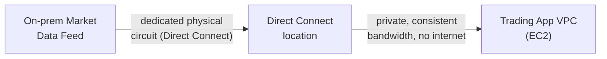

Step by step: (1) a dedicated physical circuit is provisioned between the on-prem data center
and an AWS Direct Connect location, bypassing the public internet path entirely; (2) traffic
between the market-data feed and the trading application flows over this private, dedicated
link with consistent, predictable latency and bandwidth, immune to public internet congestion
during peak hours; (3) the missed-trading-window problem caused by internet latency spikes is
eliminated, since that variable congestion is no longer in the data path at all.

**Why the others are wrong:**
- **A** a Site-to-Site VPN, while encrypted and private in terms of addressing, still routes its traffic over the **public internet** as the underlying transport — it inherits exactly the same congestion-driven latency variability the firm is trying to eliminate, just with an encryption wrapper on top.
- **C** CloudFront caches HTTP responses for repeated requests — a live, real-time market-data feed is not the kind of cacheable, repeatable content CloudFront is designed for, and introducing a cache would risk serving stale market data, which is unacceptable for trading.
- **D** NAT Gateways manage outbound internet connectivity from a VPC's private subnets — adding more of them does nothing about the on-prem-to-AWS network path's reliance on the congested public internet; it's solving an unrelated problem.

Reference: [`services/networking-content-delivery/direct-connect.md`](../../../services/networking-content-delivery/direct-connect.md)

---

## Question 9

*(Domain 2 — Resilient Architectures)*

A payment processor's order-event pipeline must guarantee that events for the same order are
processed in the exact order they were created, and that no event is ever processed more than
once, even under retries — both guarantees are non-negotiable for correct financial state.
What SQS queue configuration should the Solutions Architect use?

A) SQS Standard queue, since it offers the highest throughput of any SQS queue type
B) SQS FIFO queue, with message group ID set to the order ID, providing strict per-group ordering and exactly-once processing (via deduplication) — directly satisfying both the ordering and no-duplicate-processing requirements
C) SQS Standard queue with application-level sequence numbers added to each message, read and re-sorted by the consumer after receipt
D) Two separate SQS Standard queues, with the producer alternating between them to approximate ordering

**Correct Answer: B**

**Why correct:** [SQS FIFO queues](../../../services/application-integration/sqs.md) guarantee strict ordering *within* a given message group — setting the message group ID to the order ID ensures all events for the same order are delivered and processed in the exact order they were sent — and FIFO queues also provide exactly-once processing (via content-based or ID-based deduplication within a deduplication interval), directly satisfying both non-negotiable requirements in a single, purpose-built queue type, rather than needing any additional custom logic.

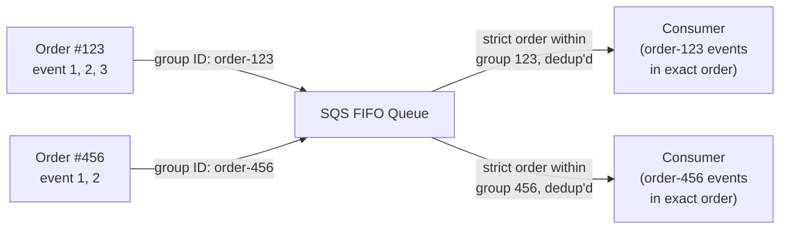

Step by step: (1) every event for a given order is published with that order's ID as the
message group ID; (2) within each group, FIFO guarantees strict delivery order and
deduplicates any accidental resend, so order #123's events always arrive 1-2-3, never out of
order or duplicated; (3) different orders' groups are processed independently and in parallel,
so ordering guarantees apply where they matter (within an order) without serializing the whole
queue.

**Why the others are wrong:**
- **A** SQS Standard queues explicitly do **not** guarantee ordering (best-effort, generally close but not strict) and provide only at-least-once delivery (duplicates are possible) — both characteristics directly fail the stated non-negotiable requirements, regardless of its throughput advantage.
- **C** adding custom sequence numbers and having the consumer re-sort them after receipt is possible in principle but is a fragile, hand-built approximation of what FIFO queues already guarantee natively — it also does nothing about the "no duplicate processing" requirement, which would need separate custom deduplication logic layered on top.
- **D** alternating between two Standard queues doesn't produce any genuine ordering guarantee across the combined stream — a consumer reading from two independent queues has no way to know the true interleaved order events were produced in, and this still doesn't solve deduplication either.

Reference: [`services/application-integration/sqs.md`](../../../services/application-integration/sqs.md)

---

## Question 10

*(Domain 4 — Cost-Optimized Architectures)*

A retail company's seasonal demand-forecasting workflow runs once a month, involves five
sequential processing steps (each a Lambda function) with the whole run typically taking under
an hour, and needs orchestration (step sequencing, retries, error handling) without the
company running any dedicated compute 24/7 just to coordinate a monthly job. What should the
Solutions Architect use to orchestrate this workflow?

A) A permanently-running EC2 instance hosting a custom orchestration script that polls for the monthly trigger
B) AWS Step Functions, orchestrating the five Lambda functions as a state machine triggered on a schedule (e.g., via EventBridge Scheduler), with no infrastructure running between monthly executions and billing only for the state transitions during each actual run
C) A permanently-running ECS service that coordinates the five Lambda invocations
D) A single, very large Lambda function combining all five steps' logic, invoked once a month, with no orchestration service at all

**Correct Answer: B**

**Why correct:** [Step Functions](../../../services/application-integration/step-functions.md) triggered on a schedule incurs **no cost or running infrastructure between executions** — it only bills for the state transitions that occur during each actual monthly run — while still providing the sequencing, retry, and error-handling orchestration the five-step workflow needs, directly matching "orchestration... without... dedicated compute 24/7 just to coordinate a monthly job."

**Why the others are wrong:**
- **A** a permanently-running EC2 instance, even an inexpensive one, running 24/7 purely to poll for a once-a-month trigger is exactly the "dedicated compute 24/7" cost the requirement explicitly wants to avoid for a workload that only needs to run roughly once a month for under an hour.
- **C** a permanently-running ECS service has the same "pays 24/7 for occasional work" problem as option A — ECS tasks running continuously just to coordinate a monthly job is a poor cost fit regardless of the orchestration logic it implements.
- **D** combining all five steps into one large Lambda function removes Step Functions' sequencing/retry/error-handling benefits (no visual state machine, no per-step retry configuration, a single function failure means redoing the whole thing from scratch rather than resuming from a failed step) — it may reduce orchestration overhead slightly, but at a real cost to resilience and operability for the workflow's own retry/error needs.

Reference: [`services/application-integration/step-functions.md`](../../../services/application-integration/step-functions.md)

---

## Question 11

*(Domain 2 — Resilient Architectures)*

A SaaS company deploys new application versions to its ALB-fronted EC2 fleet frequently and
wants zero-downtime deployments with the ability to instantly roll back to the previous version
if the new one shows elevated error rates within the first few minutes, with minimal manual
DNS or load balancer reconfiguration during rollback. What deployment pattern should the
Solutions Architect design using the ALB?

A) In-place deployment, updating the existing instances directly with the new version
B) Blue/green deployment using two ALB target groups (one for the current "blue" version, one for the new "green" version), shifting traffic between them via weighted target group rules, with instant rollback achieved by simply shifting the weight back to the blue target group
C) A single target group with instances being replaced one at a time, with no ability to compare or control traffic split between old and new versions
D) Canary deployment relying entirely on client-side feature flags with no load balancer involvement at all

**Correct Answer: B**

**Why correct:** [ALB weighted target groups](../../../services/networking-content-delivery/elastic-load-balancing.md) let you register two target groups (blue = current version, green = new version) under the same listener rule with configurable traffic-weight percentages — shifting weight gradually (or all at once) toward green performs the deployment, and if the new version shows elevated error rates, shifting the weight back to 100% blue is an instant, pure load-balancer-configuration change — no DNS propagation delay, no redeploying old code, and no instance-level changes needed for rollback.

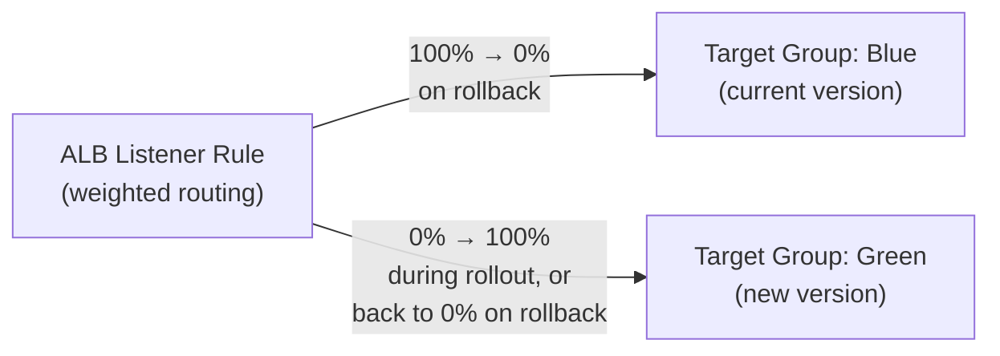

Step by step: (1) the new version is deployed to a fresh set of instances registered in the
"green" target group, while "blue" (the current, known-good version) keeps running
undisturbed; (2) the ALB listener rule's weights are shifted toward green gradually, with
error rates monitored at each step; (3) if green shows elevated errors, the weight is shifted
back to 100% blue instantly — a load-balancer configuration change, not a redeploy — giving
the fast, low-risk rollback the team needs.

**Why the others are wrong:**
- **A** in-place deployment updates the existing instances directly — if the new version has a problem, rolling back means re-deploying the old version's code onto those same instances, which is slower and riskier than simply flipping a load balancer weight back to an entirely separate, still-running blue fleet.
- **C** replacing instances one at a time with no traffic-split control provides no mechanism to test the new version on a controlled slice of traffic or to instantly revert — by the time a problem is noticed, a meaningful fraction (or all) of the fleet may already be running the bad version with no simple one-step rollback.
- **D** relying entirely on client-side feature flags with no load-balancer involvement removes the ALB's instant-rollback capability from the equation entirely — a server-side issue (like elevated backend error rates) isn't something a client-side feature flag addresses the way redirecting server-side traffic at the ALB does.

Reference: [`services/networking-content-delivery/elastic-load-balancing.md`](../../../services/networking-content-delivery/elastic-load-balancing.md)

---

## Question 12

*(Domain 3 — High-Performing Architectures)*

A global news app serves readers across five continents through an API that returns a
"trending stories" response. Each continent's app traffic currently connects to a single
Regional API deployment, and the product team wants users automatically routed to whichever
Regional deployment currently responds fastest for them, re-evaluated continuously as network
conditions change, without the team hand-maintaining a static mapping of countries to Regions.
What Route 53 routing policy fits?

A) Geolocation routing, mapping continents to Regions based on a static, manually maintained table
B) Latency-based routing, which continuously measures real network latency from Route 53's perspective and routes each user to whichever configured Regional endpoint currently has the lowest latency for them, adapting automatically as conditions change
C) Weighted routing, splitting traffic evenly across all Regional endpoints regardless of user location
D) Simple routing, returning a single static IP address for all users worldwide

**Correct Answer: B**

**Why correct:** [Route 53 latency-based routing](../../../services/networking-content-delivery/route53.md) measures actual network latency (not geographic proximity assumptions) between users and each configured Regional endpoint, and routes each query to whichever Region currently measures fastest — this adapts automatically as real network conditions shift (e.g., a transient path issue making a "normally fastest" Region temporarily slower for some users), with no static, hand-maintained country-to-Region table required, directly matching "automatically routed to whichever... responds fastest... re-evaluated continuously... without... hand-maintaining a static mapping."

**Why the others are wrong:**
- **A** geolocation routing is explicitly based on a manually configured, static mapping of geographic location to endpoint — it doesn't measure or react to actual real-time latency at all, and the scenario explicitly wants to avoid hand-maintaining such a static mapping.
- **C** weighted routing splits traffic by a configured percentage split, with no consideration of each individual user's actual latency to each Region — this would often send a meaningful share of users to a Region that isn't their fastest option.
- **D** simple routing returns the same static answer to every query with no routing logic, no latency measurement, and typically only supports a single record set — it does nothing to match users to their fastest-performing Region.

Reference: [`services/networking-content-delivery/route53.md`](../../../services/networking-content-delivery/route53.md)

---

## Question 13

*(Domain 2 — Resilient Architectures)*

A bank's core payments platform spans two Regions and must be able to automate the actual
decision of "should we fail over to the secondary Region right now," incorporating multiple
health signals (application health checks, infrastructure status, and a required manual safety
check before executing), rather than relying on a single engineer's judgment call made under
pressure during an incident. What AWS capability is purpose-built for structuring and
automating this kind of cross-Region failover decision?

A) A single CloudWatch alarm on CPU utilization, triggering an immediate automatic failover with no other checks
B) Amazon Route 53 Application Recovery Controller (ARC), which provides readiness checks across Regions, routing controls, and safety rules to structure and help automate a controlled failover decision incorporating multiple health signals, with configurable safeguards against an unsafe failover
C) A manual runbook document with no technical tooling at all, relying entirely on the on-call engineer's judgment during the incident
D) Simply deleting the primary Region's Route 53 records during an incident, forcing all traffic to the secondary Region

**Correct Answer: B**

**Why correct:** [Route 53 Application Recovery Controller (ARC)](../../../services/networking-content-delivery/route53.md) is purpose-built for structuring multi-Region failover decisions: its **readiness checks** continuously verify the secondary Region actually has sufficient capacity/configuration to take over, its **routing controls** provide a safe, auditable mechanism to actually shift traffic, and its **safety rules** can enforce constraints (like requiring certain conditions or preventing simultaneous failover of too many resources at once) — together giving a structured, partially-automatable failover decision that incorporates multiple signals rather than a single metric or one person's judgment call under pressure.

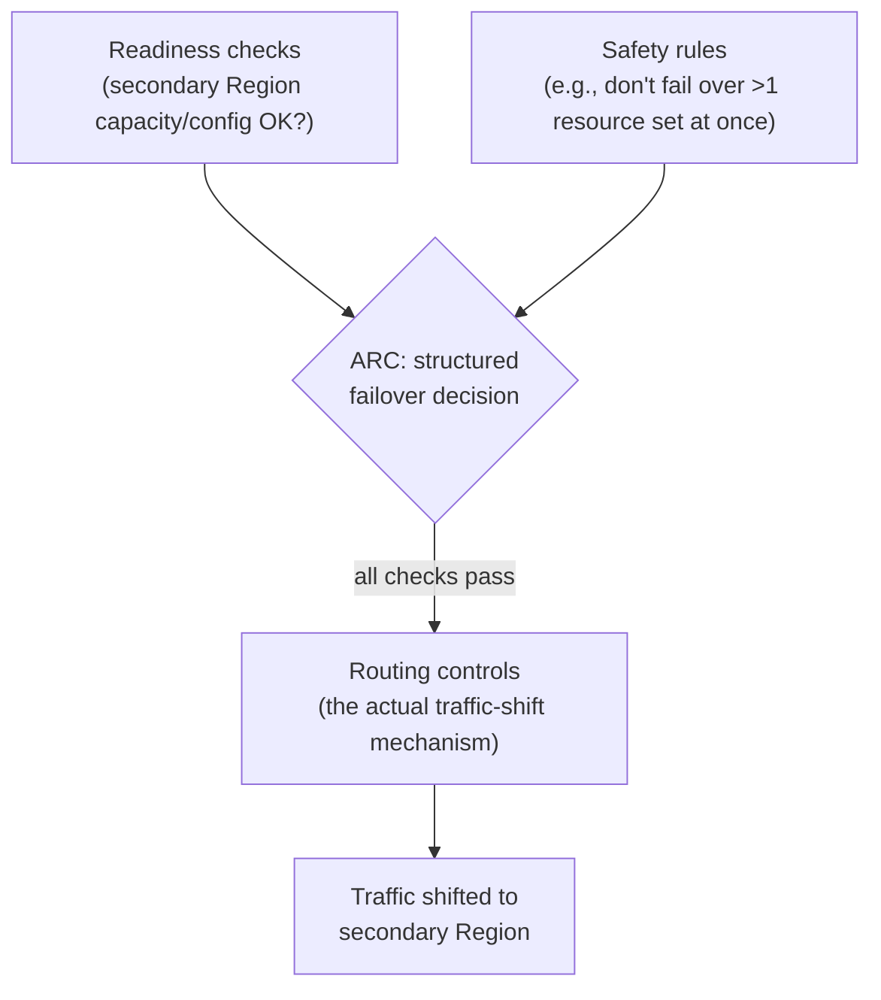

Step by step: (1) readiness checks continuously confirm the secondary Region genuinely has
the capacity and configuration needed to take over, not just that it technically exists;
(2) safety rules prevent an unsafe or overly broad failover (e.g., blocking simultaneous
failover of too many dependent resources at once); (3) only once these checks and rules are
satisfied do the routing controls actually execute the traffic shift — replacing a single
engineer's under-pressure judgment call with a structured, auditable, multi-signal decision.

**Why the others are wrong:**
- **A** a single CPU-utilization alarm is far too narrow a signal to safely decide "fail over the entire payments platform" — CPU alone says nothing about actual application health, data replication status, or secondary-Region readiness, and an immediate, unconditional trigger with no other checks is exactly the kind of under-engineered automation that risks a bad failover.
- **C** a manual runbook with no technical tooling is precisely what the bank wants to move beyond — "rather than relying on a single engineer's judgment call made under pressure" is explicitly what this option is, just formalized as a document rather than removed.
- **D** manually deleting Route 53 records during an incident is a blunt, manual, unstructured action with no readiness verification, no safety rules, and real risk of making things worse (e.g., failing over to a secondary Region that isn't actually ready) — exactly the kind of ad-hoc action ARC is designed to replace with a structured process.

Reference: [`services/networking-content-delivery/route53.md`](../../../services/networking-content-delivery/route53.md)

---

## Question 14

*(Domain 4 — Cost-Optimized Architectures)*

A retailer's traffic is highly predictable: a consistent pattern of low overnight traffic,
moderate daytime traffic, and a reliable evening peak, repeating every day based on historical
data, with no surprises expected. The team wants capacity to scale up just ahead of the known
evening peak and back down overnight, cost-efficiently, without waiting for a reactive
metric-based trigger to catch up after the peak has already started. What Auto Scaling
configuration achieves this?

A) Target tracking scaling alone, reacting to CPU utilization as it rises
B) Scheduled scaling actions, defining specific desired-capacity changes at specific times of day (e.g., scale out at 5pm, scale in at 11pm) based on the known, reliable historical traffic pattern — pre-emptively adding capacity before the peak begins rather than reacting after
C) Manual scaling, with an engineer adjusting capacity by hand at the start of each predicted peak
D) Simple scaling with a single, static fleet size sized for the evening peak, running continuously

**Correct Answer: B**

**Why correct:** [Scheduled scaling actions](../../../services/compute/ec2-auto-scaling.md) let you define specific desired-capacity changes tied to specific times, which is exactly suited to a workload with a "consistent... reliable... repeating" pattern based on historical data — capacity can be added **pre-emptively**, just ahead of the known evening peak, rather than waiting for a reactive metric (like CPU) to rise first and then scaling out *after* the peak has already begun stressing the fleet, which is the specific "without waiting for a reactive... trigger to catch up" improvement the team wants.

**Why the others are wrong:**
- **A** target tracking is reactive by nature — it only scales out once the monitored metric (e.g., CPU) has already started rising, meaning there's a lag where the fleet is under-provisioned right as the peak begins, which is exactly the "waiting for a reactive trigger to catch up" problem the team wants to avoid for a *known, predictable* pattern.
- **C** manual scaling by an engineer at predicted peak times is more error-prone (human timing, holidays, missed days) and not truly automated — scheduled scaling achieves the same pre-emptive timing without requiring a person to remember and execute it every day.
- **D** a static fleet sized for peak, running continuously, avoids any scaling lag but pays for peak-sized capacity around the clock, including the "low overnight traffic" period — failing the cost-efficiency half of the requirement significantly.

Reference: [`services/compute/ec2-auto-scaling.md`](../../../services/compute/ec2-auto-scaling.md)

---

## Question 15

*(Domain 2 — Resilient Architectures)*

An e-commerce company wants to be alerted automatically, and ideally see an automated recovery
attempt, if its public checkout page's actual user-facing flow (load page → add to cart →
reach payment screen) breaks — not just if the server returns a 200 status code, since a page
can return 200 while still being functionally broken for users (e.g., a broken JavaScript
bundle). What should the Solutions Architect configure to catch this specific class of failure?

A) A CloudWatch alarm on the ALB's HTTP 5xx error rate metric alone
B) CloudWatch Synthetics canaries scripted to actually execute the checkout flow's key steps on a schedule, paired with a CloudWatch alarm on the canary's success/failure metric that can trigger a notification (and optionally an automated remediation action)
C) A simple uptime check that only verifies the page returns an HTTP 200 status code
D) AWS X-Ray tracing alone, since it automatically detects functional UI breakage

**Correct Answer: B**

**Why correct:** [CloudWatch Synthetics canaries](../../../services/management-governance/cloudwatch.md) run scripted, scheduled tests that actually simulate real user interactions — loading the page, clicking "add to cart," reaching the payment screen — catching functional breakage (like a broken JavaScript bundle) that a simple HTTP-status check would completely miss, since the page can return a perfectly healthy 200 status while being functionally broken for users; pairing the canary with a CloudWatch alarm on its pass/fail metric gives both the automated alerting and (via an alarm action, e.g., triggering a Lambda remediation or rollback) the automated recovery-attempt capability the team wants.

**Why the others are wrong:**
- **A** a 5xx error-rate alarm only catches server-side errors returned in the HTTP response — it says nothing about client-side JavaScript breakage or a functionally broken flow that still returns 200 OK, which is explicitly the failure class described.
- **C** a simple "returns HTTP 200" uptime check is exactly the shallow check the scenario explicitly says is insufficient — "a page can return 200 while still being functionally broken for users" is stated directly as the gap this approach misses.
- **D** X-Ray provides distributed tracing for diagnosing *where* latency or errors occur across a request's path through backend services — it doesn't simulate or test the actual end-user-facing flow (like clicking through a checkout funnel) the way a Synthetics canary does, and it doesn't "automatically detect functional UI breakage" as a built-in capability.

Reference: [`services/management-governance/cloudwatch.md`](../../../services/management-governance/cloudwatch.md)

---

## Question 16

*(Domain 1 — Secure Architectures)*

A SaaS vendor issues HTTPS certificates for dozens of customer-facing ALB listeners across
multiple accounts, and has repeatedly had certificates expire unnoticed, causing outages when
browsers reject the now-invalid HTTPS connection. The team wants certificates to renew
automatically with no manual renewal step, for both existing and future ALB listeners. What
should the Solutions Architect implement?

A) Set a recurring calendar reminder for an engineer to manually renew each certificate 30 days before expiry
B) Use AWS Certificate Manager (ACM) to issue and manage the certificates, attaching ACM certificates to the ALB listeners; ACM handles domain validation renewal and automatic certificate rotation with no manual step, as long as the required DNS/validation records remain in place
C) Use certificates from an external, third-party CA, manually uploaded to each ALB via IAM
D) Disable HTTPS certificate expiry checks in the browser settings used by test engineers, to stop the outages from being noticed

**Correct Answer: B**

**Why correct:** [ACM-issued certificates](../../../services/security-identity-compliance/acm-and-private-ca.md) attached directly to ALB listeners are automatically renewed by ACM well ahead of expiry, as long as the domain validation mechanism (typically DNS validation records) remains correctly in place — this is a fully managed, no-manual-step renewal process, directly eliminating the "certificates expire unnoticed" failure mode for both existing and future listeners that use ACM certificates going forward.

**Why the others are wrong:**
- **A** a manual calendar reminder is exactly the process that has already failed repeatedly, per the scenario — it depends entirely on a human remembering and acting in time, which is precisely the unreliable manual step the team wants eliminated.
- **C** externally issued, manually uploaded certificates (imported into ACM or elsewhere) do **not** get automatic renewal from ACM — ACM can only auto-renew certificates it issued itself; imported third-party certificates still require a manual renewal-and-reupload process before each expiry.
- **D** disabling expiry checks in test engineers' browsers does nothing about the actual certificate expiring for real end users — it only hides the problem from internal testing, which is not a fix at all and actively makes the real failure harder to catch before it affects customers.

Reference: [`services/security-identity-compliance/acm-and-private-ca.md`](../../../services/security-identity-compliance/acm-and-private-ca.md)

---

## Question 17

*(Domain 4 — Cost-Optimized Architectures)*

A healthcare software vendor runs a legacy billing application that requires a specific
per-core commercial database license tied to physical server characteristics (sockets/cores)
for compliance with the vendor's licensing terms — a requirement that rules out standard
multi-tenant EC2 instances, where the underlying physical hardware isn't dedicated or
fully visible. What EC2 option satisfies this licensing requirement?

A) Standard On-Demand EC2 instances, since the licensing terms don't actually apply to cloud environments
B) Dedicated Hosts, which provide a physical server fully dedicated to one customer with visibility into sockets and physical cores — specifically designed to support bring-your-own-license (BYOL) scenarios tied to physical hardware attributes
C) Spot Instances, since they're the cheapest option and licensing cost is the primary concern
D) Dedicated Instances, since "dedicated" in the name means they satisfy any hardware-visibility licensing requirement

**Correct Answer: B**

**Why correct:** [Dedicated Hosts](../../../services/compute/ec2.md) provide an entire physical server dedicated to a single customer, with visibility into the specific sockets and physical cores available — this is specifically the EC2 option designed to support bring-your-own-license scenarios where a vendor's commercial licensing terms are tied to physical hardware characteristics (sockets/cores) that standard shared-tenancy or even Dedicated Instances don't expose or guarantee in the way a license compliance team would need to prove.

**Why the others are wrong:**
- **A** "licensing terms don't actually apply to cloud environments" is not something a Solutions Architect can assume or decide unilaterally — the scenario explicitly states this is a compliance requirement tied to the vendor's licensing terms, and the correct response is to meet that requirement with the appropriate EC2 option, not to assume it away.
- **C** Spot Instances address *cost*, not the hardware-visibility licensing requirement at all — and Spot's interruption risk is also a poor fit for a billing application with compliance/availability expectations; cost was explicitly not described as the primary concern here, licensing compliance was.
- **D** Dedicated Instances run on hardware dedicated to a single customer at the *account* level but, unlike Dedicated Hosts, do not provide visibility into or control over specific physical sockets/cores — "dedicated" in the name alone doesn't mean it satisfies every possible hardware-visibility licensing requirement; Dedicated Hosts are specifically the option built for that deeper level of hardware transparency.

Reference: [`services/compute/ec2.md`](../../../services/compute/ec2.md)

---

## Question 18

*(Domain 3 — High-Performing Architectures)*

A cloud cost and performance review of a company's EC2 fleet shows a mix of over-provisioned
instances (consistently under 15% CPU utilization) and under-provisioned instances
(frequently CPU-throttled above 90%), across several different instance families, with no
single obvious pattern by eye. The team wants specific, data-driven resize recommendations for
each instance rather than guessing, informed by actual historical utilization data. What
should the Solutions Architect use?

A) A simple average of the past 24 hours' CPU utilization for each instance, with manual judgment calls based on that single number
B) AWS Compute Optimizer, which analyzes historical CloudWatch utilization metrics (CPU and other available signals) over a longer observation window and produces specific instance-type/size resize recommendations for both over- and under-provisioned instances across the fleet
C) Terminate every instance under 15% average CPU utilization immediately, without further analysis
D) Upgrade every instance to the next larger size in its family, regardless of its actual utilization pattern

**Correct Answer: B**

**Why correct:** [AWS Compute Optimizer](../../../services/management-governance/cost-management-tools.md) analyzes historical CloudWatch metrics over an extended observation window (not just a quick snapshot) and produces specific, per-instance resize recommendations — correctly identifying which instances should be downsized (the over-provisioned, low-CPU ones) and which should be upsized or changed to a different family (the throttled, high-CPU ones) — replacing "no single obvious pattern by eye" guesswork with a systematic, data-driven analysis across the whole mixed fleet.

**Why the others are wrong:**
- **A** a simple 24-hour average is a much shorter, noisier window than Compute Optimizer's analysis, and manual judgment calls per instance don't scale well across a fleet with "several different instance families" and no obvious pattern — this reintroduces the guesswork the team wants to move away from.
- **C** terminating every low-CPU instance assumes CPU is the only relevant signal and that low CPU automatically means "unneeded" — this ignores that an instance might be memory- or I/O-bound, or correctly sized for a legitimately bursty workload, and it does nothing at all about the throttled, under-provisioned instances.
- **D** blanket-upgrading every instance to the next size, regardless of actual utilization, would fix the under-provisioned instances by accident while making the already over-provisioned (low-CPU) instances even more wasteful — exactly the opposite of a data-driven, instance-specific approach.

Reference: [`services/management-governance/cost-management-tools.md`](../../../services/management-governance/cost-management-tools.md)

---

## Question 19

*(Domain 1 — Secure Architectures)* **(Choose TWO)**

A fintech company's 3-tier application has a web tier, an application tier, and a database
tier, each in its own subnet. Security review found that the application tier's security
group allows inbound traffic from `0.0.0.0/0` on the application port, when in reality only
the web tier should ever be allowed to reach it, and the database tier's security group
similarly allows inbound from the entire VPC CIDR rather than just the application tier.
Which **two** changes should the Solutions Architect make to tighten this to least privilege,
without hardcoding IP addresses that would break if instances are replaced?

A) Update the application tier's security group to allow inbound only from the web tier's security group ID (as the source) on the application port
B) Update the database tier's security group to allow inbound only from the application tier's security group ID (as the source) on the database port
C) Replace the CIDR-based rules with hardcoded IP addresses of the current web and application tier instances
D) Remove all inbound rules entirely, relying on NACLs alone for tier-to-tier access control
E) Leave the database tier's rule as-is, since the VPC CIDR is "close enough" to least privilege

**Correct Answer: A, B**

**Why correct:** [Security groups can reference other security groups as the source](../../../services/networking-content-delivery/security-groups-vs-nacls.md) in an inbound rule — doing this at **both** boundaries (A: web→app, B: app→database) is what actually achieves least privilege across the whole 3-tier chain; fixing only one boundary would still leave the other tier over-permissive. Referencing security groups as sources rather than IP/CIDR ranges means each rule automatically continues to apply correctly as instances are launched, terminated, or replaced (as long as new instances join the same security group), achieving least privilege at every tier boundary without ever hardcoding an IP address that would break on replacement.

Step by step: (1) the web tier's security group stays open to the internet on the public port,
since that's its job; (2) the app tier's security group is tightened to allow inbound only
from principals that are members of `web-sg` — not any IP in the world; (3) the database
tier's security group is tightened to allow inbound only from members of `app-sg` — not the
entire VPC CIDR — so each tier boundary enforces exactly the intended access path, and the
rules keep working correctly even as instances in any tier are replaced.

**Why the others are wrong:**
- **C** hardcoded IP addresses are exactly the brittle approach the question asks to avoid — any time an instance is replaced (Auto Scaling replacement, patching, failure recovery), its IP typically changes, breaking the hardcoded rule.
- **D** removing security group rules entirely and relying only on NACLs loses the application-tier-aware, stateful, security-group-referencing capability — NACLs operate at the subnet level with simple CIDR-based rules and have no equivalent "reference this other security group" capability.
- **E** leaving the database tier's rule open to the entire VPC CIDR still allows the web tier (and anything else in the VPC) to reach the database directly, bypassing the application tier entirely — "close enough" is not least privilege when a tighter, equally simple fix (B) is available.

Reference: [`services/networking-content-delivery/security-groups-vs-nacls.md`](../../../services/networking-content-delivery/security-groups-vs-nacls.md)

---

## Question 20

*(Domain 3 — High-Performing Architectures)*

A genomics company runs a nightly Spark-based ETL job on EMR that processes raw sequencing
data. The job's workload is bursty within the run (some stages need far more compute than
others), and the team wants to minimize cost without extending the job's total runtime, by
matching cluster capacity to each stage's actual needs and using discounted capacity wherever
the job can tolerate it. What EMR cluster design fits?

A) A fixed-size cluster of On-Demand core nodes sized for the single most compute-intensive stage, running for the entire job
B) A cluster with a baseline of On-Demand (or Reserved) core nodes for the data storage/HDFS layer, plus task nodes (which hold no persistent data) added via Spot Instances and scaled up/down per stage's compute demand, minimizing cost on the variable compute layer without risking data loss if a task node is reclaimed
C) 100% Spot Instances for both core and task nodes, since Spot always minimizes cost regardless of node role
D) A single large On-Demand instance running the entire Spark job without a distributed cluster at all

**Correct Answer: B**

**Why correct:** [EMR's core-node/task-node distinction](../../../services/analytics/emr.md) is designed for exactly this cost-optimization pattern: core nodes (running HDFS, holding persistent data) should stay on stable capacity (On-Demand or Reserved) since losing one risks data loss, while task nodes (compute-only, no persistent storage) are the ideal place to use Spot Instances and to scale up/down per stage's actual compute demand — getting Spot's deep discount specifically on the variable, loss-tolerant layer, without risking job data if a Spot task node is reclaimed, and without extending runtime since task nodes can be sized to each stage's needs.

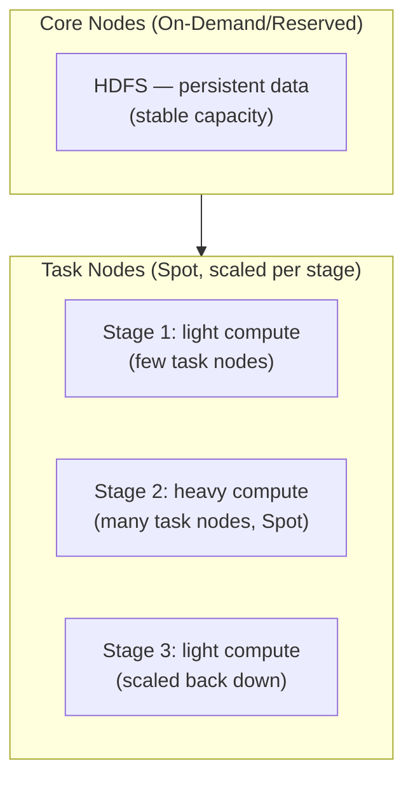

Step by step: (1) core nodes hold HDFS data on stable, non-Spot capacity so losing one never
risks job data; (2) task nodes hold no persistent data, so they're scaled up aggressively (on
cheap Spot capacity) for the compute-heavy stage and scaled back down for lighter stages,
matching cost to each stage's actual demand; (3) if a Spot task node is reclaimed mid-stage,
the job loses only compute capacity (automatically replaced or absorbed by remaining
capacity), never the underlying data.

**Why the others are wrong:**
- **A** a fixed cluster sized for the single most demanding stage runs that same (expensive) capacity throughout every other, less-demanding stage — significant waste for a workload explicitly described as having bursty, uneven compute needs across stages.
- **C** running core nodes on Spot risks losing HDFS data (and potentially stalling or failing the job) if a core node is reclaimed — "Spot always minimizes cost regardless of node role" ignores the real risk difference between core nodes (stateful) and task nodes (stateless, safely interruptible) in EMR's architecture.
- **D** a single large instance abandons the benefits of a distributed Spark cluster entirely (parallelism across nodes) — this would likely dramatically *increase* total runtime for a genomics-scale ETL job rather than minimizing cost at the same runtime, directly violating "without extending the job's total runtime."

Reference: [`services/analytics/emr.md`](../../../services/analytics/emr.md)

---

## Question 21

*(Domain 2 — Resilient Architectures)*

An EC2 instance running a legacy application occasionally fails its EC2 system status check
(indicating an underlying hardware/host issue) but the application itself has no Auto Scaling
group — it's a standalone instance that must be replaced on the same instance (preserving its
EBS volumes, instance ID conventions, and configuration) rather than relaunched as an entirely
new instance in a fleet. What should the Solutions Architect configure to automatically
recover this specific instance when a system status check fails?

A) Place the instance in an Auto Scaling group with a minimum and desired capacity of 1
B) A CloudWatch alarm on the instance's `StatusCheckFailed_System` metric, configured with an EC2 "Recover" alarm action, which automatically migrates the instance to new underlying hardware while preserving its instance ID, private IP, EBS volumes, and other configuration
C) A Lambda function that polls the instance's status every five minutes and manually terminates and relaunches it if unhealthy
D) Enable Multi-AZ on the EC2 instance, since that automatically handles hardware failures

**Correct Answer: B**

**Why correct:** [EC2 instance "Recover" alarm action](../../../services/compute/ec2.md), triggered by a CloudWatch alarm on `StatusCheckFailed_System` (the system-level check, which reflects underlying hardware/host/network issues, as distinct from `StatusCheckFailed_Instance`, which reflects OS-level issues), automatically migrates the same instance to new, healthy underlying hardware while preserving its instance ID, private IP address, Elastic IP (if any), and attached EBS volumes — exactly matching "replaced on the same instance... preserving... rather than relaunched as an entirely new instance," which an Auto Scaling group replacement would not do (that launches a genuinely new instance).

**Why the others are wrong:**
- **A** an Auto Scaling group, even with capacity of 1, replaces an unhealthy instance by terminating it and launching a brand-new instance — this is explicitly the opposite of "replaced on the same instance... preserving its instance ID" that the scenario requires; a new instance gets a new instance ID and (without extra configuration) a new IP by default.
- **C** manually terminating and relaunching via a custom Lambda poller has the same "new instance, not the same one" problem as option A, and building this custom logic also reinvents a capability (EC2 Recover) that already exists natively and does the right thing (same-instance recovery) automatically.
- **D** "Multi-AZ" is not an EC2 instance-level setting at all — there's no such feature for a standalone EC2 instance; this option describes a capability that doesn't exist in this context (Multi-AZ is a managed-database/service concept, not an EC2 instance attribute).

Reference: [`services/compute/ec2.md`](../../../services/compute/ec2.md)

---

## Question 22

*(Domain 1 — Secure Architectures)*

A data-lake team's S3 bucket periodically receives files containing accidentally-included
customer PII from an upstream system that's supposed to strip it before export. The security
team wants any newly-uploaded file found to contain PII automatically moved into a quarantine
prefix/bucket with public access blocked and further processing halted, without anyone having
to manually review every new file first. What should the Solutions Architect implement?

A) A nightly batch job that manually spot-checks 5% of newly uploaded files for PII
B) Amazon Macie configured with a job scanning new S3 objects for PII, publishing findings to EventBridge, with an EventBridge rule triggering a Lambda function that automatically moves any flagged file to a locked-down quarantine location and halts its normal downstream processing
C) An S3 Lifecycle rule that deletes any file larger than a certain size, assuming PII-containing files are always larger
D) A bucket policy that blocks all uploads from the upstream system entirely, until the system is fixed

**Correct Answer: B**

**Why correct:** [Macie](../../../services/security-identity-compliance/macie.md) scanning jobs can detect PII in newly uploaded S3 objects and publish findings that [EventBridge](../../../services/application-integration/eventbridge.md) can match, triggering an automated Lambda response — moving the flagged file to a quarantine location (with public access blocked) and halting its normal downstream processing — all automatically, as each new file is scanned, with no manual review step required for every file, directly matching the stated requirement.

**Why the others are wrong:**
- **A** a nightly 5% spot-check both introduces significant delay (up to 24 hours before even being checked) and, more importantly, misses 95% of files entirely by design — this doesn't catch "any newly-uploaded file" the way a comprehensive scanning approach does.
- **C** file size has no reliable correlation with whether a file contains PII — this is a crude, unreliable proxy that would both miss PII in small files and wrongly quarantine large files with no PII at all; it doesn't actually detect sensitive content.
- **D** blocking all uploads entirely halts the data pipeline completely until the upstream system is fixed — this is a drastic operational disruption when the actual requirement is to automatically quarantine the *specific problematic files*, not stop all legitimate data flow.

Reference: [`services/security-identity-compliance/macie.md`](../../../services/security-identity-compliance/macie.md) and [`services/application-integration/eventbridge.md`](../../../services/application-integration/eventbridge.md)

---

## Question 23

*(Domain 4 — Cost-Optimized Architectures)*

A company with 30 AWS accounts under one Organization wants each business unit to see exactly
their own team's costs, even when multiple teams' resources are mixed within a shared account,
and wants finance to be able to group costs by project across accounts for cross-functional
initiatives that span multiple business units. What should the Solutions Architect implement?

A) Nothing beyond the default per-account billing breakdown, since that's already granular enough
B) A consistent resource tagging strategy (e.g., `BusinessUnit` and `Project` tags) activated as cost allocation tags in Billing/Cost Management, combined with AWS Cost Categories to group tagged costs (and even entire accounts) into logical groupings like cross-functional projects, viewable in Cost Explorer
C) Create a separate AWS account for every possible combination of business unit and project
D) Manually export the monthly bill to a spreadsheet and have finance sort line items by hand each month

**Correct Answer: B**

**Why correct:** [Cost allocation tags](../../../services/management-governance/cost-management-tools.md) (activated in Billing/Cost Management) let Cost Explorer break down spend by tag value (e.g., by `BusinessUnit`, even for resources mixed within a shared account), directly solving "each business unit to see exactly their own team's costs" even without full account separation; [Cost Categories](../../../services/management-governance/cost-management-tools.md) then let finance define custom, rule-based groupings — combining specific tags, accounts, or services into a single logical category like a cross-functional project — satisfying "group costs by project... that span multiple business units" on top of the tag-based foundation.

**Why the others are wrong:**
- **A** the default per-account billing breakdown can't separate costs *within* a single shared account by team at all, and provides no cross-account grouping mechanism for cross-functional projects either — it doesn't meet either stated requirement.
- **C** creating a separate account for every business-unit/project combination is an extreme, unscalable proliferation of accounts (with its own management overhead) just to get cost visibility that tagging and Cost Categories already provide without restructuring the account topology at all.
- **D** manually exporting and sorting a spreadsheet every month is slow, error-prone, and doesn't scale — tags and Cost Categories give this breakdown automatically and continuously in Cost Explorer, with no manual monthly effort.

Reference: [`services/management-governance/cost-management-tools.md`](../../../services/management-governance/cost-management-tools.md)

---

## Question 24

*(Domain 3 — High-Performing Architectures)*

A mobile ad-tech platform's DynamoDB table tracks per-advertiser daily spend counters, using
`advertiser_id` as the partition key. A handful of the platform's largest advertisers generate
disproportionately more write traffic than thousands of smaller advertisers combined, and
during campaign launches those specific large advertisers' writes get throttled even though
the table's total consumed write capacity is well under its provisioned total. What redesign
should the Solutions Architect apply to the partition key to fix this specific hot-key pattern?

A) Switch the table to use a Local Secondary Index keyed on advertiser size, assuming that redistributes write load
B) Append a calculated shard suffix to the large advertisers' partition key (e.g., `advertiser_id#shard_N`, where N is chosen by hashing or round-robin across a small fixed number of shards specifically for high-volume advertisers), spreading their writes across multiple physical partitions instead of concentrating them on one
C) Convert the table to use a composite sort key instead of changing the partition key at all
D) Increase the overall table's provisioned write capacity further, even though it's already underused in aggregate

**Correct Answer: B**

**Why correct:** [DynamoDB throttles per physical partition](../../../services/database/dynamodb.md), not just on aggregate table capacity — a small number of advertiser IDs generating disproportionate traffic concentrates writes onto a correspondingly small number of partitions, hitting that partition's throughput ceiling even while the table overall has headroom. Appending a calculated shard suffix specifically for the high-volume advertisers spreads what would have been one hot partition key's writes across several partitions, directly relieving the per-partition throttling bottleneck at its root cause (this also means reads for a given advertiser's total spend need to query/sum across that advertiser's shards, a design trade-off worth noting, but one the exam expects you to accept as the standard sharding pattern).

**Why the others are wrong:**
- **A** a Local Secondary Index shares the same partition key as the base table and doesn't change how writes are distributed across physical partitions at all — it provides an alternative sort key for querying, not a fix for write-throughput hot-partitioning.
- **C** adding or changing a sort key without altering the partition key does nothing about write distribution across partitions — DynamoDB's partitioning (and therefore per-partition throughput limits) is driven by the partition key, not the sort key, so this doesn't address the hot-key problem at all.
- **D** increasing overall table capacity doesn't help when the problem is *distribution* across partitions, not total capacity — the aggregate capacity is already stated to be underused; the specific hot partitions serving the large advertisers are what's being throttled, and more total capacity elsewhere doesn't relieve pressure on those specific partitions.

Reference: [`services/database/dynamodb.md`](../../../services/database/dynamodb.md)

---

## Question 25

*(Domain 4 — Cost-Optimized Architectures)*

A media company's EFS file system holds a mix of actively-edited video projects (accessed
daily) and completed, archived projects that haven't been touched in months but must stay
immediately accessible (no retrieval delay) if someone unexpectedly needs an old file. The
team wants to reduce EFS storage cost for the cold files without any retrieval delay and
without manually tracking which specific files have gone cold. What should the Solutions
Architect configure?

A) Manually move cold files to S3 Glacier Deep Archive once identified by eye
B) EFS Lifecycle Management, configured to automatically transition files that haven't been accessed for a defined period (e.g., 30 days) to EFS Infrequent Access (IA) storage class, which costs less per GB while still being available with no retrieval delay, with files automatically moved back to Standard if accessed again
C) Delete files that haven't been accessed in over 90 days, assuming they're no longer needed
D) Switch the entire EFS file system to "One Zone" storage to reduce cost across the board

**Correct Answer: B**

**Why correct:** [EFS Lifecycle Management](../../../services/storage/efs.md) automatically monitors file access patterns and transitions files that haven't been accessed for a configured period into the EFS Infrequent Access storage class — which has a lower per-GB storage cost than EFS Standard while still being available for immediate access with **no retrieval delay or fee for access** (unlike S3 Glacier tiers) — and if an archived file is accessed again, it can automatically move back to Standard, all without anyone manually tracking which specific files have gone cold, directly matching every stated requirement.

**Why the others are wrong:**
- **A** manually identifying and moving cold files "by eye" is exactly the manual tracking process the requirement explicitly wants to avoid, and moving files to Glacier Deep Archive specifically would introduce real retrieval delay (hours), violating "no retrieval delay."
- **C** deleting files that haven't been accessed in 90 days directly contradicts "must stay immediately accessible... if someone unexpectedly needs an old file" — this destroys data the business explicitly wants retained, just because it's gone cold.
- **D** switching the entire file system to One Zone storage reduces durability (single-AZ) for *all* files, including the actively-edited ones that presumably still need standard multi-AZ durability — this is a blunt, all-or-nothing cost cut that doesn't selectively target just the cold files the way EFS Lifecycle Management's IA transition does.

Reference: [`services/storage/efs.md`](../../../services/storage/efs.md)

---

## Question 26

*(Domain 1 — Secure Architectures)*

A streaming service's content library is served exclusively through CloudFront, and premium
subscribers should be able to watch videos for up to 4 hours after starting a session, while
non-subscribers (and anyone whose session has expired) must be blocked from playing the video
URLs even if they somehow obtain a direct link. What CloudFront feature should the Solutions
Architect use to enforce this time-limited access?

A) CloudFront field-level encryption, since it encrypts specific form fields in requests
B) CloudFront signed cookies (or signed URLs), generated with a policy that includes an expiration time a few hours out, so only requests presenting a valid, non-expired signature can retrieve the video content — content requested after expiration (or without a valid signature) is rejected by CloudFront itself
C) A CloudFront cache behavior with a TTL of 4 hours, since that naturally limits access duration
D) AWS WAF with a rule blocking all requests after 4 hours from a given IP address

**Correct Answer: B**

**Why correct:** [CloudFront signed cookies/URLs](../../../services/networking-content-delivery/cloudfront.md) use a cryptographically signed policy (generated by the content provider's backend, typically after validating the subscriber's session) that includes an expiration timestamp — CloudFront itself validates this signature and expiration on every request, rejecting access once the policy expires or if the signature is missing/invalid, directly enforcing "watch for up to 4 hours... blocked... even if they obtain a direct link," since simply having the URL isn't enough without a currently-valid signed policy.

**Why the others are wrong:**
- **A** field-level encryption encrypts specific sensitive form field data (e.g., payment details) as it passes through CloudFront to the origin — it has nothing to do with time-limiting access to video content at all.
- **C** a cache behavior's TTL controls how long CloudFront caches an object at the edge before re-checking the origin — it has no relationship to *per-user* access authorization or expiration; it wouldn't distinguish a subscriber from a non-subscriber at all, and caching has nothing to do with time-limiting individual users' viewing sessions.
- **D** a WAF rule blocking by IP address after a fixed duration doesn't correspond to individual subscriber sessions at all (many users could share an IP via NAT, and a single user's IP can change) — it's an imprecise, unreliable proxy for session-based access control compared to a cryptographically signed, per-session policy.

Reference: [`services/networking-content-delivery/cloudfront.md`](../../../services/networking-content-delivery/cloudfront.md)

---

## Question 27

*(Domain 3 — High-Performing Architectures)*

A retail company's website serves a mix of content: product images that almost never change
(cacheable for days), a "current cart total" API response that changes on every interaction
(must never be cached), and a "related products" API response that's acceptable to cache for
about 60 seconds. All three are served through the same CloudFront distribution. What should
the Solutions Architect configure to handle these three very different caching needs
correctly within one distribution?

A) A single cache behavior for the entire distribution with one TTL value applied uniformly to all paths
B) Multiple cache behaviors, each scoped to a specific path pattern (e.g., `/images/*`, `/api/cart/*`, `/api/related-products/*`), each with its own TTL and cache policy matching that specific content type's actual caching needs — long TTL for images, no caching (TTL 0, forward all headers) for cart totals, and a short TTL for related products
C) Disable caching across the entire distribution, to avoid ever serving stale cart data
D) Use a single Lambda@Edge function to manually decide caching behavior for every single request, instead of using CloudFront's native per-path cache behavior feature

**Correct Answer: B**

**Why correct:** [CloudFront cache behaviors](../../../services/networking-content-delivery/cloudfront.md) let a single distribution define multiple path-pattern-matched behaviors, each with its own cache policy/TTL — this is exactly the mechanism for handling exactly this scenario: `/images/*` gets a long TTL (rarely changes, cache aggressively), `/api/cart/*` gets caching disabled entirely (TTL 0, ensuring every request reaches the origin fresh, critical for a value that "must never be cached"), and `/api/related-products/*` gets a short TTL matching its 60-second staleness tolerance — all within one distribution, correctly matching each content type's specific needs.

**Why the others are wrong:**
- **A** a single, uniform TTL applied to everything would either cache the cart total (unacceptable — users could see stale totals) or, if set to zero to protect the cart, would also disable caching for the images and related-products paths that would genuinely benefit from caching — one TTL can't correctly serve three different staleness requirements at once.
- **C** disabling caching across the entire distribution to protect cart data throws away the real, uncontroversial caching benefit available for the images and related-products content — an unnecessary overcorrection when per-path cache behaviors solve this cleanly without sacrificing performance for the cacheable content.
- **D** building custom Lambda@Edge logic to replicate what CloudFront's native per-path cache behavior feature already does natively is unnecessary complexity and additional operational/cost overhead for a problem CloudFront's built-in configuration already solves directly.

Reference: [`services/networking-content-delivery/cloudfront.md`](../../../services/networking-content-delivery/cloudfront.md)

---

## Question 28

*(Domain 2 — Resilient Architectures)* **(Choose TWO)**

A bank's core account-balance database runs on an Amazon RDS Multi-AZ DB cluster deployment
(the newer cluster variant with two readable standby instances, not the classic single
non-readable standby). The team wants to understand which **two** capabilities this
specific deployment type provides compared to classic RDS Multi-AZ with a single standby.

A) Both standby instances are readable, usable for offloading read traffic in addition to serving as failover targets
B) Failover to a standby is typically faster than classic Multi-AZ, since the cluster uses a different, lower-latency replication and failover mechanism between the writer and the two readable standbys
C) The deployment automatically becomes a multi-Region deployment, replicating to a second AWS Region by default
D) Storage costs are always lower than classic Multi-AZ, regardless of the number of standby instances
E) The two standby instances eliminate the need for RDS automated backups entirely

**Correct Answer: A, B**

**Why correct:** [RDS Multi-AZ DB clusters (A)](../../../services/database/rds.md) specifically make both standby instances **readable** — unlike classic Multi-AZ's single, non-readable standby that exists purely for failover — so applications can offload read traffic to either standby in addition to the normal failover protection, directly adding read-scaling capability classic Multi-AZ doesn't have. The same architecture also delivers **faster failover (B)** than classic Multi-AZ, since it uses a different underlying replication/failover mechanism (commonly cited as roughly sub-minute, often faster than classic Multi-AZ's typical failover window) — both characteristics are genuine, documented differences of the Multi-AZ DB cluster deployment type versus classic Multi-AZ.

**Why the others are wrong:**
- **C** is factually wrong — Multi-AZ DB clusters are a **same-Region** high-availability feature (standbys are in different AZs within one Region); it does not automatically create or imply any cross-Region replication, which is a separate feature entirely (e.g., Aurora Global Database, or cross-Region read replicas for certain engines).
- **D** storage cost isn't inherently "always lower" simply because of the Multi-AZ DB cluster deployment type — cost depends on the specific instance/storage configuration chosen, not an automatic guarantee tied to this deployment type; this is an overgeneralized, unsupported claim.
- **E** having readable standbys does not eliminate the need for automated backups — backups (and point-in-time recovery) protect against a different class of problem (data corruption, accidental deletes, long-term retention) that having more readable replicas does nothing to address; these are complementary, not substitutable, features.

Reference: [`services/database/rds.md`](../../../services/database/rds.md)

---

## Question 29

*(Domain 4 — Cost-Optimized Architectures)*

A startup's product has highly unpredictable adoption — some features may see zero usage for
weeks and then a sudden burst if a feature goes viral on social media, and the team cannot
justify maintaining a 24/7 EC2 fleet for a workload that might sit completely idle most of the
time. The processing itself is stateless, bursty, and each unit of work completes within a few
seconds. What compute model should the Solutions Architect choose to minimize cost for this
specific usage pattern?

A) A fixed small EC2 fleet running 24/7, sized for the "typical" (mostly idle) case, accepting that it will be under-provisioned during a viral burst
B) AWS Lambda, which incurs no cost at all when there's no traffic (pay only for actual invocations and execution time) and scales automatically and near-instantly to absorb a sudden burst, perfectly matching a stateless, short-duration, highly unpredictable workload
C) Reserved Instances sized for the expected viral-burst peak, purchased for a 1-year term to lock in the lowest possible per-hour rate
D) A Dedicated Host running continuously, since dedicated hardware handles bursty traffic best

**Correct Answer: B**

**Why correct:** [Lambda's](../../../services/compute/lambda.md) pay-per-invocation, pay-per-execution-time pricing model means a feature seeing zero usage for weeks costs literally nothing in compute during that idle period, while its automatic, near-instant scaling absorbs a sudden viral burst without any pre-provisioning — a perfect match for a workload explicitly described as stateless, bursty, short-duration (seconds), and highly unpredictable in volume, which is exactly the profile Lambda's pricing and scaling model is designed to serve most cost-effectively.

**Why the others are wrong:**
- **A** a fixed 24/7 fleet pays continuously even during weeks of zero usage (wasted spend) and, by the scenario's own admission, would still be under-provisioned during a genuine viral burst — failing both the cost-minimization and the burst-handling goals simultaneously.
- **C** Reserved Instances sized for a rare, unpredictable viral peak would mean paying for that peak-sized capacity 24/7 even during the weeks of zero usage — a significant and unnecessary ongoing cost for capacity that's needed only occasionally and unpredictably.
- **D** a continuously-running Dedicated Host is both expensive to run 24/7 for a mostly-idle workload and solves a different problem entirely (physical hardware dedication/licensing) — it has no particular advantage for handling bursty, unpredictable traffic over Lambda's native auto-scaling, and costs far more during the idle periods.

Reference: [`services/compute/lambda.md`](../../../services/compute/lambda.md)

---

## Question 30

*(Domain 2 — Resilient Architectures)*

A logistics company's Step Functions workflow calls a third-party customs-clearance API as
one of its steps. That API occasionally returns a `429 Too Many Requests` error under load,
which is a transient condition that typically resolves within seconds if retried with
backoff — but a `400 Bad Request` from the same API indicates a permanent data problem that
should never be retried and should instead immediately route to a manual-review step. What
Step Functions state configuration achieves this distinct handling of the two error types?

A) A single generic `Retry` field that retries all errors the same way, with no differentiation between error types
B) A `Retry` field scoped specifically to the `429` error type with exponential backoff and a maximum retry count, combined with a `Catch` field scoped to the `400` error type that routes directly to the manual-review state without any retry attempts
C) Wrapping the entire state machine in a single try/catch equivalent that retries every error exactly once before failing the whole execution
D) Removing error handling entirely and letting the Lambda function calling the API handle all retries internally with no visibility in the state machine

**Correct Answer: B**

**Why correct:** [Step Functions' `Retry` and `Catch` fields](../../../services/application-integration/step-functions.md) can each be scoped to specific error types — a `Retry` field matching specifically the `429` error (with configurable backoff and max attempts) correctly retries only the transient condition, while a separate `Catch` field matching specifically the `400` error routes straight to the manual-review state with zero retry attempts, since retrying a permanent data problem would never succeed and would just waste time before eventually failing anyway — this precise, per-error-type differentiation is exactly what the scenario needs and exactly what these fields are designed to express.

**Why the others are wrong:**
- **A** a single generic retry-all-errors-the-same-way configuration would waste retry attempts (and time) on the `400` error, which will never succeed no matter how many times it's retried, delaying the correct outcome (routing to manual review) for no benefit.
- **C** a single blanket "retry once then fail" doesn't differentiate error types either, and "fail the whole execution" for a `429` that would have resolved on a second or third retry means transient errors cause unnecessary full-workflow failures, while also not providing the specific "route to manual review" behavior wanted for the `400` case.
- **D** moving retry logic into the Lambda function's own code removes the visibility, declarative configuration, and execution-history benefits Step Functions' native `Retry`/`Catch` fields provide — it reinvents, in less visible custom code, exactly the capability Step Functions already offers natively for this precise use case.

Reference: [`services/application-integration/step-functions.md`](../../../services/application-integration/step-functions.md)

---

## Question 31

*(Domain 3 — High-Performing Architectures)*

A fintech company's Java-based fraud-scoring Lambda function has a large Spring-based
dependency graph, causing cold starts of 4-6 seconds — unacceptable for a function in the
synchronous path of a payment authorization flow. The team wants to reduce cold-start latency
significantly without rewriting the function in a different language or restructuring its
dependency graph. What Lambda feature should the Solutions Architect enable?

A) Lambda SnapStart, which pre-initializes the function (running its initialization code once) and caches a snapshot of the initialized execution environment's memory and disk state, then resumes new execution environments from that cached snapshot instead of re-running initialization from scratch on every cold start
B) Increase the function's memory allocation to the maximum, assuming more memory always eliminates cold starts
C) Convert the function to a container image, since container images never have cold starts
D) Reduce the function's timeout setting, forcing faster initialization

**Correct Answer: A**

**Why correct:** [Lambda SnapStart](../../../services/compute/lambda.md) is specifically designed for exactly this problem — Java (and other supported runtime) functions with expensive initialization (like loading a large Spring dependency graph) — by running the initialization phase once ahead of time and caching a snapshot of the fully-initialized execution environment's state, then resuming new environments from that snapshot on subsequent cold starts rather than re-running the full initialization code every time, dramatically reducing effective cold-start latency with no code rewrite or dependency restructuring required.

**Why the others are wrong:**
- **B** more memory can speed up the actual initialization code's *execution* somewhat (since memory allocation also scales proportional CPU), but it doesn't fundamentally change the nature of a slow, dependency-heavy Spring initialization process the way skipping re-initialization entirely (via SnapStart) does — "always eliminates cold starts" overstates what a memory increase alone can achieve for this specific problem.
- **C** is factually incorrect — Lambda functions packaged as container images are still subject to cold starts; using a container image does not inherently eliminate cold-start latency, and in some cases container image cold starts can be comparable to or different from zip-based deployments depending on image size, but "never have cold starts" is simply false.
- **D** reducing the timeout setting doesn't make initialization faster at all — it would just make the function more likely to be killed mid-initialization for exceeding its (now shorter) timeout, making the cold-start problem worse, not better.

Reference: [`services/compute/lambda.md`](../../../services/compute/lambda.md)

---

## Question 32

*(Domain 4 — Cost-Optimized Architectures)*

A manufacturing company needs to move 200 TB of CAD design archives from an on-prem data
center to S3 as part of a one-time migration, with no ongoing need for continuous transfer
afterward, and their available internet bandwidth (shared with other business-critical
traffic) cannot be monopolized for the weeks it would take to transfer this volume online
without disrupting other operations. What should the Solutions Architect use to minimize both
cost and disruption for this one-time transfer?

A) Increase the internet bandwidth permanently to handle the transfer, then downgrade it back afterward
B) AWS Snowball Edge, ordered for this one-time bulk transfer, loading the 200 TB on-site without consuming any of the shared internet bandwidth, then shipping the device to AWS for direct ingestion into S3
C) S3 Transfer Acceleration, running continuously in the background at low priority to avoid disrupting other traffic
D) Direct Connect, provisioned specifically and only for this one-time transfer, then decommissioned afterward

**Correct Answer: B**

**Why correct:** [Snowball Edge](../../../services/storage/storage-gateway.md) is well-suited for exactly this one-time, large-volume transfer: loading the 200 TB locally (over the data center's own internal network, not the shared internet link) consumes none of the shared, business-critical internet bandwidth at all, and shipping the physical device to AWS for direct S3 ingestion avoids weeks of contending for limited internet capacity — minimizing both disruption (zero shared-bandwidth usage) and cost (no temporary bandwidth upgrade, no dedicated circuit provisioning for a one-time need) relative to any network-based transfer option.

**Why the others are wrong:**
- **A** temporarily upgrading (and then downgrading) internet bandwidth for a one-time need adds cost and contractual complexity (ISP terms rarely support clean short-term upgrade/downgrade cycles) and still would consume shared bandwidth during the transfer, continuing to compete with other business-critical traffic throughout the weeks-long transfer.
- **C** Transfer Acceleration still ultimately moves data over the existing internet connection's available bandwidth (just via an optimized path) — "running in the background at low priority" doesn't eliminate contention for the shared link, and at 200 TB this would still take a very long time and still use real bandwidth that competes with other traffic.
- **D** provisioning a dedicated Direct Connect circuit specifically for a *one-time* transfer and then decommissioning it is a disproportionately heavy (and typically costly, given provisioning lead times and contractual minimums) solution for a transfer that doesn't recur — Snowball Edge is both cheaper and simpler for exactly this one-time use case.

Reference: [`services/storage/storage-gateway.md`](../../../services/storage/storage-gateway.md)

---

## Question 33

*(Domain 4 — Cost-Optimized Architectures)*

A media company's CloudFront distribution currently fetches from its S3 origin on every cache
miss using the default (short) TTL configuration, even though the underlying video metadata
and thumbnail images actually only change once every few hours when new content is published.
This is driving up origin data-transfer costs from repeated, largely unnecessary origin
fetches. What is the most direct way to reduce this specific cost without changing where the
content is stored?

A) Move the S3 origin to a different, cheaper Region
B) Increase the CloudFront cache behavior's TTL (minimum/default/maximum) to align with the actual content refresh cadence (a few hours), so CloudFront serves far more requests from cache and fetches from the S3 origin far less often
C) Enable S3 Transfer Acceleration on the origin bucket
D) Switch the origin from S3 to an EC2-hosted web server, assuming EC2 origin fetches are cheaper

**Correct Answer: B**

**Why correct:** [Increasing the CloudFront cache behavior's TTL](../../../services/networking-content-delivery/cloudfront.md) to match the content's actual refresh cadence (a few hours, as stated) means CloudFront serves the vast majority of requests directly from its edge cache instead of re-fetching from the S3 origin on every cache expiration — directly and specifically reducing the number of origin fetches (and therefore the data-transfer cost associated with them) without requiring any change to where or how the content is stored.

**Why the others are wrong:**
- **A** moving the origin to a different Region might marginally affect certain cost line items but doesn't address the actual root cause described — unnecessarily frequent cache expiration driving excessive origin fetches — and could introduce new latency/data-transfer costs of its own depending on the new Region's relationship to CloudFront and users.
- **C** Transfer Acceleration is specifically for speeding up *uploads into* S3 over long distances — it has no bearing on how often CloudFront re-fetches from the origin on cache misses/expirations, which is the actual cost driver here.
- **D** switching the origin type to EC2 doesn't inherently reduce origin-fetch costs and adds the operational burden of running and maintaining a web server — the stated problem is about TTL/cache-expiration frequency, not which origin type is used, so this doesn't address the root cause at all.

Reference: [`services/networking-content-delivery/cloudfront.md`](../../../services/networking-content-delivery/cloudfront.md)

---

## Question 34

*(Domain 3 — High-Performing Architectures)*

A high-frequency trading firm's order-matching engine needs to process hundreds of thousands
of TCP connections per second with the absolute lowest possible latency, and the engine's
clients connect directly over raw TCP (not HTTP). The firm has ruled out Application Load
Balancer since it operates at Layer 7 and adds HTTP-processing overhead unnecessary (and
potentially harmful latency-wise) for this raw TCP workload. What load balancer type fits?

A) Classic Load Balancer, since it's the oldest and simplest ELB type
B) Network Load Balancer, which operates at Layer 4 (TCP/UDP), is designed for extreme throughput and the lowest possible latency, and preserves the client's source IP without the Layer-7 HTTP processing overhead an ALB would add
C) Gateway Load Balancer, since "Gateway" implies the highest-throughput option
D) No load balancer at all; distribute connections using Route 53 round-robin DNS alone

**Correct Answer: B**

**Why correct:** [Network Load Balancer](../../../services/networking-content-delivery/elastic-load-balancing.md) operates at Layer 4, handling raw TCP/UDP connections with extremely high throughput (millions of requests per second) and the lowest latency of the ELB family, specifically because it doesn't parse or process HTTP semantics the way an ALB does — directly matching "raw TCP... absolute lowest possible latency... HTTP-processing overhead... unnecessary."

**Why the others are wrong:**
- **A** Classic Load Balancer is a legacy load balancer type with lower performance characteristics and fewer modern features than NLB — AWS doesn't recommend it for new workloads, and it isn't optimized for the extreme throughput/lowest-latency profile NLB specifically targets.
- **C** Gateway Load Balancer is designed for deploying and scaling third-party virtual network appliances (firewalls, intrusion detection, etc.) transparently in the traffic path — "Gateway" refers to its use case (a gateway for inline network appliances), not a claim about being the highest-throughput general load balancer; it's the wrong tool for direct client-to-order-matching-engine TCP load balancing.
- **D** DNS round-robin alone provides no real load balancing (no health checking, no connection-level distribution logic, caching/TTL behavior makes it unpredictable and slow to react to failures) — this is a far weaker mechanism than a purpose-built Layer 4 load balancer for a latency- and throughput-critical trading workload.

Reference: [`services/networking-content-delivery/elastic-load-balancing.md`](../../../services/networking-content-delivery/elastic-load-balancing.md)

---

## Question 35

*(Domain 2 — Resilient Architectures)*

A SaaS company's Elastic Beanstalk-hosted application needs zero-downtime deployments where,
during the rollout, the environment never drops below 100% of its pre-deployment capacity
(to avoid any capacity-related performance degradation for users during the deployment
window), even though this means temporarily running extra instances during the rollout. What
Elastic Beanstalk deployment policy should the Solutions Architect choose?

A) All at once, updating every instance simultaneously for the fastest possible deployment
B) Rolling with additional batch, which launches a new batch of instances with the new version before taking any existing instances out of service, maintaining full (or more than full) capacity throughout the entire deployment, batch by batch, until all instances are updated
C) Rolling (without additional batch), taking a batch of existing instances out of service to update them before bringing them back
D) Immutable deployment, which the team should avoid here since it doesn't support maintaining capacity during rollout

**Correct Answer: B**

**Why correct:** [Rolling with additional batch](../../../services/compute/elastic-beanstalk.md) deployment specifically launches **new** instances running the new version *before* taking any existing (old-version) instances out of service — meaning total capacity never drops below the pre-deployment level at any point during the rollout (it's briefly *above* 100% while both old and new batches coexist, then settles back to 100% as old batches are terminated) — directly matching "never drops below 100%... even though this means temporarily running extra instances."

**Why the others are wrong:**
- **A** "all at once" updates every instance simultaneously, meaning the environment has zero capacity (complete outage) for however long the update takes — the opposite of maintaining any capacity during deployment.
- **C** standard rolling deployment (without the additional batch) takes a batch of *existing* instances out of service before replacing them, meaning capacity temporarily **drops** during each batch's update window — directly violating "never drops below 100%."
- **D** is factually backwards — immutable deployments actually also maintain full capacity throughout (by standing up an entirely new, fully-separate Auto Scaling group with the new version before swapping over), so claiming the team "should avoid" it because it "doesn't support maintaining capacity" misstates how immutable deployments work; however, rolling with additional batch is the more directly matching, standard answer described by the scenario's specific "batch by batch, launches before removing" framing.

Reference: [`services/compute/elastic-beanstalk.md`](../../../services/compute/elastic-beanstalk.md)

---

## Question 36

*(Domain 1 — Secure Architectures)*

A marketing agency needs to let an external contractor upload a single large video file (up to
5 GB) to a specific prefix in the agency's S3 bucket, exactly once, within the next 4 hours,
without creating any IAM credentials for the contractor and without making any part of the
bucket publicly writable. What should the Solutions Architect generate for the contractor to
use?

A) A public bucket policy allowing anonymous `s3:PutObject` to the specific prefix, active for 4 hours
B) An S3 presigned URL for a `PutObject` request to the specific key, generated by an authorized principal in the agency's account with an expiration set to 4 hours from now, given only to the contractor
C) An IAM user with an access key, scoped to just that prefix, deleted after 4 hours
D) A public Lambda function URL that accepts file uploads and writes them to S3 on the caller's behalf, with no authentication

**Correct Answer: B**

**Why correct:** [S3 presigned URLs](../../../services/storage/s3.md) let an authorized principal in the account generate a time-limited URL (here, a 4-hour expiration) that grants the bearer permission to perform a specific action (here, `PutObject` to a specific key) without that bearer needing any IAM credentials of their own at all — the bucket itself remains entirely private and not publicly writable; only someone holding this specific, expiring URL can perform this specific upload, directly matching every constraint in the prompt.

**Why the others are wrong:**
- **A** a public bucket policy allowing anonymous uploads to a prefix, even "only for 4 hours," makes that prefix genuinely publicly writable during that window — anyone who discovers the bucket name and prefix (not just the intended contractor) could upload arbitrary files there, violating "without making any part of the bucket publicly writable."
- **C** creating (and later deleting) an IAM user and access key is exactly the long-lived-credential creation the prompt explicitly wants to avoid ("without creating any IAM credentials for the contractor") — a presigned URL achieves the same one-time, time-limited access without ever creating a new identity.
- **D** a Lambda function URL configured with no authentication at all is publicly invokable by anyone, not just the intended contractor — this doesn't restrict access to only the one party who's supposed to have it, and "no authentication" is a much broader exposure than a specific, secret, expiring presigned URL.

Reference: [`services/storage/s3.md`](../../../services/storage/s3.md)

---

## Question 37

*(Domain 2 — Resilient Architectures)*

A SaaS company's application team accidentally ran a migration script against production
DynamoDB that corrupted a large number of item attributes three hours ago; the mistake was
just discovered. The table has point-in-time recovery (PITR) enabled, and the team needs to
recover the pre-corruption data **without losing legitimate writes** made to other, unrelated
items during and after the bad migration. What is the correct recovery approach?

A) Restore the table using PITR to a new table at a timestamp just before the migration ran, then selectively reconcile/migrate the corrected item data back into the live production table, preserving legitimate writes that happened on other items in the meantime
B) Delete the corrupted table entirely and restore PITR directly into the same table name, overwriting everything with the pre-migration state
C) Manually reconstruct the corrupted attributes from application logs, without using PITR at all
D) Disable PITR and re-enable it, assuming this resets the table to a clean state

**Correct Answer: A**

**Why correct:** [DynamoDB PITR](../../../services/database/dynamodb.md) restores to a **new** table at any second within the retention window (up to 35 days) — restoring to a timestamp just before the bad migration gives a clean copy of the pre-corruption data in a separate table, which the team can then selectively reconcile against (and merge corrected values back into) the live production table, specifically preserving legitimate writes to unrelated items that happened during and after the migration — exactly matching "without losing legitimate writes."

**Why the others are wrong:**
- **B** restoring directly over/into the same table (if this were even how PITR worked, which it isn't — PITR always restores to a new table) would discard every legitimate write made since the restore point, including the three hours of unrelated, correct writes the scenario explicitly wants preserved.
- **C** manually reconstructing from application logs without using PITR at all is far slower, more error-prone, and ignores the fact that PITR already has the exact correct pre-corruption state readily available — this is reinventing a much harder version of the problem PITR already solves directly.
- **D** disabling and re-enabling PITR doesn't restore any data at all — it only affects whether point-in-time recovery is available/tracked going forward, and re-enabling it starts a new recovery window; it does nothing to recover the already-corrupted data.

Reference: [`services/database/dynamodb.md`](../../../services/database/dynamodb.md)

---

## Question 38

*(Domain 1 — Secure Architectures)*

A security engineer troubleshooting access denials notices that a customer-managed KMS key's
key policy grants a specific IAM role `kms:Decrypt`, but an IAM policy attached to that same
role explicitly denies `kms:Decrypt` on all resources. When the role attempts to decrypt data
with this key, is the request allowed or denied, and why?

A) Allowed, because the key policy is always authoritative over any IAM policy, regardless of what the IAM policy says
B) Denied, because an explicit `Deny` in either the key policy or any applicable IAM policy always overrides any `Allow` from the other — IAM's policy evaluation logic treats an explicit deny anywhere in the evaluation as taking precedence over an allow
C) Allowed, because IAM policies can only grant additional permissions, never restrict permissions granted by a resource policy
D) Denied, because KMS key policies are advisory only and IAM policies are the sole source of truth for access decisions

**Correct Answer: B**

**Why correct:** [AWS IAM's policy evaluation logic](../../../services/security-identity-compliance/kms.md) follows a well-defined order: by default, everything is denied; an explicit `Allow` anywhere applicable (key policy, IAM policy, or both, since KMS requires *both* to permit access unless the key policy delegates fully to IAM) grants access — **except** that an explicit `Deny` found in *any* applicable policy (key policy or IAM policy) always overrides any `Allow`, regardless of where that allow came from. Here, the IAM policy's explicit deny on `kms:Decrypt` overrides the key policy's allow, so the request is denied.

**Why the others are wrong:**
- **A** is incorrect — the key policy being "authoritative" in the sense that KMS requires its permission to be present doesn't mean it unconditionally overrides an explicit deny elsewhere; an explicit deny anywhere in the evaluation always wins, regardless of source.
- **C** is a common misconception about resource policies in general, but it directly contradicts the explicit-deny-always-wins rule — an IAM policy absolutely can (and, in this exact case, does) restrict access that a resource/key policy would otherwise allow, specifically via an explicit deny statement.
- **D** mischaracterizes KMS's dual-permission model — key policies are not "advisory"; for a customer-managed key, both the key policy and any applicable IAM policy generally need to allow the action for it to succeed (unless the key policy explicitly delegates all permission decisions to IAM) — but regardless of that nuance, the deciding factor here is specifically the explicit deny, not a claim that key policies don't matter.

Reference: [`services/security-identity-compliance/kms.md`](../../../services/security-identity-compliance/kms.md)

---

## Question 39

*(Domain 3 — High-Performing Architectures)*

A computational chemistry lab runs a tightly-coupled molecular dynamics simulation across 300
EC2 instances using MPI, where nodes exchange enormous volumes of small messages extremely
frequently, and standard TCP/IP networking stack overhead (even with enhanced networking and a
cluster placement group) is still a measurable bottleneck limiting how fast the simulation
runs. What additional EC2 networking feature, built specifically for HPC workloads like this,
should the Solutions Architect add?

A) A second network interface per instance, assuming doubling interfaces doubles effective MPI throughput
B) Elastic Fabric Adapter (EFA), a network interface specifically designed for HPC/MPI workloads that bypasses the traditional operating system TCP/IP networking stack (using an OS-bypass mechanism) to deliver the very low latency and high message rate that tightly-coupled HPC applications need
C) A larger instance type within the same family, assuming instance size alone resolves networking-stack overhead
D) Switching from a cluster placement group to a spread placement group, for better network performance

**Correct Answer: B**

**Why correct:** [Elastic Fabric Adapter (EFA)](../../../services/compute/ec2.md) is purpose-built specifically for HPC workloads like tightly-coupled MPI simulations — it provides an OS-bypass networking mechanism that lets MPI libraries communicate directly with the network hardware, skipping much of the traditional kernel TCP/IP stack's overhead, delivering the lower latency and higher message rate that standard (even enhanced) networking still can't fully achieve for extremely frequent, small-message, tightly-coupled HPC communication patterns — directly matching "built specifically for HPC workloads like this."

**Why the others are wrong:**
- **A** simply adding a second network interface doesn't address the underlying TCP/IP stack overhead bottleneck described, and network throughput/latency for MPI-style communication doesn't scale simply by adding interfaces without a mechanism (like EFA's OS-bypass) to actually reduce the per-message processing overhead.
- **C** a larger instance size may offer more network bandwidth *capacity*, but it doesn't change the fundamental TCP/IP stack overhead per message that's the actual bottleneck described here — EFA addresses that overhead directly, which instance size alone cannot.
- **D** switching to a spread placement group deliberately places instances on distinct underlying hardware (for fault isolation) rather than packing them close together for low inter-node latency — this would likely make the tightly-coupled HPC communication pattern's latency *worse*, not better, moving away from the cluster placement group's co-location benefit the scenario already has in place.

Reference: [`services/compute/ec2.md`](../../../services/compute/ec2.md)

---

## Question 40

*(Domain 1 — Secure Architectures)*

A security operations team is investigating a multi-stage incident: an EC2 instance was
compromised, the attacker pivoted to access an S3 bucket, and later attempted lateral movement
to another account. GuardDuty generated several individual findings across this timeline, but
the team is struggling to understand how these separate findings relate to each other as a
single connected attack. What AWS service should the Solutions Architect add to help
reconstruct the full attack timeline and relationships between these findings?

A) AWS Config, since it tracks configuration history that would show the attack's progression
B) Amazon Detective, which automatically collects and organizes log data (VPC Flow Logs, CloudTrail, GuardDuty findings) into a unified, visual interactive graph specifically designed to help analysts investigate and understand the relationships and timeline across multiple related security findings
C) AWS Trusted Advisor, since it provides security best-practice recommendations
D) Re-run GuardDuty with a higher sensitivity setting, assuming it will automatically merge related findings into one

**Correct Answer: B**

**Why correct:** [Amazon Detective](../../../services/security-identity-compliance/security-hub-and-inspector.md) is purpose-built specifically for this kind of multi-stage incident investigation — it automatically ingests and organizes CloudTrail, VPC Flow Logs, and GuardDuty findings into an interactive visual graph showing relationships between resources, IP addresses, principals, and findings over time, directly helping analysts answer "how do these separate findings relate to each other as a single connected attack," which is exactly the stated struggle.

**Why the others are wrong:**
- **A** AWS Config tracks resource *configuration* changes over time (e.g., a security group rule changed) — it doesn't provide the kind of security-focused, cross-finding relationship analysis and investigative graph Detective is specifically built for.
- **C** Trusted Advisor provides general best-practice checks and recommendations (cost, security, performance, etc.) — it's not an incident-investigation tool and has no capability to reconstruct attack timelines or relationships between specific findings.
- **D** GuardDuty doesn't have a "sensitivity setting" that merges related findings into a unified investigative timeline — that cross-finding relationship analysis is specifically Detective's distinct capability, built on top of (not a configuration change within) GuardDuty itself.

Reference: [`services/security-identity-compliance/security-hub-and-inspector.md`](../../../services/security-identity-compliance/security-hub-and-inspector.md)

---

## Question 41

*(Domain 1 — Secure Architectures)*

A company stores database credentials for 50 different applications. Security policy requires
automatic rotation for all of them, but the team notes that Systems Manager Parameter Store's
`SecureString` type is cheaper at this scale than Secrets Manager, and asks whether Parameter
Store can be used instead while still meeting the automatic-rotation requirement. What is the
accurate answer?

A) Yes — Parameter Store SecureString parameters support the exact same built-in, fully-managed automatic rotation Secrets Manager provides, at no extra configuration
B) No — Parameter Store SecureString provides encrypted storage but does not include Secrets Manager's native, built-in automatic rotation scheduling and rotation Lambda integration; achieving rotation with Parameter Store would require building custom rotation logic yourself, whereas Secrets Manager provides this natively for supported databases
C) Yes — but only for parameters tagged with a specific "rotation-enabled" tag, which triggers AWS's internal rotation service automatically
D) No — Parameter Store cannot store encrypted values at all, making it unsuitable for credentials regardless of rotation

**Correct Answer: B**

**Why correct:** [Parameter Store SecureString parameters](../../../services/security-identity-compliance/secrets-manager-vs-parameter-store.md) are KMS-encrypted at rest (so they are suitable for storing sensitive values from a confidentiality standpoint) but Parameter Store does **not** include Secrets Manager's native, built-in automatic rotation scheduling and its pre-built rotation Lambda integrations for common database engines — achieving automatic rotation with Parameter Store requires building and maintaining custom rotation logic (e.g., a custom Lambda function and EventBridge schedule) from scratch, whereas Secrets Manager provides this rotation capability natively and out of the box for supported engines, which is the core functional gap between the two services relevant to this requirement.

**Why the others are wrong:**
- **A** overstates Parameter Store's capability — there is no "exact same built-in" rotation feature; this is the specific functional distinction between the two services that the question is testing.
- **C** describes a tagging-triggered automatic AWS-managed rotation mechanism for Parameter Store that doesn't exist — there's no such built-in feature activated by a tag.
- **D** is factually wrong — Parameter Store SecureString parameters are explicitly designed to store encrypted values (backed by KMS); the actual limitation relevant here is the lack of native automatic rotation, not an inability to store encrypted data at all.

Reference: [`services/security-identity-compliance/secrets-manager-vs-parameter-store.md`](../../../services/security-identity-compliance/secrets-manager-vs-parameter-store.md)

---

## Question 42

*(Domain 3 — High-Performing Architectures)*

A video-sharing platform's upload pipeline accepts files up to 50 GB, and users on slower
or less reliable connections frequently experience failed uploads that require restarting the
entire multi-gigabyte file transfer from the beginning, frustrating users and wasting
bandwidth. What S3 upload feature should the Solutions Architect use to make large uploads
both faster (via parallelism) and more resilient to partial connection failures?

A) S3 Standard uploads using a single PUT request for the entire file, regardless of size
B) S3 multipart upload, splitting the file into multiple parts that can be uploaded in parallel (improving speed) and independently retried if a specific part fails, without needing to restart the upload of parts that already succeeded
C) S3 Transfer Acceleration alone, with no change to how the file is uploaded (still a single PUT request)
D) Reducing the maximum allowed file size to 5 GB, so single PUT requests are more likely to succeed

**Correct Answer: B**

**Why correct:** [S3 multipart upload](../../../services/storage/s3.md) splits a large file into multiple independently-uploadable parts — parts can be uploaded in parallel (improving overall upload speed by using multiple concurrent connections) and, critically, if a specific part fails due to a connection interruption, **only that part** needs to be retried, not the entire file from the beginning — directly solving both "faster via parallelism" and "resilient to partial connection failures... without restarting the entire transfer."

**Why the others are wrong:**
- **A** a single PUT request for the entire file has no parallelism (slower for large files) and, if the connection drops partway through, the entire upload must restart from byte zero — exactly the frustrating, wasteful behavior described in the scenario.
- **C** Transfer Acceleration improves the network *path* to S3 (routing through CloudFront edge locations), which can help with latency/throughput over long distances, but if the upload is still a single PUT request, the same "any interruption means starting over" problem remains — it doesn't address resilience to partial failures at all.
- **D** reducing the maximum allowed file size is a workaround that limits what users can upload at all (contradicting the platform's apparent requirement to support files "up to 50 GB") rather than actually solving the reliability problem for large-file uploads — it avoids the problem by restricting functionality instead of fixing the upload mechanism.

Reference: [`services/storage/s3.md`](../../../services/storage/s3.md)

---

## Question 43

*(Domain 1 — Secure Architectures)*

A company's disaster-recovery plan restores encrypted RDS snapshots in a secondary Region
during an actual regional outage. The backups are encrypted with a KMS **multi-Region key**,
and the DR Region has the corresponding replica key already configured. During an actual
failover test, the restore in the DR Region failed with a KMS-related permissions error, even
though the replica key existed. What is the most likely cause, and the fix?

A) Multi-Region replica keys never support RDS snapshot restoration; a different encryption approach is required entirely
B) The IAM role/user performing the restore in the DR Region likely lacks an IAM policy (or the replica key's key policy lacks a statement) granting the necessary `kms:Decrypt` and related permissions on the *replica key specifically* in that Region — the fix is ensuring the restoring principal has the correct permissions on the DR Region's replica key, not just on the primary key in the primary Region
C) Multi-Region replica keys automatically inherit all IAM policy grants from the primary key's Region with no separate configuration needed, so this error indicates a corrupted replica key that must be deleted and recreated
D) The snapshot copy must be re-encrypted with a brand new, non-multi-Region key specifically created in the DR Region before it can be restored

**Correct Answer: B**

**Why correct:** [KMS multi-Region keys](../../../services/security-identity-compliance/kms.md) share key material across the primary and replica keys, but each replica key has its **own, independently managed key policy and is a distinct KMS resource in its Region** — IAM permissions (and the key's own key policy) need to explicitly grant the restoring principal `kms:Decrypt` (and related permissions) **on the replica key in the DR Region specifically**; permissions configured only against the primary key in the primary Region do not automatically carry over, which is the most common cause of exactly this kind of "replica key exists but restore still fails with a permissions error" symptom.

**Why the others are wrong:**
- **A** is factually wrong — multi-Region replica keys are specifically designed to support exactly this use case (restoring encrypted backups in a DR Region); the problem described is a permissions configuration gap, not a fundamental incompatibility.
- **C** is incorrect — replica keys do **not** automatically inherit the primary key's IAM/key-policy grants; each replica key's access must be configured independently (even though the underlying cryptographic key material is shared), and there's no indication of "corruption" here, just a missing permission grant.
- **D** is an unnecessarily disruptive and incorrect fix — re-encrypting with an entirely different, non-multi-Region key defeats the purpose of having set up multi-Region keys in the first place (to avoid exactly this kind of manual re-encryption step during DR) and doesn't address the actual root cause, which is simply a missing permission on the existing replica key.

Reference: [`services/security-identity-compliance/kms.md`](../../../services/security-identity-compliance/kms.md)

---

## Question 44

*(Domain 4 — Cost-Optimized Architectures)*

A SaaS company's RDS PostgreSQL instance has its storage manually set to 2 TB, sized for an
anticipated growth projection that hasn't yet materialized — actual data usage is currently
around 600 GB and growing slowly, meaning the company is paying for roughly 1.4 TB of
allocated-but-unused storage every month. They want storage to grow automatically as actual
data grows, paying only for what's used at any given time, without manually resizing storage
(and risking either running out of space or over-provisioning again) going forward. What
should the Solutions Architect enable?

A) Reduce the allocated storage to exactly 600 GB today, and manually increase it again whenever usage approaches the limit
B) Enable RDS Storage Auto Scaling, which automatically increases allocated storage when free space falls below a configured threshold, up to a defined maximum — so the instance always has enough storage headroom without needing to pre-allocate far more than currently needed or manually intervene later
C) Migrate to DynamoDB, since DynamoDB storage is always billed per-GB with no pre-allocation
D) Leave storage at 2 TB permanently, since reducing allocated RDS storage is never possible

**Correct Answer: B**

**Why correct:** [RDS Storage Auto Scaling](../../../services/database/rds.md) continuously monitors free storage space and automatically increases the allocated storage (up to a configured maximum) when free space drops below a configured threshold — this means the instance can start allocated close to actual current usage and grow automatically as real data grows, eliminating both the "paying for unused pre-allocated storage" problem and the "risk of running out of space" or "manually resizing" operational burden, directly matching every part of the requirement.

**Why the others are wrong:**
- **A** manually reducing today and then manually increasing again later reintroduces exactly the manual-intervention process the requirement explicitly wants automated away, and "exactly 600 GB today" with no headroom risks hitting the limit quickly if growth continues even modestly.
- **C** migrating a production relational PostgreSQL workload to DynamoDB is an enormous, unnecessary re-architecture just to solve a storage-allocation billing question that RDS Storage Auto Scaling already solves directly, with zero data-model or application changes.
- **D** is factually incorrect in its premise (reducing allocated RDS storage isn't simply "never possible" as an absolute, blanket statement in every circumstance — though it has historically had real constraints depending on engine/configuration) but more importantly, "leave it at 2 TB forever" doesn't solve the stated problem of paying for unused allocated storage at all — it's not actually a fix of any kind.

Reference: [`services/database/rds.md`](../../../services/database/rds.md)

---

## Question 45

*(Domain 2 — Resilient Architectures)*

A logistics company's production AWS account was compromised by an attacker who gained
sufficient access to attempt deleting AWS Backup recovery points to cripple the company's
ability to recover. Investigation afterward showed the backups survived because they had been
copied to a dedicated backup account the attacker had no access to, via an AWS Backup
cross-account copy rule configured months earlier. What does this scenario demonstrate about
account-level security design, beyond what AWS Backup Vault Lock alone would have provided
in this specific incident?

A) Vault Lock and cross-account copy are redundant and interchangeable; either alone would have produced the identical outcome in this incident
B) Cross-account copy demonstrates a specific, additional layer of protection — true account-boundary isolation — that protects backups even in a scenario where an attacker's compromise is scoped to the production account specifically and never reaches the separate backup account at all, independent of whether Vault Lock was also configured
C) This outcome could only have happened if Vault Lock was also enabled; cross-account copy alone provides no protection against a compromised account
D) This scenario proves Vault Lock is unnecessary once cross-account copy is configured, since account isolation alone is always sufficient

**Correct Answer: B**

**Why correct:** [Cross-account backup copy](../../../services/storage/aws-backup.md) provides **account-boundary isolation** as a distinct protection layer: because the backup account is a genuinely separate AWS account that the compromised production account's credentials have no access to at all, the attacker's compromise — however severe within the production account — simply cannot reach the backups sitting in the isolated account, regardless of whether Vault Lock was configured there. This incident specifically demonstrates that benefit in isolation, since the scenario describes only the cross-account copy as the protective factor that worked.

**Why the others are wrong:**
- **A** the two controls are complementary, not interchangeable or redundant — Vault Lock protects against deletion *within* an account (even by that account's own compromised administrators), while cross-account copy protects by removing the backups from the compromised account's reach entirely; a different incident (e.g., an attacker who *did* reach the backup account) would illustrate why having both matters, but they aren't the same mechanism achieving the identical thing.
- **C** is incorrect — cross-account copy alone, with no Vault Lock at all, still provides real protection against a production-account-scoped compromise, simply because the attacker never had any access to the separate backup account to begin with; Vault Lock isn't required for this specific protection to work.
- **D** overgeneralizes from one incident — account isolation protects against compromises scoped to one account, but doesn't protect against every possible threat (e.g., an attacker who somehow also compromises the backup account, or an authorized-but-malicious actor with legitimate access to the backup account) — Vault Lock's immutability is still valuable as a complementary, independent layer for those other scenarios.

Reference: [`services/storage/aws-backup.md`](../../../services/storage/aws-backup.md)

---

## Question 46

*(Domain 2 — Resilient Architectures)*

A startup is designing its very first production VPC from scratch and wants the network
foundation itself to be resilient to a single Availability Zone failure from day one, before
any compute, database, or load balancer resources are even added on top of it. What should
the Solutions Architect ensure the VPC's base design includes?

A) A single public subnet and a single private subnet, both in one Availability Zone, kept simple for the initial launch
B) Public and private subnets deliberately created in at least two (commonly three) different Availability Zones within the Region, giving every future resource (ALB, Auto Scaling group, RDS Multi-AZ, etc.) the subnet foundation needed to actually be deployed redundantly across AZs
C) A single subnet with no AZ designation, since subnets automatically span every AZ in the Region
D) One subnet per AWS service the company plans to use, regardless of Availability Zone

**Correct Answer: B**

**Why correct:** [A VPC's subnets are each tied to exactly one Availability Zone](https://docs.aws.amazon.com/whitepapers/latest/aws-fault-isolation-boundaries/images/availability-zones.png) — so AZ-level resilience for anything built on top of the VPC (an ALB spanning AZs, an Auto Scaling group launching instances in multiple AZs, an RDS Multi-AZ deployment) is only *possible* if the VPC's own subnet design already has public and private subnets in multiple AZs to place those resources into. Designing this from day one, before any compute/database resources exist, means every future resource added to the VPC inherits a foundation that supports AZ redundancy, rather than the team discovering later that a single-AZ subnet design blocks a feature they now want to add.

*Source: [AWS Fault Isolation Boundaries whitepaper](https://docs.aws.amazon.com/whitepapers/latest/aws-fault-isolation-boundaries/availability-zones.html).*
Each Availability Zone is a fault-isolated location with its own independent power, cooling,
and networking — a VPC's subnets are each explicitly scoped to one specific AZ, which is why a
resilient VPC design intentionally creates subnet pairs (public + private) in multiple AZs
from the start, giving every AZ a home for both internet-facing and internal resources.

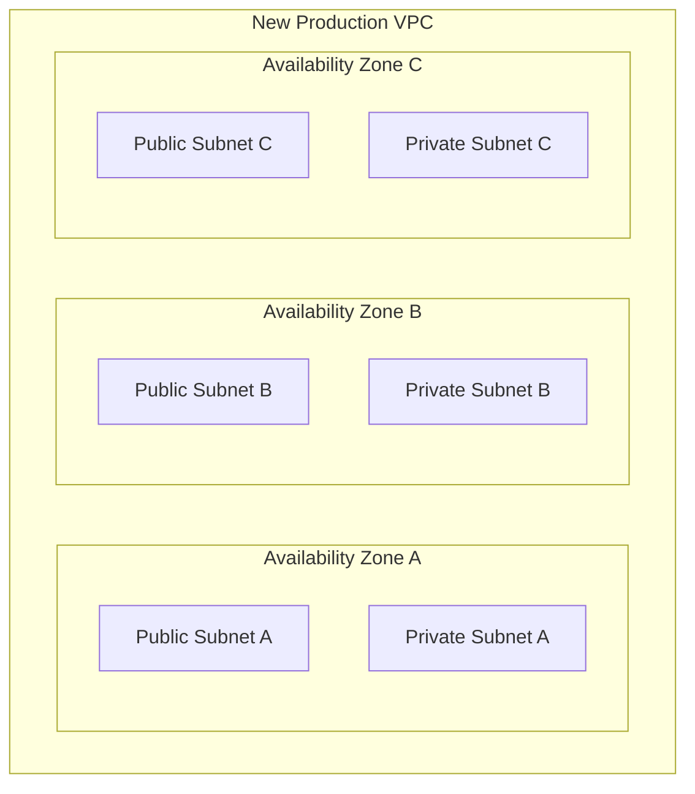

Step by step: (1) the VPC is created spanning the Region, and subnets are deliberately
provisioned in three different AZs rather than one, each AZ getting its own public/private
subnet pair; (2) this is done before any compute or database resources are added, so the
network foundation never becomes the blocker later; (3) when an ALB, Auto Scaling group, or
RDS Multi-AZ deployment is added afterward, the subnet structure already supports spreading
them redundantly across AZs, with no VPC redesign needed.

**Why the others are wrong:**
- **A** a single-AZ subnet design means every future resource added to this VPC is confined to one AZ unless the VPC is redesigned later — baking in exactly the AZ-level single point of failure the requirement wants to avoid from day one, and retrofitting multi-AZ subnets into a live VPC with resources already running is more disruptive than designing it correctly from the start.
- **C** is factually wrong — a subnet is explicitly scoped to exactly one Availability Zone; subnets do not automatically span every AZ in a Region, which is precisely why multiple subnets (one per AZ) must be deliberately created for AZ redundancy.
- **D** organizing subnets by AWS service rather than by Availability Zone misunderstands what subnets are for in this context — the relevant resilience dimension is AZ distribution, not a one-subnet-per-service organizational scheme, which wouldn't ensure AZ redundancy at all.

Reference: [`services/networking-content-delivery/subnets-route-tables-igw-natgw.md`](../../../services/networking-content-delivery/subnets-route-tables-igw-natgw.md)

---

## Question 47

*(Domain 1 — Secure Architectures)*

A consulting firm's cross-account automation calls `sts:AssumeRole` from within a Lambda
function (Role X in Account A) into a role in Account B (Role Y), and then that Lambda's code
attempts to assume yet another role in Account C (Role Z) using the temporary credentials it
just received from assuming Role Y. This nested chain fails partway through with a session
duration error. What is the most likely cause?

A) Cross-account role chaining is never supported beyond a single hop, regardless of configuration
B) When a role is assumed using temporary credentials obtained from another `AssumeRole` call (role chaining), the resulting session's maximum duration is capped at one hour, regardless of the individual roles' own configured maximum session duration — the chain likely requested a longer duration than this one-hour cap allows
C) The Lambda function's own execution timeout is the cause, unrelated to STS session duration at all
D) KMS key policies are blocking the nested role assumption

**Correct Answer: B**

**Why correct:** [STS role chaining](../../../services/security-identity-compliance/sts-and-role-switching.md) — assuming a role using temporary credentials that were themselves obtained from a previous `AssumeRole` call, rather than from a long-lived IAM identity — caps the resulting session's maximum duration at **one hour**, regardless of how long the individual roles involved are configured to allow for a session (which could be up to 12 hours when assumed directly from a non-temporary identity). If the nested assumption in this scenario requested or expected a longer session, hitting this one-hour role-chaining cap is the most likely and well-documented cause of this kind of error.

**Why the others are wrong:**
- **A** is incorrect — role chaining across multiple accounts is a supported pattern; it is specifically subject to the one-hour maximum session duration limitation rather than being unsupported outright.
- **C** a Lambda function's own execution timeout (maxing at 15 minutes) is a separate limit from STS session duration — the scenario's symptom (a session duration error from STS) points specifically to the STS role-chaining cap, not the Lambda runtime's own timeout mechanism.
- **D** KMS key policies govern access to KMS keys specifically — they have no relationship to STS's own session-duration limits for role chaining, and nothing in the scenario suggests a KMS operation is even involved.

Reference: [`services/security-identity-compliance/sts-and-role-switching.md`](../../../services/security-identity-compliance/sts-and-role-switching.md)

---

## Question 48

*(Domain 2 — Resilient Architectures)*

An order-processing system publishes events to an SNS topic, which fans out to an SQS queue
consumed by a downstream inventory-reservation service. During a flash sale, the inventory
service's processing rate is consistently slower than the rate of incoming order events,
causing the SQS queue's backlog to grow continuously throughout the sale. The team does not
want to lose any events and wants the backlog to drain automatically once the sale ends and
traffic normalizes, without manual intervention. What should the Solutions Architect confirm
is already correctly supporting this behavior, and what (if anything) should be added?

A) Nothing is needed — SQS already buffers the excess events durably (up to its retention period) without loss, and once traffic normalizes, the backlog will naturally drain as the consumer catches up; the team should ensure the queue's message retention period is long enough to hold the backlog for the sale's duration, and consider adding consumer Auto Scaling (e.g., scaling the number of inventory-service workers based on queue depth) to drain the backlog faster
B) Switch from SNS/SQS to direct synchronous API calls from the order system to the inventory service, to avoid any backlog forming at all
C) Reduce the SQS queue's visibility timeout to zero, so messages are reprocessed as fast as possible
D) Configure the SNS topic to drop messages once the downstream SQS queue reaches a certain depth, to prevent "overload"

**Correct Answer: A**

**Why correct:** [SQS](../../../services/application-integration/sqs.md) is specifically designed to **buffer** exactly this kind of producer-faster-than-consumer impedance mismatch durably, without losing messages, up to the queue's configured retention period (up to 14 days) — this is the core value of decoupling via a queue in the first place, and it already "just works" as described without the team needing to do anything extra to prevent message loss. Confirming the retention period comfortably covers the sale's duration (so nothing expires before being processed) is the one thing worth verifying, and adding **Auto Scaling for the consumer fleet based on queue depth** (a CloudWatch metric SQS exposes) directly speeds up the automatic, unattended drain-down once traffic normalizes or even during the sale itself if more consumer capacity is added dynamically.

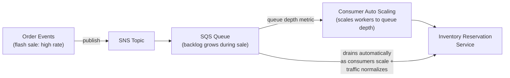

Step by step: (1) during the flash sale, events arrive faster than the inventory service
processes them, so the queue's backlog grows — durably, with nothing lost; (2) a CloudWatch
alarm on queue depth drives Auto Scaling to add more inventory-service workers, increasing
processing throughput without any manual action; (3) once the sale ends and arrival rate
drops (and with more workers now running), the backlog drains down to zero automatically, with
every event eventually processed exactly once.

**Why the others are wrong:**
- **B** switching to direct synchronous calls removes the buffering benefit entirely — the inventory service being slower than the order rate would now cause order-processing itself to block or fail during the flash sale, which is a worse outcome than a growing-but-durable queue backlog.
- **C** setting visibility timeout to zero means a message becomes visible to other consumers again essentially immediately after being received, before the current consumer could possibly finish processing it — this would cause the same message to be picked up and processed multiple times concurrently, a correctness bug, not a performance fix.
- **D** deliberately dropping messages once a depth threshold is reached is the literal opposite of the explicit "does not want to lose any events" requirement — this isn't a real SNS/SQS feature in the way described, and even conceptually it directly violates the stated goal.

Reference: [`services/application-integration/sqs.md`](../../../services/application-integration/sqs.md)

---

## Question 49

*(Domain 1 — Secure Architectures)*

A multinational company's AWS Organization creates a new sandbox OU for experimentation,
where developers are expected to try many different AWS services freely, but security wants
to explicitly forbid a short list of genuinely dangerous actions (like disabling CloudTrail or
leaving the Organization) while leaving everything else unrestricted, to maximize
developer freedom for experimentation. What SCP strategy fits this specific intent?

A) An allow-list (default-deny) SCP, explicitly enumerating every single permitted action and denying everything else by default
B) A deny-list SCP, explicitly denying only the specific short list of dangerous actions, while leaving all other actions permitted by default (subject to the account's own IAM permissions) — matching "forbid a short list... leaving everything else unrestricted"
C) No SCP at all, relying entirely on IAM permissions within each sandbox account
D) An SCP that denies all actions entirely, maximizing security at the cost of making the sandbox OU unusable

**Correct Answer: B**

**Why correct:** [A deny-list SCP strategy](../../../services/security-identity-compliance/organizations-and-scps.md) explicitly denies only the specific, named dangerous actions (e.g., `cloudtrail:StopLogging`, `organizations:LeaveOrganization`) while leaving every other action's permission decision to the account's own IAM policies — this directly matches the stated intent: "forbid a short list of genuinely dangerous actions... leaving everything else unrestricted, to maximize developer freedom," which is precisely the use case a deny-list (as opposed to an allow-list) SCP is suited for.

**Why the others are wrong:**
- **A** an allow-list (default-deny) SCP would require explicitly enumerating every single service/action developers are allowed to experiment with, and anything not explicitly listed would be blocked — directly contradicting "try many different AWS services freely" and "maximize developer freedom," since new/unlisted services would be blocked by default until added to the list.
- **C** having no SCP at all removes the organization-wide, unbypassable guarantee that the specific dangerous actions are blocked — the requirement explicitly wants those specific actions forbidden with certainty, not left purely to individual account IAM configuration (which could be misconfigured or changed by someone with sufficient account permissions).
- **D** denying all actions entirely is the opposite extreme from what's needed — it would make the sandbox OU completely unusable for experimentation, failing "maximize developer freedom" just as badly as being too permissive would fail the security requirement.

Reference: [`services/security-identity-compliance/organizations-and-scps.md`](../../../services/security-identity-compliance/organizations-and-scps.md)

---

## Question 50

*(Domain 1 — Secure Architectures)*

An e-commerce company's ALB-fronted web application has experienced several attempted SQL
injection and cross-site scripting (XSS) attacks identified in its logs. The security team
wants broad, continuously-updated protection against these well-known categories of web
exploits without writing and maintaining custom detection rules for every new attack variant
themselves. What should the Solutions Architect implement?

A) Custom NACL rules matching known malicious IP ranges, updated manually whenever a new attack is observed
B) AWS WAF with AWS Managed Rule Groups (such as the Core Rule Set, which includes broad protections against SQL injection, XSS, and other OWASP Top 10 patterns), attached to the ALB and kept automatically updated by AWS as new attack patterns emerge
C) Security groups configured to block all traffic except from a small allow-list of trusted IP ranges
D) A custom-built regular-expression filter running in a Lambda@Edge function, manually updated by the security team whenever they learn of a new attack pattern

**Correct Answer: B**

**Why correct:** [AWS WAF's Managed Rule Groups](../../../services/security-identity-compliance/waf.md) — maintained and continuously updated by AWS (and AWS Marketplace security vendors) — provide broad, pre-built protection against well-known attack categories like SQL injection and XSS (the Core Rule Set specifically targets OWASP Top 10-style patterns), attached directly to the ALB, with AWS responsible for keeping the rule content current as new attack variants emerge — directly matching "broad, continuously-updated protection... without writing and maintaining custom detection rules... themselves."

**Why the others are wrong:**
- **A** manually updating NACL rules with known malicious IPs is both a weak defense (IPs are easily rotated/spoofed by attackers, and this does nothing to detect the actual SQL injection/XSS *payload* patterns) and exactly the manual, ongoing-maintenance burden the requirement explicitly wants to avoid.
- **C** restricting an e-commerce site's public web application to a small allow-list of trusted IPs would block its actual (unpredictable, worldwide) customer base entirely — this isn't a viable option for a public-facing retail site at all.
- **D** a custom-built, manually-maintained regex filter is precisely the "writing and maintaining custom detection rules... themselves" burden the requirement explicitly wants to avoid, and it would need constant updates to keep pace with evolving attack techniques that AWS's managed rule groups already track and update automatically.

Reference: [`services/security-identity-compliance/waf.md`](../../../services/security-identity-compliance/waf.md)

---

## Question 51

*(Domain 3 — High-Performing Architectures)*

A social media analytics company's ElastiCache for Redis cluster, running on a single large
node, is approaching both its memory capacity ceiling and its maximum throughput for the
dataset it caches, which continues to grow as the company onboards more customers. A single,
even larger node is not a long-term solution since dataset growth is expected to continue
indefinitely. What ElastiCache configuration should the Solutions Architect move to in order
to scale beyond a single node's ceiling?

A) ElastiCache for Memcached instead, since Memcached nodes are unconditionally larger than any Redis node
B) Redis cluster mode enabled, sharding the dataset across multiple node groups (shards), allowing both memory capacity and throughput to scale horizontally by adding more shards as the dataset continues to grow, rather than being capped by a single node's ceiling
C) A read replica added to the existing single-shard setup, since read replicas increase write throughput and total memory capacity
D) Switching to a smaller node type to reduce cost, accepting more frequent cache misses as a trade-off

**Correct Answer: B**

**Why correct:** [Redis cluster mode enabled](../../../services/database/elasticache.md) partitions (shards) data across multiple node groups, meaning both total memory capacity and total throughput scale horizontally as more shards are added — directly solving "a single, even larger node is not a long-term solution" for a dataset expected to keep growing indefinitely, since cluster mode removes the single-node ceiling as the limiting factor altogether.

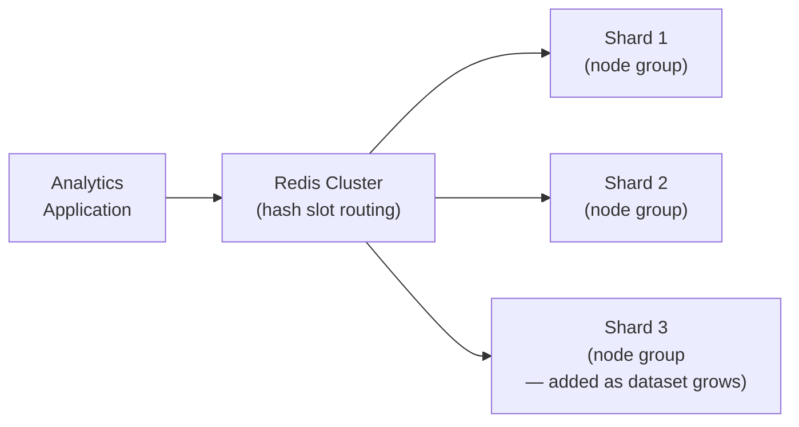

Step by step: (1) with cluster mode enabled, the dataset's keyspace is divided into hash slots
spread across multiple shards (node groups), not held entirely on one node; (2) as the dataset
keeps growing, additional shards can be added, each taking a portion of the hash slot range
and adding both its own memory capacity and its own throughput to the cluster's total;
(3) there's no longer a single node's hardware ceiling capping how large the cache can grow,
since growth is horizontal (more shards) rather than vertical (a bigger single node).

**Why the others are wrong:**
- **A** is both an unhelpful swap (Memcached vs. Redis is a feature/architecture choice, not a guaranteed "larger node" proposition) and "unconditionally larger" is not an accurate characterization of the relationship between the two engines' node size options — this doesn't solve the stated scaling problem.
- **C** read replicas (in non-cluster-mode Redis) add additional read capacity and failover targets, but they do **not** increase the cluster's total writable memory capacity — all replicas of a given shard hold the *same* data as that shard's primary, so adding replicas doesn't let the dataset itself grow beyond a single shard's memory ceiling; this is the classic read-scaling-vs-capacity-scaling confusion.
- **D** switching to a smaller node type moves in the opposite direction of what's needed — the dataset is already too large and throughput-intensive for the *current* node, so downsizing would make capacity and throughput problems worse, not better, trading them for a cost reduction that doesn't actually solve the underlying growth problem.

Reference: [`services/database/elasticache.md`](../../../services/database/elasticache.md)

---

## Question 52

*(Domain 4 — Cost-Optimized Architectures)*

A 60-account AWS Organization's finance team wants a single, unified view of total spend
across every account, broken down by linked account, service, and custom cost allocation
tags, with the ability to drill into any specific account's or team's spend history over the
past 12 months. What should the Solutions Architect confirm is set up to provide this?

A) Nothing beyond each account's individual billing console, since finance can simply log into each of the 60 accounts separately and manually total the numbers
B) AWS Organizations' consolidated billing (automatically aggregating all linked accounts' usage/cost data into the management account) combined with AWS Cost Explorer (enabled in the management account, or a delegated billing/cost-management account), providing a unified, drillable view by account, service, and cost allocation tag across the Organization's full billing history
C) A separate, third-party billing aggregation tool, since AWS has no native way to view combined multi-account spend
D) Manually exporting each account's monthly CSV invoice and combining them in a spreadsheet every month

**Correct Answer: B**

**Why correct:** [AWS Organizations' consolidated billing](../../../services/management-governance/cost-management-tools.md) automatically rolls up every linked account's usage and cost data into the management account (or a delegated account), and [Cost Explorer](../../../services/management-governance/cost-management-tools.md) built on top of that consolidated data lets finance filter and drill down by linked account, service, cost allocation tag, and time range (including up to the past 12+ months of history) — directly providing the "single, unified view... drillable... by account, service, and tag" the finance team wants, natively, with no manual aggregation.

**Why the others are wrong:**
- **A** manually logging into 60 separate accounts and totaling numbers by hand is exactly the fragmented, manual, error-prone, and non-scalable process that consolidated billing and Cost Explorer already eliminate natively.
- **C** is factually wrong — AWS does have a native mechanism for exactly this (consolidated billing plus Cost Explorer); reaching for a third-party tool first ignores the built-in capability that already solves this directly.
- **D** manually exporting and combining 60 accounts' CSVs every month is slow, error-prone, and redundant with what Cost Explorer already provides automatically and continuously, with richer drill-down (by tag, by service) than a basic CSV export would offer without significant additional manual spreadsheet work.

Reference: [`services/management-governance/cost-management-tools.md`](../../../services/management-governance/cost-management-tools.md)

---

## Question 53

*(Domain 3 — High-Performing Architectures)*

A multiplayer mobile game's backend serves players across the globe using a mix of a
real-time UDP-based game session protocol and a separate HTTPS REST API for account/profile
management. The team already uses CloudFront for the REST API's cacheable responses but needs
a *different* AWS service specifically for optimizing and providing failover for the UDP game
session traffic, since CloudFront doesn't support arbitrary UDP traffic. Which service, and
why is it the right complement to CloudFront here (not a replacement for it)?

A) AWS Global Accelerator for the UDP game traffic, since it operates at the network layer (TCP/UDP) rather than CloudFront's HTTP/HTTPS caching layer — the two are complementary because they solve different problems for different traffic types within the same application
B) A second CloudFront distribution configured specifically for UDP, since CloudFront can be configured to support any protocol with the right settings
C) Amazon API Gateway, configured with a UDP integration type
D) Just use CloudFront for everything, including the UDP traffic, since consolidating onto one service is always simpler

**Correct Answer: A**

**Why correct:** [AWS Global Accelerator](../../../services/networking-content-delivery/global-accelerator.md) operates at the network layer, supporting both TCP and UDP traffic with static anycast IPs routed over AWS's global backbone with health-check-based failover — this is exactly the complementary service needed for the UDP game-session traffic that CloudFront (an HTTP/HTTPS-layer caching service) cannot handle, while CloudFront continues to serve its own distinct purpose (caching the REST API's cacheable HTTPS responses) — the two genuinely solve different problems for different traffic types within the same overall application, which is why using both together (not replacing one with the other) is the correct architecture.

**Why the others are wrong:**
- **B** is factually incorrect — CloudFront does not support configuring a distribution for arbitrary UDP traffic; it is fundamentally an HTTP/HTTPS content delivery service, not a general network-layer traffic router.
- **C** API Gateway is designed for building and managing HTTP/REST/WebSocket APIs — there's no "UDP integration type" for API Gateway, and it isn't designed for routing raw UDP game-session traffic at all.
- **D** "just use CloudFront for everything" directly contradicts the question's own premise that "CloudFront doesn't support arbitrary UDP traffic" — consolidating onto a service that structurally cannot handle the required protocol isn't simpler, it's simply non-functional for that traffic type.

Reference: [`services/networking-content-delivery/global-accelerator.md`](../../../services/networking-content-delivery/global-accelerator.md)

---

## Question 54

*(Domain 1 — Secure Architectures)*

A multinational enterprise has on-prem Active Directory-joined workstations in several
offices and a hybrid network connection to AWS via Direct Connect. They want internal
applications' DNS names (hosted in private Route 53 hosted zones within their VPCs) to resolve
correctly from on-prem workstations, and conversely, want AWS-side resources to be able to
resolve certain on-prem-only DNS names — all without manually maintaining a static hosts file
or duplicate DNS records on either side. What should the Solutions Architect configure?

A) A public Route 53 hosted zone for the internal application names, making them resolvable from anywhere on the internet
B) Route 53 Resolver, with inbound and outbound endpoints configured in the VPC, plus conditional forwarding rules on both the on-prem DNS servers (toward the Resolver's inbound endpoint for AWS-side names) and within the Resolver (toward on-prem DNS servers, via the outbound endpoint, for on-prem-only names) — enabling bidirectional DNS resolution without manual record duplication
C) Manually export the private hosted zone's records periodically and import them into the on-prem DNS servers' zone files
D) Disable DNSSEC on both sides, since DNSSEC is what's preventing cross-network DNS resolution

**Correct Answer: B**

**Why correct:** [Route 53 Resolver](../../../services/networking-content-delivery/route53.md) with both inbound and outbound endpoints is specifically built for exactly this hybrid bidirectional DNS scenario: the **inbound endpoint** lets on-prem DNS servers forward queries for AWS-side private-hosted-zone names into the VPC for resolution, while the **outbound endpoint** lets AWS-side resolvers forward queries for on-prem-only names out to the on-prem DNS servers — configured with conditional forwarding rules on both sides, this achieves genuine bidirectional resolution with no manual record duplication or static hosts files required on either side.

**Why the others are wrong:**
- **A** making internal application names resolvable via a **public** hosted zone exposes those internal DNS names (and the fact that they exist, and potentially the IP addressing behind them) to the entire internet — a significant security exposure for what are explicitly described as internal applications, and it's also not actually the mechanism needed for on-prem-to-AWS *private* DNS resolution.
- **C** manually exporting and importing DNS records periodically is exactly the "manually maintaining... duplicate DNS records" process the requirement explicitly wants to avoid, and it would always be at least somewhat stale between export cycles.
- **D** DNSSEC (DNS Security Extensions) is about cryptographically validating DNS responses to prevent spoofing — it has nothing to do with whether cross-network DNS forwarding/resolution is configured at all, and disabling it wouldn't enable any new resolution capability; this option misunderstands what DNSSEC does.

Reference: [`services/networking-content-delivery/route53.md`](../../../services/networking-content-delivery/route53.md)

---

## Question 55

*(Domain 2 — Resilient Architectures)*

A streaming analytics company ingests real-time clickstream events via Amazon MSK (Managed
Streaming for Apache Kafka), and a recent single-broker failure in their 3-broker cluster
caused a brief processing interruption and, worse, some data appeared to be temporarily
unavailable to consumers until the cluster recovered. The team wants the Kafka cluster
configured so that losing any single broker (or even an entire Availability Zone) doesn't
interrupt data availability for consumers at all. What MSK configuration should the Solutions
Architect verify/implement?

A) A single-broker MSK cluster, since fewer brokers means simpler failure recovery
B) An MSK cluster with brokers distributed across multiple Availability Zones (commonly three), combined with a topic replication factor greater than 1 (e.g., 3) so each partition has replicas on brokers in different AZs — a broker or AZ failure then has an in-sync replica elsewhere immediately available to continue serving that partition's consumers
C) A single broker per Availability Zone, with no partition replication configured, to keep storage costs minimal
D) MSK Serverless, since serverless automatically guarantees zero data unavailability regardless of replication configuration

**Correct Answer: B**

**Why correct:** [Amazon MSK's](../../../services/analytics/kinesis-family.md) resilience to broker/AZ failure depends on both (1) brokers being spread across multiple AZs, and (2) each topic's **replication factor** being greater than 1, so every partition has replicas living on brokers in *different* AZs — when one broker (or its entire AZ) fails, an in-sync replica on a different, healthy broker/AZ is already available to be promoted as the new leader for that partition, with consumers continuing uninterrupted (or with only a very brief leader-election pause) rather than experiencing the "data temporarily unavailable" symptom described, which strongly suggests replication factor or AZ distribution wasn't properly configured in the first place.

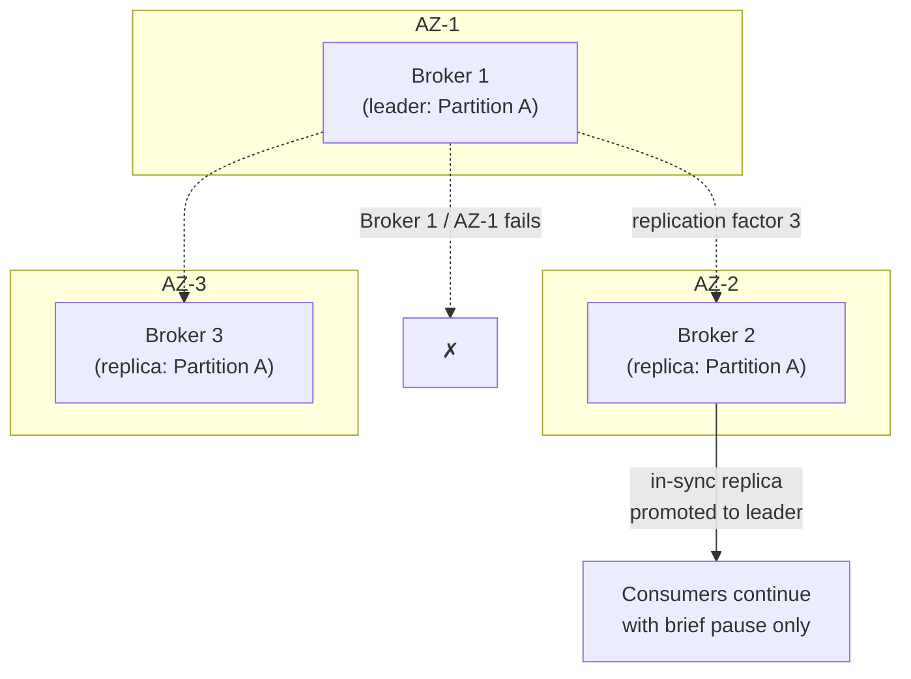

Step by step: (1) the topic's partitions are replicated (replication factor 3) across brokers
that are deliberately spread across three AZs, not concentrated in one; (2) each partition has
one leader and multiple in-sync replicas, each on a different broker/AZ; (3) if Broker 1 (or
all of AZ-1) fails, one of the in-sync replicas in AZ-2 or AZ-3 is promoted to leader almost
immediately, so consumers experience at most a brief leader-election pause rather than true
data unavailability.

**Why the others are wrong:**
- **A** a single-broker cluster has zero fault tolerance by definition — any broker failure (the only broker) means total unavailability, the opposite of the stated resilience goal.
- **C** "no partition replication configured" (replication factor of 1) means each partition's data exists on exactly one broker — losing that specific broker (or its AZ) makes that partition's data genuinely unavailable until the broker recovers, which is exactly the symptom the scenario describes happening and wants eliminated; multiple brokers across AZs without replication don't help an individual partition's availability.
- **D** is an overclaim — "serverless automatically guarantees zero data unavailability regardless of replication configuration" misstates how MSK Serverless's underlying resilience actually works and isn't an accurate blanket guarantee; resilience still fundamentally depends on proper replication and AZ distribution of the underlying data, not simply picking a serverless deployment mode as a magic fix.

Reference: [`services/analytics/kinesis-family.md`](../../../services/analytics/kinesis-family.md)

---

## Question 56

*(Domain 1 — Secure Architectures)*

A company's security team enforces least privilege using IAM policies scoped by resource tags,
so that a developer's role can only manage resources tagged with their own team's name. During
an audit, they realize tags themselves can be freely added, changed, or removed by any
developer with `ec2:CreateTags`/`ec2:DeleteTags` permission — meaning a developer could
retag another team's resource as their own and then manage it, circumventing the access
control entirely. What should the Solutions Architect add to close this specific gap?

A) Nothing; tag-based access control is inherently unfixable against this specific risk
B) Add a separate IAM policy statement explicitly restricting who can call `ec2:CreateTags` and `ec2:DeleteTags` on the specific tag keys used for access control (e.g., only a dedicated provisioning/automation role can set the `Team` tag, not individual developers), closing the loophole where modifying the tag itself bypasses the access control built on top of it
C) Switch entirely from tag-based access control to resource-ARN-based access control, since ARNs can never be changed by developers
D) Rely on developers' good judgment not to abuse this capability, since explicitly restricting tagging permissions is unnecessary extra complexity

**Correct Answer: B**

**Why correct:** [Restricting who can modify the specific tag keys used for access-control decisions](../../../services/security-identity-compliance/iam.md) (e.g., via a policy statement that denies `ec2:CreateTags`/`ec2:DeleteTags` on the `Team` tag key for anyone except a dedicated provisioning/automation role) closes exactly this gap: if developers can't freely change the tag that *is* the access-control key, they can't retag another team's resource as their own to gain access to it — this is the standard, documented mitigation for tag-based access control's "tag mutability" risk.

**Why the others are wrong:**
- **A** is defeatist and incorrect — this is a well-known, specifically-addressable risk with tag-based access control, not an inherent, unfixable flaw; the standard mitigation (restricting who can modify the access-control tag keys) is exactly option B.
- **C** switching to pure resource-ARN-based policies would, as noted, avoid this specific tag-mutability risk, but it reintroduces the original problem tag-based access control was solving in the first place — hardcoded ARNs require manual policy updates every time a new resource is created, which doesn't scale and was presumably why tag-based access control was adopted to begin with; it's a bigger, less practical change than simply locking down who can set the access-control tag.
- **D** "rely on good judgment" provides no technical enforcement at all against a now-identified, specific, exploitable gap — the whole point of the audit finding this gap is to close it technically, not to hope no one exploits it.

Reference: [`services/security-identity-compliance/iam.md`](../../../services/security-identity-compliance/iam.md)

---

## Question 57

*(Domain 4 — Cost-Optimized Architectures)*

A manufacturing company's finance team wants to see EC2, Lambda, and Fargate usage combined
under a single discount commitment, since their mix of compute across those three shifts
over time as teams modernize different services, and they don't want to manage three separate
category-specific Savings Plans. What should the Solutions Architect recommend over
purchasing separate EC2 Instance Savings Plans, RDS Reserved Instances, and no coverage at all
for Fargate/Lambda?

A) A single Compute Savings Plan, sized to the company's steady-state hourly compute spend across EC2, Lambda, and Fargate combined, automatically applying its discount across whichever of those three is actually consumed at any given time, adapting as the mix shifts between them
B) Three separate EC2 Instance Savings Plans, one per major instance family currently in use, assuming this provides equivalent coverage
C) A single Reserved Instance covering the combined peak usage of EC2, Lambda, and Fargate together
D) No commitment of any kind, since mixed usage across three different compute types makes any Savings Plan "too complicated" to size correctly

**Correct Answer: A**

**Why correct:** [A Compute Savings Plan](../../../services/management-governance/cost-management-tools.md) is specifically the Savings Plan type that applies automatically across EC2 (any family/size/Region/OS), Fargate, **and** Lambda under one single commitment — exactly matching "combined under a single discount commitment" and "adapting as the mix shifts," since the commitment is a steady hourly dollar amount rather than being tied to any specific service or instance family, which is the direct answer to wanting one commitment instead of three separate category-specific plans.

**Why the others are wrong:**
- **B** EC2 Instance Savings Plans (even several of them) only ever cover EC2 usage — they provide zero coverage for Lambda or Fargate spend at all, directly failing "combined under a single discount commitment" across all three compute types.
- **C** Reserved Instances are an EC2-specific (and RDS/ElastiCache/Redshift-specific, in their respective contexts) purchasing mechanism — there's no "Reserved Instance" product that covers Lambda or Fargate usage at all, so this doesn't achieve combined coverage either.
- **D** "too complicated" is specifically what Compute Savings Plans are designed to simplify — rather than needing separate commitments per compute type, a single steady-state dollar commitment handles the complexity of a shifting mix automatically; forgoing any commitment at all leaves real savings on the table for no good reason given this tool already exists.

Reference: [`services/management-governance/cost-management-tools.md`](../../../services/management-governance/cost-management-tools.md)

---

## Question 58

*(Domain 2 — Resilient Architectures)*

A multinational logistics company's hybrid network connects on-prem distribution centers to
AWS using both a Direct Connect circuit and a Site-to-Site VPN connection as a backup path.
During a recent fiber cut affecting the Direct Connect circuit, traffic did not automatically
shift to the VPN connection, and the on-prem team had to manually intervene to reroute
traffic, causing an extended outage. What should the Solutions Architect verify/configure to
make this failover automatic going forward?

A) Static routes only, pointing exclusively at the Direct Connect circuit, with the VPN connection left entirely unconfigured in the routing tables until manually added during an incident
B) BGP (Border Gateway Protocol) configured on both the Direct Connect circuit and the Site-to-Site VPN connection, with appropriate route priorities (e.g., AS path prepending or local preference making Direct Connect preferred under normal conditions), so that if BGP detects the Direct Connect path is down, routes automatically converge to advertise the VPN path instead, with no manual intervention
C) Replace the Direct Connect circuit with a second VPN connection, since two VPN connections are inherently more reliable
D) Manually update static routes to point at the VPN connection every time Direct Connect has planned maintenance, and revert afterward

**Correct Answer: B**

**Why correct:** [BGP](../../../services/networking-content-delivery/vpn.md) configured on both paths, with route preference tuned so Direct Connect is preferred under normal conditions, allows **automatic route convergence**: if BGP detects the Direct Connect path is down (session drops, routes withdrawn), it automatically starts advertising/using the VPN path's routes instead — all without manual intervention — directly fixing the described gap ("did not automatically shift... had to manually intervene") for future incidents.

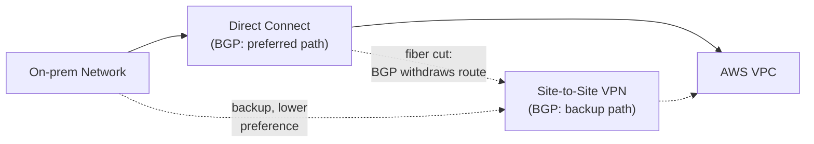

Step by step: (1) under normal conditions, BGP route preference makes Direct Connect the
preferred path, with the VPN connection's routes present but deprioritized; (2) when the fiber
cut takes Direct Connect down, BGP detects the dropped session and withdraws its routes
automatically; (3) traffic converges onto the VPN path's already-advertised routes within
seconds, with no engineer needing to notice the outage and manually reconfigure routing.

**Why the others are wrong:**
- **A** having only static routes pointing at Direct Connect, with the VPN left unconfigured in routing until manually added, is precisely the configuration that caused this exact outage — it offers no automatic failover path at all by design.
- **C** replacing Direct Connect entirely with a second VPN connection removes the dedicated, consistent-performance private connection the company presumably wanted Direct Connect for in the first place (and VPNs, being internet-routed, aren't inherently "more reliable" than a dedicated circuit; they're a different trade-off) — and simply having two VPN connections doesn't automatically solve the dynamic-failover configuration problem described without the same BGP-based automatic routing.
- **D** manually updating static routes before "planned" maintenance doesn't help with *unplanned* failures like the fiber cut described — a fiber cut isn't a scheduled event the team can manually prepare for in advance, which is exactly why automatic BGP-based failover (not manual route changes) is the correct fix.

Reference: [`services/networking-content-delivery/vpn.md`](../../../services/networking-content-delivery/vpn.md)

---

## Question 59

*(Domain 4 — Cost-Optimized Architectures)*

A quarterly cost audit of a mid-sized company's AWS account reveals: an idle NAT Gateway in a
VPC with no resources routing through it anymore, three unattached EBS volumes from
terminated instances, and an RDS instance that was stopped eight months ago and never deleted
(RDS automatically restarts a stopped instance after 7 days if not manually re-stopped, so
this instance has actually been incurring running-instance charges intermittently rather than
truly "stopped" this whole time). What combination of actions should the Solutions Architect
take, and what should be put in place to prevent recurrence?

A) Delete all three resources immediately with no further investigation, and consider the audit complete with no process changes
B) Verify each resource is genuinely unused (check NAT Gateway route table references, confirm EBS volumes aren't intentionally retained backups, confirm the RDS instance has no remaining business need), then delete/decommission confirmed-unused resources, and going forward, schedule a recurring (e.g., monthly) Trusted Advisor cost-optimization review specifically to catch this category of waste before it accumulates for months
C) Leave everything as-is, since a quarterly review already caught it, proving the current process works fine
D) Increase the account's budget alert threshold so this level of waste no longer triggers alerts

**Correct Answer: B**

**Why correct:** Before deleting anything, [verifying each resource's actual status](../../../services/management-governance/trusted-advisor.md) (confirming the NAT Gateway truly has no route table references pointing at it, that the EBS volumes aren't intentionally-retained backups, and that the RDS instance has no remaining business need) avoids accidentally destroying something still needed; after cleanup, establishing a **recurring** review cadence using Trusted Advisor's cost-optimization checks specifically prevents this same category of waste (idle NAT Gateways, unattached EBS volumes, forgotten stopped-then-auto-restarting RDS instances) from silently accumulating for months again before the next audit catches it — directly addressing both the immediate cleanup and the recurrence-prevention half of the question.

**Why the others are wrong:**
- **A** deleting without any verification risks destroying a resource still serving some purpose not immediately obvious from a quarterly audit's surface-level view, and "no process changes" guarantees the exact same accumulation pattern repeats before the next audit.
- **C** a quarterly cadence allowing up to *eight months* of a stopped-then-auto-restarting RDS instance's intermittent charges to accumulate before being caught is not evidence the "process works fine" — it's evidence the review cadence is too infrequent to catch this kind of slow-accumulating waste promptly; a more frequent (e.g., monthly) check would catch it much sooner.
- **D** raising the budget alert threshold specifically so this level of spend stops triggering alerts is the opposite of good cost governance — it hides the signal rather than addressing the underlying waste, making future similar issues harder, not easier, to catch.

Reference: [`services/management-governance/trusted-advisor.md`](../../../services/management-governance/trusted-advisor.md)

---

## Question 60

*(Domain 1 — Secure Architectures)*

A company's AWS Organization wants to let application teams use tags to control which team
can manage which resources — specifically, access should be scoped not just by a fixed
`Team` tag match, but by matching several different tag dimensions simultaneously (team,
environment, and cost-center) in combinations that vary per role, without writing a separate,
hand-crafted IAM policy for every possible combination of team/environment/cost-center that
might exist. What IAM Identity Center capability fits this requirement?

A) Standard permission sets with hardcoded resource ARNs for every team/environment/cost-center combination, updated manually as combinations grow
B) Attribute-Based Access Control (ABAC) in IAM Identity Center, where permission sets reference user and resource attributes (like `Team`, `Environment`, `CostCenter`) generically in policy conditions, so access decisions are computed dynamically from whatever attribute values apply to a given user and resource — without hand-writing a policy per combination
C) A separate AWS account per team/environment/cost-center combination, to achieve isolation instead of using tags at all
D) IAM Identity Center does not support any tag- or attribute-based access patterns; only resource-ARN-based policies are possible

**Correct Answer: B**

**Why correct:** [ABAC in IAM Identity Center](../../../services/security-identity-compliance/iam-identity-center-sso.md) lets policies reference **attributes** (tags on users and resources) generically in policy conditions — rather than writing a distinct policy for every specific team/environment/cost-center combination, a single ABAC-based policy pattern evaluates dynamically against whatever attribute values actually apply to a given user and resource at access time, automatically covering new combinations as they arise without additional hand-written policies, directly matching "without writing a separate, hand-crafted IAM policy for every possible combination."

**Why the others are wrong:**
- **A** hardcoding resource ARNs per combination, updated manually as new combinations arise, is exactly the brittle, manually-maintained-per-combination process the requirement explicitly wants to avoid — and the number of required policies would grow multiplicatively as more teams/environments/cost-centers are added.
- **C** creating a separate account per every combination of three independent tag dimensions would produce an enormous, unmanageable number of accounts (team × environment × cost-center) purely to achieve something ABAC already achieves without any new accounts — a vastly disproportionate response to the actual requirement.
- **D** is factually incorrect — IAM Identity Center explicitly supports ABAC using attributes synced from an identity source (or defined directly), specifically for scenarios exactly like this one; resource-ARN-based policies are not the only option available.

Reference: [`services/security-identity-compliance/iam-identity-center-sso.md`](../../../services/security-identity-compliance/iam-identity-center-sso.md)

---

## Question 61

*(Domain 1 — Secure Architectures)*

A pharmaceutical company needs cryptographic key operations for a custom application that
must call low-level HSM APIs directly (PKCS#11, for example) for compatibility with specific
legacy software that expects to talk to physical or virtual HSM hardware directly, rather than
through the higher-level KMS API. Standard AWS KMS customer-managed keys (using the default
AWS key store) don't expose this kind of direct HSM API access. What should the Solutions
Architect provision instead?

A) AWS Secrets Manager, since it can store any kind of credential including HSM access tokens
B) AWS CloudHSM, which provides dedicated HSM instances with direct support for standard HSM APIs like PKCS#11, CNG, and JCE — exactly the direct low-level HSM API access the legacy software requires, which standard KMS (default key store) does not expose
C) A KMS customer-managed key with the default AWS key store, since all KMS keys support PKCS#11 by default
D) Amazon Cognito, since it manages cryptographic identity tokens

**Correct Answer: B**

**Why correct:** [AWS CloudHSM](../../../services/security-identity-compliance/kms.md) provides dedicated, customer-controlled HSM instances that natively support standard, low-level HSM APIs (PKCS#11, Java Cryptography Extension/JCE, Microsoft CNG) — exactly the direct hardware-level API access this legacy software integration requires, which KMS's higher-level, AWS-API-mediated interface (even for customer-managed keys in the default key store) does not expose in the same way.

**Why the others are wrong:**
- **A** Secrets Manager stores and retrieves secret *values* (like passwords and API keys) — it has no concept of exposing a PKCS#11 or similar direct HSM API interface at all; it solves a different problem (secret storage/rotation), not direct HSM API compatibility.
- **C** is factually incorrect — standard KMS customer-managed keys using the default AWS key store do not expose a direct PKCS#11 (or similar) HSM API; that level of direct HSM API access is specifically what CloudHSM (or a KMS custom key store backed by CloudHSM, for a different specific use case) provides, not default KMS.
- **D** Cognito manages user identity and authentication tokens for applications — it has nothing to do with providing direct, low-level cryptographic HSM API access for a custom application's key operations.

Reference: [`services/security-identity-compliance/kms.md`](../../../services/security-identity-compliance/kms.md)

---

## Question 62

*(Domain 3 — High-Performing Architectures)*

An online marketplace's product-search feature currently runs `LIKE '%keyword%'` queries
against its RDS PostgreSQL catalog table, which has become painfully slow (several seconds per
search) as the catalog has grown to millions of listings, and the team also wants typo-tolerant
and relevance-ranked full-text search results, not just substring matching. What should the
Solutions Architect introduce to deliver fast, relevant, typo-tolerant search without
replacing the catalog's system of record?

A) Add more read replicas to the RDS instance, since more replicas always fix any slow-query problem
B) Amazon OpenSearch Service, indexing the product catalog (kept in sync via a stream from RDS, e.g., DMS or a Lambda-based pipeline) and serving search queries against its purpose-built inverted-index full-text search engine, with relevance ranking and typo tolerance built in
C) Increase the RDS instance's storage IOPS allocation, since search slowness is always an IOPS problem
D) Move the entire catalog from RDS to DynamoDB, since DynamoDB queries are always faster than RDS queries

**Correct Answer: B**

**Why correct:** [Amazon OpenSearch Service](../../../services/analytics/opensearch.md) is purpose-built for exactly this: a managed, distributed full-text search engine using an inverted index, delivering fast (typically sub-second, even at large catalog scale) relevance-ranked search with built-in typo tolerance (fuzzy matching) — capabilities a relational `LIKE` query fundamentally cannot provide regardless of how it's tuned. Keeping RDS as the catalog's system of record and streaming changes into OpenSearch for the search-specific workload (a common CQRS-style pattern) means the two systems each do what they're best at — RDS for transactional consistency, OpenSearch for fast, relevant full-text search — without replacing the catalog's source of truth.

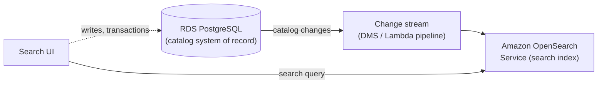

Step by step: (1) the catalog's authoritative data continues to live in RDS, where writes and
transactional consistency are handled as before; (2) a change-capture pipeline streams catalog
updates into OpenSearch, keeping its index current; (3) the search UI queries OpenSearch
directly for fast, relevance-ranked, typo-tolerant results, leaving RDS to handle only the
transactional workload it's actually good at — neither system is asked to do the other's job.

**Why the others are wrong:**
- **A** more read replicas scale *read throughput* for the same slow query pattern — a `LIKE '%keyword%'` scan is fundamentally inefficient regardless of how many replicas run it, and replicas do nothing to add relevance ranking or typo tolerance, which are structural capabilities a relational substring search doesn't have at all.
- **C** search slowness here is a *query-pattern and indexing-structure* problem (substring scans can't use a standard B-tree index efficiently), not an IOPS/storage-throughput problem — more IOPS doesn't change the fundamental inefficiency of the query pattern itself.
- **D** DynamoDB is not "always faster" in a blanket sense, and more importantly it has no native full-text search, relevance ranking, or typo-tolerance capability either — migrating the catalog wholesale wouldn't solve the actual search-quality problem at all, and it's also explicitly ruled out by "without replacing the catalog's system of record."

Reference: [`services/analytics/opensearch.md`](../../../services/analytics/opensearch.md)

---

## Question 63

*(Domain 3 — High-Performing Architectures)*

A social app's "user feed" endpoint queries DynamoDB on every request to assemble a
personalized feed, and the underlying data changes frequently (new posts arrive constantly)
but any individual user's feed can tolerate being up to 5 seconds stale without anyone
noticing. Read load on DynamoDB from this endpoint has grown to the point of driving up both
read-capacity cost and response latency. What caching strategy should the Solutions Architect
add in front of DynamoDB to reduce both, given the acceptable staleness window?

A) No caching at all, since "frequently changing data" means caching would serve incorrect information
B) A read-through cache using ElastiCache in front of DynamoDB, with a short TTL (around 5 seconds, matching the acceptable staleness window) — cache hits are served from memory at much lower latency and avoid a DynamoDB read entirely, while the short TTL ensures staleness never exceeds what users already find acceptable
C) DynamoDB Accelerator (DAX) configured with an item cache TTL of 24 hours, to maximize cache hit rate
D) Switch the table to use Global Tables, since replication reduces read load automatically

**Correct Answer: B**

**Why correct:** [A read-through ElastiCache layer](../../../services/database/elasticache.md) in front of DynamoDB, with a TTL tuned to match the explicitly-stated 5-second staleness tolerance, serves the large majority of repeated feed-assembly reads from memory — cutting both DynamoDB read-capacity consumption (lower cost) and response latency (cache hits are faster than DynamoDB reads) — while the short TTL specifically ensures cached data is never served stale beyond the window users already find acceptable, directly matching the stated constraint rather than ignoring it.

**Why the others are wrong:**
- **A** "caching would serve incorrect information" ignores the scenario's own explicit statement that up to 5 seconds of staleness is genuinely acceptable — a correctly-tuned short TTL cache serves data that's within the tolerance the business itself defined as fine, so this isn't "incorrect," it's intentionally-bounded staleness.
- **C** DAX is a valid DynamoDB-specific caching option, but a 24-hour TTL is wildly mismatched to the stated 5-second staleness tolerance — this would serve feed data that's far staler than what users find acceptable, a real correctness/UX problem the scenario is trying to avoid, not just "maximize hit rate" at any cost to freshness.
- **D** Global Tables are about multi-Region active-active replication for resilience and local-Region latency, not a caching/read-offload mechanism in the way described — adding Global Tables wouldn't reduce the read-capacity consumption or response latency driven by a single Region's heavy, repeated feed-read pattern the way a caching layer directly addresses.

Reference: [`services/database/elasticache.md`](../../../services/database/elasticache.md)

---

## Question 64

*(Domain 1 — Secure Architectures)*

A container platform team runs workloads on Amazon EKS and wants to detect anomalous
behavior at the container runtime level — for example, a container unexpectedly spawning a
reverse shell, or making suspicious outbound network connections not typical of its normal
behavior — going beyond what standard EKS control-plane logging alone would reveal. What
should the Solutions Architect enable?

A) AWS Config rules checking EKS cluster configuration settings, since configuration compliance implies runtime security
B) GuardDuty EKS Protection (including runtime monitoring via the GuardDuty security agent), which analyzes Kubernetes audit logs and container runtime behavior to detect anomalous activity like unexpected process execution or suspicious network connections at the container level
C) CloudTrail alone, since it logs every Kubernetes API call made to the EKS control plane
D) VPC Flow Logs alone, since all container network traffic is fully visible and self-explanatory in flow log records

**Correct Answer: B**

**Why correct:** [GuardDuty EKS Protection](../../../services/security-identity-compliance/guardduty.md), including its runtime monitoring capability (via a lightweight security agent), analyzes both Kubernetes audit logs and actual container-level runtime behavior — detecting anomalies like unexpected process execution (e.g., a reverse shell spawning inside a container) or suspicious outbound connections that deviate from a container's normal behavior pattern — which is specifically the kind of **runtime** security visibility that goes beyond standard control-plane logging alone.

**Why the others are wrong:**
- **A** AWS Config evaluates *configuration* state (e.g., is a setting compliant with a defined rule) — it has no visibility into actual runtime process execution or network behavior happening inside a running container, which is a fundamentally different (and here, the actually needed) security signal.
- **C** CloudTrail (or EKS's Kubernetes audit logs, which it's sometimes confused with) records API calls made *to* the Kubernetes/EKS control plane — it doesn't capture what's happening *inside* a running container at the process or network level, which is exactly the runtime behavior the scenario needs visibility into.
- **D** VPC Flow Logs record IP-level traffic metadata (source/dest IP, port, accept/reject) but are not "self-explanatory" for identifying anomalous *application-level* behavior — raw flow log records require significant additional analysis/correlation to surface something as specific as "this container made a suspicious connection atypical of its normal behavior," which is precisely the kind of behavioral analysis GuardDuty EKS Protection performs automatically.

Reference: [`services/security-identity-compliance/guardduty.md`](../../../services/security-identity-compliance/guardduty.md)

---

## Question 65

*(Domain 1 — Secure Architectures)*

A company's AWS Config setup detects that several security groups across multiple accounts
have inbound rules allowing `0.0.0.0/0` on port 22 (SSH), a clear violation of the company's
security baseline. The security team wants these specific non-compliant security group rules
automatically remediated (removed) the moment they're detected, without a human having to
manually fix each one, while still being notified that a remediation occurred for audit
purposes. What should the Solutions Architect configure?

A) An AWS Config rule evaluating the security groups for this condition, with no remediation action configured, relying on someone checking the Config dashboard regularly and fixing violations by hand
B) An AWS Config rule evaluating the security groups for this condition, paired with an AWS Systems Manager Automation remediation action configured to trigger automatically on a non-compliant finding — removing the offending rule — with an SNS notification configured to alert the security team each time a remediation runs
C) Delete all security groups in every account and require manual recreation with no automation at all
D) GuardDuty alone, assuming it automatically removes non-compliant security group rules when it detects them

**Correct Answer: B**

**Why correct:** [AWS Config's remediation integration with Systems Manager Automation](../../../services/management-governance/aws-config.md) lets a Config rule's non-compliant finding automatically trigger a remediation action (here, an SSM Automation document that removes the offending `0.0.0.0/0`-on-22 rule) with no human intervention required at the moment of detection, and configuring an SNS notification alongside the remediation action satisfies "still be notified... for audit purposes" — giving both the automatic fix and the audit trail the security team wants.

**Why the others are wrong:**
- **A** a Config rule with no remediation action configured is purely detective — it still requires a human to notice the finding and manually fix it, directly failing "automatically remediated... without a human having to manually fix each one."
- **C** deleting all security groups in every account (most of which are presumably fine) is a drastically disproportionate overreaction to a specific, narrow non-compliance condition (one particular rule pattern) — this would break legitimate access everywhere, not just fix the specific violating rules.
- **D** GuardDuty is a threat-detection service that generates findings about suspicious activity — it does not automatically modify or remediate security group configurations itself; that remediation capability is specifically what AWS Config's remediation-action integration (with SSM Automation) provides, not GuardDuty.

Reference: [`services/management-governance/aws-config.md`](../../../services/management-governance/aws-config.md)
