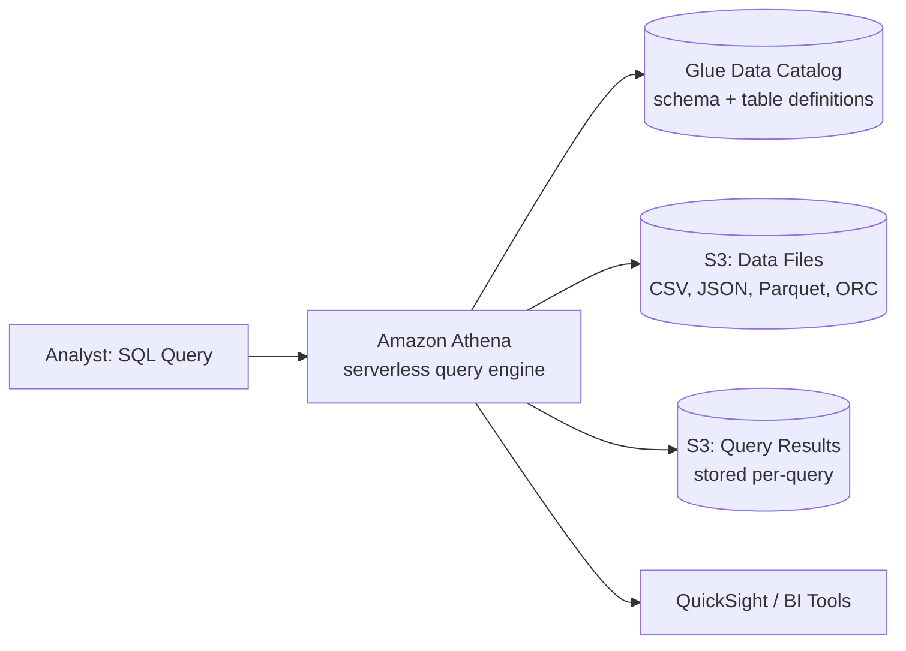
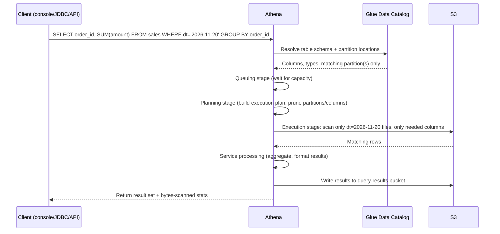
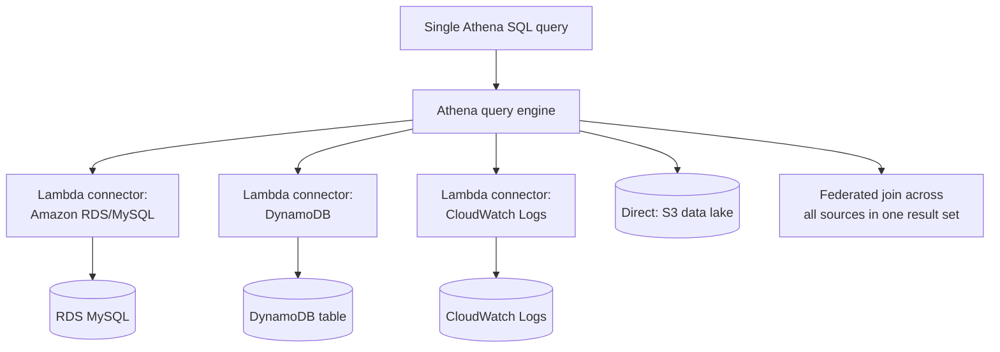
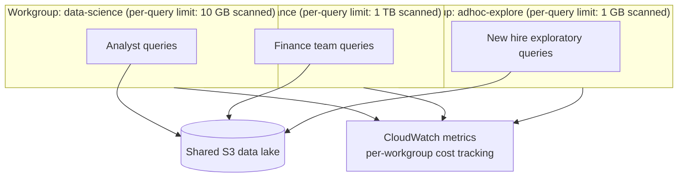
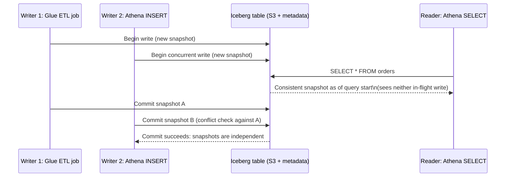

# Amazon Athena

> **Appears in:** [MLA-C02](../../certifications/mla-c02/README.md) · [SAA-C03](../../certifications/saa-c03/README.md)


*Analytics · maps to SAA-C03 Domain 3 Task 3.5, MLA-C02 Domain 1 (Data Preparation for ML and AI)*

## Definition

Amazon Athena is a **serverless, interactive query service** that lets you run standard SQL
directly against data sitting in S3 — no database to load the data into first, no servers to
provision, and no cluster to manage. You point it at files (CSV, JSON, Parquet, ORC, Avro) and
query them as if they were already database tables.

## Purpose

Before Athena, querying data sitting in S3 meant first loading it into a database or data
warehouse — a whole ETL step just to ask a question. AWS built Athena so analysts and engineers
could query data **in place**, the moment it lands in S3, paying only for the query they run
rather than for a database sitting there 24/7 waiting to be queried. It's the answer to "I just
need to run this one SQL query against these log files" without standing up any infrastructure.

## How It Works

Plain explanation: imagine a librarian who, instead of making you check books out of the
library first, lets you walk in, point at any shelf, and ask a question about what's on it —
she reads only the relevant books, answers your question, and charges you for exactly the pages
she had to read. Athena doesn't store or move your data; it reads straight from S3 using the
schema that Glue already has on file, runs the query (powered by the open-source Presto/Trino
engine under the hood), and returns results.



Step by step:

1. Before querying, a **table definition** must exist in the **Glue Data Catalog** describing
   the schema (columns, types) and location (S3 path) of the data — created either by a Glue
   Crawler automatically, or defined manually with a `CREATE TABLE` statement in Athena itself.
2. You write a standard **SQL query** (`SELECT ... FROM ... WHERE ...`) through the Athena
   console, CLI, JDBC/ODBC driver, or API.
3. Athena's underlying **Presto/Trino-based engine** reads only the S3 objects/partitions
   actually needed to answer the query — it does not load the whole dataset into a database
   first; it scans files directly where they sit.
4. Query **results** are written to a designated S3 bucket (the query results location you
   configure), and also returned to whatever client issued the query.
5. **QuickSight** or any JDBC/ODBC-compatible BI tool can connect to Athena as a data source,
   letting dashboards run live SQL against S3 data with no separate database layer at all.

### Query execution stages

A single query isn't one atomic black box — understanding the stages is what makes "Query
stats" and "Execution details" in the console (and the CloudWatch metrics behind them)
actionable rather than decorative.



Partition pruning happens at the **planning** stage, before any S3 scan occurs — this is why a
well-partitioned table can make an otherwise-expensive query nearly free: the planner simply
never requests the irrelevant files from S3 in the first place.

### Athena Federated Query across heterogeneous sources



Each non-S3 data source connector runs as a **Lambda function** implementing Athena's Query
Federation SDK; the query planner pushes filter predicates down to each connector where
possible, so a federated query doesn't necessarily mean "pull everything from every source and
join locally" — connectors can filter at the source first, the same spirit as partition
pruning against S3.

### Workgroup-based cost isolation



Workgroups give cost governance without separate AWS accounts: each workgroup can enforce its
own per-query data-scanned limit, publish its own CloudWatch metrics, and even force all
queries in that workgroup to use a specific query-results S3 location — the standard pattern
for "prevent one team's runaway query from blowing the shared Athena budget."

### Apache Iceberg ACID writes on Athena



Without Iceberg, two concurrent writers against plain S3-backed Hive tables risk a reader
seeing a half-written, inconsistent set of files mid-write. Iceberg's snapshot-based metadata
layer means every read sees one complete, consistent snapshot, and every write either commits
cleanly as a new snapshot or fails outright — this is the specific mechanism behind "lake house
= ACID transactions on S3," referenced in `data-lake-concepts.md`.

## Key Features / Components

- **Serverless** — nothing to provision, patch, or scale; you submit a query and pay per data
  scanned.
- **Standard SQL (ANSI-compatible)**, powered by Trino/Presto under the hood — supports joins,
  window functions, complex aggregations.
- **Reads multiple formats** — CSV, JSON, Parquet, ORC, Avro — and multiple compression codecs.
- **Partition support** — querying only the relevant S3 "folders" (e.g.,
  `s3://bucket/year=2026/month=11/`) dramatically cuts data scanned and cost.
- **Federated Query** — connectors let Athena query non-S3 sources too (RDS, DynamoDB,
  CloudWatch Logs, and more) through the same SQL interface.
- **Workgroups** — isolate teams/use-cases, apply per-workgroup query result limits and cost
  controls.
- **Athena for Apache Spark** — an alternative mode that runs Spark notebooks serverlessly
  through Athena for more complex, programmatic analysis beyond SQL.
- **Apache Iceberg table support** — Athena can read AND write Iceberg tables with ACID
  transaction guarantees (inserts, updates, deletes, time travel), closing much of the gap with
  a traditional warehouse while data still physically lives in S3.
- **Query result reuse** — Athena can serve a recent, unchanged query's results from a cache
  instead of re-scanning S3, cutting both cost and latency for repeated dashboard queries.
- **CTAS (CREATE TABLE AS SELECT)** — lets a query itself produce a new, optimized (partitioned,
  Parquet-converted) table from a less-optimized source table, a common "fix my slow/expensive
  Athena table" pattern.

## Partitioning and performance tuning

- **Partition by the columns you actually filter on** — a table partitioned by `year/month/day`
  only helps if queries filter on those exact columns; partitioning by a column nobody filters
  by wastes the partition-pruning benefit entirely.
- **Convert CSV/JSON to Parquet/ORC** — columnar formats let Athena read only the columns a
  query actually selects, not every column in every row, which on a wide table with a narrow
  `SELECT` can cut bytes scanned by an order of magnitude on its own, independent of
  partitioning.
- **Avoid excessive partition granularity** — partitioning down to the minute on a table that's
  usually queried by day creates thousands of tiny partitions/files, which adds per-partition
  metadata overhead that can outweigh the pruning benefit; partition grain should match query
  grain.
- **CTAS to fix an unoptimized table** — `CREATE TABLE sales_optimized WITH (format='PARQUET',
  partitioned_by=ARRAY['dt']) AS SELECT * FROM sales_raw` is the standard one-shot fix for "this
  CSV-based table is slow and expensive to query," converting both format and partition layout
  in a single statement.
- **Worked example — bytes scanned, before and after**: a 500 GB table of unpartitioned,
  uncompressed CSV logs, queried with a filter on a single day, scans the **full 500 GB** every
  time (CSV + no partitions = no pruning, no columnar skip). Converting to Parquet partitioned
  by day, where a day's worth of data is roughly 500 GB ÷ 365 ≈ 1.4 GB, and the query only
  needs 3 of the table's 20 columns (roughly 15% of each row's bytes in columnar storage),
  brings bytes scanned down to roughly **1.4 GB × 0.15 ≈ 210 MB** — a reduction of well over
  1,000x in bytes billed for that query, which is the exact mechanism behind "convert to Parquet
  and partition" being the default answer to nearly every Athena cost question on the exam.
- **Worked example — dollar cost of the "before" query**: at the standard per-TB-scanned rate
  (~$5/TB), scanning 500 GB (0.5 TB) costs **$2.50 per query**; run 50 times a day by different
  analysts, that's **$125/day ≈ $3,750/month** for a query pattern the Parquet-partitioned
  version would cost closer to **$0.001 per query**, effectively eliminating the line item.

## Common Architectures

**1. Log analytics / incident investigation** — CloudTrail, VPC Flow Logs, or ALB access logs
land in S3 → a Glue Crawler (or manually-defined table with partition projection) catalogs
them → security/ops teams run ad-hoc Athena SQL during an investigation, paying only for the
specific queries run during that incident, not for a standing log database.

**2. Data lake SQL layer feeding BI** — curated Parquet zone (from Glue/EMR) → Athena as the
query engine → QuickSight dashboards built directly on Athena-backed datasets, with SPICE
caching the heaviest/most-repeated queries so end users rarely hit Athena directly.

**3. Cost and usage analysis** — AWS Cost and Usage Reports (CUR) delivered to S3 → Athena
queries them directly with partition projection on the report's date-based layout — one of
AWS's own most common internal/customer-facing Athena use cases.

**4. Federated query across a lake and an operational database** — a single Athena query joins
curated S3 data with a live RDS table (via the RDS connector) to answer "which lake records
don't yet exist in the operational system," without an ETL step to copy RDS data into S3 first.

**5. Lake house table format for safe concurrent writes** — multiple Glue ETL jobs and Athena
CTAS/INSERT statements write to the same logical table backed by Apache Iceberg, getting ACID
isolation (no query ever sees a half-written file) even though several writers operate
concurrently against the same S3 location.

## Use Cases — When to Use It

- **Ad-hoc analysis of log files or exported data** sitting in S3 — security teams querying
  VPC Flow Logs or CloudTrail logs directly, for example.
- **One-off or infrequent queries** where standing up a full data warehouse would be overkill —
  pay only for the query you run, nothing when you're not querying.
- **Querying a data lake** built on S3 as the final, user-facing SQL layer, especially paired
  with partitioned Parquet data produced by Glue or EMR.
- **BI dashboards** (via QuickSight) that need to query S3-resident data without first loading
  it into a traditional database.
- **Joining S3 data against a live operational source** without a separate ETL/copy step —
  Federated Query.

## When NOT to Use It / Alternatives

- For **frequent, complex analytical queries at large scale with many concurrent users**, a
  true data warehouse — **Amazon Redshift** — will usually be more cost-predictable and faster,
  since it keeps data pre-loaded and optimized rather than scanning S3 files per query.
  Redshift Spectrum even lets you combine the two: warehouse data plus direct S3 scans.
- Athena is **not a transactional/OLTP database** — it can't handle single-row inserts/updates
  at low latency; it's built for analytical scans, not application backend queries.
- If query cost from scanning large unpartitioned/uncompressed files becomes expensive, that's
  a signal to **convert to Parquet and partition the data** (often via Glue or a CTAS
  statement) rather than continuing to pay to scan inefficient CSV.
- For very high query concurrency with strict, predictable latency SLAs, a provisioned
  warehouse (Redshift) or indexed search engine (OpenSearch) may serve better than a
  pay-per-scan, best-effort-latency query service.

## Why It's Important

**Real-world:** Athena is often the cheapest and fastest way to get a first answer out of a
data lake — teams use it constantly for incident investigation (scanning logs), cost analysis
(querying Cost and Usage Reports in S3), and as the query layer behind lightweight dashboards,
all without ever provisioning a database.

**Exam:** Athena is directly relevant to **SAA-C03 Task 3.5 — "Determine high-performing data
ingestion and transformation solutions"**, specifically as the query/analysis endpoint of a
data lake pipeline (data lands in S3 as Parquet via Glue/Firehose, then Athena queries it) — and
is a recurring correct answer whenever a scenario says "serverless, ad-hoc SQL over S3 data,
no infrastructure to manage." In **MLA-C02 Domain 1**, Athena often appears as the tool used to
explore/profile a dataset (understand distributions, check for bad records) before deciding how
to transform it for ML — exam scenarios may test recognizing Athena as the right lightweight,
serverless exploration tool versus spinning up EMR/SageMaker just to look at the data.

### Exam scenario deep-dive: the cost-reduction question family

A very frequent SAA-C03 question shape presents an expensive/slow Athena workload and offers
several "fixes." Pattern-match the correct one:

| Distractor offered | Correct? | Why |
|---|---|---|
| "Convert source data to Parquet and partition by the filtered column" | **Correct** | Reduces bytes scanned directly — the only lever that changes Athena's actual billing basis |
| "Increase Athena's compute capacity / add more nodes" | Wrong | Athena is serverless; there is no compute to provision or scale |
| "Add a cache layer in front of Athena" | Usually wrong unless literally repeated identical queries | Query result reuse already does this for exact repeats; doesn't help varied ad-hoc queries |
| "Move to Redshift instead" | Depends | Right answer only if the real problem is *frequent, concurrent, complex* queries at scale — not a cost question about an occasional query |
| "Use a smaller query result limit" | Wrong | Limits returned rows, not bytes scanned during execution — doesn't reduce cost |

### MLA-C02 scenario — Athena as the data-profiling step

A Domain 1 question describing "before training a model, we need to understand the
distribution of a column, check for nulls/outliers, and see row counts by category" is
describing exactly the kind of lightweight exploratory SQL Athena is built for — the
exam-correct answer is typically Athena (fast, serverless, no new infrastructure) rather than
spinning up an EMR cluster or a SageMaker Processing job just to run `SELECT COUNT(*) ... GROUP
BY` style exploratory queries.

## Pricing Model (summary)

- Billed **per TB of data scanned** by each query (a flat rate per TB, prorated) — there is no
  charge for data that isn't scanned, which is why partitioning and columnar formats
  (Parquet/ORC) directly cut cost.
- No charge for idle time — nothing running means nothing billed, true serverless pricing.
- Query result storage in S3 is billed under normal **S3 storage pricing**.
- **Query result reuse** avoids re-billing an identical repeated query within the configured
  reuse window, at no extra charge for the feature itself.
- **Worked example**: see the "bytes scanned, before and after" and "dollar cost" examples
  under Partitioning and performance tuning above — they are this section's core worked
  calculation and are repeated here by reference rather than duplicated.
- **Worked example — Athena for Apache Spark cost shape**: unlike SQL queries (billed per TB
  scanned), Athena's Spark mode bills per **DPU-hour** while a Spark session is active, closer
  in spirit to Glue ETL billing than to Athena SQL billing — a detail worth knowing since it's
  a different cost model within the same named service.
- See official pricing: https://aws.amazon.com/athena/pricing/

## Limits & Quotas

- **Query timeout**: a maximum query execution time (configurable per workgroup, with an
  account-level ceiling) — a query that would otherwise run indefinitely on bad input is cut
  off rather than running (and scanning, and billing) forever.
- **DDL/DML statement limits**: Athena limits the number of partitions a single `ALTER TABLE
  ADD PARTITION` or similar DDL statement can add at once; very large bulk partition
  registrations may need batching.
- **Concurrent queries per workgroup/account**: a soft, raisable limit on queries running
  simultaneously — relevant for high-concurrency dashboard workloads hitting Athena directly
  rather than through SPICE-cached QuickSight datasets.
- **Federated Query connector limits**: each Lambda-based connector inherits standard Lambda
  limits (timeout, memory, concurrency) — a federated query against a connector under heavy
  concurrent load can be throttled by the connector's own Lambda concurrency limit, not by
  Athena itself.
- **Result set size**: very large result sets are better handled by `UNLOAD` (writing results
  directly to S3 in Parquet) than by retrieving the full result set through the standard query
  results API, which is optimized for human-scale result sets, not bulk export.

## Troubleshooting / Common Issues

- **Query is slow/expensive despite "small" source data** — check the actual file format and
  partition layout, not just logical row count; a tiny number of rows spread across millions of
  tiny uncompressed JSON files scans far more bytes (and takes far longer due to per-file
  overhead) than the same data as a handful of partitioned Parquet files.
- **`HIVE_PARTITION_SCHEMA_MISMATCH` or missing columns** — a newer file introduced a column
  type conflicting with the Glue Data Catalog's existing schema for that table/partition; the
  fix is in the catalog/crawler (see `glue.md`), not in the Athena query itself.
- **`GENERIC_INTERNAL_ERROR` or query hangs then times out** — often a malformed/corrupt file in
  the scanned partition range (a truncated upload, a non-UTF8 CSV) — isolate the specific
  partition/file via a narrower query before assuming Athena itself is broken.
- **Federated query against RDS/DynamoDB is slow** — check the connector Lambda's configured
  memory/timeout and concurrency; a federated query is only as fast as its slowest connector,
  and connector cold starts can dominate latency for infrequently-used connections.
- **New partitions not appearing in query results** — same root cause and fix as described in
  `glue.md`: the catalog hasn't been updated (crawler hasn't run, `ADD PARTITION` wasn't called,
  or partition projection is misconfigured against the actual S3 key pattern).
- **CTAS statement fails partway through** — Athena's CTAS is not fully transactional against
  non-Iceberg tables; a partial failure can leave some output files written — prefer Iceberg
  table format for workloads needing guaranteed all-or-nothing writes.

## Hands-on Lab (Floci)

Floci (`awslocal`) supports Athena's query submission API against its local S3/Glue Catalog
emulation reasonably well for basic flows — enough to practice the CLI pattern of submitting a
query and polling for results, though very large-scale query performance characteristics
obviously can't be reproduced locally. Full walkthrough: `labs-floci/athena.md`.

```bash
# Assumes an S3 bucket with sample CSV data and a Glue table already registered (see glue.md)
awslocal s3 cp sample_sales.csv s3://sales-landing/raw/sample_sales.csv

# Set up an Athena query result location
awslocal s3 mb s3://athena-query-results

# Start a query execution
QUERY_ID=$(awslocal athena start-query-execution \
  --query-string "SELECT order_id, amount FROM salesdb.raw_sales WHERE amount > 100" \
  --result-configuration OutputLocation=s3://athena-query-results/ \
  --query 'QueryExecutionId' --output text)

# Check query status
awslocal athena get-query-execution --query-execution-id "$QUERY_ID"

# Fetch the results once it succeeds
awslocal athena get-query-results --query-execution-id "$QUERY_ID"

# Demonstrate the CTAS optimization pattern (metadata-level against Floci)
awslocal athena start-query-execution \
  --query-string "CREATE TABLE salesdb.raw_sales_optimized WITH (format='PARQUET', partitioned_by=ARRAY['order_date']) AS SELECT * FROM salesdb.raw_sales" \
  --result-configuration OutputLocation=s3://athena-query-results/
```

## Exam Tips

- **Athena vs. Redshift** — the classic confusion for this service. Athena = serverless,
  pay-per-query, best for ad-hoc/infrequent analysis directly on S3 data, no data loading step.
  Redshift = provisioned (or serverless) data warehouse, best for frequent/complex queries at
  scale, with data pre-loaded and optimized, predictable cost via reserved capacity. If the
  question says "infrequent," "serverless," "query data in S3 without moving it" → Athena. If
  it says "data warehouse," "frequent BI queries," "many concurrent users," "columnar storage
  with sort/dist keys" → Redshift.
- **Partitioning and Parquet directly cut Athena cost** — expect a question framed as "reduce
  the cost of Athena queries" where the answer is "convert to Parquet and partition by date/
  key," not "add more compute" (there's no compute to add — it's serverless).
- Athena reads the **Glue Data Catalog** — if a question describes a schema mismatch or
  missing table error, the root cause is usually the catalog/crawler, not Athena itself.
- Remember Athena **cannot modify** S3 data in place (no UPDATE/DELETE on files directly in the
  general case) — it's a read/query layer, not a database engine, though Athena does support
  ACID-like operations on tables using the Apache Iceberg table format as a newer capability.
- **CTAS** is the go-to exam answer for "I have a slow/expensive unoptimized table and need a
  fast fix" — it converts format and partitioning in one statement rather than requiring a
  separate Glue job.
- **Federated Query** is the answer whenever a scenario needs to join S3 data against a live
  operational source (RDS, DynamoDB) without an ETL/copy step first.
- A question emphasizing "query logs during a security incident, pay only for queries run, no
  standing infrastructure" is close to a textbook Athena definition — don't overthink it into
  OpenSearch unless the scenario specifically needs near-real-time search/relevance ranking.

## Further Reading

- Amazon Athena User Guide — what it is:
  https://docs.aws.amazon.com/athena/latest/ug/what-is.html
- Using Athena Federated Query:
  https://docs.aws.amazon.com/athena/latest/ug/federated-queries.html
- Partition projection (automatic partition discovery without a crawler):
  https://docs.aws.amazon.com/athena/latest/ug/partition-projection.html
- Viewing query statistics and execution details:
  https://docs.aws.amazon.com/athena/latest/ug/query-stats.html
- Using CTAS to improve query performance:
  https://docs.aws.amazon.com/athena/latest/ug/ctas.html
- Athena and Apache Iceberg tables:
  https://docs.aws.amazon.com/athena/latest/ug/querying-iceberg.html
- Athena pricing: https://aws.amazon.com/athena/pricing/

### Reference screenshot from official AWS sources


*Athena's own "Query stats" execution-details view, showing the queuing/planning/execution
stage breakdown described above for a completed query. Source: AWS Athena User Guide,
[View statistics and execution details for completed queries](https://docs.aws.amazon.com/athena/latest/ug/query-stats.html).*

## Related Terms

[`glossary/README.md`](../../glossary/README.md) · [`glue.md`](glue.md) ·
[`emr.md`](emr.md) · [`data-lake-concepts.md`](data-lake-concepts.md) ·
[`quicksight.md`](quicksight.md) · `services/database/redshift.md`
