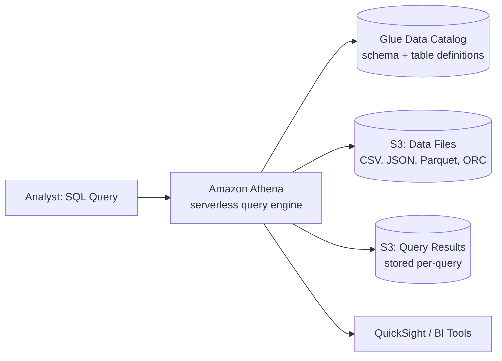

# Amazon Athena


*Analytics · maps to SAA-C03 Domain 3 Task 3.5, MLA-C02 Domain 1 (Data Preparation for ML and AI)*

## Definition

Amazon Athena is a **serverless, interactive query service** that lets you run standard SQL
directly against data sitting in S3 — no database to load the data into first, no servers to
provision, and no cluster to manage. You point it at files (CSV, JSON, Parquet, ORC, Avro) and
query them as if they were already database tables.

## Purpose

Before Athena, querying data sitting in S3 meant first loading it into a database or data
warehouse — a whole ETL step just to ask a question. AWS built Athena so analysts and engineers
could query data **in place**, the moment it lands in S3, paying only for the query they run
rather than for a database sitting there 24/7 waiting to be queried. It's the answer to "I just
need to run this one SQL query against these log files" without standing up any infrastructure.

## How It Works

Plain explanation: imagine a librarian who, instead of making you check books out of the
library first, lets you walk in, point at any shelf, and ask a question about what's on it —
she reads only the relevant books, answers your question, and charges you for exactly the pages
she had to read. Athena doesn't store or move your data; it reads straight from S3 using the
schema that Glue already has on file, runs the query (powered by the open-source Presto/Trino
engine under the hood), and returns results.



Step by step:

1. Before querying, a **table definition** must exist in the **Glue Data Catalog** describing
   the schema (columns, types) and location (S3 path) of the data — created either by a Glue
   Crawler automatically, or defined manually with a `CREATE TABLE` statement in Athena itself.
2. You write a standard **SQL query** (`SELECT ... FROM ... WHERE ...`) through the Athena
   console, CLI, JDBC/ODBC driver, or API.
3. Athena's underlying **Presto/Trino-based engine** reads only the S3 objects/partitions
   actually needed to answer the query — it does not load the whole dataset into a database
   first; it scans files directly where they sit.
4. Query **results** are written to a designated S3 bucket (the query results location you
   configure), and also returned to whatever client issued the query.
5. **QuickSight** or any JDBC/ODBC-compatible BI tool can connect to Athena as a data source,
   letting dashboards run live SQL against S3 data with no separate database layer at all.

## Key Features / Components

- **Serverless** — nothing to provision, patch, or scale; you submit a query and pay per data
  scanned.
- **Standard SQL (ANSI-compatible)**, powered by Trino/Presto under the hood — supports joins,
  window functions, complex aggregations.
- **Reads multiple formats** — CSV, JSON, Parquet, ORC, Avro — and multiple compression codecs.
- **Partition support** — querying only the relevant S3 "folders" (e.g.,
  `s3://bucket/year=2026/month=11/`) dramatically cuts data scanned and cost.
- **Federated Query** — connectors let Athena query non-S3 sources too (RDS, DynamoDB,
  CloudWatch Logs, and more) through the same SQL interface.
- **Workgroups** — isolate teams/use-cases, apply per-workgroup query result limits and cost
  controls.
- **Athena for Apache Spark** — an alternative mode that runs Spark notebooks serverlessly
  through Athena for more complex, programmatic analysis beyond SQL.

## Use Cases — When to Use It

- **Ad-hoc analysis of log files or exported data** sitting in S3 — security teams querying
  VPC Flow Logs or CloudTrail logs directly, for example.
- **One-off or infrequent queries** where standing up a full data warehouse would be overkill —
  pay only for the query you run, nothing when you're not querying.
- **Querying a data lake** built on S3 as the final, user-facing SQL layer, especially paired
  with partitioned Parquet data produced by Glue or EMR.
- **BI dashboards** (via QuickSight) that need to query S3-resident data without first loading
  it into a traditional database.

## When NOT to Use It / Alternatives

- For **frequent, complex analytical queries at large scale with many concurrent users**, a
  true data warehouse — **Amazon Redshift** — will usually be more cost-predictable and faster,
  since it keeps data pre-loaded and optimized rather than scanning S3 files per query.
  Redshift Spectrum even lets you combine the two: warehouse data plus direct S3 scans.
- Athena is **not a transactional/OLTP database** — it can't handle single-row inserts/updates
  at low latency; it's built for analytical scans, not application backend queries.
- If query cost from scanning large unpartitioned/uncompressed files becomes expensive, that's
  a signal to **convert to Parquet and partition the data** (often via Glue) rather than
  continuing to pay to scan inefficient CSV.
- For very high query concurrency with strict, predictable latency SLAs, a provisioned
  warehouse (Redshift) or indexed search engine (OpenSearch) may serve better than a
  pay-per-scan, best-effort-latency query service.

## Why It's Important

**Real-world:** Athena is often the cheapest and fastest way to get a first answer out of a
data lake — teams use it constantly for incident investigation (scanning logs), cost analysis
(querying Cost and Usage Reports in S3), and as the query layer behind lightweight dashboards,
all without ever provisioning a database.

**Exam:** Athena is directly relevant to **SAA-C03 Task 3.5 — "Determine high-performing data
ingestion and transformation solutions"**, specifically as the query/analysis endpoint of a
data lake pipeline (data lands in S3 as Parquet via Glue/Firehose, then Athena queries it) — and
is a recurring correct answer whenever a scenario says "serverless, ad-hoc SQL over S3 data,
no infrastructure to manage." In **MLA-C02 Domain 1**, Athena often appears as the tool used to
explore/profile a dataset (understand distributions, check for bad records) before deciding how
to transform it for ML — exam scenarios may test recognizing Athena as the right lightweight,
serverless exploration tool versus spinning up EMR/SageMaker just to look at the data.

## Pricing Model (summary)

- Billed **per TB of data scanned** by each query (a flat rate per TB, prorated) — there is no
  charge for data that isn't scanned, which is why partitioning and columnar formats
  (Parquet/ORC) directly cut cost.
- No charge for idle time — nothing running means nothing billed, true serverless pricing.
- Query result storage in S3 is billed under normal **S3 storage pricing**.
- See official pricing: https://aws.amazon.com/athena/pricing/

## Hands-on Lab (Floci)

Floci (`awslocal`) supports Athena's query submission API against its local S3/Glue Catalog
emulation reasonably well for basic flows — enough to practice the CLI pattern of submitting a
query and polling for results, though very large-scale query performance characteristics
obviously can't be reproduced locally. Full walkthrough: `labs-floci/athena.md`.

```bash
# Assumes an S3 bucket with sample CSV data and a Glue table already registered (see glue.md)
awslocal s3 cp sample_sales.csv s3://sales-landing/raw/sample_sales.csv

# Set up an Athena query result location
awslocal s3 mb s3://athena-query-results

# Start a query execution
QUERY_ID=$(awslocal athena start-query-execution \
  --query-string "SELECT order_id, amount FROM salesdb.raw_sales WHERE amount > 100" \
  --result-configuration OutputLocation=s3://athena-query-results/ \
  --query 'QueryExecutionId' --output text)

# Check query status
awslocal athena get-query-execution --query-execution-id "$QUERY_ID"

# Fetch the results once it succeeds
awslocal athena get-query-results --query-execution-id "$QUERY_ID"
```

## Exam Tips

- **Athena vs. Redshift** — the classic confusion for this service. Athena = serverless,
  pay-per-query, best for ad-hoc/infrequent analysis directly on S3 data, no data loading step.
  Redshift = provisioned (or serverless) data warehouse, best for frequent/complex queries at
  scale, with data pre-loaded and optimized, predictable cost via reserved capacity. If the
  question says "infrequent," "serverless," "query data in S3 without moving it" → Athena. If
  it says "data warehouse," "frequent BI queries," "many concurrent users," "columnar storage
  with sort/dist keys" → Redshift.
- **Partitioning and Parquet directly cut Athena cost** — expect a question framed as "reduce
  the cost of Athena queries" where the answer is "convert to Parquet and partition by date/
  key," not "add more compute" (there's no compute to add — it's serverless).
- Athena reads the **Glue Data Catalog** — if a question describes a schema mismatch or
  missing table error, the root cause is usually the catalog/crawler, not Athena itself.
- Remember Athena **cannot modify** S3 data in place (no UPDATE/DELETE on files directly in the
  general case) — it's a read/query layer, not a database engine, though Athena does support
  ACID-like operations on tables using the Apache Iceberg table format as a newer capability.

## Related Terms

[`glossary/README.md`](../../glossary/README.md) · [`glue.md`](glue.md) ·
[`emr.md`](emr.md) · [`data-lake-concepts.md`](data-lake-concepts.md) ·
[`quicksight.md`](quicksight.md) · `services/database/redshift.md`
