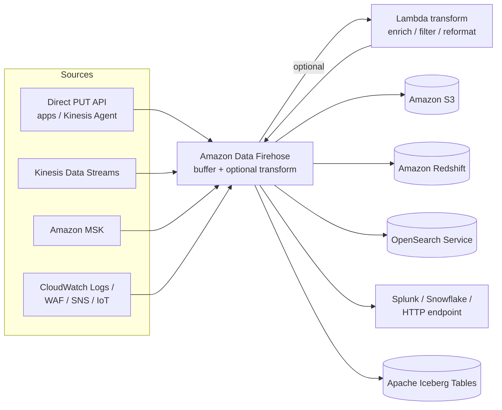
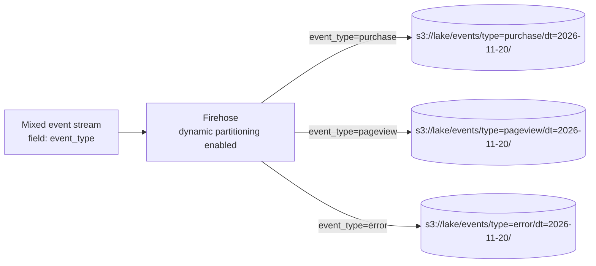

# Amazon Data Firehose

> **Appears in:** [SAA-C03](../../certifications/saa-c03/README.md) · [DVA-C03](../../certifications/dva-c03/README.md) · [MLA-C02](../../certifications/mla-c02/README.md)


<!-- AWS Architecture Icons, Analytics category; see diagrams/README.md for the convention -->

> **This is a dedicated deep dive on Firehose specifically.** The broader streaming family —
> how Firehose relates to Kinesis Data Streams and Managed Service for Apache Flink, shared
> pipeline patterns, and side-by-side exam-scenario tables — lives in
> [`kinesis-family.md`](kinesis-family.md). Read that file for the family-wide picture; read this
> one when a question (or a real design) is specifically about Firehose's own behavior, newer
> destinations, and the Firehose-vs-Data-Streams trap in detail.

## Definition

Amazon Data Firehose (formerly "Kinesis Data Firehose," renamed in 2024 and no longer branded
under the Kinesis name) is a fully managed service that takes streaming data as it arrives and
automatically delivers it — buffered, optionally transformed, and batched — to a destination like
S3, Redshift, OpenSearch, Splunk, Snowflake, or an Apache Iceberg table, **without you writing or
running any code or managing any infrastructure**. You configure a source, a destination, and
optional transformations; Firehose does the rest.

## Purpose

Getting streaming data to *land somewhere durable and queryable* is an extremely common need that
doesn't actually require custom processing logic most of the time — "take these IoT events and
put them in S3 as Parquet, partitioned by hour" is a *delivery* problem, not a *compute* problem.
Before Firehose, satisfying that need meant either running your own fleet of consumer
applications reading off a stream and writing batches to S3 by hand (buffering logic, retry
logic, format conversion, partitioning — all built and operated by you), or accepting a batch-only
pipeline with higher latency. Firehose exists to make "just deliver it, reliably, close to real
time, with zero ops" a configuration choice instead of an engineering project — the delivery
counterpart to Kinesis Data Streams' "you write the processing code" model.

## How It Works

Plain explanation: think of Firehose as a conveyor belt loading dock that's always running —
records arrive continuously, Firehose holds them in a short buffer (by size or by time, whichever
threshold is hit first), and the moment that buffer flushes, it writes a neatly-batched file to
wherever you told it to deliver. No one is driving the forklift; you just point it at a
destination once and it keeps running.



Step by step:
1. **A source feeds Firehose.** Four source shapes: (a) the **Direct PUT API** — your
   application calls `PutRecord`/`PutRecordBatch` straight into Firehose, no Kinesis Data Stream
   involved at all; (b) an existing **Kinesis Data Stream** as the source, where Firehose simply
   reads off it (a common pattern when the same stream also feeds a custom Data Streams consumer
   for a different purpose); (c) **Amazon MSK** (Managed Streaming for Kafka) as a source, reading
   directly from a Kafka topic; (d) **20+ native AWS service integrations** — CloudWatch Logs
   subscription filters, AWS WAF web ACL logs, SNS, AWS IoT rules, and others can write straight
   into a Firehose stream with no custom glue code.
2. **Buffering.** Firehose holds incoming records in memory until either a configured **buffer
   size** (megabytes) or **buffer interval** (seconds) threshold is reached — whichever comes
   first — then flushes the buffer as one batch to the destination. This is the dial that trades
   off latency (smaller buffer = faster delivery, more/smaller files) against cost and file-count
   efficiency (larger buffer = slower delivery, fewer/larger files, cheaper per-file overhead at
   the destination).
3. **Optional transformation.** Before delivery, Firehose can invoke a **Lambda function** you
   provide to transform each record (enrich it, filter it out entirely, reshape its fields), and
   separately (not via Lambda) can **convert format** — JSON to Apache Parquet or ORC — using a
   schema registered in the **Glue Data Catalog**, and apply **dynamic partitioning** to route
   records to different destination prefixes based on a field in the data itself.
4. **Delivery.** The batch is written to the configured destination. For S3 this is a direct
   write; for Redshift, Firehose actually lands the batch in S3 first, then issues a `COPY`
   command to load it into the cluster; for OpenSearch and Splunk, Firehose delivers directly to
   the service's own ingest API, with an optional simultaneous S3 backup of the same records.
5. **Retry and error handling.** If delivery to the destination fails (the destination is down,
   a transformation Lambda errors, a record doesn't match the expected schema), Firehose retries
   according to a configurable retry duration, and ultimately routes persistently-failing records
   to an **error output S3 prefix** rather than silently dropping them — this error prefix is
   where you look first when data seems to be "missing" at the destination.

### Destination-specific delivery paths

The exact mechanics differ meaningfully by destination, and knowing the shape of each is directly
useful for both real debugging and exam scenario questions:


*Figure: the S3 delivery path — the simplest of the four. Records buffer, optionally pass through
a transformation Lambda, and write directly to the target bucket; if transformation is enabled,
Firehose can simultaneously back up the untransformed source records to a second bucket, so a
bug in the transformation logic never destroys your ability to recover the original data.
Source: AWS Developer Guide, ["What is Amazon Data
Firehose?"](https://docs.aws.amazon.com/firehose/latest/dev/what-is-this-service.html).*


*Figure: the Redshift delivery path — note that S3 is always an intermediate stop here, not an
optional one; Firehose writes the batch to S3, then issues a Redshift `COPY` command (the same
bulk-load mechanism you'd use by hand) to pull it into the cluster. This matters operationally:
Redshift cluster unavailability shows up as a stalled `COPY` step with data already safely
sitting in the intermediate S3 bucket, not as lost data. Source: AWS Developer Guide, ["What is
Amazon Data Firehose?"](https://docs.aws.amazon.com/firehose/latest/dev/what-is-this-service.html).*


*Figure: the OpenSearch Service delivery path — data is pushed directly to the cluster's ingest
endpoint (not staged in S3 first, unlike Redshift), with an optional concurrent S3 backup running
in parallel for cheap long-term retention of the exact same records that are also searchable in
OpenSearch. Source: AWS Developer Guide, ["What is Amazon Data
Firehose?"](https://docs.aws.amazon.com/firehose/latest/dev/what-is-this-service.html).*

The practical takeaway across all three diagrams: **S3 is either the destination itself, a
mandatory intermediate stop (Redshift), or an optional parallel backup (OpenSearch/Splunk)** —
Firehose's relationship with S3 is central to nearly every delivery path it supports, which is
why "does the data also land in S3" is one of the first debugging questions to ask regardless of
which final destination a Firehose stream targets.

### Dynamic partitioning, worked in detail

A single Firehose delivery stream can split its own output across multiple destination prefixes
at delivery time, based on a field inside each record — no separate stream per partition value
needed:



Dynamic partitioning uses a JQ-style expression against each record's JSON to extract the
partitioning key (here, `event_type`) and routes it to the matching S3 prefix, buffering each
partition's records independently. Downstream, a Glue Crawler run against the top-level prefix
discovers all partitions as one logical table with `type` and `dt` as partition columns, and an
Athena query filtering `WHERE type = 'error'` scans only the matching files — the entire reason
to partition data this way in the first place.

### Firehose vs. Kinesis Data Streams — the classic exam trap, made explicit

This is the single most important distinction in this document, and it's worth stating plainly
and repeatedly because it's one of the most reliably tested confusions across SAA-C03, DVA-C03,
and MLA-C02:

| Question | Kinesis Data Streams | Amazon Data Firehose |
|---|---|---|
| Who writes the processing/consumer code? | **You do** (KCL, Lambda consumer, custom app) | **Nobody** — it's a managed delivery pipe, no consumer code at all |
| Can you replay/reprocess historical data? | **Yes**, within the configured retention window (24 hrs–365 days) | **No** — once a batch is delivered, it's delivered; there is no "go back and re-read" |
| What is the unit of scaling/capacity? | **Shards** (manual) or on-demand auto-scaling | Fully automatic — there is no shard concept to manage at all |
| Typical latency to the data actually being usable | Milliseconds, as fast as your consumer reads | Tens of seconds to a few minutes (bounded by the buffer interval) |
| Can multiple independent consumers read the same data differently? | **Yes** — any number of independent consumers, each at its own pace | **No** — one Firehose stream has exactly one delivery destination (though a Kinesis Data Stream feeding multiple things, one of which is a Firehose stream, achieves a similar effect upstream) |
| What triggers you to pick this one | "I need custom per-record logic," "multiple consumers," "need to replay history" | "Just get it to S3/Redshift/OpenSearch/Splunk, no code, don't want to run infrastructure" |

The trap in practice: a question describing a scenario that actually needs **custom processing
logic** or **replay** but surface-level mentions "streaming data to S3" will bait you toward
Firehose on the "streaming → S3" keyword match alone — read for whether the scenario needs code
or replay before answering; if either is present, the answer is Data Streams (optionally *with* a
Firehose stream attached downstream for the simple delivery half), not Firehose alone. Conversely,
a question emphasizing "no custom code," "fully managed," or "format conversion to Parquet with
zero infrastructure" is a Firehose signature almost every time.

### Minimal producer code shape (boto3)

```python
import boto3
import json

firehose = boto3.client("firehose", region_name="us-east-1")

# Direct PUT: no Kinesis Data Stream involved, straight into Firehose
firehose.put_record(
    DeliveryStreamName="clickstream-to-s3",
    Record={"Data": json.dumps({"event_type": "purchase", "sku": "SKU-991", "amount": 42.50}) + "\n"},
)

# Batch variant for higher throughput (up to 500 records per call)
firehose.put_record_batch(
    DeliveryStreamName="clickstream-to-s3",
    Records=[
        {"Data": json.dumps({"event_type": "pageview", "page": "/cart"}) + "\n"},
        {"Data": json.dumps({"event_type": "pageview", "page": "/checkout"}) + "\n"},
    ],
)
```

Note there is no `get_records`, no shard iterator, no consumer code at all on the reading side —
that absence, compared to the Kinesis Data Streams boto3 shape in `kinesis-family.md`, *is* the
service's defining characteristic in code form.

## Key Features / Components

- **Direct PUT** — write straight into a Firehose stream via `PutRecord`/`PutRecordBatch`, with
  no Kinesis Data Stream in between at all.
- **Source integrations** — Kinesis Data Streams, Amazon MSK, and 20+ native AWS service sources
  (CloudWatch Logs, WAF logs, SNS, IoT Core rules, and others) can feed a Firehose stream with no
  custom code.
- **Buffering hints** — buffer size (MB) and buffer interval (seconds); Firehose flushes on
  whichever threshold hits first. This is the primary latency-vs-file-size/cost tuning knob.
- **Record transformation (Lambda)** — invoke your own Lambda function per batch of records to
  enrich, filter, or reshape data before delivery; failed transformation invocations are retried
  and ultimately routed to an error output location if they keep failing.
- **Format conversion** — convert incoming JSON to Apache Parquet or ORC on the way to S3, using
  a schema sourced from the Glue Data Catalog — the standard way to make downstream Athena/Redshift
  Spectrum queries fast and cheap instead of scanning raw JSON.
- **Dynamic partitioning** — route records to different destination prefixes at delivery time
  based on a field in the record, without needing a separate stream per partition value.
- **Compression** — GZIP, Snappy, or Zip compression applied to the delivered files, independent
  of format conversion.
- **Destinations** — Amazon S3, Amazon Redshift, Amazon OpenSearch Service/Serverless, Splunk,
  Snowflake, Apache Iceberg Tables, Amazon S3 Tables, generic HTTP endpoints, and a growing list
  of third-party observability platforms (Datadog, Dynatrace, New Relic, MongoDB, Coralogix,
  Elastic, and others) reachable via the HTTP endpoint destination type.
- **Error output location** — a dedicated S3 prefix where records that persistently fail
  delivery or transformation land, instead of being silently dropped — the first place to check
  when data appears to be missing at the destination.
- **Source backup** — when transformation is enabled, Firehose can simultaneously back up the
  **untransformed** original records to a separate S3 location, protecting against a
  transformation bug destroying the only copy of the raw data.
- **Server-side encryption** — data in transit (TLS) and at rest (S3-side or Firehose's own
  SSE-KMS depending on configuration) can be encrypted end-to-end.
- **VPC delivery** — Firehose can deliver into a destination that lives inside a VPC (e.g., a
  self-managed OpenSearch or Elasticsearch cluster on EC2) without traversing the public internet.

## Use Cases — When to Use It

1. **Zero-code IoT telemetry landing in a data lake (industrial IoT).** A fleet of sensors
   streams telemetry that just needs to land in S3 as partitioned Parquet for later analysis —
   no per-record business logic required. Firehose with format conversion and dynamic
   partitioning does this with zero infrastructure to run. **Tradeoff vs. Kinesis Data Streams +
   a custom consumer**: a custom consumer would let you compute something per-record in flight,
   but that's explicitly not needed here, so it would only add unneeded operational overhead.
2. **Centralized log shipping to a SIEM (security operations).** CloudWatch Logs subscription
   filters feed directly into a Firehose stream that delivers to OpenSearch Service for search
   and Splunk/a third-party SIEM in parallel via the HTTP endpoint destination. **Tradeoff vs.
   a custom Lambda log-shipper**: Firehose's native CloudWatch Logs integration and built-in
   retry/buffering replace what would otherwise be a hand-rolled, state-tracking shipping script.
3. **Streaming ETL into a lake house table format (data platform team).** Continuous
   application events need to land in an Apache Iceberg table with ACID write guarantees so
   concurrent writers never produce a half-written read for a downstream query engine. Firehose's
   native Apache Iceberg Tables destination writes directly in that format. **Tradeoff vs. an
   hourly batch Glue job**: the batch job is simpler to reason about but adds up to an hour of
   latency before new data is queryable, unacceptable for a near-real-time dashboard requirement.
4. **Clickstream archiving alongside a live analytics path (e-commerce).** The same clickstream
   that feeds a live Kinesis Data Streams + Flink dashboard also needs a permanent, queryable
   archive — a second Firehose stream reading off the same Kinesis Data Stream delivers raw events
   to S3 independently of the live-scoring path. **Tradeoff vs. having the Flink app itself write
   the archive**: mixing the live-scoring code's responsibilities with archival writing means a
   bug in the scoring logic could corrupt the permanent record — keeping Firehose as an
   independent, simpler delivery path is deliberate risk isolation.
5. **WAF and VPC Flow Log analysis pipeline (security/compliance).** AWS WAF web ACL logs and
   VPC Flow Logs need to land somewhere queryable for a compliance audit trail, without a team
   writing and operating custom log-shipping code. Firehose's native WAF log integration handles
   this directly. **Tradeoff vs. S3 direct export + Athena**: direct S3 export is simpler for
   pure archival, but loses Firehose's in-flight format conversion/partitioning that makes the
   eventual Athena queries fast and cheap.
6. **Migrating legacy on-premises log forwarding to AWS (enterprise migration).** A company
   moving off a self-hosted Splunk forwarder fleet wants log delivery without operating any
   forwarding infrastructure themselves. Firehose's native Splunk destination (HEC-compatible)
   replaces the self-managed forwarder fleet directly. **Tradeoff vs. keeping the self-hosted
   forwarders**: the forwarders are fully customizable but represent exactly the kind of
   patch/scale/secure overhead managed delivery is meant to remove.
7. **Change-data-capture archival for compliance replay (financial services).** A regulated
   payments system's CDC stream (sourced from a Kinesis Data Stream fed by DMS) needs a permanent,
   immutable audit copy in S3, separate from any real-time consumer acting on the same changes.
   Firehose delivering the same stream to S3 satisfies the archival requirement without touching
   the real-time consumer's code at all. **Tradeoff vs. having the real-time consumer also write
   the archive**: as in use case 4, mixing concerns risks a bug in live processing corrupting the
   compliance record — a dedicated, independent Firehose stream avoids that entirely.
8. **Feeding a Snowflake data warehouse without a custom loader (analytics platform team).**
   An organization standardized on Snowflake wants streaming application events loaded
   continuously without building and maintaining a custom Snowpipe-triggering loader. Firehose's
   native Snowflake destination handles continuous loading directly. **Tradeoff vs. S3 + Snowpipe
   auto-ingest configured by hand**: the manual Snowpipe route works but requires building and
   maintaining the S3-to-Snowflake wiring yourself; Firehose's native destination collapses that
   into configuration.
9. **Real-time dashboard data feed via a generic HTTP endpoint (observability vendor
   integration).** A company using a third-party observability platform not natively listed as a
   destination can still target it via Firehose's generic HTTP endpoint destination type, as long
   as the vendor exposes a compatible ingest API. **Tradeoff vs. a custom Lambda forwarder**:
   Firehose's built-in retry/backoff and buffering logic replace what a hand-rolled forwarder
   would otherwise need to reimplement.
10. **ML training data lake ingestion (MLA-C02-relevant, ML platform team).** Raw event data
    destined to eventually train a model needs to land in S3 as Parquet, partitioned usefully for
    a later SageMaker Processing or Glue ETL job to consume efficiently — with no custom
    ingestion code needed at the capture stage. Firehose's format conversion and dynamic
    partitioning produce exactly that layout automatically. **Tradeoff vs. Kinesis Data Streams +
    a Flink app computing features in flight**: if real-time feature computation is genuinely
    needed before storage, Firehose alone isn't enough — see the feature-engineering discussion in
    `kinesis-family.md` for when that upgrade is warranted.

## When NOT to Use It / Alternatives

- **You need custom per-record processing logic beyond what a transformation Lambda cleanly
  expresses** (complex stateful joins, windowed aggregation) — use **Kinesis Data Streams** with
  a custom consumer or **Managed Service for Apache Flink** instead; Firehose's Lambda
  transformation is meant for per-record reshaping, not stateful streaming compute.
- **You need to replay or reprocess historical data** — Firehose has no replay mechanism once a
  batch is delivered; use **Kinesis Data Streams**' retention window if replay is a real
  requirement.
- **You need multiple independent consumers reading the same data for different purposes** — one
  Firehose stream has one destination; fan out multiple purposes upstream via a Kinesis Data
  Stream (or SNS) feeding several consumers, one of which can be a Firehose stream for the
  "just deliver it" purpose specifically.
- **Sub-second delivery latency is a hard requirement** — Firehose's buffering model means
  delivery is bounded by the buffer interval (seconds to low minutes at minimum); if a dashboard
  genuinely needs sub-second freshness, that's a Kinesis Data Streams + custom consumer (or Flink)
  problem, not a Firehose one.
- **You're just doing a one-time or occasional batch load from files already sitting in S3** —
  Firehose is for continuous streaming ingestion; a one-off batch load is better served by a
  **Glue job**, **S3 batch operation**, or a direct `COPY`/load command, none of which need a
  continuously-running delivery stream provisioned for a single load.

## Why It's Important

**Real-world:** a huge fraction of "get streaming data somewhere durable" requirements genuinely
don't need custom processing — they need reliable, managed delivery, and building that reliability
(buffering, retry, format conversion, partitioning, backpressure handling) by hand is a real
engineering project most teams shouldn't be spending time on. Firehose being "boring" (no
exciting compute model, just dependable delivery) is precisely its value: it removes an entire
category of undifferentiated infrastructure work.

**Exam relevance:**
- **SAA-C03** — Task 3.5, "Determine high-performing data ingestion and transformation
  solutions," explicitly lists Firehose alongside Kinesis Data Streams, Glue, and data lake
  concepts; expect scenario questions choosing between the two Kinesis-family delivery/processing
  models based on whether custom code or replay is actually needed.
- **DVA-C03** — a developer-facing scenario describing "deliver application log/event data to
  S3/OpenSearch without writing a custom shipping process" is a Firehose signature; DVA-C03
  cares about recognizing when managed delivery removes code you'd otherwise have to write and
  maintain.
- **MLA-C02** — Domain 1 (Data Preparation) tests ingestion choices for ML pipelines directly:
  "land raw data in S3 for later feature engineering, no custom code" points at Firehose; "compute
  a feature in flight before storage" points past Firehose toward Data Streams + Flink or
  SageMaker Feature Store — recognizing which the scenario is actually asking for is the tested
  skill, not memorizing either service in isolation.

## Pricing Model (summary)

- **Billed per GB ingested**, with volume-based pricing tiers that get cheaper at higher
  sustained throughput — there is no separate "shard-hour" concept the way Data Streams has,
  because Firehose has no shards to provision.
- **Format conversion** (JSON → Parquet/ORC) adds a small additional per-GB charge on top of
  base ingestion.
- **VPC delivery** (to a destination inside a VPC) adds a separate per-GB-processed charge.
- **Data transformation (Lambda invocations)** are billed separately under standard Lambda
  pricing — Firehose itself doesn't charge extra for invoking your transformation function beyond
  normal Lambda invocation/duration costs.
- **No minimum commitment, no idle cost** — unlike Data Streams' shard-hour model, an idle
  Firehose stream with no incoming data costs nothing beyond any storage already delivered.
- Official current pricing: https://aws.amazon.com/firehose/pricing/

### Worked cost comparison: Firehose vs. a self-managed delivery Lambda

A team ingests 500 GB/day of clickstream data and is deciding between Firehose and a
self-built Lambda-based delivery pipeline reading off a Kinesis Data Stream.
- **Firehose**: ~500 GB/day × 30 days = 15 TB/month at a representative tiered rate (illustrative
  — check current pricing) lands well under $1,000/month in pure ingestion cost, with zero
  engineering time spent building/maintaining buffering, retry, or format-conversion logic.
- **Self-built Lambda delivery**: Lambda invocation/duration costs would likely be a similar or
  smaller dollar figure at this volume, but the *real* cost is engineering time: implementing
  buffering logic, retry/backoff, Parquet conversion, dynamic partitioning, and error-record
  handling from scratch, then operating and patching that code indefinitely.
The lesson this is meant to illustrate: Firehose's pricing is rarely the deciding factor at
moderate scale — the deciding factor is almost always the engineering time saved by not building
the same reliability/transformation logic yourself, which is the actual point of a managed
delivery service.

## Hands-on Lab (Floci)

Floci (`awslocal`) supports the Firehose API well — delivery stream creation and record
submission work end-to-end against a local S3 destination.

```bash
# 1. Create the destination bucket first
awslocal s3 mb s3://clickstream-landing

# 2. Create a Firehose delivery stream targeting S3
awslocal firehose create-delivery-stream \
  --delivery-stream-name clickstream-to-s3 \
  --s3-destination-configuration \
  RoleARN=arn:aws:iam::000000000000:role/firehose-role,BucketARN=arn:aws:s3:::clickstream-landing,\
BufferingHints={SizeInMBs=1,IntervalInSeconds=60}

# 3. Describe it (confirm status, buffering hints, destination)
awslocal firehose describe-delivery-stream --delivery-stream-name clickstream-to-s3

# 4. Send records via Direct PUT (base64-encoded payload)
awslocal firehose put-record \
  --delivery-stream-name clickstream-to-s3 \
  --record '{"Data":"eyJldmVudF90eXBlIjoicHVyY2hhc2UiLCJza3UiOiJTS1UtOTkxIn0K"}'

# 5. Batch variant for higher throughput
awslocal firehose put-record-batch \
  --delivery-stream-name clickstream-to-s3 \
  --records '[{"Data":"eyJldmVudF90eXBlIjoicGFnZXZpZXcifQo="},{"Data":"eyJldmVudF90eXBlIjoiZXJyb3IifQo="}]'

# 6. Wait for the buffer interval to flush, then check the destination bucket
awslocal s3 ls s3://clickstream-landing --recursive
```

See `labs-floci/kinesis-family.md` for the shared Kinesis/Firehose setup. The exercise worth
doing deliberately: notice there is no `get-records` call anywhere in this workflow — the entire
point of this lab is confirming that data simply *appears* at the destination after the buffer
interval elapses, with no consumer code written at all.

## Exam Tips

- **The #1 trap: Firehose vs. Kinesis Data Streams.** "Custom processing logic," "multiple
  independent consumers," or "need to replay history" → Data Streams. "Just deliver it,
  no code, fully managed" → Firehose. Memorize this pairing of keywords, not just the service
  names in isolation.
- **Firehose has no replay, full stop.** A question implying you can "go back and re-read" data
  already delivered through Firehose is testing whether you know this limitation — the answer is
  no, that requires Data Streams' retention window instead.
- **Firehose has no shards and no consumer code** — if a question mentions shard count,
  `GetRecords`, or a KCL application in the same breath as "Firehose," something is off; those are
  Data Streams concepts.
- **Buffering is latency's floor, not a bug** — "data appears in S3 a minute or two late" through
  Firehose is expected behavior governed by the buffer size/interval settings, not an error
  condition, unless the delay vastly exceeds the configured thresholds (which then points at a
  failing transformation Lambda or a struggling destination).
- **Redshift delivery always stages through S3 first** — a question describing Firehose
  delivering "directly" to Redshift with no S3 involved is describing something that doesn't
  happen; S3 is a mandatory intermediate stop for that specific destination.
- **Error output location is where "missing" data actually is** — a troubleshooting scenario
  describing records that seem to have vanished is pointing at checking the configured error
  output S3 prefix before assuming data loss.
- **Firehose is in scope for all three certs covered in this repo** — SAA-C03 (ingestion
  architecture choice), DVA-C03 (recognizing when managed delivery replaces custom shipping code),
  and MLA-C02 (ML data pipeline ingestion step) — don't assume it belongs to only one exam.
- Remember the 2024 rebrand: **"Kinesis Data Firehose" and "Amazon Data Firehose" are the same
  service** — older materials and some exam content may still use the Kinesis-prefixed name.

## Further Reading

- [What is Amazon Data Firehose? (AWS Developer Guide)](https://docs.aws.amazon.com/firehose/latest/dev/what-is-this-service.html)
- [Amazon Data Firehose product page — "How it works"](https://aws.amazon.com/firehose/)
- [Amazon Data Firehose pricing](https://aws.amazon.com/firehose/pricing/)
- [Dynamic partitioning in Amazon Data Firehose](https://docs.aws.amazon.com/firehose/latest/dev/dynamic-partitioning.html)
- [`kinesis-family.md`](kinesis-family.md) — the full Kinesis family picture, including the
  shared ingestion-to-query pipeline diagram and the exam-scenario pattern-match table this doc
  assumes as background

## Related Terms

- [`kinesis-family.md`](kinesis-family.md) — Kinesis Data Streams and Managed Service for Apache
  Flink, the two services Firehose is most often confused with or paired alongside
- [`glue.md`](glue.md) — the Glue Data Catalog schema Firehose's format-conversion feature reads
  from
- [`athena.md`](athena.md) — the typical query engine run against Firehose's partitioned,
  Parquet-converted S3 output
- [`data-lake-concepts.md`](data-lake-concepts.md) — the broader lake architecture Firehose
  commonly feeds into
- `services/storage/s3.md` — Firehose's most common destination and, for several other
  destinations, a mandatory or optional intermediate stop
- `glossary/README.md` — streaming data, buffer, partition key, at-least-once delivery
  definitions
