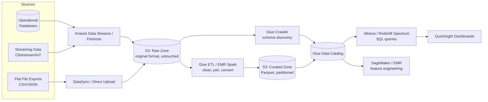
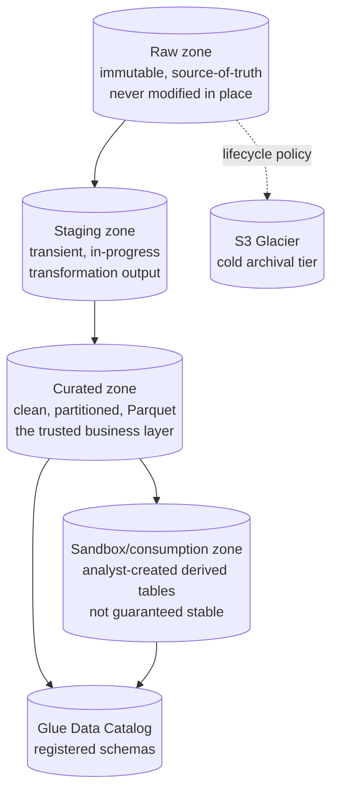
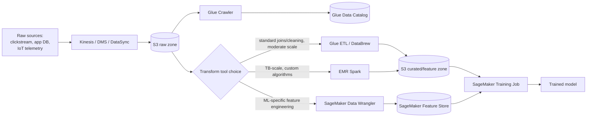
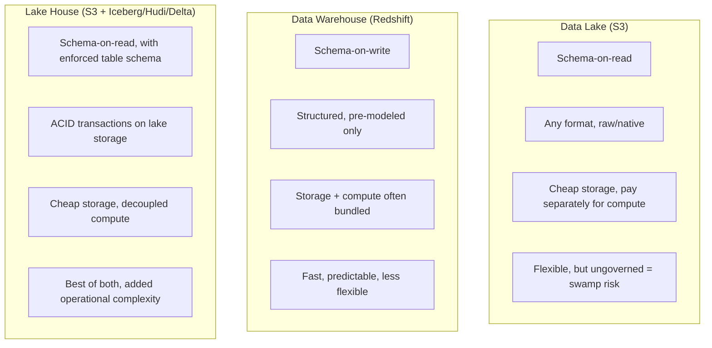
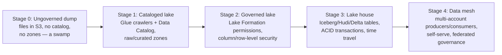
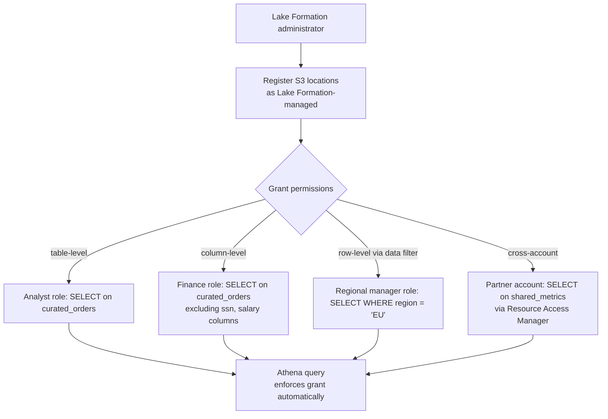

# Data Lake Concepts (S3 as a Data Lake, Lake House Architecture)


*Analytics · maps to SAA-C03 Domain 3 Task 3.5, MLA-C02 Domain 1 (Data Preparation for ML and AI)*

## Definition

A **data lake** is a centralized storage repository that holds data in its raw, native format
— structured, semi-structured, and unstructured alike — at any scale, without forcing a rigid
schema on it before it's stored. Unlike a database or data warehouse, where you must define the
table structure before writing data in, a data lake lets you store first and decide how to
structure/interpret the data later, when you actually query it ("schema-on-read" instead of
"schema-on-write"). On AWS, **Amazon S3** is the de facto foundation almost everyone builds a
data lake on top of.

## Purpose

Traditional data warehouses require designing a schema up front and transforming data to fit it
before it's even stored — fine when you know exactly what questions you'll ask, expensive and
slow when you don't, or when data arrives in wildly different shapes (JSON logs, images, CSV
exports, video, IoT telemetry) that don't fit one rigid table structure. AWS (and the industry
generally) built the data lake pattern so organizations can capture **everything**, cheaply, in
its original form, and figure out the valuable questions later — without re-ingesting history
every time a new question comes up, because the raw data was never thrown away or reshaped.

## How It Works

Plain explanation: think of a data warehouse as a filing cabinet where every folder must be
pre-labeled and every document reformatted to fit a specific folder size before it's filed — a
data lake is a big, cheap warehouse where you can just drop boxes of any size and shape as they
arrive, and index/label them later, only when someone actually needs to find something. A
**lake house** architecture adds database-like structure and query performance on top of that
cheap, flexible raw storage — the best of both patterns — by layering table formats, catalogs,
and optimized file formats (like Parquet) over the lake.



Step by step:

1. **Sources** — operational databases, streaming event data, and flat-file exports all feed
   into the lake. Nothing is reshaped to fit a predefined schema before it arrives.
2. **Ingestion** — Kinesis Data Streams/Firehose handle continuous streaming sources; batch
   files are moved in via AWS DataSync, direct S3 uploads, or database export/migration tools
   (DMS).
3. **Raw zone (S3)** — data lands in its original, untouched format, typically organized by
   source and date (e.g., `s3://lake/raw/orders/year=2026/month=11/day=20/`). This zone is the
   permanent, authoritative copy — nothing downstream ever needs to "go back to the source
   system" because raw history is preserved here.
4. **Cataloging** — a Glue Crawler scans the raw zone and registers table definitions (schema,
   partitions) in the **Glue Data Catalog**, so the data becomes discoverable and queryable
   without anyone needing to know the physical file layout.
5. **Transformation** — Glue ETL jobs or EMR Spark jobs read the raw zone, clean/join/dedupe
   the data, convert it to a columnar format (Parquet/ORC), and write it to a **curated zone**
   — partitioned for efficient querying, with the schema re-registered in the catalog.
6. **Query/consumption** — Athena and Redshift Spectrum run SQL directly against the curated
   zone using the shared catalog; SageMaker or EMR pull from the same curated data for ML
   feature engineering; QuickSight builds dashboards on top of Athena/Redshift query results.

The key insight: **one durable raw copy, one shared catalog, many consumers** — Athena, EMR,
Redshift, and SageMaker never duplicate the data or disagree about its schema, because they all
read from the same S3 lake and the same Glue Data Catalog.

### Multi-zone layout in detail

Most production lakes use more than the two zones in the summary diagram above — a typical
real-world layout adds a staging zone (for in-flight transformation work) and a consumption/
sandbox zone (for ad-hoc exploration that shouldn't risk the curated zone's integrity):



- **Raw zone** is never edited in place — a transformation job always reads raw and writes
  elsewhere; treating raw as mutable is the single most common way a lake's "we can always
  reprocess from scratch" guarantee quietly breaks.
- **Staging zone** holds transient, in-progress output (e.g., a Glue job's intermediate Spark
  shuffle output, or data mid-validation before a data-quality gate passes it to curated) —
  this zone is expected to be cleaned up regularly and isn't meant for long-term storage.
- **Curated zone** is the trusted, "business accepts this as correct" layer that Athena,
  Redshift Spectrum, and dashboards are built against.
- **Sandbox zone** gives analysts/data scientists room to create their own derived tables for
  exploration without any risk of them being mistaken for official curated data, or of their
  ad-hoc work accidentally breaking the curated zone's schema contracts.
- **Lifecycle policies** age raw data that's rarely accessed into S3 Glacier automatically —
  the lake pattern explicitly assumes raw history is kept essentially forever for reprocessing,
  so storage-class tiering (not deletion) is the default cost lever for raw-zone growth.

### Full ingest-to-ML-feature pipeline (MLA-C02 focus)

This is the diagram MLA-C02 Domain 1 questions are most directly testing: how raw data becomes
a feature a model can actually train on, and which tool does which step.



The exam-relevant decision point is the `XFORM` diamond: scale and tooling need (not just "I
need to transform data") determine Glue vs. EMR vs. Data Wrangler, each covered in depth in
their own documents (`glue.md`, `emr.md`,
`services/machine-learning-ai/sagemaker-data-wrangler-and-feature-store.md`).

### Data lake vs. data warehouse vs. lake house, side by side



| Dimension | Data Lake | Data Warehouse | Lake House |
|---|---|---|---|
| Schema timing | On read (flexible) | On write (rigid, upfront) | On read, but table format enforces structure |
| Format flexibility | Any (JSON, images, CSV, Parquet, video) | Structured only | Any raw format, but query layer expects structured tables |
| ACID transactions | No (plain S3 objects) | Yes, natively | Yes, via Iceberg/Hudi/Delta table format |
| Storage/compute coupling | Fully decoupled | Often bundled (varies by product) | Fully decoupled |
| Best for | Unknown-future-questions, ML raw history, mixed formats | Known, frequent, complex BI queries at scale | Needing both lake flexibility and warehouse-like guarantees |
| Typical AWS services | S3, Glue, Athena, EMR | Redshift | S3 + Glue + Athena/EMR + Iceberg/Hudi/Delta |

A lake house is not a third separate storage system — it's a lake (S3) with a transactional
table format layered on top, which is why the exam treats "time travel," "upserts," and "ACID
on S3" as lake house signals rather than requiring a completely different service name.

## Key Features / Components

- **Schema-on-read** — structure is applied at query time, not at write time, which is what
  lets a data lake ingest any format without upfront modeling.
- **Raw / curated (and often "staging"/"consumption") zones** — a common convention for
  organizing a lake by processing stage, so raw history is never overwritten by transformations.
- **S3 as the storage layer** — virtually unlimited scale, 11 nines of durability, low cost per
  GB, and native integration with every AWS analytics service (Athena, EMR, Glue, SageMaker,
  Redshift Spectrum) make it the default data lake foundation on AWS.
- **Glue Data Catalog** — the shared metadata layer that makes files in S3 behave like queryable
  tables for every engine that reads it.
- **AWS Lake Formation** — a service built specifically to simplify setting up a secure,
  governed data lake: centralizes permissions (column/row-level security) across S3, Glue,
  Athena, EMR, and Redshift, instead of managing IAM policies per-service separately.
- **Lake house architecture** — layering transactional table formats (Apache Iceberg, Apache
  Hudi, Delta Lake) on top of S3 adds database-like features — ACID transactions, time travel,
  schema evolution, upserts/deletes — directly on lake-stored data, closing much of the gap
  with a traditional warehouse while keeping the lake's flexibility and cost profile.
- **Partitioning & columnar formats (Parquet/ORC)** — the two biggest practical levers for
  query performance and cost in a lake, since engines like Athena scan only the partitions/
  columns actually needed.
- **Data mesh / multi-account data sharing** — large organizations often structure a lake as
  multiple producer accounts each owning their own data, with **Lake Formation cross-account
  sharing** granting fine-grained, governed access to consumer accounts/teams, rather than one
  giant shared bucket and IAM policy everyone edits.
- **S3 Object Lock / data lake governance controls** — immutability controls (WORM — write once,
  read many) applied to the raw zone specifically, supporting compliance requirements that raw
  historical data can never be altered or deleted before a retention period expires.

## Partitioning and performance tuning across the lake

A data lake's performance characteristics are really the sum of the partitioning/format
decisions covered in depth in `glue.md`, `athena.md`, and `emr.md` — this section is the
cross-cutting summary of how those choices compound across the whole pipeline, not a repeat of
any single service's tuning details.

- **Partition grain should match query grain at every layer** — if Athena queries typically
  filter by day, partitioning the curated zone by day (not hour, not month) is correct; getting
  this wrong at the *curated zone* layer defeats partition pruning no matter how well-tuned any
  individual Glue job or Athena query is.
- **Columnar format conversion should happen once, early, not repeatedly** — converting raw
  JSON/CSV to Parquet during the raw-to-curated transformation step (not re-converting on every
  query) is both cheaper and faster; a lake where every consumer independently converts format
  on the fly is paying the conversion cost N times instead of once.
- **File size consistency matters more at lake scale than within any single job** — the "avoid
  too many small files" tuning advice in `glue.md`/`emr.md` compounds across a lake with many
  independent ingestion pipelines; a lake-wide convention (e.g., "target 256 MB–1 GB per file,
  compact small files on a schedule") avoids the "death by a thousand tiny files" problem that's
  easy to introduce one pipeline at a time without a shared standard.
- **Worked example — compounding cost of inconsistent formats**: a lake where 60% of data is
  curated Parquet (cheap to query) and 40% remains raw, unpartitioned JSON (expensive to query)
  because one team's pipeline was never finished — Athena queries spanning both proportions pay
  roughly the JSON-driven cost for that 40% regardless of how well-optimized the other 60% is,
  illustrating why partial modernization of a lake captures only partial cost savings; the
  worst-case data shape in a query, not the average, usually dominates query cost.

## Common Architectures

**1. The standard raw-to-curated-to-query lake** — the core diagram covered above: sources →
ingestion → raw zone → Glue Crawler/catalog → Glue ETL/EMR transformation → curated zone →
Athena/Redshift Spectrum → QuickSight. This is the default shape referenced throughout
`glue.md`, `athena.md`, `emr.md`, and `kinesis-family.md`.

**2. Lake house with Apache Iceberg for concurrent, ACID-safe writes** — multiple independent
pipelines (a streaming Firehose delivery, a nightly Glue batch job, and ad-hoc Athena INSERTs)
all write to the same logical Iceberg table concurrently, with every reader seeing one
consistent snapshot rather than a partially-written state — the specific mechanism detailed in
`athena.md`'s Iceberg section.

**3. Governed multi-team data mesh** — several business units each own their own S3 prefixes/
accounts as data "producers," registering their tables in a shared or federated Glue Data
Catalog; **Lake Formation** grants fine-grained, auditable cross-account access to "consumer"
teams without flattening everything into one shared bucket with shared IAM policies.

**4. ML feature pipeline from raw lake to training job** — the ingest-to-feature diagram above:
raw zone → Glue/EMR/Data Wrangler (chosen by scale/complexity) → curated feature zone or
SageMaker Feature Store → SageMaker training — the standard MLA-C02 Domain 1 pipeline shape.

**5. Compliance-grade immutable raw archive** — the raw zone is placed under S3 Object Lock in
compliance mode, guaranteeing no one (including account admins) can delete or alter raw records
before a defined retention period — used in regulated industries where "we can prove this raw
data was never tampered with" is a hard requirement, not just a nice property.

**6. Hybrid batch + streaming lake ("Lambda architecture"-style)** — a streaming hot path
(Kinesis → Flink → low-latency serving layer) runs alongside a batch cold path (the same source
data also landing in the raw zone via Firehose, transformed on a schedule into the curated
zone) — giving both near-real-time answers and a permanent, reprocessable historical record from
one set of source events, the same hot/cold pattern introduced in `kinesis-family.md`.

**7. Data lake as the system of record for disaster recovery / cross-region resilience** — the
raw zone is replicated cross-region (S3 Cross-Region Replication), so a regional outage doesn't
just threaten live applications but also the organization's entire historical analytical/ML
training data — a detail often missed when DR planning focuses only on operational databases
and ignores the lake that increasingly holds an organization's most irreplaceable long-term
data asset.

## Use Cases — When to Use It

- A company with data arriving in **many different shapes** (app logs, clickstream, exported
  database tables, IoT sensor readings, images) that wants one unified place to land all of it
  before deciding exactly how to use each piece.
- **ML/AI data preparation** — training data for ML models is almost always assembled from a
  data lake, since ML workflows need raw history, flexible reprocessing, and large-scale
  feature engineering that a rigid warehouse schema would get in the way of.
- Organizations wanting to **decouple storage growth from compute cost** — a lake's storage
  (S3) scales and is billed independently from the query engines (Athena/EMR/Redshift) that
  read it, unlike a traditional warehouse where storage and compute are often bundled.
- **Long-term, cost-efficient retention of raw data** for compliance, auditing, or future
  reprocessing needs that haven't been defined yet.
- **Multi-team/multi-account organizations** that need governed, auditable data sharing without
  every team managing its own copy of every other team's data.

## When NOT to Use It / Alternatives

- If your data is already **well-structured, known in advance, and queried frequently by many
  users with strict performance SLAs**, going straight to a **data warehouse (Redshift)** avoids
  the lake's extra cataloging/transformation steps — don't build lake infrastructure you don't
  need for simple, stable, structured BI reporting.
- A data lake without governance (no catalog, no access controls, no zone discipline) becomes a
  **"data swamp"** — unusable because nobody can find or trust what's in it; if an organization
  can't commit to cataloging/governance discipline (Lake Formation, Glue Catalog, clear
  zoning), the lake pattern will cause more harm than a smaller, well-modeled warehouse would.
- For **low-latency, transactional application data** (an app's live order/customer records),
  a lake is the wrong tool entirely — use **RDS/DynamoDB**; a lake is for analytical, not
  operational, workloads.
- Don't treat "store everything forever" as free — S3 storage costs and query-scan costs both
  scale with volume; apply **lifecycle policies** (move cold raw data to Glacier) even in a lake.
- Partial modernization (some pipelines curated/Parquet, others left as raw JSON "for now")
  captures only partial benefit, as the worked cost example above shows — a half-finished lake
  migration is a common, underestimated real-world trap.

## Why It's Important

**Real-world:** nearly every modern analytics and ML program at any real scale is built on a
data lake pattern because it's the only approach that scales economically to "capture
everything now, figure out the valuable question later" — and because ML specifically needs
large volumes of raw historical data that a pre-modeled warehouse schema would have already
discarded or summarized away.

**Exam:** data lakes are named explicitly in **SAA-C03 Task 3.5 — "Determine high-performing
data ingestion and transformation solutions"**, right alongside Kinesis, Glue, and EMR — the
task statement is effectively "can you design the ingestion → transform → store → query
pipeline that is a data lake." In **MLA-C02 Domain 1 (Data Preparation for ML and AI)**, the
entire domain assumes a data-lake-shaped pipeline: "ingest and store data (S3, EFS, FSx,
Kinesis streaming) → transform (Glue, Glue DataBrew, EMR Spark, SageMaker Data Wrangler) →
feature engineering" — recognizing S3 as the lake foundation and the role of each transformation
tool is the core of this domain.

**Why EFS/FSx appear alongside S3 in MLA-C02's ingest/store list**: S3 is the overwhelming
default for lake storage, but the exam explicitly lists EFS and FSx too — these matter for
specific workloads where SageMaker training jobs need a **POSIX-compliant shared filesystem**
(some distributed training frameworks and HPC-style workloads expect real file-system
semantics, not object storage's API) or where **FSx for Lustre** is used specifically to
accelerate repeated high-throughput reads of the same training dataset across many training
instances — a detail worth knowing exists, even though S3 remains the correct default answer
for the large majority of "where should lake data live" questions.

### Exam scenario deep-dive: diagnosing a "data swamp"

A recurring scenario describes symptoms (analysts can't find data, nobody knows which table is
authoritative, duplicate/conflicting schemas for the "same" data) and asks for the fix. The
correct diagnosis and fix, in order:

1. **Missing or inconsistent cataloging** — fix with a **Glue Data Catalog** populated by
   crawlers (or disciplined manual registration), so there's one schema of record per dataset.
2. **No zone discipline** — fix by enforcing raw/staging/curated/sandbox separation, so "is this
   table trustworthy" has a structural answer (its zone) instead of requiring tribal knowledge.
3. **No governance/access control layer** — fix with **AWS Lake Formation** centralizing
   permissions, rather than per-service IAM policies drifting out of sync across S3, Glue,
   Athena, and Redshift independently.

A wrong-answer distractor commonly offered is "add more storage" or "migrate everything to a
data warehouse" — neither addresses the actual root cause (missing catalog/governance), and a
warehouse migration in particular throws away the lake's native-format flexibility to solve a
discoverability problem that Lake Formation/Glue solve directly without that cost.

### MLA-C02 scenario — the full Domain 1 pipeline, named service by named service

| Pipeline stage | Primary services tested | Decision point |
|---|---|---|
| Ingest (batch) | S3 direct upload, DataSync, DMS | Is the source a file export or a live database needing CDC? |
| Ingest (streaming) | Kinesis Data Streams, Firehose | Custom per-record logic needed, or just managed delivery? |
| Store (raw) | S3, EFS, FSx | S3 for nearly all cases; EFS/FSx for specific POSIX/HPC-filesystem needs |
| Catalog | Glue Data Catalog, Glue Crawlers | Automatic discovery vs. manual/partition-projection registration |
| Transform | Glue ETL, Glue DataBrew, EMR Spark, SageMaker Data Wrangler | Scale and audience (engineer vs. analyst vs. data scientist) drive the choice |
| Feature storage | SageMaker Feature Store, S3 curated zone | Needs point-in-time correctness/online serving vs. plain batch training input |
| Train | SageMaker Training | Out of this document's scope — see `sagemaker-overview.md` |

### Data lake maturity model

Organizations don't arrive at a well-governed lake house on day one — recognizing which
maturity stage a scenario describes (and what the next correct step is) is a useful mental
model for both real projects and multi-part exam scenarios that describe an evolving
architecture.



A scenario describing "analysts can't find or trust data" is Stage 0 needing Stage 1 (catalog +
zones). A scenario describing "we have a catalog but can't restrict who sees which columns" is
Stage 1 needing Stage 2 (Lake Formation). A scenario describing "we need upserts/deletes and
point-in-time consistency on lake data" is Stage 2 needing Stage 3 (a lake house table format).
A scenario describing "many business units each need to own and share their own data
independently, with central governance" is Stage 3 needing Stage 4 (data mesh). Recognizing
which stage transition a question is really asking about is often more useful than trying to
recall every feature of every stage individually.

### Worked example — migrating a legacy warehouse-only shop to a lake house

A retailer currently runs 100% of analytics on a single large, aging on-premises data warehouse,
paying for both storage and compute together, and struggling with rigid schema-on-write change
requests that take weeks to approve. The staged migration this document's concepts describe:

1. **Land raw exports in S3 raw zone** alongside (not replacing) the existing warehouse
   initially — de-risks the migration since the warehouse keeps running unchanged while the
   lake is built out in parallel.
2. **Catalog and curate** the same data into S3 curated Parquet zones via Glue ETL, validated
   against the existing warehouse's known-correct numbers as a trust-building step before
   anyone relies on the new curated zone for real decisions.
3. **Move read-only, ad-hoc, and exploratory analytics to Athena/QuickSight against the curated
   zone** first — the lowest-risk workload to migrate, since it doesn't touch any write path.
4. **Introduce a lake house table format (Iceberg)** for curated tables that need upserts/
   deletes (e.g., slowly-changing dimension tables) — closing the specific warehouse-parity gap
   that was blocking a full migration.
5. **Decommission warehouse capacity incrementally** as confidence grows, rather than a single
   cutover — the storage/compute decoupling of the lake means this can happen gradually,
   migrating workload-by-workload instead of needing one all-or-nothing switch.

This phased pattern — parallel run, validate, migrate read workloads first, close write-path
gaps with a lake house format, decommission last — is the generally correct shape whenever an
exam scenario asks "how do we migrate from X to a data lake without a risky big-bang cutover."

## Pricing Model (summary)

A data lake's cost is the sum of its parts, not a single line item:

- **S3 storage** — billed per GB/month, with storage class tiers (Standard → Infrequent Access
  → Glacier) that should match the zone's access pattern (raw/cold data ages into cheaper tiers).
- **Glue** — crawler and ETL job costs billed per DPU-hour, as described in `glue.md`.
- **Athena/EMR/Redshift Spectrum** — query/compute costs as described in their own docs.
- **Lake Formation** — no separate charge for the governance/permission layer itself beyond the
  underlying services it coordinates.
- **Worked example — storage-tiering savings across zones**: a lake with 100 TB in the raw zone,
  of which roughly 80 TB is older than 90 days and rarely re-queried. Left entirely on S3
  Standard, that's 100 TB at the Standard rate; moving the 80 TB of cold raw data to Glacier
  (whose per-GB rate commonly runs at a small fraction of Standard's) while keeping the active
  20 TB on Standard can cut the raw zone's total storage bill substantially — often by half or
  more overall — purely through lifecycle tiering, with zero change to any query/compute cost.
- **Worked example — the real cost of "partial modernization"**: following the earlier
  partitioning-and-performance section's worked example, a lake querying a mix of 60% optimized
  Parquet and 40% unoptimized JSON pays Athena's bytes-scanned cost dominated by that 40% —
  finishing the Parquet conversion for the remaining 40% (a one-time Glue ETL cost) typically
  pays for itself quickly once the ongoing per-query savings compound across the many queries
  run against that data over time, which is the standard framing for "is it worth finishing the
  migration" cost-justification questions.
- The practical lesson: a well-partitioned, columnar lake (Parquet, by date/key) is
  dramatically cheaper to query than a flat, unpartitioned CSV lake — format and layout choices
  are the biggest cost lever, more than any single service's pricing page.
- See official pricing: https://aws.amazon.com/s3/pricing/ and https://aws.amazon.com/glue/pricing/

### Lake Formation governance model in detail



The critical exam-relevant property: once a table is registered with Lake Formation and
permissions are granted through it, **every** integrated query engine (Athena, Redshift
Spectrum, EMR) enforces that same permission automatically — an analyst can't bypass a
column-level restriction by switching from Athena to an EMR notebook, because the restriction
lives in Lake Formation's grant model, not in each engine's own access control layer
independently.

## Limits & Quotas

- **S3 itself has no practical total storage limit** — a lake's growth is bounded by budget and
  governance discipline, not an S3 capacity ceiling, which is part of why "data swamp" risk
  (not storage exhaustion) is the real operational constraint at scale.
- **S3 request rate**: S3 supports very high request rates per prefix without special tuning in
  modern practice, but extremely hot, narrow key prefixes (e.g., all files sharing one exact
  timestamp-based prefix) can still benefit from key-naming strategies that spread load, a
  legacy concern worth knowing conceptually even though S3's partitioning has improved
  significantly over time.
- **Glue Data Catalog limits**: soft, raisable limits on databases/tables/partitions per
  account/region (see `glue.md`) — relevant at very large multi-tenant lake scale.
- **Lake Formation permission grants**: a soft limit on the number of fine-grained grants per
  principal/resource — very large, deeply nested data-mesh sharing setups may need to plan
  around this rather than assuming unlimited grant granularity.
- **Cross-account data sharing via Lake Formation**: requires both producer and consumer
  accounts to be part of the same AWS Organizations structure or explicitly configured for
  cross-account grants — not something that works automatically between arbitrary, unrelated
  AWS accounts without setup.
- **S3 Object Lock retention periods**: once a raw-zone object is placed under compliance-mode
  retention, the retention period **cannot be shortened or removed** by any user, including the
  root account — a deliberate, by-design limit that's the entire point of compliance-mode
  immutability, not a bug or an oversight to work around.

## Troubleshooting / Common Issues

- **Analysts can't find or trust data ("data swamp" symptoms)** — see the exam scenario
  deep-dive above: the fix is cataloging + zone discipline + Lake Formation governance, not more
  storage.
- **Different consumers get different results from "the same" data** — almost always a zone
  discipline violation (someone queried the raw zone directly instead of the curated zone, or
  two independent transformation pipelines both produced a "curated" version with subtly
  different logic) — the fix is enforcing one authoritative curated table per concept, not
  patching each consumer's query individually.
- **Raw zone data was accidentally modified/deleted** — this should be structurally impossible
  in a well-designed lake (raw is never written to by transformation jobs); if it happened,
  the real fix is access control (IAM policies restricting write access to the raw zone to only
  the ingestion pipeline's role) and/or S3 Object Lock, not just "be more careful."
- **Query costs spiking unexpectedly** — check for a new pipeline or ad-hoc process querying an
  unpartitioned/uncurated zone directly (often the raw zone, or an unfinished sandbox table)
  instead of the optimized curated equivalent.
- **Cross-account Lake Formation grant doesn't seem to work** — confirm both accounts are
  correctly linked (AWS Organizations or an explicit resource share) and that the grant was made
  at the expected resource level (database, table, or column) — partial/mismatched grant scope
  is the most common root cause of "I granted access but they still can't query it."
- **New data isn't appearing in query results across the lake** — trace it back to the specific
  cause covered in `glue.md` (crawler schedule, missing `ADD PARTITION` call, or partition
  projection misconfiguration) rather than treating it as a lake-wide problem; it's almost
  always isolated to one table/pipeline's cataloging setup.
- **Storage costs growing faster than expected despite "cheap S3"** — almost always means raw
  data is accumulating in S3 Standard with no lifecycle policy aging it into Infrequent Access
  or Glacier; a lake's "store everything, forever" default assumption only stays cheap if
  storage-class tiering is actually configured, not just theoretically available.
- **Cross-region DR gap discovered during an incident** — if only operational databases have a
  DR/replication strategy and the data lake's raw zone doesn't, a regional outage can mean
  losing access to historical/training data even if live applications fail over successfully —
  worth auditing explicitly rather than assuming "S3 is durable" automatically implies
  cross-region resilience (durability and regional availability are different guarantees).

## Hands-on Lab (Floci)

Floci supports the **core building blocks** of a data lake end to end — S3 for storage, Glue
for cataloging, Athena for querying — so you can walk through the full raw → curated → query
pattern locally. It does not emulate **AWS Lake Formation**'s fine-grained permission engine;
for practicing governance concepts, treat IAM bucket/prefix policies as the stand-in locally,
and read Lake Formation's real behavior from AWS docs rather than expecting Floci parity. Full
walkthrough: `labs-floci/data-lake-concepts.md`.

```bash
# Create the zone structure as S3 prefixes
awslocal s3 mb s3://company-data-lake
awslocal s3api put-object --bucket company-data-lake --key raw/orders/
awslocal s3api put-object --bucket company-data-lake --key staging/orders/
awslocal s3api put-object --bucket company-data-lake --key curated/orders/
awslocal s3api put-object --bucket company-data-lake --key sandbox/orders/

# Land raw data untouched
awslocal s3 cp orders_2026_11.csv s3://company-data-lake/raw/orders/year=2026/month=11/orders_2026_11.csv

# Catalog it (see glue.md for full crawler/table setup)
awslocal glue create-database --database-input '{"Name":"lakedb"}'

# After a Glue ETL job (or manual step) writes curated Parquet:
awslocal s3 cp orders_curated.parquet s3://company-data-lake/curated/orders/year=2026/month=11/orders_curated.parquet

# Query the curated zone with Athena (see athena.md for the full query flow)
awslocal athena start-query-execution \
  --query-string "SELECT * FROM lakedb.curated_orders LIMIT 10" \
  --result-configuration OutputLocation=s3://company-data-lake/athena-results/

# Apply a lifecycle policy moving raw data older than 90 days to a cheaper storage class
# (real AWS CLI shape; Floci's lifecycle emulation is metadata-only)
awslocal s3api put-bucket-lifecycle-configuration --bucket company-data-lake --lifecycle-configuration '{
  "Rules": [{
    "ID": "archive-raw-zone",
    "Filter": {"Prefix": "raw/"},
    "Status": "Enabled",
    "Transitions": [{"Days": 90, "StorageClass": "GLACIER"}]
  }]
}'

# Real AWS CLI shape for a Lake Formation grant (not executable against Floci):
# aws lakeformation grant-permissions \
#   --principal DataLakePrincipalIdentifier=arn:aws:iam::222222222222:role/ConsumerAnalystRole \
#   --resource '{"Table": {"DatabaseName": "lakedb", "Name": "curated_orders"}}' \
#   --permissions "SELECT" "DESCRIBE"
```

## Exam Tips

- **"Schema-on-read" vs. "schema-on-write"** is the core conceptual distinction tested — a data
  lake (schema-on-read, flexible, cheap storage) vs. a data warehouse (schema-on-write, rigid,
  optimized for known queries). A question contrasting "store any format now, decide structure
  later" against "structured, pre-modeled, fast repeated queries" is testing lake vs. warehouse.
- **Lake house = lake + warehouse features** — if a question mentions ACID transactions,
  upserts/deletes, or "time travel" on data stored in S3, that's pointing at a lake house
  pattern (Iceberg/Hudi/Delta Lake table formats on S3), not a plain lake or a plain warehouse.
- A **"data swamp"** is the named failure mode of an ungoverned lake — if a scenario describes
  "data in S3 nobody can find or trust the schema of," the fix is **Glue Data Catalog + Lake
  Formation governance**, not "just add more storage."
- Remember the **raw zone is never modified** by transformation jobs — ETL reads raw, writes a
  separate curated copy; a question implying raw data gets overwritten/discarded during
  transformation is describing an anti-pattern, not a correct lake design.
- **Lake Formation vs. per-service IAM policies** — a question emphasizing centralized,
  fine-grained (column/row-level), cross-service, cross-account data governance is pointing at
  Lake Formation specifically, not "write more detailed IAM policies for each service
  individually," which is both harder to maintain and the thing Lake Formation exists to
  replace.
- The **full pipeline naming pattern** (ingest → store raw → catalog → transform → store
  curated → query → visualize/train) is worth being able to name end-to-end with the correct
  AWS service at each stage — this exact sequence, with different nouns, is the shape of a very
  large share of SAA-C03 Domain 3 and MLA-C02 Domain 1 scenario questions.
- **Partial lake modernization captures only partial savings** — a cost question showing mixed
  optimized/unoptimized data is testing whether you recognize that query cost is dominated by
  the worst-case data shape actually scanned, not the average across the whole lake.
- **Data mesh vs. a single shared lake** — a question describing many independent business
  units each wanting ownership and autonomy over their own data, with central governance only
  for cross-team sharing, is describing a data mesh pattern (multiple accounts/prefixes, Lake
  Formation cross-account grants) rather than "just put it all in one bucket with one IAM
  policy" — recognize this as a deliberate organizational/governance choice, not a technical
  limitation being worked around.
- **S3 durability vs. regional availability** are different guarantees — a question implying
  "S3's 11 nines of durability means we don't need a DR plan for the lake" is conflating the
  two; durability protects against data loss within a region, not against a regional service
  disruption, which is what Cross-Region Replication addresses.

### Data governance checklist (the practical "is this lake well-governed" test)

A fast way to sanity-check whether a described architecture is a well-governed lake or heading
toward a data swamp — useful both for real design reviews and for quickly validating which
answer an exam scenario is pointing toward:

- [ ] Is there **one Glue Data Catalog** (or a federated equivalent) that every query engine
      reads from, rather than each engine maintaining its own schema definitions?
- [ ] Are **raw, staging, curated, and sandbox zones** structurally separated (different
      prefixes/buckets), not just a convention nobody enforces?
- [ ] Is access governed through **Lake Formation** (or at minimum, consistent IAM policies
      applied the same way across every service touching the lake), rather than per-service,
      ad hoc permissions that drift independently?
- [ ] Do **lifecycle policies** exist on the raw zone to age cold data into cheaper storage
      classes, rather than leaving everything on S3 Standard indefinitely?
- [ ] Is the **raw zone genuinely immutable** in practice (write-once from ingestion, never
      edited by transformation jobs), not just documented as a convention that pipelines could
      technically violate?
- [ ] Is there a **named owner per curated dataset** (a team or individual accountable for its
      correctness), so "which table is authoritative" has an organizational answer, not just a
      technical one?

A "no" on several of these is the practical definition of a data swamp in progress, regardless
of how much data has been successfully landed in S3.

## Further Reading

- AWS Big Data Blog — "Modern data architecture" and lake house concepts:
  https://aws.amazon.com/big-data/datalakes-and-analytics/what-is-a-data-lake/
- Modern Data Analytics Reference Architecture on AWS (official diagram):
  https://docs.aws.amazon.com/architecture-diagrams/latest/modern-data-analytics-on-aws/modern-data-analytics-on-aws.html
- AWS Lake Formation — what it is:
  https://docs.aws.amazon.com/lake-formation/latest/dg/what-is-lake-formation.html
- Data lake zones and best practices (AWS Prescriptive Guidance):
  https://docs.aws.amazon.com/prescriptive-guidance/latest/defining-bucket-names-data-lakes/introduction.html
- Serverless data lake centric analytics architecture whitepaper:
  https://docs.aws.amazon.com/whitepapers/latest/aws-serverless-data-analytics-pipeline/aws-serverless-data-analytics-pipeline.html
- Lake Formation cross-account data sharing:
  https://docs.aws.amazon.com/lake-formation/latest/dg/cross-account-permissions.html
- Apache Iceberg table format overview (lake house ACID transactions):
  https://docs.aws.amazon.com/athena/latest/ug/querying-iceberg.html
- S3 Object Lock (WORM compliance for a raw zone):
  https://docs.aws.amazon.com/AmazonS3/latest/userguide/object-lock.html
- S3 pricing: https://aws.amazon.com/s3/pricing/ · Glue pricing: https://aws.amazon.com/glue/pricing/

### Reference diagrams from official AWS sources


*AWS's own Modern Data Analytics reference architecture — ingestion tools (DMS, DataSync,
Kinesis, MSK, IoT Core, AppFlow) feeding a Lake Formation-governed S3 data lake, cataloged by
Glue, queried by Athena/Redshift Spectrum, visualized by QuickSight, and consumed by SageMaker
— the same end-to-end shape described throughout this document. Source: AWS Architecture
Diagrams, [Modern Data Analytics Reference Architecture on AWS](https://docs.aws.amazon.com/architecture-diagrams/latest/modern-data-analytics-on-aws/modern-data-analytics-on-aws.html).*


*A concrete, applied data lake reference architecture (IoT telemetry + on-premises database
migration via DMS, cataloged by Glue, visualized with Athena/QuickSight/Managed Grafana, and
used to train SageMaker ML models) — a real-world instance of the generic raw→curated→query
pipern shown in this document's own diagrams. Source: AWS Architecture Diagrams,
[Data Lake Architecture for Renewable Energy](https://docs.aws.amazon.com/architecture-diagrams/latest/data-lake-architecture-for-renewable-energy/data-lake-architecture-for-renewable-energy.html).*

## Related Terms

[`glossary/README.md`](../../glossary/README.md) · [`kinesis-family.md`](kinesis-family.md) ·
[`glue.md`](glue.md) · [`emr.md`](emr.md) · [`athena.md`](athena.md) ·
[`opensearch.md`](opensearch.md) · [`quicksight.md`](quicksight.md) ·
`services/storage/s3.md` · `services/database/redshift.md`
