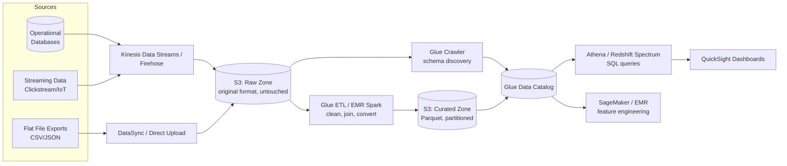

# Data Lake Concepts (S3 as a Data Lake, Lake House Architecture)


*Analytics · maps to SAA-C03 Domain 3 Task 3.5, MLA-C02 Domain 1 (Data Preparation for ML and AI)*

## Definition

A **data lake** is a centralized storage repository that holds data in its raw, native format
— structured, semi-structured, and unstructured alike — at any scale, without forcing a rigid
schema on it before it's stored. Unlike a database or data warehouse, where you must define the
table structure before writing data in, a data lake lets you store first and decide how to
structure/interpret the data later, when you actually query it ("schema-on-read" instead of
"schema-on-write"). On AWS, **Amazon S3** is the de facto foundation almost everyone builds a
data lake on top of.

## Purpose

Traditional data warehouses require designing a schema up front and transforming data to fit it
before it's even stored — fine when you know exactly what questions you'll ask, expensive and
slow when you don't, or when data arrives in wildly different shapes (JSON logs, images, CSV
exports, video, IoT telemetry) that don't fit one rigid table structure. AWS (and the industry
generally) built the data lake pattern so organizations can capture **everything**, cheaply, in
its original form, and figure out the valuable questions later — without re-ingesting history
every time a new question comes up, because the raw data was never thrown away or reshaped.

## How It Works

Plain explanation: think of a data warehouse as a filing cabinet where every folder must be
pre-labeled and every document reformatted to fit a specific folder size before it's filed — a
data lake is a big, cheap warehouse where you can just drop boxes of any size and shape as they
arrive, and index/label them later, only when someone actually needs to find something. A
**lake house** architecture adds database-like structure and query performance on top of that
cheap, flexible raw storage — the best of both patterns — by layering table formats, catalogs,
and optimized file formats (like Parquet) over the lake.



Step by step:

1. **Sources** — operational databases, streaming event data, and flat-file exports all feed
   into the lake. Nothing is reshaped to fit a predefined schema before it arrives.
2. **Ingestion** — Kinesis Data Streams/Firehose handle continuous streaming sources; batch
   files are moved in via AWS DataSync, direct S3 uploads, or database export/migration tools
   (DMS).
3. **Raw zone (S3)** — data lands in its original, untouched format, typically organized by
   source and date (e.g., `s3://lake/raw/orders/year=2026/month=11/day=20/`). This zone is the
   permanent, authoritative copy — nothing downstream ever needs to "go back to the source
   system" because raw history is preserved here.
4. **Cataloging** — a Glue Crawler scans the raw zone and registers table definitions (schema,
   partitions) in the **Glue Data Catalog**, so the data becomes discoverable and queryable
   without anyone needing to know the physical file layout.
5. **Transformation** — Glue ETL jobs or EMR Spark jobs read the raw zone, clean/join/dedupe
   the data, convert it to a columnar format (Parquet/ORC), and write it to a **curated zone**
   — partitioned for efficient querying, with the schema re-registered in the catalog.
6. **Query/consumption** — Athena and Redshift Spectrum run SQL directly against the curated
   zone using the shared catalog; SageMaker or EMR pull from the same curated data for ML
   feature engineering; QuickSight builds dashboards on top of Athena/Redshift query results.

The key insight: **one durable raw copy, one shared catalog, many consumers** — Athena, EMR,
Redshift, and SageMaker never duplicate the data or disagree about its schema, because they all
read from the same S3 lake and the same Glue Data Catalog.

## Key Features / Components

- **Schema-on-read** — structure is applied at query time, not at write time, which is what
  lets a data lake ingest any format without upfront modeling.
- **Raw / curated (and often "staging"/"consumption") zones** — a common convention for
  organizing a lake by processing stage, so raw history is never overwritten by transformations.
- **S3 as the storage layer** — virtually unlimited scale, 11 nines of durability, low cost per
  GB, and native integration with every AWS analytics service (Athena, EMR, Glue, SageMaker,
  Redshift Spectrum) make it the default data lake foundation on AWS.
- **Glue Data Catalog** — the shared metadata layer that makes files in S3 behave like queryable
  tables for every engine that reads it.
- **AWS Lake Formation** — a service built specifically to simplify setting up a secure,
  governed data lake: centralizes permissions (column/row-level security) across S3, Glue,
  Athena, EMR, and Redshift, instead of managing IAM policies per-service separately.
- **Lake house architecture** — layering transactional table formats (Apache Iceberg, Apache
  Hudi, Delta Lake) on top of S3 adds database-like features — ACID transactions, time travel,
  schema evolution, upserts/deletes — directly on lake-stored data, closing much of the gap
  with a traditional warehouse while keeping the lake's flexibility and cost profile.
- **Partitioning & columnar formats (Parquet/ORC)** — the two biggest practical levers for
  query performance and cost in a lake, since engines like Athena scan only the partitions/
  columns actually needed.

## Use Cases — When to Use It

- A company with data arriving in **many different shapes** (app logs, clickstream, exported
  database tables, IoT sensor readings, images) that wants one unified place to land all of it
  before deciding exactly how to use each piece.
- **ML/AI data preparation** — training data for ML models is almost always assembled from a
  data lake, since ML workflows need raw history, flexible reprocessing, and large-scale
  feature engineering that a rigid warehouse schema would get in the way of.
- Organizations wanting to **decouple storage growth from compute cost** — a lake's storage
  (S3) scales and is billed independently from the query engines (Athena/EMR/Redshift) that
  read it, unlike a traditional warehouse where storage and compute are often bundled.
- **Long-term, cost-efficient retention of raw data** for compliance, auditing, or future
  reprocessing needs that haven't been defined yet.

## When NOT to Use It / Alternatives

- If your data is already **well-structured, known in advance, and queried frequently by many
  users with strict performance SLAs**, going straight to a **data warehouse (Redshift)** avoids
  the lake's extra cataloging/transformation steps — don't build lake infrastructure you don't
  need for simple, stable, structured BI reporting.
- A data lake without governance (no catalog, no access controls, no zone discipline) becomes a
  **"data swamp"** — unusable because nobody can find or trust what's in it; if an organization
  can't commit to cataloging/governance discipline (Lake Formation, Glue Catalog, clear
  zoning), the lake pattern will cause more harm than a smaller, well-modeled warehouse would.
- For **low-latency, transactional application data** (an app's live order/customer records),
  a lake is the wrong tool entirely — use **RDS/DynamoDB**; a lake is for analytical, not
  operational, workloads.
- Don't treat "store everything forever" as free — S3 storage costs and query-scan costs both
  scale with volume; apply **lifecycle policies** (move cold raw data to Glacier) even in a lake.

## Why It's Important

**Real-world:** nearly every modern analytics and ML program at any real scale is built on a
data lake pattern because it's the only approach that scales economically to "capture
everything now, figure out the valuable question later" — and because ML specifically needs
large volumes of raw historical data that a pre-modeled warehouse schema would have already
discarded or summarized away.

**Exam:** data lakes are named explicitly in **SAA-C03 Task 3.5 — "Determine high-performing
data ingestion and transformation solutions"**, right alongside Kinesis, Glue, and EMR — the
task statement is effectively "can you design the ingestion → transform → store → query
pipeline that is a data lake." In **MLA-C02 Domain 1 (Data Preparation for ML and AI)**, the
entire domain assumes a data-lake-shaped pipeline: "ingest and store data (S3, EFS, FSx,
Kinesis streaming) → transform (Glue, Glue DataBrew, EMR Spark, SageMaker Data Wrangler) →
feature engineering" — recognizing S3 as the lake foundation and the role of each transformation
tool is the core of this domain.

## Pricing Model (summary)

A data lake's cost is the sum of its parts, not a single line item:

- **S3 storage** — billed per GB/month, with storage class tiers (Standard → Infrequent Access
  → Glacier) that should match the zone's access pattern (raw/cold data ages into cheaper tiers).
- **Glue** — crawler and ETL job costs billed per DPU-hour, as described in `glue.md`.
- **Athena/EMR/Redshift Spectrum** — query/compute costs as described in their own docs.
- **Lake Formation** — no separate charge for the governance/permission layer itself beyond the
  underlying services it coordinates.
- The practical lesson: a well-partitioned, columnar lake (Parquet, by date/key) is
  dramatically cheaper to query than a flat, unpartitioned CSV lake — format and layout choices
  are the biggest cost lever, more than any single service's pricing page.
- See official pricing: https://aws.amazon.com/s3/pricing/ and https://aws.amazon.com/glue/pricing/

## Hands-on Lab (Floci)

Floci supports the **core building blocks** of a data lake end to end — S3 for storage, Glue
for cataloging, Athena for querying — so you can walk through the full raw → curated → query
pattern locally. It does not emulate **AWS Lake Formation**'s fine-grained permission engine;
for practicing governance concepts, treat IAM bucket/prefix policies as the stand-in locally,
and read Lake Formation's real behavior from AWS docs rather than expecting Floci parity. Full
walkthrough: `labs-floci/data-lake-concepts.md`.

```bash
# Create the zone structure as S3 prefixes
awslocal s3 mb s3://company-data-lake
awslocal s3api put-object --bucket company-data-lake --key raw/orders/
awslocal s3api put-object --bucket company-data-lake --key curated/orders/

# Land raw data untouched
awslocal s3 cp orders_2026_11.csv s3://company-data-lake/raw/orders/year=2026/month=11/orders_2026_11.csv

# Catalog it (see glue.md for full crawler/table setup)
awslocal glue create-database --database-input '{"Name":"lakedb"}'

# After a Glue ETL job (or manual step) writes curated Parquet:
awslocal s3 cp orders_curated.parquet s3://company-data-lake/curated/orders/year=2026/month=11/orders_curated.parquet

# Query the curated zone with Athena (see athena.md for the full query flow)
awslocal athena start-query-execution \
  --query-string "SELECT * FROM lakedb.curated_orders LIMIT 10" \
  --result-configuration OutputLocation=s3://company-data-lake/athena-results/
```

## Exam Tips

- **"Schema-on-read" vs. "schema-on-write"** is the core conceptual distinction tested — a data
  lake (schema-on-read, flexible, cheap storage) vs. a data warehouse (schema-on-write, rigid,
  optimized for known queries). A question contrasting "store any format now, decide structure
  later" against "structured, pre-modeled, fast repeated queries" is testing lake vs. warehouse.
- **Lake house = lake + warehouse features** — if a question mentions ACID transactions,
  upserts/deletes, or "time travel" on data stored in S3, that's pointing at a lake house
  pattern (Iceberg/Hudi/Delta Lake table formats on S3), not a plain lake or a plain warehouse.
- A **"data swamp"** is the named failure mode of an ungoverned lake — if a scenario describes
  "data in S3 nobody can find or trust the schema of," the fix is **Glue Data Catalog + Lake
  Formation governance**, not "just add more storage."
- Remember the **raw zone is never modified** by transformation jobs — ETL reads raw, writes a
  separate curated copy; a question implying raw data gets overwritten/discarded during
  transformation is describing an anti-pattern, not a correct lake design.

## Related Terms

[`glossary/README.md`](../../glossary/README.md) · [`kinesis-family.md`](kinesis-family.md) ·
[`glue.md`](glue.md) · [`emr.md`](emr.md) · [`athena.md`](athena.md) ·
[`opensearch.md`](opensearch.md) · [`quicksight.md`](quicksight.md) ·
`services/storage/s3.md` · `services/database/redshift.md`
