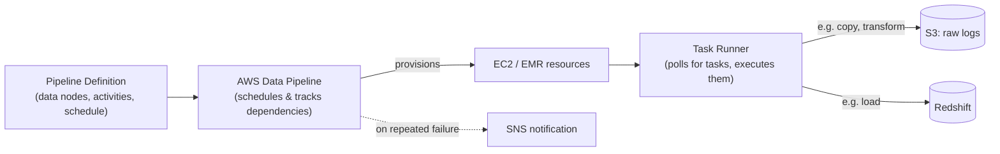
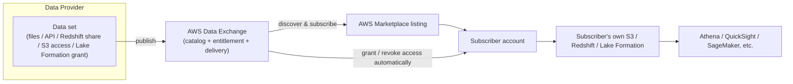

# AWS Data Pipeline & AWS Data Exchange

> **Appears in:** [SAA-C03](../../certifications/saa-c03/README.md)

This is a new `analytics` consolidation doc covering two services confirmed in-scope by the
SAA-C03 exam-guide appendix with no existing standalone doc in this repo. They have little in
common functionally — one orchestrates data movement/transformation jobs, the other is a data
marketplace — so they're grouped here purely because each is too narrow in exam weight to earn
its own full-template file, not because they solve related problems. Each section covers
definition, purpose, a concrete use case, and the exam-trigger phrasing to recognize.

## AWS Data Pipeline

> ⚠️ **Currency note:** AWS Data Pipeline is in **maintenance mode** — AWS stopped onboarding new
> customers and the service receives no new features or Region expansions. AWS's own migration
> guidance points existing customers toward **AWS Glue**, **AWS Step Functions**, or **Amazon
> MWAA (Managed Workflows for Apache Airflow)** depending on the workload shape. This doc
> documents Data Pipeline under its long-standing name because SAA-C03's published exam guide
> appendix still lists it as in-scope, and because the underlying orchestration *concept*
> (schedule → run → retry → notify) is exactly what its intended replacements do differently, which
> is the comparison the exam actually tests. Treat the service's future as declining; treat the
> concept it represents as durable.

### Definition

AWS Data Pipeline is a web service for defining, scheduling, and running data-driven workflows —
you describe a series of data sources, the activities (EMR jobs, SQL queries, shell commands)
that transform them, the schedule those activities run on, and the compute resources (EC2
instances or EMR clusters) that execute them — and the service handles dependency tracking,
retries, and failure notification for you.

### Purpose

Before Data Pipeline existed (and before Glue/Step Functions existed as alternatives), moving and
transforming data on a recurring schedule — "copy yesterday's log files from S3, run a nightly
Hive job to summarize them, load the result into Redshift, and alert someone if any step fails" —
meant hand-rolling cron jobs, bespoke retry logic, and ad-hoc dependency tracking across multiple
disconnected scripts. Data Pipeline existed to turn that into one declarative pipeline definition:
describe the data nodes, the activities, the schedule, and the preconditions that must be true
before an activity runs, and the service provisions the compute, runs the tasks in the right
order, retries failures according to your policy, and notifies you if a task fails repeatedly.

Step by step: you author a **pipeline definition** (graphically in the console, as a JSON file, or
via the SDK/CLI) naming the data sources, the activities that transform them, and the schedule.
**Data Pipeline** reads that definition, determines the individual **tasks** it implies, and
assigns them to a **Task Runner** — either the one Data Pipeline runs for you automatically on
resources it provisions, or a custom Task Runner you install yourself to reach data Data Pipeline
can't otherwise access (an on-premises database, for instance). If a task fails, Data Pipeline
retries it according to the policy in the definition, and if it fails enough times, triggers a
notification action (commonly an SNS topic) rather than failing silently.

### Use Case

A media company archives its web servers' access logs to S3 nightly, then needs a weekly summary
report: every day at 2am, copy that day's log files from the web fleet into a staging S3 prefix;
every Sunday, launch an EMR cluster that aggregates the week's files into a summary table, load
the result into Redshift for the analytics team, and tear the EMR cluster down immediately after
to avoid paying for idle capacity. Data Pipeline's dependency model expresses this cleanly: the
weekly EMR activity has a precondition that all seven of that week's daily copy activities
completed successfully first, so the aggregation job never runs against a partial week's data.

### Exam Tip

A scenario describing exactly this shape — "schedule a recurring data copy/transform job with
retries and a failure notification, using EC2 or EMR as the compute" — is the classic Data
Pipeline trigger phrase on SAA-C03's appendix, but recognize that a *new-architecture* scenario
asking "what should we build today" is more often pointing at **Step Functions** (general-purpose
workflow orchestration, see [`step-functions.md`](../application-integration/step-functions.md))
or **Glue** (ETL specifically, see [`glue.md`](glue.md)) — the exam can still test Data Pipeline
as a legacy/maintenance-mode fact, but a forward-looking design question answered with "stand up
a brand-new Data Pipeline" instead of Glue/Step Functions/MWAA is usually the wrong register for
a *new* workload, even though Data Pipeline itself remains a valid, supported answer for
describing or maintaining an *existing* one.

### Key Features / Components

- **Pipeline definition** — the declarative description of data nodes, activities, schedule, and
  preconditions; authored graphically, as JSON, or via the SDK/CLI.
- **Data nodes** — the location of input/output data (an S3 path, a MySQL table, a Redshift
  table, a DynamoDB table).
- **Activities** — the actual work (`EmrActivity`, `HiveActivity`, `CopyActivity`,
  `ShellCommandActivity`, `SqlActivity`, and others) run on a schedule against data nodes.
- **Preconditions** — a conditional check that must be true before an activity is allowed to run
  (e.g., "the source S3 object exists") — this is what lets the weekly aggregation job in the use
  case above wait on all seven daily copy jobs first.
- **Resources** — the compute Data Pipeline provisions to run activities: an `Ec2Resource` or an
  `EmrCluster`, both of which Data Pipeline can spin up and tear down automatically around the
  activity's schedule.
- **Task Runner** — the process that actually polls for and executes tasks; either the one Data
  Pipeline manages for you on its own provisioned resources, or a custom Task Runner you install
  on infrastructure Data Pipeline can't otherwise reach (an on-premises database server, for
  instance).
- **Retry policy and failure actions** — configurable per-activity retry count/delay, with an
  `onFail` action (commonly publishing to an SNS topic) once retries are exhausted.

### Where Data Pipeline's job goes today

| Data Pipeline concept | Modern equivalent |
|---|---|
| Scheduled EMR/Hive ETL activity | **AWS Glue** ETL job (serverless Spark, no cluster to manage) |
| General workflow with branching/retries across AWS services | **AWS Step Functions** state machine |
| Complex, code-defined DAG-style orchestration (cross-service, cross-account) | **Amazon MWAA** (managed Apache Airflow) |
| `ShellCommandActivity` hitting on-premises resources | A custom Task Runner is still the Data Pipeline-native answer; Glue/Step Functions instead typically reach on-premises data via DataSync, DMS, or a VPN/Direct Connect-attached Lambda |

This table is the practical shape of nearly every modern "should I use Data Pipeline" exam
question: the service still technically works and is still in the appendix, but the *intended*
answer for a greenfield design is almost always one of the rows on the right.

### Common exam scenarios

- *"An existing, long-running nightly ETL job uses AWS Data Pipeline and the question only asks
  what Data Pipeline's components are doing."* → Answer from Data Pipeline's own model (data
  nodes, activities, preconditions, Task Runner) — this is a legacy-literacy question, not a
  design question.
- *"Design a brand-new scheduled data transformation pipeline today."* → Glue (ETL-specific) or
  Step Functions (general orchestration), not a new Data Pipeline — recognize the "net-new"
  framing as the signal.
- *"A pipeline activity must not run until a precondition — a specific S3 object's existence — is
  verified."* → Data Pipeline's precondition mechanism (if the scenario is explicitly about an
  existing Data Pipeline setup) or an equivalent dependency check in Step Functions/Glue triggers
  for a new one.

### Pricing Model (summary)

Data Pipeline bills per-pipeline, per-activity-execution, at a low fixed rate (e.g., a few cents
per activity run on AWS-managed resources, less for on-premises/self-managed Task Runner
executions), separate from the cost of the EC2/EMR resources the pipeline provisions to actually
run the work — the orchestration layer itself is cheap; the underlying compute it spins up is
where most real cost sits. Official current pricing: https://aws.amazon.com/datapipeline/pricing/

### When NOT to Use It / Alternatives

- **Any new, greenfield scheduled ETL job** — use **AWS Glue** instead; it's serverless (no EC2/
  EMR cluster to provision and tear down yourself), has a built-in Data Catalog, and is where AWS
  directs all new ETL workloads.
- **A general-purpose workflow needing visual state-machine branching, human-approval steps, or
  cross-service orchestration beyond data movement** — use **Step Functions**; its visual
  execution history and native error-handling/retry model is purpose-built for this in a way Data
  Pipeline's activity-and-precondition model wasn't designed for.
- **A complex, code-as-DAG orchestration need migrating from an existing open-source Airflow
  deployment** — use **Amazon MWAA**, which runs actual Apache Airflow DAGs as a managed service,
  the most direct lift-and-shift path for teams already standardized on Airflow's DAG model.

## AWS Data Exchange

### Definition

AWS Data Exchange is a service for finding, subscribing to, and securely receiving third-party
data — or, from the other side, for publishing and licensing your own data to other
organizations — without either side building custom data-delivery infrastructure, billing
integration, or entitlement management themselves.

### Purpose

Getting external data into your own analytics pipeline has traditionally meant negotiating a data
license, then building (and maintaining) a bespoke delivery mechanism — an SFTP drop, a shared S3
bucket, a custom API — plus the entitlement logic to make sure access actually expires when a
subscription ends. Data Exchange exists to collapse that into one managed layer: data providers
publish a **data set** (one of several supported asset types — files, an API, an Amazon Redshift
data share, an Amazon S3 data access grant, or an AWS Lake Formation permission), subscribers find
it through the AWS Data Exchange console or AWS Marketplace, and once subscribed/granted access,
the data lands in a form their own AWS analytics or ML services can use directly — no custom
delivery pipeline, and no manual process to revoke access when the subscription period ends.

*Source: [AWS Reference Architecture Diagrams — Modern Data Analytics Reference Architecture on
AWS](https://docs.aws.amazon.com/reference-architecture-diagrams/latest/modern-data-analytics-on-aws/modern-data-analytics-on-aws.html).
Data Exchange's role in this bigger picture (step 3 in AWS's own numbered walkthrough): while AWS
DMS, DataSync, Kinesis, and Transfer Family ingest data generated by *your own* systems, Data
Exchange is the one ingestion path in this diagram that brings in data your organization never
generated at all — a third party's data set, flowing into the same Lake Formation-governed S3
data lake everything else lands in.*

Step by step: a **provider** packages data into a **data set** made up of one or more
**revisions** (a revision is a container for the specific assets being published at a point in
time — new revisions let a data set update over time without breaking a subscriber's existing
access to prior versions). The provider publishes the data set directly through the Data Exchange
console, or lists it as a paid product on **AWS Marketplace**. A **subscriber** finds the listing,
subscribes (or, for a direct provider-to-receiver relationship outside the Marketplace, accepts a
**data grant**), and Data Exchange handles the entitlement bookkeeping — granting access for
exactly the agreed period and automatically revoking it when a subscription lapses, with no manual
cleanup on either side. Once entitled, the subscriber consumes the data directly from their own
AWS account using whatever analytics or ML tooling they already run against their other data.

### Use Case

A quantitative hedge fund needs daily foreign-exchange rate data from a specialized financial-data
provider to feed a trading model running on SageMaker. Before Data Exchange, this meant the
provider building and maintaining an SFTP delivery pipeline (and the fund building an ingestion
job to poll it), plus a manual process on both sides to handle a contract renewal or
cancellation. With Data Exchange, the provider publishes a daily-refreshed S3-backed data set; the
fund subscribes once through AWS Marketplace, and each day's new revision simply appears in the
fund's entitled S3 location — no SFTP server, no custom polling job, and if the subscription
isn't renewed, access stops automatically without either side having to act on it.

### Exam Tip

The trigger phrase to recognize is "incorporate third-party data into an AWS analytics/ML
pipeline without building custom data-delivery or entitlement infrastructure" → **AWS Data
Exchange**, not a custom S3-sharing or SFTP setup, and not AWS Marketplace alone (Marketplace is
the storefront/billing surface Data Exchange data products can be listed on; Data Exchange is the
underlying data-set, revision, and entitlement mechanism). A scenario distinguishing "we generate
this data ourselves and need to move/replicate it" (DMS, DataSync, Transfer Family, Kinesis) from
"we need someone else's data, licensed and delivered automatically" (Data Exchange) is testing
whether you recognize Data Exchange as the *only* one of those services designed around a
third-party licensing relationship rather than your own infrastructure.

### Key Features / Components

- **Data set** — a resource curated by a provider containing the data a receiver gains access to;
  supports five asset types: **Files**, **API** (an API Gateway-backed API), **Amazon Redshift**
  data shares, **Amazon S3** data access, and **AWS Lake Formation** data permissions (Preview).
- **Revision** — a container for one or more assets within a data set; new revisions let a
  provider publish updated data over time (a new day's CSV file, for instance) without disrupting
  a subscriber's access to data they already received from prior revisions.
- **Asset** — the actual piece of data within a revision: a file, an S3 object, a Redshift data
  share, an API, or a Lake Formation permission.
- **Data grant** — a direct provider-to-receiver entitlement created without going through AWS
  Marketplace's public listing/billing flow — the provider sends a grant request to a specific
  receiver account, and the receiver accepts it to gain access, with an expiration the provider
  controls.
- **AWS Marketplace subscription** — the public-listing path: providers with a product on AWS
  Marketplace get subscription and billing handled by Marketplace, while Data Exchange itself
  handles the underlying data set/revision/entitlement mechanics regardless of which path (grant
  or Marketplace) connected provider to receiver.
- **Owned vs. entitled data sets** — a data set is *owned* by the account that created it;
  receivers see a read-only *entitled* view of someone else's owned data set, created at the
  moment a grant is accepted or a Marketplace subscription begins.

### Common exam scenarios

- *"A company wants to license and publish its proprietary data set to other organizations
  without building billing or delivery infrastructure."* → AWS Data Exchange as a provider,
  optionally listed on AWS Marketplace for public discovery/billing.
- *"A financial services firm needs to incorporate a third-party market-data feed directly into
  its existing S3-based analytics pipeline, with access automatically expiring at the end of the
  license term."* → AWS Data Exchange as a subscriber — automatic entitlement expiration is the
  specific detail pointing away from a manually-managed S3 bucket policy.
- *"Two organizations in the same AWS Organization want to share a private data set directly,
  without listing it publicly on a marketplace."* → A Data Exchange **data grant**, not a public
  Marketplace listing.

### Pricing Model (summary)

For **subscribers**, pricing is set by the data provider (free, a flat fee, or usage-based,
depending on the product) — AWS charges no separate Data Exchange fee on top of the provider's
price for consuming a subscribed data set, though normal AWS charges for storing/processing the
received data in your own account (S3 storage, Redshift compute, etc.) still apply. For
**providers**, Data Exchange itself has no platform fee to publish; providers set and collect
their own product pricing (when selling via AWS Marketplace, standard Marketplace revenue-share
terms apply, same as any other Marketplace product). Official current pricing:
https://aws.amazon.com/data-exchange/pricing/

### When NOT to Use It / Alternatives

- **Data you generate yourself, that needs to move or replicate between your own systems** — use
  **DataSync**, **DMS**, or **Transfer Family** (`services/migration-transfer/`) instead; Data
  Exchange's entitlement/licensing model solves a *different* problem (a relationship between two
  separate organizations) than internal data movement.
- **A one-off, informal data handoff to a single known partner with no recurring licensing
  relationship** — a direct S3 cross-account bucket policy or a signed URL may be simpler than
  standing up a full data set/revision structure for a single exchange that will never recur.

## Related Terms

- [`glue.md`](glue.md) · [`emr.md`](emr.md) — the modern ETL/transformation services AWS points
  existing Data Pipeline customers toward when migrating off it
- `services/application-integration/step-functions.md` — the modern general-purpose workflow
  orchestration service Data Pipeline customers are pointed toward for non-ETL scheduling needs
- `services/migration-transfer/datasync.md` · `services/migration-transfer/dms.md` ·
  `services/migration-transfer/transfer-family.md` — ingestion paths for data *you* generate,
  the direct contrast to Data Exchange's third-party data focus
- [`data-lake-concepts.md`](data-lake-concepts.md) — the S3/Lake Formation destination both
  internally generated and Data-Exchange-sourced data typically lands in
- `glossary/README.md` — pipeline definition, task runner, data set, revision, data grant
  definitions

---

**Repo completeness note:** this doc is newly created and linked from
`certifications/saa-c03/domain-3-high-performing-architectures/README.md`'s Task 3.5 table (data
ingestion and transformation). No other certification guide (DVA-C03, MLA-C02) lists either
service as in-scope per their current published appendices, so no additional cross-linking is
expected at this time.
