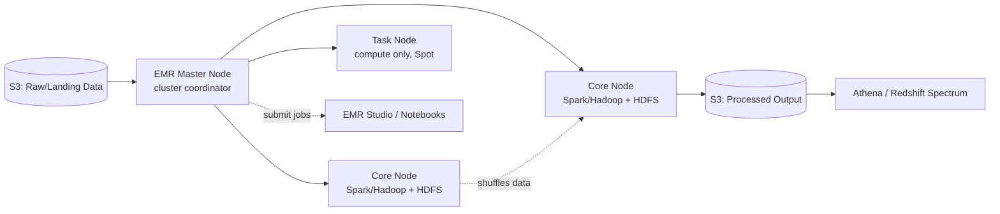
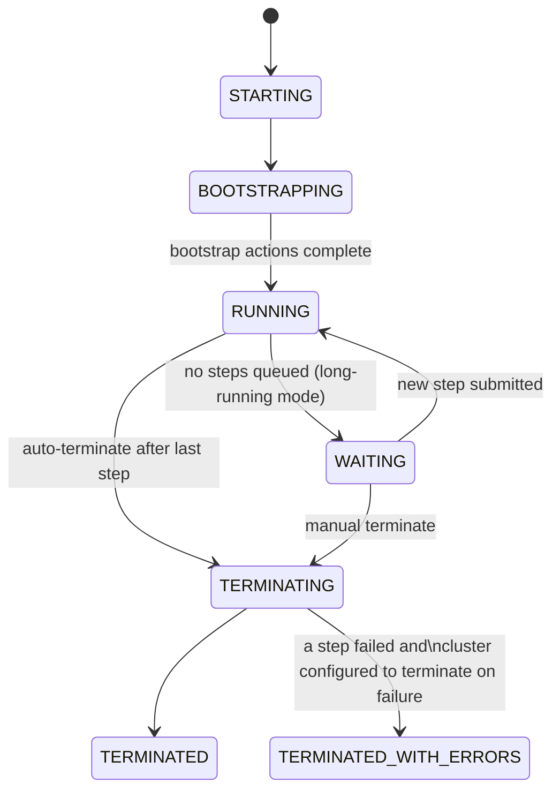
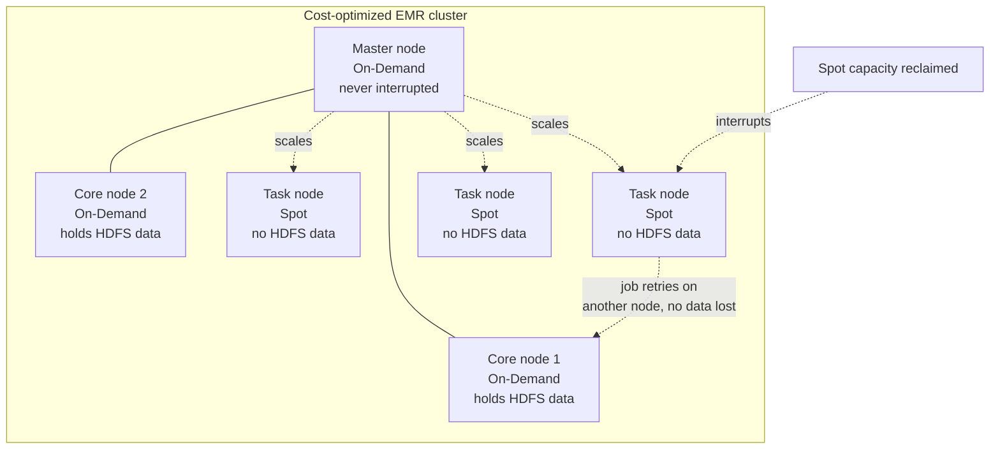
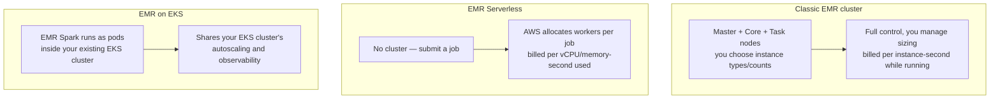

# Amazon EMR (Elastic MapReduce)

> **Appears in:** [MLA-C02](../../certifications/mla-c02/README.md) · [SAA-C03](../../certifications/saa-c03/README.md)


*Analytics · maps to SAA-C03 Domain 3 Task 3.5, MLA-C02 Domain 1 (Data Preparation for ML and AI)*

## Definition

Amazon EMR is a **managed big-data platform** that runs open-source frameworks — Apache Spark,
Hadoop, Hive, Presto/Trino, HBase, and others — on a cluster of EC2 instances (or containers,
or serverless) that AWS provisions, configures, and can scale for you. It's "rent a big-data
cluster by the hour (or by the second), fully configured, without racking servers."

## Purpose

Running real Hadoop/Spark clusters used to mean buying physical servers, installing and
patching dozens of interdependent open-source components, and tuning them for weeks before a
single job ran reliably. AWS built EMR so a team can launch a correctly-configured,
production-grade big-data cluster in minutes, scale it up for a big job and back down (or to
zero) when it's done, and pay only for what's running — while still having the full,
unrestricted open-source ecosystem available (not a cut-down, AWS-only substitute).

## How It Works

Plain explanation: EMR is a construction crew AWS assembles for you on demand. You tell it
which tools you need (Spark? Hive? Presto?), how big a crew (how many, what size instances),
and it shows up with everything pre-wired to talk to each other and to your data in S3. When
the job's done, you can send the crew home (terminate the cluster) and stop paying, while the
actual output stays safely in S3.



Step by step:

1. You launch an EMR **cluster**, picking a release version bundling tested, compatible
   versions of Spark/Hadoop/Hive/etc., and choosing node types: a **Master node** coordinates
   the cluster, **Core nodes** run tasks and hold HDFS storage, and **Task nodes** (optional,
   often Spot instances) add pure compute capacity without storage.
2. Data typically lives in **S3** (not HDFS) using the **EMRFS** connector, so the cluster
   itself can be ephemeral — you don't lose data by terminating it, because S3 is the durable
   layer, not the cluster's local disks.
3. You submit **jobs/steps** (a Spark application, a Hive query, a Presto query) to the
   cluster — either interactively via **EMR Studio/notebooks** for exploration, or as scripted
   steps for scheduled batch processing.
4. The cluster distributes work across Core/Task nodes, processing data in parallel, and
   writes results back to S3 (often in Parquet, partitioned for downstream query performance).
5. Once the job's done, the cluster can **auto-terminate** (for transient/batch workloads) or
   stay running (for long-lived interactive clusters) — and because compute is decoupled from
   storage (S3), you can scale the cluster independently of your data volume.
6. Output in S3 becomes queryable by **Athena** or **Redshift Spectrum** using the same Glue
   Data Catalog, the same way Glue ETL output is.

### Cluster lifecycle and step state machine

Understanding the exact states a cluster and a step move through matters for both debugging a
stuck job and for exam questions about transient vs. long-running clusters.



A step itself moves through its own, simpler sequence: `PENDING → RUNNING → COMPLETED` (happy
path), or `PENDING → RUNNING → FAILED`, and by default a failed step does **not** automatically
cancel steps queued behind it unless you explicitly configure
`ActionOnFailure=CANCEL_AND_WAIT` or `TERMINATE_CLUSTER` — a detail that shows up in both
real debugging ("why did steps after the failed one still run?") and exam questions about step
failure handling.

### Spot/On-Demand node mix for cost-optimized clusters



Master and Core nodes run On-Demand because losing the Master kills the cluster and losing a
Core node loses the HDFS blocks it was holding; Task nodes carry no HDFS data, so losing one to
a Spot reclamation only costs a retry of whatever task was running on it, not data loss — this
is the exact reasoning the exam expects you to articulate, not just the "Spot = cheaper"
headline.

### EMR deployment modes compared



The three deployment modes aren't tiers of the same thing — they're different answers to "who
manages the compute substrate." Classic EMR: you do, with full control. EMR Serverless: AWS
does, per job, zero idle cost. EMR on EKS: your existing Kubernetes platform does, for teams
already standardized there. A scenario naming Kubernetes/EKS explicitly is the signal for the
third option; a scenario just saying "no servers to manage" without mentioning containers
usually points to Serverless, not EKS.

## Key Features / Components

- **EMR Serverless** — run Spark/Hive jobs with no cluster to provision at all; AWS scales
  workers automatically per job — closes some of the operational gap with Glue while keeping
  full framework flexibility.
- **EMR on EKS** — run EMR Spark jobs inside an existing Kubernetes cluster, for teams
  standardized on EKS/containers.
- **Instance fleets/groups + Spot integration** — mix On-Demand and Spot instances within a
  cluster for significant cost savings on fault-tolerant, interruptible work.
- **EMRFS** — lets Spark/Hadoop treat S3 as if it were HDFS, enabling ephemeral, stateless
  clusters.
- **EMR Studio** — a managed, Jupyter-based notebook environment for interactive data
  science/engineering directly against the cluster.
- **Broad framework support** — Spark, Hadoop MapReduce, Hive, Presto/Trino, HBase, Flink, Hue
  — the full open-source big-data ecosystem, not a curated subset.
- **Managed scaling** — automatically add/remove Core and Task nodes based on workload, within
  limits you set.
- **Bootstrap actions** — custom scripts that run on every node at cluster launch, before
  Hadoop/Spark daemons start — the standard mechanism for installing extra libraries or tuning
  OS-level settings consistently across the whole cluster.
- **EMRFS consistent view / S3 optimized committer** — mechanisms that make Spark's commit
  protocol safe and fast against S3 (which has different consistency/rename semantics than a
  real filesystem like HDFS) — relevant when jobs intermittently see "missing output files"
  without them.
- **Security configurations** — a reusable bundle of encryption (at-rest, in-transit),
  Kerberos authentication, and IAM-based fine-grained access settings applied consistently
  across clusters, rather than configuring each setting ad hoc per cluster.

## Partitioning and performance tuning on EMR

- **Spark shuffle partitions** — the default (`spark.sql.shuffle.partitions=200`) is tuned for
  a mid-size cluster; a small cluster processing a small dataset wastes time on scheduling
  overhead for 200 tiny partitions, while a huge cluster processing terabytes may need far more
  than 200 to avoid huge, slow partitions — this single setting is one of the highest-leverage
  Spark tuning knobs and a frequent root cause of "why is my EMR job slow."
- **Output file count on S3** — same principle as Glue: coalesce/repartition before writing so
  output isn't thousands of tiny files; EMRFS pays a real per-object S3 API cost and latency
  penalty for excessive small files, separate from the Spark-side scheduling overhead.
- **Instance fleet provisioning strategy** — requesting a fleet of several compatible instance
  types (rather than one specific type) for Task nodes dramatically improves Spot availability
  and interruption resilience, since Spot capacity fluctuates independently per instance type.
- **HDFS replication factor on Core nodes** — defaults to 3x for durability; lowering it saves
  Core-node storage cost but increases the blast radius of losing a single Core node, a real
  tradeoff worth stating explicitly rather than treating replication as free.
- **Worked example — right-sizing a nightly Spark job**: a job processing 2 TB of input
  currently runs on 20 × m5.2xlarge Core nodes (8 vCPU/32 GB each) in 90 minutes with visible
  shuffle spill in the Spark UI. Switching the same node count to m5.4xlarge (16 vCPU/64 GB,
  double the memory per node, same total node count) often resolves shuffle-spill-driven
  slowness more effectively — and more cheaply overall — than simply doubling the *count* of
  the original smaller instance type, because the bottleneck was memory per executor, not raw
  CPU parallelism.

## Common Architectures

**1. Transient nightly batch cluster** — cluster launches on a schedule (via Step Functions or
EventBridge + Lambda calling `RunJobFlow`), runs a sequence of Spark/Hive steps, writes results
to S3, and auto-terminates — the default "we need big-data power for 2 hours a night, not
24/7" shape, and the standard EMR cost-optimization answer versus a long-running cluster.

**2. Long-running interactive cluster with EMR Studio** — a cluster stays up for a data science
team's working hours, serving Jupyter notebooks against a shared Spark context for exploratory
analysis on large datasets that don't fit a single machine — explicitly NOT auto-terminated,
and typically right-sized with managed scaling rather than a fixed, overprovisioned node count.

**3. EMR Serverless for unpredictable, bursty Spark workloads** — no cluster to provision at
all; submit a Spark job, EMR Serverless allocates workers for that job's duration only — the
answer whenever a scenario wants EMR's full framework flexibility with Glue-like zero-idle-
cost economics.

**4. EMR on EKS for container-standardized teams** — an organization already running all
workloads on EKS runs EMR Spark jobs as Kubernetes pods inside the same cluster, sharing
cluster autoscaling and observability tooling with the rest of their container workloads
instead of operating a separate EMR-native cluster fleet.

**5. Large-scale ML feature engineering feeding SageMaker** — EMR Spark processes a dataset too
large for a single SageMaker Processing job or Data Wrangler flow (hundreds of GB to TB-scale),
writing engineered features to S3 in a format a SageMaker training job (or Feature Store
ingestion job) consumes directly — the standard MLA-C02 "when Glue/Data Wrangler isn't enough"
escalation path.

## Use Cases — When to Use It

- Large-scale, complex **Spark or Hadoop** processing jobs (petabyte-scale ETL, large ML
  feature engineering, log processing) where you need control over cluster size, instance
  types, and the specific framework version.
- Workloads that specifically need **Hive, HBase, Presto/Trino, or other Hadoop-ecosystem
  tools** that Glue doesn't offer.
- **Cost-sensitive, fault-tolerant batch processing** where a large Spot-instance fleet can cut
  compute cost substantially (EMR is a textbook SAA-C03 Domain 4 cost-optimization example).
- Processing that needs full control (e.g., custom Spark configurations, tuning shuffle
  behavior, GPU-accelerated ML training on raw data at scale).
- Interactive, exploratory **data science at scale** via EMR Studio notebooks against very
  large datasets that don't fit on a single machine or SageMaker notebook instance.

## When NOT to Use It / Alternatives

- If the job is "clean this data and land it somewhere, on a schedule, with no ops burden" —
  **Glue** does the same transformation job with zero cluster management; EMR trades
  operational simplicity for control, so don't reach for it by default.
- If you just need **ad-hoc SQL on data in S3** — **Athena** answers that directly without
  standing up any cluster at all.
- For **data warehousing with complex joins across curated, structured data** at BI scale —
  **Redshift** is usually a better fit than running Presto/Hive on EMR yourself.
- Don't keep a long-running EMR cluster "just in case" for occasional jobs — that's paying for
  idle compute; use **EMR Serverless** or launch-and-terminate transient clusters instead.
- Don't under-size Core nodes to save cost — losing a Core node loses HDFS blocks it was
  holding; Spot is for Task nodes, not a place to cut corners on Core/Master.

## Why It's Important

**Real-world:** EMR is still the backbone of a huge share of real-world big-data pipelines at
scale — it's the honest "we actually need Spark/Hadoop/Presto, with real control" option when
managed/serverless tools don't fit. Picking the right node mix (Spot for Task nodes, On-Demand
for Core nodes) is a direct, material cost lever companies rely on.

**Exam:** EMR is named explicitly in **SAA-C03 Task 3.5 — "Determine high-performing data
ingestion and transformation solutions"**, usually as the "when you need full big-data
framework control and can tolerate/want to manage a cluster" answer against Glue's serverless
alternative. It also appears in **SAA-C03 Domain 4 (Cost-Optimized Architectures)** via Spot
Instance usage in EMR clusters. In **MLA-C02 Domain 1**, "EMR Spark" is explicitly listed as a
transform-step tool alongside Glue and SageMaker Data Wrangler — expect scenario questions
about large-scale feature engineering or preprocessing that exceeds what a single SageMaker
instance or Glue job can efficiently handle.

### Exam scenario deep-dive: transient vs. long-running clusters

| Scenario clue | Correct answer | Why |
|---|---|---|
| "Nightly batch job, 2 hours, minimize cost" | Transient cluster, auto-terminate, Spot Task nodes | No reason to pay for idle cluster time |
| "Data science team needs an always-available interactive notebook environment" | Long-running cluster with EMR Studio, managed scaling | Interactive workloads need persistence; auto-terminate would be disruptive |
| "Unpredictable, bursty Spark jobs, minimize operational overhead" | EMR Serverless | No cluster sizing decisions, pay only per job |
| "Need HDFS replication tuning and custom Kerberos security config across many clusters" | EMR with a reusable security configuration | Full control is the explicit requirement here |
| "Losing a Spot instance mid-job must not lose data" | Spot on Task nodes only, On-Demand Core/Master | Task nodes hold no HDFS data, so losing one only costs a retry |

### MLA-C02 scenario — when EMR beats Glue/Data Wrangler for ML prep

A Domain 1 question describing feature engineering over **hundreds of GB to TB-scale** raw
data, needing **custom distributed algorithms** (not just standard joins/filters/encodings), or
requiring **GPU-accelerated preprocessing** at scale, is pointing at EMR (often EMR with GPU
instance types) rather than Glue ETL or SageMaker Data Wrangler — both of the latter are
strong for moderate-scale, standard transformation patterns, but EMR is the answer once the
question's scale or algorithmic-customization language exceeds what those tools are built for.

## Pricing Model (summary)

- Billed per **second** for the underlying EC2 instances in the cluster, plus a smaller
  **EMR service fee** per instance-hour on top of EC2 pricing.
- **Spot Instances** for Task/Core nodes can cut compute cost significantly for fault-tolerant
  workloads (the job retries on another node if a Spot instance is reclaimed).
- **EMR Serverless** bills per vCPU/memory-second actually consumed by the job — no idle
  cluster cost at all.
- Storage (S3) is billed separately under standard S3 pricing.
- **Worked example — transient vs. always-on cluster cost**: a nightly job needs 10 ×
  m5.2xlarge nodes for 90 minutes. Transient: 10 nodes × 1.5 hours × (EC2 rate + EMR service
  fee) ≈ a few dollars per run, roughly **tens of dollars per month** running nightly. The same
  10-node cluster left running 24/7 "just in case" costs roughly **16x more** for the same
  actual useful compute time (1.5 hours used out of 24 available each day) — the arithmetic
  behind why "auto-terminate transient clusters" is close to a universal EMR cost-optimization
  answer on the exam.
- **Worked example — Spot savings on Task nodes**: a cluster with 4 On-Demand Core nodes
  running the full job and adding 6 Spot Task nodes for peak-hour burst capacity — if Spot
  pricing runs at roughly 60–70% off On-Demand for the instance type in question, the 6 Task
  nodes cost substantially less than the same count of On-Demand instances would, while the
  4 Core nodes guarantee the job can still complete (slower) even in the worst case where every
  Task node is reclaimed simultaneously.
- See official pricing: https://aws.amazon.com/emr/pricing/

## Limits & Quotas

- **Cluster size**: EMR supports clusters from a single node up to hundreds of nodes; very
  large clusters may need an account service-quota increase for EC2 instance limits in the
  target region, since EMR itself doesn't cap cluster size as tightly as the underlying EC2
  quota does.
- **Steps per cluster**: a soft limit on the number of steps that can be submitted to a cluster
  over its lifetime (in the low hundreds by default) — long-running clusters processing many
  small steps may need to batch work into fewer, larger steps or request a quota increase.
- **Instance fleets**: up to 5 instance type specifications per fleet by default — relevant when
  maximizing Spot diversification across many instance types for availability.
- **EMR Serverless**: application-level vCPU/memory maximums are configurable per application,
  bounding how much a single job can scale to.
- **Release version support window**: AWS supports a rolling set of EMR release versions;
  very old releases eventually lose support, which matters for long-lived pinned-version
  clusters that haven't been upgraded.

## Troubleshooting / Common Issues

- **Job runs much slower than expected with visible shuffle spill in Spark UI** — memory
  pressure on executors; increase executor memory (bigger instance type or fewer executors per
  node) before adding more nodes of the same size, which doesn't address the underlying
  per-task memory ceiling.
- **"Missing output" after a job that appeared to succeed** — check EMRFS commit behavior; S3's
  rename/consistency semantics differ from HDFS, and jobs not using the S3-optimized output
  committer can occasionally leave partial/inconsistent output under certain failure/retry
  conditions.
- **Steps after a failed step still ran and produced wrong results** — by default EMR does not
  cancel queued steps when an earlier step fails; set `ActionOnFailure` explicitly
  (`CANCEL_AND_WAIT` or `TERMINATE_CLUSTER`) if downstream steps depend on an earlier step's
  success.
- **Cluster stuck in `BOOTSTRAPPING`** — a custom bootstrap action is hanging or failing
  silently on some nodes; check bootstrap action logs in S3 (EMR uploads them automatically)
  rather than assuming the cluster itself is broken.
- **Spot Task nodes repeatedly reclaimed, job keeps retrying tasks** — diversify across more
  instance types/AZs in the Task instance fleet rather than requesting one specific, possibly
  capacity-constrained instance type; a narrow fleet specification is a common root cause of
  "Spot keeps getting reclaimed" complaints that read like an AWS reliability problem but are
  actually a provisioning-strategy problem.
- **Data not visible to Hive/Presto after a Spark job writes it** — the Glue Data Catalog (or
  Hive Metastore) wasn't updated with the new partition; either re-run `MSCK REPAIR TABLE`
  (Hive/Presto) or ensure the writing job registers new partitions explicitly, the same pattern
  described in `glue.md`.
- **EMR Serverless job fails immediately with a capacity/quota error** — check the application's
  configured maximum vCPU/memory; a job's requested executor count/size can exceed the
  application-level cap even though the account's broader EC2 quota would allow more, since
  EMR Serverless applications have their own independently configured ceiling.
- **Cluster terminates with `TERMINATED_WITH_ERRORS` but the step logs look clean** — check
  bootstrap action exit codes and instance health events (e.g., an underlying EC2 instance
  failure or an AZ capacity issue) separately from step-level application logs; a cluster-level
  termination reason isn't always visible from inside a step's own log output.

## Hands-on Lab (Floci)

Floci does not run a full EMR cluster or the underlying Hadoop/Spark/Presto daemons (EMR is a
heavyweight, multi-service orchestration product that isn't practically emulated locally) — its
`awslocal emr` support is limited to basic cluster metadata API calls. For real hands-on Spark
experience, the practical free alternative is running **open-source Apache Spark/Hadoop in
Docker Compose** on your machine, pointed at the same S3 bucket Floci exposes, which exercises
the same EMRFS-style S3 read/write pattern without needing real AWS. Full walkthrough:
`labs-floci/emr.md`.

```bash
# Metadata-level only in Floci — demonstrates the API shape, not real Spark execution
awslocal emr create-cluster \
  --name "demo-cluster" \
  --release-label emr-6.15.0 \
  --applications Name=Spark Name=Hive \
  --instance-type m5.xlarge \
  --instance-count 3 \
  --use-default-roles

awslocal emr list-clusters

awslocal emr describe-cluster --cluster-id <ClusterId-from-above>

# Submit a step (metadata-level in Floci)
awslocal emr add-steps --cluster-id <ClusterId-from-above> --steps '[{
  "Name": "spark-etl-step",
  "ActionOnFailure": "CONTINUE",
  "HadoopJarStep": {
    "Jar": "command-runner.jar",
    "Args": ["spark-submit", "--deploy-mode", "cluster", "s3://scripts/transform_job.py"]
  }
}]'

# Real execution: run equivalent Spark job against Floci's S3 using local Spark/Docker instead
# docker run --rm -v $(pwd):/app bitnami/spark:3 spark-submit \
#   --conf spark.hadoop.fs.s3a.endpoint=http://localhost:4566 /app/transform_job.py
```

## Exam Tips

- **Glue vs. EMR** is the headline confusion: Glue = serverless, pay-per-job, no cluster
  control, best when minimizing ops is the priority. EMR = you own the cluster shape (instance
  types/counts/Spot mix), full Hadoop ecosystem (Hive/HBase/Presto), best when you need that
  control or those specific tools. If the question says "fully managed, no infrastructure to
  maintain" → Glue. If it says "need to run Hive/Presto/HBase" or "customize cluster
  configuration/Spot fleet" → EMR.
- EMR clusters storing data on **HDFS** lose that data when the cluster terminates — the exam-
  correct pattern is **EMRFS to S3** for durable storage, keeping clusters ephemeral.
- **Spot Instances on Task nodes, On-Demand on Core/Master** is the standard "cost-optimized,
  fault-tolerant EMR cluster" exam answer — Task nodes hold no persistent data, so losing one
  to Spot reclamation doesn't lose data, only requires a retry.
- Don't confuse **EMR Serverless** (no cluster management, pay per job) with standard EMR
  (you provision and manage cluster size) — questions emphasizing "no cluster to manage" with
  Spark/Hive specifically (not just general ETL) may be pointing at EMR Serverless, not Glue.
- Remember a failed step does **not** automatically stop subsequent queued steps unless
  `ActionOnFailure` is explicitly set — a detail tested both as an operational gotcha and a
  direct factual question.
- A question emphasizing "shuffle spill," "out of memory on executors," or "job slow despite
  adding nodes" is pointing at **instance type/memory sizing**, not node *count* — this is one
  of the more nuanced, frequently-missed EMR performance distinctions on the exam.

## Further Reading

- EMR architecture and service layers:
  https://docs.aws.amazon.com/emr/latest/ManagementGuide/emr-overview-arch.html
- Understanding EMR node types (primary/core/task):
  https://docs.aws.amazon.com/emr/latest/ManagementGuide/emr-master-core-task-nodes.html
- EMR cluster and step lifecycle:
  https://docs.aws.amazon.com/emr/latest/ManagementGuide/emr-overview.html
- EMR Serverless:
  https://docs.aws.amazon.com/emr/latest/EMR-Serverless-UserGuide/emr-serverless.html
- EMR on EKS:
  https://docs.aws.amazon.com/emr/latest/EMR-on-EKS-DevelopmentGuide/emr-eks.html
- Instance fleets and Spot best practices:
  https://docs.aws.amazon.com/emr/latest/ManagementGuide/emr-instance-fleet.html
- EMR pricing: https://aws.amazon.com/emr/pricing/

### Reference diagrams from official AWS sources


*The official EMR cluster lifecycle diagram — states from cluster launch through
bootstrapping, running, and termination, matching the state machine described above. Source:
AWS EMR Management Guide,
[Understanding how to create and work with Amazon EMR clusters](https://docs.aws.amazon.com/emr/latest/ManagementGuide/emr-overview.html).*


*The official EMR step state sequence — PENDING, RUNNING, COMPLETED/FAILED/CANCELLED — the
exact states referenced in the troubleshooting section above. Source: AWS EMR Management Guide,
[Understanding how to create and work with Amazon EMR clusters](https://docs.aws.amazon.com/emr/latest/ManagementGuide/emr-overview.html).*

## Related Terms

[`glossary/README.md`](../../glossary/README.md) · [`glue.md`](glue.md) ·
[`athena.md`](athena.md) · [`data-lake-concepts.md`](data-lake-concepts.md) ·
`services/compute/ec2.md` · `services/storage/s3.md`
