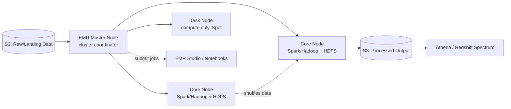

# Amazon EMR (Elastic MapReduce)


*Analytics · maps to SAA-C03 Domain 3 Task 3.5, MLA-C02 Domain 1 (Data Preparation for ML and AI)*

## Definition

Amazon EMR is a **managed big-data platform** that runs open-source frameworks — Apache Spark,
Hadoop, Hive, Presto/Trino, HBase, and others — on a cluster of EC2 instances (or containers,
or serverless) that AWS provisions, configures, and can scale for you. It's "rent a big-data
cluster by the hour (or by the second), fully configured, without racking servers."

## Purpose

Running real Hadoop/Spark clusters used to mean buying physical servers, installing and
patching dozens of interdependent open-source components, and tuning them for weeks before a
single job ran reliably. AWS built EMR so a team can launch a correctly-configured,
production-grade big-data cluster in minutes, scale it up for a big job and back down (or to
zero) when it's done, and pay only for what's running — while still having the full,
unrestricted open-source ecosystem available (not a cut-down, AWS-only substitute).

## How It Works

Plain explanation: EMR is a construction crew AWS assembles for you on demand. You tell it
which tools you need (Spark? Hive? Presto?), how big a crew (how many, what size instances),
and it shows up with everything pre-wired to talk to each other and to your data in S3. When
the job's done, you can send the crew home (terminate the cluster) and stop paying, while the
actual output stays safely in S3.



Step by step:

1. You launch an EMR **cluster**, picking a release version bundling tested, compatible
   versions of Spark/Hadoop/Hive/etc., and choosing node types: a **Master node** coordinates
   the cluster, **Core nodes** run tasks and hold HDFS storage, and **Task nodes** (optional,
   often Spot instances) add pure compute capacity without storage.
2. Data typically lives in **S3** (not HDFS) using the **EMRFS** connector, so the cluster
   itself can be ephemeral — you don't lose data by terminating it, because S3 is the durable
   layer, not the cluster's local disks.
3. You submit **jobs/steps** (a Spark application, a Hive query, a Presto query) to the
   cluster — either interactively via **EMR Studio/notebooks** for exploration, or as scripted
   steps for scheduled batch processing.
4. The cluster distributes work across Core/Task nodes, processing data in parallel, and
   writes results back to S3 (often in Parquet, partitioned for downstream query performance).
5. Once the job's done, the cluster can **auto-terminate** (for transient/batch workloads) or
   stay running (for long-lived interactive clusters) — and because compute is decoupled from
   storage (S3), you can scale the cluster independently of your data volume.
6. Output in S3 becomes queryable by **Athena** or **Redshift Spectrum** using the same Glue
   Data Catalog, the same way Glue ETL output is.

## Key Features / Components

- **EMR Serverless** — run Spark/Hive jobs with no cluster to provision at all; AWS scales
  workers automatically per job — closes some of the operational gap with Glue while keeping
  full framework flexibility.
- **EMR on EKS** — run EMR Spark jobs inside an existing Kubernetes cluster, for teams
  standardized on EKS/containers.
- **Instance fleets/groups + Spot integration** — mix On-Demand and Spot instances within a
  cluster for significant cost savings on fault-tolerant, interruptible work.
- **EMRFS** — lets Spark/Hadoop treat S3 as if it were HDFS, enabling ephemeral, stateless
  clusters.
- **EMR Studio** — a managed, Jupyter-based notebook environment for interactive data
  science/engineering directly against the cluster.
- **Broad framework support** — Spark, Hadoop MapReduce, Hive, Presto/Trino, HBase, Flink, Hue
  — the full open-source big-data ecosystem, not a curated subset.
- **Managed scaling** — automatically add/remove Core and Task nodes based on workload, within
  limits you set.

## Use Cases — When to Use It

- Large-scale, complex **Spark or Hadoop** processing jobs (petabyte-scale ETL, large ML
  feature engineering, log processing) where you need control over cluster size, instance
  types, and the specific framework version.
- Workloads that specifically need **Hive, HBase, Presto/Trino, or other Hadoop-ecosystem
  tools** that Glue doesn't offer.
- **Cost-sensitive, fault-tolerant batch processing** where a large Spot-instance fleet can cut
  compute cost substantially (EMR is a textbook SAA-C03 Domain 4 cost-optimization example).
  processing that needs full control (e.g., custom Spark configurations, tuning shuffle
  behavior, GPU-accelerated ML training on raw data at scale).
- Interactive, exploratory **data science at scale** via EMR Studio notebooks against very
  large datasets that don't fit on a single machine or SageMaker notebook instance.

## When NOT to Use It / Alternatives

- If the job is "clean this data and land it somewhere, on a schedule, with no ops burden" —
  **Glue** does the same transformation job with zero cluster management; EMR trades
  operational simplicity for control, so don't reach for it by default.
- If you just need **ad-hoc SQL on data in S3** — **Athena** answers that directly without
  standing up any cluster at all.
- For **data warehousing with complex joins across curated, structured data** at BI scale —
  **Redshift** is usually a better fit than running Presto/Hive on EMR yourself.
- Don't keep a long-running EMR cluster "just in case" for occasional jobs — that's paying for
  idle compute; use **EMR Serverless** or launch-and-terminate transient clusters instead.

## Why It's Important

**Real-world:** EMR is still the backbone of a huge share of real-world big-data pipelines at
scale — it's the honest "we actually need Spark/Hadoop/Presto, with real control" option when
managed/serverless tools don't fit. Picking the right node mix (Spot for Task nodes, On-Demand
for Core nodes) is a direct, material cost lever companies rely on.

**Exam:** EMR is named explicitly in **SAA-C03 Task 3.5 — "Determine high-performing data
ingestion and transformation solutions"**, usually as the "when you need full big-data
framework control and can tolerate/want to manage a cluster" answer against Glue's serverless
alternative. It also appears in **SAA-C03 Domain 4 (Cost-Optimized Architectures)** via Spot
Instance usage in EMR clusters. In **MLA-C02 Domain 1**, "EMR Spark" is explicitly listed as a
transform-step tool alongside Glue and SageMaker Data Wrangler — expect scenario questions
about large-scale feature engineering or preprocessing that exceeds what a single SageMaker
instance or Glue job can efficiently handle.

## Pricing Model (summary)

- Billed per **second** for the underlying EC2 instances in the cluster, plus a smaller
  **EMR service fee** per instance-hour on top of EC2 pricing.
- **Spot Instances** for Task/Core nodes can cut compute cost significantly for fault-tolerant
  workloads (the job retries on another node if a Spot instance is reclaimed).
- **EMR Serverless** bills per vCPU/memory-second actually consumed by the job — no idle
  cluster cost at all.
- Storage (S3) is billed separately under standard S3 pricing.
- See official pricing: https://aws.amazon.com/emr/pricing/

## Hands-on Lab (Floci)

Floci does not run a full EMR cluster or the underlying Hadoop/Spark/Presto daemons (EMR is a
heavyweight, multi-service orchestration product that isn't practically emulated locally) — its
`awslocal emr` support is limited to basic cluster metadata API calls. For real hands-on Spark
experience, the practical free alternative is running **open-source Apache Spark/Hadoop in
Docker Compose** on your machine, pointed at the same S3 bucket Floci exposes, which exercises
the same EMRFS-style S3 read/write pattern without needing real AWS. Full walkthrough:
`labs-floci/emr.md`.

```bash
# Metadata-level only in Floci — demonstrates the API shape, not real Spark execution
awslocal emr create-cluster \
  --name "demo-cluster" \
  --release-label emr-6.15.0 \
  --applications Name=Spark Name=Hive \
  --instance-type m5.xlarge \
  --instance-count 3 \
  --use-default-roles

awslocal emr list-clusters

awslocal emr describe-cluster --cluster-id <ClusterId-from-above>

# Real execution: run equivalent Spark job against Floci's S3 using local Spark/Docker instead
# docker run --rm -v $(pwd):/app bitnami/spark:3 spark-submit \
#   --conf spark.hadoop.fs.s3a.endpoint=http://localhost:4566 /app/transform_job.py
```

## Exam Tips

- **Glue vs. EMR** is the headline confusion: Glue = serverless, pay-per-job, no cluster
  control, best when minimizing ops is the priority. EMR = you own the cluster shape (instance
  types/counts/Spot mix), full Hadoop ecosystem (Hive/HBase/Presto), best when you need that
  control or those specific tools. If the question says "fully managed, no infrastructure to
  maintain" → Glue. If it says "need to run Hive/Presto/HBase" or "customize cluster
  configuration/Spot fleet" → EMR.
- EMR clusters storing data on **HDFS** lose that data when the cluster terminates — the exam-
  correct pattern is **EMRFS to S3** for durable storage, keeping clusters ephemeral.
- **Spot Instances on Task nodes, On-Demand on Core/Master** is the standard "cost-optimized,
  fault-tolerant EMR cluster" exam answer — Task nodes hold no persistent data, so losing one
  to Spot reclamation doesn't lose data, only requires a retry.
- Don't confuse **EMR Serverless** (no cluster management, pay per job) with standard EMR
  (you provision and manage cluster size) — questions emphasizing "no cluster to manage" with
  Spark/Hive specifically (not just general ETL) may be pointing at EMR Serverless, not Glue.

## Related Terms

[`glossary/README.md`](../../glossary/README.md) · [`glue.md`](glue.md) ·
[`athena.md`](athena.md) · [`data-lake-concepts.md`](data-lake-concepts.md) ·
`services/compute/ec2.md` · `services/storage/s3.md`
