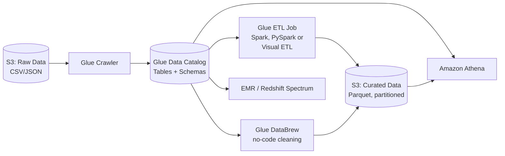

# AWS Glue (Glue ETL, Glue DataBrew, Glue Data Catalog)


*Analytics · maps to SAA-C03 Domain 3 Task 3.5, MLA-C02 Domain 1 (Data Preparation for ML and AI)*

## Definition

AWS Glue is a **serverless data integration service**: it finds, catalogs, cleans, and
transforms data so it's ready to be queried or analyzed, without you standing up and managing
any servers. It's really three connected tools under one name: the **Data Catalog** (a shared
metadata directory — "what tables/columns exist and where"), **Glue ETL** (code-based or
visual jobs that transform data at scale using Apache Spark), and **Glue DataBrew** (a
no-code, visual tool for cleaning and normalizing data).

## Purpose

Raw data almost never arrives ready to analyze — it's scattered across S3 buckets, databases,
and file formats, with inconsistent schemas, missing values, and no shared catalog of what
exists where. AWS built Glue so that transforming messy data into clean, queryable data
doesn't require provisioning a Hadoop/Spark cluster yourself, writing boilerplate schema
discovery code, or hiring someone who knows Spark internals just to clean a CSV. It's the
"glue" between where data lands and where it's usable.

## How It Works

Plain explanation: imagine a librarian (the **Crawler**) who walks through your messy archive
room (S3), reads what's in each box, and writes an index card for every shelf describing its
contents (the **Data Catalog**). Once the index exists, a worker (a **Glue ETL job**, running
serverless Spark) can look up "where's the raw sales data" in the index, pull it, clean/reshape
it, and put the finished product on a different shelf. **DataBrew** is a separate workbench
where someone who isn't a programmer can point-and-click to clean data visually, without ever
touching Spark code.



Step by step:

1. A **Crawler** points at a data source (an S3 prefix, a JDBC database, DynamoDB) and infers
   schema automatically — column names, data types, partitioning structure — without you
   writing that schema by hand.
2. The crawler writes (or updates) tables in the **Glue Data Catalog** — a central, Hive
   Metastore-compatible metadata store. This catalog is shared infrastructure: Athena, EMR,
   and Redshift Spectrum all read from the same catalog, so you define a schema once and every
   query engine sees it.
3. A **Glue ETL job** (written in PySpark/Scala, built visually in Glue Studio, or generated
   from a blueprint) reads from catalog tables, applies transformations — joins, filters, type
   conversions, format conversion (CSV → Parquet) — and writes the result back to S3, typically
   partitioned for efficient downstream querying. Jobs run on **serverless Spark workers**
   (DPUs) that Glue provisions and tears down automatically per run.
4. **Glue DataBrew** offers an alternative path for the same curated-data goal: a visual UI
   where an analyst profiles the data (see nulls, outliers, distributions), applies 250+
   built-in transformations (trim whitespace, standardize dates, deduplicate) via clicks, and
   publishes a recipe that can run repeatedly — no Spark code written by a human.
5. Once curated data lands in S3 (or a database), **Athena**, **Redshift Spectrum**, and **EMR**
   all query it directly using the same Data Catalog entries — the catalog is the single
   source of truth so every engine agrees on the schema.

## Key Features / Components

- **Glue Data Catalog** — a persistent, managed Hive-metastore-compatible metadata store;
  shared across Athena/EMR/Redshift Spectrum so schema is defined once.
- **Crawlers** — scan a data source and infer/update schema automatically; can run on a
  schedule to pick up new partitions as data arrives.
- **Glue ETL (jobs)** — serverless Apache Spark (or Python Shell for lighter jobs) that reads,
  transforms, writes data at scale; billed per **DPU-hour** (Data Processing Unit).
- **Glue Studio** — visual, drag-and-drop job authoring UI that generates PySpark code for you.
- **Glue DataBrew** — no-code visual data cleaning with a point-and-click recipe builder aimed
  at analysts, not engineers.
- **Glue Workflows & Triggers** — orchestrate multi-step ETL (crawl → transform → crawl again)
  without a separate orchestration tool.
- **Glue Schema Registry** — validates and manages schemas for streaming data (e.g., Kafka/
  Kinesis payloads), preventing incompatible schema changes from breaking consumers.
- **FindMatches / Sensitive Data Detection** — ML-powered transforms for deduplication and PII
  discovery built into Glue ETL.

## Use Cases — When to Use It

- You have raw files landing in S3 (logs, exports, IoT data) and need a **repeatable, scheduled
  transformation** into a clean, partitioned, query-ready format (e.g., CSV → Parquet) —
  classic Glue ETL job.
- You need a **shared schema catalog** so Athena, EMR, and Redshift Spectrum all agree on table
  definitions without redefining them in three places — Glue Data Catalog.
- A business analyst (not an engineer) needs to clean/normalize a dataset visually before it's
  usable — **Glue DataBrew**.
- You're building a **data lake** and need automatic schema discovery as new data partitions
  (e.g., daily S3 folders) show up — **Glue Crawlers** on a schedule.
- Preparing training data for ML (dedup, null handling, format conversion) before it reaches
  SageMaker — Glue ETL/DataBrew is the standard "data prep" layer in MLA-C02 pipelines.

## When NOT to Use It / Alternatives

- For **heavy, long-running, highly customized big-data processing** (complex multi-stage
  Spark pipelines, Hadoop ecosystem tools like Hive/HBase/Presto, or workloads needing fine
  control over cluster size/instance types/spot mix) — **EMR** gives you that control; Glue
  intentionally trades control for "no servers to manage."
- If you just need **ad-hoc SQL queries** against data already in S3 and don't need a
  repeatable transformation pipeline — go straight to **Athena**, skip writing a Glue job.
- If your transformation needs are trivial (rename a column, light filtering) and run
  infrequently, a **Lambda function** triggered by an S3 event can be cheaper and simpler than
  spinning up a Glue job's Spark workers.
- DataBrew isn't a replacement for ETL at true big-data scale or for complex joins across many
  large tables — it's optimized for analyst-level cleaning tasks, not heavy-duty pipeline
  engineering.

## Why It's Important

**Real-world:** most "the dashboard numbers look wrong" incidents trace back to inconsistent
schemas or uncleaned data — Glue's catalog-first approach (one schema, many consumers) is what
prevents Athena and Redshift from silently disagreeing about what a column means. Serverless
billing also means a company doesn't pay for idle Spark clusters between nightly ETL runs.

**Exam:** Glue is named explicitly in **SAA-C03 Task 3.5 — "Determine high-performing data
ingestion and transformation solutions"** alongside Kinesis and EMR — exam scenarios test
whether you'd pick serverless Glue (no ops burden, pay-per-job) vs. EMR (full cluster control)
for a given transformation need. In **MLA-C02 Domain 1 (Data Preparation for ML and AI)**,
Glue and **Glue DataBrew** are explicitly listed as the "transform" step tools (alongside EMR
Spark and SageMaker Data Wrangler) — expect questions on choosing DataBrew (no-code, analyst-
friendly) vs. Glue ETL (code-based, engineer-driven) vs. SageMaker Data Wrangler (ML-feature-
specific transforms).

## Pricing Model (summary)

- **Glue ETL jobs**: billed per **DPU-hour** (a DPU = 4 vCPU + 16 GB memory), billed by the
  second with a 1-minute minimum per job run — you pay only while the job executes.
- **Crawlers**: billed per DPU-hour for the time spent crawling.
- **Data Catalog**: first 1 million objects stored and first 1 million access requests/month
  are free; beyond that, a small per-object/per-request fee.
- **Glue DataBrew**: billed per session (interactive data profiling/cleaning) and per job run
  (when a recipe executes on a schedule), node-hour based.
- See official pricing: https://aws.amazon.com/glue/pricing/

## Hands-on Lab (Floci)

Floci's Glue support covers the **Data Catalog** (databases, tables, partitions) and basic
**Crawler**/job metadata operations well via `awslocal glue`; it does not run an actual Spark
execution engine for Glue ETL jobs (there's no real Spark cluster behind the emulator) — for
hands-on Spark execution, run **open-source Apache Spark in Docker** locally against the same
S3 data in Floci, or use the AWS Glue Studio free-tier notebook on a real (disposable) AWS
account for a short session. Full walkthrough: `labs-floci/glue.md`.

```bash
# Create a Glue database (a namespace for tables in the Data Catalog)
awslocal glue create-database --database-input '{"Name":"salesdb"}'

# Register a table manually (what a crawler would normally infer for you)
awslocal glue create-table --database-name salesdb --table-input '{
  "Name": "raw_sales",
  "StorageDescriptor": {
    "Columns": [
      {"Name": "order_id", "Type": "string"},
      {"Name": "amount", "Type": "double"},
      {"Name": "order_date", "Type": "string"}
    ],
    "Location": "s3://sales-landing/raw/",
    "InputFormat": "org.apache.hadoop.mapred.TextInputFormat",
    "SerdeInfo": {"SerializationLibrary": "org.apache.hadoop.hive.serde2.OpenCSVSerde"}
  }
}'

# List tables in the catalog to confirm it's registered
awslocal glue get-tables --database-name salesdb

# Create a crawler pointing at the raw data prefix (metadata only in Floci)
awslocal glue create-crawler \
  --name sales-crawler \
  --role arn:aws:iam::000000000000:role/glue-role \
  --database-name salesdb \
  --targets '{"S3Targets":[{"Path":"s3://sales-landing/raw/"}]}'

awslocal glue start-crawler --name sales-crawler
```

## Exam Tips

- **Glue vs. EMR** — the second-most common confusion on this topic. Glue = serverless,
  "no cluster to manage," best for scheduled/repeatable ETL and when the Data Catalog matters.
  EMR = you choose the cluster (instance types, size, Spot mix), full Hadoop ecosystem access
  (Hive, HBase, Presto, Spark), best when you need fine-grained control or non-Spark big-data
  tools. If the question emphasizes "minimal operational overhead" or "serverless" → Glue. If
  it emphasizes "full control over cluster configuration" or names Hive/HBase/Presto → EMR.
- **Glue Data Catalog is shared** — a classic exam trap is assuming Athena needs its own
  separate schema definition; it reads the *same* Glue Data Catalog that EMR and Redshift
  Spectrum use. One schema registered once (via crawler or manually) serves all three.
  Remember this interconnection, especially: **athena.md**.
- **DataBrew vs. Glue ETL vs. SageMaker Data Wrangler** — DataBrew is no-code/visual for general
  analytics cleaning; SageMaker Data Wrangler is also visual but specifically for ML feature
  engineering (feeds SageMaker directly); Glue ETL is code-based/Spark for engineers.
- Crawlers cost money and time — running them on every single file upload instead of on a
  schedule is a common "cost-optimized architecture" (Domain 4) wrong-answer bait.

## Related Terms

[`glossary/README.md`](../../glossary/README.md) · [`athena.md`](athena.md) ·
[`emr.md`](emr.md) · [`data-lake-concepts.md`](data-lake-concepts.md) ·
[`kinesis-family.md`](kinesis-family.md) · `services/storage/s3.md` ·
`services/machine-learning-ai/sagemaker-data-wrangler.md`
