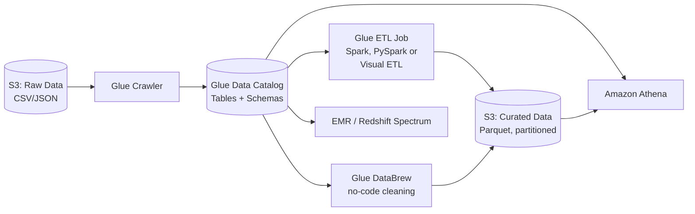
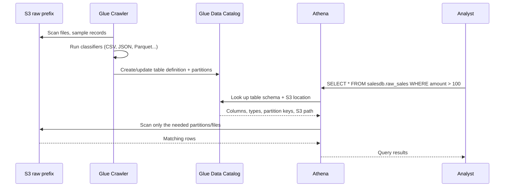
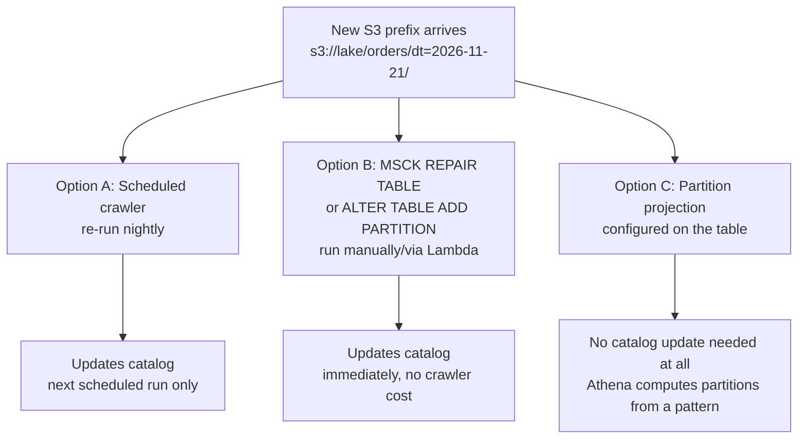
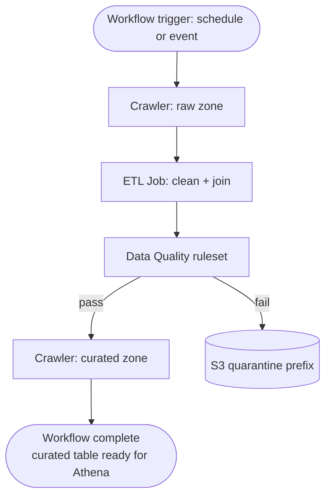
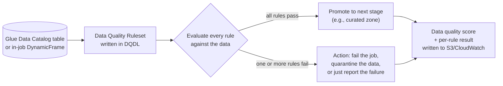
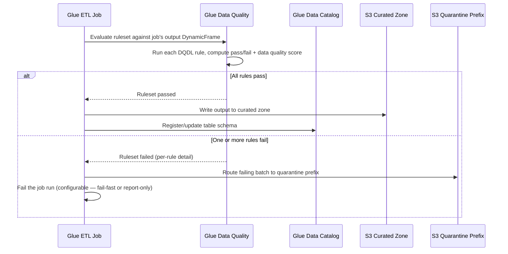
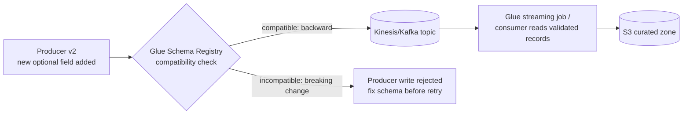

# AWS Glue (Glue ETL, Glue DataBrew, Glue Data Catalog)

> **Appears in:** [MLA-C02](../../certifications/mla-c02/README.md) · [SAA-C03](../../certifications/saa-c03/README.md)


*Analytics · maps to SAA-C03 Domain 3 Task 3.5, MLA-C02 Domain 1 (Data Preparation for ML and AI)*

## Definition

AWS Glue is a **serverless data integration service**: it finds, catalogs, cleans, and
transforms data so it's ready to be queried or analyzed, without you standing up and managing
any servers. It's really three connected tools under one name: the **Data Catalog** (a shared
metadata directory — "what tables/columns exist and where"), **Glue ETL** (code-based or
visual jobs that transform data at scale using Apache Spark), and **Glue DataBrew** (a
no-code, visual tool for cleaning and normalizing data).

## Purpose

Raw data almost never arrives ready to analyze — it's scattered across S3 buckets, databases,
and file formats, with inconsistent schemas, missing values, and no shared catalog of what
exists where. AWS built Glue so that transforming messy data into clean, queryable data
doesn't require provisioning a Hadoop/Spark cluster yourself, writing boilerplate schema
discovery code, or hiring someone who knows Spark internals just to clean a CSV. It's the
"glue" between where data lands and where it's usable.

## How It Works

Plain explanation: imagine a librarian (the **Crawler**) who walks through your messy archive
room (S3), reads what's in each box, and writes an index card for every shelf describing its
contents (the **Data Catalog**). Once the index exists, a worker (a **Glue ETL job**, running
serverless Spark) can look up "where's the raw sales data" in the index, pull it, clean/reshape
it, and put the finished product on a different shelf. **DataBrew** is a separate workbench
where someone who isn't a programmer can point-and-click to clean data visually, without ever
touching Spark code.



Step by step:

1. A **Crawler** points at a data source (an S3 prefix, a JDBC database, DynamoDB) and infers
   schema automatically — column names, data types, partitioning structure — without you
   writing that schema by hand.
2. The crawler writes (or updates) tables in the **Glue Data Catalog** — a central, Hive
   Metastore-compatible metadata store. This catalog is shared infrastructure: Athena, EMR,
   and Redshift Spectrum all read from the same catalog, so you define a schema once and every
   query engine sees it.
3. A **Glue ETL job** (written in PySpark/Scala, built visually in Glue Studio, or generated
   from a blueprint) reads from catalog tables, applies transformations — joins, filters, type
   conversions, format conversion (CSV → Parquet) — and writes the result back to S3, typically
   partitioned for efficient downstream querying. Jobs run on **serverless Spark workers**
   (DPUs) that Glue provisions and tears down automatically per run.
4. **Glue DataBrew** offers an alternative path for the same curated-data goal: a visual UI
   where an analyst profiles the data (see nulls, outliers, distributions), applies 250+
   built-in transformations (trim whitespace, standardize dates, deduplicate) via clicks, and
   publishes a recipe that can run repeatedly — no Spark code written by a human.
5. Once curated data lands in S3 (or a database), **Athena**, **Redshift Spectrum**, and **EMR**
   all query it directly using the same Data Catalog entries — the catalog is the single
   source of truth so every engine agrees on the schema.

### Crawler-to-catalog-to-Athena, end to end

This is the exact sequence worth memorizing for SAA-C03 Task 3.5: a crawler never answers
queries itself — it only ever populates metadata that other engines then read.



Note that Athena never talks to the crawler directly and the crawler never touches query
results — the Data Catalog is the only thing connecting them. A classic exam trap implies
Athena "needs its own schema" or that crawlers "answer queries" — neither is true; the catalog
is the sole handoff point.

### New-partition discovery loop

A recurring real-world and exam question: "new daily S3 partitions keep arriving — how does
Athena know about `day=21` if nobody re-runs the crawler?" The answer is one of three
mechanisms, each with different cost/latency tradeoffs:



- **Scheduled crawler** — simplest to set up, but costs a DPU-hour per run and only discovers
  partitions as often as the schedule fires; running it on every single file upload is a
  classic cost-optimization anti-pattern.
- **`MSCK REPAIR TABLE` / `ALTER TABLE ... ADD PARTITION`** — a Lambda triggered by the same S3
  event that lands the data can register just the new partition immediately, with no crawler
  DPU cost and no waiting for a schedule — the better answer when partitions follow a
  predictable, known naming convention and near-real-time catalog freshness matters.
- **Partition projection** — the table definition encodes the partition *pattern* itself (e.g.,
  "partitions are named `dt=YYYY-MM-DD` for every day since 2024-01-01"), so Athena computes
  which S3 prefixes to scan on the fly without consulting stored partition metadata at all —
  eliminates crawler/catalog-update cost and latency entirely, at the cost of needing a
  predictable, well-structured partition naming scheme up front.

### Glue Workflow orchestration

Multi-step pipelines (crawl → transform → crawl again → data-quality check) are coordinated by
a **Glue Workflow**, which is Glue's own lightweight orchestrator — useful when the entire
pipeline lives inside Glue and doesn't need the broader cross-service coordination a tool like
Step Functions provides.



If a pipeline needs to coordinate **across services** beyond Glue itself (e.g., "run this Glue
job, then trigger a SageMaker training job, then notify via SNS, with retries and manual
approval steps"), **AWS Step Functions** is the better orchestrator — Glue Workflows are scoped
to Glue's own crawlers/jobs/triggers, not arbitrary AWS API calls.

### Worked example — sizing DPUs for a join-heavy job

A job joins a 200 GB orders table against a 5 GB customers table and writes partitioned
Parquet output. Rule-of-thumb sizing questions this worked example answers:

1. **Start with the smaller, safer default** — G.1X workers (1 DPU = 4 vCPU/16 GB each) are the
   default; a reasonable starting point for 200 GB input is roughly 10–20 workers, adjusted
   after watching the first run's actual duration and Spark UI shuffle-spill metrics.
2. **If Spark UI shows heavy shuffle spill to disk** — that's a memory-pressure signal, meaning
   the fix is **G.2X** (double the memory per DPU at the same vCPU ratio), not simply adding
   more G.1X workers, which doesn't give any single task more memory to work with.
3. **If the job is CPU-bound** (e.g., heavy UDF usage, not large joins) more workers of the
   existing type usually helps more than switching worker type.
4. **Enable Auto Scaling for Glue ETL** so the job can request additional workers mid-run, up
   to a cap you set, rather than you guessing a single fixed worker count that's either
   wasteful on light days or insufficient on heavy ones.

## AWS Glue Data Quality — Deep Dive

Earlier sections mention Glue Data Quality in passing (a Key Feature bullet, a use case, and a
Glue Workflow diagram node); this section is the real depth the exam's data-preparation-quality
scenarios actually test — how rules are written, what the DQDL language looks like, and exactly
how it plugs into the Data Catalog.

**Plain English:** Glue Data Quality is a rule-based checker that runs against a Glue Data
Catalog table (or directly inside an ETL job) and answers one question precisely: *does this
data satisfy the specific, named rules we wrote for it* (no nulls in this column, values in this
column are unique, this column's values fall in an expected range) — not a general-purpose
anomaly detector, but a deterministic, auditable rule engine built on the open-source **Deequ**
framework.



### Data Quality Definition Language (DQDL)

DQDL is a small, purpose-built language for expressing rules as a simple list — not general
code, which is deliberate: rules need to be readable and auditable by a data steward, not only a
Spark engineer.

```text
Rules = [
    IsComplete "order_id",
    IsUnique "order_id",
    ColumnValues "amount" > 0,
    ColumnValues "amount" <= 100000,
    Completeness "customer_email" > 0.95,
    ColumnLength "zip_code" between 5 and 10,
    ReferentialIntegrity "product_id" "products_table.product_id" = 1.0
]
```

Reading this ruleset line by line: `IsComplete "order_id"` requires zero nulls in that column;
`IsUnique "order_id"` requires no duplicate values (a primary-key-style check); `ColumnValues
"amount" > 0` and `<= 100000` bound a numeric column to a plausible range, catching data-entry
errors or unit mistakes; `Completeness "customer_email" > 0.95` is a *threshold* check — allowing
up to 5% missing emails rather than demanding 100% completeness, useful when a field is
legitimately sometimes absent; `ColumnLength` validates a string field's length falls in an
expected range (catching a truncated or malformed zip code); `ReferentialIntegrity` checks that
every `product_id` in this table actually exists in a `products_table` — a cross-table
consistency check analogous to a foreign-key constraint, which plain S3/Parquet files have no
native way to enforce on their own.

### How a ruleset plugs into the pipeline



The critical design point: Data Quality rules can run **inside a Glue ETL job itself** (gating
whether the job's output is written to the curated zone at all) or **against an already-cataloged
table** on a schedule (auditing data that's already landed, independent of any specific job run).
The first mode catches bad data *before* it reaches consumers; the second mode is a standing
health check on data that's already there — both are valid, and a scenario naming "before it
reaches a dashboard" vs. "periodically audit what's already in the catalog" is distinguishing
between these two attachment points, not between two different products.

### DQDL rule categories worth knowing by name

| Rule category | Example | What it catches |
|---|---|---|
| Completeness | `IsComplete "col"`, `Completeness "col" > 0.9` | Missing/null values, either entirely disallowed or bounded by a threshold |
| Uniqueness | `IsUnique "col"`, `Uniqueness "col" > 0.99` | Duplicate values in a column that should behave like a key |
| Value range/set | `ColumnValues "col" > 0`, `ColumnValues "col" in ["A","B","C"]` | Out-of-range numbers, unexpected categorical values |
| Data type/format | `ColumnDataType "col" = "INTEGER"`, `ColumnLength "col" between 5 and 10` | A column silently containing the wrong type or malformed string length |
| Referential integrity | `ReferentialIntegrity "fk_col" "other_table.pk_col" = 1.0` | Orphaned foreign-key-style references across tables |
| Statistical | `Mean "col" between 10 and 100`, `StandardDeviation "col" < 50` | A column's aggregate distribution drifting outside an expected statistical range |
| Custom SQL-like | `CustomSql "SELECT COUNT(*) FROM primary WHERE amount < 0" = 0` | Any check expressible as a SQL aggregate the built-in rule types don't directly cover |


*Configuring how a composite Data Quality rule evaluates — across the whole dataset or scoped per
column — directly in the Glue Studio console's rule builder. Source: AWS Glue Developer Guide,
[Data Quality Definition Language (DQDL) reference](https://docs.aws.amazon.com/glue/latest/dg/dqdl.html).
© Amazon Web Services.*

### Why this matters specifically for MLA-C02

A model trained on data that silently violates basic quality assumptions (nulls where there
shouldn't be any, a numeric column with impossible values, orphaned foreign keys breaking a join)
doesn't fail loudly — it just trains on corrupted signal and produces a quietly worse model, the
exact kind of failure Domain 1's "ensure data integrity" task statement is built around. Glue
Data Quality gives a deterministic, named, auditable way to gate that — the exam-correct answer
whenever a scenario wants bad data caught **before** a training job or dashboard sees it, as
opposed to discovering the problem downstream via a confusing model evaluation result or a wrong
dashboard number.

## Key Features / Components

- **Glue Data Catalog** — a persistent, managed Hive-metastore-compatible metadata store;
  shared across Athena/EMR/Redshift Spectrum so schema is defined once.
- **Crawlers** — scan a data source and infer/update schema automatically; can run on a
  schedule to pick up new partitions as data arrives.
- **Glue ETL (jobs)** — serverless Apache Spark (or Python Shell for lighter jobs) that reads,
  transforms, writes data at scale; billed per **DPU-hour** (Data Processing Unit).
- **Glue Studio** — visual, drag-and-drop job authoring UI that generates PySpark code for you.
- **Glue DataBrew** — no-code visual data cleaning with a point-and-click recipe builder aimed
  at analysts, not engineers.
- **Glue Workflows & Triggers** — orchestrate multi-step ETL (crawl → transform → crawl again)
  without a separate orchestration tool.
- **Glue Schema Registry** — validates and manages schemas for streaming data (e.g., Kafka/
  Kinesis payloads), preventing incompatible schema changes from breaking consumers.
- **FindMatches / Sensitive Data Detection** — ML-powered transforms for deduplication and PII
  discovery built into Glue ETL.
- **Glue Data Quality** — rule-based data quality checks (row counts, null thresholds,
  referential checks) that can run as part of an ETL job and halt a pipeline before bad data
  reaches the curated zone, rather than discovering the problem downstream in Athena.
- **Job bookmarks** — Glue tracks which source data a job has already processed across runs, so
  a scheduled incremental job only processes new/changed files instead of reprocessing the
  entire source every time it runs.
- **Worker types (G.1X, G.2X, G.4X, G.8X, G.025X)** — different vCPU/memory ratios per DPU,
  chosen based on whether a job is memory-bound (wide joins, large shuffles) or CPU-bound.

## Partitioning and performance tuning in Glue ETL

Glue jobs are Spark under the hood, so the same tuning levers that apply to any Spark job apply
here, with a few Glue-specific wrinkles:

- **Write partitioned output, matching your query patterns** — `glueContext.write_dynamic_frame`
  with `partitionKeys=["year", "month", "day"]` produces a Hive-style partitioned S3 layout;
  the partition columns should match how downstream consumers (Athena, Redshift Spectrum)
  actually filter, not an arbitrary convenient column.
- **Avoid too many small output files** — a job emitting thousands of tiny Parquet files per
  partition hurts Athena/Spark read performance (each file has per-file open/read overhead
  regardless of size) — use `.coalesce(n)` or Glue's **"group small files"** read option on the
  source side, and target output files in roughly the 128 MB–1 GB range.
- **Predicate pushdown at the catalog level** — when a job only needs certain partitions (e.g.,
  "reprocess just last week"), use `push_down_predicate` in `create_dynamic_frame.from_catalog`
  so Glue skips reading irrelevant partitions from S3 entirely, rather than reading everything
  and filtering in Spark afterward.
- **DPU sizing** — a job that spills to disk (visible in Spark UI/CloudWatch as excessive
  shuffle spill) usually needs a memory-optimized worker type (G.2X instead of G.1X) rather than
  simply more workers of the same undersized type.
- **Job bookmarks + incremental crawlers** — pairing bookmarked ETL jobs with crawlers configured
  to only crawl new S3 prefixes (rather than re-crawling everything) keeps both crawl time and
  ETL run time proportional to *new* data volume, not total historical volume.
- **Worked example — file count tuning**: a job processes 50 GB/day into a `dt=` partition. At
  default Spark shuffle partitioning it might emit 400 small files (~125 MB combined into
  fragments as small as a few MB each) — explicitly repartitioning/coalescing to 50 output
  files of ~1 GB each cuts Athena's per-query file-open overhead roughly in proportion to the
  10x reduction in file count, often the single biggest "why did my Athena cost/latency drop"
  lever available.

## Use Cases — When to Use It

1. **Nightly ETL for daily reporting** — a retailer's raw sales exports land in S3 every night
   and need to be clean, partitioned Parquet by morning for the BI team. A scheduled Glue ETL job
   with job bookmarks is the fit — serverless, pay-per-run, no idle cluster. **Tradeoff vs. EMR**:
   EMR gives the same transform more low-level Spark tuning control, but means paying to manage
   cluster sizing for a job that's genuinely simple and intermittent.
2. **Shared schema catalog across query engines** — a data platform team wants Athena, EMR, and
   Redshift Spectrum to agree on one table definition instead of three teams maintaining three
   schemas that silently drift. The Glue Data Catalog is the fit by design. **Tradeoff vs. a Hive
   Metastore you run yourself**: self-hosting is viable if you're already deep in the Hadoop
   ecosystem, but then you're patching and scaling a metastore server Glue gives you for free.
3. **Analyst-driven data cleaning, no engineers involved** — a business analyst needs to dedupe
   and standardize a messy CSV export before it reaches a dashboard, and has no Spark/Python
   experience. Glue DataBrew's point-and-click recipes are the fit. **Tradeoff vs. Glue ETL
   (code-based)**: ETL scales better to huge, complex joins, but requires an engineer to write and
   maintain the PySpark — overkill for a one-off analyst cleaning task.
4. **Automatic schema discovery for an evolving data lake** — new daily S3 partitions arrive and
   nobody wants to hand-write `ALTER TABLE ADD PARTITION` for each one. A scheduled Glue Crawler
   is the fit when the naming scheme isn't fully predictable. **Tradeoff vs. partition
   projection**: projection needs zero catalog updates at all, but only works when the partition
   naming pattern is fully predictable up front — a crawler is the fallback when it isn't.
5. **ML training data preparation** — a data science team needs deduplication, null handling, and
   format conversion on raw clickstream data before SageMaker sees it. Glue ETL/DataBrew is the
   standard "data prep" layer. **Tradeoff vs. SageMaker Data Wrangler**: Wrangler is purpose-built
   for ML-specific feature transforms that export straight to Feature Store/training, while Glue
   is the more general-purpose transform tool — pick Wrangler once the task becomes genuinely
   ML-feature-shaped rather than general cleaning.
6. **Data-quality gating before a dashboard sees bad numbers** — a finance team has been burned
   by null-filled or duplicated rows silently reaching their QuickSight dashboard. Glue Data
   Quality rules embedded in a scheduled job catch this before promotion to the curated zone.
   **Tradeoff vs. catching it in Athena after the fact**: Athena can surface a bad row with a
   query, but only after someone already built a dashboard on top of it — the Glue gate stops it
   earlier, at the cost of a slightly more complex pipeline.
7. **Multi-source consolidation into one catalog** — a company has sales data in an on-prem JDBC
   database, inventory in DynamoDB, and clickstream in S3, and wants one Glue ETL job joining
   across all three without hand-rolling connection code for each. Glue Connections + Crawlers are
   the fit. **Tradeoff vs. writing custom Python connectors**: custom code gives full control over
   each connection's auth/retry behavior, but means re-implementing what a Glue Connection already
   handles for the common JDBC/DynamoDB/S3 cases.
8. **Streaming-to-batch feature consistency** — an ML pipeline needs the same cleaning/feature
   logic applied whether data arrives via nightly batch or a live Kinesis stream, so training and
   serving never silently diverge. A Glue streaming ETL job sharing logic with the batch job is
   the fit. **Tradeoff vs. two independently-maintained pipelines**: separate batch and streaming
   code paths are simpler to write once, but drift apart over time and are a classic source of
   "why does the model behave differently in production" bugs.
9. **Schema-evolution-safe producer/consumer contracts** — multiple teams publish events onto a
   shared Kinesis/Kafka topic and a producer's accidental breaking schema change should fail loud
   and early, not corrupt the curated zone downstream. The Glue Schema Registry is the fit.
   **Tradeoff vs. trusting producers to coordinate manually**: manual coordination works at small
   team counts but doesn't scale — the registry enforces compatibility automatically at the
   write boundary.
10. **PII discovery and redaction at scale** — a compliance team needs to find and redact Social
    Security numbers scattered across thousands of legacy files before they can be shared with an
    analytics vendor. Glue's Sensitive Data Detection transform is purpose-built for this.
    **Tradeoff vs. a custom regex-based Lambda scanner**: a hand-rolled regex scanner is cheaper
    for a narrow, well-known pattern, but Glue's ML-powered detection catches a far broader range
    of PII shapes without per-pattern maintenance.
11. **Fuzzy deduplication of near-identical records** — a CRM migration surfaces thousands of
    customer records that are "almost" duplicates (typos, formatting differences) a simple exact
    match won't catch. Glue FindMatches' ML-powered matching is purpose-built for this.
    **Tradeoff vs. exact-match SQL dedup**: exact match is instant and free but misses fuzzy
    near-duplicates entirely — FindMatches costs a training/inference cycle to catch what SQL
    structurally cannot.
12. **Event-driven micro-batch ETL** — a fraud team needs new data queryable within minutes of
    arriving, not once a night. An S3 PUT event → EventBridge rule → Glue Workflow (crawl then
    transform) is the fit. **Tradeoff vs. a continuously-running EMR cluster**: EMR could also hit
    minute-level freshness, but at the cost of paying for cluster uptime between events instead of
    Glue's pay-per-run model.

## When NOT to Use It / Alternatives

- For **heavy, long-running, highly customized big-data processing** (complex multi-stage
  Spark pipelines, Hadoop ecosystem tools like Hive/HBase/Presto, or workloads needing fine
  control over cluster size/instance types/spot mix) — **EMR** gives you that control; Glue
  intentionally trades control for "no servers to manage."
- If you just need **ad-hoc SQL queries** against data already in S3 and don't need a
  repeatable transformation pipeline — go straight to **Athena**, skip writing a Glue job.
- If your transformation needs are trivial (rename a column, light filtering) and run
  infrequently, a **Lambda function** triggered by an S3 event can be cheaper and simpler than
  spinning up a Glue job's Spark workers.
- DataBrew isn't a replacement for ETL at true big-data scale or for complex joins across many
  large tables — it's optimized for analyst-level cleaning tasks, not heavy-duty pipeline
  engineering.
- Running a crawler on every single file upload (instead of on a schedule, or using partition
  projection/manual partition registration) wastes DPU-hours for no benefit — a frequent
  cost-optimization exam distractor.

## Common Architectures

**1. Scheduled nightly batch ETL** — S3 raw zone → Glue Crawler (scheduled, incremental) →
Glue ETL job with job bookmarks enabled (so it only processes new files) → curated Parquet zone
→ Athena/QuickSight. The default, lowest-ops shape for a daily reporting pipeline.

**2. Event-driven micro-batch ETL** — S3 PUT event → EventBridge rule → triggers a Glue
Workflow that runs a crawler then an ETL job in sequence — useful when "new data must be
queryable within minutes," not "once a night."

**3. Multi-source consolidation** — several Crawlers point at different sources (an on-prem
JDBC database via a Glue Connection, a DynamoDB table, several S3 prefixes) into one shared
Data Catalog, letting a single Glue ETL job join across all of them without you writing custom
connection code for each source.

**4. Data-quality-gated curated zone** — Glue ETL job computes the curated output, then a Glue
Data Quality ruleset checks null rates/row counts/referential integrity on the result; only
rows (or the whole batch) passing the ruleset get promoted to the zone Athena/QuickSight read
from, with failures routed to a quarantine prefix for investigation.

**5. Streaming-to-batch bridge for ML features** — a Glue streaming ETL job (Glue supports
structured streaming sources, not just batch) reads from a Kinesis stream or Kafka topic
continuously, applying the same cleaning/feature logic as the batch job, landing micro-batches
into the same curated S3 zone SageMaker training jobs read from — keeping batch and streaming
feature computation logically consistent instead of two divergent code paths.

**6. Schema-evolution-safe streaming ingestion** — producers write to a Kinesis/Kafka topic
whose payload schema is registered and versioned in the **Glue Schema Registry**; a Glue
streaming job (or any consumer) validates incoming records against the registry before
processing, so a producer accidentally introducing an incompatible field change fails fast and
visibly at the registry boundary, rather than silently corrupting the curated zone downstream.




## Why It's Important

**Real-world:** most "the dashboard numbers look wrong" incidents trace back to inconsistent
schemas or uncleaned data — Glue's catalog-first approach (one schema, many consumers) is what
prevents Athena and Redshift from silently disagreeing about what a column means. Serverless
billing also means a company doesn't pay for idle Spark clusters between nightly ETL runs.

**Exam:** Glue is named explicitly in **SAA-C03 Task 3.5 — "Determine high-performing data
ingestion and transformation solutions"** alongside Kinesis and EMR — exam scenarios test
whether you'd pick serverless Glue (no ops burden, pay-per-job) vs. EMR (full cluster control)
for a given transformation need. In **MLA-C02 Domain 1 (Data Preparation for ML and AI)**,
Glue and **Glue DataBrew** are explicitly listed as the "transform" step tools (alongside EMR
Spark and SageMaker Data Wrangler) — expect questions on choosing DataBrew (no-code, analyst-
friendly) vs. Glue ETL (code-based, engineer-driven) vs. SageMaker Data Wrangler (ML-feature-
specific transforms).

### Exam scenario deep-dive: crawler cost traps

A frequent SAA-C03 Domain 4 (cost-optimization) crossover question describes a crawler running
far more often than necessary (e.g., "every 5 minutes," "on every file upload") and asks for the
cheaper fix. The exam-correct answers, roughly in order of preference depending on the exact
scenario:

1. **Switch to a scheduled crawler** (e.g., once per hour or once nightly) if near-real-time
   catalog freshness isn't actually required.
2. **Replace the crawler with a targeted `ALTER TABLE ADD PARTITION` call** (often from a
   Lambda triggered by the same S3 event) when the partition naming scheme is predictable —
   this eliminates crawler DPU cost entirely for ongoing partition discovery.
3. **Use partition projection** when the naming scheme is fully predictable and stable — removes
   the need for *any* partition metadata updates, crawler or manual.

A wrong-answer distractor commonly offered is "add more DPUs to the crawler" — that makes an
unnecessarily frequent crawler run faster, not cheaper; the actual waste is *frequency*, not
*speed*.

### MLA-C02 scenario — DataBrew vs. Glue ETL vs. SageMaker Data Wrangler

| Need | Right tool | Why |
|---|---|---|
| Analyst wants to visually explore/clean a dataset, no code | Glue DataBrew | No-code, built for general-purpose data cleaning |
| Engineer needs a repeatable, scheduled, code-based transform at scale | Glue ETL (Spark) | Full programmatic control, integrates with Data Catalog and Workflows |
| Data scientist needs ML-specific feature transforms (encoding, binning, joins feeding directly into a SageMaker training job) | SageMaker Data Wrangler | Purpose-built for the ML feature-engineering step, exports directly to Feature Store/training jobs |
| Need to detect and redact PII across many files automatically | Glue Sensitive Data Detection | Built-in ML-powered PII transform inside Glue ETL |
| Need to deduplicate near-identical customer records across sources | Glue FindMatches | ML-powered fuzzy matching transform, purpose-built for this exact problem |

## Pricing Model (summary)

- **Glue ETL jobs**: billed per **DPU-hour** (a DPU = 4 vCPU + 16 GB memory), billed by the
  second with a 1-minute minimum per job run — you pay only while the job executes.
- **Crawlers**: billed per DPU-hour for the time spent crawling.
- **Data Catalog**: first 1 million objects stored and first 1 million access requests/month
  are free; beyond that, a small per-object/per-request fee.
- **Glue DataBrew**: billed per session (interactive data profiling/cleaning) and per job run
  (when a recipe executes on a schedule), node-hour based.
- **Worked example — ETL job cost**: a nightly Glue ETL job runs for 18 minutes using 10
  standard DPUs (G.1X). At a representative rate of ~$0.44/DPU-hour: 10 DPUs × 0.3 hours ×
  $0.44 ≈ **$1.32 per run**, or roughly **$40/month** run nightly — versus a comparably-sized
  EMR cluster that would need to be provisioned (and billed) for the time it takes to start up,
  even if the actual processing only needs those same 18 minutes, making Glue's per-second,
  no-idle-cost billing meaningfully cheaper for short, scheduled jobs specifically.
- **Worked example — crawler cost from "every 5 minutes" vs. scheduled**: a crawler taking 3
  minutes to run, firing every 5 minutes, runs roughly 288 times/day; scheduled to run once
  nightly instead, it runs once/day — a ~288x reduction in crawler DPU-hours for a workload
  where data doesn't actually need minute-level catalog freshness, with partition registration
  handled instead by a cheap event-driven Lambda call for anything that does need near-real-time
  discovery.
- See official pricing: https://aws.amazon.com/glue/pricing/

## Limits & Quotas

- **DPU range per job**: typically 2–100 DPUs per job (higher via limit increase), with
  **Auto Scaling for Glue ETL** letting a job request additional workers mid-run up to a
  configured maximum, rather than you guessing a fixed worker count up front.
- **Concurrent job runs per account**: a soft, raisable default limit; very parallel workloads
  (many small jobs running simultaneously) may need a limit increase request.
- **Crawler run time**: crawlers have practical limits on how many tables/partitions they can
  register efficiently in one run; extremely high-partition-count tables (tens of thousands of
  partitions) perform and cost better with partition projection than ongoing crawler-based
  discovery.
- **Glue Data Catalog**: a soft limit on databases/tables/partitions per account/region, raisable
  via support request — relevant mainly at very large multi-tenant catalog scale.
- **DataBrew dataset size**: interactive sessions operate on a sample (not the full dataset) for
  responsiveness; the full dataset is only processed when a recipe job actually runs.
- **Job timeout**: Glue jobs have a configurable maximum run time; a job exceeding it is
  terminated, which matters for sizing DPUs so a job reliably finishes within its window rather
  than being killed mid-run.

## Troubleshooting / Common Issues

- **Crawler runs but Athena still can't find the table/columns** — check the crawler's
  **classifier** results; an unexpected file format or inconsistent schema across files in the
  same prefix (e.g., some files have an extra column) can cause the crawler to either skip
  files or create multiple inconsistent table versions instead of one clean table.
- **Glue ETL job fails with an out-of-memory/shuffle-spill error** — almost always a DPU sizing
  or data-skew problem; check Spark UI for skewed partitions (one task processing far more data
  than its peers) before simply adding more workers of the same type, which doesn't fix skew.
- **Job runs successfully but reprocesses all historical data every time** — job bookmarks are
  disabled, misconfigured, or the job's transformation context changed between runs (bookmarks
  are keyed partly by the job's internal transformation structure, so significant code changes
  can reset bookmark state unexpectedly).
- **New S3 partitions not appearing in Athena query results** — the crawler hasn't run since
  the new partition landed (check its schedule), or the table was defined with partition
  projection misconfigured against a naming pattern that doesn't match the actual S3 keys.
- **DataBrew recipe job produces different results than the interactive session preview** — the
  interactive session profiles a *sample*; always validate a recipe against the full dataset via
  an actual job run before treating a sample-based preview as representative, especially for
  outlier/null-rate assumptions.
- **Glue Data Catalog and Athena disagree about column types** — usually means the table was
  manually edited in one place (e.g., directly in the catalog) without re-running the crawler,
  or a newer file introduced a type that conflicts with the catalog's inferred type (e.g., a
  numeric column that later contains a text value) — re-crawl or explicitly fix the catalog
  schema rather than assuming Athena is wrong.
- **Glue Workflow stuck or a downstream trigger never fires** — triggers are evaluated on the
  *success* condition of the preceding job/crawler by default; a job that completes with
  partial failures reported as "succeeded" (e.g., a script that swallows exceptions) can leave
  a workflow looking "stuck" when actually the upstream step silently did less work than
  expected — check the actual job run logs, not just the workflow's green/red status.
- **Schema Registry rejects a producer's write unexpectedly** — almost always a compatibility
  mode mismatch (e.g., registry configured for `BACKWARD` compatibility but the new schema
  version removed a required field, which `BACKWARD` mode doesn't allow) — check the registry's
  configured compatibility mode before assuming the producer's schema change itself is wrong.
- **DPU Auto Scaling doesn't seem to add workers under load** — confirm the job's configured
  maximum worker cap isn't already reached, and that the workload is actually parallelizable
  (a job bottlenecked on a single large shuffle stage sometimes can't usefully use more workers
  regardless of the cap).

## Hands-on Lab (Floci)

Floci's Glue support covers the **Data Catalog** (databases, tables, partitions) and basic
**Crawler**/job metadata operations well via `awslocal glue`; it does not run an actual Spark
execution engine for Glue ETL jobs (there's no real Spark cluster behind the emulator) — for
hands-on Spark execution, run **open-source Apache Spark in Docker** locally against the same
S3 data in Floci, or use the AWS Glue Studio free-tier notebook on a real (disposable) AWS
account for a short session. Full walkthrough: `labs-floci/glue.md`.

```bash
# Create a Glue database (a namespace for tables in the Data Catalog)
awslocal glue create-database --database-input '{"Name":"salesdb"}'

# Register a table manually (what a crawler would normally infer for you)
awslocal glue create-table --database-name salesdb --table-input '{
  "Name": "raw_sales",
  "StorageDescriptor": {
    "Columns": [
      {"Name": "order_id", "Type": "string"},
      {"Name": "amount", "Type": "double"},
      {"Name": "order_date", "Type": "string"}
    ],
    "Location": "s3://sales-landing/raw/",
    "InputFormat": "org.apache.hadoop.mapred.TextInputFormat",
    "SerdeInfo": {"SerializationLibrary": "org.apache.hadoop.hive.serde2.OpenCSVSerde"}
  }
}'

# List tables in the catalog to confirm it's registered
awslocal glue get-tables --database-name salesdb

# Create a crawler pointing at the raw data prefix (metadata only in Floci)
awslocal glue create-crawler \
  --name sales-crawler \
  --role arn:aws:iam::000000000000:role/glue-role \
  --database-name salesdb \
  --targets '{"S3Targets":[{"Path":"s3://sales-landing/raw/"}]}'

awslocal glue start-crawler --name sales-crawler

# Manually register a new partition (the Lambda-driven alternative to re-crawling)
awslocal glue create-partition \
  --database-name salesdb \
  --table-name raw_sales \
  --partition-input '{
    "Values": ["2026-11-20"],
    "StorageDescriptor": {
      "Location": "s3://sales-landing/raw/order_date=2026-11-20/",
      "InputFormat": "org.apache.hadoop.mapred.TextInputFormat"
    }
  }'

# Real Spark execution against the same S3 data (illustrative, not Floci-native):
# docker run --rm -v $(pwd):/app bitnami/spark:3 spark-submit \
#   --conf spark.hadoop.fs.s3a.endpoint=http://localhost:4566 /app/transform_job.py
```

## Exam Tips

- **Glue vs. EMR** — the second-most common confusion on this topic. Glue = serverless,
  "no cluster to manage," best for scheduled/repeatable ETL and when the Data Catalog matters.
  EMR = you choose the cluster (instance types, size, Spot mix), full Hadoop ecosystem access
  (Hive, HBase, Presto, Spark), best when you need fine-grained control or non-Spark big-data
  tools. If the question emphasizes "minimal operational overhead" or "serverless" → Glue. If
  it emphasizes "full control over cluster configuration" or names Hive/HBase/Presto → EMR.
- **Glue Data Catalog is shared** — a classic exam trap is assuming Athena needs its own
  separate schema definition; it reads the *same* Glue Data Catalog that EMR and Redshift
  Spectrum use. One schema registered once (via crawler or manually) serves all three.
  Remember this interconnection, especially: **athena.md**.
- **DataBrew vs. Glue ETL vs. SageMaker Data Wrangler** — DataBrew is no-code/visual for general
  analytics cleaning; SageMaker Data Wrangler is also visual but specifically for ML feature
  engineering (feeds SageMaker directly); Glue ETL is code-based/Spark for engineers.
- Crawlers cost money and time — running them on every single file upload instead of on a
  schedule is a common "cost-optimized architecture" (Domain 4) wrong-answer bait.
- **Partition projection vs. crawler vs. manual `ADD PARTITION`** is a newer but increasingly
  tested distinction — know that partition projection needs zero catalog updates at all for a
  predictable naming scheme, manual `ADD PARTITION` needs an event-driven trigger but no
  crawler cost, and a scheduled crawler is the simplest-but-least-fresh, costliest-at-scale
  option.
- **Job bookmarks** are the exam-correct answer whenever a scenario describes "reprocessing all
  historical data every run" as the problem to fix for a scheduled incremental ETL job.
- Glue **Data Quality** rules are the answer whenever a scenario wants bad data caught *before*
  it reaches a curated zone/dashboard, not after — don't reach for a downstream Athena query or
  manual QuickSight inspection as the "fix."
- **Glue Workflows vs. Step Functions** — if a question's orchestration stays entirely inside
  Glue (crawler → job → crawler), Glue Workflows is the lighter-weight, purpose-built answer;
  if it spans multiple unrelated AWS services with branching/approval logic, Step Functions is
  the more general-purpose orchestrator and the better answer.

## Further Reading

- AWS Glue concepts — official architecture overview:
  https://docs.aws.amazon.com/glue/latest/dg/components-key-concepts.html
- Using crawlers to populate the Data Catalog:
  https://docs.aws.amazon.com/glue/latest/dg/add-crawler.html
- Glue job parameters & worker type tuning:
  https://docs.aws.amazon.com/glue/latest/dg/add-job.html
- Glue Data Quality:
  https://docs.aws.amazon.com/glue/latest/dg/data-quality.html
- Partition projection for Athena-queried Glue tables:
  https://docs.aws.amazon.com/athena/latest/ug/partition-projection.html
- AWS Glue DataBrew Developer Guide:
  https://docs.aws.amazon.com/databrew/latest/dg/what-is.html
- Glue pricing: https://aws.amazon.com/glue/pricing/

### Reference diagram from official AWS sources


*AWS Glue's own architecture diagram: crawlers populate the Data Catalog from data stores, and
ETL jobs read/write through that same catalog to data targets. Source: AWS Glue Developer
Guide, [AWS Glue concepts](https://docs.aws.amazon.com/glue/latest/dg/components-key-concepts.html).*

## Related Terms

[`glossary/README.md`](../../glossary/README.md) · [`athena.md`](athena.md) ·
[`emr.md`](emr.md) · [`data-lake-concepts.md`](data-lake-concepts.md) ·
[`kinesis-family.md`](kinesis-family.md) · `services/storage/s3.md` ·
`services/machine-learning-ai/sagemaker-data-wrangler.md`
