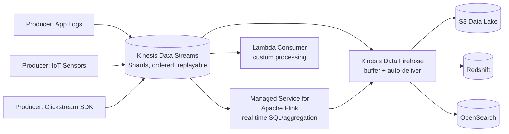

# Amazon Kinesis Family (Data Streams, Data Firehose, Data Analytics)


*Analytics · maps to SAA-C03 Domain 3 Task 3.5, MLA-C02 Domain 1 (Data Preparation for ML and AI)*

## Definition

Kinesis is AWS's family of services for working with data **as it arrives**, in real time,
instead of waiting for a batch job to run later. "Kinesis" is an umbrella name for three
distinct services that solve three different problems with streaming data:

- **Kinesis Data Streams (KDS)** — a durable, ordered pipe you write records into and read
  records out of yourself, with custom code, in near real time.
- **Kinesis Data Firehose** — a fully managed "autopilot" delivery pipe that takes streaming
  data and lands it in a destination (S3, Redshift, OpenSearch, Splunk) with no code required.
- **Managed Service for Apache Flink (formerly Kinesis Data Analytics)** — runs SQL or Apache
  Flink applications directly against a stream to compute things in motion (running totals,
  anomaly detection, windowed aggregates) before the data ever lands anywhere.

## Purpose

Before streaming services existed, "real time" usually meant polling a database every few
seconds — slow, wasteful, and it doesn't scale past a handful of sources. AWS built Kinesis so
you can capture continuous data (clickstreams, IoT sensor telemetry, application logs, stock
ticks, video) the moment it's produced, process or route it within seconds, and never lose a
record even if a downstream consumer is temporarily down. The three services exist separately
because "capture and retain," "deliver to a destination," and "compute over the stream" are
genuinely different jobs — bundling them into one service would force everyone into one
operational model.

## How It Works

Plain explanation: think of Kinesis Data Streams as a conveyor belt with numbered slots
(shards) that data producers drop records onto, and consumers read from in order, at their own
pace, re-reading history if needed (up to a retention window). Firehose is a forklift that
automatically takes items off a belt and stacks them neatly in a warehouse (S3) without anyone
driving it. Managed Service for Apache Flink is a quality-control station built right into the
belt that inspects items as they pass and can flag or transform them in real time.



Step by step:

1. **Producers** (application servers, IoT devices, a clickstream SDK in a web page, or the
   Kinesis Agent tailing log files) write records into **Kinesis Data Streams**. Each record
   is assigned to a **shard** based on a partition key, and within a shard, order is guaranteed.
2. Data sits in the stream for a configurable **retention period** (24 hours by default, up to
   365 days with extended retention) — multiple consumers can read the same data independently,
   at their own speed, and a consumer going down for a while doesn't lose data; it just resumes
   from its last checkpoint when it's back.
3. **Managed Service for Apache Flink** can attach to the stream and run continuous SQL/Flink
   code over it — e.g., "give me a rolling 1-minute count of errors per service" — emitting
   results as a new output stream, without you standing up a cluster.
4. **Kinesis Data Firehose** can read either straight from producers (via PutRecord API) or
   from a Kinesis Data Stream, buffer records for a short time or until a size threshold, then
   automatically batch-write them to S3, Redshift, OpenSearch, Splunk, or a generic HTTP
   endpoint — with optional format conversion (JSON → Parquet) and compression along the way.
5. A **Lambda consumer** (or a custom KCL application) can also read directly off Data Streams
   for fully custom per-record business logic — this is the "I need to write my own processing"
   lane, as opposed to Firehose's "just deliver it somewhere" lane.

## Key Features / Components

- **Shards (Data Streams)** — the unit of throughput: each shard supports 1 MB/sec or 1,000
  records/sec in, and 2 MB/sec out. You scale a stream by adding/removing shards
  ("resharding"), or by switching to **on-demand capacity mode**, which auto-scales for you.
- **Partition key** — determines which shard a record lands on; a skewed partition key (e.g.,
  always the same customer ID) creates a "hot shard" bottleneck even if total throughput is fine.
- **Retention window** — 24 hours default, extendable to 7 days (standard) or 365 days
  (long-term retention) — lets multiple independent consumers replay history.
- **Enhanced fan-out (Data Streams)** — gives each consumer a dedicated 2 MB/sec read
  throughput pipe instead of sharing the shard's total read throughput with every consumer.
- **Firehose buffering hints** — you configure a buffer size (MB) and buffer interval
  (seconds); Firehose flushes whichever threshold hits first — this is the main lever for
  balancing latency vs. file size/cost at the destination.
- **Firehose format conversion** — can convert incoming JSON to Apache Parquet or ORC on the
  way to S3, using a schema from the Glue Data Catalog — critical for cheap, fast Athena queries
  later.
- **Managed Service for Apache Flink apps** — write in SQL, Java, Python, or Scala; AWS
  manages the underlying Flink cluster, checkpointing, and scaling.

## Use Cases — When to Use It

- **Kinesis Data Streams**: real-time dashboards, fraud detection that needs custom logic per
  record, multiple independent teams/systems needing to consume the *same* event stream
  differently, or any case where you need to replay history to reprocess data.
- **Kinesis Data Firehose**: "I just need this telemetry/log data to land in S3/Redshift/
  OpenSearch reliably, as Parquet, compressed, without managing servers" — the default choice
  when you don't need custom per-record logic.
- **Managed Service for Apache Flink**: real-time anomaly detection, running aggregates/
  windowed analytics (e.g., "alert if error rate crosses 5% in any 1-minute window"), streaming
  ETL that needs stateful computation (joins across streams, sessionization).
- Together: a very common pattern is producers → Data Streams → Flink app computes real-time
  metrics AND a Firehose also archives the raw stream to S3 for later batch analysis — "hot
  path" and "cold path" from the same source.

## When NOT to Use It / Alternatives

- Don't use Kinesis for simple point-to-point decoupling of application components where
  ordering and replay don't matter — **SQS** is simpler and cheaper for "producer hands off a
  job to a worker" patterns.
- Don't use Kinesis for pub/sub fan-out to many independent subscribers where you don't need
  replay or ordering — **SNS** (or EventBridge) is the simpler fit.
- If your real need is "batch load files that show up periodically" rather than a continuous
  stream, you don't need Kinesis at all — just trigger **Glue** or **Lambda** off S3 events.
- If you need a fully managed, Apache Kafka-compatible experience (e.g., migrating an existing
  Kafka workload), **Amazon MSK (Managed Streaming for Apache Kafka)** is the closer fit than
  Kinesis Data Streams, though KDS is simpler to operate if you're starting fresh.
- Don't hand-roll a Firehose-like S3 delivery pipeline with Lambda if your requirements are
  just "batch and deliver" — you'll end up re-implementing Firehose, badly.

## Why It's Important

**Real-world:** streaming ingestion is the backbone of any "real time" claim a company makes —
fraud alerts, live dashboards, IoT telemetry, recommendation engines all depend on getting data
moving within seconds instead of hours. Getting shard count and partition key design wrong is
one of the most common real-world causes of "why is my pipeline falling behind" incidents.

**Exam:** this is a direct, named example in **SAA-C03 Task 3.5 — "Determine high-performing
data ingestion and transformation solutions"** — Kinesis is explicitly listed alongside Glue,
EMR, and data lakes as the services this task statement tests. It also appears throughout
**MLA-C02 Domain 1 (Data Preparation for ML and AI)**, specifically the "ingest and store data"
step (S3, EFS, FSx, **Kinesis streaming**) before transformation with Glue/EMR/SageMaker Data
Wrangler — exam questions there test whether you'd choose streaming ingestion (Kinesis) vs.
batch ingestion for a given ML data pipeline.

## Pricing Model (summary)

- **Data Streams**: provisioned mode bills per shard-hour plus per-PUT-payload-unit; on-demand
  mode bills per GB ingested/retrieved with no shard management. Extended retention beyond 24
  hours adds a per-shard-hour fee.
- **Firehose**: billed per GB ingested (with per-GB tiers that get cheaper at volume), plus
  extra for optional format conversion and VPC delivery.
- **Managed Service for Apache Flink**: billed per Kinesis Processing Unit (KPU)-hour — a KPU
  bundles vCPU + memory, similar in spirit to billing for compute capacity.
- See official pricing: https://aws.amazon.com/kinesis/pricing/

## Hands-on Lab (Floci)

Floci (`awslocal`) supports Kinesis Data Streams and Firehose well; Managed Service for Apache
Flink is not emulated (it depends on a managed Flink runtime Floci doesn't ship) — for that,
run Apache Flink locally in Docker, or use the real AWS free tier with a short-lived, small
test app and tear it down immediately. Full walkthrough: `labs-floci/kinesis-family.md`.

```bash
# Create a Kinesis Data Stream with 2 shards
awslocal kinesis create-stream --stream-name clickstream-demo --shard-count 2

# Describe it (check shard IDs, status)
awslocal kinesis describe-stream --stream-name clickstream-demo

# Put a record onto the stream
awslocal kinesis put-record \
  --stream-name clickstream-demo \
  --partition-key user-123 \
  --data '{"event":"page_view","user":"123","page":"/checkout"}'

# Read records back (get a shard iterator, then get-records)
SHARD_ITER=$(awslocal kinesis get-shard-iterator \
  --stream-name clickstream-demo \
  --shard-id shardId-000000000000 \
  --shard-iterator-type TRIM_HORIZON \
  --query 'ShardIterator' --output text)

awslocal kinesis get-records --shard-iterator "$SHARD_ITER"

# Create a Firehose delivery stream targeting an S3 bucket (first create the bucket)
awslocal s3 mb s3://clickstream-landing

awslocal firehose create-delivery-stream \
  --delivery-stream-name clickstream-to-s3 \
  --s3-destination-configuration \
  RoleARN=arn:aws:iam::000000000000:role/firehose-role,BucketARN=arn:aws:s3:::clickstream-landing

# Send a record straight into Firehose
awslocal firehose put-record \
  --delivery-stream-name clickstream-to-s3 \
  --record '{"Data":"eyJldmVudCI6InBhZ2Vfdmlldy..."}'
```

## Exam Tips

- **Kinesis Data Streams vs. Firehose** — the #1 confusion on this topic. If the question says
  "need custom processing logic per record," "multiple independent consumers reading the same
  data differently," or "need to replay/reprocess historical data" → **Data Streams**. If the
  question says "just deliver data to S3/Redshift/OpenSearch, no custom code, want it managed" →
  **Firehose**. Firehose is "serverless delivery," Data Streams is "you write the consumer."
- Firehose has **no replay** — once delivered, it's delivered; Data Streams retains data for a
  window you control, enabling replay.
- A **hot shard** (uneven partition key distribution) is a classic scenario question — the fix
  is a better partition key design or resharding, not just "add more shards blindly."
- Remember Managed Service for Apache Flink was renamed from "Kinesis Data Analytics" — older
  exam questions/materials may still say the old name; they mean the same service.
- Don't confuse Kinesis with **SQS/SNS** — Kinesis guarantees *ordering within a shard* and
  supports *replay*; SQS standard queues don't guarantee order, and SNS doesn't retain messages
  for replay at all.

## Related Terms

[`glossary/README.md`](../../glossary/README.md) · [`glue.md`](glue.md) ·
[`athena.md`](athena.md) · [`data-lake-concepts.md`](data-lake-concepts.md) ·
`services/storage/s3.md` · `services/application-integration/sqs-sns.md`
