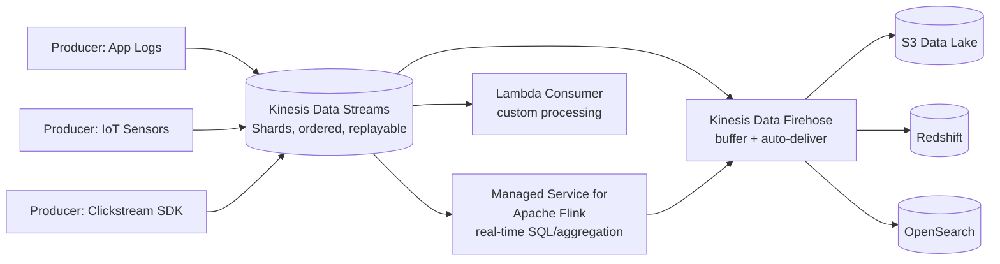
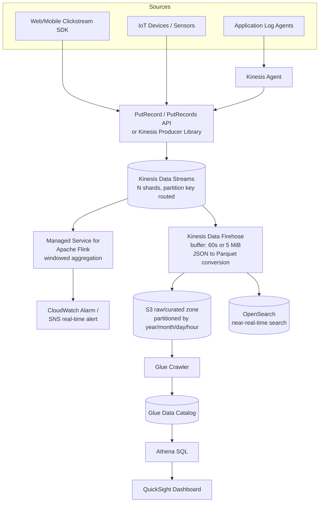
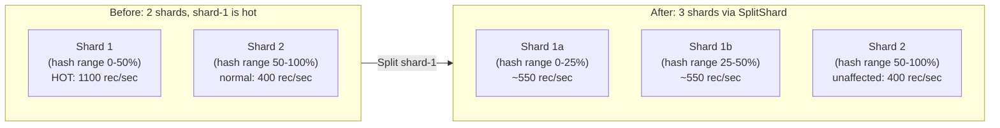
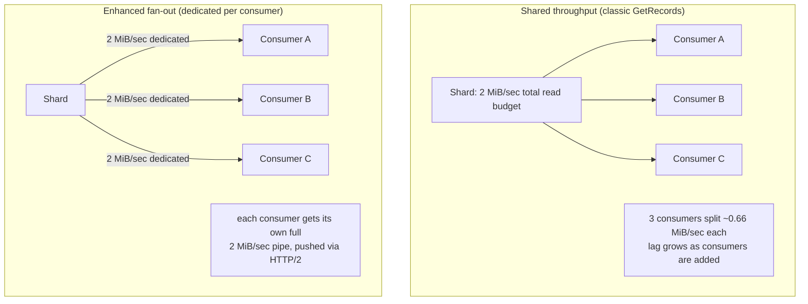
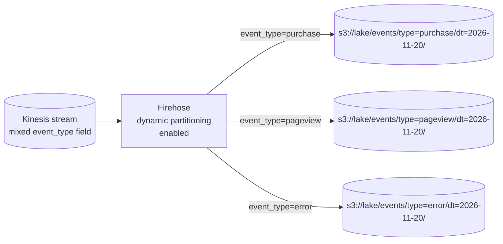

# Amazon Kinesis Family (Data Streams, Data Firehose, Data Analytics)


*Analytics · maps to SAA-C03 Domain 3 Task 3.5, MLA-C02 Domain 1 (Data Preparation for ML and AI)*

## Definition

Kinesis is AWS's family of services for working with data **as it arrives**, in real time,
instead of waiting for a batch job to run later. "Kinesis" is an umbrella name for three
distinct services that solve three different problems with streaming data:

- **Kinesis Data Streams (KDS)** — a durable, ordered pipe you write records into and read
  records out of yourself, with custom code, in near real time.
- **Kinesis Data Firehose** (now branded **Amazon Data Firehose**) — a fully managed "autopilot"
  delivery pipe that takes streaming data and lands it in a destination (S3, Redshift,
  OpenSearch, Splunk, Apache Iceberg tables) with no code required.
- **Managed Service for Apache Flink (formerly Kinesis Data Analytics)** — runs SQL or Apache
  Flink applications directly against a stream to compute things in motion (running totals,
  anomaly detection, windowed aggregates) before the data ever lands anywhere.

## Purpose

Before streaming services existed, "real time" usually meant polling a database every few
seconds — slow, wasteful, and it doesn't scale past a handful of sources. AWS built Kinesis so
you can capture continuous data (clickstreams, IoT sensor telemetry, application logs, stock
ticks, video) the moment it's produced, process or route it within seconds, and never lose a
record even if a downstream consumer is temporarily down. The three services exist separately
because "capture and retain," "deliver to a destination," and "compute over the stream" are
genuinely different jobs — bundling them into one service would force everyone into one
operational model.

## How It Works

Plain explanation: think of Kinesis Data Streams as a conveyor belt with numbered slots
(shards) that data producers drop records onto, and consumers read from in order, at their own
pace, re-reading history if needed (up to a retention window). Firehose is a forklift that
automatically takes items off a belt and stacks them neatly in a warehouse (S3) without anyone
driving it. Managed Service for Apache Flink is a quality-control station built right into the
belt that inspects items as they pass and can flag or transform them in real time.



Step by step:

1. **Producers** (application servers, IoT devices, a clickstream SDK in a web page, or the
   Kinesis Agent tailing log files) write records into **Kinesis Data Streams**. Each record
   is assigned to a **shard** based on a partition key, and within a shard, order is guaranteed.
2. Data sits in the stream for a configurable **retention period** (24 hours by default, up to
   365 days with extended retention) — multiple consumers can read the same data independently,
   at their own speed, and a consumer going down for a while doesn't lose data; it just resumes
   from its last checkpoint when it's back.
3. **Managed Service for Apache Flink** can attach to the stream and run continuous SQL/Flink
   code over it — e.g., "give me a rolling 1-minute count of errors per service" — emitting
   results as a new output stream, without you standing up a cluster.
4. **Kinesis Data Firehose** can read either straight from producers (via PutRecord API) or
   from a Kinesis Data Stream, buffer records for a short time or until a size threshold, then
   automatically batch-write them to S3, Redshift, OpenSearch, Splunk, or a generic HTTP
   endpoint — with optional format conversion (JSON → Parquet) and compression along the way.
5. A **Lambda consumer** (or a custom KCL application) can also read directly off Data Streams
   for fully custom per-record business logic — this is the "I need to write my own processing"
   lane, as opposed to Firehose's "just deliver it somewhere" lane.

### Full ingestion-to-query pipeline

The diagram below is the single most exam-relevant shape in this whole document: it is the
"source → stream → compute → delivery → storage → query → visualize" chain that almost every
SAA-C03 Task 3.5 scenario and MLA-C02 Domain 1 ingestion question is secretly asking you to
assemble from named services.



Walk-through: clickstream and log data enters through `PutRecords` calls or the Kinesis Agent,
lands in Data Streams where it is durably ordered per shard. A Flink application watches the
same stream for anomalies and fires a CloudWatch alarm within seconds — the "hot path." In
parallel, Firehose buffers the same (or a transformed) stream and writes Parquet files into a
partitioned S3 prefix — the "cold path" that a Glue Crawler later catalogs so Athena and
QuickSight can query it with SQL and visualize it, typically minutes behind real time rather
than seconds. A third branch sends the same data into OpenSearch for operators who need to
search raw events immediately. This exact "hot path / cold path from one source" pattern is
worth memorizing verbatim — it shows up under different nouns in a large fraction of data
pipeline exam questions.

### Shard scaling and resharding

Shards are the unit everything else in Kinesis Data Streams is priced and throttled against, so
understanding how resharding actually works mechanically (not just "add more shards") matters
for both operations and the exam.



- Each shard supports **1 MiB/sec or 1,000 records/sec ingest**, and **2 MiB/sec (shared) or
  2 MiB/sec dedicated (enhanced fan-out) egress per consumer**.
- **SplitShard** divides one shard's hash-key range into two child shards — used when a single
  shard is hot (receiving more than its 1,000 rec/sec or 1 MiB/sec limit) due to a popular
  partition key. The parent shard is marked `CLOSED` but stays readable until its retention
  window expires, so in-flight consumers don't lose data mid-split.
- **MergeShards** combines two adjacent shards (by hash-key range) back into one — used to
  reduce cost when traffic drops and you no longer need the throughput (or shard-hour cost) of
  the extra shard.
- **UpdateShardCount** lets you specify a target shard count directly and Kinesis works out the
  splits/merges needed, rather than you calling SplitShard/MergeShards shard-by-shard — the
  practical way most teams resize a provisioned stream.
- **On-demand mode** removes all of this: Kinesis watches your last 30 days of peak throughput
  and auto-scales shard count behind the scenes, trading a flat per-GB price (usually a bit
  higher than well-tuned provisioned capacity) for zero capacity planning.
- **Worked example — sizing shards for a launch**: a mobile game expects 50,000 events/sec at
  peak, each event ~0.5 KB. Records/sec needs `50,000 / 1,000 = 50` shards by the *record count*
  limit. Bytes/sec needs `50,000 × 0.5 KB = 25 MB/sec`, which needs `25 / 1 = 25` shards by the
  *throughput* limit. You always provision for the **binding constraint** — here that's 50
  shards (the record-count limit, not the byte limit) — then round up for headroom (commonly
  +20–30%) before a known traffic spike, since resharding takes time to propagate and isn't
  instantaneous.
- A **hot shard** almost always traces back to partition key design, not raw volume — e.g.
  keying by `customer_id` when 5% of customers generate 80% of events concentrates traffic on
  whichever shards those IDs hash to, no matter how many shards exist in total. The fix is a
  better-distributed key (e.g., `customer_id + random_suffix`, or a composite key), not blindly
  adding shards, because adding shards doesn't change *which* shard a given key still lands on.

### Worked example — end-to-end cost + latency budget for a fraud-detection pipeline

A payments company ingests 2,000 transactions/sec (avg 2 KB each) and needs a fraud score
within 2 seconds, plus a permanent audit trail queryable by analysts the next business day.

1. **Throughput sizing**: 2,000 rec/sec ÷ 1,000 = 2 shards by record count; 2,000 × 2 KB =
   4 MB/sec ÷ 1 MB/sec = 4 shards by byte throughput. The binding constraint is **4 shards**
   (byte throughput, not record count, is the limit here) — provision 5 for headroom.
2. **Hot path**: a Managed Service for Apache Flink application reads the stream, joins each
   transaction against a rolling window of the same customer's recent transactions (stateful
   windowed join), and emits a fraud score within roughly 200–500 ms of ingestion — comfortably
   inside the 2-second SLA.
3. **Cold path**: the same stream also feeds a Firehose delivery stream buffering 60 seconds or
   5 MiB (whichever comes first), converting to Parquet against a Glue Data Catalog schema, and
   landing partitioned by `year=/month=/day=/hour=` in S3 for the audit trail — Athena queries
   against yesterday's partition the next morning scan only that day's files, not the whole
   history, because of the partition layout.
4. **Why not read the audit trail from the hot path's output instead of re-deriving it from
   Firehose?** Because the Flink app's job is scoring, not archiving — mixing concerns would
   mean a Flink code bug could also corrupt the permanent audit record. Keeping Firehose as an
   independent, simpler delivery path for the raw data is deliberate risk isolation, not
   redundancy for its own sake.

### Partition key design patterns

Partition key choice determines shard assignment via a hash, so the practical exam-relevant
patterns are:

- **High-cardinality, roughly uniform key** (e.g., a random UUID per event, or a well-
  distributed `device_id`) — spreads load evenly across shards; the default safe choice when
  there's no natural grouping requirement.
- **Business key needed for per-entity ordering** (e.g., `order_id` so all events for one order
  process in order) — fine as long as no single `order_id` dominates total volume; if one
  customer/entity genuinely generates disproportionate traffic (a "whale" account), consider a
  **composite key** like `customer_id + shard_suffix(0-9)` to spread that one entity's events
  across multiple shards while still preserving *most* locality.
- **Low-cardinality key** (e.g., `region` with only 4 possible values, or worse, a constant) —
  the anti-pattern: with only 4 distinct key values, no more than 4 shards will ever receive
  traffic regardless of how many shards the stream has, guaranteeing a throughput ceiling far
  below what the shard count suggests. This is one of the most common root causes behind "we
  added shards and throughput didn't improve" real-world incidents and exam distractors alike.

### Enhanced fan-out vs. shared throughput



Enhanced fan-out inverts the delivery model from pull (`GetRecords` polling, shared budget) to
push (shard pushes data to each registered consumer over its own HTTP/2 connection) — this is
why it scales per-consumer-read-throughput linearly with the number of registered consumers
instead of dividing one fixed budget among them, at a small additional per-consumer-hour cost.

### Firehose dynamic partitioning at delivery time



A single Firehose delivery stream, given a JQ-style expression against each record, routes
different event types to different S3 prefixes automatically — without standing up three
separate streams. Downstream, a Glue Crawler run against the top-level prefix discovers all
three partitions as one logical table with `type` and `dt` as partition columns, and Athena
queries that filter `WHERE type = 'error'` skip scanning the `purchase`/`pageview` files
entirely.

## Key Features / Components

- **Shards (Data Streams)** — the unit of throughput: each shard supports 1 MB/sec or 1,000
  records/sec in, and 2 MB/sec out. You scale a stream by adding/removing shards
  ("resharding"), or by switching to **on-demand capacity mode**, which auto-scales for you.
- **Partition key** — determines which shard a record lands on; a skewed partition key (e.g.,
  always the same customer ID) creates a "hot shard" bottleneck even if total throughput is fine.
- **Retention window** — 24 hours default, extendable to 7 days (standard) or 365 days
  (long-term retention) — lets multiple independent consumers replay history.
- **Enhanced fan-out (Data Streams)** — gives each consumer a dedicated 2 MB/sec read
  throughput pipe instead of sharing the shard's total read throughput with every consumer.
- **Firehose buffering hints** — you configure a buffer size (MB) and buffer interval
  (seconds); Firehose flushes whichever threshold hits first — this is the main lever for
  balancing latency vs. file size/cost at the destination.
- **Firehose format conversion** — can convert incoming JSON to Apache Parquet or ORC on the
  way to S3, using a schema from the Glue Data Catalog — critical for cheap, fast Athena queries
  later.
- **Managed Service for Apache Flink apps** — write in SQL, Java, Python, or Scala; AWS
  manages the underlying Flink cluster, checkpointing, and scaling.
- **Dynamic partitioning (Firehose)** — splits a single Firehose delivery stream's output into
  multiple S3 prefixes at delivery time based on a field in the data (e.g., `customer_id` or
  `event_type`), without needing a separate Firehose stream per partition value.
- **Kinesis Client Library (KCL)** — the standard framework for writing a custom Data Streams
  consumer; it manages shard-to-worker assignment, checkpointing progress in a DynamoDB table,
  and rebalancing workers automatically when shards split/merge or workers scale in/out.
- **Server-side encryption (SSE-KMS)** — Data Streams can encrypt records at rest using a
  customer-managed or AWS-managed KMS key, transparent to producers/consumers.

### Service comparison at a glance

| Dimension | Kinesis Data Streams | Kinesis Data Firehose | Managed Service for Apache Flink |
|---|---|---|---|
| Who writes the processing code | You (KCL, Lambda, or any consumer) | Nobody — managed delivery only | You (SQL, Java, Python, Scala) |
| Replay / reprocess history | Yes, within retention window | No — once delivered, it's delivered | Depends on upstream source's replay support |
| Typical latency to destination | Milliseconds (consumer-dependent) | Tens of seconds to minutes (buffered) | Sub-second to seconds (in-flight compute) |
| Scaling unit | Shards (manual or on-demand) | Fully automatic | Kinesis Processing Units (KPUs) |
| Common destinations | Custom app logic, DynamoDB, any API | S3, Redshift, OpenSearch, Splunk, HTTP, Iceberg | Another stream, or any sink the app writes to |
| Billing basis | Shard-hour + payload units, or GB (on-demand) | Per GB ingested | Per KPU-hour |

### Minimal producer/consumer code shape (boto3)

This is the shape MLA-C02 and SAA-C03 labs expect you to recognize, even if you never write it
verbatim on the exam — knowing *which calls* exist (`put_record`, `get_shard_iterator`,
`get_records`) and that checkpointing is the consumer's own responsibility (Kinesis does not
track "what has this consumer already read" for you outside of KCL/enhanced fan-out) is the
actual tested concept.

```python
import boto3
import json

kinesis = boto3.client("kinesis", region_name="us-east-1")

# Producer: a partition key chosen to avoid a hot shard (not a constant, not a low-cardinality field)
kinesis.put_record(
    StreamName="clickstream-prod",
    Data=json.dumps({"user": "u-48213", "event": "add_to_cart", "sku": "SKU-991"}),
    PartitionKey="u-48213",
)

# Consumer (illustrative — production code uses KCL, which handles checkpointing/rebalancing)
iterator = kinesis.get_shard_iterator(
    StreamName="clickstream-prod",
    ShardId="shardId-000000000000",
    ShardIteratorType="LATEST",
)["ShardIterator"]

response = kinesis.get_records(ShardIterator=iterator, Limit=100)
for record in response["Records"]:
    payload = json.loads(record["Data"])
    # idempotent processing required: at-least-once delivery can redeliver this record
    print(payload)
```

## Common Architectures

**1. Clickstream analytics with hot/cold path** — clickstream SDK → Data Streams → (a) Flink
app computing live session metrics for an operational dashboard, and (b) Firehose archiving raw
events to S3/Parquet for Athena-based historical analysis. This is the canonical "I need both a
live number and a permanent record" design.

**2. Change Data Capture (CDC) fan-out** — a relational database's change stream (via DMS or
DynamoDB Streams) feeds Kinesis Data Streams; multiple independent Lambda/KCL consumers each
react differently to the same change events (one updates a search index, one invalidates a
cache, one sends a notification) without the source database needing to know any consumer
exists. This is the textbook use for Data Streams' *independent, replayable* multi-consumer
model, versus SNS fan-out, which cannot replay.

**3. Centralized log/security analytics** — CloudWatch Logs subscription filter → Kinesis Data
Firehose → Amazon OpenSearch Service, with an optional S3 backup branch on the same Firehose
stream for cheap long-term retention of the exact same records that went to OpenSearch.

**4. Streaming ETL to a lake house table format** — Data Streams → Firehose with dynamic
partitioning and Parquet conversion → S3 table backed by Apache Iceberg, so downstream Athena
queries get ACID guarantees (no "query sees a half-written file") even though ingestion is
continuous.

**5. IoT telemetry at the edge** — thousands of devices → AWS IoT Core → IoT rule routes
messages into Kinesis Data Streams → Managed Service for Apache Flink computes rolling
device-health aggregates → anomalies trigger Lambda-driven alerts, while Firehose archives raw
telemetry to S3 for later ML feature engineering (a frequent MLA-C02 Domain 1 framing).

## Use Cases — When to Use It

- **Kinesis Data Streams**: real-time dashboards, fraud detection that needs custom logic per
  record, multiple independent teams/systems needing to consume the *same* event stream
  differently, or any case where you need to replay history to reprocess data.
- **Kinesis Data Firehose**: "I just need this telemetry/log data to land in S3/Redshift/
  OpenSearch reliably, as Parquet, compressed, without managing servers" — the default choice
  when you don't need custom per-record logic.
- **Managed Service for Apache Flink**: real-time anomaly detection, running aggregates/
  windowed analytics (e.g., "alert if error rate crosses 5% in any 1-minute window"), streaming
  ETL that needs stateful computation (joins across streams, sessionization).
- Together: a very common pattern is producers → Data Streams → Flink app computes real-time
  metrics AND a Firehose also archives the raw stream to S3 for later batch analysis — "hot
  path" and "cold path" from the same source.

## When NOT to Use It / Alternatives

- Don't use Kinesis for simple point-to-point decoupling of application components where
  ordering and replay don't matter — **SQS** is simpler and cheaper for "producer hands off a
  job to a worker" patterns.
- Don't use Kinesis for pub/sub fan-out to many independent subscribers where you don't need
  replay or ordering — **SNS** (or EventBridge) is the simpler fit.
- If your real need is "batch load files that show up periodically" rather than a continuous
  stream, you don't need Kinesis at all — just trigger **Glue** or **Lambda** off S3 events.
- If you need a fully managed, Apache Kafka-compatible experience (e.g., migrating an existing
  Kafka workload), **Amazon MSK (Managed Streaming for Apache Kafka)** is the closer fit than
  Kinesis Data Streams, though KDS is simpler to operate if you're starting fresh.
- Don't hand-roll a Firehose-like S3 delivery pipeline with Lambda if your requirements are
  just "batch and deliver" — you'll end up re-implementing Firehose, badly.

## Why It's Important

**Real-world:** streaming ingestion is the backbone of any "real time" claim a company makes —
fraud alerts, live dashboards, IoT telemetry, recommendation engines all depend on getting data
moving within seconds instead of hours. Getting shard count and partition key design wrong is
one of the most common real-world causes of "why is my pipeline falling behind" incidents.

**Exam:** this is a direct, named example in **SAA-C03 Task 3.5 — "Determine high-performing
data ingestion and transformation solutions"** — Kinesis is explicitly listed alongside Glue,
EMR, and data lakes as the services this task statement tests. Expect scenario questions that
describe symptoms (a consumer falling behind, `ProvisionedThroughputExceededException`, data
delivered late to S3) and ask you to pick the fix — the fix is almost always "shard count /
partition key / enhanced fan-out," not a different service entirely. It also appears throughout
**MLA-C02 Domain 1 (Data Preparation for ML and AI)**, specifically the "ingest and store data"
step (S3, EFS, FSx, **Kinesis streaming**) before transformation with Glue/EMR/SageMaker Data
Wrangler — exam questions there test whether you'd choose streaming ingestion (Kinesis) vs.
batch ingestion for a given ML data pipeline, and whether raw telemetry destined for model
training should land via Firehose (simple, no code) or Data Streams + a custom consumer (needs
per-record feature computation before storage).

### Exam scenario deep-dive: picking the right lane

A recurring SAA-C03/MLA-C02 scenario shape gives you a short paragraph and a cost/ops
constraint, then expects you to name one of the three Kinesis services (or rule all three out).
Pattern-match like this:

| Scenario clue | Correct answer | Why |
|---|---|---|
| "Multiple teams need to consume the same event stream for different purposes, and may need to replay the last 3 days" | Kinesis Data Streams | Independent consumers + replay is KDS's defining trait |
| "Just land IoT telemetry into S3 as Parquet, no custom code, minimize ops" | Kinesis Data Firehose | "No custom code" + "managed delivery" is the Firehose signature |
| "Compute a rolling 1-minute error rate and alert before data lands anywhere" | Managed Service for Apache Flink | In-flight, stateful, windowed compute is Flink's job, not Firehose's |
| "Decouple two services, no ordering guarantee needed, cheapest option" | SQS (not Kinesis) | A classic distractor — Kinesis is more expensive/complex than needed here |
| "Need Kafka protocol compatibility for an existing consumer app" | Amazon MSK (not Kinesis) | Kinesis is not wire-compatible with Kafka clients |
| "`ProvisionedThroughputExceededException` on PutRecord, one partition key used for 60% of traffic" | Reshape partition key / split hot shard | Adding shards alone won't fix skew |

### MLA-C02 scenario — streaming feature engineering for real-time fraud scoring

MLA-C02 Domain 1 increasingly tests whether a candidate recognizes that **streaming ingestion
and feature engineering are not the same step** — getting data into Kinesis is ingestion;
computing a feature like "transaction count for this card in the last 10 minutes" from that
stream is feature engineering, and it can happen in two different places with very different
tradeoffs:

- **Compute the rolling feature in Managed Service for Apache Flink**, emitting an enriched
  record (raw fields + the computed feature) to a second stream that a SageMaker real-time
  endpoint reads from — the feature is fresh to the millisecond, at the cost of writing and
  maintaining stateful streaming code.
- **Compute the rolling feature in SageMaker Feature Store's online store**, fed by a simpler
  Firehose/Lambda pipeline that just writes raw events — simpler to build, but introduces a
  small propagation delay between "event happened" and "feature reflects it," which matters if
  the model scores transactions in real time and a fraudster could exploit the lag window.

A question describing "compute aggregates in-flight, before the data lands anywhere, with
sub-second freshness" is pointing at Flink; a question describing "store a point-in-time correct
feature a training job can later join against" is pointing at Feature Store, not Flink — they
solve different halves of the same pipeline and are not substitutes for each other.

### CloudWatch metrics worth knowing by name

- `IncomingBytes` / `IncomingRecords` — ingest volume, checked **per shard** to catch skew that
  a stream-wide average hides.
- `WriteProvisionedThroughputExceeded` — count of throttled PutRecord/PutRecords calls; a
  sustained non-zero value is the signal to reshard or fix the partition key, not a one-off
  blip to ignore.
- `ReadProvisionedThroughputExceeded` — throttled GetRecords calls; usually means too many
  consumers sharing one shard's 2 MiB/sec read pipe without enhanced fan-out.
- `GetRecords.IteratorAgeMilliseconds` — how far behind "now" the consumer's current read
  position is; the single most important lag metric for "is my consumer keeping up."
- `DeliveryToS3.DataFreshness` (Firehose) — how old the oldest buffered-but-undelivered record
  is; climbing values mean the destination (or a transformation Lambda) is failing or slow.

## Pricing Model (summary)

- **Data Streams**: provisioned mode bills per shard-hour (~$0.015/hour per shard in most US
  regions) plus a small per-million-PUT-payload-unit fee (a "payload unit" is a 25 KB chunk, so
  a 60 KB record consumes 3 units); on-demand mode bills per GB ingested/retrieved with no shard
  management, typically more expensive per-GB at steady, predictable volume but cheaper in
  total cost of ownership for spiky/unpredictable traffic since nobody pays to babysit shard
  counts. Extended retention beyond 24 hours adds a per-shard-hour fee (a separate, smaller rate
  for the 24-hour-to-7-day tier, and another rate for the 7-day-to-365-day tier).
- **Firehose**: billed per GB ingested (with per-GB tiers that get cheaper at volume), plus
  extra for optional format conversion and VPC delivery.
- **Managed Service for Apache Flink**: billed per Kinesis Processing Unit (KPU)-hour — a KPU
  bundles vCPU + memory, similar in spirit to billing for compute capacity.
- **Worked example — provisioned vs. on-demand break-even**: a stream needs 10 shards
  sustained, 24/7, to handle steady average load (no spikes). Provisioned: 10 shards ×
  $0.015/shard-hour × 730 hours/month ≈ **$109.50/month** in shard-hour cost alone (plus PUT
  payload unit charges). On-demand pricing for the same ~10 MB/sec sustained ingest (roughly
  6.3 TB/month) at the on-demand per-GB ingest rate would typically land noticeably higher in
  total for this *steady* workload — on-demand's premium pays for not having to plan capacity,
  so it wins economically only when traffic is spiky/unpredictable enough that provisioned
  capacity would otherwise be either under-provisioned (throttling) or heavily over-provisioned
  (paying for idle shards) most of the time.
- See official pricing: https://aws.amazon.com/kinesis/pricing/

## Limits & Quotas

- **1 MiB/sec or 1,000 records/sec** write throughput per shard (whichever limit is hit first).
- **2 MiB/sec** shared read throughput per shard across all consumers using the classic
  `GetRecords` API; each consumer using **enhanced fan-out** instead gets its own dedicated
  2 MiB/sec pipe, up to **20 enhanced fan-out consumers per stream**.
- **Maximum record size: 1 MB** (after base64-encoding for the API call).
- **Default shard limit per account/region**: varies by region (commonly 500 on-demand shard
  equivalents and a provisioned shard soft limit that's raisable via a support case) — exam
  questions rarely need the exact number, just that **limits are soft and raisable**.
- **Retention window**: 24 hours (default, included in base price) up to 365 days (extra cost
  tier), configurable per stream.
- **Firehose buffer**: minimum buffer interval is a small number of seconds; maximum buffer
  size before a mandatory flush is in the low tens of MB — you cannot buffer indefinitely even
  if you want larger files.
- **Firehose record size**: up to 1,000 KB per record (before any Lambda transformation);
  larger payloads must be split by the producer.
- **Managed Service for Apache Flink**: application parallelism is bounded by KPU allocation;
  very large stateful jobs need proportionally more KPUs and checkpoint storage.

## Troubleshooting / Common Issues

- **`ProvisionedThroughputExceededException` on PutRecord/PutRecords** — the shard targeted by
  this record's partition key is over its 1 MiB/sec or 1,000 rec/sec limit. Check
  `IncomingBytes`/`IncomingRecords` CloudWatch metrics *per shard*, not just stream-wide
  averages — a stream-wide average can look fine while one shard is saturated. Fix: improve
  partition key cardinality/distribution, or split the hot shard.
- **Consumer falling behind (`GetRecords.IteratorAgeMilliseconds` climbing)** — the consumer
  can't keep up with the shard's write rate, or is being throttled on reads. If multiple
  consumers share the shard's 2 MiB/sec read pipe, add **enhanced fan-out** for the lagging
  consumer instead of fighting over shared bandwidth.
- **Data arriving in S3 later than expected via Firehose** — check the buffer size/interval
  settings; Firehose flushes on whichever threshold is hit first, so a low-volume stream with a
  large buffer size configured will wait for the *time* threshold, not the size one. Also check
  for a failing Lambda transformation (Firehose retries transformation failures, which adds
  delay and can eventually route records to an error S3 prefix).
- **Duplicate records downstream** — Kinesis Data Streams and Firehose both provide **at-least-
  once** delivery, not exactly-once; consumers must be idempotent (e.g., dedupe by a record's
  unique ID) rather than assuming each record is processed exactly once.
- **KCL application not rebalancing after a reshard** — confirm the KCL's DynamoDB lease table
  isn't throttled (KCL uses DynamoDB for shard lease/checkpoint tracking) and that worker IAM
  roles have permission against the new child shards.
- **Firehose records silently missing specific fields after format conversion** — almost always
  a schema mismatch between the incoming JSON and the Glue Data Catalog table schema Firehose
  was told to convert against; a field present in the data but absent from the catalog schema is
  dropped during Parquet conversion, not errored.

## Hands-on Lab (Floci)

Floci (`awslocal`) supports Kinesis Data Streams and Firehose well; Managed Service for Apache
Flink is not emulated (it depends on a managed Flink runtime Floci doesn't ship) — for that,
run Apache Flink locally in Docker, or use the real AWS free tier with a short-lived, small
test app and tear it down immediately. Full walkthrough: `labs-floci/kinesis-family.md`.

```bash
# Create a Kinesis Data Stream with 2 shards
awslocal kinesis create-stream --stream-name clickstream-demo --shard-count 2

# Describe it (check shard IDs, status)
awslocal kinesis describe-stream --stream-name clickstream-demo

# Put a record onto the stream
awslocal kinesis put-record \
  --stream-name clickstream-demo \
  --partition-key user-123 \
  --data '{"event":"page_view","user":"123","page":"/checkout"}'

# Read records back (get a shard iterator, then get-records)
SHARD_ITER=$(awslocal kinesis get-shard-iterator \
  --stream-name clickstream-demo \
  --shard-id shardId-000000000000 \
  --shard-iterator-type TRIM_HORIZON \
  --query 'ShardIterator' --output text)

awslocal kinesis get-records --shard-iterator "$SHARD_ITER"

# Reshard: split a shard (demonstrates the SplitShard API shape)
awslocal kinesis split-shard \
  --stream-name clickstream-demo \
  --shard-to-split shardId-000000000000 \
  --new-starting-hash-key 170141183460469231731687303715884105728

# Create a Firehose delivery stream targeting an S3 bucket (first create the bucket)
awslocal s3 mb s3://clickstream-landing

awslocal firehose create-delivery-stream \
  --delivery-stream-name clickstream-to-s3 \
  --s3-destination-configuration \
  RoleARN=arn:aws:iam::000000000000:role/firehose-role,BucketARN=arn:aws:s3:::clickstream-landing

# Send a record straight into Firehose
awslocal firehose put-record \
  --delivery-stream-name clickstream-to-s3 \
  --record '{"Data":"eyJldm...lldy..."}'
```

## Exam Tips

- **Kinesis Data Streams vs. Firehose** — the #1 confusion on this topic. If the question says
  "need custom processing logic per record," "multiple independent consumers reading the same
  data differently," or "need to replay/reprocess historical data" → **Data Streams**. If the
  question says "just deliver data to S3/Redshift/OpenSearch, no custom code, want it managed" →
  **Firehose**. Firehose is "serverless delivery," Data Streams is "you write the consumer."
- Firehose has **no replay** — once delivered, it's delivered; Data Streams retains data for a
  window you control, enabling replay.
- A **hot shard** (uneven partition key distribution) is a classic scenario question — the fix
  is a better partition key design or resharding, not just "add more shards blindly."
- Remember Managed Service for Apache Flink was renamed from "Kinesis Data Analytics" — older
  exam questions/materials may still say the old name; they mean the same service.
- Don't confuse Kinesis with **SQS/SNS** — Kinesis guarantees *ordering within a shard* and
  supports *replay*; SQS standard queues don't guarantee order, and SNS doesn't retain messages
  for replay at all.
- **Enhanced fan-out** is the exam-correct fix whenever a question describes *multiple*
  consumers competing for a shard's shared 2 MiB/sec read throughput — don't reach for "add more
  shards," which doesn't change per-consumer read allocation the way enhanced fan-out does.
- **On-demand vs. provisioned** is a cost-optimization question in disguise — "unpredictable,
  spiky traffic, minimize operational planning" points to on-demand; "steady, well-understood
  volume, minimize unit cost" points to provisioned with a right-sized shard count.
- Know that both Data Streams and Firehose are **at-least-once** delivery — a question implying
  "exactly-once guaranteed by Kinesis itself" is wrong; idempotency is the consumer's job.

## Further Reading

- Kinesis Data Streams Developer Guide — key concepts & architecture:
  https://docs.aws.amazon.com/streams/latest/dev/key-concepts.html
- Amazon Data Firehose — what it is and data flow:
  https://docs.aws.amazon.com/firehose/latest/dev/what-is-this-service.html
- Resharding a stream (split/merge mechanics):
  https://docs.aws.amazon.com/streams/latest/dev/kinesis-using-sdk-java-resharding.html
- Managed Service for Apache Flink Developer Guide:
  https://docs.aws.amazon.com/managed-flink/latest/java/what-is.html
- AWS Big Data Blog — "Architectural patterns for real-time analytics using Amazon Kinesis Data
  Streams": https://aws.amazon.com/blogs/big-data/architectural-patterns-for-real-time-analytics-using-amazon-kinesis-data-streams-part-1/
- AWS Big Data Blog — "LaunchDarkly's journey from ingesting 1 TB to 100 TB per day with
  Amazon Kinesis Data Streams" (a real-world shard-scaling case study):
  https://aws.amazon.com/blogs/big-data/launchdarklys-journey-from-ingesting-1-tb-to-100-tb-per-day-with-amazon-kinesis-data-streams/
- Kinesis pricing: https://aws.amazon.com/kinesis/pricing/

### Reference diagrams from official AWS sources


*Kinesis Data Streams high-level architecture — producers push records continuously, consumers
process them in real time, and a consumer can be a custom app on EC2 or a Firehose delivery
stream. Source: AWS Kinesis Data Streams Developer Guide,
[Terminology and concepts](https://docs.aws.amazon.com/streams/latest/dev/key-concepts.html).*


*A full streaming reference architecture segmented into data sources, ingestion/producers,
stream storage, processing/consumers, and downstream destinations — the same five-layer shape
used throughout this document's pipeline diagrams. Source: AWS Well-Architected Framework,
[Analytics Lens — Reference architecture](https://docs.aws.amazon.com/wellarchitected/latest/analytics-lens/reference-architecture-2.html).*

## Related Terms

[`glossary/README.md`](../../glossary/README.md) · [`glue.md`](glue.md) ·
[`athena.md`](athena.md) · [`data-lake-concepts.md`](data-lake-concepts.md) ·
`services/storage/s3.md` · `services/application-integration/sqs-sns.md`
