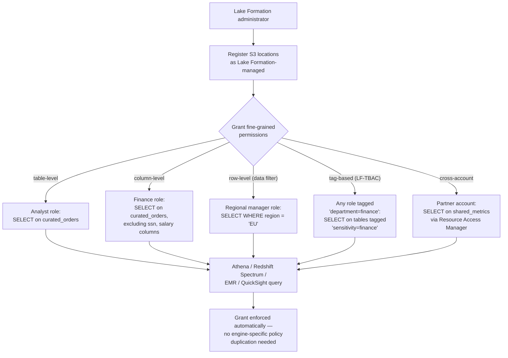
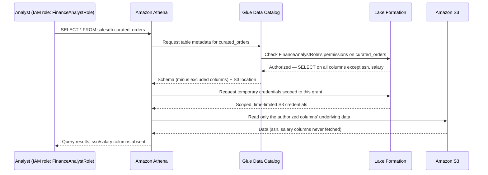
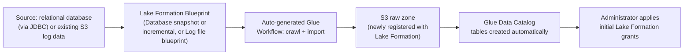

# AWS Lake Formation

> **Appears in:** [MLA-C02](../../certifications/mla-c02/README.md) · [SAA-C03](../../certifications/saa-c03/README.md)


*Analytics · governance/permissions layer on top of the Glue Data Catalog · maps to SAA-C03
Domain 3 Task 3.5, MLA-C02 Domain 1 (Data Preparation for ML and AI)*

## Definition

AWS Lake Formation is a managed service that centralizes **fine-grained permissions** for a data
lake — database-, table-, column-, row-, and even cell-level access control — enforced
consistently across every integrated query engine (Athena, Redshift Spectrum, EMR, Glue,
QuickSight, SageMaker) that reads from the same Glue Data Catalog. Instead of each AWS service
maintaining its own separate access-control story, you define who-can-see-what **once**, in Lake
Formation, and every integrated engine automatically enforces that same grant.

## Purpose

Before Lake Formation, securing a data lake meant stacking together **S3 bucket policies** (control
access to raw files) and **IAM policies** (control which principals can call which API operations)
across every service touching the lake — Athena, Glue, EMR, Redshift Spectrum each needing their
own correctly-written, kept-in-sync policy. That approach has no native concept of "let this
analyst see every column in this table except `ssn` and `salary`" or "let this regional manager
only see rows where `region = 'EU'`" — IAM and S3 policies operate at the level of *objects and
API calls*, not *table columns and row values*. AWS built Lake Formation specifically to add a
database-like, fine-grained permissions layer *on top of* the Glue Data Catalog, so governance
could be expressed the way a data administrator actually thinks about it (grant SELECT on these
columns of this table to this role) rather than translated awkwardly into bucket-prefix and
API-action policies.

## How It Works

Plain explanation: think of IAM + S3 bucket policies as a building's front-door lock (you're
either let into the building or not) — adequate for coarse access control, but with no way to
say "you may enter the building, but only open the finance department's filing cabinet, and
within it, only read every drawer except the one labeled HR." Lake Formation is that finer
internal lock system: it sits between a query engine and the Glue Data Catalog, checking a
fine-grained grant at query time — which specific tables, columns, and even rows a principal is
allowed to see — before any engine is allowed to touch the underlying S3 data at all.



Step by step:
1. **An administrator registers S3 locations** with Lake Formation — this is the handoff point
   where S3 data starts being governed by Lake Formation grants rather than only raw IAM/bucket
   policies.
2. **The administrator (or a delegated data lake administrator) grants permissions** on Data
   Catalog resources — databases, tables, columns, or rows — to specific IAM principals or Lake
   Formation-managed personas, at whatever granularity the governance requirement needs.
3. **A principal submits a query** through any integrated engine (Athena, Glue ETL, EMR,
   Redshift Spectrum, QuickSight).
4. **The engine asks the Data Catalog for the table's metadata**; the Data Catalog checks the
   requesting principal's permissions against Lake Formation before returning anything.
5. **Lake Formation grants temporary, scoped credentials** ("credential vending") back to the
   engine for exactly the S3 objects/columns/rows the principal is authorized to see — the engine
   never gets broader S3 access than the grant allows, even if its own underlying IAM role would
   otherwise permit more.
6. **The engine fetches only the authorized data**, applying column/row/cell filtering as
   needed, and returns results to the user — the filtering happens *before* data leaves Lake
   Formation's control, not as an afterthought the engine applies locally.

### Official AWS permissions workflow diagram


*AWS's own diagram of the exact "get metadata → check permissions → get credentials → get data"
sequence described above — note that the engine never talks to S3 directly until Lake Formation
has vended it scoped, temporary credentials. Source: AWS Lake Formation Developer Guide, [AWS
Lake Formation: How it
works](https://docs.aws.amazon.com/lake-formation/latest/dg/how-it-works.html). © Amazon Web
Services.*


*A concrete applied example — Lake Formation governing access for a QuickSight dashboard querying
through Athena against Glue Data Catalog tables, replacing a patchwork of per-service IAM/S3
policies with one centrally managed grant model. Source: AWS QuickSight (Quick) User Guide,
[Authorizing connections through AWS Lake
Formation](https://docs.aws.amazon.com/quick/latest/userguide/lake-formation.html). © Amazon Web
Services.*

### Credential vending, the mechanism that makes this actually secure

A subtlety worth making explicit: Lake Formation's permission model only *matters* in practice
because of **credential vending** — the step where Lake Formation (not the calling engine's own
IAM role) decides exactly what S3 access to grant, per query, scoped to exactly what that query
is authorized to read.



This is the exam-relevant property that distinguishes Lake Formation from "just writing a more
careful IAM policy": **FinanceAnalystRole's own underlying IAM policy might be broad** (e.g., a
general `s3:GetObject` on the bucket), but Lake Formation's credential-vending step never hands
Athena credentials broader than the specific grant — meaning an analyst can't bypass a
column-level restriction by switching from Athena to an EMR notebook using the *same* IAM role,
because the restriction is enforced at the Lake Formation/Data Catalog layer every integrated
engine must pass through, not inside each engine's own access-control logic independently.

## Lake Formation vs. plain IAM + S3 bucket policies — the central exam contrast

| Question | IAM + S3 bucket policies alone | AWS Lake Formation |
|---|---|---|
| Finest granularity available | Object/prefix-level (an S3 key or prefix) | Column-level, row-level (data filters), and cell-level |
| Where is the rule expressed? | Separately, in each service's own IAM policy and/or the bucket policy | Once, centrally, in Lake Formation's grant model |
| Does a grant automatically apply across Athena, EMR, Redshift Spectrum, QuickSight? | No — each service's access must be independently configured and kept in sync | Yes — one grant, enforced identically everywhere Lake Formation is integrated |
| Cross-account sharing | Requires manually replicating bucket policies/resource policies per account | Native cross-account grants via AWS Resource Access Manager (RAM), governed centrally |
| Tag-based access control at scale | Not natively supported — would require custom tagging logic layered on top of IAM conditions | **LF-TBAC** (Lake Formation Tag-Based Access Control) — grant access by matching resource tags to principal tags, scaling without one grant per table |
| Audit story | Scattered across CloudTrail entries for each service's own API calls | Centralized grant history in Lake Formation itself, plus CloudTrail |
| Setup overhead for a brand-new, simple, single-team lake | Lower — a single bucket policy may be "good enough" | Higher — registering locations and defining the permission model is real upfront work |
| Best fit when... | A small team, one trust boundary, coarse (bucket/prefix-level) access is genuinely sufficient | Multiple teams/roles need different column/row visibility into the *same* tables, or the lake spans multiple accounts |

**The exam-relevant selection logic:** a scenario emphasizing **"column-level,"
"row-level,"** **"different teams should see different parts of the same table,"** or
**"centralized, auditable permissions across Athena/EMR/Redshift Spectrum without duplicating
policy logic in each service"** points at Lake Formation. A scenario describing a simple,
single-team lake with no need for anything finer than "this IAM role can read this S3 prefix" is
pointing at plain IAM + S3 bucket policies — reaching for Lake Formation there is real,
avoidable complexity for a requirement that doesn't need it.

## Key Features / Components

- **Lake Formation permissions model** — a relational-database-style GRANT/REVOKE permissions
  system (`SELECT`, `INSERT`, `DESCRIBE`, `ALTER`, `DROP`, `CREATE_TABLE`, and more) applied to
  Data Catalog databases and tables, replacing scattered per-service IAM/S3 policy logic.
- **Column-level security** — grant `SELECT` on a table while explicitly excluding (or
  explicitly including only) specific columns, enforced before data ever reaches the query
  engine.
- **Row-level security via data filters** — a named filter expression (e.g., `region = 'EU'`)
  attached to a grant, so different principals querying the *same* table transparently see
  different row subsets.
- **Tag-based access control (LF-TBAC)** — define logical tags (e.g., `department=finance`,
  `sensitivity=pii`) on both resources (tables/columns) and principals (roles/users), then grant
  access by tag match rather than by naming every individual table in every grant — the mechanism
  that scales governance to hundreds or thousands of tables without hundreds of individual grants.
- **Credential vending** — the mechanism (detailed above) that makes every grant *actually*
  enforced, by scoping the temporary S3 credentials an integrated engine receives to exactly what
  was granted, regardless of that engine's own broader underlying IAM role.
- **Blueprints** — pre-built workflow templates (in the Lake Formation console) that automate
  setting up a new data lake's initial structure — importing data from a relational database or
  log source, registering S3 locations, and creating the initial Data Catalog tables — reducing
  "stand up a governed lake from zero" from a multi-step manual process to a guided wizard.
- **Cross-account data sharing** — grants a consumer account access to specific databases/tables
  a producer account owns, via AWS Resource Access Manager (RAM) integration, without either
  account needing to duplicate the data or write custom cross-account IAM trust policies by hand.
- **Governed tables (transactional, Lake Formation-managed storage)** — optional support for
  ACID-transactional tables directly managed by Lake Formation, layering update/delete/merge
  semantics on top of the lake, complementary to (and overlapping in purpose with) the Iceberg/
  Hudi/Delta lake house pattern covered in `data-lake-concepts.md`.
- **Data Catalog integration (not a replacement for it)** — Lake Formation is a permissions layer
  *on top of* the Glue Data Catalog, not a competing or separate catalog; registering a table with
  Lake Formation doesn't move or duplicate its catalog entry.
- **Hybrid access mode** — lets an account transition gradually from pure IAM-based Data Catalog
  permissions to full Lake Formation permissions, table by table, rather than requiring an
  all-or-nothing cutover on day one.

## Blueprint-based data lake setup, worked through

Lake Formation's **blueprints** exist specifically to reduce the "stand up a new, properly
governed lake" cold-start problem:



A **Database snapshot blueprint** does a one-time, full extraction of a source relational
database's tables into the lake; a **Database incremental blueprint** sets up ongoing,
change-tracking extraction so the lake stays in sync with the source; a **Log file blueprint**
is tuned for ingesting application/service log data (e.g., CloudTrail, ALB access logs) with
common log-specific parsing already configured. In every case, the blueprint's output is a
working Glue Workflow (crawler + import job) and a set of newly cataloged, Lake
Formation-registered tables — collapsing what would otherwise be several separate manual setup
steps (register the S3 location, write a crawler, configure an import job, apply initial grants)
into one guided console flow.

## Use Cases — When to Use It

1. **Multi-team data mesh with column-level sensitivity differences** — several business units
   share a central Data Catalog, but only the finance team should see salary/SSN columns in an
   otherwise broadly-readable employee table. Lake Formation's column-level grants are the fit.
   **Tradeoff vs. maintaining separate "redacted" and "full" copies of the same table**: a
   redacted-copy approach duplicates storage and risks the two copies drifting out of sync; one
   table with column-level grants avoids both problems.
2. **Regional data residency/visibility requirements** — a global retailer's regional managers
   should each see only their own region's rows in one shared `orders` table, without
   maintaining one table per region. A row-level data filter grant per region is the fit.
   **Tradeoff vs. per-region tables**: per-region tables avoid needing row filters at all, but
   multiply the number of tables (and ETL jobs feeding them) by the number of regions, and make
   any cross-region aggregate query (e.g., global revenue) harder to write.
3. **Governed cross-account data sharing without data duplication** — a data platform team owns
   a curated `shared_metrics` table that three other AWS accounts (different business units) need
   read access to, without copying the data into each account. Lake Formation's cross-account
   grants via RAM are the fit. **Tradeoff vs. S3 cross-account bucket policies**: bucket policies
   can grant cross-account S3 access too, but don't give column/row-level control or a single,
   auditable grant model spanning the Data Catalog the way Lake Formation does.
4. **Scaling governance across hundreds of tables without hundreds of individual grants** — a
   large organization's data lake has grown to hundreds of tables, and writing/maintaining an
   individual grant per table per team is itself becoming an operational burden. LF-TBAC
   (tag-based access control) is the fit — tag tables by sensitivity/domain once, tag
   roles/teams once, and grants follow automatically as new matching tables are added.
   **Tradeoff vs. named per-table grants**: named grants are simpler to reason about for a small,
   static table count, but don't scale to a continuously growing catalog the way tag-matching
   does.
5. **Rapid bootstrap of a new, governed data lake from an existing relational database** — a
   team migrating off a legacy on-premises database wants a working, cataloged, Lake
   Formation-governed lake quickly, without hand-writing crawlers and import jobs from scratch.
   A Database snapshot or incremental blueprint is the fit. **Tradeoff vs. manually building the
   Glue Workflow**: manual setup gives more fine-grained control over the exact crawler/job
   configuration, but a blueprint gets a reasonable, working setup running in a fraction of the
   time for the common case.
6. **Preventing an analyst from bypassing a restriction by switching tools** — a security team
   needs certainty that a column-level restriction enforced in Athena can't be circumvented by
   the same analyst opening an EMR notebook with the same underlying IAM role. Lake Formation's
   credential-vending model is the fit by design — the restriction lives below any individual
   engine's own access logic. **Tradeoff vs. trusting each engine's own access control
   independently**: per-engine enforcement requires every engine to be correctly and
   *identically* configured, a much larger and more error-prone surface than one centrally
   enforced grant.

## When NOT to Use It / Alternatives

- **A small, single-team lake with no need for anything finer than bucket/prefix-level access**
  — plain **IAM policies + S3 bucket policies** are simpler to set up and reason about; Lake
  Formation's registration and grant model is real overhead that doesn't pay for itself at this
  scale.
- **The data isn't in S3/Glue Data Catalog at all** (e.g., it's purely in DynamoDB or RDS with no
  lake/catalog layer involved) — Lake Formation governs Data-Catalog-registered lake resources
  specifically; a pure OLTP database's access control is a plain IAM/database-native-permissions
  problem, not a Lake Formation one.
- **The organization needs row-level security for a traditional data warehouse, not a lake** —
  **Redshift's own row-level security features** operate natively inside the warehouse; Lake
  Formation governs the lake/catalog side specifically, and the two aren't interchangeable for a
  Redshift-only, non-lake workload.
- **A one-off, ad-hoc analysis where setting up formal grants would slow down genuinely
  exploratory work** — a sandbox zone with looser, broader access (see `data-lake-concepts.md`'s
  zone pattern) may be the more appropriate governance posture for exploratory analyst work that
  isn't yet a stable, production table needing fine-grained grants.

## Why It's Important

**Real-world:** the single most common cause of a data lake turning into an unusable "data
swamp" with ungoverned, untrusted access isn't a storage problem — it's a governance problem:
nobody can confidently say who can see what, across a growing set of tools and teams. Lake
Formation's value is making that answerable in one place, enforced automatically everywhere,
instead of trusting that a dozen separately-written IAM and bucket policies across Athena, EMR,
and Redshift Spectrum all happen to agree with each other and stay that way as the lake grows.

**Exam:**
- **SAA-C03 Task 3.5 — "Determine high-performing data ingestion and transformation
  solutions"** names Lake Formation alongside Glue, Kinesis, and S3 as part of the standard data
  lake toolset; expect it tested as the governance answer whenever a scenario needs column/row-
  level or cross-account permissions beyond what IAM/S3 policies natively express.
- **MLA-C02 Domain 1 (Data Preparation for ML and AI)** — Lake Formation is the named answer
  for "ensure data integrity and prepare for modeling" scenarios involving access governance (who
  can see sensitive training data columns, how a multi-team ML platform shares curated feature
  tables safely) — see `data-lake-concepts.md`'s "diagnosing a data swamp" scenario for the
  broader Domain 1 framing this doc's permissions-specific depth plugs into.
- **The recurring exam trap**: a question describing "write more detailed/separate IAM policies
  per service" as the fix for a fine-grained, multi-engine access requirement is usually testing
  whether you'd recognize Lake Formation as the actually-correct, centrally-enforced alternative
  instead.

## Pricing Model (summary)

- **No separate charge for Lake Formation itself** beyond the underlying services it coordinates
  (Glue Data Catalog storage/requests, S3 storage, the query engine's own compute cost for
  Athena/EMR/Redshift Spectrum).
- **Blueprints** generate standard Glue Workflows (crawlers + jobs) under the hood, billed at
  normal Glue DPU-hour rates — the blueprint itself adds no additional service charge on top.
- The practical cost consideration is **operational**, not billing: the setup and grant-management
  effort of adopting Lake Formation is the real "cost," worth weighing against the governance
  risk of *not* having centralized fine-grained permissions as a lake scales across teams.
- See official pricing context: https://aws.amazon.com/lake-formation/pricing/ (Lake Formation's
  own control plane is free; you pay for the Glue/S3/query-engine resources it coordinates).

## Limits & Quotas

- **Permission grants per principal/resource**: a soft, raisable limit on the number of
  fine-grained grants — very large, deeply nested multi-team data mesh setups should plan around
  this rather than assume unlimited per-grant granularity (favor LF-TBAC tag-based grants over
  many individual named grants as the table count grows).
- **Cross-account sharing**: requires either AWS Organizations membership or an explicit RAM
  resource share configured between the producer and consumer accounts — it does not work
  automatically between two arbitrary, unrelated AWS accounts with zero prior setup.
- **Data filters (row-level security) per table**: a practical, soft limit on how many distinct
  row-filter definitions are manageable per table before the permission model itself becomes hard
  to audit — a sign to consider restructuring via tags or a different partitioning scheme at very
  high filter counts.
- **Hybrid access mode transition**: moving an existing, large Data-Catalog-permissions-only
  environment fully into Lake Formation governance is a deliberate, often table-by-table
  migration, not an instant account-wide switch — plan for a transition period, not a single
  cutover event.

## Troubleshooting / Common Issues

- **"I granted Lake Formation permissions but the user still can't query the table."** Confirm
  the S3 location backing the table was actually **registered** with Lake Formation — a grant on
  an unregistered location's table doesn't take effect the way expected; also confirm the
  querying engine is actually an integrated one (not every third-party tool respects Lake
  Formation's credential-vending model).
- **"A user can see a table through Athena but gets different results through an EMR notebook
  using the same role."** Check whether EMR's Lake Formation integration is actually enabled for
  that cluster — EMR requires explicit configuration to participate in Lake Formation's grant
  enforcement; without it, EMR may fall back to the role's own broader IAM permissions instead of
  being scoped by Lake Formation at all.
- **"Cross-account grant doesn't seem to work."** Confirm both accounts are correctly linked
  (same AWS Organization, or an explicit RAM resource share accepted by the consumer account) and
  that the grant was made at the expected resource level (database, table, or column) — a
  mismatched grant scope is the most common root cause of "I granted access but they still can't
  query it."
- **"Column-level restriction isn't being enforced in a specific query."** Some older
  engine/driver versions or non-integrated third-party BI tools may not fully respect Lake
  Formation's fine-grained filtering — verify the specific tool version against AWS's documented
  list of Lake Formation-integrated engines before assuming the grant itself is misconfigured.
- **"LF-TBAC grant isn't applying to a newly created table."** Confirm the new table actually
  inherited (or was explicitly given) the expected resource tag — tags aren't always
  automatically propagated from a parent database to every new table depending on how the table
  was created, and a missing tag means the tag-based grant simply has nothing to match against.
- **"Blueprint-generated workflow failed partway through."** Treat it as a standard Glue Workflow
  failure first (check the underlying crawler/job run logs) — the blueprint is a convenience
  wrapper generating ordinary Glue Workflow components, not a fundamentally different execution
  engine with its own separate failure mode.

## Hands-on Lab (Floci)

Floci supports the core data lake building blocks (S3, Glue Data Catalog, Athena) well, but does
**not** emulate Lake Formation's fine-grained permission engine — there's no local credential-
vending simulation. For local practice, treat IAM bucket/prefix policies as the stand-in for
"governance," and read Lake Formation's real grant behavior from AWS documentation rather than
expecting local parity. Full walkthrough: `labs-floci/data-lake-concepts.md`.

```bash
# Real AWS CLI shapes for Lake Formation (illustrative — not Floci-executable):

# Register an S3 location with Lake Formation
# aws lakeformation register-resource \
#   --resource-arn arn:aws:s3:::company-data-lake/curated/ \
#   --role-arn arn:aws:iam::123456789012:role/LakeFormationServiceRole

# Grant table-level SELECT to an analyst role
# aws lakeformation grant-permissions \
#   --principal DataLakePrincipalIdentifier=arn:aws:iam::123456789012:role/AnalystRole \
#   --resource '{"Table": {"DatabaseName": "salesdb", "Name": "curated_orders"}}' \
#   --permissions "SELECT" "DESCRIBE"

# Grant column-level SELECT excluding sensitive columns
# aws lakeformation grant-permissions \
#   --principal DataLakePrincipalIdentifier=arn:aws:iam::123456789012:role/FinanceAnalystRole \
#   --resource '{"TableWithColumns": {
#       "DatabaseName": "salesdb", "Name": "employees",
#       "ColumnWildcard": {"ExcludedColumnNames": ["ssn", "salary"]}
#   }}' \
#   --permissions "SELECT"

# Create a row-level data filter and attach it to a grant
# aws lakeformation create-data-cells-filter --table-data '{
#   "TableCatalogId": "123456789012", "DatabaseName": "salesdb", "TableName": "orders",
#   "Name": "eu-region-only", "RowFilter": {"FilterExpression": "region = '\''EU'\''"},
#   "ColumnWildcard": {}
# }'

# Locally, approximate "governed access" with S3 + Glue + Athena's own IAM scoping:
awslocal s3 mb s3://company-data-lake
awslocal glue create-database --database-input '{"Name":"salesdb"}'
# ...then follow glue.md / athena.md for the catalog + query steps; real grant enforcement
# (column/row filtering, credential vending) can only be validated against real AWS.
```

## Exam Tips

- **Fine-grained (column/row/tag-based) permissions, enforced identically across multiple query
  engines** is Lake Formation's core signature — a question naming any of those specific
  granularities, or naming more than one engine (Athena *and* EMR *and* Redshift Spectrum) needing
  consistent enforcement, is pointing here, not at per-service IAM policies.
- **Lake Formation sits on top of the Glue Data Catalog, it doesn't replace it** — a question
  implying Lake Formation is a separate catalog or storage system is wrong; it's a permissions
  layer governing access to the *same* catalog/S3 data every other analytics service already uses.
- **Credential vending is the mechanism that makes grants actually binding** — remember that an
  engine's own underlying IAM role can be broader than what Lake Formation ultimately hands it
  per query; this is why switching engines doesn't bypass a Lake Formation restriction.
- **LF-TBAC (tag-based access control) is the scaling answer** — a question about governing
  permissions across a *large and growing* number of tables without maintaining one grant per
  table per team is pointing at tag-based grants, not named per-resource grants.
- **Blueprints are a bootstrap convenience, not a different execution engine** — they generate
  ordinary Glue Workflows under the hood; a blueprint-related troubleshooting question reduces to
  normal Glue Workflow/crawler/job troubleshooting.
- **Don't reach for Lake Formation when plain IAM + S3 policies are genuinely sufficient** — a
  small, single-team, coarse-access scenario naming no fine-grained requirement is a distractor
  toward unnecessary complexity if Lake Formation is offered as an answer choice.
- Exam domains: **SAA-C03 Task 3.5**, **MLA-C02 Domain 1**.

## Further Reading

- [AWS Lake Formation: How it works](https://docs.aws.amazon.com/lake-formation/latest/dg/how-it-works.html)
- [AWS Lake Formation: What is Lake Formation?](https://docs.aws.amazon.com/lake-formation/latest/dg/what-is-lake-formation.html)
- [Lake Formation permissions reference](https://docs.aws.amazon.com/lake-formation/latest/dg/lf-permissions-reference.html)
- [Lake Formation Tag-Based Access Control (LF-TBAC)](https://docs.aws.amazon.com/lake-formation/latest/dg/tag-based-access-control.html)
- [Lake Formation blueprints overview](https://docs.aws.amazon.com/lake-formation/latest/dg/workflows-with-blueprints.html)
- [Cross-account data sharing in Lake Formation](https://docs.aws.amazon.com/lake-formation/latest/dg/cross-account-permissions.html)
- [Lake Formation pricing](https://aws.amazon.com/lake-formation/pricing/)

## Related Terms

- [`glue.md`](glue.md) — the Glue Data Catalog Lake Formation's permission model is layered on
  top of; also see that doc's new Glue Data Quality section for the companion data-*quality*
  layer (distinct from this doc's data-*access* layer).
- [`data-lake-concepts.md`](data-lake-concepts.md) — the broader data lake architecture; its
  "Lake Formation governance model in detail" section and "diagnosing a data swamp" scenario
  reference this doc for permissions-specific depth.
- [`athena.md`](athena.md) · [`emr.md`](emr.md) — two of the query engines whose access Lake
  Formation grants govern identically.
- `services/storage/s3.md` — the underlying storage layer Lake Formation registers locations
  from and vends scoped credentials against.
- `glossary/README.md` — Credential vending, LF-TBAC, Data filter, Blueprint.
