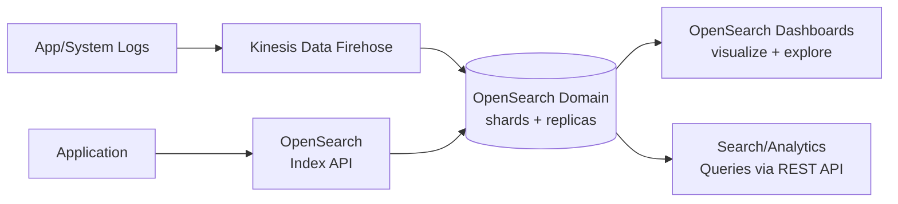
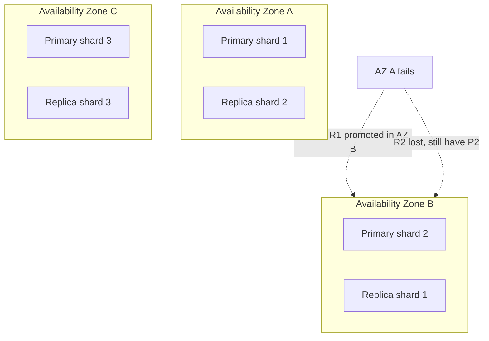
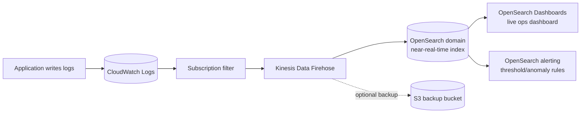
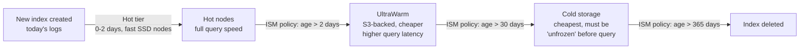

# Amazon OpenSearch Service


*Analytics · maps to SAA-C03 Domain 3 Task 3.5, MLA-C02 Domain 1 (Data Preparation for ML and AI)*

## Definition

Amazon OpenSearch Service is a **managed search and analytics engine**, based on the
open-source OpenSearch project (a fork of Elasticsearch), that lets you store, search, and
visualize large volumes of data — especially text, logs, and semi-structured JSON — with
fast, full-text and near-real-time analytical queries. Think "Google-style search, but over
your own data," plus a built-in dashboarding UI (OpenSearch Dashboards).

## Purpose

Relational databases are built for exact-match, structured queries; they're slow and awkward
for "find all log lines mentioning this error, ranked by relevance" or "full-text search across
millions of documents." AWS built OpenSearch Service so teams get a production-grade search/log
analytics engine (indexing, relevance ranking, aggregations, near-real-time ingestion) without
operating the underlying distributed cluster, patching nodes, or handling sharding/replication
by hand — all problems the open-source Elasticsearch/OpenSearch software solves, but that are
operationally heavy to run yourself.

## How It Works

Plain explanation: OpenSearch is like a card catalog system built specifically to answer "find
me everything related to X, ranked by how relevant it is," not "look up record #4521." Data
gets broken into an **index** (like a specialized card catalog) built from the actual content,
so searching doesn't mean scanning every record — it means checking the index directly, which
is how it stays fast even over huge volumes of text/logs.



Step by step:

1. Data arrives into an **OpenSearch domain** (a managed cluster) either via direct API calls
   from an application, or streamed continuously through **Kinesis Data Firehose**, which can
   deliver records straight into an OpenSearch index as they arrive.
2. Incoming documents (usually JSON) get **indexed** — OpenSearch analyzes the text, builds an
   inverted index (word → which documents contain it), so later searches don't need to scan
   every document, just look up the index.
3. Data is split into **shards** spread across nodes in the domain, with **replica shards** for
   both fault tolerance and to spread read load — this is what lets the service handle large
   volumes and remain available if a node fails.
4. You query via the **REST API** (search queries, aggregations like "count errors per hour")
   or interactively through **OpenSearch Dashboards**, the built-in visualization UI for
   building charts and dashboards straight off indexed data.
5. Because ingestion is near-real-time, dashboards built on OpenSearch reflect what's happening
   right now — this is why it's the standard choice for **live log analytics/observability**,
   distinct from a data lake that's often queried in minutes-to-hours-old batches.

### Shard and replica allocation across Availability Zones

Shard/replica placement is both the key to OpenSearch's fault tolerance and one of the most
commonly misconfigured aspects of a domain — the diagram below is the official AWS illustration
of how a Multi-AZ domain actually places primary and replica shards.


*OpenSearch Service VPC architecture across two Availability Zones — data nodes are placed in
subnets in each AZ, with the service managing network interfaces into each. Source: AWS
OpenSearch Service Developer Guide,
[Launching your Amazon OpenSearch Service domains within a VPC](https://docs.aws.amazon.com/opensearch-service/latest/developerguide/vpc.html).*



OpenSearch never places a primary shard and its own replica in the same Availability Zone —
losing one AZ always leaves at least one copy of every shard available elsewhere, which is why
**replica count ≥ 1 across at least 2 AZs** is the standard "don't lose data/availability on an
AZ outage" exam and real-world answer, not a nice-to-have.

### Ingestion pipeline: CloudWatch Logs to searchable dashboard



This exact chain — CloudWatch Logs → subscription filter → Firehose → OpenSearch → Dashboards —
is worth memorizing verbatim; it is the single most commonly tested "near-real-time log
analytics" architecture across both SAA-C03 and operationally in the real world, and it
reappears (with S3 instead of OpenSearch as the destination) as the batch/cold-path analog.

## Key Features / Components

- **OpenSearch Dashboards** — the built-in UI (fork of Kibana) for building visualizations and
  dashboards directly on indexed data, no separate BI tool required.
- **Full-text search & relevance ranking** — queries can rank results by relevance score, not
  just exact match, essential for search-box-style use cases.
- **Near-real-time indexing** — documents typically become searchable within ~1 second of being
  indexed, unlike batch-oriented analytics systems.
- **Shards and replicas** — horizontal scaling (more shards) and fault tolerance (replica
  shards on different nodes/AZs) are both built in, configurable per index.
- **Fine-grained access control & encryption** — integrates with IAM, supports encryption at
  rest/in transit, and VPC-only domains for network isolation.
- **OpenSearch Serverless** — an on-demand mode that removes capacity planning entirely,
  auto-scaling the underlying compute/storage as load changes.
- **UltraWarm / Cold storage tiers** — move older, less-frequently-queried indices to cheaper
  storage tiers automatically, without losing searchability.
- **Index State Management (ISM)** — policy-driven automation for index lifecycle: roll over to
  a new index at a size/age threshold, move old indices to UltraWarm, then Cold, then delete —
  without a human running these steps manually on a schedule.
- **k-NN / vector search** — native support for approximate nearest-neighbor search over vector
  embeddings, making OpenSearch usable as a **vector database** for RAG/semantic search
  pipelines, not just text search.
- **Cross-cluster search/replication** — query across multiple domains, or replicate indices
  between domains (e.g., for disaster recovery or geographic distribution).

## Partitioning (sharding) and performance tuning

- **Shard count is set at index creation and cannot be changed afterward** (without reindexing)
  — this is the single most consequential OpenSearch sizing decision, unlike S3/Athena
  partitioning, which can evolve over time.
- **Rule of thumb: target shard size 10–50 GB** — too many small shards wastes overhead
  (cluster state, per-shard memory) per unit of data; too few large shards limits parallelism
  and makes rebalancing/recovery slower.
- **Worked example — sizing shards for a logging index**: an index expected to hold 300 GB/day
  of logs, retained for 7 days (2.1 TB total), targeting ~30 GB per shard, needs roughly
  `2.1 TB / 30 GB ≈ 70 primary shards` total across the retention window — in practice split
  across daily indices (one index per day, each sized for that day's ~300 GB ÷ 30 GB ≈ 10
  shards), using **Index State Management** to roll indices and age them into UltraWarm/Cold
  tiers as they leave the "hot" query window.
- **Replica count trades availability/read-throughput for cost** — 1 replica (2 total copies)
  is the common minimum for production; 0 replicas means any single node failure can lose data
  for shards hosted only there, a real risk, not just a theoretical one.
- **Hot-warm-cold architecture** — put recent, frequently-queried data on hot (fast, pricier)
  nodes; age data into **UltraWarm** (cheaper, S3-backed, still searchable but higher query
  latency) once it's rarely queried; move oldest data to **Cold storage** (cheapest, must be
  "unfrozen"/attached before querying) — this tiering is the primary cost lever for a
  log-retention-heavy OpenSearch workload, directly analogous to S3 storage class tiering.
- **Mapping/field type choices matter at scale** — indexing every field as a full-text
  `text` type (versus `keyword` for exact-match fields like status codes or IDs) bloats index
  size and slows aggregations; explicit mappings outperform OpenSearch's auto-detected defaults
  at any meaningful scale.

### Hot-warm-cold tiering with Index State Management



An Index State Management policy automates this entire lifecycle against age/size thresholds
you define once — without it, aging indices into cheaper tiers (or deleting them) is a manual,
easily-forgotten operational chore, and the most common real-world reason an OpenSearch bill
grows unbounded over time is simply that nobody ever configured this policy.


## Common Architectures

**1. Centralized application/infrastructure log analytics** — CloudWatch Logs subscription
filter → Kinesis Data Firehose → OpenSearch domain → OpenSearch Dashboards, the canonical
"live ops visibility" pipeline described above, often with an S3 backup branch on the same
Firehose stream for cheap long-term retention of the same raw logs.

**2. Application search feature (e-commerce/document search)** — a product catalog or document
store is indexed into OpenSearch directly from the application (not via a log pipeline), with
relevance tuning (boosting, synonyms, fuzzy matching) configured on the index mapping to power
a customer-facing search box.

**3. Security analytics / SIEM-style threat hunting** — security event sources (GuardDuty,
Security Hub, VPC Flow Logs, application audit logs) feed into OpenSearch, with **alerting**
rules configured to fire on suspicious patterns (e.g., many failed logins from one IP in a
short window) in near-real-time, rather than discovered the next day in a batch report.

**4. Vector search / RAG retrieval backend** — document chunks are embedded (e.g., via Amazon
Titan Embeddings or Bedrock) and indexed into OpenSearch using its k-NN vector field type; a
Bedrock Knowledge Base or custom RAG application queries OpenSearch for the most semantically
similar chunks to a user's question, the same role OpenSearch plays as a vector store described
in `services/machine-learning-ai/bedrock.md`.

**5. Hot-warm-cold log retention at scale** — new logs land on hot nodes for fast near-real-time
querying, an Index State Management policy automatically rolls indices over by size/age, ages
indices older than a few days into UltraWarm, and after a retention threshold moves them to
Cold storage or deletes them — all without manual index-lifecycle operations.

**6. Hybrid keyword + semantic search** — a single query combines a traditional keyword/BM25
search with a k-NN vector similarity search over the same index, blending both relevance scores
— used when pure keyword search misses semantically-related-but-differently-worded results, and
pure vector search misses exact-term matches (product codes, SKUs) that users expect to find
verbatim.

### Worked example — sizing a k-NN vector index

A RAG knowledge base holds 500,000 document chunks, each embedded as a 1,536-dimension vector
(a common embedding size, e.g., Titan Embeddings) stored as 32-bit floats.

1. **Raw vector storage**: 500,000 × 1,536 × 4 bytes ≈ **3.07 GB** of raw vector data before any
   index overhead.
2. **HNSW index overhead**: the k-NN algorithm most commonly used (Hierarchical Navigable Small
   World graphs) typically adds roughly 1.2–2x overhead on top of raw vector size for the graph
   structure itself, bringing total index size to roughly **4–6 GB** for this example.
3. **Why this matters for node sizing**: unlike a text index where the inverted index is
   usually much smaller than the source text, a vector index's size is dominated by vector
   dimensionality and overhead, not by the length of the original document text — a
   knowledge base of short chunks with high-dimensional embeddings can need more memory/storage
   than its raw text size would suggest, a frequently-missed sizing assumption.

## Use Cases — When to Use It

- **Centralized log analytics / observability** — aggregating application and infrastructure
  logs for searching, alerting, and dashboarding (a very common pairing: CloudWatch Logs →
  subscription filter → Kinesis Firehose → OpenSearch).
- **Full-text and fuzzy search features in an application** — e.g., a product catalog search
  box, document search, "did you mean" suggestions.
- **Security analytics / SIEM-style workloads** — searching large volumes of security event
  data for investigation and threat hunting.
- **Clickstream and application performance monitoring** dashboards that need near-real-time
  visibility rather than next-morning batch reports.
- **Vector/semantic search backend** for RAG pipelines and similarity-search features.

## When NOT to Use It / Alternatives

- If you need **structured, transactional queries** (joins, strict consistency, ACID) on
  relational data — use **RDS/Aurora**, not OpenSearch; it's not a relational database
  replacement.
- For **large-scale historical batch analytics** over a data lake (petabytes, infrequent
  queries, cost-sensitive) — **Athena** or **Redshift** over S3 is cheaper than keeping that
  volume hot in an OpenSearch cluster continuously.
- If your real need is just "store logs cheaply and query them occasionally," plain
  **CloudWatch Logs Insights** or S3 + Athena can be far cheaper than running an OpenSearch
  domain sized for near-real-time search.
- Don't use OpenSearch as a primary system of record — it's optimized for search/analytics, not
  durability guarantees and transactional integrity the way a database is.
- Don't over-shard a small index "just in case" — excess shards waste cluster overhead and can
  actually hurt performance versus a correctly-sized shard count.

## Why It's Important

**Real-world:** OpenSearch underpins most "live search this" and "live dashboard of what's
happening right now" features — from e-commerce search boxes to SOC/security dashboards to
ops team "what's breaking right now" views. Getting shard count and replica strategy wrong is a
classic source of either poor performance (too few shards) or wasted cost (over-sharded,
over-replicated small indices).

**Exam:** OpenSearch appears in **SAA-C03 Task 3.5 — "Determine high-performing data ingestion
and transformation solutions"** as the near-real-time search/analytics destination option
(frequently paired with Kinesis Data Firehose as a delivery target, alongside S3 and Redshift)
— exam scenarios testing "near-real-time, searchable, dashboard-ready" point here over a data
lake/Athena answer, which is more batch-oriented. In **MLA-C02 Domain 1**, OpenSearch (with its
**k-NN / vector search** capability) is increasingly relevant for storing and searching
**embeddings** used in RAG (retrieval-augmented generation) pipelines — recognize OpenSearch as
a vector store option, not just a log search tool, in newer GenAI-adjacent data-prep questions.

### Exam scenario deep-dive: OpenSearch vs. Athena vs. Redshift, side by side

| Scenario clue | Correct answer | Why |
|---|---|---|
| "Near-real-time dashboard of errors happening right now, full-text search over log messages" | OpenSearch | Near-real-time indexing + relevance ranking is OpenSearch's defining trait |
| "Ad-hoc SQL over S3 log files, infrequent, pay-per-query" | Athena | Batch/ad-hoc, not continuously hot — Athena's sweet spot |
| "Frequent complex BI queries across curated structured data, many concurrent analysts" | Redshift | Structured, SQL-heavy, provisioned/optimized warehouse workload |
| "Product search box with typo tolerance and relevance ranking" | OpenSearch | Full-text search with relevance scoring, not a SQL aggregation problem |
| "Store document embeddings, retrieve top-K similar chunks for RAG" | OpenSearch (k-NN) | Native vector search capability |

### MLA-C02 scenario — OpenSearch as a vector store

A question describing "store embeddings generated from company documents, retrieve the most
semantically similar passages to a user's question" is testing whether you recognize OpenSearch
(specifically its k-NN index type) as a legitimate, AWS-native vector database option alongside
Amazon Aurora with pgvector and third-party vector databases — don't default to assuming
"vector search" automatically means a specialized third-party product; OpenSearch is often the
first AWS-native answer the exam expects.

## Pricing Model (summary)

- **Managed domains**: billed per instance-hour for the data/master node instance types chosen,
  plus EBS storage attached to each node (if not using instance store).
- **UltraWarm/Cold storage**: cheaper per-GB rates for less frequently queried data, billed
  separately from hot-tier instance pricing.
- **OpenSearch Serverless**: billed per OpenSearch Compute Unit (OCU)-hour for indexing and
  search capacity consumed, with no instance provisioning.
- **Worked example — hot vs. hot+warm cost shape**: a 7-day retention logging workload sized at
  2.1 TB keeps all of it on hot nodes without tiering — say 6 × r6g.xlarge.search data nodes
  running 24/7. Introducing a hot-warm architecture where only the most recent 1–2 days stay on
  hot nodes and the remaining 5–6 days move to UltraWarm (billed at a substantially lower
  per-GB rate than hot-node storage) typically cuts the storage-driven portion of the bill
  significantly for retention-heavy, rarely-re-queried older data, while keeping identical
  query functionality against that older data (just at higher latency) — the standard
  "right-size by access pattern" OpenSearch cost argument.
- **Worked example — replica cost tradeoff**: doubling replica count from 1 to 2 roughly
  doubles the storage and compute footprint for the affected indices, in exchange for
  tolerating two simultaneous node failures instead of one — a concrete cost-vs-availability
  tradeoff a cost-optimization exam question expects you to reason through explicitly, not
  simply recall "more replicas = more available."
- See official pricing: https://aws.amazon.com/opensearch-service/pricing/

## Limits & Quotas

- **Shard count is fixed at index creation** — resizing requires reindexing into a
  differently-shard-counted new index (via the `_reindex` API or a Dashboards reindex action),
  not an in-place resize.
- **Recommended max shard size**: roughly 10–50 GB per shard for query performance; exceeding
  this significantly degrades search latency even if the cluster has capacity headroom.
- **Maximum shards per node**: a soft cluster-health limit based on available heap/memory per
  node — exceeding it risks cluster instability (commonly summarized as "don't let shard count
  per node exceed roughly 20x the node's GB of heap," a widely cited open-source OpenSearch/
  Elasticsearch operational guideline, not an AWS-specific hard limit).
- **Domain node count**: supports large domains (AWS documentation cites support for over 1,000
  data nodes and tens of petabytes of attached storage for the largest domain configurations) —
  exam questions rarely need the exact ceiling, just that OpenSearch scales to very large
  deployments.
- **VPC domain limitations**: a domain created with a public endpoint cannot later move into a
  VPC, and vice versa — migrating requires creating a new domain and reindexing/snapshotting
  data across, not an in-place network change.

## Troubleshooting / Common Issues

- **Cluster status `yellow`** — at least one replica shard is unassigned (commonly because
  there aren't enough nodes/AZs to place it per the "never co-locate primary and replica"
  rule) — check node count and AZ distribution against the configured replica count before
  assuming data loss; `yellow` means reduced redundancy, not lost data.
- **Cluster status `red`** — at least one primary shard is unassigned, meaning some data is
  currently unsearchable/unavailable — this is the urgent state to investigate immediately
  (node failure, disk full, or a shard allocation problem), unlike `yellow`.
- **Indexing slows down or rejects writes under load** — check for **disk watermark** limits
  (OpenSearch throttles or blocks writes as disk usage approaches configured high-watermark
  thresholds) before assuming it's a compute/CPU bottleneck.
- **Searches are slow despite a "healthy" cluster** — check shard size distribution (too few,
  too-large shards limit query parallelism) and whether `text` vs `keyword` field mappings are
  appropriate for the query patterns actually run — a mapping mismatch is a very common root
  cause of slow aggregation queries specifically.

- **Firehose delivery to OpenSearch failing/backing up** — check the domain's access policy and
  whether Firehose's IAM role has the necessary index permissions; also check whether the
  domain is simply under indexing-capacity pressure (watermark throttling, as above).
- **Can't reach a VPC-based domain from outside the VPC** — this is expected behavior, not a
  misconfiguration; VPC domains require a VPN, transit gateway, proxy, or peered/connected
  network path by design — don't troubleshoot it as if a public endpoint should be reachable.

## Hands-on Lab (Floci)

Floci's `awslocal` support for OpenSearch typically covers **domain creation/management API
calls**; it does not run a true multi-node OpenSearch cluster with full search/aggregation
behavior locally — for genuine hands-on search/indexing practice, run **OpenSearch's own
official Docker image** locally (a single-node OpenSearch container, free and open-source) and
treat Floci purely for practicing the AWS-side domain-management CLI calls. Full walkthrough:
`labs-floci/opensearch.md`.

```bash
# Create an OpenSearch domain (metadata/management API call)
awslocal opensearch create-domain \
  --domain-name app-logs \
  --engine-version "OpenSearch_2.11" \
  --cluster-config InstanceType=t3.small.search,InstanceCount=1

# Describe the domain to get its (local) endpoint
awslocal opensearch describe-domain --domain-name app-logs

# For real indexing/search behavior, run OpenSearch itself locally:
# docker run -p 9200:9200 -e "discovery.type=single-node" \
#   opensearchproject/opensearch:2.11.0
#
# curl -X PUT "localhost:9200/app-logs/_doc/1" -H 'Content-Type: application/json' \
#   -d '{"level":"ERROR","message":"payment service timeout","service":"checkout"}'
#
# curl -X GET "localhost:9200/app-logs/_search?q=message:timeout"
#
# Demonstrate an explicit mapping (keyword vs text) rather than relying on auto-detection:
# curl -X PUT "localhost:9200/app-logs-v2" -H 'Content-Type: application/json' -d '{
#   "mappings": {"properties": {
#     "level": {"type": "keyword"},
#     "message": {"type": "text"},
#     "service": {"type": "keyword"}
#   }}
# }'
```

## Exam Tips

- **OpenSearch vs. Athena** — both can sit downstream of a streaming/data-lake pipeline, but
  OpenSearch means "near-real-time, searchable, dashboard-driven" while Athena means "batch,
  ad-hoc SQL over files in S3, pay-per-scan." A question emphasizing "search," "near real-time
  dashboard," or "full-text search with relevance ranking" points to OpenSearch, not Athena.
- **OpenSearch vs. Redshift** — Redshift is for structured, SQL-heavy BI analytics over large
  curated datasets; OpenSearch is for text/log search and near-real-time operational
  dashboards. They solve different query shapes, not the same job at different scales.
- Remember OpenSearch Service is often paired with **Kinesis Data Firehose** as a named
  destination option on the exam — recognize this pipeline shape: source → Firehose →
  OpenSearch → OpenSearch Dashboards.
- OpenSearch Service was formerly branded "Amazon Elasticsearch Service" — older materials/
  questions may still use that name; they refer to the same underlying service lineage (now
  based on the open-source OpenSearch fork, not Elastic's licensed Elasticsearch).
- **Shard count cannot change after index creation** — a question describing "we need to resize
  shards without downtime" is pointing at reindexing into a new index (often via an index
  alias swap), not an in-place resize operation.
- **`yellow` vs. `red` cluster status** is a frequently tested factual distinction: `yellow` =
  reduced redundancy (a replica unassigned), `red` = actual unavailable data (a primary
  unassigned) — don't treat them as the same severity.
- Know OpenSearch's **k-NN vector search** capability as a legitimate MLA-C02-relevant answer
  for "where do RAG embeddings get stored and searched," not just a log-analytics-only service.

## Further Reading

- What is Amazon OpenSearch Service:
  https://docs.aws.amazon.com/opensearch-service/latest/developerguide/what-is.html
- Launching domains within a VPC (architecture diagrams):
  https://docs.aws.amazon.com/opensearch-service/latest/developerguide/vpc.html
- Index State Management (ISM) policies:
  https://docs.aws.amazon.com/opensearch-service/latest/developerguide/ism.html
- UltraWarm and Cold storage:
  https://docs.aws.amazon.com/opensearch-service/latest/developerguide/ultrawarm.html
- k-NN vector search:
  https://docs.aws.amazon.com/opensearch-service/latest/developerguide/knn.html
- OpenSearch Service pricing: https://aws.amazon.com/opensearch-service/pricing/

## Related Terms

[`glossary/README.md`](../../glossary/README.md) · [`kinesis-family.md`](kinesis-family.md) ·
[`athena.md`](athena.md) · [`data-lake-concepts.md`](data-lake-concepts.md) ·
`services/database/redshift.md` · `services/machine-learning-ai/embeddings-and-rag.md`
