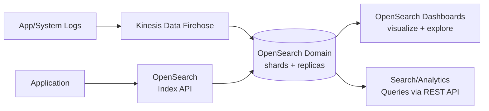

# Amazon OpenSearch Service


*Analytics · maps to SAA-C03 Domain 3 Task 3.5, MLA-C02 Domain 1 (Data Preparation for ML and AI)*

## Definition

Amazon OpenSearch Service is a **managed search and analytics engine**, based on the
open-source OpenSearch project (a fork of Elasticsearch), that lets you store, search, and
visualize large volumes of data — especially text, logs, and semi-structured JSON — with
fast, full-text and near-real-time analytical queries. Think "Google-style search, but over
your own data," plus a built-in dashboarding UI (OpenSearch Dashboards).

## Purpose

Relational databases are built for exact-match, structured queries; they're slow and awkward
for "find all log lines mentioning this error, ranked by relevance" or "full-text search across
millions of documents." AWS built OpenSearch Service so teams get a production-grade search/log
analytics engine (indexing, relevance ranking, aggregations, near-real-time ingestion) without
operating the underlying distributed cluster, patching nodes, or handling sharding/replication
by hand — all problems the open-source Elasticsearch/OpenSearch software solves, but that are
operationally heavy to run yourself.

## How It Works

Plain explanation: OpenSearch is like a card catalog system built specifically to answer "find
me everything related to X, ranked by how relevant it is," not "look up record #4521." Data
gets broken into an **index** (like a specialized card catalog) built from the actual content,
so searching doesn't mean scanning every record — it means checking the index directly, which
is how it stays fast even over huge volumes of text/logs.



Step by step:

1. Data arrives into an **OpenSearch domain** (a managed cluster) either via direct API calls
   from an application, or streamed continuously through **Kinesis Data Firehose**, which can
   deliver records straight into an OpenSearch index as they arrive.
2. Incoming documents (usually JSON) get **indexed** — OpenSearch analyzes the text, builds an
   inverted index (word → which documents contain it), so later searches don't need to scan
   every document, just look up the index.
3. Data is split into **shards** spread across nodes in the domain, with **replica shards** for
   both fault tolerance and to spread read load — this is what lets the service handle large
   volumes and remain available if a node fails.
4. You query via the **REST API** (search queries, aggregations like "count errors per hour")
   or interactively through **OpenSearch Dashboards**, the built-in visualization UI for
   building charts and dashboards straight off indexed data.
5. Because ingestion is near-real-time, dashboards built on OpenSearch reflect what's happening
   right now — this is why it's the standard choice for **live log analytics/observability**,
   distinct from a data lake that's often queried in minutes-to-hours-old batches.

## Key Features / Components

- **OpenSearch Dashboards** — the built-in UI (fork of Kibana) for building visualizations and
  dashboards directly on indexed data, no separate BI tool required.
- **Full-text search & relevance ranking** — queries can rank results by relevance score, not
  just exact match, essential for search-box-style use cases.
- **Near-real-time indexing** — documents typically become searchable within ~1 second of being
  indexed, unlike batch-oriented analytics systems.
- **Shards and replicas** — horizontal scaling (more shards) and fault tolerance (replica
  shards on different nodes/AZs) are both built in, configurable per index.
- **Fine-grained access control & encryption** — integrates with IAM, supports encryption at
  rest/in transit, and VPC-only domains for network isolation.
- **OpenSearch Serverless** — an on-demand mode that removes capacity planning entirely,
  auto-scaling the underlying compute/storage as load changes.
- **UltraWarm / Cold storage tiers** — move older, less-frequently-queried indices to cheaper
  storage tiers automatically, without losing searchability.

## Use Cases — When to Use It

- **Centralized log analytics / observability** — aggregating application and infrastructure
  logs for searching, alerting, and dashboarding (a very common pairing: CloudWatch Logs →
  subscription filter → Kinesis Firehose → OpenSearch).
- **Full-text and fuzzy search features in an application** — e.g., a product catalog search
  box, document search, "did you mean" suggestions.
- **Security analytics / SIEM-style workloads** — searching large volumes of security event
  data for investigation and threat hunting.
- **Clickstream and application performance monitoring** dashboards that need near-real-time
  visibility rather than next-morning batch reports.

## When NOT to Use It / Alternatives

- If you need **structured, transactional queries** (joins, strict consistency, ACID) on
  relational data — use **RDS/Aurora**, not OpenSearch; it's not a relational database
  replacement.
- For **large-scale historical batch analytics** over a data lake (petabytes, infrequent
  queries, cost-sensitive) — **Athena** or **Redshift** over S3 is cheaper than keeping that
  volume hot in an OpenSearch cluster continuously.
- If your real need is just "store logs cheaply and query them occasionally," plain
  **CloudWatch Logs Insights** or S3 + Athena can be far cheaper than running an OpenSearch
  domain sized for near-real-time search.
- Don't use OpenSearch as a primary system of record — it's optimized for search/analytics, not
  durability guarantees and transactional integrity the way a database is.

## Why It's Important

**Real-world:** OpenSearch underpins most "live search this" and "live dashboard of what's
happening right now" features — from e-commerce search boxes to SOC/security dashboards to
ops team "what's breaking right now" views. Getting shard count and replica strategy wrong is a
classic source of either poor performance (too few shards) or wasted cost (over-sharded,
over-replicated small indices).

**Exam:** OpenSearch appears in **SAA-C03 Task 3.5 — "Determine high-performing data ingestion
and transformation solutions"** as the near-real-time search/analytics destination option
(frequently paired with Kinesis Data Firehose as a delivery target, alongside S3 and Redshift)
— exam scenarios testing "near-real-time, searchable, dashboard-ready" point here over a data
lake/Athena answer, which is more batch-oriented. In **MLA-C02 Domain 1**, OpenSearch (with its
**k-NN / vector search** capability) is increasingly relevant for storing and searching
**embeddings** used in RAG (retrieval-augmented generation) pipelines — recognize OpenSearch as
a vector store option, not just a log search tool, in newer GenAI-adjacent data-prep questions.

## Pricing Model (summary)

- **Managed domains**: billed per instance-hour for the data/master node instance types chosen,
  plus EBS storage attached to each node (if not using instance store).
- **UltraWarm/Cold storage**: cheaper per-GB rates for less frequently queried data, billed
  separately from hot-tier instance pricing.
- **OpenSearch Serverless**: billed per OpenSearch Compute Unit (OCU)-hour for indexing and
  search capacity consumed, with no instance provisioning.
- See official pricing: https://aws.amazon.com/opensearch-service/pricing/

## Hands-on Lab (Floci)

Floci's `awslocal` support for OpenSearch typically covers **domain creation/management API
calls**; it does not run a true multi-node OpenSearch cluster with full search/aggregation
behavior locally — for genuine hands-on search/indexing practice, run **OpenSearch's own
official Docker image** locally (a single-node OpenSearch container, free and open-source) and
treat Floci purely for practicing the AWS-side domain-management CLI calls. Full walkthrough:
`labs-floci/opensearch.md`.

```bash
# Create an OpenSearch domain (metadata/management API call)
awslocal opensearch create-domain \
  --domain-name app-logs \
  --engine-version "OpenSearch_2.11" \
  --cluster-config InstanceType=t3.small.search,InstanceCount=1

# Describe the domain to get its (local) endpoint
awslocal opensearch describe-domain --domain-name app-logs

# For real indexing/search behavior, run OpenSearch itself locally:
# docker run -p 9200:9200 -e "discovery.type=single-node" \
#   opensearchproject/opensearch:2.11.0
#
# curl -X PUT "localhost:9200/app-logs/_doc/1" -H 'Content-Type: application/json' \
#   -d '{"level":"ERROR","message":"payment service timeout","service":"checkout"}'
#
# curl -X GET "localhost:9200/app-logs/_search?q=message:timeout"
```

## Exam Tips

- **OpenSearch vs. Athena** — both can sit downstream of a streaming/data-lake pipeline, but
  OpenSearch means "near-real-time, searchable, dashboard-driven" while Athena means "batch,
  ad-hoc SQL over files in S3, pay-per-scan." A question emphasizing "search," "near real-time
  dashboard," or "full-text search with relevance ranking" points to OpenSearch, not Athena.
- **OpenSearch vs. Redshift** — Redshift is for structured, SQL-heavy BI analytics over large
  curated datasets; OpenSearch is for text/log search and near-real-time operational
  dashboards. They solve different query shapes, not the same job at different scales.
- Remember OpenSearch Service is often paired with **Kinesis Data Firehose** as a named
  destination option on the exam — recognize this pipeline shape: source → Firehose →
  OpenSearch → OpenSearch Dashboards.
- OpenSearch Service was formerly branded "Amazon Elasticsearch Service" — older materials/
  questions may still use that name; they refer to the same underlying service lineage (now
  based on the open-source OpenSearch fork, not Elastic's licensed Elasticsearch).

## Related Terms

[`glossary/README.md`](../../glossary/README.md) · [`kinesis-family.md`](kinesis-family.md) ·
[`athena.md`](athena.md) · [`data-lake-concepts.md`](data-lake-concepts.md) ·
`services/database/redshift.md` · `services/machine-learning-ai/embeddings-and-rag.md`
