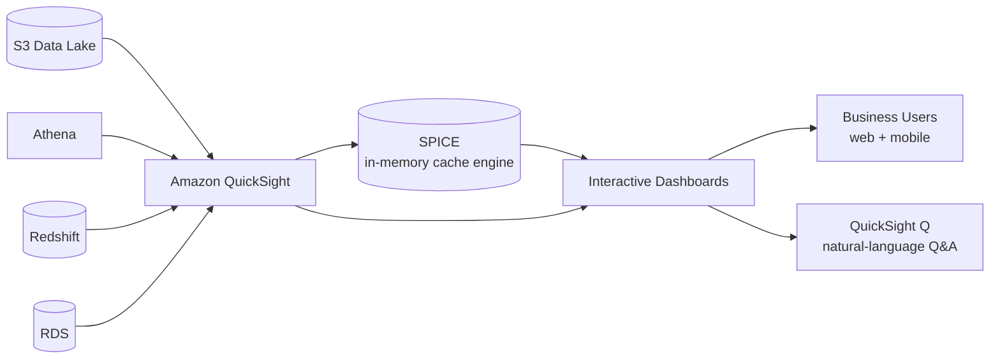
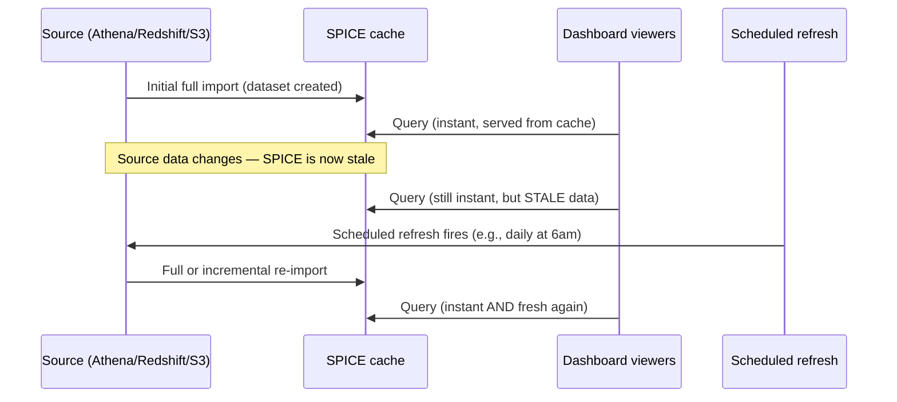
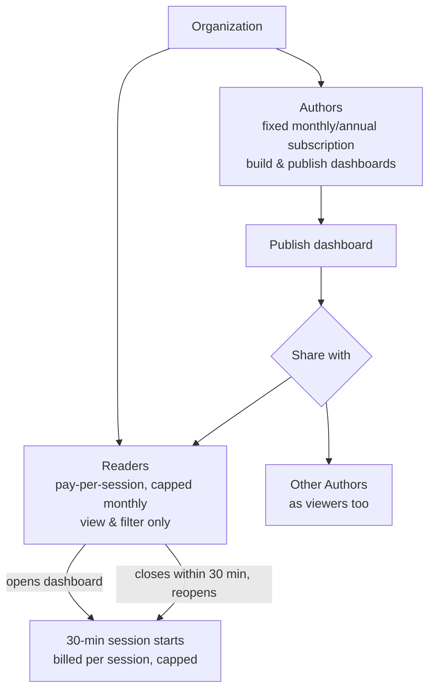
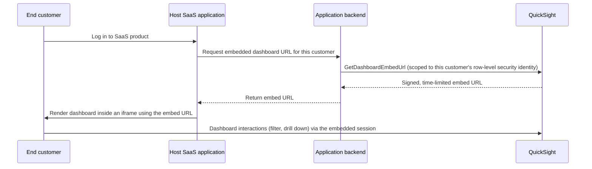
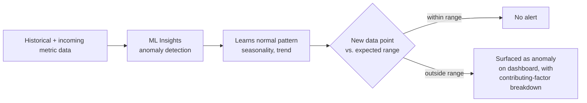

# Amazon QuickSight


*Analytics · maps to SAA-C03 Domain 3 Task 3.5, MLA-C02 Domain 1 (Data Preparation for ML and AI)*

## Definition

Amazon QuickSight is a **fully managed business intelligence (BI) service** — the "last mile"
tool that turns data sitting in S3, Redshift, Athena, RDS, or other sources into interactive
dashboards and visualizations that business users can explore themselves, without writing SQL.

## Purpose

Getting data clean and queryable (Glue, Athena, Redshift) solves half the problem — someone
still has to turn numbers into a chart a manager can actually read and act on, and most
companies don't want to run and license a heavyweight, self-hosted BI server (Tableau/Power BI
server-class infrastructure) just for internal dashboards. AWS built QuickSight as a serverless,
pay-per-use BI layer that connects directly to AWS data sources, scales automatically to
thousands of viewers, and bills per user/session instead of per fixed server license.

## How It Works

Plain explanation: QuickSight is the "shop window" at the end of the data pipeline — it doesn't
store or transform the core data itself, it connects to wherever the clean data already lives,
pulls it in (either live or cached in-memory), and lets a non-technical person drag-and-drop
fields into charts, filters, and dashboards that update automatically as underlying data changes.



Step by step:

1. QuickSight connects to one or more **data sources** — S3 (data lake files), Athena (SQL over
   S3), Redshift, RDS, or even on-premises databases via a secure connector — without needing
   the data to be physically copied into QuickSight first.
2. For better performance on repeated/interactive queries, QuickSight can **import data into
   SPICE** (Super-fast, Parallel, In-memory Calculation Engine) — a columnar in-memory engine
   that makes dashboard interactions (filtering, drilling down) feel instant, instead of
   re-running the source query every click. Alternatively, it can query sources **directly**
   (live) each time, trading speed for always-fresh data.
3. An **author** builds a dashboard visually — choosing chart types, adding filters, defining
   calculated fields — without writing SQL (though calculated fields use a formula language).
4. The finished dashboard is **published** and shared with specific users or groups; QuickSight
   handles authentication (via IAM, Active Directory, or SSO) and per-session access.
5. **Business users** view dashboards through a web browser or the QuickSight mobile app; they
   can filter and drill into data themselves without needing the author's help for every
   question, and without write access to the underlying data source.
6. **QuickSight Q** (natural-language querying) lets a user type a plain-English question
   ("what were sales in Q3 by region?") and get an auto-generated chart answer, without
   navigating a pre-built dashboard at all.

### SPICE ingestion and refresh lifecycle

Understanding exactly when SPICE data goes stale (and how it gets refreshed) is the key
operational/exam detail that separates "the dashboard just looks wrong" from "the dashboard is
correctly showing slightly-old cached data by design."



A dashboard built on SPICE is only as fresh as its **last scheduled refresh** — this is the
single most common "why does my dashboard show yesterday's numbers" support question, and the
fix is either tightening the refresh schedule or switching that specific dataset to direct
query mode if true real-time freshness is required.

### Author vs. Reader access and licensing flow



Assigning every occasional dashboard viewer an Author seat (instead of a Reader session) is the
classic QuickSight cost-optimization anti-pattern — Readers are billed per-session with a
monthly cap, which is dramatically cheaper than a full Author subscription for anyone who only
ever *views* dashboards.

### Embedded analytics authentication flow



The embed URL is short-lived and scoped to one customer's identity (typically mapped to a
row-level security rule), so the *same* dashboard definition safely serves every customer of
the SaaS product without the host application ever handling QuickSight credentials directly or
needing a separate dashboard per customer.

### ML Insights anomaly detection flow



ML Insights requires no model training or data science involvement from the dashboard author —
it's a built-in, point-and-click capability applied directly to a visual's underlying data,
which is specifically why exam material frames it as the "non-code way to surface anomalies"
option versus standing up a custom SageMaker-based anomaly detection pipeline for the same
business-metrics use case.

## Key Features / Components

- **SPICE** — the in-memory engine that caches data for fast, interactive dashboard
  performance; has its own separate capacity/pricing from the data source itself.
- **Serverless, auto-scaling** — QuickSight scales to thousands of concurrent dashboard viewers
  without you provisioning any servers.
- **Per-session/per-user pricing** — unlike traditional BI tools with fixed per-seat licenses,
  QuickSight has an Author/Reader split, with Readers billed per session rather than a fixed
  monthly seat in some plans.
- **ML Insights** — built-in anomaly detection and forecasting applied automatically to
  dashboard data, without a data scientist writing custom models.
- **QuickSight Q** — natural-language Q&A over your data, generating a visualization on the fly
  from a typed question.
- **Embedded analytics** — dashboards can be embedded directly into a company's own
  application/website, so QuickSight can power a product's customer-facing analytics feature.
- **Row-level security** — restrict which rows of data a given user/group can see within the
  same shared dashboard, based on their identity.
- **Column-level security** — similar concept, restricting which columns (not just rows) a
  given user/group can see — commonly paired with row-level security for datasets mixing
  sensitive and non-sensitive fields in one table.
- **Dataset-level incremental refresh** — SPICE datasets can refresh incrementally (only new/
  changed rows since the last refresh) rather than a full re-import every time, cutting refresh
  time and source-query load for large, append-heavy datasets.
- **QuickSight Paginated Reports** — operational, pixel-perfect PDF-style reports (distinct
  from interactive dashboards) for recipients who need a fixed-format document rather than an
  explorable dashboard.

## Common Architectures

**1. Data lake to dashboard, the standard shape** — S3 curated zone → Athena (SQL layer) →
QuickSight dataset imported into SPICE on a nightly schedule → dashboard shared with Readers
across the business — the default "we built a data lake, now show it to people" pipeline.

**2. Warehouse-backed executive dashboard** — Redshift (curated, modeled data) → QuickSight
connected directly (often SPICE-cached for speed) → row-level security restricting each
regional manager to their own region's data within one shared dashboard definition, instead of
maintaining N separate dashboards.

**3. Embedded customer-facing analytics** — a SaaS product's own application embeds QuickSight
dashboards per-customer (using embedded analytics + row-level security keyed to the logged-in
customer's account ID), letting the product offer rich analytics without building charting
infrastructure in-house.

**4. Real-time-ish operational dashboard via direct query** — a dashboard explicitly configured
for **direct query mode** (not SPICE) against a frequently-changing Athena/Redshift source,
accepting slightly slower interactivity in exchange for every view reflecting current data —
used when the SPICE refresh-schedule staleness window described above is unacceptable for the
use case.

**5. Natural-language self-service via QuickSight Q** — business users who can't write SQL or
navigate a complex pre-built dashboard instead type plain-English questions directly against a
QuickSight Q-indexed dataset, reducing the backlog of "can you build me a report for X" requests
an analytics team would otherwise field one at a time.

## Use Cases — When to Use It

- **Executive/operational dashboards** — sales trends, operational KPIs, cost dashboards built
  on top of Athena/Redshift/S3 data, viewed by non-technical staff.
- **Embedding analytics into a SaaS product** — giving your own customers a dashboard inside
  your application without building charting infrastructure yourself.
- **Ad-hoc self-service BI** — letting analysts/managers explore data themselves (drag-and-drop,
  filter, drill down) instead of filing a request for every new report.
- **Lightweight anomaly detection/forecasting** on business metrics, without standing up a
  dedicated ML forecasting pipeline.
- **Multi-tenant dashboards with per-user data restrictions** — one dashboard definition serving
  many users/customers, each seeing only their own authorized rows/columns via row/column-level
  security.

## When NOT to Use It / Alternatives

- If you need **deep, specialized BI features** that competitors like Tableau or Power BI offer
  (certain advanced visualization types, specific enterprise BI governance workflows) and your
  organization is already standardized on one of those tools, QuickSight may not be worth a
  migration — it's strongest when you're already AWS-native and want tight integration/low ops.
- If the audience is purely **engineers who are comfortable writing SQL directly**, Athena or a
  SQL client against Redshift may be simpler than building a dashboard layer at all.
- QuickSight is **not a data transformation tool** — if data isn't clean/modeled yet, that's a
  Glue/EMR/Athena-view job first; QuickSight visualizes, it doesn't substantively reshape raw
  data.
- For extremely large, constantly-changing datasets that resist caching, you may need to use
  **direct query mode** instead of SPICE, accepting slower interactivity for freshness — plan
  for that tradeoff rather than treating SPICE as mandatory.
- Assigning every viewer an Author seat when most only ever view dashboards is a direct,
  avoidable cost mistake — see the Author/Reader diagram above.

## Why It's Important

**Real-world:** QuickSight is frequently the actual interface executives and operators use to
make decisions — if the data pipeline upstream is flawless but the dashboard is wrong, slow, or
unreadable, none of that upstream work matters to the business. Per-session/per-reader pricing
also makes it dramatically cheaper than legacy BI licensing for organizations with many
occasional dashboard viewers.

**Exam:** QuickSight is referenced in **SAA-C03 Task 3.5 — "Determine high-performing data
ingestion and transformation solutions"** as the visualization endpoint of a complete data
pipeline (ingest → transform → store → query → **visualize**) — questions testing "pick the
right AWS-native BI tool" point here. It is less central to **MLA-C02**, but appears as a
recognizable tool for **visualizing model evaluation metrics or data quality reports** during
data preparation/monitoring discussions, and ML Insights' anomaly detection is occasionally
referenced as a non-code way to surface anomalies in business metrics.

### Exam scenario deep-dive: SPICE vs. direct query decision table

| Scenario clue | Correct mode | Why |
|---|---|---|
| "Dashboard needs to feel instant even with complex filtering/drill-down" | SPICE | In-memory caching makes interaction latency near-zero |
| "Data must reflect the absolute latest state, even if slower to load" | Direct query | SPICE is only as fresh as its last scheduled refresh |
| "Source data changes continuously throughout the day and freshness matters" | Direct query, or SPICE with frequent incremental refresh | Depends on how tight the freshness requirement actually is |
| "Thousands of viewers hitting the dashboard simultaneously" | SPICE | Protects the underlying source (Athena/Redshift) from being hammered by every viewer's query |
| "Minimize cost for dataset storage, data rarely viewed" | Direct query | Avoids paying for SPICE capacity for a rarely-used dataset |

### Cost-optimization scenario — Author vs. Reader

A classic SAA-C03 Domain 4 crossover question describes "200 employees need to view a sales
dashboard, 3 analysts build/maintain it" and asks for the cheapest licensing approach. The
exam-correct answer is **3 Author subscriptions + 200 Readers billed per session**, not 203
Author subscriptions — Reader pricing is designed exactly for this "many viewers, few builders"
shape and is dramatically cheaper at any meaningful viewer count.

## Pricing Model (summary)

- **Author** seats: a monthly or annual per-user subscription for people who build dashboards.
- **Reader** sessions: pay-per-session pricing (capped monthly) for people who only view
  dashboards — much cheaper than a full Author seat for a large viewer base.
- **SPICE capacity**: billed per GB/month for in-memory cache storage, separate from author/
  reader fees.
- **Worked example — Author vs. all-Author cost shape**: 200 viewers + 3 builders. At a
  representative Author rate (~$24/month) vs. Reader rate (~$0.30 per session, capped around
  ~$5/month per active reader): all-Author would cost roughly 203 × $24 ≈ **$4,872/month**;
  the Author+Reader split costs roughly 3 × $24 + 200 × (capped reader cost, worst case ~$5) ≈
  **$1,072/month** — less than a quarter of the all-Author cost for the identical dashboard,
  illustrating why this is one of the most reliable QuickSight cost-optimization answers on the
  exam.
- **Worked example — SPICE capacity sizing**: a dataset with 50 million rows × 20 columns,
  averaging roughly 20 bytes/column after QuickSight's columnar compression, is roughly
  50,000,000 × 20 × 20 bytes ≈ **20 GB** of SPICE capacity — a number worth being able to
  ballpark-estimate rather than memorize exactly, since SPICE is billed per GB/month
  independently of Author/Reader fees.
- See official pricing: https://aws.amazon.com/quicksight/pricing/

## Limits & Quotas

- **SPICE capacity per account**: a default capacity allocation per region that can be
  increased by purchasing additional capacity; very large cached datasets may require this
  increase ahead of time rather than failing at import time unexpectedly.
- **Dataset row/column limits**: QuickSight supports very large datasets in SPICE, but
  extremely wide tables (very high column counts) or extremely high-cardinality fields used in
  visuals can hit practical rendering/performance limits well before any hard row-count ceiling.
- **Refresh schedule granularity**: SPICE scheduled refreshes have a minimum interval (commonly
  as frequent as hourly, depending on plan/dataset) — a requirement for refreshes more frequent
  than that minimum needs direct query mode instead.
- **Concurrent SPICE dataset refreshes**: a soft limit on simultaneous refresh jobs per account;
  very large numbers of frequently-refreshed datasets may need refresh schedules staggered
  rather than all firing at once.
- **Row/column-level security rule complexity**: very large permission-rule sets (thousands of
  distinct row-level security entries) are supported but add administrative overhead that's
  worth weighing against simpler group-based access patterns.

## Troubleshooting / Common Issues

- **Dashboard shows stale/outdated numbers** — check the SPICE dataset's last successful
  refresh time before assuming a data pipeline bug; this is the single most common QuickSight
  support issue and is almost always a refresh-schedule or refresh-failure problem, not bad
  source data.
- **Scheduled SPICE refresh failing silently** — check refresh history in the dataset's
  settings; a common cause is the underlying Athena/Redshift query itself failing (e.g., a
  Glue Crawler hasn't registered a new partition the refresh query depends on) rather than a
  QuickSight-side problem.
- **Dashboard loads slowly despite using SPICE** — often a visual-design problem (too many
  visuals on one sheet, overly complex calculated fields evaluated per-row) rather than a SPICE
  capacity problem; simplifying visuals or pre-aggregating in the source (Athena CTAS/materialized
  view) usually resolves this faster than adding SPICE capacity.
- **Row-level security not restricting data as expected** — confirm the security mapping
  dataset (the table defining which user/group sees which rows) is itself correctly joined to
  the underlying dataset's identity column; a mismatched join key is the most common cause of
  row-level security silently not applying.
- **Unexpectedly high monthly bill** — almost always traced to Author seats assigned to people
  who only view dashboards (should be Readers), or unused/orphaned SPICE datasets still
  consuming capacity after a project ended.
- **Embedded dashboard shows an authentication/permission error in the host application** —
  typically a mismatched or expired embedding token/session, or an IAM policy on the embedding
  role missing permission for the specific dashboard/dataset being embedded.

## Hands-on Lab (Floci)

**Floci does not support QuickSight at all** — QuickSight is a fully managed SaaS-style
service with no local/open-source emulation path, and it isn't part of Floci's API coverage.
The practical free alternative for hands-on BI practice: use **QuickSight's own AWS free tier**
(one Author free for 30 days, or the free Reader allowance) directly against a real but
disposable AWS account, connected to a small Athena/S3 dataset, and delete the subscription
immediately after practicing — or use an **open-source BI tool like Apache Superset** (run via
Docker) pointed at the same local data, to practice the "connect a data source → build a
dashboard" workflow conceptually without any cloud dependency. Full walkthrough:
`labs-floci/quicksight.md` (documents the limitation and the Superset alternative in detail).

```bash
# Not supported in Floci — no awslocal quicksight commands will reflect real dashboard behavior.
# Practice path instead (open-source, fully local, free):
# docker run -d -p 8088:8088 --name superset apache/superset
# then connect Superset to the same Postgres/S3-backed data Floci exposes,
# and build an equivalent chart/dashboard to what you'd build in real QuickSight.
#
# Real AWS CLI shape worth recognizing (not runnable against Floci):
# aws quicksight create-data-set --aws-account-id 123456789012 --data-set-id sales-dataset \
#   --name "Sales Dataset" --import-mode SPICE \
#   --physical-table-map '{"athenaTable": {"RelationalTable": {"DataSourceArn": "...", "Schema": "salesdb", "Name": "raw_sales"}}}'
#
# aws quicksight create-ingestion --aws-account-id 123456789012 \
#   --data-set-id sales-dataset --ingestion-id manual-refresh-01
```

## Exam Tips

- QuickSight is the AWS-native answer whenever a question asks for **"business intelligence,"
  "dashboards," or "visualize data for business users"** without naming a specific competitor
  tool — don't overthink it into Athena/Redshift, which answer the query layer, not the
  visualization layer.
- Remember the **Author vs. Reader** distinction if a cost-optimization question appears: many
  viewers who only need to *see* dashboards should be Readers (pay-per-session), not Authors
  (fixed subscription) — assigning everyone an Author seat is the wrong-answer cost trap.
- **SPICE vs. direct query** — SPICE = fast, cached, best for interactive dashboards on data
  that doesn't need to be second-by-second fresh. Direct query = always fresh, but slower,
  re-hits the source every interaction — pick based on the freshness requirement stated in the
  question.
- QuickSight sits at the **end** of the pipeline (ingest → transform → store → query →
  visualize) — if a question's answer involves Kinesis/Glue/EMR/Athena/Redshift *and* a
  dashboard requirement, QuickSight is usually the final named component, not a replacement for
  any of the earlier stages.
- **Row-level security** is the exam-correct answer whenever a scenario needs "one dashboard,
  different users see different rows" — don't reach for building N separate dashboards, which
  is both more expensive and harder to maintain.
- A dashboard showing "stale data" in a troubleshooting-style question almost always points to
  the **SPICE refresh schedule**, not a problem with the underlying Athena/Redshift query
  itself — a detail distinguishing a QuickSight-layer issue from a data-pipeline issue.

## Further Reading

- Amazon QuickSight User Guide — what it is:
  https://docs.aws.amazon.com/quicksight/latest/user/welcome.html
- Working with SPICE data:
  https://docs.aws.amazon.com/quicksight/latest/user/spice.html
- Row-level and column-level security:
  https://docs.aws.amazon.com/quicksight/latest/user/restrict-access-to-a-data-set-using-row-level-security.html
- QuickSight Q (natural language querying):
  https://docs.aws.amazon.com/quicksight/latest/user/quicksight-q-topics.html
- Embedding QuickSight dashboards:
  https://docs.aws.amazon.com/quicksight/latest/user/embedding-overview.html
- QuickSight pricing: https://aws.amazon.com/quicksight/pricing/

### Reference diagram from official AWS sources


*The AWS Well-Architected Analytics Lens's own QuickSight reference design — data sources
feeding the visualization tool, consumed by dashboard viewers through the console or embedded
analytics. Source: AWS Well-Architected Framework,
[Analytics Lens — Reference architecture](https://docs.aws.amazon.com/wellarchitected/latest/analytics-lens/reference-architecture-4.html).*

## Related Terms

[`glossary/README.md`](../../glossary/README.md) · [`athena.md`](athena.md) ·
[`data-lake-concepts.md`](data-lake-concepts.md) · `services/database/redshift.md`
