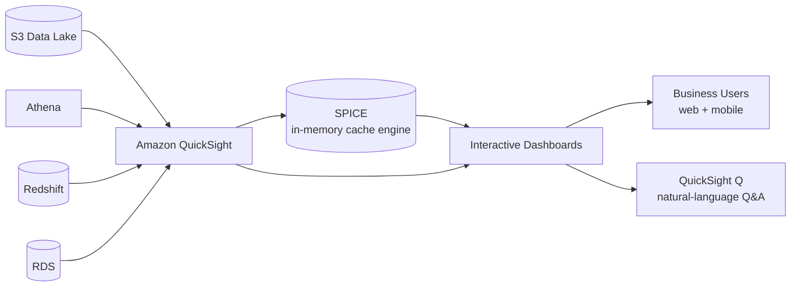

# Amazon QuickSight


*Analytics · maps to SAA-C03 Domain 3 Task 3.5, MLA-C02 Domain 1 (Data Preparation for ML and AI)*

## Definition

Amazon QuickSight is a **fully managed business intelligence (BI) service** — the "last mile"
tool that turns data sitting in S3, Redshift, Athena, RDS, or other sources into interactive
dashboards and visualizations that business users can explore themselves, without writing SQL.

## Purpose

Getting data clean and queryable (Glue, Athena, Redshift) solves half the problem — someone
still has to turn numbers into a chart a manager can actually read and act on, and most
companies don't want to run and license a heavyweight, self-hosted BI server (Tableau/Power BI
server-class infrastructure) just for internal dashboards. AWS built QuickSight as a serverless,
pay-per-use BI layer that connects directly to AWS data sources, scales automatically to
thousands of viewers, and bills per user/session instead of per fixed server license.

## How It Works

Plain explanation: QuickSight is the "shop window" at the end of the data pipeline — it doesn't
store or transform the core data itself, it connects to wherever the clean data already lives,
pulls it in (either live or cached in-memory), and lets a non-technical person drag-and-drop
fields into charts, filters, and dashboards that update automatically as underlying data changes.



Step by step:

1. QuickSight connects to one or more **data sources** — S3 (data lake files), Athena (SQL over
   S3), Redshift, RDS, or even on-premises databases via a secure connector — without needing
   the data to be physically copied into QuickSight first.
2. For better performance on repeated/interactive queries, QuickSight can **import data into
   SPICE** (Super-fast, Parallel, In-memory Calculation Engine) — a columnar in-memory engine
   that makes dashboard interactions (filtering, drilling down) feel instant, instead of
   re-running the source query every click. Alternatively, it can query sources **directly**
   (live) each time, trading speed for always-fresh data.
3. An **author** builds a dashboard visually — choosing chart types, adding filters, defining
   calculated fields — without writing SQL (though calculated fields use a formula language).
4. The finished dashboard is **published** and shared with specific users or groups; QuickSight
   handles authentication (via IAM, Active Directory, or SSO) and per-session access.
5. **Business users** view dashboards through a web browser or the QuickSight mobile app; they
   can filter and drill into data themselves without needing the author's help for every
   question, and without write access to the underlying data source.
6. **QuickSight Q** (natural-language querying) lets a user type a plain-English question
   ("what were sales in Q3 by region?") and get an auto-generated chart answer, without
   navigating a pre-built dashboard at all.

## Key Features / Components

- **SPICE** — the in-memory engine that caches data for fast, interactive dashboard
  performance; has its own separate capacity/pricing from the data source itself.
- **Serverless, auto-scaling** — QuickSight scales to thousands of concurrent dashboard viewers
  without you provisioning any servers.
- **Per-session/per-user pricing** — unlike traditional BI tools with fixed per-seat licenses,
  QuickSight has an Author/Reader split, with Readers billed per session rather than a fixed
  monthly seat in some plans.
- **ML Insights** — built-in anomaly detection and forecasting applied automatically to
  dashboard data, without a data scientist writing custom models.
- **QuickSight Q** — natural-language Q&A over your data, generating a visualization on the fly
  from a typed question.
- **Embedded analytics** — dashboards can be embedded directly into a company's own
  application/website, so QuickSight can power a product's customer-facing analytics feature.
- **Row-level security** — restrict which rows of data a given user/group can see within the
  same shared dashboard, based on their identity.

## Use Cases — When to Use It

- **Executive/operational dashboards** — sales trends, operational KPIs, cost dashboards built
  on top of Athena/Redshift/S3 data, viewed by non-technical staff.
- **Embedding analytics into a SaaS product** — giving your own customers a dashboard inside
  your application without building charting infrastructure yourself.
- **Ad-hoc self-service BI** — letting analysts/managers explore data themselves (drag-and-drop,
  filter, drill down) instead of filing a request for every new report.
- **Lightweight anomaly detection/forecasting** on business metrics, without standing up a
  dedicated ML forecasting pipeline.

## When NOT to Use It / Alternatives

- If you need **deep, specialized BI features** that competitors like Tableau or Power BI offer
  (certain advanced visualization types, specific enterprise BI governance workflows) and your
  organization is already standardized on one of those tools, QuickSight may not be worth a
  migration — it's strongest when you're already AWS-native and want tight integration/low ops.
- If the audience is purely **engineers who are comfortable writing SQL directly**, Athena or a
  SQL client against Redshift may be simpler than building a dashboard layer at all.
- QuickSight is **not a data transformation tool** — if data isn't clean/modeled yet, that's a
  Glue/EMR/Athena-view job first; QuickSight visualizes, it doesn't substantively reshape raw
  data.
- For extremely large, constantly-changing datasets that resist caching, you may need to use
  **direct query mode** instead of SPICE, accepting slower interactivity for freshness — plan
  for that tradeoff rather than treating SPICE as mandatory.

## Why It's Important

**Real-world:** QuickSight is frequently the actual interface executives and operators use to
make decisions — if the data pipeline upstream is flawless but the dashboard is wrong, slow, or
unreadable, none of that upstream work matters to the business. Per-session/per-reader pricing
also makes it dramatically cheaper than legacy BI licensing for organizations with many
occasional dashboard viewers.

**Exam:** QuickSight is referenced in **SAA-C03 Task 3.5 — "Determine high-performing data
ingestion and transformation solutions"** as the visualization endpoint of a complete data
pipeline (ingest → transform → store → query → **visualize**) — questions testing "pick the
right AWS-native BI tool" point here. It is less central to **MLA-C02**, but appears as a
recognizable tool for **visualizing model evaluation metrics or data quality reports** during
data preparation/monitoring discussions, and ML Insights' anomaly detection is occasionally
referenced as a non-code way to surface anomalies in business metrics.

## Pricing Model (summary)

- **Author** seats: a monthly or annual per-user subscription for people who build dashboards.
- **Reader** sessions: pay-per-session pricing (capped monthly) for people who only view
  dashboards — much cheaper than a full Author seat for a large viewer base.
- **SPICE capacity**: billed per GB/month for in-memory cache storage, separate from author/
  reader fees.
- See official pricing: https://aws.amazon.com/quicksight/pricing/

## Hands-on Lab (Floci)

**Floci does not support QuickSight at all** — QuickSight is a fully managed SaaS-style
service with no local/open-source emulation path, and it isn't part of Floci's API coverage.
The practical free alternative for hands-on BI practice: use **QuickSight's own AWS free tier**
(one Author free for 30 days, or the free Reader allowance) directly against a real but
disposable AWS account, connected to a small Athena/S3 dataset, and delete the subscription
immediately after practicing — or use an **open-source BI tool like Apache Superset** (run via
Docker) pointed at the same local data, to practice the "connect a data source → build a
dashboard" workflow conceptually without any cloud dependency. Full walkthrough:
`labs-floci/quicksight.md` (documents the limitation and the Superset alternative in detail).

```bash
# Not supported in Floci — no awslocal quicksight commands will reflect real dashboard behavior.
# Practice path instead (open-source, fully local, free):
# docker run -d -p 8088:8088 --name superset apache/superset
# then connect Superset to the same Postgres/S3-backed data Floci exposes,
# and build an equivalent chart/dashboard to what you'd build in real QuickSight.
```

## Exam Tips

- QuickSight is the AWS-native answer whenever a question asks for **"business intelligence,"
  "dashboards," or "visualize data for business users"** without naming a specific competitor
  tool — don't overthink it into Athena/Redshift, which answer the query layer, not the
  visualization layer.
- Remember the **Author vs. Reader** distinction if a cost-optimization question appears: many
  viewers who only need to *see* dashboards should be Readers (pay-per-session), not Authors
  (fixed subscription) — assigning everyone an Author seat is the wrong-answer cost trap.
- **SPICE vs. direct query** — SPICE = fast, cached, best for interactive dashboards on data
  that doesn't need to be second-by-second fresh. Direct query = always fresh, but slower,
  re-hits the source every interaction — pick based on the freshness requirement stated in the
  question.
- QuickSight sits at the **end** of the pipeline (ingest → transform → store → query →
  visualize) — if a question's answer involves Kinesis/Glue/EMR/Athena/Redshift *and* a
  dashboard requirement, QuickSight is usually the final named component, not a replacement for
  any of the earlier stages.

## Related Terms

[`glossary/README.md`](../../glossary/README.md) · [`athena.md`](athena.md) ·
[`data-lake-concepts.md`](data-lake-concepts.md) · `services/database/redshift.md`
