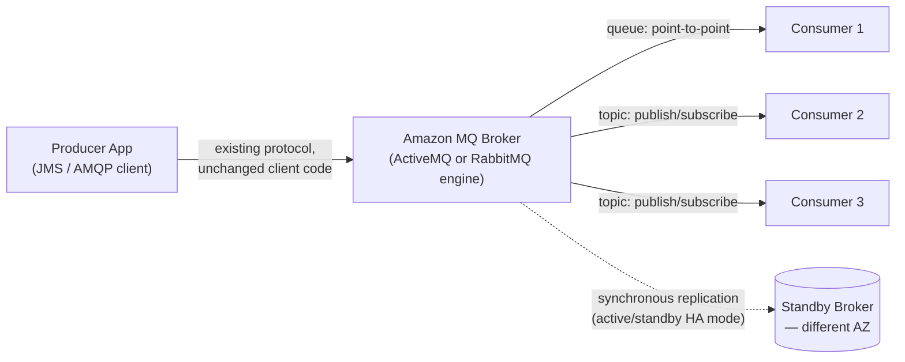
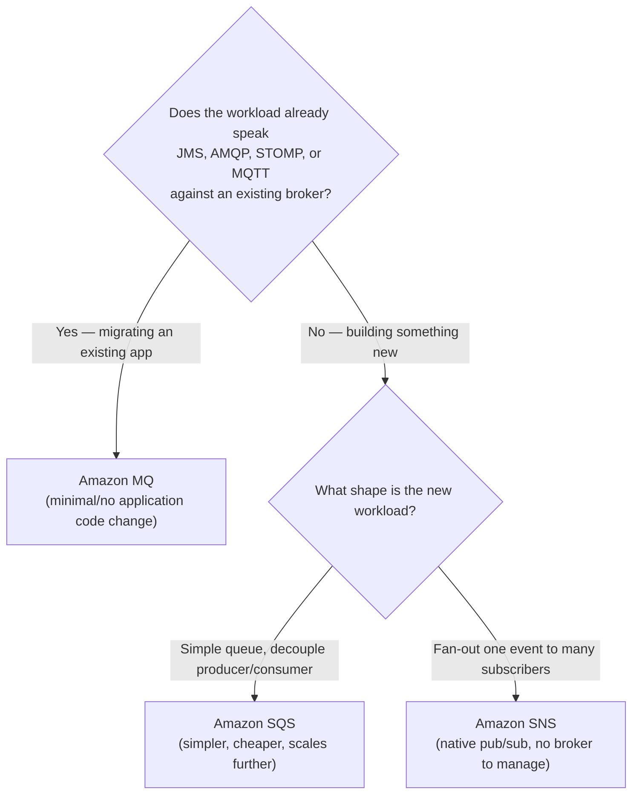

# Amazon MQ

> **Appears in:** [SAA-C03](../../certifications/saa-c03/README.md)

<!-- No vendored icon exists for Amazon MQ in diagrams/assets/icons/ at the time this doc was
written. Per diagrams/README.md convention, a missing icon is skipped rather than linking an
unverified external CDN URL. If an Amazon MQ icon is later vendored from aws-icons-for-plantuml
(dist/App-Integration/AmazonMQ.png or similar), add it here as
``. -->

## Definition

Amazon MQ is a managed message broker service for **Apache ActiveMQ** and **RabbitMQ** — it runs
and operates the actual open-source broker software for you (patching, failover, storage), and
exposes it through the same **industry-standard messaging protocols** (JMS, AMQP 0-9-1, STOMP,
MQTT, and WebSocket) that existing enterprise applications already speak, so a JMS- or AMQP-based
application can move to AWS largely unchanged on the client side.

## Purpose

Many enterprise applications — especially older, on-premises Java/JMS or .NET/AMQP systems —
were built directly against a specific open-source or commercial message broker's wire protocol,
not against a cloud-native API. Rewriting that messaging layer to use SQS or SNS as part of a
cloud migration means also rewriting every producer and consumer that currently speaks JMS or
AMQP, which is often a far larger, riskier undertaking than migrating the infrastructure
underneath an otherwise-working application. Amazon MQ exists specifically to remove that
rewrite requirement: it's a drop-in managed replacement for a self-hosted ActiveMQ or RabbitMQ
broker, so the *application code* — the JMS `ConnectionFactory`, the AMQP client library, the
existing queue and topic names — keeps working against AWS's managed broker with little to no
change, while AWS takes over patching, scaling the underlying infrastructure, and failover.

This is the single most important thing to internalize about Amazon MQ's reason for existing: it
is a **migration/compatibility** service first, and a general-purpose "new cloud-native
messaging" service a distant second. AWS's own guidance is explicit that if you're building a
*new* application with no existing broker-protocol dependency, SQS and SNS are the recommended
starting point, not Amazon MQ — a distinction the exam leans on heavily (see the comparison
section below).

## How It Works

Plain-English version: you provision an Amazon MQ **broker** (either a single instance or an
active/standby pair for high availability), choose ActiveMQ or RabbitMQ as the underlying engine,
and AWS handles provisioning the compute, attaching durable storage, and — for the HA
configuration — keeping a synchronized standby broker ready to take over automatically. Your
application then connects to the broker's endpoint using whichever standard protocol its client
library already speaks (JMS over OpenWire, AMQP, STOMP, MQTT, or WebSocket), sends/receives
messages through queues (point-to-point) or topics (publish/subscribe) exactly as it would
against a self-hosted broker, and Amazon MQ durably stores messages until a consumer picks them
up.



Step by step:
1. **Broker provisioning.** You choose single-instance (one broker, one Availability Zone) or
   active/standby (two brokers in two AZs, synchronously replicated via Amazon EFS for ActiveMQ,
   or a clustered deployment behind a Network Load Balancer for RabbitMQ) deployment modes, pick
   an instance size, and AWS provisions and configures the actual broker software.
2. **Client connection, unchanged.** Existing application code — a Java app's JMS
   `ConnectionFactory`, a Python app's `pika` AMQP client, an IoT device's MQTT client — points at
   the broker's new endpoint using the exact same protocol and, in most cases, largely the same
   configuration it used against a self-hosted broker.
3. **Message delivery.** Producers send to a **queue** (exactly one consumer receives each
   message, for point-to-point work distribution) or a **topic** (every subscriber receives a
   copy, for publish/subscribe fan-out) — both are native ActiveMQ/RabbitMQ concepts, not an
   AWS-specific abstraction layered on top.
4. **High availability (if configured).** In active/standby mode, one broker is active while the
   standby stays synchronously updated; if the active broker fails or undergoes maintenance,
   Amazon MQ promotes the standby automatically, and clients reconnect using the same endpoint
   (ActiveMQ) or are rebalanced across the surviving cluster nodes (RabbitMQ), without the
   application needing to discover a new address by hand.
5. **Patching and operations.** AWS handles broker software patching (during a maintenance window
   you configure), underlying host/storage maintenance, and CloudWatch metrics for broker and
   queue/topic health — the same operational surface a self-hosted broker admin used to own
   manually.

### Amazon MQ for ActiveMQ — deployment options in more depth


*Source: [Amazon MQ Developer Guide — Deployment options for Amazon MQ for ActiveMQ
brokers](https://docs.aws.amazon.com/amazon-mq/latest/developer-guide/amazon-mq-broker-architecture.html).
The detail worth internalizing: both brokers share the same underlying Amazon EFS storage volume
(replicated across AZs for durability), and only one broker is active at any moment — if the
active broker in `us-west-2a` fails, Amazon MQ promotes the standby in `us-west-2b`, which already
has access to the same EFS-backed message data, so no messages are lost in the handoff.*

RabbitMQ brokers on Amazon MQ instead use a **cluster deployment** — three broker nodes across
three AZs behind a Network Load Balancer, sharing state and mirroring queues across all nodes
(RabbitMQ's native clustering/mirroring, not an AWS-specific mechanism) — a structurally different
HA model from ActiveMQ's active/standby pair, because that's how upstream RabbitMQ itself
achieves high availability. The exam-relevant point isn't memorizing each engine's internals, but
recognizing that Amazon MQ runs each engine's *own* native HA mechanism rather than imposing one
uniform AWS HA model across both.

## Amazon MQ vs. SQS/SNS — the classic exam trap

This is the single most exam-tested fact about Amazon MQ, and it's worth internalizing as a
decision rule rather than a list of feature differences:



| Dimension | Amazon MQ | SQS / SNS |
|---|---|---|
| **Primary use case** | Migrating an *existing* JMS/AMQP application off a self-hosted broker | Building a *new*, cloud-native decoupled or pub/sub architecture |
| **Protocol** | Industry-standard: JMS, AMQP 0-9-1, STOMP, MQTT, WebSocket | AWS proprietary API (HTTP/HTTPS calls to the SQS/SNS API) |
| **Application code impact of adopting it** | Little to none, if already using one of the standard protocols | Requires writing to the SQS/SNS API from scratch |
| **Underlying model** | A specific broker (ActiveMQ or RabbitMQ) you provision and size | Fully serverless — no broker instance to size, patch, or fail over yourself |
| **Scaling model** | Scales by broker instance size/cluster, with a practical upper ceiling tied to instance class | Scales near-infinitely and automatically; no capacity planning |
| **Ordering/dedup features** | Native to the chosen broker engine's own feature set | SQS FIFO queues provide ordering/exactly-once *as an explicit, separate queue type* |
| **Operational overhead** | Lower than self-hosting, but you still choose instance size, HA mode, and maintenance windows | Effectively zero — no instance sizing or HA mode decision at all |
| **When the exam wants this answer** | Scenario explicitly mentions "migrating an existing application using JMS/AMQP" or names ActiveMQ/RabbitMQ directly | Scenario describes a *new* decoupling or fan-out need with no mention of an existing broker protocol |

The trap, spelled out directly: a scenario that *sounds* like simple queuing/decoupling
("messages need to flow from one component to another reliably") is answered with **SQS**, full
stop, *unless* the scenario also says the application already uses JMS or AMQP against an
existing broker — that one detail is what flips the correct answer from SQS to Amazon MQ. Exam
writers use this exact mechanism to test whether you default to the newest/most scalable service
out of habit (SQS/SNS) versus correctly reading "migrate an existing application" as a protocol-
compatibility requirement that only Amazon MQ satisfies without a rewrite.

## Key Features / Components

- **Broker engine choice** — ActiveMQ or RabbitMQ, each exposing that engine's own native
  protocol support and HA model; you pick the engine matching what your existing application
  already uses.
- **Deployment modes** — single-instance (lower cost, single AZ, no automatic failover) or
  active/standby (ActiveMQ) / cluster (RabbitMQ) for Multi-AZ high availability.
- **Protocol support** — JMS (over OpenWire), AMQP 0-9-1, STOMP, MQTT, and WebSocket, selected
  based on what the connecting client already speaks.
- **Queues and topics** — native point-to-point (queue) and publish/subscribe (topic) messaging
  patterns, inherited directly from the underlying broker engine.
- **Managed patching and maintenance windows** — AWS applies broker software patches during a
  customer-configured maintenance window rather than requiring the customer to patch the broker
  themselves.
- **CloudWatch integration** — broker-level and queue/topic-level metrics (queue depth, consumer
  count, broker CPU/memory) surfaced the same way any other AWS service's metrics are.
- **VPC-based networking** — brokers are provisioned inside a VPC, reachable from EC2/ECS/Lambda
  (via a VPC-attached function) exactly like any other VPC-resident resource, with security groups
  controlling access.
- **Encryption** — at-rest encryption via KMS and in-transit TLS for all supported protocols.

## Use Cases — When to Use It

- **Insurance company migrating a 15-year-old Java/JMS claims-processing system to AWS.**
  Situation: the claims application's core logic is built directly against JMS APIs talking to an
  on-premises ActiveMQ broker, and rewriting every producer/consumer to use SQS would touch dozens
  of legacy modules the team doesn't want to risk destabilizing during a migration. Why Amazon MQ
  fits: pointing the existing JMS `ConnectionFactory` at a new Amazon MQ (ActiveMQ) endpoint
  typically requires only a configuration change, not an application rewrite. What the
  alternative would cost: rewriting every JMS producer/consumer to the SQS API is a multi-month
  engineering project with real regression risk on a system the business depends on daily.
- **Logistics company replacing a self-managed RabbitMQ cluster with a managed equivalent.**
  Situation: an existing microservices platform uses RabbitMQ's AMQP protocol and topic exchanges
  extensively, and the platform team is tired of patching and failover-testing the cluster
  themselves. Why Amazon MQ fits: Amazon MQ for RabbitMQ is a largely drop-in replacement — the
  AMQP client code, exchange/queue topology, and routing logic carry over, while AWS now owns
  patching and the clustered HA failover mechanics. What the alternative would cost: continuing
  to self-host means continuing to own 2am page-outs for broker-node failures that Amazon MQ's
  managed HA would otherwise absorb.
- **Healthcare system integrating with a legacy hospital information system over MQTT.**
  Situation: bedside monitoring devices speak MQTT natively and were never going to be rewritten
  to call a cloud API directly. Why Amazon MQ fits: Amazon MQ's MQTT protocol support lets those
  devices connect with no firmware change, while the cloud-side consuming application can process
  the same messages through standard AWS compute. What the alternative would cost: firmware
  updates across a fleet of already-deployed medical devices are slow, expensive, and in some
  cases regulatorily constrained in ways that make "just rewrite the device" impractical.
- **Financial services firm needing a drop-in broker during a phased cloud migration.**
  Situation: a trading-adjacent back-office system depends on STOMP-based messaging and the
  migration plan explicitly forbids touching application code in this phase — infrastructure
  moves first, application modernization is a separate, later phase. Why Amazon MQ fits: it lets
  the infrastructure move to AWS in this phase while deferring the SQS/SNS rewrite (if ever
  undertaken) to a deliberately later, separately-scoped phase. What the alternative would cost:
  forcing an application rewrite into the same phase as an infrastructure migration multiplies the
  risk surface of a single change window.
- **SaaS vendor whose enterprise customers' on-premises systems integrate exclusively via AMQP.**
  Situation: several large enterprise customers have existing on-premises systems hard-wired to
  speak AMQP to the vendor's platform, and asking each customer to adopt a proprietary API isn't
  commercially realistic. Why Amazon MQ fits: the vendor's platform exposes an Amazon MQ (RabbitMQ)
  endpoint that those existing AMQP clients connect to unchanged, while the vendor's own internal
  services behind that broker can still be modern and cloud-native. What the alternative would
  cost: requiring every enterprise customer to rewrite their own integration code is a commercial
  non-starter that would cost the vendor those accounts.

## When NOT to Use It / Alternatives

- **Any brand-new application with no existing broker-protocol dependency** — use **SQS** (simple
  queuing, decoupling) or **SNS** (pub/sub fan-out) instead; both are fully serverless, scale
  further with zero capacity planning, and are AWS's explicitly recommended default for new
  designs. Reaching for Amazon MQ on a greenfield design, with no stated migration context, is
  almost always the wrong answer on the exam.
- **A workload needing SQS FIFO's specific exactly-once-processing/strict-ordering guarantee as a
  first-class, managed feature** — SQS FIFO queues provide this as a distinct, explicitly-named
  queue type; replicating the exact same guarantee on Amazon MQ means correctly configuring the
  underlying broker engine's own ordering semantics yourself.
- **Extremely high-throughput, must-scale-indefinitely messaging with no interest in broker
  protocol compatibility** — SQS's serverless scaling model removes the instance-sizing ceiling a
  provisioned Amazon MQ broker (or cluster) still has; a workload purely chasing maximum scale
  with no legacy-protocol constraint should default to SQS/SNS/Kinesis depending on shape.
- **A pure event-bus / event-routing need across many independent producers and consumers with
  content-based filtering** — **EventBridge** is purpose-built for that pattern; Amazon MQ's
  queue/topic model doesn't natively offer EventBridge's rule-based event filtering.

## Why It's Important

**Real-world:** enterprise cloud migrations overwhelmingly involve existing applications with
real, working messaging layers already built against JMS or AMQP — forcing every one of those
applications through a full messaging-layer rewrite before they can move to the cloud would make
many migrations commercially unworkable. Amazon MQ exists to let the *infrastructure* move first,
decoupling the (lower-risk, often-necessary) move to managed cloud infrastructure from the
(higher-risk, often-optional) decision to modernize the messaging layer itself — two separate
decisions that don't have to happen in the same project.

**Exam relevance:**
- **SAA-C03** — Domain 2 "Design Resilient Architectures" (Task 2.1, loosely coupled
  architectures) and Domain 3 (application-integration choices generally) both test Amazon MQ,
  almost always through the comparison-with-SQS/SNS lens above. The single highest-value fact to
  carry into the exam: "migrating an existing JMS/AMQP application" is the phrase that should make
  you pick Amazon MQ over SQS/SNS; absent that phrase, default to SQS/SNS.

## Limits & Quotas

Exact numbers change — always check the Service Quotas console for current values — but the
*shape* of what's limited is genuinely useful to know:

- **Broker instance sizing is a real capacity-planning decision**, unlike SQS/SNS — you choose an
  instance type/size for the broker (or each node in a RabbitMQ cluster), and throughput is
  bounded by that choice, not elastic by default the way SQS's backend is.
- **Deployment mode is fixed at creation for a given broker** — moving from single-instance to
  active/standby (or vice versa) is a distinct broker configuration choice, not a runtime toggle,
  relevant when a scenario describes adding HA to an existing non-HA broker.
- **Maximum message size** follows the underlying engine's own practical limits (tens of MB range
  depending on configuration), generally larger than SQS's 256 KB default message size (extendable
  via the Extended Client Library) but still not intended for very large payloads — large
  payloads belong in S3 with a reference message, the same pattern used with SQS.
- **Protocol-specific connection limits** exist per broker instance size, meaning a very large
  number of simultaneously connected MQTT devices, for instance, is itself a sizing input when
  choosing an instance class.

## Security Considerations

- Brokers run inside a **VPC**, reachable only via security groups you control — unlike SQS/SNS's
  AWS-managed public API endpoint model, Amazon MQ network access is governed by standard VPC
  networking (security groups, subnets, and optionally a VPN/Direct Connect path for on-premises
  clients).
- **Encryption at rest** uses a KMS key (AWS-managed by default, or a customer-managed key for
  tighter control), and **encryption in transit** uses TLS across every supported protocol.
- **IAM** controls who can manage the broker *resource itself* (create, modify, delete brokers);
  authentication *into* the broker for sending/receiving messages uses the broker engine's own
  username/password (or, for RabbitMQ, its native authentication mechanisms) — a distinction worth
  remembering, since it means broker-level access control isn't solely an IAM policy the way SQS
  queue access can be.
- A scenario requiring an on-premises JMS client to reach an Amazon MQ broker securely without
  traversing the public internet points at a **VPN or Direct Connect** connection into the VPC the
  broker lives in — the same hybrid-connectivity pattern used everywhere else in this domain.

## Troubleshooting / Common Issues

- **Application fails to connect after migrating from a self-hosted broker.** Check, in order:
  (1) the security group attached to the broker allows inbound traffic on the relevant protocol's
  port from the client's network; (2) the client's connection string/endpoint actually points at
  the new Amazon MQ endpoint, not a leftover reference to the old self-hosted broker; (3) for
  active/standby ActiveMQ, confirm the client library's failover transport URL format lists both
  broker endpoints so it can reconnect automatically on failover.
- **Failover takes longer than expected during a broker-level event.** Active/standby failover is
  not instantaneous — client libraries need to detect the dropped connection and retry against the
  (now-promoted) standby endpoint; an application without a properly configured failover transport
  URL or retry policy will see a longer outage than the broker-level mechanics alone would suggest.
- **Message throughput plateaus under load.** Unlike SQS, Amazon MQ throughput is bounded by the
  provisioned broker instance size — check whether the instance class needs to scale up before
  assuming there's a configuration bug.
- **Mirrored RabbitMQ queue falls behind during very high publish rates.** RabbitMQ's own classic
  mirroring has known throughput tradeoffs at very high message rates — this is upstream RabbitMQ
  behavior inherited by Amazon MQ, not an AWS-specific bug, and is part of why AWS's own guidance
  steers new, very-high-throughput designs toward SQS/SNS/Kinesis instead.

## Common Architectures

**1. Lift-and-shift broker migration ahead of application modernization.** An on-premises
ActiveMQ broker backing a Java/JMS order-processing system is replaced with an Amazon MQ
(ActiveMQ) active/standby broker; the application's JMS connection factory URL changes, nothing
else does — the infrastructure migration is now complete and decoupled from any future decision
to modernize the messaging layer itself.

**2. Hybrid bridge during a phased migration.** A still-on-premises legacy system continues
publishing to a local broker, which forwards messages to an Amazon MQ broker in AWS over a
network connector (a native ActiveMQ/RabbitMQ bridging feature, not an AWS-specific one) — new,
cloud-native consumers in AWS subscribe directly to the Amazon MQ broker, letting the migration
happen consumer-by-consumer instead of all at once.

**3. Protocol-compatible IoT ingestion.** A fleet of existing MQTT-speaking industrial sensors
connects directly to an Amazon MQ broker with no firmware change; a Lambda function (or EC2-based
consumer) subscribes to the relevant topics and forwards processed readings into a modern
pipeline (Kinesis, DynamoDB) for the rest of the architecture, isolating the MQTT compatibility
requirement to just the broker tier.

**4. Managed broker behind a multi-tenant SaaS platform.** A SaaS vendor's enterprise customers
each integrate via their own existing AMQP client code; the vendor runs a shared (or per-customer,
depending on isolation requirements) Amazon MQ for RabbitMQ broker as the compatibility layer,
while every service behind that broker is modern, cloud-native application code with no AMQP
dependency of its own.

**5. Disaster-recovery pairing with a standby Region.** A regulated workload requiring a tested
DR plan for its messaging layer runs an active/standby Amazon MQ broker in its primary Region,
with broker configuration (queue/topic definitions, access policies) replicated via
infrastructure-as-code into a standby Region's broker that's activated only as part of a declared
regional failover — the same Warm-Standby-style pattern Domain 2's disaster-recovery strategies
apply to compute and database tiers, applied here to the messaging tier specifically.

## Pricing Model (summary)

- Billed per **broker-hour** (varies by instance size and single-instance vs. active/standby or
  cluster deployment mode) plus **storage** (EFS-backed for ActiveMQ, EBS-backed for RabbitMQ) and
  **data transfer**.
- No per-message pricing the way SQS/SNS charge per-request — cost scales with the provisioned
  broker's size and uptime, not directly with message volume, which is itself a meaningful
  cost-comparison point against SQS/SNS for a very low-message-volume workload that would be
  cheaper on SQS/SNS's near-zero-at-idle pricing.
- Official current pricing: https://aws.amazon.com/amazon-mq/pricing/

## Hands-on Lab (Floci)

**Honest limitation:** Amazon MQ is not in Floci's documented support table (it emulates
request/response AWS service APIs like S3, DynamoDB, and SQS; Amazon MQ is a provisioned broker
*instance* running real ActiveMQ/RabbitMQ server software, which has no meaningful local
emulation path the way a stateless API call does). The commands below show the **real
control-plane CLI shape** for study purposes; expect them to be unsupported against a local Floci
endpoint. The practical substitute for hands-on practice: run an actual ActiveMQ or RabbitMQ
Docker container locally, connect a simple JMS or AMQP client to it, and mentally map that local
broker to what Amazon MQ manages for you in AWS (the broker software is identical; what changes
is who patches it, sizes it, and keeps a standby ready).

```bash
# Create a single-instance ActiveMQ broker
aws mq create-broker \
  --broker-name study-activemq-broker \
  --engine-type ACTIVEMQ \
  --engine-version 5.18.6 \
  --host-instance-type mq.t3.micro \
  --deployment-mode SINGLE_INSTANCE \
  --publicly-accessible false \
  --users ConsoleUsername=admin,ConsolePassword=«redacted-secret»

# Create an active/standby ActiveMQ broker for HA
aws mq create-broker \
  --broker-name study-activemq-ha-broker \
  --engine-type ACTIVEMQ \
  --engine-version 5.18.6 \
  --host-instance-type mq.m5.large \
  --deployment-mode ACTIVE_STANDBY_MULTI_AZ \
  --publicly-accessible false \
  --subnet-ids subnet-aaaa1111 subnet-bbbb2222 \
  --users ConsoleUsername=admin,ConsolePassword=«redacted-secret»

# Describe a broker to get its connection endpoints
aws mq describe-broker --broker-id b-1234a5b6-78cd-901e-2fgh-3i45j6k178l9

# List brokers in the account
aws mq list-brokers

# Reboot a broker (e.g., to apply a pending engine-version upgrade)
aws mq reboot-broker --broker-id b-1234a5b6-78cd-901e-2fgh-3i45j6k178l9
```

See `labs-floci/README.md` for the shared setup. The exercise worth internalizing even without
live emulation: `--deployment-mode` is the single flag that distinguishes "cheaper, single point
of failure" from "costs roughly double, survives an AZ failure automatically" — the exact tradeoff
Domain 2's resilience-vs-cost framing applies everywhere else in this repo, just expressed here as
one API parameter.

## Exam-Style Scenario Walkthroughs

**Scenario 1:** A company is migrating a 10-year-old Java application that communicates
exclusively via JMS to an on-premises ActiveMQ broker. The migration team wants to move to AWS
with minimal code changes. What should they use?

*Answer:* Amazon MQ (ActiveMQ engine) — the JMS client code can point at the new broker endpoint
with little to no change, versus a full rewrite to the SQS API.

**Scenario 2:** A brand-new microservices application needs to decouple an order-placement
service from an inventory-update service, with no existing broker protocol dependency anywhere in
the design. What should the architect choose?

*Answer:* Amazon SQS, not Amazon MQ — there's no existing JMS/AMQP dependency to preserve, so the
simpler, serverless, more-scalable option is the better default for a new design.

**Scenario 3:** An IoT platform has thousands of already-deployed field devices that communicate
over MQTT and cannot have their firmware updated in the field. The platform is moving its backend
to AWS. What service receives the devices' MQTT traffic in the new architecture?

*Answer:* Amazon MQ, specifically for its native MQTT protocol support — the devices connect
unchanged, while everything else behind the broker can be modern AWS services.

**Scenario 4:** A team self-hosting a three-node RabbitMQ cluster wants to stop managing broker
patching and failover themselves, while keeping their existing AMQP-based producer/consumer code
completely unchanged. What's the right migration target?

*Answer:* Amazon MQ for RabbitMQ, using a cluster deployment — the native RabbitMQ clustering and
mirroring behavior the team already depends on continues to work, now managed by AWS.

## Exam Tips

- **The defining trigger phrase is "migrating an existing application" that already uses JMS,
  AMQP, STOMP, or MQTT** — see that phrase (or a named broker like ActiveMQ/RabbitMQ) and the
  answer is Amazon MQ; see a *new* decoupling/fan-out need with no such phrase and the answer is
  SQS/SNS.
- **Don't pick Amazon MQ by default just because a scenario mentions "message broker"** — SQS and
  SNS are also message brokers in the generic sense; the specific signal for Amazon MQ is protocol
  compatibility with an *existing* system, not the word "broker" alone.
- **Amazon MQ is not more scalable than SQS/SNS** — it's the opposite tradeoff: less operational
  overhead than self-hosting, but still bounded by a provisioned broker's instance size, unlike
  SQS/SNS's serverless, near-unbounded scaling.
- **ActiveMQ uses active/standby for HA; RabbitMQ uses a clustered deployment** — if a question
  names the specific engine, remember each one's HA model is that engine's own native mechanism,
  not a single uniform AWS HA layer across both.
- **VPC networking, not a public managed API endpoint** — unlike SQS/SNS, an Amazon MQ broker
  lives inside your VPC, so cross-network access (from on-premises, for instance) requires VPN or
  Direct Connect, the same as any other VPC-resident resource.

## Further Reading

- [Amazon MQ Developer Guide — What is Amazon MQ?](https://docs.aws.amazon.com/amazon-mq/latest/developer-guide/welcome.html)
- [Amazon MQ Developer Guide — Deployment options for Amazon MQ for ActiveMQ brokers](https://docs.aws.amazon.com/amazon-mq/latest/developer-guide/amazon-mq-broker-architecture.html)
- [Amazon MQ Developer Guide — Deployment options for Amazon MQ for RabbitMQ brokers](https://docs.aws.amazon.com/amazon-mq/latest/developer-guide/rabbitmq-broker-architecture.html)
- [Amazon MQ Migration Guide — Replicating IBM MQ architecture with Amazon MQ](https://docs.aws.amazon.com/amazon-mq/latest/migration-guide/amazon-mq-architecture.html)
- [Amazon MQ pricing](https://aws.amazon.com/amazon-mq/pricing/)

## Related Terms

- [`sqs.md`](sqs.md) · [`sns.md`](sns.md) — the cloud-native alternatives Amazon MQ is constantly
  compared against; the primary exam-tested distinction on this entire page
- [`eventbridge.md`](eventbridge.md) — the service for content-filtered event routing, distinct
  from Amazon MQ's queue/topic model
- [`messaging-patterns-overview.md`](messaging-patterns-overview.md) — the broader comparison of
  every application-integration messaging service, Amazon MQ included
- `services/migration-transfer/migration-services-overview.md` — the discovery/migration-tracking
  services that typically identify a JMS/AMQP dependency *before* a team decides Amazon MQ is the
  right migration target
- `glossary/README.md` — broker, queue, topic, JMS, AMQP definitions

---

**Repo completeness note:** this doc is newly created and linked from
`certifications/saa-c03/domain-2-resilient-architectures/README.md`'s Task 2.1 table. No other
certification guide (DVA-C03, MLA-C02) lists Amazon MQ as in-scope per their current published
appendices, so no additional cross-linking is expected at this time.
