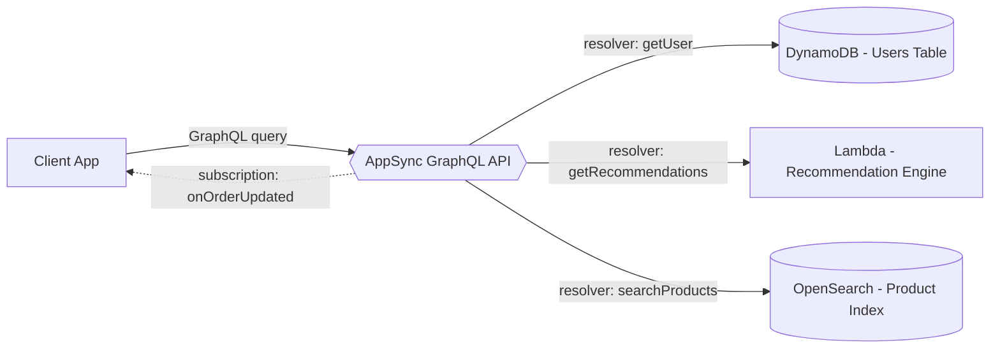

# AWS AppSync


<!-- If this icon 404s, pull "AppSync.svg" from the official AWS Architecture Icons zip
(category may appear under Front-End-Web-Mobile in the official set — see diagrams/README.md) -->

## Definition

AWS AppSync is a fully managed **GraphQL (and Events) API** service. Instead of a client
calling several different REST endpoints to assemble the data it needs, it sends **one
GraphQL query** describing exactly the fields it wants, and AppSync fetches each piece from
whatever backend holds it (DynamoDB, Lambda, RDS, OpenSearch, HTTP APIs) and returns a single
combined response shaped exactly like the request asked.

## Purpose

Mobile and web clients historically suffered from two REST problems: **over-fetching** (an
endpoint returns a big object when the screen only needs three fields) and **under-fetching**
(the screen needs data from three different endpoints, so the client fires three round trips,
each adding latency). GraphQL solves both by letting the client declare its exact data shape in
one request. AWS built AppSync so teams get a production-grade, scalable GraphQL server without
operating one themselves — plus built-in **real-time subscriptions** (push updates to
connected clients when data changes) and fine-grained authorization, which a hand-rolled
GraphQL server on EC2 would require significant extra engineering to replicate.

## How It Works

A client sends a GraphQL **query** (read), **mutation** (write), or **subscription**
(real-time listen) to the AppSync endpoint. AppSync matches each requested field against a
**resolver** — a small piece of logic (a VTL mapping template or, more commonly today, a JS
resolver) that knows how to fetch or write that specific field's data from its configured
**data source**. Multiple fields can resolve from entirely different backends in a single
request.



Step by step:
1. **Client sends one query**: e.g., `{ getUser(id: "42") { name, recommendations { title },
   cart { items } } }` — a single request describing nested, cross-source data.
2. **AppSync resolves each field independently**: `getUser` is resolved against DynamoDB,
   `recommendations` is resolved by invoking a Lambda function, and (if included) a product
   search field is resolved against OpenSearch — all within the same request/response cycle.
3. **Response is assembled and shaped exactly like the query** — no extra fields the client
   didn't ask for, no separate round trips to stitch data together client-side.
4. **Subscriptions push updates**: a client can also `subscribe` to `onOrderUpdated`; when a
   mutation elsewhere changes that order, AppSync pushes the update over a managed WebSocket
   connection to every subscribed client — no polling.

## Key Features / Components

- **GraphQL schema** — a strongly-typed contract (types, queries, mutations, subscriptions)
  defining exactly what clients can ask for.
- **Resolvers** — per-field logic connecting a schema field to a data source; written as
  JavaScript (APPSYNC_JS) or legacy VTL (Velocity Template Language).
- **Data sources** — DynamoDB, Lambda, RDS (via Data API), OpenSearch, HTTP endpoints, or
  EventBridge, each pluggable per-field.
- **Real-time subscriptions** — WebSocket-based push to clients when underlying data changes,
  without the client polling.
- **AppSync Events** — a newer AppSync capability for simple publish/subscribe real-time
  messaging (e.g., chat, live notifications) without requiring a full GraphQL schema.
- **Built-in authorization modes** — API key, IAM, Amazon Cognito user pools, or OpenID
  Connect/Lambda custom authorizers — configurable per field, not just per API.
- **Caching** — server-side response caching to reduce repeated backend calls for frequently
  requested, slow-changing data.
- **Offline/sync support** — conflict detection/resolution strategies for mobile clients that
  write while offline and sync later (via AWS Amplify DataStore integration).

## Use Cases — When to Use It

- **Mobile/web apps that need to assemble data from multiple backends in one round trip** —
  a single screen pulling from DynamoDB, a Lambda-backed recommendation service, and a search
  index, all in one query.
- **Real-time collaborative or live-updating apps**: chat apps, live order tracking, live
  dashboards — subscriptions push changes instantly to every connected client.
- **Bandwidth-constrained mobile clients** where over-fetching unnecessary fields over a
  cellular connection is a real cost/performance problem.
- **Front-end teams that want a strongly-typed, self-documenting API contract** (the GraphQL
  schema) decoupled from how many different backends actually serve it.

## When NOT to Use It / Alternatives

- **Simple CRUD API with no complex client-side data-shaping needs** → plain **API Gateway +
  Lambda** (REST or HTTP API) is simpler to reason about and has a shallower learning curve —
  GraphQL's flexibility is wasted if every client just needs the same fixed shape every time.
- **Server-to-server integration/internal microservices talking to each other** — GraphQL's
  client-driven shaping benefit is mostly for front-end consumers with varied data needs;
  internal services usually do fine with REST, direct SDK calls, or messaging (SQS/SNS/EventBridge).
- **Team has no GraphQL experience and the deadline is tight** — the learning curve (schema
  design, resolver mapping templates, N+1 query pitfalls) is real; a straightforward REST API
  may ship faster for a simple use case.
- **Pure async event processing with no client request/response or live-query need** → that's
  squarely SQS/SNS/EventBridge/Step Functions territory, not AppSync.

## Why It's Important

**Real-world**: AppSync lets a mobile/web team ship a single coherent API that quietly spans
several different backend technologies, with real-time push built in — without the team
operating a GraphQL server, managing WebSocket infrastructure, or hand-rolling cache
invalidation and auth per field.

**Exam mapping**:
- **SAA-C03 Domain 2 (Design Resilient Architectures), Task 2.1** — AppSync shows up as the
  managed, serverless answer when a scenario needs a scalable API layer with real-time data
  sync across mobile clients, without standing up and scaling a custom GraphQL server.
- **DVA-C03 Domain 1 (Development with AWS Services), Task 1.1** — building applications using
  AWS services directly covers AppSync as a managed API option alongside API Gateway; expect
  questions distinguishing when GraphQL (AppSync) beats REST (API Gateway) for a given client
  requirement, and recognizing subscriptions as the mechanism for real-time updates.

## Pricing Model (summary)

Pay per million **query/mutation requests**, per million **real-time messages** delivered over
subscriptions, and per **connection-minute** for active WebSocket subscription connections.
Caching, if enabled, is billed per cache-node-hour. No charge for idle schemas with no traffic.
See the [official AppSync pricing page](https://aws.amazon.com/appsync/pricing/) for current
numbers.

## Hands-on Lab (Floci)

```bash
# Create a GraphQL API
awslocal appsync create-graphql-api --name orders-api --authentication-type API_KEY

# (Use the apiId from the output below)
export API_ID="<api-id-from-above>"

# Create a DynamoDB table AppSync will read/write
awslocal dynamodb create-table \
  --table-name Orders \
  --attribute-definitions AttributeName=orderId,AttributeType=S \
  --key-schema AttributeName=orderId,KeyType=HASH \
  --billing-mode PAY_PER_REQUEST

# Register DynamoDB as a data source
awslocal appsync create-data-source \
  --api-id "$API_ID" \
  --name OrdersTable \
  --type AMAZON_DYNAMODB \
  --dynamodb-config tableName=Orders,awsRegion=us-east-1 \
  --service-role-arn arn:aws:iam::000000000000:role/floci-appsync-role

# Upload a schema (save minimal schema.graphql first)
cat <<'EOF' > /tmp/schema.graphql
type Order { orderId: ID!, total: Float, status: String }
type Query { getOrder(orderId: ID!): Order }
schema { query: Query }
EOF
awslocal appsync start-schema-creation --api-id "$API_ID" --definition fileb:///tmp/schema.graphql

# Create a resolver for the getOrder field against the DynamoDB data source
awslocal appsync create-resolver \
  --api-id "$API_ID" \
  --type-name Query \
  --field-name getOrder \
  --data-source-name OrdersTable \
  --request-mapping-template '{"version":"2018-05-29","operation":"GetItem","key":{"orderId":{"S":"$ctx.args.orderId"}}}' \
  --response-mapping-template '$util.toJson($ctx.result)'
```
Full walkthrough (API keys, subscriptions, Lambda resolver): `labs-floci/README.md` lab index →
application-integration section. Note: Floci's AppSync support covers the control-plane API
shape; verify real-time subscription behavior against actual AWS docs before relying on it for
exam-level subscription semantics.

## Exam Tips

- **AppSync = GraphQL, API Gateway = REST/HTTP** — if a question mentions a client needing
  exactly-shaped data from multiple sources in one call, or live/real-time updates pushed to
  clients, that's AppSync; if it's a straightforward single-resource REST endpoint, that's
  API Gateway.
- **Subscriptions are the real-time keyword** — "push updates to connected clients the instant
  data changes" is a dead giveaway for AppSync subscriptions over polling-based designs.
- **Resolvers can hit multiple data source types in one query** — a common exam distractor is
  assuming AppSync only talks to DynamoDB; it also resolves against Lambda, RDS, OpenSearch,
  HTTP, and EventBridge.
- **Caching reduces load on data sources**, not just latency — relevant in cost/performance
  optimization scenario questions.
- Exam domains: **SAA-C03 Domain 2 Task 2.1**, **DVA-C03 Domain 1 Task 1.1**.

## Related Terms

- [`messaging-patterns-overview.md`](./messaging-patterns-overview.md) — how AppSync's
  real-time subscription model relates to pub/sub messaging more broadly.
- [`eventbridge.md`](./eventbridge.md) — AppSync can use EventBridge as a data source/target
  to bridge GraphQL mutations into the wider event-driven system.
- `glossary/README.md` — GraphQL, Resolver, Schema, Over-fetching, Under-fetching, WebSocket.
