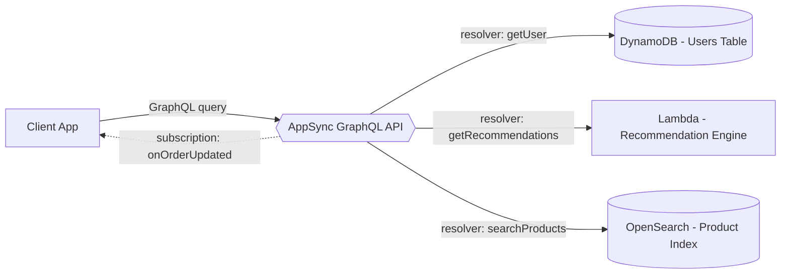
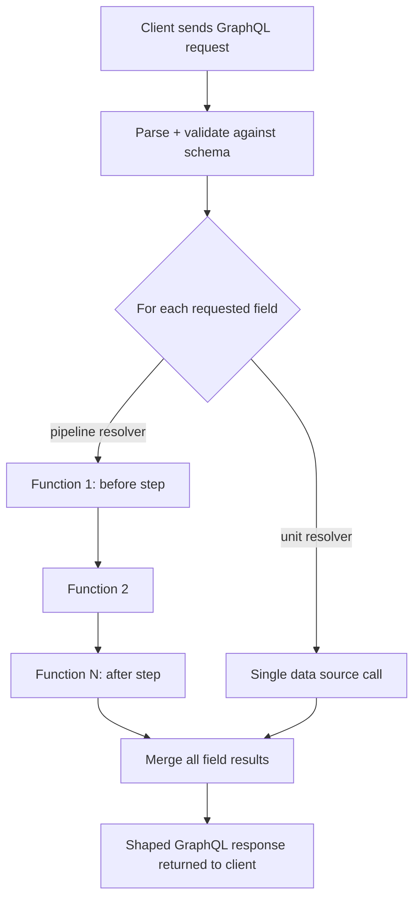
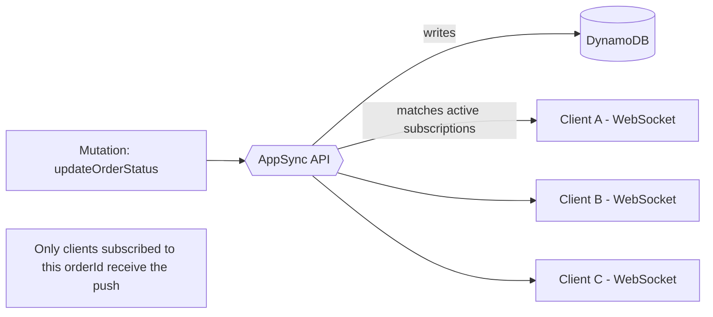
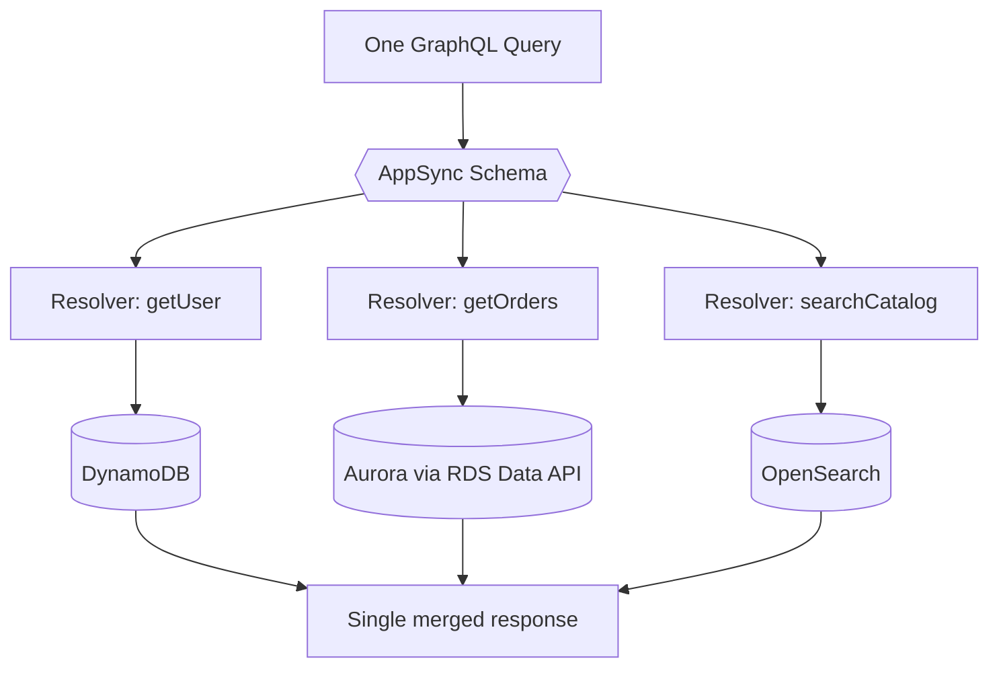
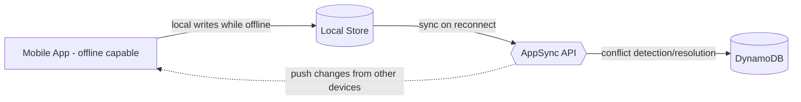
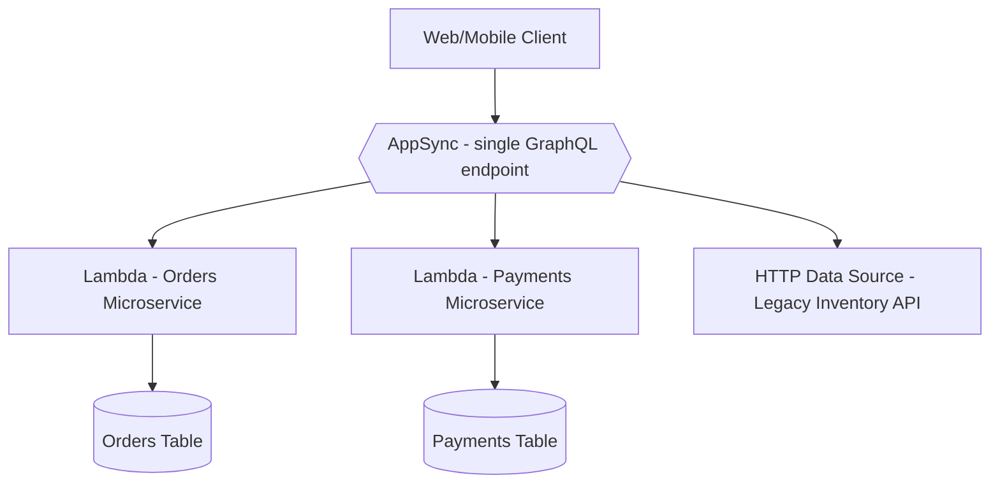
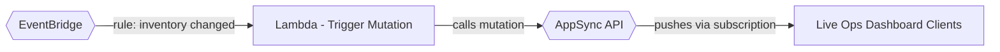
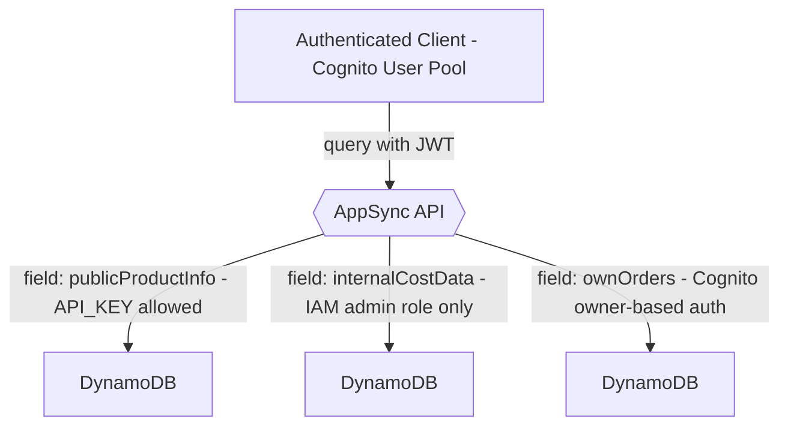

# AWS AppSync


<!-- If this icon 404s, pull "AppSync.svg" from the official AWS Architecture Icons zip
(category may appear under Front-End-Web-Mobile in the official set — see diagrams/README.md) -->

## Definition

AWS AppSync is a fully managed **GraphQL (and Events) API** service. Instead of a client
calling several different REST endpoints to assemble the data it needs, it sends **one
GraphQL query** describing exactly the fields it wants, and AppSync fetches each piece from
whatever backend holds it (DynamoDB, Lambda, RDS, OpenSearch, HTTP APIs) and returns a single
combined response shaped exactly like the request asked.

## Purpose

Mobile and web clients historically suffered from two REST problems: **over-fetching** (an
endpoint returns a big object when the screen only needs three fields) and **under-fetching**
(the screen needs data from three different endpoints, so the client fires three round trips,
each adding latency). GraphQL solves both by letting the client declare its exact data shape in
one request. AWS built AppSync so teams get a production-grade, scalable GraphQL server without
operating one themselves — plus built-in **real-time subscriptions** (push updates to
connected clients when data changes) and fine-grained authorization, which a hand-rolled
GraphQL server on EC2 would require significant extra engineering to replicate.

## How It Works

A client sends a GraphQL **query** (read), **mutation** (write), or **subscription**
(real-time listen) to the AppSync endpoint. AppSync matches each requested field against a
**resolver** — a small piece of logic (a VTL mapping template or, more commonly today, a JS
resolver) that knows how to fetch or write that specific field's data from its configured
**data source**. Multiple fields can resolve from entirely different backends in a single
request.



Step by step:
1. **Client sends one query**: e.g., `{ getUser(id: "42") { name, recommendations { title },
   cart { items } } }` — a single request describing nested, cross-source data.
2. **AppSync resolves each field independently**: `getUser` is resolved against DynamoDB,
   `recommendations` is resolved by invoking a Lambda function, and (if included) a product
   search field is resolved against OpenSearch — all within the same request/response cycle.
3. **Response is assembled and shaped exactly like the query** — no extra fields the client
   didn't ask for, no separate round trips to stitch data together client-side.
4. **Subscriptions push updates**: a client can also `subscribe` to `onOrderUpdated`; when a
   mutation elsewhere changes that order, AppSync pushes the update over a managed WebSocket
   connection to every subscribed client — no polling.

### Official AWS reference architecture


*Source: AWS Documentation — [Components of a GraphQL API](https://docs.aws.amazon.com/appsync/latest/devguide/api-components.html), AWS AppSync Developer Guide. © Amazon Web Services.*


*Source: AWS Documentation — [Data sources](https://docs.aws.amazon.com/appsync/latest/devguide/data-source-components.html), AWS AppSync Developer Guide. © Amazon Web Services.*

## Worked Query Flow — Actual GraphQL and JSON Payloads

**1. Client sends a GraphQL query** requesting nested data from two different backends in one
round trip:

```graphql
query GetOrderDashboard {
  getOrder(orderId: "ORD-10042") {
    orderId
    status
    total
    recommendations {
      productId
      title
    }
  }
}
```

**2. The `getOrder` field's resolver** (DynamoDB data source) — a modern JS resolver's request
handler shaping a `GetItem` call:

```javascript
import { util } from '@aws-appsync/utils';

export function request(ctx) {
  return {
    operation: 'GetItem',
    key: util.dynamodb.toMapValues({ orderId: ctx.args.orderId }),
  };
}

export function response(ctx) {
  return ctx.result;
}
```

**3. The `recommendations` field's resolver** (Lambda data source) — invoked with the parent
order already resolved, letting the recommendation engine use `orderId` as context:

```javascript
export function request(ctx) {
  return {
    operation: 'Invoke',
    payload: { orderId: ctx.source.orderId, field: 'recommendations' },
  };
}

export function response(ctx) {
  return ctx.result;
}
```

**4. The final assembled response** sent back to the client — one shape, two backends, one
round trip:

```json
{
  "data": {
    "getOrder": {
      "orderId": "ORD-10042",
      "status": "SHIPPED",
      "total": 49.98,
      "recommendations": [
        { "productId": "SKU-55", "title": "Matching phone case" },
        { "productId": "SKU-77", "title": "Screen protector 2-pack" }
      ]
    }
  }
}
```

**5. A subscription** a client opens to receive real-time push updates when this order's status
changes:

```graphql
subscription OnOrderUpdated {
  onOrderUpdated(orderId: "ORD-10042") {
    orderId
    status
  }
}
```

**6. The mutation that triggers that subscription push** elsewhere in the system (e.g., a
warehouse system marking the order shipped):

```graphql
mutation UpdateOrderStatus {
  updateOrderStatus(orderId: "ORD-10042", status: SHIPPED) {
    orderId
    status
  }
}
```
AppSync automatically matches the mutation's response shape against any active subscriptions
whose arguments match (`orderId: "ORD-10042"`) and pushes the update over the already-open
WebSocket connection — the client never polls for this.

## Pipeline Resolvers & Error Handling

For fields that need multiple backend operations in sequence (not just one data source call), a
**pipeline resolver** chains several **functions**, each with its own request/response handler:

```javascript
// Function 1: ValidateInventory
export function request(ctx) {
  return { operation: 'GetItem', key: util.dynamodb.toMapValues({ sku: ctx.args.sku }) };
}
export function response(ctx) {
  if (ctx.result.quantity < ctx.args.qty) {
    util.error('Insufficient inventory', 'InsufficientInventoryError');
  }
  return ctx.result;
}

// Function 2: ReserveInventory (runs only if Function 1 didn't error)
export function request(ctx) {
  return {
    operation: 'UpdateItem',
    key: util.dynamodb.toMapValues({ sku: ctx.args.sku }),
    update: { expression: 'SET quantity = quantity - :qty', expressionValues: util.dynamodb.toMapValues({ ':qty': ctx.args.qty }) },
  };
}
export function response(ctx) {
  return ctx.result;
}
```
`util.error(message, errorType)` is how a resolver surfaces a typed GraphQL error — the client
sees a structured `errors` array in the response rather than a generic failure, which matters
for building retry/user-messaging logic on the client side:

```json
{
  "data": { "reserveInventory": null },
  "errors": [
    {
      "message": "Insufficient inventory",
      "errorType": "InsufficientInventoryError",
      "path": ["reserveInventory"]
    }
  ]
}
```

### Resolver execution flow, visually



### Real-time subscription fan-out



### Multi-source single-request architecture



## Key Features / Components

- **GraphQL schema** — a strongly-typed contract (types, queries, mutations, subscriptions)
  defining exactly what clients can ask for.
- **Resolvers** — per-field logic connecting a schema field to a data source; written as
  JavaScript (APPSYNC_JS) or legacy VTL (Velocity Template Language). Can be **unit** resolvers
  (one data source call) or **pipeline** resolvers (chained functions).
- **Data sources** — DynamoDB, Lambda, RDS (via Data API), OpenSearch, HTTP endpoints,
  EventBridge, or **None** (for pure computation/pass-through fields with no external call).
- **Real-time subscriptions** — WebSocket-based push to clients when underlying data changes,
  without the client polling.
- **AppSync Events** — a newer AppSync capability for simple publish/subscribe real-time
  messaging (e.g., chat, live notifications) without requiring a full GraphQL schema.
- **Built-in authorization modes** — API key, IAM, Amazon Cognito user pools, or OpenID
  Connect/Lambda custom authorizers — configurable per field, not just per API.
- **Caching** — server-side response caching to reduce repeated backend calls for frequently
  requested, slow-changing data.
- **Offline/sync support** — conflict detection/resolution strategies for mobile clients that
  write while offline and sync later (via AWS Amplify DataStore integration).

## Use Cases — When to Use It

- **Mobile/web apps that need to assemble data from multiple backends in one round trip** —
  a single screen pulling from DynamoDB, a Lambda-backed recommendation service, and a search
  index, all in one query.
- **Real-time collaborative or live-updating apps**: chat apps, live order tracking, live
  dashboards — subscriptions push changes instantly to every connected client.
- **Bandwidth-constrained mobile clients** where over-fetching unnecessary fields over a
  cellular connection is a real cost/performance problem.
- **Front-end teams that want a strongly-typed, self-documenting API contract** (the GraphQL
  schema) decoupled from how many different backends actually serve it.

## When NOT to Use It / Alternatives

- **Simple CRUD API with no complex client-side data-shaping needs** → plain **API Gateway +
  Lambda** (REST or HTTP API) is simpler to reason about and has a shallower learning curve —
  GraphQL's flexibility is wasted if every client just needs the same fixed shape every time.
- **Server-to-server integration/internal microservices talking to each other** — GraphQL's
  client-driven shaping benefit is mostly for front-end consumers with varied data needs;
  internal services usually do fine with REST, direct SDK calls, or messaging (SQS/SNS/EventBridge).
- **Team has no GraphQL experience and the deadline is tight** — the learning curve (schema
  design, resolver mapping templates, N+1 query pitfalls) is real; a straightforward REST API
  may ship faster for a simple use case.
- **Pure async event processing with no client request/response or live-query need** → that's
  squarely SQS/SNS/EventBridge/Step Functions territory, not AppSync.

### AppSync vs API Gateway

| | API Gateway (REST/HTTP) | AppSync (GraphQL) |
|---|---|---|
| Client shapes the response | No — fixed per endpoint | Yes — client declares exact fields wanted |
| Multiple backends in one call | No — one endpoint, one backend (or a Lambda that fans out itself) | Yes — different fields resolve against different data sources natively |
| Real-time push to clients | Only via WebSocket API (custom routes, more manual) | Built-in subscriptions, managed WebSockets |
| Best for | Simple, fixed-shape CRUD endpoints | Complex, varied client data needs; live-updating apps |
| Learning curve | Lower (most teams already know REST) | Higher (schema design, resolver mapping, N+1 awareness) |

## Common Architectures

### 1. Mobile app with offline sync (Amplify DataStore)



### 2. Backend-for-frontend (BFF) aggregating microservices


Each backend microservice keeps its own data store and API; AppSync's schema is the single
"supergraph" clients talk to, abstracting away which team or system actually owns each field.

### 3. Live dashboard with EventBridge-driven updates


A backend event (not a client action) triggers an AppSync mutation purely to fan the update out
to subscribed dashboard clients in real time — AppSync here acts as the real-time delivery leg
of a larger event-driven pipeline.

### 4. Fine-grained, per-field authorization


Different fields in the *same* query can enforce different authorization rules — a public field,
an admin-only field, and an owner-only field can all be requested together, each independently
authorized by AppSync before its resolver ever runs.

## Why It's Important

**Real-world**: AppSync lets a mobile/web team ship a single coherent API that quietly spans
several different backend technologies, with real-time push built in — without the team
operating a GraphQL server, managing WebSocket infrastructure, or hand-rolling cache
invalidation and auth per field.

**Exam mapping**:
- **SAA-C03 Domain 2 (Design Resilient Architectures), Task 2.1** — AppSync shows up as the
  managed, serverless answer when a scenario needs a scalable API layer with real-time data
  sync across mobile clients, without standing up and scaling a custom GraphQL server.
- **DVA-C03 Domain 1 (Development with AWS Services), Task 1.1** — building applications using
  AWS services directly covers AppSync as a managed API option alongside API Gateway; expect
  questions distinguishing when GraphQL (AppSync) beats REST (API Gateway) for a given client
  requirement, recognizing subscriptions as the mechanism for real-time updates, and
  understanding unit vs pipeline resolvers and per-field authorization.

## Pricing Model (summary)

Pay per million **query/mutation requests**, per million **real-time messages** delivered over
subscriptions, and per **connection-minute** for active WebSocket subscription connections.
Caching, if enabled, is billed per cache-node-hour. No charge for idle schemas with no traffic.
See the [official AppSync pricing page](https://aws.amazon.com/appsync/pricing/) for current
numbers.

## Limits & Quotas

| Limit | Value | Notes |
|---|---|---|
| Max request payload size | 5 MB | Across the whole GraphQL request |
| Max response payload size | 5 MB | Large result sets may need pagination |
| Max resolver execution timeout (unit) | 30 seconds | Per resolver, not per whole request |
| Max selection set / query depth | Configurable, practical limits apply | Deep nested queries increase backend fan-out and latency — watch for N+1 patterns |
| Max concurrent WebSocket subscriptions per client | Account/service-level quota (raisable) | Relevant for very large real-time dashboards |
| Pipeline resolver max functions | 10 | Per pipeline resolver |
| Max data sources per API | 100 (soft limit, raisable) | |
| Schema size | Up to tens of MB practically, soft-limited | Very large schemas are a maintainability concern before they're a hard quota concern |

Always check the
[AppSync quotas page](https://docs.aws.amazon.com/appsync/latest/devguide/service-quotas.html)
for current authoritative numbers.

## Troubleshooting / Common Issues

- **"My query is slow and seems to be making far more backend calls than expected."** Classic
  **N+1 problem**: a list field (e.g., `getOrders`) resolving fine, but a nested field on each
  item (e.g., `customer { name }`) firing one extra DynamoDB/Lambda call *per item* in the list.
  Fix with **batch resolvers** (e.g., DynamoDB `BatchGetItem` via a pipeline resolver) instead of
  per-item resolution.
- **"A client isn't receiving subscription pushes even though the mutation succeeded."** Confirm
  the subscription's arguments actually match the mutation's response shape AppSync evaluates
  for routing (e.g., a subscription filtered to a specific `orderId` won't fire for a mutation
  response that doesn't carry a matching `orderId` field) and that the client's WebSocket
  connection is still alive (connections can silently drop on mobile networks).
- **"Resolver errors aren't surfacing clearly to the client."** Use `util.error(message,
  errorType)` in the resolver response handler to produce a structured, typed GraphQL error
  instead of letting an unhandled exception produce an opaque 500-style failure.
- **"Authorization works for queries but a specific field is unexpectedly rejected (or
  unexpectedly allowed)."** Remember authorization in AppSync can be configured **per field**,
  not just per API or per type — check the specific field's `@aws_auth` directives/resolver-level
  auth config, not just the top-level API authorization mode.
- **"Offline mobile clients are producing conflicting writes when they reconfigure."** This is
  what AppSync's conflict detection/resolution strategies (via Amplify DataStore) exist to
  handle — pick an explicit strategy (optimistic concurrency, auto-merge, or a custom Lambda
  resolver) rather than assuming "last write wins" is acceptable for the data in question.
- **"Caching is returning stale data after a mutation."** Server-side response caching has its
  own TTL and invalidation rules — a mutation doesn't automatically invalidate a previously
  cached query response unless caching is configured with that relationship in mind.

## Hands-on Lab (Floci)

```bash
# Create a GraphQL API
awslocal appsync create-graphql-api --name orders-api --authentication-type API_KEY

# (Use the apiId from the output below)
export API_ID="<api-id-from-above>"

# Create a DynamoDB table AppSync will read/write
awslocal dynamodb create-table \
  --table-name Orders \
  --attribute-definitions AttributeName=orderId,AttributeType=S \
  --key-schema AttributeName=orderId,KeyType=HASH \
  --billing-mode PAY_PER_REQUEST

# Register DynamoDB as a data source
awslocal appsync create-data-source \
  --api-id "$API_ID" \
  --name OrdersTable \
  --type AMAZON_DYNAMODB \
  --dynamodb-config tableName=Orders,awsRegion=us-east-1 \
  --service-role-arn arn:aws:iam::000000000000:role/floci-appsync-role

# Upload a schema (save minimal schema.graphql first)
cat <<'EOF' > /tmp/schema.graphql
type Order { orderId: ID!, total: Float, status: String }
type Query { getOrder(orderId: ID!): Order }
type Mutation { updateOrderStatus(orderId: ID!, status: String!): Order }
type Subscription {
  onOrderUpdated(orderId: ID!): Order
    @aws_subscribe(mutations: ["updateOrderStatus"])
}
schema { query: Query, mutation: Mutation, subscription: Subscription }
EOF
awslocal appsync start-schema-creation --api-id "$API_ID" --definition fileb:///tmp/schema.graphql

# Create a resolver for the getOrder field against the DynamoDB data source
awslocal appsync create-resolver \
  --api-id "$API_ID" \
  --type-name Query \
  --field-name getOrder \
  --data-source-name OrdersTable \
  --request-mapping-template '{"version":"2018-05-29","operation":"GetItem","key":{"orderId":{"S":"$ctx.args.orderId"}}}' \
  --response-mapping-template '$util.toJson($ctx.result)'

# Create a resolver for the updateOrderStatus mutation (drives the subscription push)
awslocal appsync create-resolver \
  --api-id "$API_ID" \
  --type-name Mutation \
  --field-name updateOrderStatus \
  --data-source-name OrdersTable \
  --request-mapping-template '{"version":"2018-05-29","operation":"UpdateItem","key":{"orderId":{"S":"$ctx.args.orderId"}},"update":{"expression":"SET #status = :status","expressionNames":{"#status":"status"},"expressionValues":{":status":{"S":"$ctx.args.status"}}}}' \
  --response-mapping-template '$util.toJson($ctx.result)'
```
Full walkthrough (API keys, subscriptions, Lambda resolver): `labs-floci/README.md` lab index →
application-integration section. Note: Floci's AppSync support covers the control-plane API
shape; verify real-time subscription behavior against actual AWS docs before relying on it for
exam-level subscription semantics.

## Exam Tips

- **AppSync = GraphQL, API Gateway = REST/HTTP** — if a question mentions a client needing
  exactly-shaped data from multiple sources in one call, or live/real-time updates pushed to
  clients, that's AppSync; if it's a straightforward single-resource REST endpoint, that's
  API Gateway.
- **Subscriptions are the real-time keyword** — "push updates to connected clients the instant
  data changes" is a dead giveaway for AppSync subscriptions over polling-based designs.
- **Resolvers can hit multiple data source types in one query** — a common exam distractor is
  assuming AppSync only talks to DynamoDB; it also resolves against Lambda, RDS, OpenSearch,
  HTTP, and EventBridge.
- **Unit vs pipeline resolvers**: a single data source call per field is a unit resolver; a
  sequence of operations (validate, then write, then notify) within one field's resolution is a
  pipeline resolver made of chained functions — recognize which one a described workflow needs.
- **N+1 query problem** — a scenario describing a GraphQL API that's unexpectedly slow or
  making excessive backend calls per request is pointing at batch resolvers (or DataLoader-style
  batching) as the fix, not just "add caching."
- **Caching reduces load on data sources**, not just latency — relevant in cost/performance
  optimization scenario questions.
- **Per-field authorization** — a question describing different access rules for different
  fields within the same type/query is testing whether you know AppSync authorization is
  configurable at the field level, not only the API level.
- Exam domains: **SAA-C03 Domain 2 Task 2.1**, **DVA-C03 Domain 1 Task 1.1**.

## Further Reading

- [What is AWS AppSync?](https://docs.aws.amazon.com/appsync/latest/devguide/what-is-appsync.html)
- [Components of a GraphQL API](https://docs.aws.amazon.com/appsync/latest/devguide/api-components.html)
- [Resolvers](https://docs.aws.amazon.com/appsync/latest/devguide/resolver-components.html)
- [AWS AppSync JavaScript resolvers overview](https://docs.aws.amazon.com/appsync/latest/devguide/resolver-reference-overview-js.html)
- [Data sources](https://docs.aws.amazon.com/appsync/latest/devguide/data-source-components.html)
- [AppSync real-time subscriptions](https://docs.aws.amazon.com/appsync/latest/devguide/aws-appsync-real-time-data.html)
- [AppSync quotas](https://docs.aws.amazon.com/appsync/latest/devguide/service-quotas.html)
- [AWS AppSync pricing](https://aws.amazon.com/appsync/pricing/)

## Related Terms

- [`messaging-patterns-overview.md`](./messaging-patterns-overview.md) — how AppSync's
  real-time subscription model relates to pub/sub messaging more broadly.
- [`eventbridge.md`](./eventbridge.md) — AppSync can use EventBridge as a data source/target
  to bridge GraphQL mutations into the wider event-driven system.
- `glossary/README.md` — GraphQL, Resolver, Schema, Over-fetching, Under-fetching, WebSocket.
