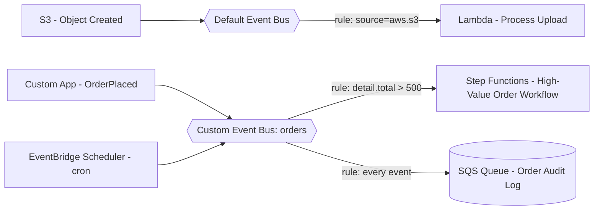

# Amazon EventBridge


<!-- If this icon 404s, pull "EventBridge.svg" from the official AWS Architecture Icons zip
(App-Integration category) — see diagrams/README.md -->

## Definition

Amazon EventBridge is a **serverless event router**. Things happen inside AWS and in your own
applications ("a file was uploaded," "an order's status changed," "it's 9am Monday") — those
are **events**. EventBridge collects events from many sources onto a **bus**, then uses
**rules** (pattern-matching filters) to decide which events should go to which **targets**
(Lambda, SQS, Step Functions, another AWS account, a SaaS app, and 20+ other target types).

## Purpose

As systems grow, you end up with dozens of things that can happen and dozens of other things
that need to react to a subset of them — "notify billing only when a subscription is
cancelled," "kick off a workflow only for orders over $500 from EU customers." Routing that
by hand means every producer needs if/else logic about every possible consumer. AWS built
EventBridge to centralize that routing logic: producers just emit an event with a `source` and
`detail`, and a rules engine — not application code — decides who gets notified based on
declarative content-matching patterns. It also unifies three previously separate concerns
(custom app events, 200+ AWS service events, and cron-style scheduling) into one service.

## How It Works

An event (a JSON document with a `source`, `detail-type`, and `detail` payload) arrives on an
**event bus** — either the account's **default bus** (which automatically receives events from
most AWS services), a **custom bus** (for your own application events), or a **partner bus**
(for SaaS integrations like Zendesk or Datadog). Every **rule** attached to that bus has an
**event pattern**; EventBridge checks the incoming event against every rule's pattern and, for
each match, invokes that rule's configured **target(s)**.



Step by step:
1. **Events arrive on a bus**: AWS service events (e.g., S3 object created) land automatically
   on the account's default bus; your own application events are explicitly `PutEvents`-ed onto
   a custom bus; EventBridge Scheduler can also inject time-based events.
2. **Rules evaluate patterns**: each rule defines a JSON pattern (e.g., `{"source": ["aws.s3"]}`
   or `{"detail": {"total": [{"numeric": [">", 500]}]}}`); EventBridge checks every incoming
   event against every rule on that bus.
3. **Matching rules fire their targets**: a matched event is delivered to that rule's target(s)
   — here, S3 uploads trigger a Lambda, high-value orders trigger a Step Functions workflow,
   and (separately) every order event also lands in an SQS audit queue via a second, broader rule.
4. **One event can match many rules**: nothing stops the same `OrderPlaced` event from
   triggering both the high-value workflow rule *and* the audit-log rule simultaneously —
   routing is declarative and additive, not exclusive.
5. **Scheduler** is really just another event producer: "run this rule's target every day at
   9am" generates a synthetic event on a schedule instead of waiting for something to happen.

## Key Features / Components

- **Event bus** — default (AWS service events), custom (your app events), or partner (SaaS
  integrations).
- **Rules** — declarative JSON **event patterns** matched against incoming events; can match on
  source, detail-type, or any field inside `detail` (including numeric/string comparisons).
- **Targets** — where a matched event goes: Lambda, Step Functions, SQS, SNS, Kinesis, another
  event bus (cross-account/cross-region), API destinations (external HTTPS endpoints), and more
  (20+ target types).
- **EventBridge Scheduler** — a standalone, highly scalable cron/rate scheduler (separate from
  "scheduled rules," built for millions of individual schedules, e.g., one per customer).
- **Schema Registry** — infers and stores the JSON schema of events flowing through a bus, so
  consumers can generate strongly-typed code bindings.
- **Archive & Replay** — record events on a bus and replay them later (e.g., after fixing a bug
  in a downstream consumer).
- **Input transformation** — reshape the event payload before it hits the target, without a
  Lambda in between.
- **Cross-account/cross-region event bus** — route events from one AWS account's bus straight
  to another account's bus.

## Use Cases — When to Use It

- **Reacting to AWS service activity without polling**: trigger a Lambda the instant an EC2
  instance changes state, an S3 object is created, or a CodePipeline stage fails.
- **Decoupled microservices with content-based routing**: route `OrderPlaced` events to
  different downstream workflows depending on order value, region, or customer tier — all
  configured declaratively, no code changes to the publisher.
- **Scheduled/cron jobs** at scale (EventBridge Scheduler): "run this Lambda for every one of
  our 50,000 tenants at their configured local midnight."
- **SaaS-to-AWS integrations**: receive events from a partner SaaS tool (e.g., a support
  ticketing system) directly onto a partner event bus.
- **Cross-account event routing** in a multi-account AWS Organization (e.g., a security
  account receiving GuardDuty findings from every member account).

## When NOT to Use It / Alternatives

- **Simple one-to-many broadcast with no content-based routing needed** → plain **SNS** is
  simpler and cheaper; EventBridge's rules engine is overkill if you're just fanning out every
  message to every subscriber.
- **Need a durable, pollable queue a single worker drains at its own pace** → **SQS**;
  EventBridge is a router, not a holding queue (though it commonly routes *into* an SQS queue).
- **Need sub-second guaranteed ordering of a high-volume stream multiple consumers replay from
  any point** → **Kinesis Data Streams**; EventBridge doesn't guarantee delivery order and isn't
  built for high-throughput ordered replay.
- **Need multi-step orchestration with retries, branching, and state between steps** → that's
  **Step Functions**' job; EventBridge is great at triggering the *start* of a workflow, not at
  representing the workflow itself.

### EventBridge vs SNS

| | SNS | EventBridge |
|---|---|---|
| Routing logic | None — every subscriber gets every message (unless you add filter policies) | Rich, built-in rules engine matching on any field |
| Primary event sources | Whatever you publish yourself | 200+ AWS services natively, plus your own events, plus SaaS partners |
| Scheduling | No native scheduler | Built-in (EventBridge Scheduler) |
| Schema awareness | No | Schema Registry infers/stores schemas |
| Typical use | Simple, fast fan-out / alerting | Complex, content-based routing across many sources |
| Delivery guarantee feel | Near-real-time push, simple retry policy | Near-real-time push, rule-based, supports archive & replay |

Rule of thumb: if routing is "send this to everyone" → SNS. If routing is "send this to the
*right* target depending on what's inside the event, pulled from many different sources" →
EventBridge.

## Why It's Important

**Real-world**: EventBridge is what makes modern "event-driven architecture" practical at AWS
scale — it replaces a web of point-to-point integrations and custom polling scripts with one
declarative rules engine that can see events from virtually every AWS service plus your own
code, which is a massive reduction in operational glue code and failure points.

**Exam mapping**:
- **SAA-C03 Domain 2 (Design Resilient Architectures), Task 2.1** — loosely coupled, event-driven
  architecture questions increasingly favor EventBridge over hand-rolled polling or direct
  service-to-service calls, especially when the scenario involves "react to changes across
  multiple AWS services" or "route based on event content."
- **DVA-C03 Domain 1 (Development with AWS Services), Task 1.1** — building event-driven
  applications is a named topic; expect questions on writing event patterns, choosing the
  right target, and EventBridge vs SNS vs SQS in a given scenario.

## Pricing Model (summary)

Pay per event published to a custom or partner bus (events from AWS services onto the default
bus are free to publish — you only pay if a rule matches and invokes a target, and the target
itself has its own cost, e.g., Lambda invocation cost). EventBridge Scheduler is priced
per invocation. Archive storage is billed per GB. See the
[official EventBridge pricing page](https://aws.amazon.com/eventbridge/pricing/) for current numbers.

## Hands-on Lab (Floci)

```bash
# Create a custom event bus
awslocal events create-event-bus --name orders-bus

# Create a rule on that bus matching high-value orders
awslocal events put-rule \
  --name high-value-orders \
  --event-bus-name orders-bus \
  --event-pattern '{"source": ["custom.orders"], "detail-type": ["OrderPlaced"], "detail": {"total": [{"numeric": [">", 500]}]}}'

# Create an SQS queue as the target and wire it up
awslocal sqs create-queue --queue-name high-value-order-queue
awslocal events put-targets \
  --rule high-value-orders \
  --event-bus-name orders-bus \
  --targets "Id"="1","Arn"="arn:aws:sqs:us-east-1:000000000000:high-value-order-queue"

# Publish an event that should match
awslocal events put-events --entries '[
  {
    "Source": "custom.orders",
    "DetailType": "OrderPlaced",
    "EventBusName": "orders-bus",
    "Detail": "{\"orderId\": \"2001\", \"total\": 750}"
  }
]'

# Confirm it landed in the queue
awslocal sqs receive-message --queue-url http://localhost:4566/000000000000/high-value-order-queue
```
Full walkthrough (Scheduler + cross-service rule matching): `labs-floci/README.md` lab index →
application-integration section.

## Exam Tips

- **EventBridge vs SNS**: if the question mentions filtering/routing *based on event content*
  across *multiple AWS service sources*, EventBridge is the answer; if it's a simple broadcast
  with no content logic, SNS is simpler and usually the intended answer.
- **Scheduled rules vs EventBridge Scheduler**: scheduled rules live on an event bus and are
  fine for a handful of cron jobs; EventBridge Scheduler is the newer, purpose-built service for
  massive numbers of individual schedules (per-customer, per-tenant) — the exam may test
  recognizing when scale calls for Scheduler instead.
- **Default bus receives AWS service events automatically** — you don't need to configure
  anything for most AWS-native event sources to start landing there; custom buses are for your
  own application events.
- **Event pattern matching is declarative JSON**, not code — questions may show you a pattern
  and ask whether a given sample event would match.
- Exam domains: **SAA-C03 Domain 2 Task 2.1**, **DVA-C03 Domain 1 Task 1.1**.

## Related Terms

- [`sns.md`](./sns.md) — simpler fan-out counterpart; see its comparison table above for when
  to pick each.
- [`sqs.md`](./sqs.md) — a very common EventBridge target for durable, pollable delivery.
- [`step-functions.md`](./step-functions.md) — EventBridge often *starts* a Step Functions
  workflow; it doesn't replace the orchestration layer itself.
- [`messaging-patterns-overview.md`](./messaging-patterns-overview.md) — event-driven
  architecture in the broader mental model.
- `glossary/README.md` — Event, Event Bus, Event Pattern, Rule, Target.
