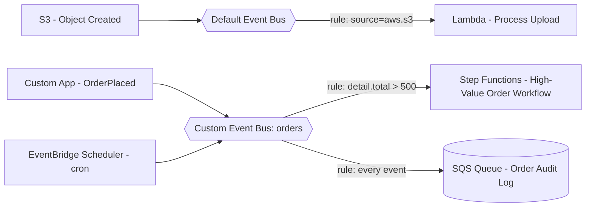
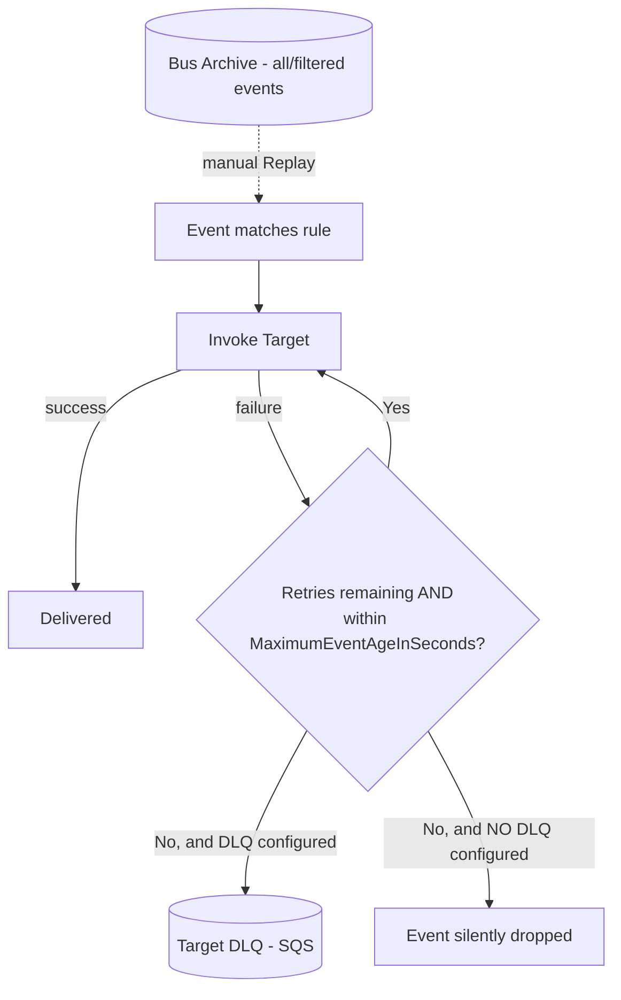
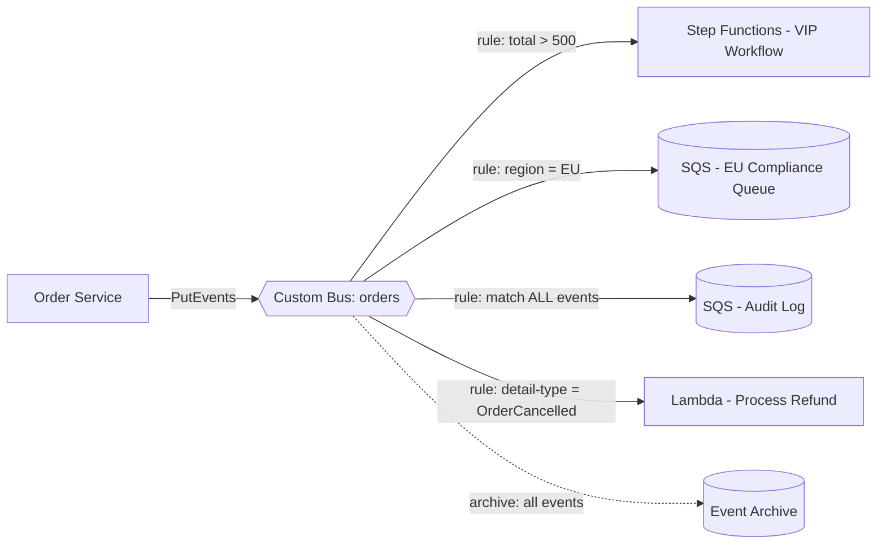
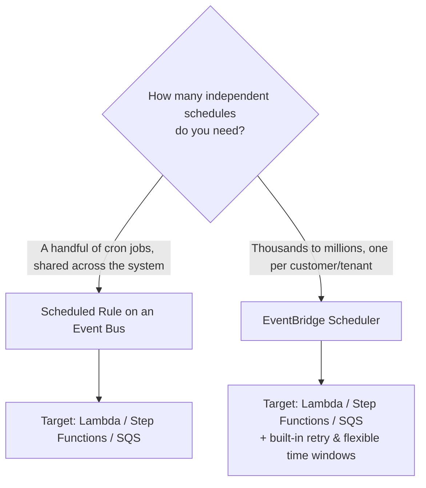
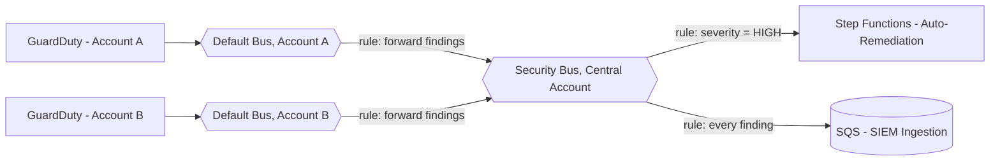
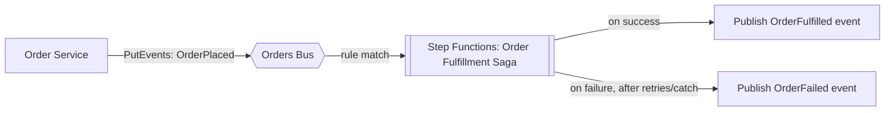
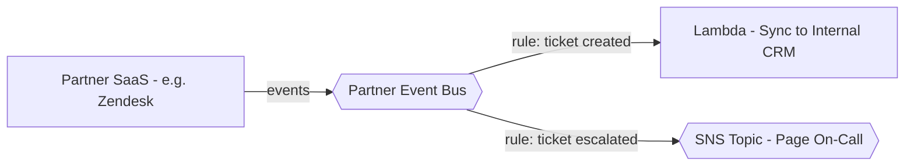
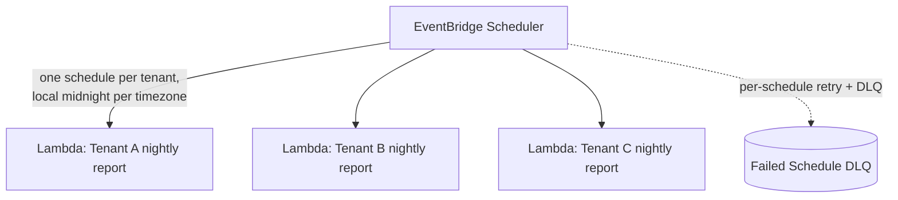

# Amazon EventBridge


<!-- If this icon 404s, pull "EventBridge.svg" from the official AWS Architecture Icons zip
(App-Integration category) — see diagrams/README.md -->

## Definition

Amazon EventBridge is a **serverless event router**. Things happen inside AWS and in your own
applications ("a file was uploaded," "an order's status changed," "it's 9am Monday") — those
are **events**. EventBridge collects events from many sources onto a **bus**, then uses
**rules** (pattern-matching filters) to decide which events should go to which **targets**
(Lambda, SQS, Step Functions, another AWS account, a SaaS app, and 20+ other target types).

## Purpose

As systems grow, you end up with dozens of things that can happen and dozens of other things
that need to react to a subset of them — "notify billing only when a subscription is
cancelled," "kick off a workflow only for orders over $500 from EU customers." Routing that
by hand means every producer needs if/else logic about every possible consumer. AWS built
EventBridge to centralize that routing logic: producers just emit an event with a `source` and
`detail`, and a rules engine — not application code — decides who gets notified based on
declarative content-matching patterns. It also unifies three previously separate concerns
(custom app events, 200+ AWS service events, and cron-style scheduling) into one service.

EventBridge actually began life as "CloudWatch Events" and was rebranded/expanded into
EventBridge in 2019 when AWS added custom and partner event buses, schema registry, and a
richer rules engine on top of the original cron/AWS-service-event plumbing. That history
explains why some older AWS documentation and IAM action names still reference `events:` as the
API namespace even though the console and marketing name is "EventBridge."

## How It Works

An event (a JSON document with a `source`, `detail-type`, and `detail` payload) arrives on an
**event bus** — either the account's **default bus** (which automatically receives events from
most AWS services), a **custom bus** (for your own application events), or a **partner bus**
(for SaaS integrations like Zendesk or Datadog). Every **rule** attached to that bus has an
**event pattern**; EventBridge checks the incoming event against every rule's pattern and, for
each match, invokes that rule's configured **target(s)**.



Step by step:
1. **Events arrive on a bus**: AWS service events (e.g., S3 object created) land automatically
   on the account's default bus; your own application events are explicitly `PutEvents`-ed onto
   a custom bus; EventBridge Scheduler can also inject time-based events.
2. **Rules evaluate patterns**: each rule defines a JSON pattern (e.g., `{"source": ["aws.s3"]}`
   or `{"detail": {"total": [{"numeric": [">", 500]}]}}`); EventBridge checks every incoming
   event against every rule on that bus.
3. **Matching rules fire their targets**: a matched event is delivered to that rule's target(s)
   — here, S3 uploads trigger a Lambda, high-value orders trigger a Step Functions workflow,
   and (separately) every order event also lands in an SQS audit queue via a second, broader rule.
4. **One event can match many rules**: nothing stops the same `OrderPlaced` event from
   triggering both the high-value workflow rule *and* the audit-log rule simultaneously —
   routing is declarative and additive, not exclusive.
5. **Scheduler** is really just another event producer: "run this rule's target every day at
   9am" generates a synthetic event on a schedule instead of waiting for something to happen.

### Official AWS reference architecture


*Source: AWS Well-Architected Framework — [Event-driven architectures, Serverless Applications Lens](https://docs.aws.amazon.com/wellarchitected/latest/serverless-applications-lens/event-driven-architectures.html). © Amazon Web Services.*


*Source: AWS Documentation — [Amazon EventBridge event patterns](https://docs.aws.amazon.com/eventbridge/latest/userguide/eb-event-patterns.html), Amazon EventBridge User Guide. © Amazon Web Services.*

## Worked Event Flow — Actual JSON Payloads

**1. An AWS service event lands on the default bus automatically** — here, an S3 object-created
notification (abbreviated):

```json
{
  "version": "0",
  "id": "6a7e8f03-b686-4f7f-93f1-fb5f6edeebd9",
  "detail-type": "Object Created",
  "source": "aws.s3",
  "account": "123456789012",
  "time": "2026-11-20T18:05:00Z",
  "region": "us-east-1",
  "resources": ["arn:aws:s3:::uploads-bucket"],
  "detail": {
    "version": "0",
    "bucket": { "name": "uploads-bucket" },
    "object": { "key": "orders/ORD-10042.json", "size": 2048 },
    "reason": "PutObject"
  }
}
```

**2. A custom application event, published explicitly via `PutEvents`:**

```json
{
  "Entries": [
    {
      "Source": "custom.orders",
      "DetailType": "OrderPlaced",
      "EventBusName": "orders-bus",
      "Detail": "{\"orderId\":\"ORD-10042\",\"total\":750,\"region\":\"EU\"}"
    }
  ]
}
```

`PutEvents` returns a per-entry result — note this isn't all-or-nothing, and checking
`FailedEntryCount` is the actual recommended pattern (a classic DVA-C03 point about not
assuming success just because the call didn't throw):

```json
{
  "FailedEntryCount": 0,
  "Entries": [
    { "EventId": "ab12cd34-ef56-7890-ab12-cd34ef567890" }
  ]
}
```

**3. A rule's event pattern that matches high-value EU orders:**

```json
{
  "source": ["custom.orders"],
  "detail-type": ["OrderPlaced"],
  "detail": {
    "total": [{ "numeric": [">", 500] }],
    "region": ["EU"]
  }
}
```

**4. What a Lambda target actually receives** — EventBridge passes the *entire matched event*
(not just the `detail` field) as the Lambda event payload, unless an input transformer reshapes
it first:

```json
{
  "version": "0",
  "id": "ab12cd34-ef56-7890-ab12-cd34ef567890",
  "detail-type": "OrderPlaced",
  "source": "custom.orders",
  "account": "123456789012",
  "time": "2026-11-20T18:05:01Z",
  "region": "us-east-1",
  "resources": [],
  "detail": { "orderId": "ORD-10042", "total": 750, "region": "EU" }
}
```

**5. Input transformer** reshaping the event before it reaches the target — for example,
flattening it to just the fields a downstream system cares about:

```json
{
  "InputPathsMap": {
    "order": "$.detail.orderId",
    "amount": "$.detail.total"
  },
  "InputTemplate": "{\"orderIdentifier\": <order>, \"amountUSD\": <amount>, \"flagged\": \"high-value-eu\"}"
}
```
Which produces this payload for the target instead of the raw event:

```json
{"orderIdentifier": "ORD-10042", "amountUSD": 750, "flagged": "high-value-eu"}
```

## DLQ, Retry & Delivery Mechanics — In Detail

- **Rule targets have their own retry policy**, separate from the source service's retry
  behavior: a configurable **maximum retry attempts** (0–185) and a **maximum event age** (60
  seconds to 24 hours) — whichever limit is hit first stops retries.
- **A DLQ is attached per target**, not per rule or per bus — if a rule has three targets and
  only one is failing, only that target's failed events go to its DLQ (if one is configured).
- **DLQ configuration** on a target (an SQS queue ARN), set via `PutTargets`:

```json
{
  "Rule": "high-value-orders",
  "EventBusName": "orders-bus",
  "Targets": [
    {
      "Id": "1",
      "Arn": "arn:aws:states:us-east-1:123456789012:stateMachine:order-workflow",
      "RetryPolicy": {
        "MaximumRetryAttempts": 5,
        "MaximumEventAgeInSeconds": 3600
      },
      "DeadLetterConfig": {
        "Arn": "arn:aws:sqs:us-east-1:123456789012:order-events-dlq"
      }
    }
  ]
}
```

- **If no DLQ is configured and retries are exhausted, the event is simply dropped** — unlike
  SQS (where an unprocessed message always eventually reaches a DLQ if one exists) or SNS,
  EventBridge gives you no automatic fallback unless you explicitly wire a `DeadLetterConfig`;
  this is one of the most commonly tested "gotcha" details across both exams.
- **Archive & Replay is a separate durability mechanism from DLQs.** An **archive** records
  *all* events (or a filtered subset) that passed through a bus, independent of whether any rule
  matched them or any target succeeded; **replay** can later re-inject those archived events
  back onto the bus as if they just happened — useful for backfilling a brand-new consumer or
  recovering from a downstream bug, but it is not an automatic retry mechanism; replay is always
  a manually-initiated action.
- **Event ordering is not guaranteed.** EventBridge explicitly does not guarantee delivery order
  across events, even from the same source — if strict ordering matters, that requirement has
  to be satisfied downstream (e.g., a FIFO SQS target with a sensible `MessageGroupId`
  derivation), not by EventBridge itself.
- **At-least-once delivery semantics** — like SQS Standard, a target could in rare cases receive
  the same event more than once; target-side idempotency is still the consumer's responsibility.

### Retry, DLQ & replay flow, visually



### Fan-out architecture with content-based routing


A single event can match zero, one, or several of these rules simultaneously — note the VIP
Workflow and EU Compliance rules could both fire for the same event if it's both high-value and
from the EU, which is the declarative, additive nature of EventBridge routing.

### Scheduled rule vs EventBridge Scheduler



## Key Features / Components

- **Event bus** — default (AWS service events), custom (your app events), or partner (SaaS
  integrations).
- **Rules** — declarative JSON **event patterns** matched against incoming events; can match on
  source, detail-type, or any field inside `detail` (including numeric/string comparisons,
  prefix matching, anything-but matching, and exists/does-not-exist checks).
- **Targets** — where a matched event goes: Lambda, Step Functions, SQS, SNS, Kinesis, another
  event bus (cross-account/cross-region), API destinations (external HTTPS endpoints), and more
  (20+ target types). Up to 5 targets per rule.
- **EventBridge Scheduler** — a standalone, highly scalable cron/rate scheduler (separate from
  "scheduled rules," built for millions of individual schedules, e.g., one per customer), with
  its own flexible time windows and built-in retry/DLQ support per schedule.
- **Schema Registry** — infers and stores the JSON schema of events flowing through a bus, so
  consumers can generate strongly-typed code bindings.
- **Archive & Replay** — record events on a bus and replay them later (e.g., after fixing a bug
  in a downstream consumer).
- **Input transformation** — reshape the event payload before it hits the target, without a
  Lambda in between.
- **Cross-account/cross-region event bus** — route events from one AWS account's bus straight
  to another account's bus.
- **EventBridge Pipes** — a point-to-point integration (source → optional filter/enrich/transform
  → target) distinct from the rules engine, purpose-built for simple "connect A to B" wiring
  with less ceremony than a full bus + rule when fan-out isn't needed.

## Use Cases — When to Use It

- **Reacting to AWS service activity without polling**: trigger a Lambda the instant an EC2
  instance changes state, an S3 object is created, or a CodePipeline stage fails.
- **Decoupled microservices with content-based routing**: route `OrderPlaced` events to
  different downstream workflows depending on order value, region, or customer tier — all
  configured declaratively, no code changes to the publisher.
- **Scheduled/cron jobs** at scale (EventBridge Scheduler): "run this Lambda for every one of
  our 50,000 tenants at their configured local midnight."
- **SaaS-to-AWS integrations**: receive events from a partner SaaS tool (e.g., a support
  ticketing system) directly onto a partner event bus.
- **Cross-account event routing** in a multi-account AWS Organization (e.g., a security
  account receiving GuardDuty findings from every member account).

## When NOT to Use It / Alternatives

- **Simple one-to-many broadcast with no content-based routing needed** → plain **SNS** is
  simpler and cheaper; EventBridge's rules engine is overkill if you're just fanning out every
  message to every subscriber.
- **Need a durable, pollable queue a single worker drains at its own pace** → **SQS**;
  EventBridge is a router, not a holding queue (though it commonly routes *into* an SQS queue).
- **Need sub-second guaranteed ordering of a high-volume stream multiple consumers replay from
  any point** → **Kinesis Data Streams**; EventBridge doesn't guarantee delivery order and isn't
  built for high-throughput ordered replay.
- **Need multi-step orchestration with retries, branching, and state between steps** → that's
  **Step Functions**' job; EventBridge is great at triggering the *start* of a workflow, not at
  representing the workflow itself.

### EventBridge vs SNS

| | SNS | EventBridge |
|---|---|---|
| Routing logic | None — every subscriber gets every message (unless you add filter policies) | Rich, built-in rules engine matching on any field |
| Primary event sources | Whatever you publish yourself | 200+ AWS services natively, plus your own events, plus SaaS partners |
| Scheduling | No native scheduler | Built-in (EventBridge Scheduler) |
| Schema awareness | No | Schema Registry infers/stores schemas |
| Typical use | Simple, fast fan-out / alerting | Complex, content-based routing across many sources |
| Delivery guarantee feel | Near-real-time push, simple retry policy | Near-real-time push, rule-based, supports archive & replay |
| Undelivered event on exhausted retries | Subscription DLQ (if configured) | Target DLQ (if configured) — otherwise silently dropped |

Rule of thumb: if routing is "send this to everyone" → SNS. If routing is "send this to the
*right* target depending on what's inside the event, pulled from many different sources" →
EventBridge.

## Common Architectures

### 1. Multi-account security event aggregation


Each member account forwards its own findings cross-account to one central security bus, which
then fans out to both automated remediation and long-term log storage — a common AWS
Organizations security pattern.

### 2. Saga trigger: EventBridge starting Step Functions


EventBridge starts the saga; Step Functions owns the actual multi-step logic; completion/failure
is itself re-published as a new event, letting other systems react without polling Step
Functions directly.

### 3. SaaS partner integration


No webhook infrastructure to build or secure — the partner integration pushes directly onto a
dedicated partner bus in your account, governed by the same rules engine as everything else.

### 4. Tenant-scoped scheduling at scale


EventBridge Scheduler (not a handful of cron-style rules) is purpose-built for this — each
tenant gets its own independent schedule, with its own retry policy and optional DLQ, scaling to
millions of schedules without hitting the practical ceiling of rules-per-bus.

## Why It's Important

**Real-world**: EventBridge is what makes modern "event-driven architecture" practical at AWS
scale — it replaces a web of point-to-point integrations and custom polling scripts with one
declarative rules engine that can see events from virtually every AWS service plus your own
code, which is a massive reduction in operational glue code and failure points.

**Exam mapping**:
- **SAA-C03 Domain 2 (Design Resilient Architectures), Task 2.1** — loosely coupled, event-driven
  architecture questions increasingly favor EventBridge over hand-rolled polling or direct
  service-to-service calls, especially when the scenario involves "react to changes across
  multiple AWS services" or "route based on event content." Expect scenario variants: "events
  are occasionally being lost when a target is unavailable" (missing DLQ on the target — the
  single most frequently tested EventBridge failure mode), "we need to replay events from last
  week to a newly built consumer" (archive & replay, not a custom log-reprocessing script).
- **DVA-C03 Domain 1 (Development with AWS Services), Task 1.1** — building event-driven
  applications is a named topic; expect questions on writing event patterns, choosing the
  right target, checking `PutEvents`' `FailedEntryCount` instead of assuming success, and
  EventBridge vs SNS vs SQS in a given scenario.

## Pricing Model (summary)

Pay per event published to a custom or partner bus (events from AWS services onto the default
bus are free to publish — you only pay if a rule matches and invokes a target, and the target
itself has its own cost, e.g., Lambda invocation cost). EventBridge Scheduler is priced
per invocation. Archive storage is billed per GB. See the
[official EventBridge pricing page](https://aws.amazon.com/eventbridge/pricing/) for current numbers.

## Limits & Quotas

| Limit | Value | Notes |
|---|---|---|
| Max targets per rule | 5 | Use a secondary fan-out (e.g., SNS) if more are needed |
| Max rules per event bus | 300 (default, can request increase) | Applies per bus, not per account |
| Max event size | 256 KB | Larger payloads: pass a pointer (e.g., to S3), not the full object |
| Max event age for target retry | 60 seconds – 24 hours | Configurable per target `RetryPolicy` |
| Max retry attempts per target | 0 – 185 | Configurable per target `RetryPolicy` |
| `PutEvents` max entries per call | 10 | Batch calls, check `FailedEntryCount` per response |
| Archive retention | Indefinite or a configured number of days | Set per archive at creation time |
| EventBridge Scheduler: max schedules per account | Very high (scales to millions) | Purpose-built for massive per-tenant scheduling |
| Custom/partner event buses per account | 100 (soft limit, can request increase) | |

Always check the current
[Amazon EventBridge quotas page](https://docs.aws.amazon.com/eventbridge/latest/userguide/eb-service-limits.html)
since rule and target limits are periodically raised.

## Troubleshooting / Common Issues

- **"Events are matching the rule but never reaching the target, and there's no error."** Check
  whether a `DeadLetterConfig` is configured on the target — if retries are exhausted with no
  DLQ, EventBridge silently drops the event with no further trace; this is the single most
  commonly missed piece of EventBridge reliability configuration.
- **"A rule I expected to match isn't firing."** Re-check the event pattern syntax carefully —
  event patterns require arrays even for single values (`{"source": ["aws.s3"]}`, not
  `{"source": "aws.s3"}`), and numeric/prefix matchers have a specific nested object shape
  (`{"numeric": [">", 500]}`) that's easy to get subtly wrong.
- **"My custom application events aren't showing up on the default bus."** Custom application
  events must be explicitly `PutEvents`-ed onto a bus (commonly a custom bus you create) — only
  AWS service events land on the default bus automatically.
- **"Events seem to arrive out of order."** EventBridge does not guarantee delivery order;
  if ordering matters, that guarantee has to be built downstream (e.g., a FIFO SQS target with
  careful `MessageGroupId` design), not assumed from EventBridge itself.
- **"I need to reprocess events from a week ago for a new consumer, but they're already gone."**
  This only works if an **archive** was configured on the bus *before* those events arrived —
  archive & replay captures events going forward from when it's enabled, not retroactively.
- **"`PutEvents` call succeeded but the event never seems to have been processed."** Check
  `FailedEntryCount` and the per-entry error in the response — a successful HTTP response from
  `PutEvents` does not guarantee every entry in the batch was actually accepted.
- **"Cross-account rule isn't triggering on the receiving account's bus."** Confirm the resource
  policy on the target bus explicitly grants `events:PutEvents` to the source account/bus, and
  that a rule on the target bus is actually present to catch the forwarded event — forwarding
  alone doesn't invoke anything without a matching rule on the receiving side.

## Hands-on Lab (Floci)

```bash
# Create a custom event bus
awslocal events create-event-bus --name orders-bus

# Create a rule on that bus matching high-value orders
awslocal events put-rule \
  --name high-value-orders \
  --event-bus-name orders-bus \
  --event-pattern '{"source": ["custom.orders"], "detail-type": ["OrderPlaced"], "detail": {"total": [{"numeric": [">", 500]}]}}'

# Create an SQS queue as the target and wire it up, with a retry policy and DLQ
awslocal sqs create-queue --queue-name high-value-order-queue
awslocal sqs create-queue --queue-name high-value-order-dlq
awslocal events put-targets \
  --rule high-value-orders \
  --event-bus-name orders-bus \
  --targets '[{
    "Id": "1",
    "Arn": "arn:aws:sqs:us-east-1:000000000000:high-value-order-queue",
    "RetryPolicy": {"MaximumRetryAttempts": 5, "MaximumEventAgeInSeconds": 3600},
    "DeadLetterConfig": {"Arn": "arn:aws:sqs:us-east-1:000000000000:high-value-order-dlq"}
  }]'

# Publish an event that should match
awslocal events put-events --entries '[
  {
    "Source": "custom.orders",
    "DetailType": "OrderPlaced",
    "EventBusName": "orders-bus",
    "Detail": "{\"orderId\": \"2001\", \"total\": 750}"
  }
]'

# Confirm it landed in the queue
awslocal sqs receive-message --queue-url http://localhost:4566/000000000000/high-value-order-queue

# --- Archive + Replay ---
awslocal events create-archive \
  --archive-name orders-archive \
  --event-source-arn arn:aws:events:us-east-1:000000000000:event-bus/orders-bus

# Later, replay archived events back onto the bus (e.g., to backfill a new consumer)
awslocal events start-replay \
  --replay-name backfill-new-consumer \
  --event-source-arn arn:aws:events:us-east-1:000000000000:event-bus/orders-bus \
  --event-start-time 2026-11-19T00:00:00Z \
  --event-end-time 2026-11-20T00:00:00Z \
  --destination '{"Arn":"arn:aws:events:us-east-1:000000000000:event-bus/orders-bus"}'
```
Full walkthrough (Scheduler + cross-service rule matching): `labs-floci/README.md` lab index →
application-integration section.

## Exam Tips

- **EventBridge vs SNS**: if the question mentions filtering/routing *based on event content*
  across *multiple AWS service sources*, EventBridge is the answer; if it's a simple broadcast
  with no content logic, SNS is simpler and usually the intended answer.
- **Scheduled rules vs EventBridge Scheduler**: scheduled rules live on an event bus and are
  fine for a handful of cron jobs; EventBridge Scheduler is the newer, purpose-built service for
  massive numbers of individual schedules (per-customer, per-tenant) — the exam may test
  recognizing when scale calls for Scheduler instead.
- **Default bus receives AWS service events automatically** — you don't need to configure
  anything for most AWS-native event sources to start landing there; custom buses are for your
  own application events.
- **Event pattern matching is declarative JSON**, not code — questions may show you a pattern
  and ask whether a given sample event would match; remember values are matched as arrays even
  for a single allowed value.
- **Missing DLQ = silent event loss** — if a scenario says events are "occasionally missing" or
  "not reliably delivered to the target" with no errors surfacing anywhere, the answer is almost
  always "configure a dead-letter queue on the target," since EventBridge drops failed
  deliveries without one.
- **Archive & Replay is not a retry mechanism** — it's a manually-triggered historical replay,
  distinct from a target's automatic `RetryPolicy`; don't confuse the two when a question asks
  about recovering from downstream failures versus fixing a bug and backfilling historical data.
- Exam domains: **SAA-C03 Domain 2 Task 2.1**, **DVA-C03 Domain 1 Task 1.1**.

## Further Reading

- [Amazon EventBridge event bus (default and Classic)](https://docs.aws.amazon.com/eventbridge/latest/userguide/eb-event-bus.html)
- [Amazon EventBridge event patterns](https://docs.aws.amazon.com/eventbridge/latest/userguide/eb-event-patterns.html)
- [Event-driven architectures — AWS Well-Architected Serverless Applications Lens](https://docs.aws.amazon.com/wellarchitected/latest/serverless-applications-lens/event-driven-architectures.html)
- [Amazon EventBridge targets](https://docs.aws.amazon.com/eventbridge/latest/userguide/eb-targets.html)
- [Amazon EventBridge archives and replaying events](https://docs.aws.amazon.com/eventbridge/latest/userguide/eb-archive.html)
- [Amazon EventBridge Scheduler](https://docs.aws.amazon.com/scheduler/latest/UserGuide/what-is-scheduler.html)
- [Amazon EventBridge quotas](https://docs.aws.amazon.com/eventbridge/latest/userguide/eb-service-limits.html)
- [Amazon EventBridge pricing](https://aws.amazon.com/eventbridge/pricing/)

## Related Terms

- [`sns.md`](./sns.md) — simpler fan-out counterpart; see its comparison table above for when
  to pick each.
- [`sqs.md`](./sqs.md) — a very common EventBridge target for durable, pollable delivery.
- [`step-functions.md`](./step-functions.md) — EventBridge often *starts* a Step Functions
  workflow; it doesn't replace the orchestration layer itself.
- [`messaging-patterns-overview.md`](./messaging-patterns-overview.md) — event-driven
  architecture in the broader mental model.
- `glossary/README.md` — Event, Event Bus, Event Pattern, Rule, Target.
