# Messaging Patterns Overview — SQS, SNS, EventBridge & Step Functions Together

> **Appears in:** [DVA-C03](../../certifications/dva-c03/README.md) · [SAA-C03](../../certifications/saa-c03/README.md)


<!-- Composite overview doc; icon shown is illustrative of the App-Integration category —
see diagrams/README.md for the convention -->

## Definition

"Messaging patterns" are the handful of reusable ways independent parts of a system can
exchange information **without calling each other directly**. The four application-integration
services in this folder — **SQS**, **SNS**, **EventBridge**, and **Step Functions** — each
implement a different pattern, and real AWS architectures almost always combine more than one
of them. This doc is the map showing how the individual service docs fit together.

## Purpose

Reading about SQS, SNS, EventBridge, and Step Functions one at a time can leave the *relationship*
between them unclear — which is exactly what exam scenario questions probe ("which combination
of services..."). This doc exists to answer, in one place: what is the pattern each service is
built for, and how do you combine them into one coherent event-driven system.

## How It Works — The Four Core Patterns

**Point-to-point (queue)**: one producer, one message, exactly one consumer processes it.
Implemented by **SQS**. The consumer pulls (polls) work at its own pace.

**Publish/subscribe (fan-out)**: one producer, one message, *every* subscriber gets an
independent copy. Implemented by **SNS** (push-based broadcast) and, for durable multi-consumer
fan-out, the combination **SNS → multiple SQS queues** (the "topic-queue chaining" pattern).

**Event-driven routing**: many different event *sources* (not just your own app — AWS services,
SaaS partners, schedules), routed to different targets based on the event's *content*.
Implemented by **EventBridge**, which layers a rules/pattern-matching engine on top of the
basic pub/sub idea.

**Orchestration (workflow)**: a specific, ordered, stateful sequence of steps for one business
process — with branching, retries, parallelism, and a visible execution history. Implemented
by **Step Functions**, which usually sits *downstream* of an event (often started by
EventBridge) and *calls into* the other services as it runs.

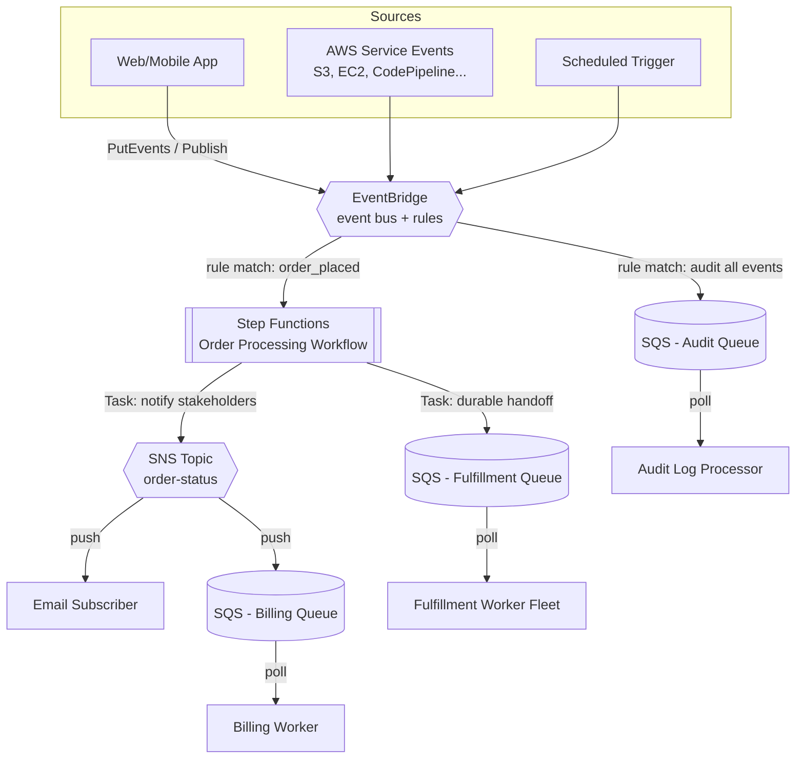

Step by step, tying all four together:
1. **Everything starts as an event**: a user action, an AWS service state change, or a
   scheduled tick — all three source types land on an **EventBridge** bus. This is the entry
   point of the whole system; EventBridge's job is purely routing, based on content, to the
   right next step.
2. **EventBridge rules decide what happens next**: a rule matching "order placed" events starts
   a **Step Functions** execution (the orchestrator for that one order's entire lifecycle); a
   separate, broader rule simultaneously routes *every* event into an **SQS** audit queue for
   compliance logging — one event, two independent reactions, no code coupling between them.
3. **Step Functions orchestrates the business process**: inside the workflow, individual Task
   states call out to other services as needed — here, publishing a status update to an
   **SNS** topic (so multiple interested parties get notified) and handing off durable work to
   an **SQS** queue (so a fleet of workers can process fulfillment at their own pace, with
   retry-on-failure built in).
4. **SNS fans out the status update**: the `order-status` topic pushes the same notification to
   an email subscriber *and* to a billing SQS queue simultaneously — pub/sub broadcast, each
   subscriber independent.
5. **SQS queues decouple the final pull-based work**: the fulfillment queue, the billing queue,
   and the audit queue are each drained by their own worker fleet, on their own schedule,
   immune to spikes or temporary slowness elsewhere in the system.

Notice the shape: **EventBridge decides "what should react,"** **Step Functions decides "in
what order and with what logic,"** **SNS decides "who else needs to know, right now,"** and
**SQS decides "how do we hold this safely until someone's ready to do the work."** None of them
replace each other — each covers a distinct piece of the event-driven puzzle.

### Official AWS reference: event-driven decoupling


*Source: AWS Documentation — [Creating event-driven architectures with Lambda](https://docs.aws.amazon.com/lambda/latest/dg/concepts-event-driven-architectures.html), AWS Lambda Developer Guide. © Amazon Web Services.*


*Source: AWS Documentation — [Creating event-driven architectures with Lambda — Reducing complexity](https://docs.aws.amazon.com/lambda/latest/dg/concepts-event-driven-architectures.html), AWS Lambda Developer Guide. © Amazon Web Services.*

## Worked End-to-End Flow — Actual JSON Payloads Across All Four Services

Tracing one order through the combined system makes the hand-offs between services concrete.

**1. A client places an order; the application publishes a custom event onto an EventBridge bus:**

```json
{
  "Entries": [
    {
      "Source": "custom.orders",
      "DetailType": "OrderPlaced",
      "EventBusName": "orders-bus",
      "Detail": "{\"orderId\":\"ORD-10042\",\"total\":750,\"region\":\"EU\"}"
    }
  ]
}
```

**2. An EventBridge rule matches it and starts a Step Functions execution**, passing the event's
`detail` as the execution input:

```json
{
  "stateMachineArn": "arn:aws:states:us-east-1:123456789012:stateMachine:order-processing",
  "input": "{\"orderId\":\"ORD-10042\",\"total\":750,\"region\":\"EU\"}"
}
```

**3. Inside the workflow, a Task state publishes a status update to SNS** once validation
succeeds:

```json
{
  "TopicArn": "arn:aws:sns:us-east-1:123456789012:order-status",
  "Message": "{\"orderId\":\"ORD-10042\",\"status\":\"validated\"}",
  "MessageAttributes": {
    "eventType": { "DataType": "String", "StringValue": "order_validated" }
  }
}
```

**4. SNS fans that out to a billing SQS queue** (topic-queue chaining, raw delivery enabled —
no SNS envelope):

```json
{"orderId":"ORD-10042","status":"validated"}
```

**5. The workflow then hands off the durable fulfillment work to its own SQS queue** directly
from a Task state (a native integration, no Lambda needed):

```json
{
  "QueueUrl": "https://sqs.us-east-1.amazonaws.com/123456789012/fulfillment-queue",
  "MessageBody": "{\"orderId\":\"ORD-10042\",\"total\":750,\"region\":\"EU\"}",
  "MessageAttributes": {
    "priority": { "DataType": "Number", "StringValue": "1" }
  }
}
```

**6. A fulfillment worker eventually polls, processes, and deletes that message** — standard
SQS consumer mechanics (see `sqs.md`'s worked flow for the full receive/delete cycle) — and,
once fulfillment completes, the worker publishes a final `OrderFulfilled` event back onto the
EventBridge bus, closing the loop without any component polling another directly:

```json
{
  "Entries": [
    {
      "Source": "custom.fulfillment",
      "DetailType": "OrderFulfilled",
      "EventBusName": "orders-bus",
      "Detail": "{\"orderId\":\"ORD-10042\",\"shippedAt\":\"2026-11-20T18:30:00Z\"}"
    }
  ]
}
```

This six-step trace is the entire point of this document: four services, each doing exactly
one job, composed through plain JSON hand-offs — no component ever needs to know how the next
one is implemented, only what shape of message to send it.

## Retry, DLQ & Failure Semantics — Compared Across All Four

A failure anywhere in this chain behaves differently depending on which service is involved —
knowing which failure-handling model applies at each hop is one of the most exam-relevant
details in the whole integration picture.

| Service | What "failure" means | Default behavior if unhandled | How to make it durable |
|---|---|---|---|
| **SQS** | Consumer never calls `DeleteMessage` (crash, timeout, exception) | Message becomes visible again after visibility timeout, retried indefinitely | Attach a redrive policy + DLQ (`maxReceiveCount`) |
| **SNS** | SNS can't deliver to a subscriber's endpoint after retries | Message is dropped for that subscription only (other subscribers unaffected) | Attach a `RedrivePolicy` (DLQ) per subscription |
| **EventBridge** | A rule's target invocation fails after retries | Event is **silently dropped** — no DLQ, no automatic record, unless one is configured | Attach a `DeadLetterConfig` per target in `PutTargets` |
| **Step Functions** | A Task state's underlying call throws an error | Execution fails and halts at that state (or further up, if uncaught) unless `Retry`/`Catch` is configured | Define `Retry` (retry same state) and `Catch` (fallback state) per Task/Parallel/Map state in the ASL definition |

The single most important row to memorize for both exams: **EventBridge is the only one of the
four that drops a failed delivery with literally nothing left behind unless you explicitly wire
a DLQ** — SQS and SNS both have a DLQ-by-default *mental model* even though SNS's lives on the
subscription rather than the topic, and Step Functions keeps a full execution history either way.

### Failure handling flow, compared, visually

```mermaid
flowchart TD
    subgraph SQS Flow
        SQSMSG[Message not deleted] --> SQSVIS[Visibility timeout expires]
        SQSVIS --> SQSCHECK{maxReceiveCount exceeded?}
        SQSCHECK -->|No| SQSMSG
        SQSCHECK -->|Yes, DLQ configured| SQSDLQ[(SQS DLQ)]
    end
    subgraph SNS Flow
        SNSPUSH[Push to subscriber fails] --> SNSRETRY[SNS retries per protocol policy]
        SNSRETRY -->|exhausted, DLQ configured| SNSDLQ[(Subscription DLQ)]
        SNSRETRY -->|exhausted, no DLQ| SNSDROP[Dropped for this subscriber only]
    end
    subgraph EventBridge Flow
        EBMATCH[Rule matches, target invoked] --> EBFAIL{Invocation fails}
        EBFAIL -->|retries exhausted, DLQ configured| EBDLQ[(Target DLQ)]
        EBFAIL -->|retries exhausted, NO DLQ| EBDROP[Event silently dropped]
    end
    subgraph Step Functions Flow
        SFTASK[Task throws error] --> SFRETRY{Retry configured and attempts remain?}
        SFRETRY -->|Yes| SFTASK
        SFRETRY -->|No| SFCATCH{Catch configured?}
        SFCATCH -->|Yes| SFFALLBACK[Transition to fallback state]
        SFCATCH -->|No| SFFAIL[Execution fails, full history retained]
    end
```

## Pattern Deep Dive — Choosing the Right Combination

### Point-to-point only (plain SQS)

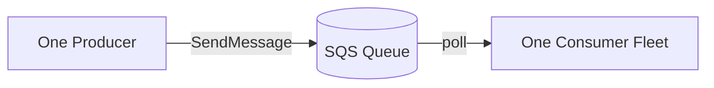
Use when there's exactly one logical type of background job and no routing/broadcast
requirement — the simplest, cheapest, and most restrained answer when a scenario doesn't
actually need fan-out or content-based routing.

### Fan-out only (SNS, no durability requirement)

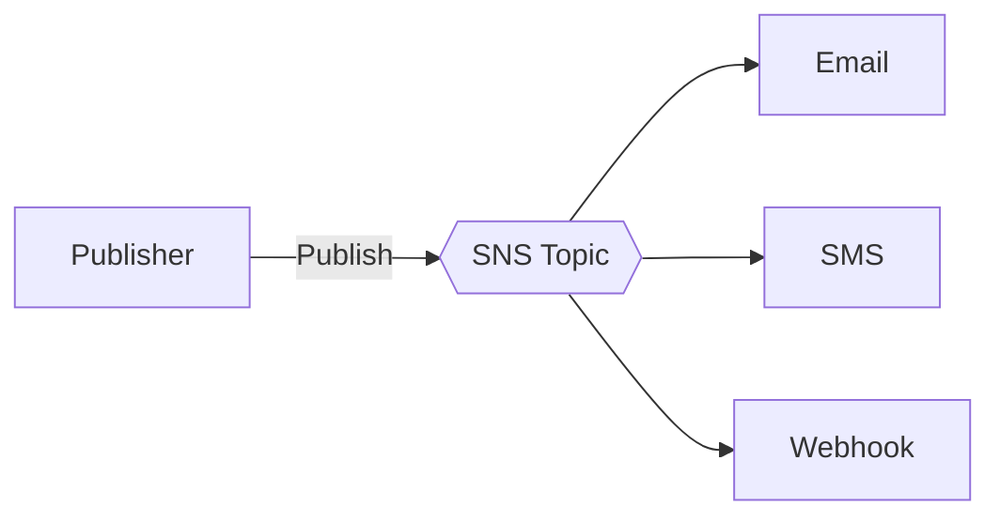
Use for "notify several things right now" with no need to durably hold the message if a
subscriber is briefly unavailable beyond SNS's own retry policy.

### Durable fan-out (topic-queue chaining: SNS → multiple SQS)

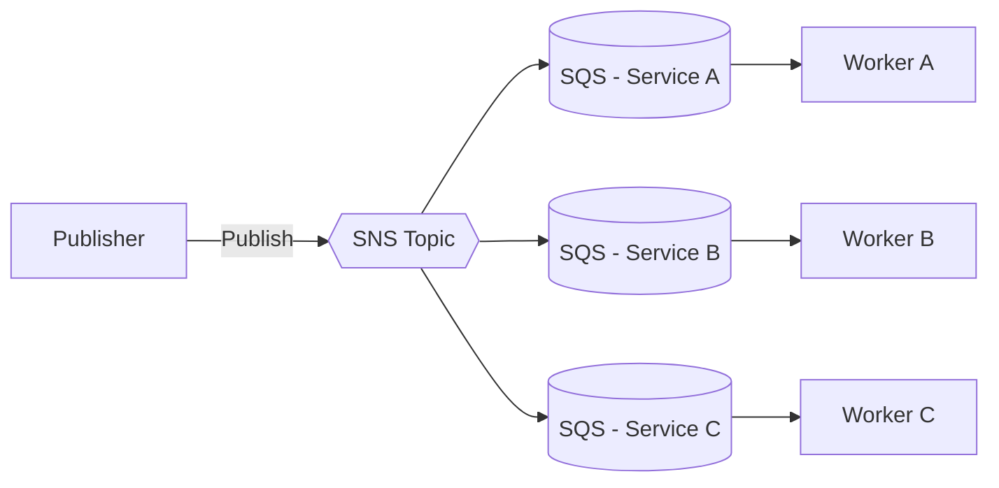
Use when multiple independent consumers each need the event *and* each needs it held durably
with its own retry/DLQ — the combination, not either service alone.

### Content-based routing (EventBridge)

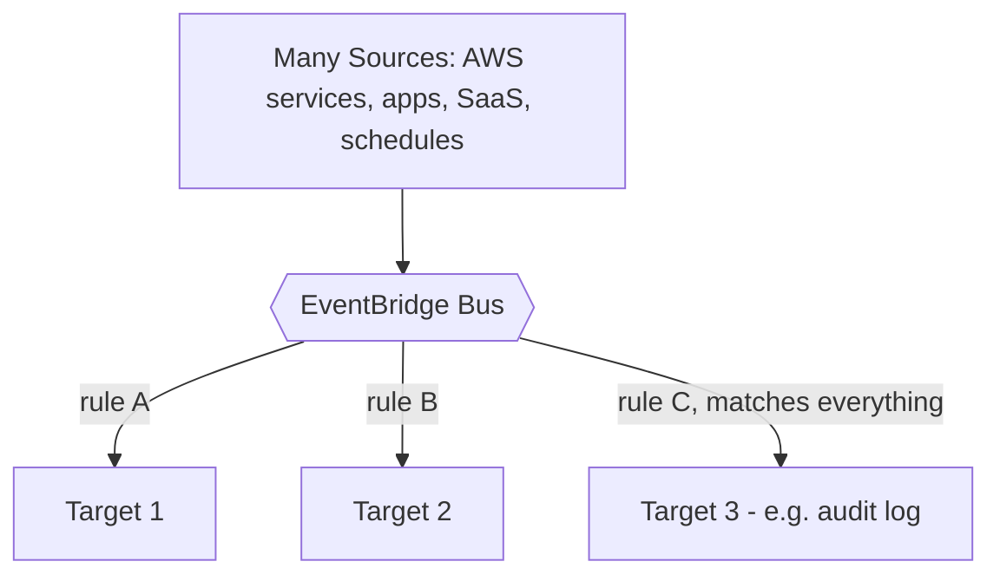
Use when routing depends on the event's *content* (value, type, source) rather than a flat
broadcast — and especially when sources include AWS service activity, SaaS partners, or
schedules, not just your own application's publishes.

### Orchestration (Step Functions, triggered by EventBridge)

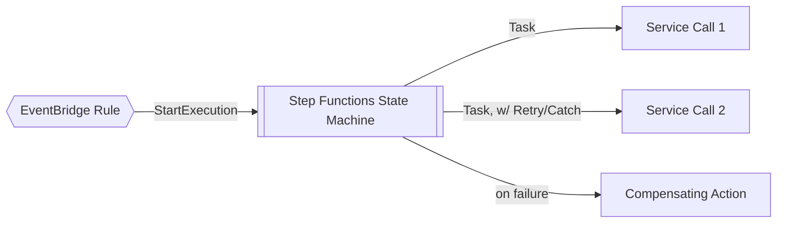
Use when the requirement is a specific, ordered, branching, retryable sequence of steps for one
business process — not a broadcast and not a generic queue, but a *process* with a visible
execution history.

### The combined pattern (all four together)

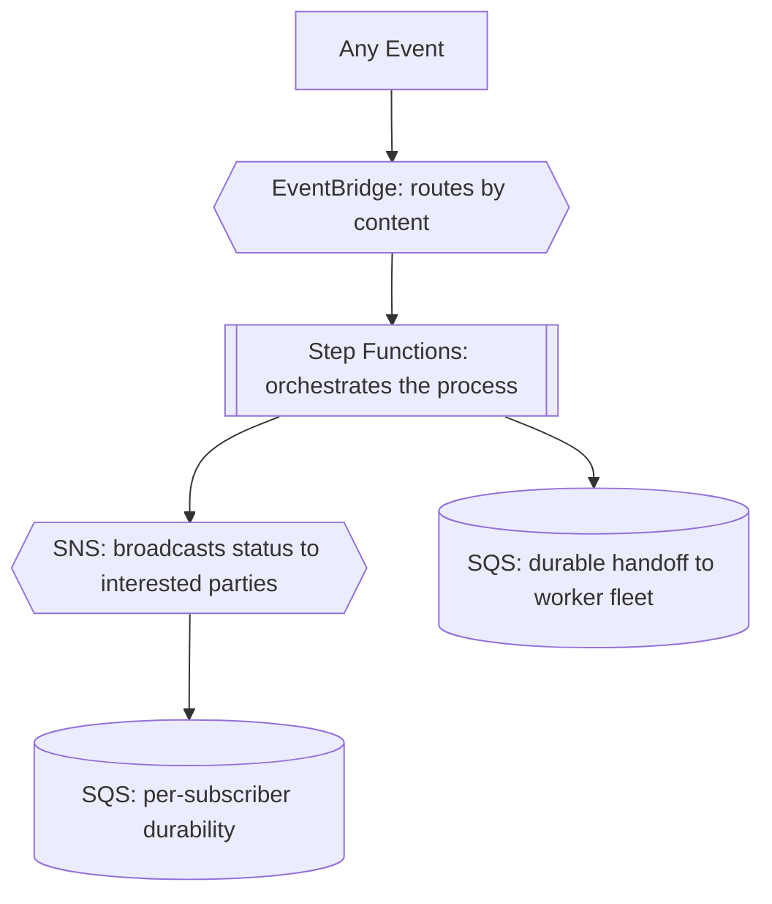
Most production systems combine at least two of these four — the exam rewards recognizing
*which combination* fits a described scenario, not picking just one service in isolation.

## Key Features / Components (cross-service cheat sheet)

| Need | Service | Why |
|---|---|---|
| Hold work durably for exactly one consumer to pull later | **SQS** | Point-to-point, pull-based, built-in retry/DLQ |
| Broadcast one event to many independent subscribers, right now | **SNS** | Push-based pub/sub, parallel independent delivery |
| Route events by content, from many different sources (AWS + custom + SaaS + schedule) | **EventBridge** | Declarative rules engine, 200+ native sources |
| Coordinate a specific multi-step process with branching/retries/history | **Step Functions** | Visual state machine, native service integrations |
| Durable fan-out (many consumers, each needing the message held reliably) | **SNS → multiple SQS** | Combines push broadcast with pull durability |
| Guarantee strict message order for a specific key (e.g., per customer/order) | **SQS FIFO** (or FIFO SNS topic → FIFO SQS) | Message-group-based ordering, exactly-once within a group |
| Human-in-the-loop approval mid-process | **Step Functions task token** | Pauses execution until an external callback resumes it |
| Replay historical events to a newly built consumer | **EventBridge archive & replay** | Captures events from when archiving was enabled, replayable on demand |

## Use Cases — When to Use Which (or Combine Them)

- **"Many services need to independently react to the same business event, and each must not
  lose the message if it's briefly down"** → SNS fan-out to multiple SQS queues.
- **"Route this to different places depending on the event's content, from many different AWS
  services, possibly on a schedule too"** → EventBridge.
- **"This needs a specific order of steps with retries/rollback, and I need to see where a
  specific execution currently is"** → Step Functions, usually triggered by an EventBridge rule.
- **"One producer, one type of background job, workers just need to pull it and do it"** →
  plain SQS, no fan-out or routing needed.
- **"A mobile client needs a single API call that returns live-updating data from multiple
  backends"** → that's outside this queue/topic/bus family entirely — see `appsync.md`.
- **Most production systems use at least two of these together** — the exam rewards
  recognizing *which combination* fits a scenario, not picking just one service in isolation.

## When NOT to Use This Combined Pattern / Simpler Alternatives

- **A single synchronous request/response API with no background work** — none of these are
  needed; use API Gateway + Lambda (or ALB + ECS) directly.
- **You truly only need one producer and one consumer, order doesn't matter, no routing logic**
  — don't reach for EventBridge + Step Functions ceremony; a single SQS queue is enough, and
  simpler to operate and cheaper to run.
- **You need a high-throughput, ordered, replayable stream many independent consumer groups
  read from arbitrary points in time** — none of these four are built for that; use **Kinesis
  Data Streams** or **MSK (Kafka)** instead, which support replay natively.
- **Over-engineering risk**: stacking EventBridge → Step Functions → SNS → SQS for something
  that's really just "call function A, then function B" adds latency, cost, and operational
  surface area for no real resilience gain — match the pattern's complexity to the actual
  coupling/scale problem you have.

## Common Architectures

### 1. The full order lifecycle (the running example in this doc)

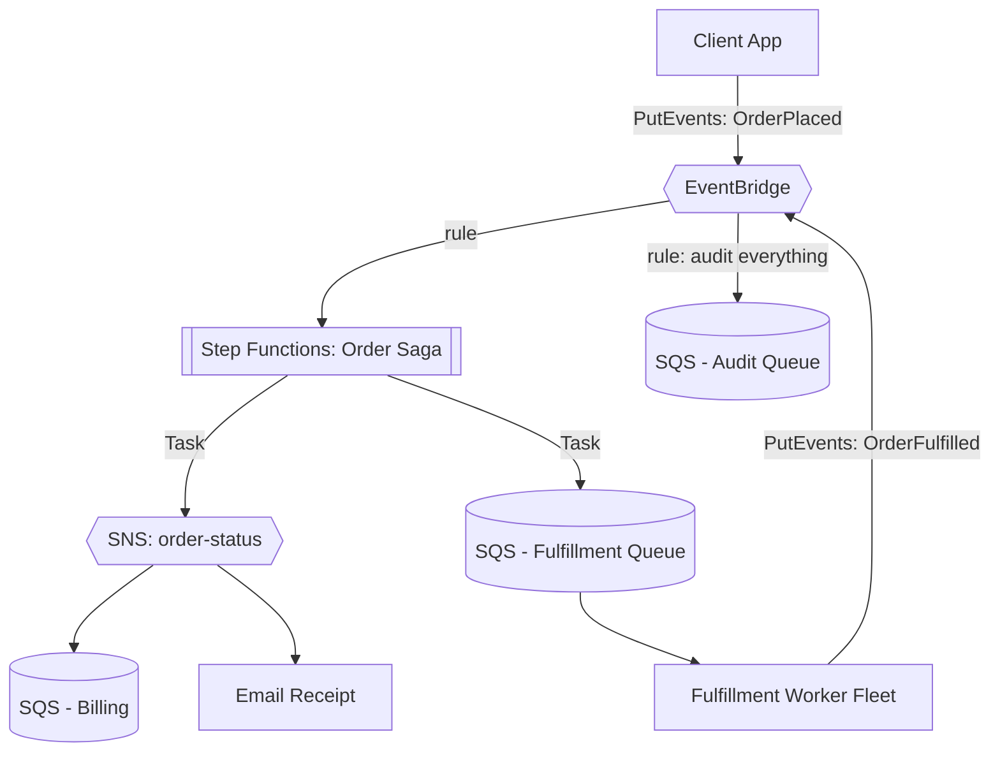

### 2. Multi-tenant SaaS event platform

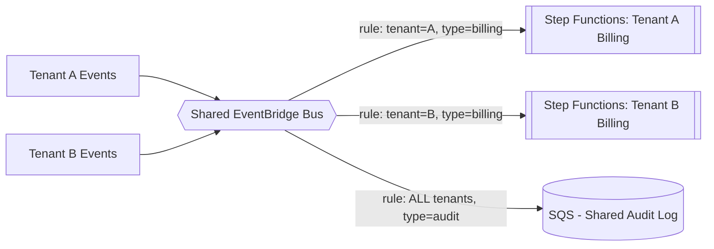

### 3. Security event aggregation + automated response

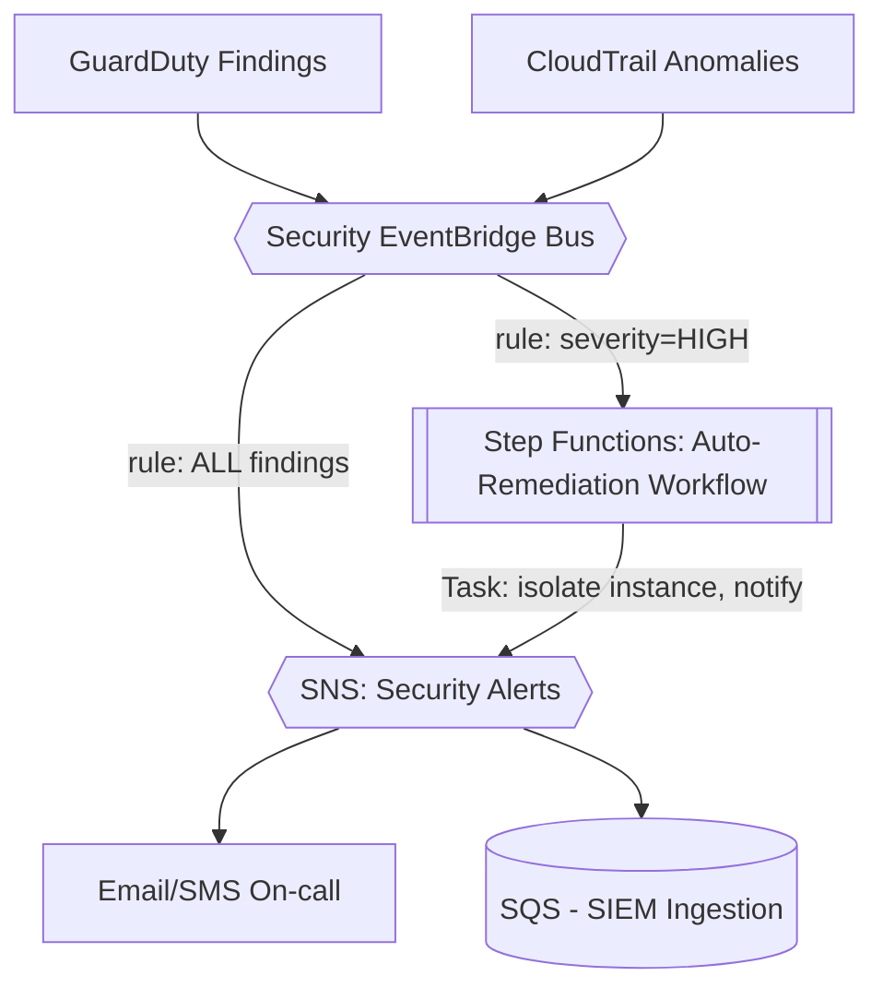

### 4. IoT telemetry pipeline with priority routing

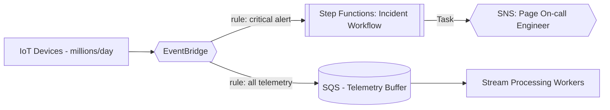

## Why It's Important

**Real-world**: event-driven architecture — decoupling producers from consumers via queues,
topics, routers, and orchestrators instead of direct synchronous calls — is the dominant design
style for resilient, independently-scalable systems on AWS, and nearly every non-trivial
serverless or microservices architecture uses at least two of these four services together.
Understanding the boundaries between them (and that they compose rather than compete) is what
separates "I know what SQS is" from "I can design a resilient system."

**Exam mapping**:
- **SAA-C03 Domain 2 (Design Resilient Architectures), Task 2.1 — "Design scalable and loosely
  coupled architectures"** is, almost word for word, this entire document: recognizing which
  combination of SQS/SNS/EventBridge/Step Functions removes tight coupling and single points of
  failure from a described system. Practice extended scenario reading: a paragraph describing a
  retail order pipeline, a security event aggregation system, or a multi-tenant SaaS platform
  should resolve into "this part is fan-out, this part is routing, this part is orchestration,
  this part is a durable queue" before you even look at the answer choices.
- **DVA-C03 Domain 1 (Development with AWS Services), Task 1.1 — "Develop code for Lambda... and
  event-driven applications"** tests the developer's side of the same picture: wiring Lambda
  event source mappings to SQS/SNS/EventBridge, handling partial batch failures, writing ASL
  `Retry`/`Catch` blocks, and structuring multi-step logic as Step Functions instead of
  monolithic functions.
- Scenario questions on both exams frequently describe a system in prose and expect you to
  identify the *correct combination*, not just one service — this overview is the fastest way
  to build that pattern-matching instinct before the exam.

## Pricing Model (summary)

There's no separate "combined pattern" charge — each service in the chain bills independently
per its own model (SQS/SNS per request, EventBridge per published custom event + target
invocation cost, Step Functions per state transition or per invocation+duration depending on
workflow type). The practical cost lesson: **every hop in a chain is a separate cost line** —
an event that goes EventBridge → Step Functions → SNS → SQS incurs charges at every arrow, which
is a real argument for not adding hops you don't need. See each service's own pricing page
(linked in its doc) for exact current numbers.

## Limits & Quotas (cross-service summary)

| Service | Key limit to remember | Why it matters when combining services |
|---|---|---|
| SQS | 256 KB max message size; 14-day max retention | Pass references (S3 keys), not large blobs, through any chained message |
| SNS | 256 KB max message size; DLQ is per-subscription | A fan-out with 5 subscribers needs up to 5 separate DLQs if full coverage is wanted |
| EventBridge | 256 KB max event size; 5 targets per rule | A rule needing more than 5 reactions needs an intermediate fan-out (e.g., into SNS) |
| Step Functions | 256 KB max state input/output; 25,000 history events (Standard) | Very large payloads or extremely long-running loops need references and/or Distributed Map, not inline data |

Because every hop shares roughly the same 256 KB payload ceiling, the **claim-check pattern**
(store the large object in S3, pass only a pointer through SQS/SNS/EventBridge/Step Functions)
is a recurring, reusable answer across all four services whenever a scenario mentions large
payloads anywhere in an event-driven chain.

## Troubleshooting / Common Issues

- **"An event seems to vanish somewhere in a multi-service chain, with no error anywhere."**
  Walk the chain hop by hop and check each service's *specific* failure model from the table
  above — the prime suspect is almost always an EventBridge target with no `DeadLetterConfig`,
  since that's the only hop in this family that drops silently by default.
- **"Downstream services are processing the same business event more than once."** At-least-once
  delivery applies at multiple hops (SQS Standard, EventBridge, SNS retries) — idempotency has
  to be designed into consumers throughout the chain, not assumed away at any single hop.
- **"A Step Functions execution triggered by EventBridge never starts."** Confirm the EventBridge
  rule's target IAM role actually has `states:StartExecution` permission on the specific state
  machine ARN — a silently-failing target invocation (with no DLQ) looks identical to "nothing
  happened" from the outside.
- **"A message that passed through SNS into SQS has an unexpected extra JSON wrapper."** Check
  whether raw message delivery is enabled on the SNS→SQS subscription — without it, consumers
  must unwrap the SNS envelope before reaching the original payload (see `sns.md`'s worked
  example).
- **"Ordering guarantees are breaking down somewhere in a fan-out chain."** FIFO ordering only
  survives end-to-end if *every* hop in the chain is FIFO-aware — a FIFO SQS queue feeding a
  Standard SNS topic (or vice versa) breaks the guarantee; EventBridge does not guarantee
  ordering at all, so any chain that routes through it cannot claim strict ordering downstream
  without re-establishing it (e.g., re-deriving a FIFO `MessageGroupId` at the SQS target).
- **"Costs are higher than expected for a seemingly simple workflow."** Count the hops: a chain
  that unnecessarily routes through EventBridge *and* Step Functions *and* SNS *and* SQS for a
  single producer/single consumer scenario pays for four separate billing models when one SQS
  queue would have sufficed — this is the "over-engineering" trap called out above, and it shows
  up as a real AWS bill, not just an exam distractor.

## Hands-on Lab (Floci)

```bash
# This ties together the labs from the four individual docs. Minimal end-to-end smoke test:

# 1. EventBridge custom bus + rule routing "OrderPlaced" to an SQS audit queue
awslocal events create-event-bus --name orders-bus
awslocal sqs create-queue --queue-name audit-queue
awslocal events put-rule --name audit-all-orders --event-bus-name orders-bus \
  --event-pattern '{"source": ["custom.orders"]}'
awslocal events put-targets --rule audit-all-orders --event-bus-name orders-bus \
  --targets "Id"="1","Arn"="arn:aws:sqs:us-east-1:000000000000:audit-queue"

# 2. SNS topic for status notifications, fanning out to an email-like SQS subscriber
awslocal sns create-topic --name order-status
awslocal sqs create-queue --queue-name billing-queue
awslocal sns subscribe --topic-arn arn:aws:sns:us-east-1:000000000000:order-status \
  --protocol sqs --notification-endpoint arn:aws:sqs:us-east-1:000000000000:billing-queue

# 3. Publish one event onto the bus and confirm it lands in the audit queue
awslocal events put-events --entries '[{
  "Source": "custom.orders", "DetailType": "OrderPlaced",
  "EventBusName": "orders-bus", "Detail": "{\"orderId\":\"5001\"}"
}]'
awslocal sqs receive-message --queue-url http://localhost:4566/000000000000/audit-queue

# 4. Publish a status update directly to SNS and confirm fan-out to billing queue
awslocal sns publish --topic-arn arn:aws:sns:us-east-1:000000000000:order-status \
  --message '{"orderId": "5001", "status": "shipped"}'
awslocal sqs receive-message --queue-url http://localhost:4566/000000000000/billing-queue

# 5. Tie in Step Functions: a minimal state machine EventBridge can start
cat <<'EOF' > /tmp/order-saga.json
{
  "Comment": "Order saga triggered by EventBridge",
  "StartAt": "PublishStatus",
  "States": {
    "PublishStatus": {
      "Type": "Task",
      "Resource": "arn:aws:states:::sns:publish",
      "Parameters": {
        "TopicArn": "arn:aws:sns:us-east-1:000000000000:order-status",
        "Message.$": "$.orderId"
      },
      "Next": "HandOffToFulfillment"
    },
    "HandOffToFulfillment": {
      "Type": "Task",
      "Resource": "arn:aws:states:::sqs:sendMessage",
      "Parameters": {
        "QueueUrl": "http://localhost:4566/000000000000/billing-queue",
        "MessageBody.$": "$"
      },
      "End": true
    }
  }
}
EOF
awslocal stepfunctions create-state-machine \
  --name order-saga \
  --definition file:///tmp/order-saga.json \
  --role-arn arn:aws:iam::000000000000:role/floci-stepfunctions-role \
  --type STANDARD

# 6. Wire EventBridge to start that state machine for every OrderPlaced event
awslocal events put-targets --rule audit-all-orders --event-bus-name orders-bus \
  --targets "Id"="2","Arn"="arn:aws:states:us-east-1:000000000000:stateMachine:order-saga","RoleArn"="arn:aws:iam::000000000000:role/floci-events-role"
```
See each individual service doc's lab section for deeper per-service walkthroughs, and the full
combined walkthrough in `labs-floci/README.md` lab index → application-integration section.

## Exam Tips

- **The exam rarely asks "what is SQS" in isolation at the scenario level** — it describes a
  business situation and expects you to pick the *right combination*. Practice reading a
  paragraph and mentally labeling: "this part needs pub/sub," "this part needs a durable pull
  queue," "this part needs content-based routing," "this part needs multi-step orchestration."
- **"Decoupled," "loosely coupled," "asynchronous," "resilient to downstream failure"** in a
  question stem are the strongest signals this whole family of services is the intended
  answer area (vs. direct synchronous calls).
- **Don't over-select services** — if a distractor answer adds EventBridge and Step Functions to
  a scenario that's really just "one producer, one consumer, no routing, no multi-step logic,"
  the simpler SQS-only answer is usually correct; the exam tests restraint as much as recall.
- **Know the direction of data flow**: EventBridge routes INTO Step Functions/SQS/SNS; Step
  Functions calls OUT to SQS/SNS/other services as part of its orchestration; SNS pushes OUT to
  subscribers (including SQS); SQS is a terminal, pull-based holding point. Getting an arrow
  backwards is a common wrong-answer trap in diagram-based questions.
- **Memorize the one failure-handling exception**: of the four, only EventBridge silently drops
  a failed delivery with no DLQ by default — a scenario describing "events occasionally go
  missing with no trace" in an EventBridge-involved pipeline is pointing at a missing
  `DeadLetterConfig` on a target, not a bug in SQS or SNS.
- **End-to-end ordering is only as strong as its weakest hop** — a chain is only strictly
  ordered if every hop (FIFO SQS, FIFO SNS topic, a deliberately-ordered Step Functions
  sequence) preserves it; EventBridge in the middle of a chain breaks any ordering guarantee
  unless re-established downstream.
- **The claim-check pattern** (payload in S3, pointer through the messaging chain) is a reusable
  answer across all four services whenever large payloads are mentioned in a multi-hop scenario.
- Exam domains: **SAA-C03 Domain 2 Task 2.1** (architecture design), **DVA-C03 Domain 1 Task 1.1**
  (implementation) — this overview maps to both simultaneously, which is exactly why it exists
  as a separate doc from the four individual service pages.

## Further Reading

- [Event-driven architectures — AWS Well-Architected Serverless Applications Lens](https://docs.aws.amazon.com/wellarchitected/latest/serverless-applications-lens/event-driven-architectures.html)
- [Creating event-driven architectures with Lambda](https://docs.aws.amazon.com/lambda/latest/dg/concepts-event-driven-architectures.html)
- [Application integration patterns for microservices: Fan-out strategies (AWS Compute Blog)](https://aws.amazon.com/blogs/compute/application-integration-patterns-for-microservices-fan-out-strategies/)
- [Implement event-driven invoice processing for resilient financial monitoring at scale (AWS Architecture Blog)](https://aws.amazon.com/blogs/architecture/implement-event-driven-invoice-processing-for-resilient-financial-monitoring-at-scale/)
- Individual service docs in this folder for authoritative per-service quotas, pricing, and
  troubleshooting detail: `sqs.md`, `sns.md`, `eventbridge.md`, `step-functions.md`.

## Related Terms

- [`sqs.md`](./sqs.md) — point-to-point queue, Standard vs FIFO.
- [`sns.md`](./sns.md) — pub/sub fan-out, SNS vs SQS decision diagram.
- [`eventbridge.md`](./eventbridge.md) — content-based event routing, EventBridge vs SNS.
- [`step-functions.md`](./step-functions.md) — workflow orchestration, Standard vs Express.
- [`appsync.md`](./appsync.md) — GraphQL API layer with its own real-time subscription pattern,
  related but distinct from the queue/topic/bus patterns above.
- `glossary/README.md` — Decoupling, Event-Driven Architecture, Pub/Sub, Point-to-Point,
  Fan-Out, Idempotency, Dead-Letter Queue.
