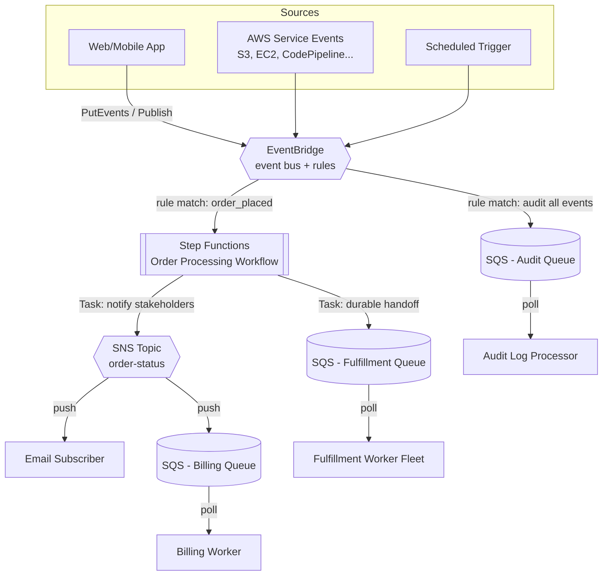

# Messaging Patterns Overview — SQS, SNS, EventBridge & Step Functions Together


<!-- Composite overview doc; icon shown is illustrative of the App-Integration category —
see diagrams/README.md for the convention -->

## Definition

"Messaging patterns" are the handful of reusable ways independent parts of a system can
exchange information **without calling each other directly**. The four application-integration
services in this folder — **SQS**, **SNS**, **EventBridge**, and **Step Functions** — each
implement a different pattern, and real AWS architectures almost always combine more than one
of them. This doc is the map showing how the individual service docs fit together.

## Purpose

Reading about SQS, SNS, EventBridge, and Step Functions one at a time can leave the *relationship*
between them unclear — which is exactly what exam scenario questions probe ("which combination
of services..."). This doc exists to answer, in one place: what is the pattern each service is
built for, and how do you combine them into one coherent event-driven system.

## How It Works — The Four Core Patterns

**Point-to-point (queue)**: one producer, one message, exactly one consumer processes it.
Implemented by **SQS**. The consumer pulls (polls) work at its own pace.

**Publish/subscribe (fan-out)**: one producer, one message, *every* subscriber gets an
independent copy. Implemented by **SNS** (push-based broadcast) and, for durable multi-consumer
fan-out, the combination **SNS → multiple SQS queues**.

**Event-driven routing**: many different event *sources* (not just your own app — AWS services,
SaaS partners, schedules), routed to different targets based on the event's *content*.
Implemented by **EventBridge**, which layers a rules/pattern-matching engine on top of the
basic pub/sub idea.

**Orchestration (workflow)**: a specific, ordered, stateful sequence of steps for one business
process — with branching, retries, parallelism, and a visible execution history. Implemented
by **Step Functions**, which usually sits *downstream* of an event (often started by
EventBridge) and *calls into* the other services as it runs.



Step by step, tying all four together:
1. **Everything starts as an event**: a user action, an AWS service state change, or a
   scheduled tick — all three source types land on an **EventBridge** bus. This is the entry
   point of the whole system; EventBridge's job is purely routing, based on content, to the
   right next step.
2. **EventBridge rules decide what happens next**: a rule matching "order placed" events starts
   a **Step Functions** execution (the orchestrator for that one order's entire lifecycle); a
   separate, broader rule simultaneously routes *every* event into an **SQS** audit queue for
   compliance logging — one event, two independent reactions, no code coupling between them.
3. **Step Functions orchestrates the business process**: inside the workflow, individual Task
   states call out to other services as needed — here, publishing a status update to an
   **SNS** topic (so multiple interested parties get notified) and handing off durable work to
   an **SQS** queue (so a fleet of workers can process fulfillment at their own pace, with
   retry-on-failure built in).
4. **SNS fans out the status update**: the `order-status` topic pushes the same notification to
   an email subscriber *and* to a billing SQS queue simultaneously — pub/sub broadcast, each
   subscriber independent.
5. **SQS queues decouple the final pull-based work**: the fulfillment queue, the billing queue,
   and the audit queue are each drained by their own worker fleet, on their own schedule,
   immune to spikes or temporary slowness elsewhere in the system.

Notice the shape: **EventBridge decides "what should react,"** **Step Functions decides "in
what order and with what logic,"** **SNS decides "who else needs to know, right now,"** and
**SQS decides "how do we hold this safely until someone's ready to do the work."** None of them
replace each other — each covers a distinct piece of the event-driven puzzle.

## Key Features / Components (cross-service cheat sheet)

| Need | Service | Why |
|---|---|---|
| Hold work durably for exactly one consumer to pull later | **SQS** | Point-to-point, pull-based, built-in retry/DLQ |
| Broadcast one event to many independent subscribers, right now | **SNS** | Push-based pub/sub, parallel independent delivery |
| Route events by content, from many different sources (AWS + custom + SaaS + schedule) | **EventBridge** | Declarative rules engine, 200+ native sources |
| Coordinate a specific multi-step process with branching/retries/history | **Step Functions** | Visual state machine, native service integrations |
| Durable fan-out (many consumers, each needing the message held reliably) | **SNS → multiple SQS** | Combines push broadcast with pull durability |

## Use Cases — When to Use Which (or Combine Them)

- **"Many services need to independently react to the same business event, and each must not
  lose the message if it's briefly down"** → SNS fan-out to multiple SQS queues.
- **"Route this to different places depending on the event's content, from many different AWS
  services, possibly on a schedule too"** → EventBridge.
- **"This needs a specific order of steps with retries/rollback, and I need to see where a
  specific execution currently is"** → Step Functions, usually triggered by an EventBridge rule.
- **"One producer, one type of background job, workers just need to pull it and do it"** →
  plain SQS, no fan-out or routing needed.
- **Most production systems use at least two of these together** — the exam rewards
  recognizing *which combination* fits a scenario, not picking just one service in isolation.

## When NOT to Use This Combined Pattern / Simpler Alternatives

- **A single synchronous request/response API with no background work** — none of these are
  needed; use API Gateway + Lambda (or ALB + ECS) directly.
- **You truly only need one producer and one consumer, order doesn't matter, no routing logic**
  — don't reach for EventBridge + Step Functions ceremony; a single SQS queue is enough, and
  simpler to operate and cheaper to run.
- **You need a high-throughput, ordered, replayable stream many independent consumer groups
  read from arbitrary points in time** — none of these four are built for that; use **Kinesis
  Data Streams** or **MSK (Kafka)** instead, which support replay natively.
- **Over-engineering risk**: stacking EventBridge → Step Functions → SNS → SQS for something
  that's really just "call function A, then function B" adds latency, cost, and operational
  surface area for no real resilience gain — match the pattern's complexity to the actual
  coupling/scale problem you have.

## Why It's Important

**Real-world**: event-driven architecture — decoupling producers from consumers via queues,
topics, routers, and orchestrators instead of direct synchronous calls — is the dominant design
style for resilient, independently-scalable systems on AWS, and nearly every non-trivial
serverless or microservices architecture uses at least two of these four services together.
Understanding the boundaries between them (and that they compose rather than compete) is what
separates "I know what SQS is" from "I can design a resilient system."

**Exam mapping**:
- **SAA-C03 Domain 2 (Design Resilient Architectures), Task 2.1 — "Design scalable and loosely
  coupled architectures"** is, almost word for word, this entire document: recognizing which
  combination of SQS/SNS/EventBridge/Step Functions removes tight coupling and single points of
  failure from a described system.
- **DVA-C03 Domain 1 (Development with AWS Services), Task 1.1 — "Develop code for Lambda... and
  event-driven applications"** tests the developer's side of the same picture: wiring Lambda
  event source mappings to SQS/SNS/EventBridge, and structuring multi-step logic as Step
  Functions instead of monolithic functions.
- Scenario questions on both exams frequently describe a system in prose and expect you to
  identify the *correct combination*, not just one service — this overview is the fastest way
  to build that pattern-matching instinct before the exam.

## Pricing Model (summary)

There's no separate "combined pattern" charge — each service in the chain bills independently
per its own model (SQS/SNS per request, EventBridge per published custom event + target
invocation cost, Step Functions per state transition or per invocation+duration depending on
workflow type). The practical cost lesson: **every hop in a chain is a separate cost line** —
an event that goes EventBridge → Step Functions → SNS → SQS incurs charges at every arrow, which
is a real argument for not adding hops you don't need. See each service's own pricing page
(linked in its doc) for exact current numbers.

## Hands-on Lab (Floci)

```bash
# This ties together the labs from the four individual docs. Minimal end-to-end smoke test:

# 1. EventBridge custom bus + rule routing "OrderPlaced" to an SQS audit queue
awslocal events create-event-bus --name orders-bus
awslocal sqs create-queue --queue-name audit-queue
awslocal events put-rule --name audit-all-orders --event-bus-name orders-bus \
  --event-pattern '{"source": ["custom.orders"]}'
awslocal events put-targets --rule audit-all-orders --event-bus-name orders-bus \
  --targets "Id"="1","Arn"="arn:aws:sqs:us-east-1:000000000000:audit-queue"

# 2. SNS topic for status notifications, fanning out to an email-like SQS subscriber
awslocal sns create-topic --name order-status
awslocal sqs create-queue --queue-name billing-queue
awslocal sns subscribe --topic-arn arn:aws:sns:us-east-1:000000000000:order-status \
  --protocol sqs --notification-endpoint arn:aws:sqs:us-east-1:000000000000:billing-queue

# 3. Publish one event onto the bus and confirm it lands in the audit queue
awslocal events put-events --entries '[{
  "Source": "custom.orders", "DetailType": "OrderPlaced",
  "EventBusName": "orders-bus", "Detail": "{\"orderId\":\"5001\"}"
}]'
awslocal sqs receive-message --queue-url http://localhost:4566/000000000000/audit-queue

# 4. Publish a status update directly to SNS and confirm fan-out to billing queue
awslocal sns publish --topic-arn arn:aws:sns:us-east-1:000000000000:order-status \
  --message '{"orderId": "5001", "status": "shipped"}'
awslocal sqs receive-message --queue-url http://localhost:4566/000000000000/billing-queue
```
See each individual service doc's lab section for the Step Functions piece (orchestrating the
steps between these messaging calls) and the full combined walkthrough in
`labs-floci/README.md` lab index → application-integration section.

## Exam Tips

- **The exam rarely asks "what is SQS" in isolation at the scenario level** — it describes a
  business situation and expects you to pick the *right combination*. Practice reading a
  paragraph and mentally labeling: "this part needs pub/sub," "this part needs a durable pull
  queue," "this part needs content-based routing," "this part needs multi-step orchestration."
- **"Decoupled," "loosely coupled," "asynchronous," "resilient to downstream failure"** in a
  question stem are the strongest signals this whole family of services is the intended
  answer area (vs. direct synchronous calls).
- **Don't over-select services** — if a distractor answer adds EventBridge and Step Functions to
  a scenario that's really just "one producer, one consumer, no routing, no multi-step logic,"
  the simpler SQS-only answer is usually correct; the exam tests restraint as much as recall.
- **Know the direction of data flow**: EventBridge routes INTO Step Functions/SQS/SNS; Step
  Functions calls OUT to SQS/SNS/other services as part of its orchestration; SNS pushes OUT to
  subscribers (including SQS); SQS is a terminal, pull-based holding point. Getting an arrow
  backwards is a common wrong-answer trap in diagram-based questions.
- Exam domains: **SAA-C03 Domain 2 Task 2.1** (architecture design), **DVA-C03 Domain 1 Task 1.1**
  (implementation) — this overview maps to both simultaneously, which is exactly why it exists
  as a separate doc from the four individual service pages.

## Related Terms

- [`sqs.md`](./sqs.md) — point-to-point queue, Standard vs FIFO.
- [`sns.md`](./sns.md) — pub/sub fan-out, SNS vs SQS decision diagram.
- [`eventbridge.md`](./eventbridge.md) — content-based event routing, EventBridge vs SNS.
- [`step-functions.md`](./step-functions.md) — workflow orchestration, Standard vs Express.
- [`appsync.md`](./appsync.md) — GraphQL API layer with its own real-time subscription pattern,
  related but distinct from the queue/topic/bus patterns above.
- `glossary/README.md` — Decoupling, Event-Driven Architecture, Pub/Sub, Point-to-Point,
  Fan-Out, Idempotency, Dead-Letter Queue.
