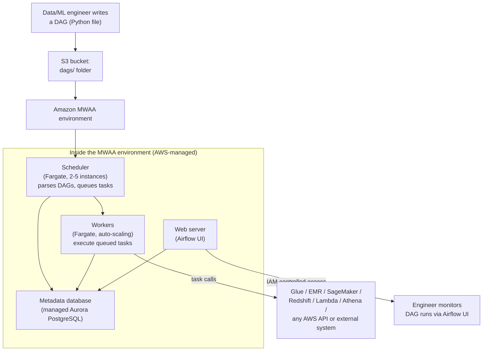
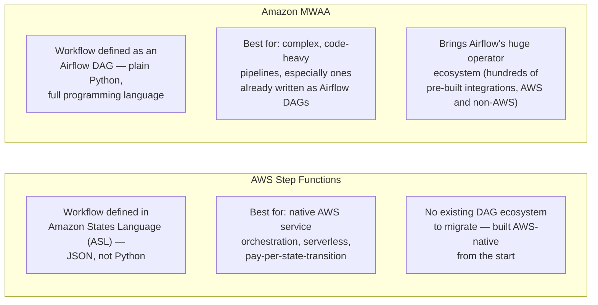

# Amazon MWAA (Managed Workflows for Apache Airflow)

> **Appears in:** [MLA-C02](../../certifications/mla-c02/README.md)


## Definition

Amazon Managed Workflows for Apache Airflow (MWAA) is a fully managed service that runs
**Apache Airflow** — the open-source workflow orchestration tool where you define complex,
multi-step data/ML pipelines as **DAGs** (Directed Acyclic Graphs) written in Python — without
you having to install, patch, scale, or operate the underlying Airflow scheduler, web server, or
worker infrastructure yourself. You write Airflow DAGs exactly as you would self-hosting Airflow;
MWAA runs them on managed AWS Fargate infrastructure behind the scenes.

## Purpose

Apache Airflow is the de facto standard open-source tool for orchestrating complex, Python-coded
workflows with rich dependency graphs — "run task A, then B and C in parallel once A succeeds,
then D only after both B and C finish, retrying D up to 3 times on failure, and alert on-call if
it still fails." Teams already invested in Airflow (existing DAGs, Airflow-specific operators for
dozens of third-party systems, an Airflow-trained data engineering team) historically had to
self-host it — standing up and patching the scheduler, web server, metadata database, and worker
fleet themselves, then handling Airflow's own scaling and high-availability concerns on top of
whatever the actual pipeline needed to do. AWS built MWAA so that same team keeps 100% of their
existing Airflow DAG code and operational mental model, but AWS runs and scales the Airflow
control plane itself.

## How It Works

Plain explanation: think of Airflow as a recipe book (your DAGs — Python files describing steps
and their dependencies) and a kitchen staff that reads the recipes and actually cooks (the
scheduler, which decides what runs when, and workers, which execute each step). Self-hosting
Airflow means you build and staff the entire kitchen yourself; MWAA means AWS runs the kitchen
staff and infrastructure for you — you just keep writing recipes (DAGs) and drop them in an S3
folder.



Step by step:
1. **You write a DAG** — a Python file defining tasks (units of work) and the dependencies
   between them, using either Airflow's built-in operators (for Glue, EMR, SageMaker, Redshift,
   S3, and many non-AWS systems) or a plain `PythonOperator` running your own code.
2. **The DAG file is uploaded to a designated S3 prefix** tied to your MWAA environment — there
   is no "deploy" step beyond this; MWAA periodically syncs new/changed DAG files from S3
   automatically.
3. **The Scheduler** (AWS Fargate containers, a minimum of 2 for availability, scalable up to 5)
   continuously parses every DAG file, determines which tasks are ready to run based on the
   dependency graph and any schedule/trigger, and queues them.
4. **Workers** (also Fargate, auto-scaling between a minimum and maximum you configure) pick up
   queued tasks and execute them — calling out to whatever AWS service or external system the
   task's operator targets (a Glue job, a SageMaker training job, a Redshift query, a plain
   Python function, an HTTP call to a third-party API).
5. **The metadata database** (a single-tenant, AWS-managed Aurora PostgreSQL instance) stores
   DAG run history, task state, and configuration — accessible to the scheduler and workers over
   a privately-secured VPC endpoint, never exposed publicly.
6. **The web server** runs the familiar Airflow UI, letting engineers see DAG run status, task
   logs, and the dependency graph visually — access controlled by an IAM policy you define, with
   the web server itself configurable as public (internet-accessible, IAM-gated) or private
   (VPC-only).

### Official AWS architecture diagram


*AWS's own diagram of everything inside one MWAA environment — the scheduler/worker Fargate
containers, the managed metadata database, and the web server, all contained within your VPC's
private subnets. Source: AWS MWAA Migration Guide, [Explore Amazon MWAA network
architecture](https://docs.aws.amazon.com/mwaa/latest/migrationguide/mwaa-architecture.html).
© Amazon Web Services.*


*The public-webserver network configuration — the Airflow UI is internet-reachable, but every
request is still authorized against the IAM policy attached to your MWAA environment, the same
access-control model as the private configuration. Source: AWS MWAA User Guide, [Apache Airflow
access modes](https://docs.aws.amazon.com/mwaa/latest/userguide/configuring-networking.html).
© Amazon Web Services.*

### A minimal DAG, to make the "Python-defined workflow" concrete

```python
from airflow import DAG
from airflow.operators.python import PythonOperator
from airflow.providers.amazon.aws.operators.glue import GlueJobOperator
from airflow.providers.amazon.aws.operators.sagemaker import SageMakerTrainingOperator
from datetime import datetime, timedelta

default_args = {
    "retries": 3,
    "retry_delay": timedelta(minutes=5),
}

with DAG(
    dag_id="ml_training_pipeline",
    schedule_interval="@daily",
    start_date=datetime(2026, 1, 1),
    default_args=default_args,
    catchup=False,
) as dag:

    def validate_upstream_data():
        # arbitrary Python logic — check an upstream table's row count, freshness, etc.
        pass

    validate = PythonOperator(task_id="validate_upstream_data", python_callable=validate_upstream_data)

    transform = GlueJobOperator(
        task_id="transform_features",
        job_name="feature-engineering-job",
        wait_for_completion=True,
    )

    train = SageMakerTrainingOperator(
        task_id="train_model",
        config={"TrainingJobName": "daily-retrain-{{ ds_nodash }}", "...": "..."},
        wait_for_completion=True,
    )

    validate >> transform >> train  # explicit dependency graph: validate, then transform, then train
```

The `>>` operator defines the dependency edges — this is the "Directed Acyclic Graph" made
literal in code: `validate_upstream_data` must succeed before `transform_features` starts, which
must succeed before `train_model` starts. Airflow's scheduler reads this graph and the `retries`/
`retry_delay` defaults, and handles the actual sequencing, retry, and failure-alerting mechanics
— none of which the DAG author had to hand-write.

## MWAA vs. Step Functions — the central exam contrast

This is the single most important distinction in this document, and the reason MWAA exists
alongside a service (Step Functions) that also "orchestrates multi-step AWS workflows."



| Question | AWS Step Functions | Amazon MWAA |
|---|---|---|
| How do you define the workflow? | **Amazon States Language (ASL)** — declarative JSON | **Python** — full programming language, arbitrary logic in a DAG file |
| What's the underlying compute model? | Fully serverless, no infrastructure to run at all | Managed Fargate infrastructure (scheduler + workers) you still "have," just don't operate |
| Pricing shape | Per state transition (Standard) or per request+duration (Express) | Per environment-hour (scheduler + worker capacity), regardless of whether DAGs are actively running |
| Best fit when... | You're orchestrating native AWS service calls, want zero idle cost, and don't have existing Airflow investment | You already have Airflow DAGs, need Airflow's operator ecosystem, or want Python-level expressiveness (loops, dynamic task generation, custom retry logic beyond what ASL expresses declaratively) |
| Ecosystem / integrations | Growing set of native AWS service integrations, callable directly from a Task state | Airflow's mature plugin/operator ecosystem — hundreds of community and provider-maintained operators for both AWS (Glue, EMR, SageMaker, Redshift, Athena, S3, Batch, EKS, and more) and third-party systems (Snowflake, Databricks, Salesforce, Slack) |
| Idle cost | None — Standard Workflows have zero idle-state cost | Yes — an MWAA environment bills for scheduler + minimum worker capacity continuously, whether or not a DAG is actively running right now |
| Visual execution history | Yes, built into the Step Functions console per-execution | Yes, via the Airflow UI's DAG run/task-instance views |
| Migration story for an existing Airflow shop | None — would mean rewriting every DAG as ASL from scratch | Direct — existing DAG Python files generally run with little to no modification |

**The exam-relevant selection logic, stated plainly:** a scenario describing **"we already have
Airflow DAGs"**, **"our team is Airflow-skilled and wants to keep writing Python, not a new
orchestration language,"** or **"we need a complex, programmatically-generated workflow (e.g., a
dynamic number of parallel tasks determined at runtime by a database query)"** points at MWAA. A
scenario describing **"orchestrate a sequence of native AWS service calls with zero idle
infrastructure cost"**, **"a team unfamiliar with Airflow wants the simplest serverless
orchestrator,"** or **"workflow definition should be declarative and visual by default"** points
at Step Functions. The trap: a question mentioning "complex workflow orchestration" alone,
without naming Airflow or an existing DAG investment, is more often pointing at Step Functions —
MWAA's signature keyword is specifically **Airflow** (or "DAG," in the Airflow sense), not
"complex" in isolation.

## Key Features / Components

- **Scheduler** — Fargate containers (minimum 2, scalable to 5) parsing DAGs and queuing tasks;
  this is Airflow's own scheduler process, just running on AWS-managed infrastructure instead of
  a server you provision.
- **Workers** — Fargate tasks executing queued work, auto-scaling between a configured minimum
  and maximum based on queued + running task volume, scaling back down after tasks sum to zero
  for a sustained period.
- **Web server** — the standard Apache Airflow UI, configurable for public (internet-reachable,
  IAM-gated) or private (VPC-only) network access.
- **Metadata database** — a single-tenant, AWS-managed Aurora PostgreSQL instance storing DAG run
  history and task state, reachable only via a private VPC endpoint.
- **Environment classes** — predefined size tiers (small/medium/large) determining the baseline
  scheduler/worker capacity and metadata database performance for an environment.
- **DAG sync from S3** — MWAA periodically polls a designated S3 prefix for new/changed DAG
  files, `requirements.txt` (Python package dependencies), and `plugins.zip` (custom Airflow
  plugins/operators) — the entire deployment mechanism for a new DAG version.
- **Airflow provider packages** — pre-built operator/hook libraries for AWS services (Glue, EMR,
  SageMaker, Redshift, Athena, Batch, EKS, Lambda, S3, and more) and many third-party systems,
  installable via `requirements.txt` just as in self-hosted Airflow.
- **Apache Airflow version support** — MWAA tracks specific supported Airflow versions and
  handles the underlying image patching for you; you choose which supported version your
  environment runs.
- **Logging to CloudWatch** — scheduler, worker, and task logs all flow to CloudWatch Logs,
  giving the same operational visibility pattern as other managed AWS compute services.
- **Private VPC networking** — an MWAA environment deploys into your VPC's private subnets,
  supporting fully private (no internet egress) configurations when data sensitivity requires it,
  the same pattern covered in this repo's VPC-isolation content for ML workloads.

## Use Cases — When to Use It

1. **Migrating an existing self-hosted Airflow deployment to AWS with minimal rewrite** — a data
   engineering team self-hosting Airflow on EC2 wants out of patching/scaling the Airflow control
   plane but has hundreds of existing DAGs. MWAA is the fit — DAG Python files migrate with
   little to no change. **Tradeoff vs. rewriting as Step Functions**: a full ASL rewrite would
   mean re-implementing every DAG's logic in a new declarative language from scratch, a far
   larger and riskier project than an MWAA migration.
2. **Complex, Python-expressive ML pipeline orchestration** — an ML platform team needs a
   pipeline that dynamically generates a variable number of parallel feature-engineering tasks
   based on how many data partitions exist that day, computed by a database query at DAG-parse
   time. MWAA's full Python DAG definition supports this directly (a `for` loop generating tasks
   dynamically). **Tradeoff vs. Step Functions' Map state**: Step Functions' `Map` state can
   fan out over a known list, but expressing "compute the fan-out count via arbitrary Python logic
   at definition time" is far more natural in an Airflow DAG than in declarative ASL.
3. **Orchestrating a mix of AWS and non-AWS systems in one pipeline** — a data pipeline needs to
   pull from Salesforce, transform in Glue, load into Snowflake, and notify via Slack — all in
   one coordinated workflow. Airflow's mature third-party provider ecosystem (community-maintained
   operators for Salesforce, Snowflake, Slack, and hundreds more) makes MWAA a natural fit.
   **Tradeoff vs. Step Functions + Lambda wrappers for each non-AWS call**: Step Functions can
   reach any system via a Lambda-wrapped API call, but that means hand-writing and maintaining a
   Lambda per non-AWS integration instead of reusing an existing, community-maintained Airflow
   operator.
4. **A data engineering team standardized on Airflow across multiple pipelines/teams** — an
   organization wants one consistent orchestration tool and skill set across data engineering,
   rather than some pipelines in Step Functions and others hand-rolled. MWAA lets that
   standardization continue on AWS without every team learning ASL. **Tradeoff vs. allowing mixed
   tooling**: mixed tooling (some Step Functions, some MWAA) is viable when teams genuinely have
   different needs, but adds operational surface area (two orchestration platforms to monitor,
   patch mentally, and train staff on) that a single-tool standardization avoids.
5. **Scheduled, interdependent batch ML retraining pipelines** — a retail company retrains a
   demand-forecasting model nightly, with explicit task dependencies (validate data → feature
   engineering in Glue → train in SageMaker → evaluate → conditionally promote to production only
   if evaluation metrics pass a threshold). MWAA's DAG `schedule_interval` plus Python-level
   conditional branching logic (a `BranchPythonOperator`) expresses this cleanly. **Tradeoff vs. a
   cron job calling a script**: a bare cron job has no visibility into which step failed, no
   structured retry per step, and no dependency graph — MWAA's Airflow UI gives per-task status
   and history a cron+script approach never built.
6. **Pipelines needing Airflow-specific features (sensors, dynamic task mapping, custom
   plugins)** — a workflow needs to **wait/poll** for an external file to land in a partner's SFTP
   server before proceeding (an Airflow `Sensor`), using a pattern the team has already built as a
   custom Airflow plugin. MWAA runs that existing plugin directly. **Tradeoff vs. rebuilding the
   same polling logic in Step Functions**: Step Functions has no direct "sensor" primitive —
   polling would need to be hand-built with a `Wait` state in a loop, redoing work an existing
   Airflow plugin already solved.

## When NOT to Use It / Alternatives

- **No existing Airflow investment, and the workflow is mostly native AWS service calls** — use
  **AWS Step Functions** instead; it's fully serverless with zero idle cost and a visual,
  declarative definition that doesn't require learning Airflow's DAG authoring model.
- **The pipeline stays entirely inside Glue (crawl → transform → crawl again)** — a lightweight
  **Glue Workflow** is purpose-built for exactly that and avoids standing up an MWAA environment
  at all; see `services/analytics/glue.md`'s Glue Workflow section.
- **Cost-sensitive, intermittently-used orchestration** — MWAA bills for scheduler + minimum
  worker capacity continuously, even when no DAG is currently running; a pipeline that runs for a
  few minutes once a week pays for 24/7 idle capacity, which Step Functions' Standard Workflows
  (zero idle cost) avoid entirely.
- **A single, simple scheduled job with no multi-step dependency graph** — a plain **EventBridge
  Scheduler rule triggering a Lambda or Glue job directly** is far simpler and cheaper than
  standing up an MWAA environment for one task with nothing to orchestrate.
- **The team has zero Airflow experience and no existing DAGs** — the learning curve of Airflow's
  DAG authoring model (operators, hooks, sensors, the scheduler's parsing behavior) is real
  overhead that a team starting from scratch may not want to take on when Step Functions'
  simpler, declarative model would satisfy the same requirement.

## Why It's Important

**Real-world:** a huge fraction of data engineering teams industry-wide already use Apache
Airflow — it's the most widely adopted open-source workflow orchestrator for data/ML pipelines.
MWAA's entire value proposition is letting that existing investment (DAGs, operator knowledge,
team skill set) move to AWS without a rewrite, while removing the real operational burden of
running Airflow's own infrastructure (scheduler HA, worker scaling, metadata database patching)
by hand.

**Exam mapping:**
- **MLA-C02 Domain 1 (Data Preparation) and Domain 3 (Deployment and Orchestration)** — MWAA is
  named as an in-scope orchestration option for complex, DAG-based ML/data pipelines; expect
  scenario questions contrasting it against Step Functions based specifically on whether existing
  Airflow DAGs or Python-level workflow expressiveness is the deciding factor, not generic
  "which is better at orchestration" framing.
- The exam consistently tests the **MWAA vs. Step Functions selection logic** above as a direct
  scenario-matching exercise — memorize the keyword pairing (Airflow/DAG/existing-Python-workflow
  → MWAA; native-AWS/serverless/zero-idle-cost/declarative → Step Functions) over either
  service's feature list in isolation.

## Pricing Model (summary)

- **Billed per environment-hour** based on the chosen **environment class** (small/medium/large),
  covering the scheduler and a baseline worker capacity — this is an ongoing cost that accrues
  whether or not DAGs are actively running, unlike Step Functions' per-transition/per-request
  model.
- **Additional worker capacity** beyond the baseline (when auto-scaling kicks in under load) is
  billed per additional worker-hour.
- **Additional scheduler capacity** (scaling beyond the default scheduler count, up to 5) is
  billed per additional scheduler-hour.
- **Metadata database storage** is billed separately per GB, as with any managed database.
- **Worked example — idle-cost consideration**: a small MWAA environment running continuously for
  a pipeline that only actually executes DAGs for two hours a night still accrues environment-hour
  charges for the other 22 hours — a direct cost contrast against a Step Functions Standard
  Workflow, which would cost essentially nothing during those 22 idle hours. This is the central,
  testable cost tradeoff between the two services: MWAA trades some baseline ongoing cost for
  Airflow's ecosystem and Python expressiveness; Step Functions trades that ecosystem/
  expressiveness for zero idle cost.
- See official pricing: https://aws.amazon.com/managed-workflows-for-apache-airflow/pricing/

## Limits & Quotas

| Limit | Value (representative — verify current) | Notes |
|---|---|---|
| Scheduler count | 2 (minimum) – 5 (maximum) | Fixed range; not a dial you tune per-workload beyond this ceiling |
| Worker count | Configurable min/max per environment | Auto-scales within your configured bounds based on queued+running task volume |
| Environment classes | Small / Medium / Large | Determines baseline scheduler/worker capacity and metadata DB performance tier |
| DAG file sync interval | Periodic (minutes-scale), not instantaneous | A newly uploaded DAG file isn't picked up immediately — expect a short delay before it appears in the UI |
| `requirements.txt` package install time | Can meaningfully extend environment startup/update time | Very large dependency lists slow down environment creation/updates — a real, testable operational detail |
| Airflow version support | A specific, AWS-maintained set of supported versions | You cannot run an arbitrary/unsupported Airflow version; AWS controls which versions are offered |

Always confirm current figures on the
[Amazon MWAA quotas page](https://docs.aws.amazon.com/mwaa/latest/userguide/airflow-environment-limits.html).

## Troubleshooting / Common Issues

- **A new or updated DAG isn't showing up in the Airflow UI.** DAG sync from S3 happens on a
  periodic interval, not instantly — wait for the next sync cycle before assuming the upload
  failed; also check CloudWatch Logs for DAG *parsing* errors, which silently prevent a broken DAG
  file from appearing at all.
- **Tasks are queuing but not executing.** Usually a worker capacity/auto-scaling bottleneck —
  check whether the configured maximum worker count is already saturated by other running DAGs,
  which would delay new task execution without an outright error.
- **A task fails with a missing Python package error.** The package needs to be listed in the
  environment's `requirements.txt` and the environment updated — Airflow's own Python environment
  on MWAA doesn't have arbitrary packages pre-installed beyond the Airflow core and AWS provider
  packages.
- **The web server shows a 403 or access-denied error.** Check the IAM policy attached to the
  calling user/role for the MWAA environment — web server access (public or private network mode)
  is still gated by IAM, not by network reachability alone.
- **A custom operator/plugin isn't available in the DAG.** Confirm `plugins.zip` was uploaded to
  the correct S3 prefix and the environment was updated afterward — plugin changes, like DAG
  changes, require the sync mechanism to pick them up, not a manual restart you trigger yourself.
- **Environment creation/update is taking unusually long.** A very large `requirements.txt` (many
  heavy Python packages) extends the time MWAA needs to build and validate the environment's
  Python dependencies — trim unnecessary dependencies before assuming the service itself is slow.

## Hands-on Lab (Floci)

Floci does not emulate MWAA's managed Airflow control plane (there's no real Fargate-backed
scheduler/worker fleet behind the local emulator) — for genuine hands-on Airflow practice, run
**open-source Apache Airflow in Docker** locally (the official `apache/airflow` Docker Compose
quickstart), which exercises the exact same DAG-authoring model MWAA runs in production, just on
your own machine instead of AWS-managed Fargate.

```bash
# Real, runnable locally (not Floci-specific) — the official Airflow Docker Compose quickstart
curl -LfO 'https://airflow.apache.org/docs/apache-airflow/stable/docker-compose.yaml'
mkdir -p ./dags ./logs ./plugins
echo -e "AIRFLOW_UID=$(id -u)" > .env
docker compose up airflow-init
docker compose up -d

# Drop the example DAG from this doc into ./dags/, then from the Airflow UI (localhost:8080):
# trigger the DAG manually and watch the dependency graph execute task by task.

# The real AWS CLI shape for creating an MWAA environment (illustrative, not Floci-executable):
# aws mwaa create-environment \
#   --name ml-training-pipeline-env \
#   --airflow-version 2.10.3 \
#   --source-bucket-arn arn:aws:s3:::my-mwaa-dags-bucket \
#   --dag-s3-path dags \
#   --execution-role-arn arn:aws:iam::123456789012:role/mwaa-execution-role \
#   --network-configuration SubnetIds=subnet-aaa,subnet-bbb,SecurityGroupIds=sg-ccc \
#   --environment-class mw1.small
```

The exercise worth internalizing even on a local Docker-based Airflow: the DAG Python file you
write and the `>>` dependency syntax are **identical** whether Airflow is self-hosted in Docker,
self-hosted on EC2, or running inside MWAA — MWAA changes *who operates the scheduler/worker
infrastructure*, not *how you author a workflow*, which is precisely why migrating an existing
Airflow shop to MWAA is comparatively low-risk.

## Exam Tips

- **The #1 trap: MWAA vs. Step Functions.** "We already have Airflow DAGs," "our team writes
  Python for orchestration logic," "need a huge ecosystem of pre-built third-party integrations"
  → MWAA. "Native AWS service orchestration, zero idle cost, declarative/visual by default" →
  Step Functions. A question naming "Airflow" or "DAG" explicitly is the strongest, most direct
  signal for MWAA — don't overthink it when that keyword is present.
- **MWAA has ongoing/idle cost; Step Functions Standard Workflows do not** — a
  cost-optimization-flavored question contrasting the two services on an infrequently-run
  workflow is testing whether you'd notice MWAA's continuous environment-hour billing versus
  Step Functions' near-zero idle cost.
- **DAGs are deployed by uploading to S3, not through a console "create workflow" wizard** — a
  question describing how a new/updated workflow gets into MWAA should point at the S3 DAG-sync
  mechanism, not a direct API call defining the workflow inline (unlike Step Functions, where the
  ASL definition *is* the API payload).
- **MWAA's compute (scheduler + workers) runs on Fargate** — know this is container-based managed
  compute, not raw EC2 instances you provision yourself, consistent with "managed" in the
  service's name.
- **Don't confuse MWAA with Glue Workflows** — Glue Workflows orchestrate only within Glue's own
  crawlers/jobs/triggers; MWAA (like Step Functions) can orchestrate arbitrary AWS services and
  external systems. A question whose orchestration stays entirely inside Glue is pointing at the
  lighter-weight Glue Workflow, not MWAA.
- Exam domain: primarily **MLA-C02 Domain 1/Domain 3** orchestration-choice scenarios.

## Further Reading

- [What Is Amazon Managed Workflows for Apache Airflow?](https://docs.aws.amazon.com/mwaa/latest/userguide/what-is-mwaa.html)
- [Explore Amazon MWAA network architecture](https://docs.aws.amazon.com/mwaa/latest/migrationguide/mwaa-architecture.html)
- [Apache Airflow access modes (public/private web server)](https://docs.aws.amazon.com/mwaa/latest/userguide/configuring-networking.html)
- [Amazon MWAA quotas](https://docs.aws.amazon.com/mwaa/latest/userguide/airflow-environment-limits.html)
- [Amazon MWAA pricing](https://aws.amazon.com/managed-workflows-for-apache-airflow/pricing/)
- [Apache Airflow official documentation](https://airflow.apache.org/docs/)

## Related Terms

- [`../application-integration/step-functions.md`](../application-integration/step-functions.md)
  — the serverless, ASL-based orchestrator MWAA is most directly contrasted against; see that
  doc's full ASL depth for the Step Functions side of every tradeoff described here.
- [`../analytics/glue.md`](../analytics/glue.md) — Glue Workflows, the lighter-weight
  Glue-scoped orchestrator for pipelines that never need to leave Glue.
- [`../machine-learning-ai/sagemaker-pipelines.md`](../machine-learning-ai/sagemaker-pipelines.md)
  — SageMaker's own ML-pipeline-specific orchestrator, a third option when a pipeline is entirely
  SageMaker-scoped rather than spanning Glue/EMR/external systems the way a typical MWAA DAG does.
- `glossary/README.md` — DAG (Directed Acyclic Graph), Operator, Sensor, Scheduler.
